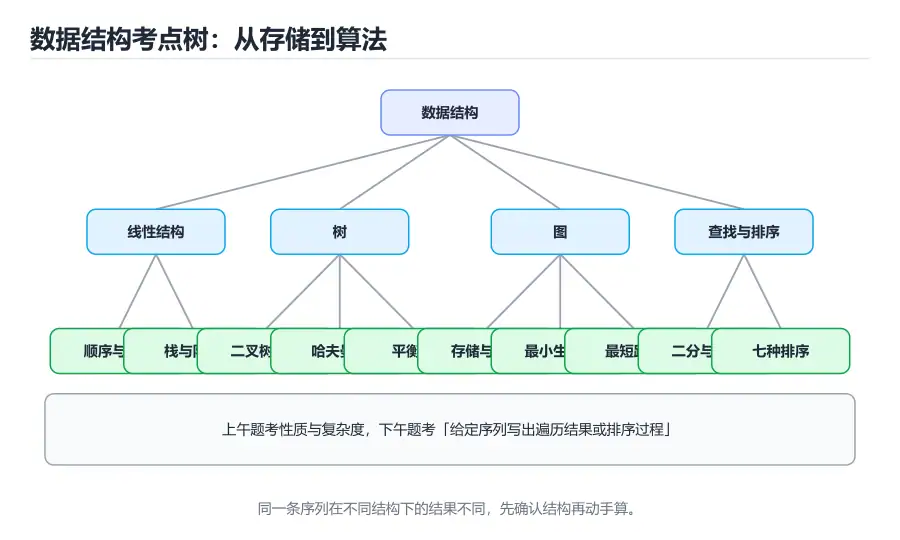

# 数据结构与算法：树、图、查找与排序



## 本节知识框架

**课程定位**：所属分类 `ruankao`（软考初级与中级），课程主题 `数据结构与算法`，学习阶段 进阶，建议用时 45 分钟。数据结构是这一考试里分值最重的一域，上午卷通常占 10~14 分，下午题的算法填空也直接从这里出题，属于「投入产出比最高、也最容易一步算错」的区域。

本课主线：把数据结构当成「怎么放东西」与「怎么找东西」两件事。先按线性、树形、图状三层理清存储方式，再把查找与排序各自的代价表背牢；最后用一条序列贯穿所有算法——同一条序列在不同结构下会给出不同答案，先确认结构再动手。

**学完本课应当能够**
- 说清顺序表与链表各自的取舍，并在给定条件下算出循环队列的长度。
- 由遍历序列反推二叉树形态，用 n0 = n2 + 1 与完全二叉树的编号性质做计数题。
- 手算哈夫曼树、散列表的平均查找长度、快速排序的一趟划分结果。
- 判断某种排序算法是否稳定、最坏复杂度是多少，并解释为什么。

### 复习清单

- [ ] 能写出循环队列判空与判满的两个条件，并说明为什么要少用一个元素空间。
- [ ] 能用「前序定根、中序分左右」的规则，从一对遍历序列还原出一棵二叉树。
- [ ] 能手算一条关键字序列在线性探测散列表上的比较次数，并求出平均查找长度。
- [ ] 能把七种常见排序按「平均时间 / 最坏时间 / 空间 / 是否稳定」四栏填成一张表。

## 核心概念定义

| 术语 | 操作性定义（白话版） | 常见边界与风险 |
| --- | --- | --- |
| 数据结构 | 数据元素之间的关系加上在这组关系上允许做的操作，分逻辑结构与存储结构两层。 | 易错：逻辑上同一结构（如栈）可以用数组或链表两种存储实现。 |
| 顺序表 | 用一段连续内存存放元素，支持下标随机访问。 | 易错：中间插入要搬移其后所有元素，平均移动 n/2 次。 |
| 单链表 | 每个结点存值加一个后继指针，靠指针串起来。 | 易错：已知结点指针时删除是 O(1)，但按位置找过去仍是 O(n)。 |
| 栈 | 只在表尾（栈顶）进出的受限线性表，后进先出。 | 易错：n 个元素依次入栈，合法出栈序列数是卡特兰数，不是 n!。 |
| 队列 | 一端进另一端出的受限线性表，先进先出。 | 易错：循环队列里 rear 与 front 相等既可能为空也可能为满，需额外约定。 |
| 串与模式匹配 | 由字符组成的序列；模式匹配是找子串第一次出现的位置。 | 易错：KMP 的 next 数组只与模式串自身有关，与主串无关。 |
| 二叉树 | 每个结点至多两棵子树且左右有序。 | 易错：度为 2 的结点数为零时它就是一条链，深度可达 n。 |
| 完全二叉树 | 除最后一层外每层排满，最后一层从左往右连续。 | 易错：满二叉树一定是完全二叉树，反之不成立。 |
| 哈夫曼树 | 用权值最小的两棵树反复合并出的带权路径长度最小的二叉树。 | 易错：哈夫曼树不唯一，但 WPL 唯一；它没有度为 1 的结点。 |
| 平衡二叉树 AVL | 任意结点左右子树高度差绝对值不超过 1。 | 易错：插入后失衡要按 LL、RR、LR、RL 四种情形旋转，一次或两次。 |
| 图 | 顶点集合加边集合，分有向无向、带权无权。 | 易错：无向图的边在邻接矩阵里出现两次，度等于该行列 1 的个数之和。 |
| 生成树与最小生成树 | 含全部顶点且恰好 n − 1 条边的连通无环子图，权值和最小的即最小生成树。 | 易错：最小生成树在边权互不相同时唯一，有权值相同则可能多解。 |
| 拓扑排序 | 有向无环图把所有顶点排成线性序列，使每条边都从前指向后。 | 易错：图中有环则不存在拓扑序列，且拓扑序列一般不唯一。 |
| 关键路径 | AOE 网里从源点到汇点路径长度最大的一条，决定总工期。 | 易错：关键路径可能不止一条，压缩某条并不必然缩短工期。 |
| 散列（哈希） | 用散列函数把关键字直接算成存储位置。 | 易错：处理冲突的主要方法是开放定址（线性探测、平方探测）、再散列与链地址。 |
| 平均查找长度 ASL | 查找成功（或失败）所需比较次数的期望值。 | 易错：成功与失败的 ASL 分别计算，判据不同，别混成一个数。 |
| 稳定性 | 值相等的元素排序后是否保持原来的相对次序。 | 易错：归并、插入、冒泡、基数稳定；快排、堆排、希尔、选择不稳定。 |

## 原理与运行机制

**一、线性结构：先想清楚「找」还是「挪」。** 顺序表像一排带编号的储物柜，报号就能直达，代价是往中间塞东西要把右边的柜子整体右移；链表像一串打了结的绳子，中间插入只要解开一个结再系上两个，代价是想找第 k 个就得从头数过去。所以「随机访问频繁、长度稳定」选顺序表，「频繁插删、长度不定」选链表——考试里问的常常就是这一句话。

栈与队列是把线性表加了一条纪律。栈像一摞盘子，只能从顶上拿放；因此 n 个元素按 1、2、…、n 的顺序进栈，能出栈的序列个数是卡特兰数 C(2n,n)/(n+1)：n = 3 时是 5 种，n = 4 时是 14 种。判断某个出栈序列是否合法有个土办法：按目标顺序逐个核对，比如有 1 2 3 4 进栈，若出栈序列以 3 开头，则 1、2 必然还压在栈里且顺序是 2 在上，之后的出栈就只能先 2 再 1。

循环队列把数组首尾接成一个圈，判空写 front == rear，判满写 (rear + 1) % m == front（牺牲一个格换取两种状态可区分），当前元素个数是 (rear − front + m) % m。这三个式子几乎每年必考一次，把它们抄在草稿纸上是划算的。

**二、树：计数题靠性质，形态题靠遍历。** 二叉树最重要的等式是 n0 = n2 + 1（叶子数比度为 2 的结点多一个），推导只需数「分支总数」：结点总数 n = n0 + n1 + n2，而除根外每个结点都恰被一条边指着，边数 = n − 1 = n1 + 2n2，两式相减即得。完全二叉树另有编号性质：把结点按层从左到右编号，i 的双亲是 ⌊i/2⌋，左孩子是 2i、右孩子 2i + 1，因此编号为偶数的结点一定是左孩子。10 个结点的完全二叉树深度为 4，叶子数 ⌈10/2⌉ = 5。

遍历有三种次序：前序「根左右」、中序「左根右」、后序「左右根」。反推形态的钥匙是「前序或后序定根，中序分左右」：前序的第一个字符是根，去中序里找它，左边是左子树、右边是右子树，两边规模一确定，就能递归切下去。所以「前序 + 中序」或「后序 + 中序」能唯一确定一棵二叉树，而「前序 + 后序」不行——它们都告诉不了你只有一个孩子时那是左还是右。

KMP 之所以快，是因为失配时不回退主串指针，只把模式串自己往前滑。滑多远由 next 数组决定：它的含义是「前若干个字符里，最长相等前后缀长度加 1」。以模式串 ababa 为例，前 4 个字符 aba 的前后缀最长公共部分是长度 1 的 a，前 5 个字符 abab 的则是长度 2 的 ab，所以 next 数组是 0、1、1、2、3。这类题的分歧几乎都来自不同教材的下标起点，看清题目用的是 0 基还是 1 基再动笔。

哈夫曼树的构造就是「每次挑两个最小的合并」，像把最便宜的两件商品打包成一个新的包裹再放回货架。以权值集合 {1, 3, 5, 7, 11} 为例：先并 1 与 3 得 4，货架变 {4, 5, 7, 11}；再并 4 与 5 得 9；再并 7 与 9 得 16；最后并 11 与 16 得 27。合并做了 4 次，5 个叶子加 4 个内部结点共 9 个（一般结论：n 个叶子的哈夫曼树共 2n − 1 个结点、n − 1 次合并）。把每个叶子的路径长度乘上权值相加：1×4 + 3×4 + 5×3 + 7×2 + 11×1 = 4 + 12 + 15 + 14 + 11 = 56，即 WPL。注意 11 这个最大权值只走了一条边，这正是贪心的直觉：出现越频繁的符号编码越短。

**三、图：结构与算法配对记。** 邻接矩阵像一张班次时刻表，n² 的格子换来「两点之间是否有边」的 O(1) 查询，适合稠密图；邻接表像每个人的通讯录，省空间，遍历代价 O(n + e)。于是 DFS 用栈或递归，BFS 用队列，两者在邻接表上都是 O(n + e)。

最小生成树两种思路：Prim 从一棵树往外长，每次接一条「连到已选顶点集」的最小边，代价 O(n²)，适合稠密图；Kruskal 每次挑全局最小的、不构成环的那条边，靠并查集判环，代价 O(e log e)，适合稀疏图。最短路三件套：Dijkstra 每次定下距离源点最近且未确定的点（不能处理负权），Floyd 用三重循环 O(n³) 求任意点对，拓扑排序只服务有向无环图，同时给关键路径铺路：正推得到各事件的最早开始时间，逆推得到最迟开始时间，两者相等的那串活动连起来就是关键路径。

**四、查找与排序：把 ASL 和代价表算出来。** 折半查找要求有序且顺序存储，比较过程画出来就是一棵判定树，n 个元素最多比较 ⌈log2(n+1)⌉ 次。散列把「比较」变成「一次计算 + 若干次冲突处理」，代价全在冲突。用散列函数 H(k) = k mod 13、表长 13、线性探测处理冲突，把关键字 19、14、23、1、68、20、84、27、55、16、43 依次插入，各关键字的比较次数依次是 1、1、1、2、1、1、3、4、3、7、8，加起来除以 11，成功查找的 ASL 约为 2.9；若把冲突改用链地址法，插入永远是 O(1) 的头插，但查找失败时要把整条链走完，ASL 的算法随之改变——所以同一批数据换一种冲突处理，两个 ASL 都要重算。

排序这一层，先背结论再理解原因：

| 算法 | 平均时间 | 最坏时间 | 附加空间 | 稳定性 | 一句话记忆 |
| --- | --- | --- | --- | --- | --- |
| 直接插入 | O(n²) | O(n²) | O(1) | 稳定 | 近似有序时最快，最好 O(n) |
| 冒泡 | O(n²) | O(n²) | O(1) | 稳定 | 一趟把一个极值沉到底 |
| 简单选择 | O(n²) | O(n²) | O(1) | 不稳定 | 比较次数固定 n(n−1)/2 |
| 希尔 | O(n^1.3) | — | O(1) | 不稳定 | 分组增量排序，先粗后细 |
| 快速 | O(n log n) | O(n²) | O(log n) | 不稳定 | 最坏出现在已有序且取端点为枢轴 |
| 堆 | O(n log n) | O(n log n) | O(1) | 不稳定 | 建堆 O(n)，取极值 O(log n) |
| 归并 | O(n log n) | O(n log n) | O(n) | 稳定 | 代价在空间，外部排序主力 |
| 基数 | O(d(n + r)) | 同左 | O(r) | 稳定 | 不比较关键字，按位分配收集 |

快速排序的一趟划分是下午题的高频套路。以序列 49、38、65、97、76、13、27 为例，取第一个元素 49 为枢轴，用两头往中间扫的交换法：从右找一个比它小的、从左找一个比它大的，交换，两指针相遇时把枢轴放进去。结果序列变成 27、38、13、49、76、97、65，枢轴落在下标 3，左边三个都不大于它、右边三个都不小于它——这就是「一趟确定一个元素的最终位置」，也是快排能分治的前提。

## 典型应用场景

| 场景 | 典型输入或前提 | 期望产物 |
| --- | --- | --- |
| 表达式求值 | 中缀表达式串 | 两个栈（数值栈与运算符栈）或先转后缀再算 |
| 优先任务调度 | 每次要取最紧急的任务 | 最小堆，O(log n) 插入与取顶 |
| 字符频率压缩 | 各符号出现次数已知 | 哈夫曼编码，平均码长即 WPL ÷ 总频次 |
| 编译器依赖检查 | 模块引用关系有向图 | 拓扑排序判序，检出环即依赖冲突 |
| 工程排期 | 活动与工期构成的 AOE 网 | 最早最迟时间与关键路径 |
| 大规模外部排序 | 数据装不进内存 | 归并排序思路做多路归并，控制 I/O 趟数 |
| 高频键值查询 | 关键字分布均匀、要求接近 O(1) | 散列表 + 链地址，控制装填因子 |

## 代码/协议/SQL 示例

把哈夫曼构造、快排一趟划分、线性探测散列 ASL 三件「手算常错」的事写成可验证的代码：

```python
import heapq

def wpl(weights):
    """每次合并两个最小的权值，把每次合并的代价累加就是 WPL。"""
    pool = list(weights)
    heapq.heapify(pool)
    total = 0
    while len(pool) > 1:
        cost = heapq.heappop(pool) + heapq.heappop(pool)
        total += cost
        heapq.heappush(pool, cost)
    return total, len(weights) * 2 - 1, len(weights) - 1

def first_pass(a):
    """取首元素为枢轴的两头扫描交换，返回枢轴下标与一趟后的序列。"""
    arr = list(a)
    pivot, i, j = arr[0], 0, len(arr) - 1
    while i < j:
        while i < j and arr[j] >= pivot:
            j -= 1
        arr[i] = arr[j]
        while i < j and arr[i] <= pivot:
            i += 1
        arr[j] = arr[i]
    arr[i] = pivot
    return i, arr

def hash_asl(keys, m, mod):
    """线性探测：返回每个关键字的比较次数与成功查找 ASL。"""
    table = [None] * m
    probes = []
    for k in keys:
        pos, c = k % mod, 1
        while table[pos] is not None:
            pos = (pos + 1) % m
            c += 1
        table[pos] = k
        probes.append(c)
    return probes, round(sum(probes) / len(keys), 2)

print(wpl([1, 3, 5, 7, 11]))          # (56, 9, 4)：WPL、结点数、合并次数
print(first_pass([49, 38, 65, 97, 76, 13, 27]))
print(hash_asl([19, 14, 23, 1, 68, 20, 84, 27, 55, 16, 43], 13, 13))
```

三段输出分别是 (56, 9, 4)、(3, [27, 38, 13, 49, 76, 97, 65])、以及比较次数列表配 ASL 2.9，与正文手算的结果一一对得上；考试时把这三段当成验算器，平时练习用，考场上用笔复现。

一段 C 语言写循环队列，重点全在那三个下标式子上：

```c
typedef struct { int data[8]; int front, rear; } Queue;

int enqueue(Queue *q, int x) {
    if ((q->rear + 1) % 8 == q->front) return 0;   /* 队满 */
    q->rear = (q->rear + 1) % 8;
    q->data[q->rear] = x;
    return 1;
}

int length(const Queue *q) { return (q->rear - q->front + 8) % 8; }
```

## 时间/空间复杂度或性能分析

数据结构这一域的考题几乎都在问「代价」，而代价的来源无非三种：搬移、比较、递归栈。

搬移类：顺序表插入删除的平均移动次数是 n/2 与 (n−1)/2，链表省掉搬移但多出指针空间（每个结点额外一个链接域的开销）。比较类：排序的比较次数下界是 ⌈log2(n!)⌉ ≈ n log2 n，这就是「基于比较的排序不可能比 O(n log n) 更快」的由来，也解释了为什么基数排序能绕过下界——它根本不比较关键字大小，而是按位分配。递归栈类：快排虽然平均 O(n log n)、原地进行，但递归深度平均 O(log n)、最坏 O(n)（已有序且取端点为枢轴时），所以说它「空间复杂度 O(log n)」指的是辅助栈；堆排序真正做到 O(1) 附加空间，代价是不稳定、缓存不友好。

几个能直接换算成备考时间的经验值：

| 考点 | 上午题约占分 | 手算熟练后单题耗时 | 易失分点 |
| --- | --- | --- | --- |
| 二叉树性质与遍历 | 3~4 | 60 秒 | 前序 + 后序不能唯一确定 |
| 哈夫曼树与 WPL | 1~2 | 90 秒 | 忘记合并后的新权要放回货架 |
| 散列与 ASL | 2~3 | 120 秒 | 成功与失败的 ASL 判据不同 |
| 排序一趟结果 | 2~3 | 90 秒 | 把「建堆」当成「取顶后调整」 |
| 图的存储与遍历 | 2~3 | 60 秒 | 无向图边数与矩阵中 1 的个数差一倍 |
| 关键路径与拓扑 | 1~2 | 120 秒 | 只正推不逆推，找不到最迟时间 |

按本课口径，散列表的性能还取决于装填因子（记录数 ÷ 表长）：它越接近 1，冲突越密集，线性探测的 ASL 会急剧上升；链地址法在装填因子大时退化成顺序查找，但退化是平缓的。这就是「表长取素数、装填因子控制在 0.7 左右」这类工程习惯的来源。

## 常见误区与易错点

| 容易答错的做法 | 考场上的实际现象 | 原因与正确做法 |
| --- | --- | --- |
| 认为链表的插入删除都是 O(1) | 忽略按位置查找的开销 | 已拿到结点指针才是 O(1)，定位仍是 O(n) |
| 把循环队列判满写成 rear == front | 队列少一个元素就误判 | 判满要写 (rear + 1) % m == front |
| 用前序与后序还原二叉树 | 得到两个不同答案 | 这两者都不能区分左右孩子，必须配中序 |
| 说哈夫曼树唯一 | 结构题写错 | 形态可以有多解，WPL 才是唯一确定的 |
| 认为中序遍历二叉树必得递增序列 | 与查找树性质混用 | 只有二叉排序树的中序才有序 |
| 把数组直接当成已建好的堆输出 | 一趟结果与答案不符 | 建堆要自底向上逐个调整 |
| 混淆 Prim 与 Kruskal 的适用图 | 复杂度选错 | Prim 按顶点扩张 O(n²)，Kruskal 按边排序 O(e log e) |
| 说 Dijkstra 能处理负权边 | 概念题丢分 | 有负权得换 Bellman-Ford 一类算法 |
| 认为稳定排序一定更快 | 选型题选错 | 稳定与速度无关，快排与堆排快但不稳定 |
| 只算成功 ASL 忘了失败 ASL | 散列大题丢分 | 失败查找要按探测到空位的次数统计 |
| 以为关键路径只有一条 | 工期题判断错 | 多条等长关键路径要同时压缩才见效 |

## 与其他知识点的关系

- **前置**：`ruankao_cs_basics` 的位运算与进制转换是散列函数、堆下标计算的基础；`ruankao_os_and_arch` 里就绪队列、页面置换都用到了本课的队列与栈。
- **并列**：`ruankao_db_design` 的索引结构与本课的树型结构同源；`ruankao_network_security` 的最短路与路由算法直接对应。
- **后续**：`ruankao_afternoon_case` 的算法填空基本落在本课的递归、分治、贪心与动态规划四类套路里，其中「给序列写出排序或查找过程」几乎每卷必现。

## 自测题与参考答案

作答时先盖上答案区，每题限时 3 分钟；做完把错题对应的正文小节翻一遍。

### 自测 1

一棵二叉树有 10 个叶子结点，关于它的其他结点，下列说法正确的是？

- A. 度为 2 的结点必有 9 个，因为叶子数比它多一个
- B. 度为 2 的结点必有 10 个，两者按层次一一对应
- C. 度为 2 的结点必有 8 个，它总比叶子数少两个
- D. 叶子数与总结点数无关，不给遍历序列就推不出任何结论

**答案：A（度为 2 的结点必有 9 个，因为叶子数比它多一个）**

**解析**：本题正确项是「度为 2 的结点必有 9 个，因为叶子数比它多一个」。等式 n0 = n2 + 1 的来源是数分支：结点总数 n = n0 + n1 + n2，而除根结点外每个结点都恰好被一条边指着，所以边数既是 n − 1 也是 n1 + 2n2，两式相减即得 n0 = n2 + 1。反过来看直觉也成立：树从「一条链」出发，每让一个结点长出第二个孩子，叶子就多一个。干扰项「度为 2 的结点必有 10 个，两者按层次一一对应」把等式记成了相等；干扰项「度为 2 的结点必有 8 个，它总比叶子数少两个」把差值记成 2；「叶子数与总结点数无关，不给遍历序列就推不出任何结论」则否定了这个与 n1 无关的恒等式，其实 n1 取任何值都不影响结论。

### 自测 2

给定权值集合 {1, 3, 5, 7, 11} 构造哈夫曼树，其带权路径长度 WPL 与树的结点总数分别是？

- A. WPL 为 74，结点总数为 10
- B. WPL 为 56，结点总数为 9
- C. WPL 为 56，结点总数为 10
- D. WPL 为 65，结点总数为 8

**答案：B（WPL 为 56，结点总数为 9）**

**解析**：本题正确项是「WPL 为 56，结点总数为 9」。构造过程是每次挑两个最小的权值合并：1 与 3 得 4，4 与 5 得 9，7 与 9 得 16，11 与 16 得 27；四次合并的代价相加 4 + 9 + 16 + 27 = 56，与按叶子路径长度加权求和 1×4 + 3×4 + 5×3 + 7×2 + 11×1 的结果一致。结点数用 2n − 1 直接得 9：5 个叶子加 4 次合并产生的 4 个内部结点，哈夫曼树里没有度为 1 的结点。干扰项「WPL 为 74，结点总数为 10」是把 11 的路径长度当成 4 级、层层都走满的结果；「结点总数为 10」多算了一个并不存在的度为 1 的结点；「WPL 为 65」则是漏掉某一次合并的代价。

### 自测 3

对序列 49、38、65、97、76、13、27 做快速排序，取首元素为枢轴进行第一趟划分，正确的结果是？

- A. 枢轴落到下标 4，序列变为 27、13、38、76、49、97、65
- B. 枢轴落到下标 2，序列变为 13、27、38、49、65、97、76
- C. 枢轴落到下标 3，序列变为 27、38、13、49、76、97、65
- D. 枢轴落到下标 3，序列变为 13、27、38、49、76、97、65

**答案：C（枢轴落到下标 3，序列变为 27、38、13、49、76、97、65）**

**解析**：本题正确项是「枢轴落到下标 3，序列变为 27、38、13、49、76、97、65」。两头往中间扫：先从右找比 49 小的 27 填到左端空位，再从左找比 49 大的 65 填到右端，如此往复，两指针相遇处即枢轴归宿。结果里下标 3 左边的 27、38、13 都不大于 49，右边的 76、97、65 都不小于 49，这就是「一趟确定一个元素的最终位置」。判分要看两点：枢轴下标与左右两侧是否满足大小关系，而不是序列有没有被排好。剩下的三个选项都把「一趟后的样子」误当成「有序的样子」来写：下标 4 那一组其实更接近已排序结果，下标 2 那一组是标准答案的有序版本，最后一组虽然位置对了但把左侧三个数排成了递增序，而一趟划分并不会顺手把它们排好。

### 自测 4

一个含 n 个顶点、e 条边的连通无向简单图，关于它的存储与生成树，下列说法正确的是？

- A. 邻接矩阵中非零元素的个数恰好等于边数 e
- B. 生成树只含 n − 1 条边，因此可以不包含全部顶点
- C. 深度优先遍历的代价只与边数 e 有关，与顶点个数无关
- D. 最小生成树含 n − 1 条边，Prim 与 Kruskal 求出的权值和相同

**答案：D（最小生成树含 n − 1 条边，Prim 与 Kruskal 求出的权值和相同）**

**解析**：本题正确项是「最小生成树含 n − 1 条边，Prim 与 Kruskal 求出的权值和相同」。生成树的定义就要求覆盖全部顶点且无环，n 个顶点配 n − 1 条边；两种算法思路不同——Prim 从已选顶点集向外接最小边，Kruskal 全局挑最小且不形成环的边——但目标一致，权值和必然相同，只有当若干条边权值相等时具体的边集合才可能不唯一。干扰项「邻接矩阵中非零元素的个数恰好等于边数 e」少算了一半，无向图的每条边在对称位置各出现一次，应是 2e；干扰项「生成树只含 n − 1 条边，因此可以不包含全部顶点」把必要条件当成了可以丢顶点的理由，丢掉顶点那叫生成森林；「深度优先遍历的代价只与边数 e 有关」忽略了每个顶点都要被访问一次，邻接表下是 O(n + e)，邻接矩阵下是 O(n²)。

### 自测 5（读代码）

阅读下面这段用 Python 标准库 heapq 处理列表的代码，它的输出结果是什么？

```python
import heapq

a = [49, 38, 65, 97, 76, 13, 27]
heapq.heapify(a)
print(a[0], [heapq.heappop(a) for _ in range(3)])
```

- A. 13 [13, 27, 38]
- B. 49 [49, 38, 65]
- C. 13 [13, 38, 27]
- D. 97 [97, 76, 65]

**答案：A（13 [13, 27, 38]）**

**解析**：本题正确项是「13 [13, 27, 38]」。heapify 把普通列表原地调成最小堆，堆顶永远存在下标 0 的位置，因此 a[0] 是全集最小值 13；heappop 每次取走堆顶并把剩余元素重新调整，连续三次得到的就是升序的前三个元素 13、27、38。print 先算第一个表达式再算列表推导，所以堆顶在弹出前已被读出。把它当成排序结果是这一类题最常见的误读：heapq 是 Python 内部的稳定最小堆实现，pop 顺序严格升序，因此「[13, 38, 27]」这种先小后大又回落的序列不可能出现；「[49, 38, 65]」是把原始下标顺序误当成堆顶，「[97, 76, 65]」则是把它当成了最大堆。

### 自测 6（多选）

下列排序方法中，属于稳定排序的有哪几项？

- A. 归并排序
- B. 基数排序
- C. 快速排序
- D. 堆排序

**答案：A、B（归并排序；基数排序）**

**解析**：多选题要同时选中「归并排序」与「基数排序」。判断稳定与否只要看算法会不会让相等关键字交换原有次序：归并的合并过程在左右两段相等时优先取左边那一个，基数排序按位分配收集时保持同一桶内的进入次序，两者都天然稳定，这也是「先按次要关键字排、再按主要关键字排」的多关键字排序必须用稳定算法的原因。快速排序因为枢轴与两端元素的跨越交换，会把相等元素冲到不同分区；堆排序在建堆与取顶调整时按完全二叉树位置移动元素，同样不保持次序，因此另外两项都属于不稳定排序。希尔排序与简单选择排序也在不稳定之列，这张表要整排记牢。

## 考点精讲

### 精讲 1

一棵二叉树有 10 个叶子结点，关于它的其他结点，下列说法正确的是？

本题正确项是「度为 2 的结点必有 9 个，因为叶子数比它多一个」。等式 n0 = n2 + 1 的来源是数分支：结点总数 n = n0 + n1 + n2，而除根结点外每个结点都恰好被一条边指着，所以边数既是 n − 1 也是 n1 + 2n2，两式相减即得 n0 = n2 + 1。反过来看直觉也成立：树从「一条链」出发，每让一个结点长出第二个孩子，叶子就多一个。干扰项「度为 2 的结点必有 10 个，两者按层次一一对应」把等式记成了相等；干扰项「度为 2 的结点必有 8 个，它总比叶子数少两个」把差值记成 2；「叶子数与总结点数无关，不给遍历序列就推不出任何结论」则否定了这个与 n1 无关的恒等式，其实 n1 取任何值都不影响结论。

答案：A

### 精讲 2

给定权值集合 {1, 3, 5, 7, 11} 构造哈夫曼树，其带权路径长度 WPL 与树的结点总数分别是？

本题正确项是「WPL 为 56，结点总数为 9」。构造过程是每次挑两个最小的权值合并：1 与 3 得 4，4 与 5 得 9，7 与 9 得 16，11 与 16 得 27；四次合并的代价相加 4 + 9 + 16 + 27 = 56，与按叶子路径长度加权求和 1×4 + 3×4 + 5×3 + 7×2 + 11×1 的结果一致。结点数用 2n − 1 直接得 9：5 个叶子加 4 次合并产生的 4 个内部结点，哈夫曼树里没有度为 1 的结点。干扰项「WPL 为 74，结点总数为 10」是把 11 的路径长度当成 4 级、层层都走满的结果；「结点总数为 10」多算了一个并不存在的度为 1 的结点；「WPL 为 65」则是漏掉某一次合并的代价。

答案：B

### 精讲 3

对序列 49、38、65、97、76、13、27 做快速排序，取首元素为枢轴进行第一趟划分，正确的结果是？

本题正确项是「枢轴落到下标 3，序列变为 27、38、13、49、76、97、65」。两头往中间扫：先从右找比 49 小的 27 填到左端空位，再从左找比 49 大的 65 填到右端，如此往复，两指针相遇处即枢轴归宿。结果里下标 3 左边的 27、38、13 都不大于 49，右边的 76、97、65 都不小于 49，这就是「一趟确定一个元素的最终位置」。判分要看两点：枢轴下标与左右两侧是否满足大小关系，而不是序列有没有被排好。剩下的三个选项都把「一趟后的样子」误当成「有序的样子」来写：下标 4 那一组其实更接近已排序结果，下标 2 那一组是标准答案的有序版本，最后一组虽然位置对了但把左侧三个数排成了递增序，而一趟划分并不会顺手把它们排好。

答案：C

### 精讲 4

一个含 n 个顶点、e 条边的连通无向简单图，关于它的存储与生成树，下列说法正确的是？

本题正确项是「最小生成树含 n − 1 条边，Prim 与 Kruskal 求出的权值和相同」。生成树的定义就要求覆盖全部顶点且无环，n 个顶点配 n − 1 条边；两种算法思路不同——Prim 从已选顶点集向外接最小边，Kruskal 全局挑最小且不形成环的边——但目标一致，权值和必然相同，只有当若干条边权值相等时具体的边集合才可能不唯一。干扰项「邻接矩阵中非零元素的个数恰好等于边数 e」少算了一半，无向图的每条边在对称位置各出现一次，应是 2e；干扰项「生成树只含 n − 1 条边，因此可以不包含全部顶点」把必要条件当成了可以丢顶点的理由，丢掉顶点那叫生成森林；「深度优先遍历的代价只与边数 e 有关」忽略了每个顶点都要被访问一次，邻接表下是 O(n + e)，邻接矩阵下是 O(n²)。

答案：D

### 精讲 5（读代码）

阅读下面这段用 Python 标准库 heapq 处理列表的代码，它的输出结果是什么？

本题正确项是「13 [13, 27, 38]」。heapify 把普通列表原地调成最小堆，堆顶永远存在下标 0 的位置，因此 a[0] 是全集最小值 13；heappop 每次取走堆顶并把剩余元素重新调整，连续三次得到的就是升序的前三个元素 13、27、38。print 先算第一个表达式再算列表推导，所以堆顶在弹出前已被读出。把它当成排序结果是这一类题最常见的误读：heapq 是 Python 内部的稳定最小堆实现，pop 顺序严格升序，因此「[13, 38, 27]」这种先小后大又回落的序列不可能出现；「[49, 38, 65]」是把原始下标顺序误当成堆顶，「[97, 76, 65]」则是把它当成了最大堆。

答案：A

### 精讲 6（多选）

下列排序方法中，属于稳定排序的有哪几项？

多选题要同时选中「归并排序」与「基数排序」。判断稳定与否只要看算法会不会让相等关键字交换原有次序：归并的合并过程在左右两段相等时优先取左边那一个，基数排序按位分配收集时保持同一桶内的进入次序，两者都天然稳定，这也是「先按次要关键字排、再按主要关键字排」的多关键字排序必须用稳定算法的原因。快速排序因为枢轴与两端元素的跨越交换，会把相等元素冲到不同分区；堆排序在建堆与取顶调整时按完全二叉树位置移动元素，同样不保持次序，因此另外两项都属于不稳定排序。希尔排序与简单选择排序也在不稳定之列，这张表要整排记牢。

答案：A、B

## 术语速查

| 术语 | 一句话说明 |
| --- | --- |
| 逻辑结构与存储结构 | 前者描述元素之间的关系（线性、树、图），后者描述在内存里怎么摆（顺序、链式）。 |
| 卡特兰数 | n 个元素依次入栈时合法出栈序列的个数，公式 C(2n,n)/(n+1)。 |
| 装填因子 | 散列表中记录数与表长之比，直接决定冲突频率与平均查找长度。 |
| 判定树 | 把折半查找的比较过程画成二叉树，叶子代表失败区间，深度即最多比较次数。 |
| 堆 | 完全二叉树形式的结构，每个结点都不大于（或不小于）其孩子，堆顶是极值。 |
| 稳定排序 | 值相等的元素排序后保持原有相对次序，多关键字排序与外部排序尤其看重这一点。 |
| 并查集 | 用父子指针森林维护集合归属，Kruskal 判环与连通分量统计的常用工具。 |
| 拓扑序列 | 有向无环图顶点的线性排列，使每条弧都指向前后一致的方向。 |
| 带权路径长度 | 哈夫曼树中所有叶子的权值乘路径长度之和，是编码平均码长的基准。 |

## 参考资料与复核

- [中国计算机技术职业资格网首页（软考官方门户）](https://www.ruankao.org.cn/)
- [软件设计师考试大纲与考试介绍](https://www.ruankao.org.cn/exam/)
- [工业和信息化部教育与考试中心](https://www.miiteec.org.cn/)
- [Open Data Structures 教材站（树、图、散列的算法与复杂度分析）](https://opendatastructures.org/)
- [VisuAlgo 算法可视化（排序与图算法过程演示）](https://visualgo.net/en)
- 最后复核：2026-10-04。本课的 WPL、ASL、一趟划分结果均可用文中代码复算，属教材通用结论。
- 下次复核：2027-09-10

## 内容元数据

> 内容更新时间：2026-10-06 · 学习阶段：进阶 · 预计用时：45 分钟

- 内容版本：v2.0
- 适用考试：软件设计师 / 程序员（上午基础知识第 20~35 题区间）
- 相关课程：`ruankao_cs_basics`、`ruankao_db_design`、`ruankao_afternoon_case`
- 质量口径：与 `tool/content_pipeline/validate_pack.js` 的结构与题库门禁对齐
- 说明：数据结构的核心性质与排序算法代价表不随年度大纲变化，可长期记忆
