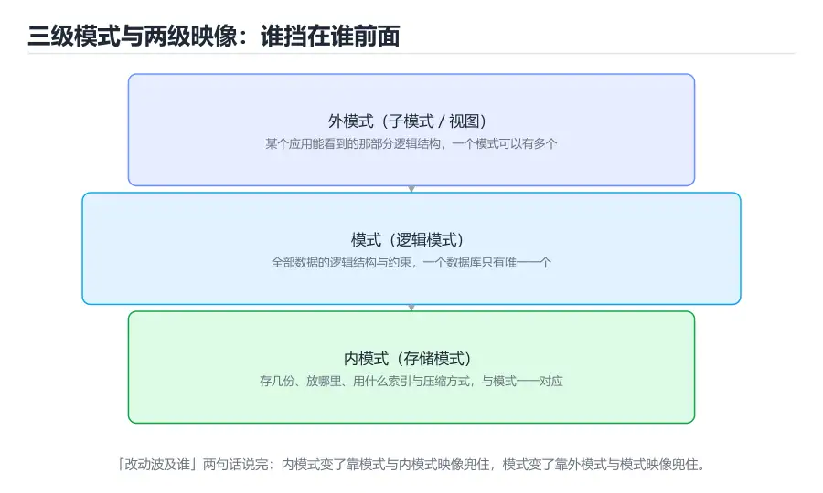

# 数据库系统：关系代数、SQL 与规范化



> 内容更新时间：2026-10-06 · 学习阶段：进阶 · 预计用时：50 分钟

## 本节知识框架

**课程定位**：所属分类 `ruankao`（软考初级与中级），课程主题 `数据库系统`，学习阶段 进阶，建议用时 50 分钟。数据库与数据表示在上午卷里通常合占 8~12 分，集中在第 36~45 题区间：三级模式与数据独立性约一题、关系代数一到两题、SQL 两到三题、函数依赖与规范化两到三题、事务与并发控制一到两题。下午科目的数据库设计大题也直接踩在本课的范式判定与分解规则上。

本课主线：把数据库拆成「三层视图、一套代数、一张判定表」。三层视图回答「谁能看到什么、改动会波及谁」；关系代数与 SQL 回答「怎么把一句自然语言需求写成可执行的运算」；函数依赖与范式回答「这张表到底该不该拆开」。事务与并发是第四条支线，它把前面三件东西放到多用户同时读写的场景里检验。

**学完本课应当能够**

- 说出三级模式与两级映像各自的职责，并判断一次给定改动属于物理独立性还是逻辑独立性。
- 用选择、投影、连接、除法写出一条查询的关系代数表达式，并能读懂带元组变量与量词的表达式。
- 给定属性集与函数依赖集，求出全部候选键、判定关系模式达到的最高范式，并给出无损且保持依赖的分解。
- 用优先图判断一个并发调度是否冲突可串行化，说清活锁与死锁的区别与各自的破解办法。

### 复习清单

- [ ] 能写出「内模式变了靠模式与内模式映像兜住、模式变了靠外模式与模式映像兜住」这句话，并各举一个改动例子。
- [ ] 能用「象元配集合」的思路解释除法 R÷S 为什么专门回答「全部」「至少这些」一类的查询。
- [ ] 能在两分钟内由依赖集推出候选键：先取只出现在依赖左边的属性，再逐步扩张属性闭包。
- [ ] 能画出两个事务操作交叉的优先图，并按有无回边判定它是否可串行化。
- [ ] 能说明 BCNF 分解为什么可能丢失函数依赖，而 3NF 合成算法为什么既能保依赖又无损。

## 核心概念定义

| 术语 | 操作性定义（白话版） | 常见边界与风险 |
| --- | --- | --- |
| 外模式 | 也叫子模式或用户视图，是某个用户或应用能看到的那部分数据的逻辑描述，一个模式可以有多个外模式。 | 易错：外模式不是某几行记录的快照，而是「一类视图」，视图是它的一种实现手段。 |
| 模式 | 也叫逻辑模式，是数据库中全部数据的逻辑结构与约束的整体描述，一个数据库只有一个模式。 | 易错：模式描述结构不描述具体取值，取值集合的全体叫数据库状态。 |
| 内模式 | 也叫存储模式，规定数据在存储介质上的物理组织：存几份、放哪里、用什么索引与压缩方式。 | 易错：一个模式只对应一个内模式，所以物理独立性天然比逻辑独立性容易做到。 |
| 两级映像 | 外模式与模式之间、模式与内模式之间的两套对应规则，是数据独立性的技术支点。 | 易错：映像改动不等于模式改动，改了映像应用程序依然可能一行都不用动。 |
| 数据独立性 | 组织结构改变时应用程序不必跟着改，分物理独立性与逻辑独立性两档。 | 易错：逻辑独立性强弱取决于外模式与模式映像，不取决于程序写得多规范。 |
| 关系与关系模式 | 关系模式是命名的属性结构（型），关系是它在某时刻的取值集合（值），一张具体的表就是一个关系。 | 易错：关系是集合，元组不重复、不讲先后次序，理论上没有「第几行」。 |
| 超键、候选键、主键 | 能唯一标识元组的属性集是超键，极小的超键是候选键，被选中的候选键是主键。 | 易错：一个关系可以有多个候选键，但只能选一个当主键；主键属性称为主属性。 |
| 外键 | 本关系中引用另一关系候选键的属性组，取值必须是被引用关系中存在的值或全为空。 | 易错：外键可以引用自身关系（如职工表里的经理编号）。 |
| 三类完整性 | 实体完整性管主键非空且唯一，参照完整性管外键取值合法，用户定义完整性管业务条件。 | 易错：实体完整性只约束主属性，不约束普通属性。 |
| 选择与投影 | 选择 σ 按条件挑行，投影 π 按属性清单挑列并去掉重复元组。 | 易错：投影后必须去重，这是它和「select 列名」不加 distinct 的实际差别。 |
| 连接 | 笛卡尔积加筛选：θ 连接按条件筛，等值连接按相等筛，自然连接把公共属性合一，外连接保留不匹配的元组。 | 易错：自然连接结果里公共属性只留一份，且会丢掉无法匹配的元组。 |
| 除法 | R÷S 取 R 中那些「与 S 的全部元组都能配上」的象元，专门回答「全部」类查询。 | 易错：被除关系的属性集必须包含除关系的全部属性，结果只剩余下属性。 |
| 元组变量 | 在关系上取值的变量，配合存在量词 ∃ 与全称量词 ∀ 表达「存在这样的元组」「对所有元组成立」。 | 易错：一个查询里可以同时用两个元组变量比较同一关系的两行，这叫自身比较。 |
| DDL、DML、DCL | 定义语言建结构（CREATE、ALTER、DROP），操纵语言读写数据（SELECT、INSERT、UPDATE、DELETE），控制语言管权限（GRANT、REVOKE）。 | 易错：SELECT 属于 DML 而不属于 DCL，事务语句通常单列一类 TCL。 |
| 视图与游标 | 视图是存定义不存数据的虚表，游标把集合运算的结果变成一行一行处理的指针。 | 易错：对含聚集、分组或多表连接的视图做更新往往不被允许。 |
| 函数依赖与范式 | X→Y 表示 X 的值决定 Y 的值；1NF 管属性原子性，2NF 消非主属性部分依赖，3NF 消非主属性传递依赖，BCNF 管到所有决定因素。 | 易错：判定 2NF、3NF 都要先看候选键，候选键算错则全盘皆错。 |
| 无损分解与保持依赖 | 分解后能靠自然连接还原原关系叫无损；分解后的依赖集合并起来仍等价于原依赖集叫保持依赖。 | 易错：无损分解不等于不丢信息，能还原和还原代价是两件事。 |
| 事务与 ACID | 原子性、一致性、隔离性、持久性四条，是一组操作不可分割执行单元的保证。 | 易错：一致性是目标，其余三条是手段，不是并列的四份功能。 |
| 调度与可串行化 | 并发调度的结果若与某种串行执行顺序等价，就说它可串行化，这是正确性的判据。 | 易错：可串行化不等于冲突可串行化，后者是前者的充分而非必要条件。 |
| 封锁、活锁与死锁 | 共享锁 S 读不加互斥、排他锁 X 读写都互斥；活锁是排队被反复插队，死锁是互相等待成环。 | 易错：两段锁协议能保证可串行化，但不能保证不死锁。 |

## 原理与运行机制

**一、三层视图解决「谁看见什么、改动波及谁」。** 把数据库想成一栋楼：内模式是管井与承重墙的位置，模式是整栋楼的平面设计图，外模式是各租户拿到的那一份户型图。租户改自己屋里的隔断，不需要动平面图；物业改供暖管道，也不需要动租户的户型图。这两条「不需要动」分别就是逻辑独立性与物理独立性，实现手段是两级映像。因此，物理存储结构调整而应用程序不必改写，这一特性依靠的正是模式与内模式之间的映像，它把物理组织的变化挡在应用程序之外；而当属性增加、关系拆分时，靠外模式与模式之间的映像把变化挡在应用程序之外，这叫逻辑独立性。一个常见误判是「改了模式所有程序一定全崩」：只要受影响的外模式重新定义，程序里读到的列名与结构可以照旧。

约束这一层要分清三类：实体完整性规定主属性非空且不重复，参照完整性规定外键要么为空、要么指向被引用关系中确实存在的候选键值，用户定义完整性则是业务规则（成绩在 0 到 100 之间）。级联操作要读清题目：ON DELETE CASCADE 是随行删除，SET NULL 是把引用置空，RESTRICT 或 NO ACTION 是直接拒绝。

**二、关系代数：四个基本运算加一个除法。** 并、差、笛卡尔积、选择、投影是五个基本运算，其余都能由它们导出。读表达式的习惯是先配对括号、再从内往外算，注意每个中间结果仍是一个关系。

- 选择 σ 是「挑行」：σ_{grade>=60}(SC) 取出所有及格记录。
- 投影 π 是「挑列并且去重」：π_{sno}(SC) 只留下选过课的学号，重复的自动合并。
- 连接是「先叉乘再筛选」：自然连接 Student⋈SC 在同名属性上取值相同的元组对拼起来，公共属性只留一份；左外连接把左表里配不上的行也留下，右半部分补空值。
- 除法是「找全覆盖」：求「选修了全部课程的学生」，写成 π_{sno,cno}(SC) ÷ π_{cno}(Course)，结果里出现的学号，其选课集合必须包含 Course 的每一门课。除法回答的正是这类问题：找出与给定集合中每一个元素都有对应关系的那些元组。若只要求「至少选了这两门」，也可以造一个只含这两门课的关系来做除数。

用元组变量写「至少」与「不存在」是另一套等价表达。检索选了 C1 也选了 C2 的学生，可以写「存在元组 t 与 u，使得 t 与 u 学号相同、t 课程为 C1 且 u 课程为 C2」。而「没有选 C1 的学生」更适合用否定式：不存在这样的元组，它的学号等于该学生且课程号为 C1。看到全称量词先想除法，看到否定先想差集或不存在，这两条直觉能省下半个考场。

**三、SQL 的四类成分与执行次序。** DDL 建结构：CREATE TABLE 里 PRIMARY KEY、UNIQUE、CHECK、FOREIGN KEY、DEFAULT、NOT NULL 六个短语分别落在不同的完整性上；ALTER TABLE ADD、DROP、MODIFY 或 ALTER COLUMN 改结构；DROP 分删除结构（DROP TABLE）与只清空数据（TRUNCATE），后者不逐行记日志、也不触发触发器。DML 读写数据，SELECT 的逻辑次序是 FROM、JOIN 与 ON、WHERE、GROUP BY、HAVING、SELECT 与 DISTINCT、ORDER BY，这条链解释了为什么 WHERE 里不能写聚合函数、而 HAVING 里可以，也解释了为什么 ORDER BY 里能引用 SELECT 里定义的列别名而 WHERE 里往往不行。DCL 管权限：GRANT SELECT ON 表 TO 用户 WITH GRANT OPTION 授予可再转授的权利，REVOKE 回收；DBA、资源、公共三类预置权限的差别属于背景知识。

子查询的三种形态要分开处理：返回单值的标量子查询可以出现在比较表达式右侧；返回一列的列表子查询配 IN 或 NOT IN；与外层逐行相关的是 EXISTS 与 NOT EXISTS，它把「存在性判断」写成嵌套循环。带 NOT IN 的子查询若结果里含空值，整个条件会永远为假，这是 SQL 三值逻辑的典型坑，改写为 NOT EXISTS 更安全。

视图是存定义不存数据的虚表，作用是简化复杂查询、给不同用户裁剪可见列、以及把逻辑改动吸收在定义里；可更新视图的限制是常见的判断题考点：含聚集函数、GROUP BY、DISTINCT、多表连接的视图一般不可更新，WITH CHECK OPTION 则要求通过视图写入的数据必须仍能被该视图看到。游标把集合结果变成逐行游标，DECLARE 定义、OPEN 打开、FETCH 取一行、CLOSE 关闭、DEALLOCATE 释放，五个动词的次序不能颠倒，滚动型与不滚动型、只读与可更新的差别在于能否 BACKWARD 与能否定位更新。

**四、规范化：把「该不该拆」变成可计算的判定。** 先复习依赖类型：部分依赖是非主属性只依赖于候选键的一部分，传递依赖是非主属性经由另一个非主属性间接依赖候选键。判定顺序永远是「求候选键 → 看非主属性依赖谁 → 看主属性之间还有没有依赖」。

- 1NF 要求属性不可再分。把「联系电话」一列里塞三个号码，就已经违反 1NF，谈不上后面的范式。
- 2NF 要求每个非主属性完全函数依赖于候选键。主键是 (学号, 课程号) 而「所在系」只依赖学号，就卡在 1NF。
- 3NF 要求每个非主属性都不传递函数依赖于候选键。
- BCNF 更严：关系里每一个函数依赖的决定因素都必须包含候选键，也就是说它把主属性参与的那些依赖也一并清理掉。
- 4NF 处理多值依赖：一门课程指定若干参考书，同时指定若干教师，两组之间彼此独立，就该把其中一组拆出去单独成表。

求候选键的手艺是属性闭包。设 F 是依赖集，X 的闭包 X+ 是从 X 出发能推出的全部属性：反复把「左边已含在 X+ 里的依赖」的右边并进来，直到不再变化；X+ 含全部属性则 X 是超键，再去掉冗余属性就得到候选键。速查三步：只出现在左边的属性必属于任何候选键，只出现在右边的属性必不属于任何候选键，两边都出现或都不出现的属性才需要逐个尝试扩张。

分解的两个性质分别有两套检验方法。无损连接的判定表法：把 R1、R2 的公共属性当「钥匙」，若公共属性能决定 R1 或 R2 的全部属性（即公共属性是其中之一或两者的超键），二元分解必无损；多元分解用逐步连接检查。保持函数依赖则要看合并各子模式上投影出的依赖后，与原依赖集是否等价。3NF 合成算法（先求最小依赖集，再按每个依赖的左边成组，最后补一个含候选键的模式）既无损又保持依赖；BCNF 分解算法保证无损，但可能不保持依赖，这一点是概念题的常客。

**五、事务、并发与安全。** 并发带来的四种异常：丢失修改（后写的把先写的覆盖）、脏读（读到别人还没提交的数据）、不可重复读（同一行两次读到的值不同，因为别人 UPDATE 了）、幻读（同一条件两次读到的行数不同，因为别人 INSERT 了）。正确性判据是可串行化：一组并发操作的效果若等价于按某种顺序依次执行这些事务，就是可串行化调度。冲突操作的判定记住三条：两个操作属于不同事务、至少一个是写、作用在同一数据对象上。把冲突按先后画成优先图，图无回边则冲突可串行化，且拓扑序给出等价的串行顺序。

封锁协议分档：一级封锁协议解决丢失修改，二级加上「读后要释放共享锁」解决脏读，三级把共享锁保持到事务结束从而解决不可重复读；两段锁协议（增长阶段只加锁、收缩阶段只释放）保证可串行化，但它和死锁是两回事——两个事务都想把增长阶段拖到拿到对方手里的锁，环就形成了。活锁是排队时总被插队，靠先来先服务排队即可破解；死锁靠一次性申请全部资源、按序申请、超时回滚、或用等待图检测并撤销一个牺牲者来处置。隔离级别从低到高是读未提交、读已提交、可重复读、串行化，级别越高异常越少、并发度越低，这是下午题里常见的权衡问法。

安全这一层要会区分两类攻击。SQL 注入的本质是把用户输入当成代码去拼接，防御的主干是参数化查询与预编译语句：数据库引擎先把语句结构定死，输入只在绑定阶段作为值填入，永远不参与语法解析。此外还要最小权限、服务端校验、对错误信息脱敏、把数据库账号与应用账号分开。加密存储口令要用带盐的单向哈希而不是可逆加密；审计日志用来留下「谁在什么时候改了什么」的证据链。

## 典型应用场景

| 场景 | 典型输入或前提 | 期望产物 |
| --- | --- | --- |
| 报表取数 | 多表关联加聚合与筛选条件 | 正确安排 WHERE 与 HAVING、能估出连接代价的 SQL |
| 老旧库改造 | 一张大宽表反复出现更新异常 | 依赖集、候选键、3NF 或 BCNF 分解方案 |
| 权限下发 | 不同角色可见列不同 | 外模式与视图定义，配 GRANT 与 REVOKE |
| 库存扣减 | 大量并发下单与回滚 | 事务边界、隔离级别与封锁粒度选择 |
| 数据迁移 | 源库与目标库结构不一致 | 用映像思路改视图而非改应用代码 |
| 对外接口加固 | 拼接 SQL 的历史代码 | 预编译语句、白名单校验与最小权限账号 |
| 查询提速 | 慢日志里出现全表扫描 | 覆盖索引、连接顺序调整与统计信息更新 |

## 代码/协议/SQL 示例

下面这段 DDL 把三类完整性都点了一遍，注意每个短语各自守哪条规则：

```sql
CREATE TABLE student (
    sno      CHAR(8)  PRIMARY KEY,                 -- 实体完整性：主属性非空且唯一
    sname    VARCHAR(20) NOT NULL,
    age      SMALLINT  CHECK (age BETWEEN 15 AND 45),
    dept     VARCHAR(30) DEFAULT '未分配'
);

CREATE TABLE course (
    cno      CHAR(4)  PRIMARY KEY,
    cname    VARCHAR(40) NOT NULL,
    credit   SMALLINT  CHECK (credit >= 0)
);

CREATE TABLE sc (
    sno      CHAR(8)  REFERENCES student(sno) ON DELETE CASCADE,  -- 参照完整性
    cno      CHAR(4)  REFERENCES course(cno)  ON DELETE CASCADE,
    grade    SMALLINT CHECK (grade BETWEEN 0 AND 100),
    PRIMARY KEY (sno, cno)
);
```

下面的查询把「分组前后各筛一次」与「除法类问题」写成可直接跑的 SQL，最后一段演示视图与授权：

```sql
-- 1. 及格门数不少于两门的学号：WHERE 先行过滤，HAVING 后置筛选
SELECT sno, COUNT(*) AS pass_cnt
FROM sc
WHERE grade >= 60
GROUP BY sno
HAVING COUNT(*) >= 2
ORDER BY pass_cnt DESC, sno;

-- 2. 选修了全部课程的学生：NOT EXISTS 双重否定，等价于关系代数里的除法
SELECT s.sno, s.sname
FROM student s
WHERE NOT EXISTS (
    SELECT c.cno FROM course c
    EXCEPT
    SELECT x.cno FROM sc x WHERE x.sno = s.sno
);

-- 3. 自身比较：成对找同系年龄更大的两人
SELECT a.sno, b.sno
FROM student a, student b
WHERE a.dept = b.dept AND a.age > b.age;

-- 4. 视图裁剪可见列并回收权限
CREATE VIEW dept_student AS
    SELECT sno, sname FROM student WHERE dept = '软件';
GRANT SELECT ON dept_student TO reader_role;
REVOKE SELECT ON student FROM reader_role;
```

游标的五个动词按次序展开，能看清「集合运算到逐行处理」的接缝：

```sql
DECLARE stu_cur CURSOR FOR
    SELECT sno, grade FROM sc WHERE grade < 60;
OPEN stu_cur;
FETCH NEXT FROM stu_cur INTO :v_sno, :v_grade;
WHILE SQLCODE = 0
BEGIN
    UPDATE sc SET grade = grade + 5 WHERE CURRENT OF stu_cur;
    FETCH NEXT FROM stu_cur INTO :v_sno, :v_grade;
END;
CLOSE stu_cur;
DEALLOCATE stu_cur;
```

最后一段是注入防护的正反写法对照：

```sql
-- 危险：把输入直接拼进语句，注释符后面的内容会被引擎忽略
-- SELECT * FROM student WHERE sno = ' OR '1'='1
-- 正确：预编译加参数绑定，输入永远只作为值参与执行
PREPARE q FROM 'SELECT sno, sname FROM student WHERE sno = ?';
EXECUTE q USING v_input;
DEALLOCATE PREPARE q;
```

## 时间/空间复杂度或性能分析

规范化程度是一把双刃剑。表拆得越细，冗余越少、更新异常越少，但一次业务查询要跨更多表连接；表合得越宽，读得快，写与改的代价就转嫁到一致性维护上。工程上的折中是「写多读少保持高范式，读多写少允许受控冗余」，而考试问的常常是这条方向的判断，不是让你选边站。

索引的代价可以用 B+ 树的高度估算：一个能放 m 个键值的结点，n 条记录的树高约 ⌈log_m n⌉，一百万条记录、每结点百个键值时树高三层，即一次主键查找约三次磁盘 I/O。这就是「不要建几百层」背后的算式。覆盖索引让查询在索引里就能取到所有列，省回表；一个表上的索引越多，插入更新时维护的页也越多，写入放大是实打实的。

几个高频数字与结论，建议直接背下来：

| 主题 | 常见结论 | 易错点 |
| --- | --- | --- |
| 自然连接结果规模 | 不匹配的元组被丢弃，结果行数通常小于两表行数之积 | 与外连接混用，以为一定保留所有行 |
| 除法 R÷S | 结果的属性是 R 减去 S 的属性集 | 把结果当成 S 的属性 |
| 相关子查询 | 外层每行都触发一次内层求值，代价接近两表乘积 | 以为整个子查询只算一次 |
| 候选键求解 | 属性闭包反复扩张直到不变，n 个属性至多 2^n 个子集 | 忘记检查极小性 |
| 无损二元分解 | 公共属性是任一子模式的超键即无损 | 把「属性相同」当成无损 |
| 两段锁协议 | 保证可串行化，不保证不死锁 | 把两件事当成一件事 |
| 隔离级别 | 级别越高并发度越低，串行化最慢但异常最少 | 以为读已提交能避免不可重复读 |

按本课口径再补一条：事务大小直接影响锁的存活时间。单个事务里包含用户交互等待，等于把锁按住不动，别人只能在门外排队；把大事务切成小事务、把事务里的人机交互挪到事务之外，是最常见的现场优化。并发用户数、每事务操作数与锁冲突概率三者的乘积，决定系统吞吐是先涨后平还是先涨后跌，这就是「加机器不涨反跌」现象的数据库侧解释。

## 常见误区与易错点

| 容易答错的做法 | 考场上的实际现象 | 原因与正确做法 |
| --- | --- | --- |
| 认为内模式可以有多个 | 概念题选错 | 一个模式只对应一个内模式，外模式才可以有多个 |
| 把逻辑独立性归给模式与内模式映像 | 两类独立性写反 | 模式与内模式管物理独立性，外模式与模式管逻辑独立性 |
| 投影后不去重 | 关系代数结果行数偏多 | 关系是集合，π 之后必须消去重复元组 |
| 自然连接写成公共属性各留一份 | 属性列数算错 | 自然连接把同名属性合并为一列 |
| 用除法表达「至少选了一门」 | 表达式与语义不符 | 除法管全覆盖，部分命中用选择或连接 |
| WHERE 里写聚合函数 | 语法或语义错 | 分组前的行筛选不能用聚合值，改放 HAVING |
| 认为候选键就是主键 | 求键时漏解 | 主键只是被选中的那一个候选键 |
| 判定 3NF 时只看主属性之间的依赖 | 范式判低或判高 | 3NF 只管非主属性的传递依赖，主属性的依赖交给 BCNF |
| 认为无损分解一定能保持依赖 | 分解方案被否 | 两个性质要分别检验，BCNF 分解可能不保持依赖 |
| 认为两段锁协议能防止死锁 | 并发题判断错 | 它保证可串行化，死锁需另用检测或剥夺策略 |
| 把脏读与不可重复读混为一谈 | 隔离级别选错 | 前者读到未提交数据，后者是别人提交后同一行变了 |
| 以为参数化查询能约束表名 | 防护留下缺口 | 占位符只替代值，标识符需走白名单 |

## 与其他知识点的关系

- **前置**：`ruankao_cs_basics` 的集合与逻辑运算直接支撑关系代数的读法；`ruankao_data_structure` 的树与散列是索引结构的底层，B+ 树高度与散列冲突处理决定了物理设计的取舍。
- **并列**：`ruankao_os_and_arch` 的并发与死锁概念在本课的封锁协议里复用，银行家算法与死锁检测是同一条思路的两个应用场景；`ruankao_net_security` 的权限最小化与审计日志与本课的 DCL、SQL 注入防护相接。
- **后续**：`ruankao_ood_uml` 的类图关联多重性与本课的外键实现方式对应，多对多关联正是靠一张中间关系表落地；下午科目的数据流图与数据库设计大题要用到本课的范式判定、E-R 转关系模式的规则与分布式数据库的透明性概念。

## 自测题与参考答案

作答时先盖上答案区，每题限时 4 分钟；做完把错题对应的小节翻一遍，手算过程写在草稿上。

### 题目 1（单选题）

关于三级模式与两级映像，下列说法正确的是？

- A. 一个数据库可以有多个模式，每个应用各配一个模式，彼此互不干扰
- B. 内模式描述数据的逻辑结构，模式描述数据在存储介质上的物理组织
- C. 一个模式只对应一个内模式，外模式却可以有多个，物理独立性靠模式与内模式映像兜住
- D. 模式一旦改变，所有引用它的应用程序都必须同步改写，否则无法继续运行

**参考答案**：C

**解析**：本题正确项是「一个模式只对应一个内模式，外模式却可以有多个，物理独立性靠模式与内模式映像兜住」。三层结构里模式是全局唯一的一份逻辑描述，内模式是它唯一的物理描述，不同用户拿到的是各自的子模式；把存储换成散列还是顺序文件、多加一个索引，只改模式与内模式之间的映像，应用程序一行都不用动。干扰项「一个数据库可以有多个模式，每个应用各配一个模式，彼此互不干扰」把外模式误写成了模式；干扰项「内模式描述数据的逻辑结构，模式描述数据在存储介质上的物理组织」把两个定义对调；干扰项「模式一旦改变，所有引用它的应用程序都必须同步改写，否则无法继续运行」否认了逻辑独立性，只要重建受影响的外模式与映像，程序读到的列名与结构可以照旧。

### 题目 2（单选题）

关系 R(A, B, C, D) 上的函数依赖集为 F = {A→B, B→C, C→D}，它的候选键是？

- A. A、B 与 C 三个属性各自都能推出全部属性，因此三者都是候选键
- B. 只有 A 是候选键，因为从 A 出发能闭出全部属性，从 B 出发取不到 A
- C. D 是候选键，它位于依赖链的末端因而唯一性最强
- D. (A, C) 与 (B, D) 是两个极小的超键，共同构成候选键

**参考答案**：B

**解析**：本题正确项是「只有 A 是候选键，因为从 A 出发能闭出全部属性，从 B 出发取不到 A」。按闭包算法反复扩张：A+ = {A, B, C, D} 覆盖全部属性，而它的任何真子集都做不到，故 A 是唯一候选键；B+ = {B, C, D} 缺 A，C+ = {C, D}，D+ = {D}，三个都不合格。速查口诀也能验证同一结论：只出现在左边的属性必属于任何候选键，只出现在右边的属性必不属于，D 正是后者。干扰项「A、B 与 C 三个属性各自都能推出全部属性，因此三者都是候选键」漏算了 B 与 C 的闭包里缺 A；干扰项「D 是候选键，它位于依赖链的末端因而唯一性最强」把「被决定」当成了「能决定」；干扰项「(A, C) 与 (B, D) 是两个极小的超键，共同构成候选键」违背极小性，含 A 的超键去掉 C 之后仍是超键，就谈不上极小。

### 题目 3（单选题）

关系 R(学号, 课程号, 成绩, 所在系) 的候选键是 (学号, 课程号)，依赖集为 {（学号, 课程号)→成绩, 学号→所在系}，它最高满足第几范式？

- A. 满足 2NF，因为成绩完全函数依赖于整个候选键
- B. 满足 3NF，因为所在系不传递依赖于候选键
- C. 满足 BCNF，因为每个非主属性都由候选键决定
- D. 仅满足 1NF，因为所在系部分函数依赖于候选键

**参考答案**：D

**解析**：本题正确项是「仅满足 1NF，因为所在系部分函数依赖于候选键」。2NF 要求每个非主属性都完全依赖候选键，而所在系只靠学号就能定出来，候选键被拆开使用了，同一个学生换系要改多行、新开一门课没成绩时连系别都记不进去——部分依赖带来的更新异常正是范式要消灭的对象。干扰项「满足 2NF，因为成绩完全函数依赖于整个候选键」只检查了一个非主属性，判定范式要所有非主属性一起过关；干扰项「满足 3NF，因为所在系不传递依赖于候选键」把部分依赖误当成了传递依赖，3NF 清理的是传递那一段，卡在 2NF 之前的错误它管不到；干扰项「满足 BCNF，因为每个非主属性都由候选键决定」与给定依赖集矛盾，学号→所在系的决定因素里不含任何候选键。

### 题目 4（代码阅读题）

下面这段 SQL 执行时报错，最可能的原因是什么？

```sql
SELECT dept, COUNT(*) AS cnt
FROM student
GROUP BY dept
WHERE cnt > 3
ORDER BY cnt DESC;
```

- A. WHERE 在 GROUP BY 之前求值，此时列别名 cnt 还没生成，条件应写进 HAVING
- B. COUNT(*) 不能出现在 SELECT 列表里，必须写成 COUNT(dept) 才合法
- C. GROUP BY 必须与 ORDER BY 使用同一个属性，否则分组结果无法排序
- D. 聚集函数结果不能参与比较，必须先在子查询里算出 cnt 再到外层用 WHERE 过滤

**参考答案**：A

**解析**：本题正确项是「WHERE 在 GROUP BY 之前求值，此时列别名 cnt 还没生成，条件应写进 HAVING」。SELECT 的逻辑次序是 FROM、JOIN 与 ON、WHERE、GROUP BY、HAVING、SELECT 与 DISTINCT、ORDER BY，别名要到 SELECT 阶段才绑定，所以 WHERE 里既看不到 cnt 也看不到聚集值；把这行条件挪到 HAVING 即可，而 ORDER BY 在 SELECT 之后求值，那里引用 cnt 是合法的。干扰项「COUNT(*) 不能出现在 SELECT 列表里，必须写成 COUNT(dept) 才合法」把聚集参数的选择当成了语法禁令，两种写法都合法只是含义不同；干扰项「GROUP BY 必须与 ORDER BY 使用同一个属性，否则分组结果无法排序」混淆了分组键与排序键，排序键完全可以是聚集结果；干扰项「聚集函数结果不能参与比较，必须先在子查询里算出 cnt 再到外层用 WHERE 过滤」把 HAVING 的存在意义抹掉了，绕道子查询只是给同一个判断多穿一层衣服。

### 题目 5（多选题）

关于并发控制与封锁协议，下列说法正确的是？

- A. 两段锁协议能保证调度可串行化，却不能保证不发生死锁
- B. 一级封锁协议通过禁止读未提交数据来解决脏读问题
- C. 活锁与死锁是同一现象的两种叫法，处置手段完全相同
- D. 超时回滚与等待图检测都能处置死锁，前者靠时间后者靠成环
- E. 读已提交级别既能避免脏读，也能避免同一行两次读取结果不同

**参考答案**：A、D

**解析**：多选题要同时选中「两段锁协议能保证调度可串行化，却不能保证不发生死锁」与「超时回滚与等待图检测都能处置死锁，前者靠时间后者靠成环」。两段锁只约束加锁与释放的次序——增长阶段只加不放、收缩阶段只放不加，它给出的是可串行化的充分条件；两个事务都想在释放已有锁之前拿到对方手里的锁，环照样形成，所以仍需靠一次性申请全部资源、按序申请、超时回滚或等待图检测撤销一个牺牲者来收拾局面。干扰项「一级封锁协议通过禁止读未提交数据来解决脏读问题」张冠李戴，一级只规定写前加排他锁、治的是丢失修改，脏读要靠二级的「读后要释放共享锁」；干扰项「活锁与死锁是同一现象的两种叫法，处置手段完全相同」抹掉了区别，活锁是排队时被反复插队，改成先来先服务即可破解，死锁才是互相等待成环；干扰项「读已提交级别既能避免脏读，也能避免同一行两次读取结果不同」低估了不可重复读，要让同一行两次读到的值一致至少得升到可重复读。

### 题目 6（排序题）

把用关系除法 R÷S 求「选修了全部课程的学生」的四个动作按先后排列：

- A. 把每个学号对应的课程号集合与除关系中的全部课程逐一配对
- B. 分别投影：从选课关系取（学号, 课程号）作被除关系，从课程表取课程号作除关系
- C. 按学号划分象元，把被除关系里的元组归到各自学号的组内
- D. 输出配对成功的学号，也就是所选课程覆盖全部课程的那些学生

**参考答案**：B → C → A → D

**解析**：本题顺序是「分别投影：从选课关系取（学号, 课程号）作被除关系，从课程表取课程号作除关系」→「按学号划分象元，把被除关系里的元组归到各自学号的组内」→「把每个学号对应的课程号集合与除关系中的全部课程逐一配对」→「输出配对成功的学号，也就是所选课程覆盖全部课程的那些学生」。除法的语义是全覆盖，所以第一步必须把两个关系的属性对齐：被除关系要包含除关系的全部属性，剩下的那一列正是待输出的象元；随后按象元分组，再逐组检查是否把除关系的每个元组都配上。用 SQL 表达同一件事就写成双重否定——不存在一门课程该学生没有选，落地为 NOT EXISTS 相关子查询或 EXCEPT 求差后判空；若换成 NOT IN 而子查询结果里混进空值，条件会永远为假，这是三值逻辑的经典坑。

## 考点精讲

本课题库共 6 道题，下面逐题复述题干原文、答案字母（A 是第 1 个选项）与判断依据，字段内容与题库完全一致。

### 考点 1（单选题 · 三级模式与映像）

- **题目**：关于三级模式与两级映像，下列说法正确的是？
- **答案**：C
- **正确项**：一个模式只对应一个内模式，外模式却可以有多个，物理独立性靠模式与内模式映像兜住
- **判断依据**：本题正确项是「一个模式只对应一个内模式，外模式却可以有多个，物理独立性靠模式与内模式映像兜住」。三层结构里模式是全局唯一的一份逻辑描述，内模式是它唯一的物理描述，不同用户拿到的是各自的子模式；把存储换成散列还是顺序文件、多加一个索引，只改模式与内模式之间的映像，应用程序一行都不用动。干扰项「一个数据库可以有多个模式，每个应用各配一个模式，彼此互不干扰」把外模式误写成了模式；干扰项「内模式描述数据的逻辑结构，模式描述数据在存储介质上的物理组织」把两个定义对调；干扰项「模式一旦改变，所有引用它的应用程序都必须同步改写，否则无法继续运行」否认了逻辑独立性，只要重建受影响的外模式与映像，程序读到的列名与结构可以照旧。

### 考点 2（单选题 · 属性闭包求候选键）

- **题目**：关系 R(A, B, C, D) 上的函数依赖集为 F = {A→B, B→C, C→D}，它的候选键是？
- **答案**：B
- **正确项**：只有 A 是候选键，因为从 A 出发能闭出全部属性，从 B 出发取不到 A
- **判断依据**：本题正确项是「只有 A 是候选键，因为从 A 出发能闭出全部属性，从 B 出发取不到 A」。按闭包算法反复扩张：A+ = {A, B, C, D} 覆盖全部属性，而它的任何真子集都做不到，故 A 是唯一候选键；B+ = {B, C, D} 缺 A，C+ = {C, D}，D+ = {D}，三个都不合格。速查口诀也能验证同一结论：只出现在左边的属性必属于任何候选键，只出现在右边的属性必不属于，D 正是后者。干扰项「A、B 与 C 三个属性各自都能推出全部属性，因此三者都是候选键」漏算了 B 与 C 的闭包里缺 A；干扰项「D 是候选键，它位于依赖链的末端因而唯一性最强」把「被决定」当成了「能决定」；干扰项「(A, C) 与 (B, D) 是两个极小的超键，共同构成候选键」违背极小性，含 A 的超键去掉 C 之后仍是超键，就谈不上极小。

### 考点 3（单选题 · 范式判定）

- **题目**：关系 R(学号, 课程号, 成绩, 所在系) 的候选键是 (学号, 课程号)，依赖集为 {（学号, 课程号)→成绩, 学号→所在系}，它最高满足第几范式？
- **答案**：D
- **正确项**：仅满足 1NF，因为所在系部分函数依赖于候选键
- **判断依据**：本题正确项是「仅满足 1NF，因为所在系部分函数依赖于候选键」。2NF 要求每个非主属性都完全依赖候选键，而所在系只靠学号就能定出来，候选键被拆开使用了，同一个学生换系要改多行、新开一门课没成绩时连系别都记不进去——部分依赖带来的更新异常正是范式要消灭的对象。干扰项「满足 2NF，因为成绩完全函数依赖于整个候选键」只检查了一个非主属性，判定范式要所有非主属性一起过关；干扰项「满足 3NF，因为所在系不传递依赖于候选键」把部分依赖误当成了传递依赖，3NF 清理的是传递那一段，卡在 2NF 之前的错误它管不到；干扰项「满足 BCNF，因为每个非主属性都由候选键决定」与给定依赖集矛盾，学号→所在系的决定因素里不含任何候选键。

### 考点 4（代码阅读题 · SELECT 执行次序）

- **题目**：下面这段 SQL 执行时报错，最可能的原因是什么？
- **答案**：A
- **正确项**：WHERE 在 GROUP BY 之前求值，此时列别名 cnt 还没生成，条件应写进 HAVING
- **判断依据**：本题正确项是「WHERE 在 GROUP BY 之前求值，此时列别名 cnt 还没生成，条件应写进 HAVING」。SELECT 的逻辑次序是 FROM、JOIN 与 ON、WHERE、GROUP BY、HAVING、SELECT 与 DISTINCT、ORDER BY，别名要到 SELECT 阶段才绑定，所以 WHERE 里既看不到 cnt 也看不到聚集值；把这行条件挪到 HAVING 即可，而 ORDER BY 在 SELECT 之后求值，那里引用 cnt 是合法的。干扰项「COUNT(*) 不能出现在 SELECT 列表里，必须写成 COUNT(dept) 才合法」把聚集参数的选择当成了语法禁令，两种写法都合法只是含义不同；干扰项「GROUP BY 必须与 ORDER BY 使用同一个属性，否则分组结果无法排序」混淆了分组键与排序键，排序键完全可以是聚集结果；干扰项「聚集函数结果不能参与比较，必须先在子查询里算出 cnt 再到外层用 WHERE 过滤」把 HAVING 的存在意义抹掉了，绕道子查询只是给同一个判断多穿一层衣服。

### 考点 5（多选题 · 封锁与死锁）

- **题目**：关于并发控制与封锁协议，下列说法正确的是？
- **答案**：A、D
- **正确项**：两段锁协议能保证调度可串行化，却不能保证不发生死锁；超时回滚与等待图检测都能处置死锁，前者靠时间后者靠成环
- **判断依据**：多选题要同时选中「两段锁协议能保证调度可串行化，却不能保证不发生死锁」与「超时回滚与等待图检测都能处置死锁，前者靠时间后者靠成环」。两段锁只约束加锁与释放的次序——增长阶段只加不放、收缩阶段只放不加，它给出的是可串行化的充分条件；两个事务都想在释放已有锁之前拿到对方手里的锁，环照样形成，所以仍需靠一次性申请全部资源、按序申请、超时回滚或等待图检测撤销一个牺牲者来收拾局面。干扰项「一级封锁协议通过禁止读未提交数据来解决脏读问题」张冠李戴，一级只规定写前加排他锁、治的是丢失修改，脏读要靠二级的「读后要释放共享锁」；干扰项「活锁与死锁是同一现象的两种叫法，处置手段完全相同」抹掉了区别，活锁是排队时被反复插队，改成先来先服务即可破解，死锁才是互相等待成环；干扰项「读已提交级别既能避免脏读，也能避免同一行两次读取结果不同」低估了不可重复读，要让同一行两次读到的值一致至少得升到可重复读。

### 考点 6（排序题 · 关系除法的四步）

- **题目**：把用关系除法 R÷S 求「选修了全部课程的学生」的四个动作按先后排列：
- **答案**：B → C → A → D
- **正确项**：分别投影取被除关系与除关系 → 按学号划分象元分组 → 把每个学号的课程号集合与全部课程逐一配对 → 输出配对成功的学号
- **判断依据**：本题顺序是「分别投影：从选课关系取（学号, 课程号）作被除关系，从课程表取课程号作除关系」→「按学号划分象元，把被除关系里的元组归到各自学号的组内」→「把每个学号对应的课程号集合与除关系中的全部课程逐一配对」→「输出配对成功的学号，也就是所选课程覆盖全部课程的那些学生」。除法的语义是全覆盖，所以第一步必须把两个关系的属性对齐：被除关系要包含除关系的全部属性，剩下的那一列正是待输出的象元；随后按象元分组，再逐组检查是否把除关系的每个元组都配上。用 SQL 表达同一件事就写成双重否定——不存在一门课程该学生没有选，落地为 NOT EXISTS 相关子查询或 EXCEPT 求差后判空；若换成 NOT IN 而子查询结果里混进空值，条件会永远为假，这是三值逻辑的经典坑。

## 术语速查

| 术语 | 一句话说明 |
| --- | --- |
| 象元 | 关系里除公共属性外的部分，做除法与连接时先按象元配对，再谈元组组合。 |
| 属性闭包 | 从给定属性集出发靠函数依赖能推出的全部属性，闭包含全属性即为超键。 |
| 最小依赖集 | 每个依赖右边只有单属性、左边无冗余且整个集合无冗余的等价依赖集。 |
| 优先图 | 以事务为结点、以冲突操作的先后为边的有向图，无回边即冲突可串行化。 |
| 丢失修改 | 两个事务先后写同一对象，后写的覆盖了前者的效果，一级封锁协议专门治它。 |
| 幻读 | 同一查询条件两次执行得到不同行数，因为中间有别的插入或删除。 |
| 覆盖索引 | 查询所需的全部列都能在索引里取到，无需回到基表再读一次。 |
| 删除标记 | 开放定址式散列与某些物理删除策略里用来占位的记号，防止探测链被截断。 |
| 三值逻辑 | 与空值比较的结果是真、假之外的第三种值，导致 IN 与 NOT IN 的边界行为。 |

## 参考资料与复核

- 最后复核：2026-10-04
- 下次复核：2027-09-10
- 复核范围：三级模式与两级映像的措辞、关系代数五个基本运算的归类、SQL 各子句逻辑执行次序、范式判定条件、无损与保持依赖的检验方法、封锁协议与隔离级别的对应关系、参数化查询的防护边界。
- 来源性质：教材通用结论与关系数据库文档的公开页；本课核对关键词：物理独立性、自然连接、属性闭包、BCNF、两段锁、预编译语句。

| 参考资料 | 本课用途 |
| --- | --- |
| [中国计算机技术职业资格网首页（软考官方门户）](https://www.ruankao.org.cn/) | 考试级别、科目设置与大纲入口 |
| [PostgreSQL 官方文档：SQL 语法教程](https://www.postgresql.org/docs/current/tutorial.html) | SELECT 各子句的实际执行行为与空值比较语义 |
| [PostgreSQL 官方文档：SQL 数据定义](https://www.postgresql.org/docs/current/ddl.html) | 约束、主外键、级联动作与默认值的规范写法 |
| [PostgreSQL 文档：SQL 查询语句详解](https://www.postgresql.org/docs/current/tutorial-sql.html) | 连接、聚集与子查询的示例与结果核对 |

## 内容元数据

> 内容更新时间：2026-10-06 · 学习阶段：进阶 · 预计用时：50 分钟

- 内容版本：v2.0
- 分类归属：`ruankao`（软考初级与中级），本课为第 6 门（order 5）
- 适用考试：软件设计师 / 数据库系统工程师（上午综合知识的数据结构后段与数据库题区）
- 题量与题型：6 题（单选 3 题、代码阅读 1 题、多选 1 题、排序 1 题），全部自主命题
- 质量口径：与 `tool/content_pipeline/validate_pack.js` 的结构与题库门禁对齐
- 相关课程：`ruankao_data_structure`、`ruankao_net_security`、`ruankao_ood_uml`
- 说明：三级模式、范式判定与可串行化的定义属于长期稳定的理论内容，具体数据库产品的语法细节需按所用版本核对
