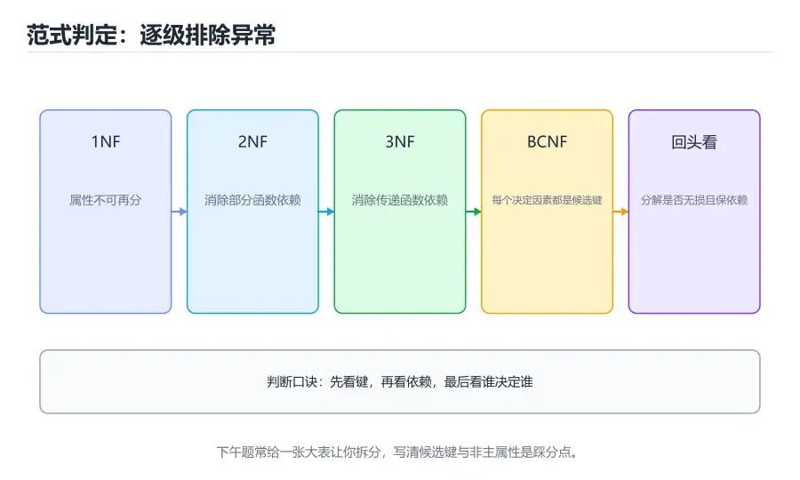

# 数据库设计：ER 模型、关系代数与范式分解



## 本节知识框架

**课程定位**：所属分类 `ruankao`（软考初级与中级），课程主题 `数据库设计`，学习阶段 基础，建议用时 45 分钟。数据库在上午卷里通常占 6~9 分，同时它还是下午试题二的固定考点：给一段业务描述，让你补 ER 图、写关系模式、判断范式并给出分解。这一课把两边的答案格式一次讲透。

本课主线：先讲清楚「三级模式两级映像」这套体系结构，再顺着设计流程往下走——需求 → 概念模型（ER）→ 逻辑模型（关系模式）→ 规范化（范式）→ 物理实现。每一步都配一个能手算的最小例子。

**学完本课应当能够**
- 说明外模式、模式、内模式各自面向谁，以及两级映像分别保证了哪种独立性。
- 把 ER 图里的 1:1、1:n、m:n 三类联系正确转换成关系模式，并写清主键与外键。
- 用函数依赖与候选键判断一个关系最高满足第几范式，并给出无损且保依赖的分解。
- 读懂关系代数的选择、投影、连接、除法等表达式，并把它翻译成等价的 SQL。

### 复习清单

- [ ] 能用一句话区分逻辑独立性与物理独立性，并各指出对应的映像。
- [ ] 面对一个 m:n 联系，能立刻说出「联系独立成关系，主键取两端主键的组合」。
- [ ] 会给一个关系写出全部函数依赖、求出候选键，再判断它属于第几范式。
- [ ] 能把一段关系代数表达式与它的 SQL 写法互相对应，尤其是除法与 NOT EXISTS。

## 核心概念定义

| 术语 | 操作性定义（白话版） | 常见边界与风险 |
| --- | --- | --- |
| 数据库系统 | 由数据库、数据库管理系统、应用系统、数据库管理员与用户共同构成的运行整体。 | 易错：DBMS 是软件，DB 是数据的集合，DBS 是包含两者的整个系统。 |
| 三级模式 | 外模式（用户能看到的局部视图）、模式（全局逻辑结构，唯一）、内模式（物理存储结构，唯一）。 | 易错：外模式可以有多个，模式与内模式各只有一个。 |
| 两级映像 | 外模式/模式映像、模式/内模式映像，把不同层次解耦。 | 易错：前者保证逻辑独立性，后者保证物理独立性，方向别记反。 |
| 数据模型 | 描述数据结构、操作与完整性约束的三要素集合，分概念模型与逻辑模型两层。 | 易错：E-R 图属概念模型，与具体 DBMS 无关；关系模型才是逻辑模型。 |
| 实体与属性 | 客观可区分的事物及其特征；属性可以是简单、复合、单值或多值的。 | 易错：多值属性不能直接摊平成一列，要拆成独立关系。 |
| 联系类型 | 两个实体集之间按实例数分为 1:1、1:n、m:n 三种，自联系也同理。 | 易错：1:n 与 n:1 只是方向不同，转换规则都落在「n 端加外键」。 |
| 弱实体 | 存在依赖拥有者实体、自身没有足够属性构成主键的实体。 | 易错：弱实体的关系主键必须把拥有者的主键一起并进来。 |
| 函数依赖 | X 的值能唯一决定 Y 的值，记作 X → Y；完全依赖指不能由 X 的任何真子集决定。 | 易错：部分依赖只在候选键是复合键时才可能出现。 |
| 候选键与主属性 | 能唯一标识元组的最小属性组是候选键，被选用的那个是主键，其中的属性称主属性。 | 易错：候选键要求最小性，能少一个属性就不再是候选键。 |
| 范式 | 对关系模式的逐级约束：1NF 讲原子性，2NF 消除部分依赖，3NF 消除传递依赖，BCNF 要求每个决定因素都是候选键。 | 易错：范式是「满足更低一级才谈更高一级」，判定要逐级向下排除。 |
| 无损分解 | 把关系拆开后，用自然连接还能拼回原样，不产生原表没有的元组。 | 易错：无损不等于保依赖，两者要分别检验。 |
| 关系代数 | 以关系为运算对象、结果仍是关系的形式化语言，包括选择、投影、并、差、交、笛卡尔积、连接、除法。 | 易错：选择是水平筛元组，投影是垂直筛列且要去重。 |
| 事务 | 一组不可分割的操作，满足原子性、一致性、隔离性、持久性四条性质。 | 易错：持久性靠日志与恢复机制，隔离性靠封锁，两者不是同一件事。 |
| 封锁与隔离级别 | 读用共享锁、写用排它锁；封锁协议级别越高，越能防止脏读与不可重复读。 | 易错：脏读是读到别的事务未提交的修改，丢失修改是两个事务互相覆盖。 |
| 索引 | 为加速查询建立的辅助结构，常见为 B+ 树与位图；聚簇索引决定数据的物理存放顺序。 | 易错：索引加速读但拖慢写，还额外占空间，不是越多越好。 |

## 原理与运行机制

**一、三级模式：把「用户看到什么」和「数据怎么存」彻底分开。** 可以把数据库想成一家连锁餐厅：菜单是外模式，每位顾客只点自己那几页；配方总表是模式，全店唯一；仓库货架摆放方式是内模式，也只有一份。供应商换了食材摆放位置（改内模式），配方总表不动，菜单也就不动——这是物理独立性；配方总表加了新的一列（改模式），只要更新「菜单与配方的对应关系」，顾客看到的菜单不变——这是逻辑独立性。这两句「靠映像换独立」是选择题的高频考点，理解成「中间加一层翻译，改一边不用动另一边」就永远不会选错。

**二、ER 图到关系模式：三条转换规则解决全部情况。** 实体直接变成一个关系，属性变列，实体标识变主键。麻烦都在联系上：

- 1:1（学生与学号卡）：把任意一端的主键放到另一端做外键即可，也可以合并成一个关系；外键那端要加唯一性约束，否则会变成 1:n。
- 1:n（系与教师）：把「一」端的主键搬到「多」端做外键，联系本身不必单独成表。这是最常见的做法，因为外键天然落在多方。
- m:n（学生与课程）：必须单独建一个关系，属性是联系自身的属性（如成绩、选课日期）加上两端主键，主键是两端主键的组合。

拿「学生选课」举例，最终得到 Student(学号, 姓名, 年龄, 系号)、Course(课程号, 课程名, 学分)、SC(学号, 课程号, 成绩, 选课日期)，其中 SC 的主键是（学号, 课程号），学号与课程号分别是引用两张表的外键。这里有个踩分点：SC 的主键绝不能写成「成绩」或单写「学号」。如果业务要求「一名学生同一门课只能有一条成绩记录」，那正好由复合主键保证。

弱实体（如「子女」依附于「职工」）要把它拥有者的主键并入自己的主键；多值属性（一个人的多个电话号码）要拆成独立关系，否则违反 1NF。

**三、范式：逐级排除异常的口诀是「先看键，再看依赖，最后看谁决定谁」。** 判断流程固定三步：① 求候选键；② 列出非主属性；③ 检查非主属性是否完全依赖于候选键、是否传递依赖。

用一张典型的「选课大宽表」练手：R(学号, 课程号, 成绩, 姓名, 所在系, 系所在地)，函数依赖集为 {学号 → 姓名, 学号 → 所在系, 所在系 → 系所在地, (学号, 课程号) → 成绩}。先求候选键：只有 (学号, 课程号) 能推出全部属性，且去掉任一个都不行，所以候选键唯一，非主属性是姓名、所在系、系所在地。此时姓名与所在系只依赖于学号——也就是候选键的一部分，这就是部分函数依赖，直接判为「只满足 1NF」。

分解要同时保住两件事：无损（不凭空多出元组）与保依赖（原来的函数依赖不用跨表才能检查）。按「每个依赖的左部 + 右部成一组、再保留一个含候选键的组」的思路，得到 R1(学号, 姓名, 所在系)、R2(所在系, 系所在地)、R3(学号, 课程号, 成绩)。检验无损：R1 与 R2 的交集是所在系，而所在系 → 系所在地 完全落在 R2 内，能决定 R2 全部属性，故合并回去不增元组；R1 与 R3 的交集是学号，学号能决定 R1 全部属性，同样无损。三个依赖各自住进一张表，保依赖也成立。R1 里学号是候选键且是唯一的决定因素，R2 里所在系是候选键，所以两张表都到了 BCNF；R3 里 (学号,课程号) 是唯一候选键，也在 BCNF。

顺带把 BCNF 的口径说清：它要求「每一个非平凡的函数依赖 X → Y，X 都必须包含候选键」。R(职员, 部门, 经理) 中，部门 → 经理、经理 → 部门（每个部门一位经理、每位经理管一个部门），候选键有两个：部门与经理。职员 → 部门 的左部职员不是候选键，所以这张表不是 BCNF，虽然它已经是 3NF——这就是「3NF 允许非主属性决定候选键」的经典反例。

**四、关系代数与 SQL：同一件事的两种写法。** 选择 σ 是水平切（按条件筛行），投影 π 是垂直切（按列筛，结果要去掉重复元组），笛卡尔积 × 把两表逐行配对，连接 ⋈ 是笛卡尔积加上条件筛选，除法 ÷ 专门回答「全部」这类问题。

除法的直觉是「谁包揽了另一边的所有元素」。求「选修了全部课程的学生学号」，写成 π学号,课程号(SC) ÷ π课程号(Course)，含义是找出那些「其选课集合包含所有课程」的学号。SQL 里没有除法运算符，等价的写法是两层否定：不存在一门课他没选。这类「全部、都、所有」的题目在上午卷与下午题里都出现过，看到这几个字先想除法或双重 NOT EXISTS。

**五、事务与并发。** 三个经典错误各有成因：丢失修改是两个事务先读后写互相覆盖（一级封锁协议，即写前加排它锁就能防）；脏读是读到了别的事务还没提交、后来可能被撤销的数据（要求读也加锁，属二级封锁协议）；不可重复读是同一事务内两次读同一行得到不同结果（要求读锁保持到事务结束，属三级封锁协议）。封锁粒度越大越安全，但并发度越低，还可能死锁——检测到环就撤销其中一个事务。

## 典型应用场景

| 场景 | 典型输入或前提 | 期望产物 |
| --- | --- | --- |
| 管理信息系统概念设计 | 一段自然语言的业务描述 | 实体、属性、联系与类型的 E-R 图 |
| 逻辑设计 | E-R 图 + 目标 DBMS 能力 | 关系模式集合，标注主键、外键与约束 |
| 数据质量整改 | 存在更新异常、插入异常的宽表 | 候选键、依赖集与满足无损保依赖的分解 |
| 报表查询编写 | 「哪些客户下过全部类别的订单」 | 除法表达式或双重 NOT EXISTS 的 SQL |
| 高频查询优化 | 少量读、大量写的字段 | 只在读多写少的列上建索引，避免过度索引 |
| 并发一致性设计 | 多事务同时修改余额 | 选择合适的封锁级别，配合短事务 |

## 代码/协议/SQL 示例

用一段 SQL 建出选课场景的三张表，主键、外键与检查约束一次写全，这是下午题最常见的作答格式：

```sql
CREATE TABLE Student (
    Sno   CHAR(10) PRIMARY KEY,
    Sname VARCHAR(20) NOT NULL,
    Sage  INT CHECK (Sage BETWEEN 15 AND 60),
    Dno   CHAR(4),
    FOREIGN KEY (Dno) REFERENCES Dept(Dno)
);

CREATE TABLE Course (
    Cno   CHAR(6) PRIMARY KEY,
    Cname VARCHAR(40) NOT NULL,
    Credit INT DEFAULT 2
);

CREATE TABLE SC (
    Sno CHAR(10),
    Cno CHAR(6),
    Grade INT CHECK (Grade BETWEEN 0 AND 100),
    PRIMARY KEY (Sno, Cno),
    FOREIGN KEY (Sno) REFERENCES Student(Sno),
    FOREIGN KEY (Cno) REFERENCES Course(Cno)
);
```

除法在 SQL 里靠两层否定实现，配合一段 Python 可以把「全部」这类语义验证清楚：

```sql
SELECT Sname
FROM Student
WHERE NOT EXISTS (
    SELECT * FROM Course
    WHERE NOT EXISTS (
        SELECT * FROM SC
        WHERE SC.Sno = Student.Sno AND SC.Cno = Course.Cno
    )
);
```

```python
sc = {
    "2024001": {"C01", "C02", "C03"},
    "2024002": {"C01", "C03"},
    "2024003": {"C02"},
}
courses = {"C01", "C02", "C03"}
print([sno for sno, cs in sc.items() if courses - cs == set()])   # 2024001
```

判断范式的过程也能写成十几行代码，先求属性闭包、再枚举候选键，最后逐级检查：

```python
attrs = ["Sno", "Cno", "Grade", "Sname", "Dno", "Loc"]
fds = [
    (["Sno"], ["Sname"]),
    (["Sno"], ["Dno"]),
    (["Dno"], ["Loc"]),
    (["Sno", "Cno"], ["Grade"]),
]

def closure(seed):
    got = set(seed)
    changed = True
    while changed:
        changed = False
        for lhs, rhs in fds:
            if all(a in got for a in lhs) and not all(a in got for a in rhs):
                got.update(rhs)
                changed = True
    return got

keys = [s for s in ([a] for a in attrs) if closure(s) == set(attrs)]
print("候选键:", keys or "无单属性候选键")
print("(Sno, Cno) 的闭包:", sorted(closure(["Sno", "Cno"])))
print("Sno 的闭包:", sorted(closure(["Sno"])))
```

输出会告诉你：学号只能推出姓名、系号与所在地，推不出课程号与成绩；而 (Sno, Cno) 能推出全部六列，所以它是候选键，同时 Sno 是它的真子集却能决定 Sname 与 Dno——这就是部分依赖，范式判定当场结束。

## 时间/空间复杂度或性能分析

设计阶段的「性能」是异常率与冗余度，运行阶段的「性能」才是时间。

规范化程度越高，冗余越少，但查询要跨表连接，连接代价随行数乘积增长。以选课为例，未分解的宽表每插入一条选课记录，都要重复写姓名、系、所在地，冗余字段占的空间是 O(选课记录数 × 重复属性字节数)；分解后姓名只存一份，代价换来一次按学号的连接。若连接列上有索引，走 B+ 树的定位是 O(log n)，而宽表扫描是 O(n)——这就是「合理规范化通常反而更快」的原因。反过来，报表类系统常做有控制的反规范化：预存合计列、把极少变化的名称复制进事实表，用写入时的额外代价换读取时省掉一次连接。

索引的收益与成本同样成对出现：B+ 树索引把等值与范围查询从 O(n) 降到 O(log n)，但每次插入要维护树结构，一个表上每多一个索引就多一份写放大；聚簇索引只有一条（它决定物理顺序），范围扫描时收益最大；覆盖索引能让查询完全不回表。位图索引适合取值很少的列（性别、状态），在低并发的数据仓库里省空间，在高并发写入下则会成为锁竞争点。

事务侧的代价体现在并发度：一级封锁只锁写，读操作畅通但可能读到未提交数据；三级封锁读锁不放，脏读与不可重复读都消失，但吞吐量随锁持有时间线性下降。多版本并发控制（MVCC）的思路是「读旧版本、写新版本」，让读写不互相阻塞，代价是要维护版本链并定期回收。

## 常见误区与易错点

| 容易答错的做法 | 考场上的实际现象 | 原因与正确做法 |
| --- | --- | --- |
| 认为改模式会影响应用程序 | 独立性概念题选错 | 有外模式/模式映像兜底，这叫逻辑独立性 |
| m:n 联系写成给某端加外键 | 转换题丢分 | 多对多必须独立成关系，主键取两端主键组合 |
| 把候选键写成一个属性集却不去验最小性 | 键求错，范式全错 | 逐个删属性验一次，能删就不是候选键 |
| 判定范式时只看有没有传递依赖 | 忽略部分依赖 | 顺序是先查部分依赖（定 2NF）再查传递依赖（定 3NF） |
| 说 3NF 一定满足 BCNF | 概念对比题错 | BCNF 更严，要求每个决定因素都包含候选键 |
| 认为无损分解一定保依赖 | 分解题写不全 | 两者独立检验，必要时保留一个含候选键的关系 |
| 投影后不写去重 | 结果比标准答案多行 | π 的结果是集合，重复元组自动消失 |
| 把除法写成普通连接 | 「全部」类题目失分 | 除法的语义是包含全部象集，用双重否定实现 |
| 一味追求高范式 | 查询变慢 | 报表与统计场景可有控制地反规范化 |
| 给所有列都建索引 | 写入变慢、空间膨胀 | 只在高频读且选择性好的列上建 |
| 认为事务提交后数据就落在内存 | 恢复题判断错 | 持久性由日志与检查点保证，崩溃后可重做 |

## 与其他知识点的关系

- **前置**：`ruankao_cs_basics` 的集合与二进制计数帮助理解笛卡尔积规模；`ruankao_data_structure` 的树结构直接对应 B+ 树索引。
- **并列**：`ruankao_uml_patterns` 的类图与 ER 图在建模时常常同时出现，一个管业务概念、一个管软件结构；`ruankao_project_mgmt` 里的里程碑会切出「概念设计完成」「逻辑设计评审通过」等交付物。
- **后续**：`ruankao_afternoon_case` 的下午试题二几乎固定考「补 ER 图 + 写关系模式 + 判断范式并分解 + 写 SQL」四问，本课的四条规则就是它的评分点。

## 自测题与参考答案

## 考点精讲

## 术语速查

| 术语 | 一句话说明 |
| --- | --- |
| 模式 | 数据库全局逻辑结构的描述，一个数据库只有一个模式。 |
| 外模式 | 某个用户或应用能看到的那部分数据的逻辑结构，由模式导出。 |
| 内模式 | 数据在存储介质上的组织方式，涉及存取路径与物理结构。 |
| 函数依赖 | 属性组 X 的值决定 Y 的值，是范式判定的唯一依据。 |
| 传递函数依赖 | X 决定 Y、Y 决定 Z，而 Y 不能决定 X，则 Z 传递依赖于 X。 |
| 无损连接分解 | 分解后的子表自然连接能还原原表，不产生新元组。 |
| 保持函数依赖 | 原依赖集中的每个依赖都能落在某个子表内部被检查。 |
| 关系除法 | 求「与另一边所有元组都配对」的对象，专治「全部、都」类查询。 |
| 视图 | 由查询定义的虚表，本身不存数据，随基本表变化而变化。 |
| 聚簇索引 | 索引顺序决定数据物理存放顺序的索引，一张表最多一个。 |

## 参考资料与复核

- [中国计算机技术职业资格网首页（软考官方门户）](https://www.ruankao.org.cn/)
- [软件设计师考试大纲与考试介绍](https://www.ruankao.org.cn/exam/)
- [工业和信息化部教育与考试中心](https://www.miiteec.org.cn/)
- [MySQL 参考手册（关系模式、约束与索引的官方文档）](https://dev.mysql.com/doc/refman/8.0/en/data-definition.html)
- [PostgreSQL 文档教程（SQL 与事务隔离级别的权威说明）](https://www.postgresql.org/docs/current/tutorial.html)
- 最后复核：2026-10-06。范式判定与 ER 转换规则属教材通用结论，不随年度大纲变化。

## 内容元数据

> 内容更新时间：2026-10-06 · 学习阶段：基础 · 预计用时：45 分钟

- 内容版本：v1.0
- 适用考试：软件设计师 / 程序员（上午基础知识与下午试题二）
- 相关课程：`ruankao_data_structure`、`ruankao_uml_patterns`、`ruankao_afternoon_case`
- 质量口径：与 `tool/content_pipeline/validate_pack.js` 的结构与题库门禁对齐
- 说明：文中 SQL 语法以标准 SQL 为主，具体 DBMS 的关键字与类型名称可能略有差异
