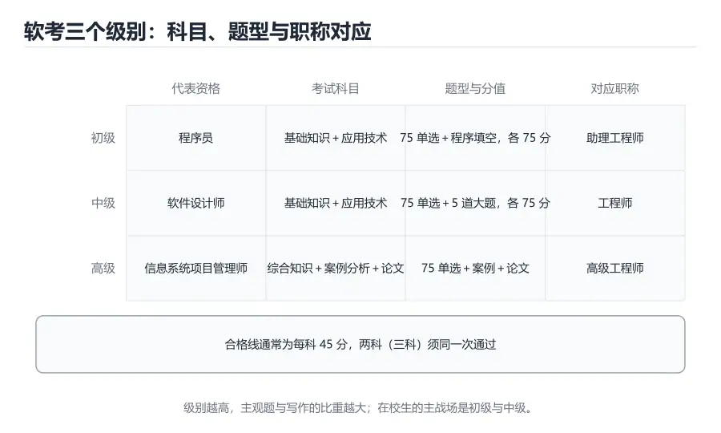

# 软考级别、资格与报名：初级/中级/高级怎么选



## 本节知识框架

**课程定位**：所属分类 `ruankao`（软考初级与中级），课程主题 `软考级别、资格与报名`，学习阶段 入门，建议用时 30 分钟。

本课主线：先把软考的三个级别、双部委发证、科目结构与合格线看清楚，再决定自己报哪一科、什么时候报、怎么分配两科复习时间。

**学完本课应当能够**
- 说出初级、中级、高级各自的代表资格名称，以及它们分别对应哪个职称层级。
- 讲清软件设计师「上午 75 道单选 + 下午 5 道大题、各科 45 分合格」这张考卷结构。
- 面对「要不要先从初级考起」「跨专业能不能报」这类问题，给出有依据的答复。

### 复习清单

- [ ] 能不看正文列出软考三个级别各 2~3 个代表资格名称，并说出对应职称。
- [ ] 能复述软件设计师上午题与下午题的题量、满分、合格线三个数字。
- [ ] 能说出报名的三条硬要求（实名注册、照片审核、按考区缴费），并指出常见的两条误解。
- [ ] 能用一次自测检验自己是否把「成绩不滚动保留」这条记对了。

## 核心概念定义

| 术语 | 操作性定义 | 常见边界与风险 |
| --- | --- | --- |
| 软考 | 计算机技术与软件专业技术资格（水平）考试，由人社部与工信部共同组织，分初、中、高三级。 | 易错：把它当成「认证证书」而非国家职业资格；成绩与证书信息以官方报名网站公布为准，别信第三方截图。 |
| 初级资格 | 代表资格是程序员、信息处理技术员、网络管理员等，考两科，对应助理工程师。 | 易错：以为初级是必考台阶。初级与中级平行，可直接报中级。 |
| 中级资格 | 代表资格是软件设计师、网络工程师、数据库系统工程师、信息安全工程师、系统集成项目管理工程师等，对应工程师。 | 易错：把「系统集成项目管理工程师」和高级的「信息系统项目管理师」混成一个，只差两个字，级别差一档。 |
| 高级资格 | 代表资格是信息系统项目管理师、系统分析师、系统架构设计师、网络规划设计师，考综合知识、案例分析、论文三科。 | 易错：只看题量不看论文，论文需要真实项目经历支撑，在校生通过率明显偏低。 |
| 以考代评 | 通过对应级别考试即取得相应职称资格，不再另外参加职称评审。 | 易错：以为还要交材料评审；个别单位内部聘任另有流程，但职称资格本身已由考试认定。 |
| 科目满分与合格线 | 各科满分 75 分，合格标准通常为 45 分，两科（高级三科）须在同一考试期内全部达标。 | 易错：把 45 分记成 60 分，或以为单科成绩可以保留到下一次。 |
| 考试批次 | 通常每年 5 月与 11 月两次，具体开考资格以当年度考试计划为准。 | 易错：默认某个资格每次都有开考，部分方向只在半年安排一次。 |
| 专业英语题 | 上午题末尾约 5 分的英文题干选择题，考查阅读与专业术语。 | 易错：整片空白放弃；其实答案线索在题干句子里，通读一遍即可拿到大部分分。 |

## 原理与运行机制

把软考想成一场「按级别取证的国考」：三个级别像三层台阶，但台阶之间没有强制通行顺序，任何一层的门都可以直接推开——只要你能通过那一层的考试。

**第一层机制：发证与定位。** 证书由人社部门与工信部门共同盖章，性质是「职业资格 + 水平评价」二合一。它同时干三件事：给在校生一张能写进简历的能力证明；给职场新人一条以考代评的职称通道；给系统集成类企业投标时提供人员资质数量。这三件事的受众不同，但考场规则完全一样。

**第二层机制：科目结构。** 初级与中级都是「基础知识 + 应用技术」两科。以软件设计师为例：

- 上午《基础知识》：75 道单选题，每题 1 分，含约 5 分专业英语，考试时长 150 分钟，机考。
- 下午《应用技术》：5 道大题共 75 分，通常是数据流图分析、数据库设计、UML 面向对象建模、C 语言算法填空、Java/C++ 面向对象程序填空（最后一题在两种语言里择一）。
- 高级多一科论文，三科必须同一次全部及格。

**第三层机制：报名与成绩。** 报名走官方网站的实名注册流程，选考区、上传符合规格的照片、在线缴费，考点名额先到先得。成绩不滚动：中级两科在同一次考试内双双达到 45 分才算通过，只过一科等于这次没过。

一个递进的小例子，说明「怎么选级别」：

1. 大一、大二，只学过 C 语言与一门专业课：先报初级程序员感受题型，或者干脆用软件设计师当目标、把教材当大纲来读。
2. 大三、准备实习或国企央企求职：直接报软件设计师，两科一次性通过，校招简历上写「中级资格（通过）」。
3. 工作三年以上、需要职称或投标资质：报中级系统集成项目管理工程师（偏记忆，投入产出比高）或高级信息系统项目管理师（要写论文，需要项目经历）。

**应试视角**：这部分的知识点在考卷里通常出现在上午第 1~5 题的「计算机技术基础与相关专业知识」开头，或者是程序语言与设计规范之前的那几题，每题 1 分。命题人最爱在「能否跨级报考」「成绩是否保留」「45 分还是 60 分」三个数字上设干扰项。

**第四层机制：机考流程。** 现在软考全程计算机化，理解流程才能把 150 分钟用完：

1. 开考后先在草稿区（系统提供的便签或纸质草稿，按考区规定）写下两个数字：各科合格线 45、总题量 75，避免中途慌乱。
2. 选择题逐题作答，遇到不确定的用系统的「标记」功能挂个旗子，继续往后做，第一遍绝不在一题上耗超过 90 秒。
3. 做完一轮后回看标记题，此时同一知识域的题目会互相提示——上午题常常在第 20 题和第 55 题考同一件事。
4. 下午题按大题切换，每道大题的答题区是独立文本框，先把空位编号写全再填内容，保证不漏空。
5. 结束前 15 分钟停止研究新题，只做两件事：检查有没有未作答的空、检查答案有没有填错框。

这条流程的代价很直观：75 道单选平均每题 2 分钟，如果前 30 题花掉 80 分钟，后面 45 题只剩 1.6 分钟/题，正确率会明显下滑。所谓「考试技巧」，本质是把时间预算提前分配好。

顺便把最常见的三种误判说清：一是把满分当成 100，于是按 60 分规划，白白多花几十小时；二是把两科当成可以分开考，报了名只准备一科；三是把论文题当成写作考试，忽略了高级资格需要真实项目经历做支撑。

## 典型应用场景

| 场景 | 典型输入或前提 | 期望产物 |
| --- | --- | --- |
| 第一次报考决策 | 大二、非科班、每周能投入 10 小时 | 确定报软件设计师，两科同步复习，先按分值权重排题量 |
| 简历与求职 | 已通过中级，尚未拿证 | 写「已通过全国计算机技术与软件专业技术资格（中级）考试」，注明科目与时间 |
| 单位职称聘任 | 需要工程师资格材料 | 提供合格证书与考试成绩单，走单位内部聘任流程 |
| 时间不够的取舍 | 距考试 6 周 | 优先保住上午题高分值知识域，下午题只练 3 类固定题型 |

三类典型人群的路径差异，值得单独记住：

两个把决策算清楚的真实案例：

**案例 A：大三、软件工程在读、暑假后找实习。** 每周可投入 12 小时，距 11 月考试 16 周，容量约 192 小时。按本课权重表，上午题各域合计需 120 小时，下午 5 类题型各练 3 遍约 50 小时，真题与模拟 22 小时，刚好排满。策略是直接报软件设计师，不浪费半年去考初级。

**案例 B：毕业两年、非科班转行做后端。** 每天只有 1.5 小时，容量约 120 小时，比案例 A 少四成。此时要主动降低目标：上午题放弃体系结构里最难的两类计算（指令流水线时序图、Cache 命中率综合题），把省下的 20 小时投给知识产权与网络协议这两片「背了就有分」的区域，最终把目标定在 48~52 分而不是 65 分。

- **在校生**：优势是时间连续、算法与数据结构底子新；短板是没有项目经历，所以高级论文是硬伤，主战场在初级与中级。
- **转行新人**：优势是目的明确；短板是计算机组成、体系结构这些「硬件味」很重的知识域，往往要在上午题上花最多时间。
- **在职开发**：优势是下午题的案例与面向对象部分几乎不用学；短板是考试节奏——机考不能回头改的自由度、以及每科 150 分钟的时间分配。

## 代码/协议/SQL 示例

下面这段 Python 用来把「两科同时达 45 分」这条规则写成可复现的判定，顺便复习 all() 的短路语义。把它跑一遍，比背口诀更牢：

```python
FULL = 75          # 单科满分
LINE = 45          # 合格线

def is_pass(scores, line=LINE):
    """初级与中级两科必须在同一次考试内双双达线，没有滚动保留。"""
    return all(s >= line for s in scores)

cases = {
    "上午差 1 分": [44, 60],
    "双双压线": [45, 45],
    "上午满分下午压线": [75, 45],
    "只过一科": [70, 44],
}

for name, scores in cases.items():
    print(f"{name:<12} {scores} -> {'通过' if is_pass(scores) else '本次不过'}")

print(f"总分口径：{sum(cases['上午差 1 分'])} 分，超过 90，仍然判定为不过")
```

再用一份 YAML 把「按分值权重分配周学习时间」写下来，后面各课都会复用这张表：

```yaml
category: ruankao
exam: 软件设计师
pass_line: 45
full_score: 75
weekly_hours: 12
weights:
  - domain: 数据结构与算法
    score: 12
    hours: 3.0
  - domain: 计算机网络与信息安全
    score: 10
    hours: 2.5
  - domain: 计算机组成与系统结构
    score: 10
    hours: 2.5
  - domain: 面向对象与设计模式
    score: 8
    hours: 2.0
  - domain: 数据库设计与范式
    score: 8
    hours: 2.0
  - domain: 知识产权与标准化
    score: 4
    hours: 0.5
```

## 时间/空间复杂度或性能分析

这一课的「性能」指的是备考投入的产出比。把每个知识域当成一项投资，用「分值 ÷ 所需小时」排序：

| 知识域 | 上午题约占分 | 预估投入小时 | 每小时的期望得分 | 决策 |
| --- | --- | --- | --- | --- |
| 知识产权与标准化 | 4 | 3 | 1.3 | 必背，最划算 |
| 计算机组成与数制 | 8 | 8 | 1.0 | 公式化训练，稳定得分 |
| 数据结构与算法 | 12 | 14 | 0.86 | 高分值，必须保住基础题 |
| 网络与信息安全 | 10 | 12 | 0.83 | 记背为主，短期冲刺有效 |
| 面向对象与 UML | 8 | 10 | 0.8 | 与下午题共用一套知识 |
| 操作系统原理 | 5 | 8 | 0.63 | 只抓调度与页面置换两类计算题 |
| 专业英语 | 5 | 2 | 2.5 | 考前刷 10 年真题英语即可 |

两个计算习惯要养成本能：一是任何投入都折算成「每周小时 × 周数」，看是否超过自己的容量；二是把目标定在 50~55 分而不是 75 分，留出波动余量。以两科各 45 分合格为例，把上午题正确率稳定在 65%（约 49 分），下午题按模板拿满基础踩分点，比「上午冲 70 分、下午裸考」稳健得多。

## 常见误区与易错点

| 容易答错的做法 | 考场上的实际现象 | 原因与正确做法 |
| --- | --- | --- |
| 认定必须先考初级 | 放弃了当年中级机会 | 三个级别平行报考，直接从中级开始完全合规 |
| 以为要相关专业学历 | 报名前自我淘汰 | 报名不审学历专业，只看实名注册与照片 |
| 把合格线记成 60 分 | 复习目标定高、时间错配 | 各科满分 75、合格 45，按 50 分左右定目标 |
| 以为单科成绩保留 | 只认真复习一科 | 两科须同一次通过，配平时间 |
| 混淆中高级的项目管理资格 | 选错报考科 | 系统集成项目管理工程师属中级，信息系统项目管理师属高级 |
| 忽略专业英语 5 分 | 白丢 5 分 | 英语题线索在题干里，考前集中刷真题 |
| 默认每个资格每次都开考 | 报名时找不到科目 | 以当年度考试安排为准，部分资格一年一次 |
| 裸考下午题 | 上午 50 分下午 30 分 | 下午题有固定模板，练 3 类题型就能上 45 |
| 只看不写 | 案例题写不满答题区 | 每题都手写完整答案，对照踩分点补漏 |
| 机考不练操作 | 最后 10 分钟来不及标记 | 考前用官方模拟系统练标记、回看与计算器使用 |

## 与其他知识点的关系

- **前置**：无，本课是整条软考路线的入口。
- **并列**：`ruankao_cs_basics`、`ruankao_os_and_arch` 等知识课共同构成上午题的分值地图；`ruankao_afternoon_case` 汇总下午题套路。
- **后续**：本课程的权重表会在各知识课的「时间/空间复杂度或性能分析」小节里被反复引用，用来决定「这一域值不值得再花两小时」。

## 自测题与参考答案

作答时先盖上答案区，每题限时 3 分钟；做完把错题对应的正文小节翻一遍。

### 自测 1

关于软考各级别的考试报名资格，下列说法正确的是？

- A. 必须计算机类专业毕业才能报考中级资格
- B. 必须先通过初级资格才能报考中级资格
- C. 不限学历、专业与年龄，可直接报考对应级别
- D. 需由所在单位出具从事计算机工作的年限证明

**答案：C（不限学历、专业与年龄，可直接报考对应级别）**

**解析**：本题正确项是「不限学历、专业与年龄，可直接报考对应级别」。软考属于国家职业资格类考试，报名环节只做实名注册与照片审核，既不查毕业证，也不查从事计算机工作的年限，在校生和跨专业转行者都能直接报中级。干扰项「必须先通过初级资格才能报考中级资格」把职称逐级晋升的老印象套到了考试上，实际上三个级别是平行关系；干扰项「必须计算机类专业毕业才能报考中级资格」同样是最常见的自我淘汰式误解。

### 自测 2

软件设计师上午的基础知识科目，题型与分值构成通常是下列哪一项？

- A. 75 道单选题，每题 1 分，其中含约 5 分专业英语
- B. 60 道单选题，每题 2 分，全部为中文题干
- C. 75 道单选题，多选也算对，总题量 100 题
- D. 50 道单选题加 5 道简答题，满分 100 分，45 分合格

**答案：A（75 道单选题，每题 1 分，其中含约 5 分专业英语）**

**解析**：本题正确项是「75 道单选题，每题 1 分，其中含约 5 分专业英语」。上午题满分 75 分、45 分合格，机考一次呈现全部单选，最后约 5 题是英文题干的专业英语，难度不高但容易被整片放弃。干扰项「50 道单选题加 5 道简答题，满分 100 分，45 分合格」把别的资格考试卷面结构搬了过来，软考上午科目里没有简答题，简答与填空都放在下午。

### 自测 3

关于软考中级的成绩与合格标准，正确的说法是？

- A. 两科得分相加满 90 分即为通过
- B. 只要下午应用技术达到 45 分，上午差几分也能拿证
- C. 两科各满分 75 分，须在同一考试期内都达到 45 分
- D. 单科合格成绩可保留到下一次考试

**答案：C（两科各满分 75 分，须在同一考试期内都达到 45 分）**

**解析**：本题正确项是「两科各满分 75 分，须在同一考试期内都达到 45 分」。软考中级按科目分别划线，两科同时达线才算通过，成绩不跨次滚动保留，所以复习时间必须两科配平。干扰项「单科合格成绩可保留到下一次考试」是很多考生的第一直觉，但中级科目不像部分职业资格有几年有效期；干扰项「两科得分相加满 90 分即为通过」听上去合理，实际上一科 60 分另一科 30 分照样不过。

### 自测 4（读代码）

阅读下面这段判定两科是否同时达标的程序，它的输出结果是什么？

```python
def is_pass(scores, line=45):
    return all(s >= line for s in scores)

print(is_pass([44, 60]), is_pass([45, 45]))
```

- A. True False
- B. False True
- C. 44 60
- D. 抛出类型错误

**答案：B（False True）**

**解析**：本题正确项是「False True」。all() 逐项求值，第一组里 44 不小于 45，整个表达式为假，返回 False；第二组两个 45 都满足大于等于关系，返回 True，也就是说压线算通过。这道题真正考的是合格线口径：单科不够就整体不过，恰好 45 分属于通过区间。干扰项「True False」只是把两组的输出顺序写反，机考时最容易顺手点错这一档。

### 自测 5

关于软考与职称的关系，下列说法正确的是？

- A. 通过软考后还需参加评审才能取得职称
- B. 软考成绩只作证明，与职称系列没有对应关系
- C. 以考代评，考过对应级别即认定相应职称资格
- D. 必须在国企工作，证书才被人社部门认可

**答案：C（以考代评，考过对应级别即认定相应职称资格）**

**解析**：本题正确项是「以考代评，考过对应级别即认定相应职称资格」。初级对应助理工程师、中级对应工程师、高级对应高级工程师，取得资格即可，不必再提交评审材料，也不限定单位性质。干扰项「通过软考后还需参加评审才能取得职称」描述的是传统评审路径，与软考的制度设计相反；至于个别单位内部聘任另有流程，那是岗位聘任，不是职称资格认定。

### 自测 6（多选）

下列软考资格中，属于中级设置的是哪几项？

- A. 软件设计师
- B. 程序员
- C. 信息系统项目管理师
- D. 网络工程师

**答案：A、D（软件设计师；网络工程师）**

**解析**：多选题要同时选中「软件设计师」与「网络工程师」，两者都是中级资格，上半年与下半年通常都有开考安排。剩下的两项各属一档：程序员是初级，对应助理工程师，下午题以程序填空为主；信息系统项目管理师是高级，除综合知识与案例分析外还要写论文。按级别把常见资格整理成三张卡片，考场上看到名称就能定档，不必现场推理。

## 考点精讲

### 精讲 1

关于软考各级别的考试报名资格，下列说法正确的是？

本题正确项是「不限学历、专业与年龄，可直接报考对应级别」。软考属于国家职业资格类考试，报名环节只做实名注册与照片审核，既不查毕业证，也不查从事计算机工作的年限，在校生和跨专业转行者都能直接报中级。干扰项「必须先通过初级资格才能报考中级资格」把职称逐级晋升的老印象套到了考试上，实际上三个级别是平行关系；干扰项「必须计算机类专业毕业才能报考中级资格」同样是最常见的自我淘汰式误解。

答案：C

### 精讲 2

软件设计师上午的基础知识科目，题型与分值构成通常是下列哪一项？

本题正确项是「75 道单选题，每题 1 分，其中含约 5 分专业英语」。上午题满分 75 分、45 分合格，机考一次呈现全部单选，最后约 5 题是英文题干的专业英语，难度不高但容易被整片放弃。干扰项「50 道单选题加 5 道简答题，满分 100 分，45 分合格」把别的资格考试卷面结构搬了过来，软考上午科目里没有简答题，简答与填空都放在下午。

答案：A

### 精讲 3

关于软考中级的成绩与合格标准，正确的说法是？

本题正确项是「两科各满分 75 分，须在同一考试期内都达到 45 分」。软考中级按科目分别划线，两科同时达线才算通过，成绩不跨次滚动保留，所以复习时间必须两科配平。干扰项「单科合格成绩可保留到下一次考试」是很多考生的第一直觉，但中级科目不像部分职业资格有几年有效期；干扰项「两科得分相加满 90 分即为通过」听上去合理，实际上一科 60 分另一科 30 分照样不过。

答案：C

### 精讲 4（读代码）

阅读下面这段判定两科是否同时达标的程序，它的输出结果是什么？

本题正确项是「False True」。all() 逐项求值，第一组里 44 不小于 45，整个表达式为假，返回 False；第二组两个 45 都满足大于等于关系，返回 True，也就是说压线算通过。这道题真正考的是合格线口径：单科不够就整体不过，恰好 45 分属于通过区间。干扰项「True False」只是把两组的输出顺序写反，机考时最容易顺手点错这一档。

答案：B

### 精讲 5

关于软考与职称的关系，下列说法正确的是？

本题正确项是「以考代评，考过对应级别即认定相应职称资格」。初级对应助理工程师、中级对应工程师、高级对应高级工程师，取得资格即可，不必再提交评审材料，也不限定单位性质。干扰项「通过软考后还需参加评审才能取得职称」描述的是传统评审路径，与软考的制度设计相反；至于个别单位内部聘任另有流程，那是岗位聘任，不是职称资格认定。

答案：C

### 精讲 6（多选）

下列软考资格中，属于中级设置的是哪几项？

多选题要同时选中「软件设计师」与「网络工程师」，两者都是中级资格，上半年与下半年通常都有开考安排。剩下的两项各属一档：程序员是初级，对应助理工程师，下午题以程序填空为主；信息系统项目管理师是高级，除综合知识与案例分析外还要写论文。按级别把常见资格整理成三张卡片，考场上看到名称就能定档，不必现场推理。

答案：A、D

## 术语速查

| 术语 | 一句话说明 |
| --- | --- |
| 软考 | 计算机技术与软件专业技术资格（水平）考试，人社部与工信部共同组织，分三个级别。 |
| 程序员 | 初级资格之一，考基础与应用两科，对应助理工程师，下午题以程序填空为主。 |
| 软件设计师 | 中级资格之一，上午 75 道单选、下午 5 道大题，是在校生报考最多的科目。 |
| 系统集成项目管理工程师 | 中级资格，偏记忆与管理，注意与高级的信息系统项目管理师区分。 |
| 以考代评 | 通过考试直接取得职称资格，不必另外提交评审材料。 |
| 合格标准 | 通常每科 45 分（满分 75），两科或三科须在同一次考试内全部达线。 |
| 专业英语 | 上午题末尾约 5 分的英文单选题，考查阅读专业材料的能力。 |
| 计算机化考试 | 报名、答题、交卷均在机考系统完成，支持标记回看与系统自带计算器。 |

## 参考资料与复核

- [中国计算机技术职业资格网首页（软考官方报名与成绩查询）](https://www.ruankao.org.cn/)
- [考试介绍与科目设置](https://www.ruankao.org.cn/exam/)
- [工业和信息化部（软考主管部门之一）](https://www.miit.gov.cn/)
- 最后复核：2026-10-04
- 下次复核：2027-09-10

## 内容元数据

> 内容更新时间：2026-10-06 · 学习阶段：入门 · 预计用时：30 分钟

- 内容版本：v2.0
- 适用考试：软件设计师 / 程序员（初级与中级方向）
- 相关课程：`ruankao_cs_basics`、`ruankao_afternoon_case`
- 质量口径：与 `tool/content_pipeline/validate_pack.js` 的结构与题库门禁对齐
- 说明：本课数字型结论（分值、合格线、题量）随年度安排可能微调，以官方当次通知为准
