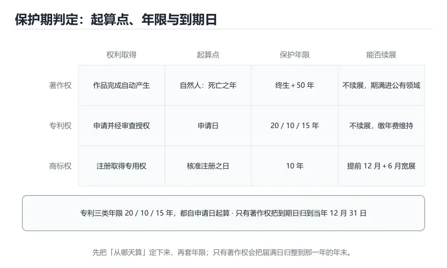

# 知识产权与标准规范



> 内容更新时间：2026-10-06 · 学习阶段：进阶 · 预计用时：50 分钟

## 本节知识框架

**课程定位**：所属分类 `ruankao`（软考初级与中级），课程主题 `知识产权与标准规范`，学习阶段 进阶，建议用时 50 分钟。

这一门在上午综合知识里通常只占 1 到 2 分，却是全卷最容易拿满的两分：它不考推理，只考你把三条起算线、三个年限数字和标准的强制与推荐之分记牢。出题形式同样固定——给一段带日期的场景（某人离职、某公司发表、某商标快到期），问权利归谁、到哪一天结束、该怎么办理；或者给一句关于标准代号的判断，问哪句能成立。丢分几乎不是因为没学过，而是因为把专利的起算日写成授权日、把商标的续展期记成二十年、把推荐性标准当成可有可无。

配图是一张三行四列的判定表：行是著作权、专利权、商标权三种权利，列依次是权利取得方式、起算点、保护年限、能否续展。看这张表要横着读，一行就是一道题：第一行说著作权随作品完成自动产生，自然人作者的财产权算到死亡后第 50 年的 12 月 31 日，到期不归零、不续展，直接进入公有领域；第二行说专利必须先申请、经审查才授权，三类年限 20、10、15 年都从申请日往后数，期间靠缴年费维持，期满不续展；第三行说商标权来自核准注册，有效期 10 年从核准注册之日起算，唯一能续展的一列就在这里，期满前 12 个月办理、另有 6 个月宽展期，每次续展 10 年、次数不限。表下面还有一句要紧的提醒：只有著作权会把届满日归整到那一年的年末，专利与商标都按对应日结束，这一步混了就会把日期算错。

**学完本节应当能够**

- 区分自动保护、申请注册、自愿登记三种权利取得方式，并说明软件著作权登记在诉讼里起什么作用。
- 给定发表年份、申请年份或注册日期，算出财产权、专利权和商标权的届满年份，并说清哪一个要归到 12 月 31 日。
- 判断职务开发与职务发明的权利归属，写出单位取得权利的三种法定情形。
- 用代号与效力两条线给国家标准、行业标准、地方标准、团体标准和企业标准归类，说明推荐性标准何时变成必须执行。
- 在专利申请与商业秘密保护之间做出取舍，并说明理由落在公开性、期限上限还是反向工程难度上。

### 复习清单

- [ ] 能否说出自然人的作品著作权中财产权的保护期算法，并解释为什么法人作品的算法不一样。
- [ ] 能否列出发明专利、实用新型专利与外观设计专利的期限，并指出它们共同的起算点。
- [ ] 能否写出注册商标续展的办理窗口、宽展期长度与每次续展的有效期。
- [ ] 能否判断一项技术成果属于职务发明还是非职务发明，并说出单位主张权利需要哪些证据。
- [ ] 能否按代号区分 GB、GB/T、GB/Z、行业标准、地方标准、团体标准与企业标准，并说明谁必须执行。

## 核心概念定义

| 概念 | 一句话定义 | 考场判分点 |
| --- | --- | --- |
| 知识产权 | 对智力成果与商业标记依法享有的专有权利，分著作权与工业产权两大块 | 客体无形、可被多人同时使用，所以法律要先确权再谈侵权 |
| 著作权 | 作者对文学、艺术和科学作品享有的人身权与财产权的总称 | 作品创作完成即自动产生，不需要发表，也不需要登记 |
| 作品 | 具有独创性并能以一定形式表达的智力成果 | 只保护表达，不保护思想、算法、操作步骤与数学方法本身 |
| 著作人身权 | 发表权、署名权、修改权与保护作品完整权 | 署名权、修改权与保护作品完整权的保护不受期限限制 |
| 著作财产权 | 复制、发行、出租、信息网络传播、改编、翻译等十余项可获酬的权利 | 有保护期，期满进入公有领域，任何人均可自由使用 |
| 职务作品与职务开发软件 | 为完成工作任务，或主要利用单位物质技术条件开发出来的成果 | 一般职务作品著作权归作者，法律另有规定或合同另有约定的除外 |
| 合理使用 | 法定情形下使用他人作品可以不经许可、不支付报酬 | 应当指明作者姓名与作品名称，且不得影响作品的正常使用 |
| 法定许可 | 依法律的直接规定使用作品，可以不经许可但必须付酬 | 与合理使用的分界线就在「要不要付酬」这一条 |
| 专利权 | 国家对发明、实用新型与外观设计授予的独占实施权 | 先申请原则；同样的发明创造只能授予一项专利权 |
| 授予专利的条件 | 新颖性、创造性与实用性三性齐备 | 申请日前的公开会破坏新颖性，法定宽限期只有 6 个月且情形有限 |
| 不授予专利的客体 | 科学发现、智力活动的规则和方法、疾病的诊断和治疗方法等 | 动物和植物品种本身不授权，其生产方法可以获得专利 |
| 专利强制许可 | 国务院专利行政部门依申请或依职权许可他人实施专利 | 只适用于发明与实用新型，不适用于外观设计 |
| 商标权 | 对核准注册的商标在核定商品或服务范围上享有的专用权 | 注册取得；有效期满不续展即被注销 |
| 显著性 | 商标能把商品或服务的来源区别开来的属性 | 通用名称、直接表示质量与原料的标志缺乏显著性 |
| 商标续展 | 有效期满前办理的延期手续，每次 10 年且次数不限 | 三种权利里只有商标可续展，这一点常单独出题 |
| 商业秘密 | 不为公众所知悉、具有商业价值并经权利人采取相应保密措施的技术与经营信息 | 三个要件缺一不可，且没有登记程序与期限上限 |
| 标准 | 通过标准化工作、经公认机构批准，供共同和重复使用的规范 | 判两级：谁制定的（层级），有没有强制力（效力） |
| 强制性国家标准 | 代号 GB，保障人身健康、生命财产安全、国家安全与生态环境安全的底线要求 | 必须执行，不符合就不得生产、销售或提供相关服务 |
| 推荐性标准 | GB/T 与行业标准、地方标准、团体标准、企业标准 | 自愿采用，一经法规引用或在合同中约定即产生约束力 |
| 采用国际标准的程度 | 等同采用 IDT、修改采用 MOD、非等效 NEQ | 国内转化国际标准以前两种为主，问「完全照搬」时看代号后缀 |
| 说明 | 本表按现行法律与标准的通行教材口径整理，具体条文以国家法律法规数据库公布的版本为准 | 修法产生的年限调整（如外观设计 15 年）以施行日为界 |

## 原理与运行机制

**权利怎么产生**：三条线走法不同。著作权走自动保护，作品创作完成那一刻权利就成立，发表、登记、加注 © 都只影响举证与涉外事务，不影响权利存在；中国版权保护中心的软件著作权登记发的是初步证明，遇到权属争议时能省掉一大截举证成本，但不是取得权利的前提。专利权走申请审查，先申请原则下谁先提交申请谁获得授权，同一内容由两个人分别申请时只授给先申请的那一方，因此技术成熟的第一天就该写申请文件，而不是等做完产品。商标权走注册取得，核准注册才有专用权，使用的时长本身不自动产生排他效力，未注册的商标只在极有限的范围内受保护。

**期限怎么算**：先把起算点定下来，再套年限，最后判断要不要归整。自然人的著作财产权以作者终生加死亡后 50 年计，截止于死亡后第 50 年的 12 月 31 日；法人或者非法人组织的作品、著作权由单位享有的职务开发软件，以首次发表后 50 年计，截止于首次发表后第 50 年的 12 月 31 日，但作品自创作完成后 50 年内未发表的不再受保护——这一句是「创作完成 50 年」这个干扰项的出处。专利三类年限都从申请日往后数，发明 20 年、实用新型 10 年、外观设计 15 年，期间靠逐年缴纳年费维持，期满不续展。商标有效期 10 年，自核准注册之日起算，是三种权利里唯一可以无限次续展的，每次续展同样是 10 年。归整规则要单独记：只有著作权的届满日被法律明文归到当年的 12 月 31 日，专利与商标都按对应日结束。

**归谁所有**：软件领域的权属题几乎都是职务开发题。判定顺序是先看是不是本职工作、再看是不是用单位的物质技术条件。针对本职工作中明确指定的开发目标所开发的软件、从事本职工作活动所预见的结果或者自然的结果所开发的软件，以及主要使用单位的资金、专用设备、未公开的专门信息等物质技术条件开发并由单位承担责任的软件，著作权由单位享有；三者都不沾，才归开发者本人。离职之后继续开发的作品最容易出问题，判分时看新代码与在职期间的成果是否有延续关系、是否仍依赖单位未公开的信息，而不是只看工牌什么时候交的。

**标准分层与效力链**：我国的标准按制定主体分五级——国家标准、行业标准、地方标准、团体标准、企业标准，前三类由政府主导制定，后两类由市场自主制定。效力上只有两个档位：强制性国家标准必须执行，由国务院批准发布或者授权批准发布，代号 GB；推荐性国家标准代号 GB/T，行业标准与地方标准为推荐性，团体标准代号 T、企业标准代号 Q，均属自愿采用。这里的陷阱在「自愿」二字：推荐性标准一旦被法律、行政法规引用，或者被写进合同、投标文件与产品明示执行的标准，就对该范围产生必须履行的约束力；企业标准还不得低于相应的强制性国家标准，国家鼓励制定严于推荐性标准的企业标准。标准也不是发出去就永远有效，实施后一般不超过 5 年要复审一次，结论只有确认、修订、废止三种。

**公开与保密的取舍**：专利与商业秘密是一组方向相反的选项。申请发明专利意味着把技术方案完整公开并换取限期独占，公开文本从此任何人都能读到；商业秘密不承担公开义务，也没有期限上限，但一旦被人独立研发出来或反向工程得到，权利人无法阻止对方使用，且构成时必须自证三要件。因此判分口径很清楚：容易被产品反推、又需要长周期独占的核心算法走专利；难以从外部观察、且一旦泄露就失去价值的配方与流程走商业秘密。两者不能叠加使用——授权即公开，公开之后同一方案就不再满足「不为公众所知悉」。

## 典型应用场景

| 场景 | 该用哪条规则 | 常见问法 |
| --- | --- | --- |
| 员工在职期间写了管理系统，离职后公司继续迭代 | 职务开发软件权属条款，看开发目标与物质技术条件 | 著作权归谁、单位需要什么证据 |
| 外包方与委托方未签书面合同，源码已交付 | 委托开发软件的著作权归属依约定，无约定时归受托人 | 谁有权二次销售、如何补签 |
| 论文里引用的他人图表与代码片段 | 合理使用，为个人学习研究或适当引用 | 是否要付酬、是否要注明出处 |
| 开源项目的 GPL 依赖引入自研产品 | 许可证的传染性义务与分发场景 | 哪些行为触发源码公开义务 |
| 自研算法是否申请专利 | 公开换保护 vs 独立研发抗辩 | 从公开性、期限、反向工程难度三选一 |
| 产品宣传册写「本产品执行 GB/T XXXXX」 | 推荐性标准被明示采用后产生约束力 | 企业是否必须达到该标准 |
| 投标要求提供产品符合强制性国标的证明 | 强制性标准必须执行，不符即不得生产销售 | 能否用高于国标的企标替代 |
| 商标使用十年后被人仿冒 | 续展与专用权范围（核定商品或服务） | 是否续展、能否跨类别主张 |
| 数据库表结构与查询语句被抄袭 | 只保护表达不保护思想，结构可能落到商业秘密 | 著作权能否覆盖数据库设计 |
| 论文署名与排序纠纷 | 署名权属于人身权，保护不受期限限制 | 署名权能否转让、能否过期 |

## 代码/协议/SQL 示例

期限判定这类题最怕手算出错，把三条规则写成一小段代码，判分口径就固定下来了。下面这段 Python 把起算点、年限与是否归整到年末做成数据，输出可以直接抄进答题纸的两行结论：

```python
START = {'著作权（法人作品）': '首次发表', '发明专利': '申请日', '注册商标': '核准注册'}
TERM = {'著作权（法人作品）': 50, '发明专利': 20, '注册商标': 10}
ROUND_YEAR_END = {'著作权（法人作品）': True, '发明专利': False, '注册商标': False}


def brief(item, since):
    year = since + TERM[item]
    tail = '年的 12 月 31 日' if ROUND_YEAR_END[item] else '年对应日'
    return f'{item}自{START[item]}起算，到第 {year} {tail}届满'


print(brief('著作权（法人作品）', 2016))
print(brief('发明专利', 2021))
```

程序输出两行，第一行的年末归整与第二行的对应日是本题的判分点，把两个词互换就会算错日期。

标准台账的核对也可以写成一句 SQL。假设表 `std` 记录了每项在用标准的代号、发布年份与实施年份，检查「强制性标准必须执行」与「复审周期一般不超过五年」两件事：

```sql
SELECT code,
       published_year,
       implemented_year,
       CASE
           WHEN code LIKE 'GB/%' THEN '推荐性，明示采用或法规引用后必须达到'
           WHEN code LIKE 'GB/%Z' THEN '指导性技术文件，不具强制力'
           WHEN code LIKE 'GB[_]%' THEN '强制性国家标准，必须执行'
           ELSE '行业、地方、团体或企业标准'
       END AS effect,
       implemented_year + 5 AS review_due_year
FROM std
WHERE implemented_year + 5 < 2026;
```

查询筛出的是复审已经超期的条目，结论列要回到「确认、修订、废止」三选一，而不是把它们直接当作作废——标准在复审结论公布之前仍然有效，这是选择题爱设的一个转折。

许可类型的口头表述也要固定下来，否则案例分析容易写歪。同一份软件，权利人可以给别人三种不同强度的许可：普通许可下权利人自己还能用、还能继续许可别人；排他许可下权利人自己可以用，但不再许可第三方；独占许可下连权利人自己都不实施。强度从低到高，对价通常也从低到高，判分时把「谁能用、还能给谁」两项各答一次。

## 时间/空间复杂度或性能分析

这一域没有算法复杂度，只有四组数字，而数字本身就是考点。

第一组是分值与题量。知识产权与标准规范在软件设计师上午卷一般出 1 到 2 道选择题，系统架构设计师卷可能多出 1 道，属于「记住即得分」的一档，与其他需要推导的题目相比时间成本极低。把这 2 分留给推导题去撞是常见的策略错误。

第二组是期限数字。著作财产权：自然人终生加死亡后 50 年；法人作品与单位享有的职务开发软件：首次发表后 50 年，创作完成后 50 年内未发表不再保护。专利：发明 20 年、实用新型 10 年、外观设计 15 年，均自申请日起算。商标：10 年，自核准注册之日起算，期满前 12 个月办理续展、6 个月宽展期，每次续展 10 年。复审：标准实施后一般不超过 5 年。优先权：发明与实用新型 12 个月，外观设计与商标 6 个月。

第三组是效力层级与代号。GB 必须执行；GB/T 自愿采用，但被法规引用或写入合同后必须达到；GB/Z 是指导性技术文件；行业标准与地方标准为推荐性，地方标准只在本行政区域内适用；团体标准 T、企业标准 Q 由市场自主制定，企业标准不得低于强制性国家标准。

第四组是成本。专利从申请到授权的周期按类型差别很大，且授权后仍有年费；技术生命周期短于授权周期的成果更适合用商业秘密或快速迭代保护，而不是排队等授权。软件著作权登记的费用低、周期短，主要买来的是举证便利。商标每 10 年一次续展，费用可控，是唯一能靠续展做到事实上永久保护的权利。

| 指标 | 常见取值或结论 | 易错点 |
| --- | --- | --- |
| 自然人著作财产权 | 终生 + 死亡后 50 年，截止于第 50 年的 12 月 31 日 | 把发表当成权利产生条件 |
| 法人著作财产权 | 首次发表后 50 年，年末归整 | 与 50 年内未发表不再保护混记 |
| 发明专利期限 | 20 年，自申请日起算 | 写成自授权日起算 |
| 实用新型与外观设计 | 10 年与 15 年 | 记成都是 10 年 |
| 注册商标有效期 | 10 年，自核准注册之日起算 | 与续展后的 10 年重复相加 |
| 续展窗口 | 期满前 12 个月 + 6 个月宽展期 | 把两个数字对调 |
| 标准复审周期 | 一般不超过 5 年 | 以为过期即自动作废 |
| 强制与推荐 | 只有强制性国标必须执行 | 认为推荐性标准一律无约束力 |
| 优先权期限 | 发明与实用新型 12 个月，外观设计与商标 6 个月 | 四类混成一个数字 |
| 商业秘密构成 | 秘密性 + 价值性 + 保密措施 | 漏掉「采取保密措施」 |
| 保护期届满后果 | 进入公有领域，可自由使用 | 以为届满后自动转为商业秘密 |
| 权属证据 | 登记证书是初步证明 | 以为登记是权利产生条件 |

## 常见误区与易错点

| 容易答错的做法 | 考场上的实际现象 | 原因与正确做法 |
| --- | --- | --- |
| 认为软件必须登记才享有著作权 | 权属题选错 | 著作权随创作完成自动产生，登记只是初步证明 |
| 把专利期限从授权公告日往后数 | 日期算错 | 三类专利均自申请日起算，授权只影响权利开始可行使 |
| 把外观设计保护期记成 10 年 | 年限题丢分 | 修法后外观设计为 15 年，实用新型仍为 10 年 |
| 认为商标续展一次 20 年 | 概念题选错 | 每次续展有效期为 10 年，次数不限 |
| 把续展窗口写成期满前 6 个月、宽展 12 个月 | 两个数字对调 | 期满前 12 个月内办理，另有 6 个月宽展期 |
| 认为推荐性标准可以随意不执行 | 案例分析扣分 | 被法规引用或在合同中明示采用后必须达到 |
| 把 GB/Z 当成推荐性国家标准 | 代号归类错 | GB/T 才是推荐性国标，GB/Z 是指导性技术文件 |
| 认为地方标准在全国范围内适用 | 层级题选错 | 地方标准只在本行政区域内适用 |
| 觉得标准复审超期即自动作废 | 判断结论错 | 复审结论是确认、修订、废止三选一，公布前仍有效 |
| 把科学发现、疾病诊断方法写成可专利客体 | 排除题选错 | 这些属于不授予专利的情形，其设备与用途可能另行授权 |
| 主张他人独立研发出的相同技术侵犯商业秘密 | 侵权判断错 | 独立研发与反向工程不属不正当手段，不构成侵权 |
| 用商业秘密与专利叠加保护同一方案 | 策略写歪 | 授权即公开，公开后无法满足不为公众所知悉 |
| 把职务作品一律写成归单位所有 | 简答题丢分 | 一般职务作品归作者，单位有业务范围内优先使用权 |
| 认为署名权会随保护期届满消灭 | 人身权题选错 | 署名权、修改权与保护作品完整权不受期限限制 |

## 与其他知识点的关系

- **前置**：`ruankao_cs_basics` 的抽象、规范化与约定概念是理解「标准为什么分强制与推荐」的底座；`ruankao_exam_overview` 给出的题型与分值分布决定了这门该投入多少时间。
- **并列**：`ruankao_net_security` 的等级保护、日志留存与安全合规和标准体系直接相接，安全要求常以强制性标准或推荐性标准被引用的方式产生约束力；`ruankao_ood_uml` 的建模成果与 `ruankao_db_and_sql` 的模式设计属于「智力成果」，它们的保护范围要靠本课的表达与思想二分来判断。
- **后续**：`ruankao_case_paper` 下午科目的案例分析里，需求与合同条款、成果归属与验收标准经常借用本课的许可类型与标准效力来设问；项目管理类科目还会把本课的标准分层与备案要求放大成流程题。

## 自测题与参考答案

作答时先盖上答案区，每题限时 4 分钟；做完把配图那张三行表重看一遍，把起算点与年限在草稿上各写一次。

### 题目 1（单选题）

某公司职员在职期间针对本职工作中明确指定的开发目标完成了一套管理系统，2016 年 3 月由公司首次发表，该职员 2020 年 8 月离职。就该软件财产性权利的保护期，下列说法正确的是？

- A. 保护期归该职员，截止于其死亡后第 50 年的 12 月 31 日
- B. 保护期归公司，截止于 2066 年 3 月 31 日，即发表日之后满 50 年
- C. 保护期归公司，截止于 2046 年 3 月 31 日，即开发完成之后满 30 年
- D. 保护期归公司，截止于 2066 年 12 月 31 日，即首次发表后第 50 年年末

**参考答案**：D

**解析**：本题正确项是「保护期归公司，截止于 2066 年 12 月 31 日，即首次发表后第 50 年年末」。针对本职工作中明确指定的开发目标所开发的软件，著作权由单位享有，归属公司的财产性权利按法人口径从首次发表起算 50 年，并且截止于第 50 年的 12 月 31 日，2016 加 50 得 2066，年末归整，两个动作都做对才落到 D。干扰项「保护期归该职员，截止于其死亡后第 50 年的 12 月 31 日」把权属判给了开发者个人，也就套错了自然人的算法；干扰项「保护期归公司，截止于 2066 年 3 月 31 日，即发表日之后满 50 年」年限算对了却没有年末归整，法人作品的截止日不归到发表纪念日的对应日；干扰项「保护期归公司，截止于 2046 年 3 月 31 日，即开发完成之后满 30 年」把已发表作品按未发表的处理，30 年这个数字在本法里并不存在。

### 题目 2（单选题）

关于我国标准的层级、代号与效力，下列说法正确的是？

- A. 强制性国家标准代号为 GB，必须执行，由国务院批准发布或授权批准发布
- B. 推荐性国家标准代号为 GB/Z，一经发布即对全社会产生强制约束力
- C. 地方标准代号为 DB，由县级以上地方政府制定并在全国范围内适用
- D. 团体标准与企业标准需报国务院标准化行政主管部门批准后才能发布实施

**参考答案**：A

**解析**：本题正确项是「强制性国家标准代号为 GB，必须执行，由国务院批准发布或授权批准发布」。强制性国标只此一档必须执行，发布与编号权统一在国务院或其授权的部门手里，这是标准化法的核心句式。干扰项「推荐性国家标准代号为 GB/Z，一经发布即对全社会产生强制约束力」两处都错，推荐性国标的代号是 GB/T，GB/Z 是指导性技术文件，而且推荐性标准本身自愿采用；干扰项「地方标准代号为 DB，由县级以上地方政府制定并在全国范围内适用」把制定层级与适用范围同时放大，地方标准由省级与设区的市级制定，只在本行政区域内适用；干扰项「团体标准与企业标准需报国务院标准化行政主管部门批准后才能发布实施」混淆了政府主导与市场自主两类标准，后两类由团体或企业自行制定并自我声明公开。

### 题目 3（单选题）

某注册商标将于 2018 年 5 月 10 日有效期满，注册人希望继续使用。关于续展的时间安排与后果，下列说法正确的是？

- A. 应当在期满前 6 个月内提出申请，另有 12 个月宽展期，每次续展有效期 20 年
- B. 续展窗口只到期满日为止，逾期未办的商标被注销后不得再次申请注册
- C. 应当在期满前 12 个月内办理，另有 6 个月宽展期，每次续展有效期 10 年
- D. 只需在期满后 6 个月宽展期内补办，同一商标的续展次数以两次为上限

**参考答案**：C

**解析**：本题正确项是「应当在期满前 12 个月内办理，另有 6 个月宽展期，每次续展有效期 10 年」。法条把窗口切成两段：期满前 12 个月是正常办理期，来不及的还可以再用 6 个月宽展期，每次续展后的有效期仍是 10 年，且次数不限，注册商标因此是唯一能靠续展做到事实上永久保护的权利。干扰项「应当在期满前 6 个月内提出申请，另有 12 个月宽展期，每次续展有效期 20 年」把两段时长对调，还擅自把有效期放大到 20 年；干扰项「续展窗口只到期满日为止，逾期未办的商标被注销后不得再次申请注册」否定了宽展期，也错在注销只是专用权终止，重新申请仍可获准；干扰项「只需在期满后 6 个月宽展期内补办，同一商标的续展次数以两次为上限」把兜底手段当成正常路径，并编出了次数上限。

### 题目 4（代码阅读题）

阅读下面的 Python 代码，第二行 print 输出的内容是什么？

```python
START = {'著作权（法人作品）': '首次发表', '发明专利': '申请日', '注册商标': '核准注册'}
TERM = {'著作权（法人作品）': 50, '发明专利': 20, '注册商标': 10}
ROUND_YEAR_END = {'著作权（法人作品）': True, '发明专利': False, '注册商标': False}


def brief(item, since):
    year = since + TERM[item]
    tail = '年的 12 月 31 日' if ROUND_YEAR_END[item] else '年对应日'
    return f'{item}自{START[item]}起算，到第 {year} {tail}届满'


print(brief('著作权（法人作品）', 2016))
print(brief('发明专利', 2021))
```

- A. 发明专利自申请日起算，到第 2041 年对应日届满
- B. 发明专利自授权日起算，到第 2041 年对应日届满
- C. 发明专利自申请日起算，到第 2061 年的 12 月 31 日届满
- D. 发明专利自申请日起算，到第 2041 年的 12 月 31 日届满

**参考答案**：A

**解析**：本题正确项是「发明专利自申请日起算，到第 2041 年对应日届满」。第二个实参给出 2021，字典查到的年限是 20，相加得 2041；`ROUND_YEAR_END` 对发明专利取 False，尾巴因此是「年对应日」而不是「年的 12 月 31 日」，起算点取的是「申请日」。这段代码写的正是判分口径本身：年末归整只属于著作权。干扰项「发明专利自授权日起算，到第 2041 年对应日届满」与代码里 START 的取值不符，是全库最高频的期限起点错误；干扰项「发明专利自申请日起算，到第 2061 年的 12 月 31 日届满」把著作权的 50 年套到了专利上；干扰项「发明专利自申请日起算，到第 2041 年的 12 月 31 日届满」年限与起点都对，却把归整规则误用到了专利上。

### 题目 5（多选题）

某核心算法是产品的竞争力来源，团队在「申请发明专利」与「作为商业秘密保护」之间权衡。下列说法正确的是？

- A. 申请发明专利必须公开技术方案，竞争对手可以从公开文本里读到实现细节
- B. 商业秘密不以公开为代价，但他人独立研发出相同技术不受限制
- C. 两种保护可以叠加，专利权期限届满后同一方案自动回到商业秘密状态
- D. 技术容易被产品反向工程时，靠商业秘密保护的风险偏高，更适合申请专利
- E. 构成商业秘密只须证明具有商业价值并采取了保密措施，秘密性不是必要条件

**参考答案**：A、B、D

**解析**：多选题要同时选中「申请发明专利必须公开技术方案，竞争对手可以从公开文本里读到实现细节」、「商业秘密不以公开为代价，但他人独立研发出相同技术不受限制」与「技术容易被产品反向工程时，靠商业秘密保护的风险偏高，更适合申请专利」。专利的交易结构是公开换保护，授权公告文本面向所有人；商业秘密换来的是不设期限的保护，代价是挡不住独立研发与反向工程，也正因为没有登记程序，权利人必须在诉讼中自证不为公众所知悉、具有商业价值并采取了相应保密措施三项齐备，而反向工程难度恰好是选型的第一根杠杆。干扰项「两种保护可以叠加，专利权期限届满后同一方案自动回到商业秘密状态」忽视了授权即公开，方案一经公告便不再满足秘密性，届满后进的是公有领域；干扰项「构成商业秘密只须证明具有商业价值并采取了保密措施，秘密性不是必要条件」删掉了三要件里的第一项，缺了秘密性就不成立。

### 题目 6（排序题）

把一项推荐性国家标准从立项到退出使用的四个阶段按先后排列：

- A. 发布与实施：由国务院标准化行政主管部门统一编号发布，按规定日期开始实施
- B. 复审：实施后一般不超过 5 年复审一次，作出确认、修订或废止的结论
- C. 立项与起草：主管部门下达项目计划，起草组形成征求意见稿并向社会征求意见
- D. 审查与批准：全国专业标准化技术委员会审查草案，通过后报主管部门批准

**参考答案**：C → D → A → B

**解析**：本题顺序是「立项与起草：主管部门下达项目计划，起草组形成征求意见稿并向社会征求意见」→「审查与批准：全国专业标准化技术委员会审查草案，通过后报主管部门批准」→「发布与实施：由国务院标准化行政主管部门统一编号发布，按规定日期开始实施」→「复审：实施后一般不超过 5 年复审一次，作出确认、修订或废止的结论」。这条链的关键在两个位置：征求意见必须出现在技术委员会审查之前，因为审查的对象是已经吸纳了社会反馈的草案；复审排在实施之后而不是批准之后，判据是复审以实施满一定年限为触发条件。答这类题时把立项、起草、审查、批准、发布、实施、复审七个动词在草稿上按时间轴排一遍，再回头看每个阶段的责任主体是否写对，比背整段原文更稳。

## 考点精讲

本课题库共 6 道题，下面逐题复述题干原文、答案字母（A 是第 1 个选项）与判断依据，字段内容与题库完全一致。

### 考点 1（单选题 · 职务开发软件的保护期）

- **题目**：某公司职员在职期间针对本职工作中明确指定的开发目标完成了一套管理系统，2016 年 3 月由公司首次发表，该职员 2020 年 8 月离职。就该软件财产性权利的保护期，下列说法正确的是？
- **答案**：D
- **正确项**：保护期归公司，截止于 2066 年 12 月 31 日，即首次发表后第 50 年年末
- **判断依据**：本题正确项是「保护期归公司，截止于 2066 年 12 月 31 日，即首次发表后第 50 年年末」。针对本职工作中明确指定的开发目标所开发的软件，著作权由单位享有，归属公司的财产性权利按法人口径从首次发表起算 50 年，并且截止于第 50 年的 12 月 31 日，2016 加 50 得 2066，年末归整，两个动作都做对才落到 D。干扰项「保护期归该职员，截止于其死亡后第 50 年的 12 月 31 日」把权属判给了开发者个人，也就套错了自然人的算法；干扰项「保护期归公司，截止于 2066 年 3 月 31 日，即发表日之后满 50 年」年限算对了却没有年末归整，法人作品的截止日不归到发表纪念日的对应日；干扰项「保护期归公司，截止于 2046 年 3 月 31 日，即开发完成之后满 30 年」把已发表作品按未发表的处理，30 年这个数字在本法里并不存在。

### 考点 2（单选题 · 标准的层级与代号）

- **题目**：关于我国标准的层级、代号与效力，下列说法正确的是？
- **答案**：A
- **正确项**：强制性国家标准代号为 GB，必须执行，由国务院批准发布或授权批准发布
- **判断依据**：本题正确项是「强制性国家标准代号为 GB，必须执行，由国务院批准发布或授权批准发布」。强制性国标只此一档必须执行，发布与编号权统一在国务院或其授权的部门手里，这是标准化法的核心句式。干扰项「推荐性国家标准代号为 GB/Z，一经发布即对全社会产生强制约束力」两处都错，推荐性国标的代号是 GB/T，GB/Z 是指导性技术文件，而且推荐性标准本身自愿采用；干扰项「地方标准代号为 DB，由县级以上地方政府制定并在全国范围内适用」把制定层级与适用范围同时放大，地方标准由省级与设区的市级制定，只在本行政区域内适用；干扰项「团体标准与企业标准需报国务院标准化行政主管部门批准后才能发布实施」混淆了政府主导与市场自主两类标准，后两类由团体或企业自行制定并自我声明公开。

### 考点 3（单选题 · 商标续展窗口）

- **题目**：某注册商标将于 2018 年 5 月 10 日有效期满，注册人希望继续使用。关于续展的时间安排与后果，下列说法正确的是？
- **答案**：C
- **正确项**：应当在期满前 12 个月内办理，另有 6 个月宽展期，每次续展有效期 10 年
- **判断依据**：本题正确项是「应当在期满前 12 个月内办理，另有 6 个月宽展期，每次续展有效期 10 年」。法条把窗口切成两段：期满前 12 个月是正常办理期，来不及的还可以再用 6 个月宽展期，每次续展后的有效期仍是 10 年，且次数不限，注册商标因此是唯一能靠续展做到事实上永久保护的权利。干扰项「应当在期满前 6 个月内提出申请，另有 12 个月宽展期，每次续展有效期 20 年」把两段时长对调，还擅自把有效期放大到 20 年；干扰项「续展窗口只到期满日为止，逾期未办的商标被注销后不得再次申请注册」否定了宽展期，也错在注销只是专用权终止，重新申请仍可获准；干扰项「只需在期满后 6 个月宽展期内补办，同一商标的续展次数以两次为上限」把兜底手段当成正常路径，并编出了次数上限。

### 考点 4（代码阅读题 · 期限判定代码）

- **题目**：阅读下面的 Python 代码，第二行 print 输出的内容是什么？
- **答案**：A
- **正确项**：发明专利自申请日起算，到第 2041 年对应日届满
- **判断依据**：本题正确项是「发明专利自申请日起算，到第 2041 年对应日届满」。第二个实参给出 2021，字典查到的年限是 20，相加得 2041；`ROUND_YEAR_END` 对发明专利取 False，尾巴因此是「年对应日」而不是「年的 12 月 31 日」，起算点取的是「申请日」。这段代码写的正是判分口径本身：年末归整只属于著作权。干扰项「发明专利自授权日起算，到第 2041 年对应日届满」与代码里 START 的取值不符，是全库最高频的期限起点错误；干扰项「发明专利自申请日起算，到第 2061 年的 12 月 31 日届满」把著作权的 50 年套到了专利上；干扰项「发明专利自申请日起算，到第 2041 年的 12 月 31 日届满」年限与起点都对，却把归整规则误用到了专利上。

### 考点 5（多选题 · 专利与商业秘密的取舍）

- **题目**：某核心算法是产品的竞争力来源，团队在「申请发明专利」与「作为商业秘密保护」之间权衡。下列说法正确的是？
- **答案**：A、B、D
- **正确项**：申请发明专利必须公开技术方案，竞争对手可以从公开文本里读到实现细节；商业秘密不以公开为代价，但他人独立研发出相同技术不受限制；技术容易被产品反向工程时，靠商业秘密保护的风险偏高，更适合申请专利
- **判断依据**：多选题要同时选中「申请发明专利必须公开技术方案，竞争对手可以从公开文本里读到实现细节」、「商业秘密不以公开为代价，但他人独立研发出相同技术不受限制」与「技术容易被产品反向工程时，靠商业秘密保护的风险偏高，更适合申请专利」。专利的交易结构是公开换保护，授权公告文本面向所有人；商业秘密换来的是不设期限的保护，代价是挡不住独立研发与反向工程，也正因为没有登记程序，权利人必须在诉讼中自证不为公众所知悉、具有商业价值并采取了相应保密措施三项齐备，而反向工程难度恰好是选型的第一根杠杆。干扰项「两种保护可以叠加，专利权期限届满后同一方案自动回到商业秘密状态」忽视了授权即公开，方案一经公告便不再满足秘密性，届满后进的是公有领域；干扰项「构成商业秘密只须证明具有商业价值并采取了保密措施，秘密性不是必要条件」删掉了三要件里的第一项，缺了秘密性就不成立。

### 考点 6（排序题 · 标准的生命周期）

- **题目**：把一项推荐性国家标准从立项到退出使用的四个阶段按先后排列：
- **答案**：C → D → A → B
- **正确项**：立项与起草：主管部门下达项目计划，起草组形成征求意见稿并向社会征求意见 → 审查与批准：全国专业标准化技术委员会审查草案，通过后报主管部门批准 → 发布与实施：由国务院标准化行政主管部门统一编号发布，按规定日期开始实施 → 复审：实施后一般不超过 5 年复审一次，作出确认、修订或废止的结论
- **判断依据**：本题顺序是「立项与起草：主管部门下达项目计划，起草组形成征求意见稿并向社会征求意见」→「审查与批准：全国专业标准化技术委员会审查草案，通过后报主管部门批准」→「发布与实施：由国务院标准化行政主管部门统一编号发布，按规定日期开始实施」→「复审：实施后一般不超过 5 年复审一次，作出确认、修订或废止的结论」。这条链的关键在两个位置：征求意见必须出现在技术委员会审查之前，因为审查的对象是已经吸纳了社会反馈的草案；复审排在实施之后而不是批准之后，判据是复审以实施满一定年限为触发条件。答这类题时把立项、起草、审查、批准、发布、实施、复审七个动词在草稿上按时间轴排一遍，再回头看每个阶段的责任主体是否写对，比背整段原文更稳。

## 术语速查

| 术语 | 一句话说明 |
| --- | --- |
| 自动保护 | 作品创作完成即享有著作权，无需发表或登记，与专利、商标的申请注册制相对。 |
| 年末归整 | 只有著作权把届满日定为第 50 年的 12 月 31 日，专利与商标按对应日结束。 |
| 先申请原则 | 同样的发明创造只授予最先申请的人，因此申请日比完成日更要紧。 |
| 宽展期 | 注册商标期满前 12 个月未及时办理时，可以再用的 6 个月补救窗口。 |
| 撤三 | 注册商标无正当理由连续三年不使用，任何单位或个人可申请撤销。 |
| 强制许可 | 国务院专利行政部门依申请或依职权许可他人实施发明或实用新型专利。 |
| 三要件 | 商业秘密成立需要秘密性、价值性与保密措施同时满足。 |
| 指导性技术文件 | 代号 GB/Z，供参考使用，不具有强制性国标的执行义务。 |
| 自我声明公开 | 企业标准通过标准信息公共服务平台公开指标与依据，无需行政审批。 |
| 等同采用 | 代号后缀 IDT，指国内标准与国际标准在技术内容与文本结构上基本一致。 |

## 参考资料与复核

- 最后复核：2026-10-04
- 下次复核：2027-09-10
- 复核范围：著作权自动产生与登记的作用、法人与自然人的保护期算法与年末归整、专利三类的年限与起算点、不授予专利的客体清单、商标续展窗口与每次续展年限、商业秘密三要件、标准五级分层与 GB、GB/T、GB/Z、DB、T、Q 代号、强制性国标的发布主体、推荐性标准被引用后的约束力、标准复审周期不超过 5 年、优先权 12 个月与 6 个月、三种许可类型的强度差别。
- 来源性质：现行法律与标准化法的通用教材口径，法条原文以国家法律法规数据库为准，标准代号与状态以全国标准信息公共服务平台查询结果为准；本课不引用任何官方命题内容。

| 参考资料 | 本课用途 |
| --- | --- |
| [国家法律法规数据库（全国人大常委会）](https://flk.npc.gov.cn/) | 著作权法、专利法、商标法与标准化法现行文本的核对入口 |
| [全国标准信息公共服务平台（国家标准委）](https://openstd.samr.gov.cn/) | 标准代号、层级、强制性状态与复审进度的查询 |
| [国家知识产权局首页](https://www.cnipa.gov.cn/) | 专利类型、期限、年费与强制许可规则的官方口径 |
| [中国政府网首页](https://www.gov.cn/) | 法规发布与施行日期的原始出处 |
| [中国计算机技术职业资格网首页（软考官方门户）](https://www.ruankao.org.cn/) | 考试级别、科目设置与当期大纲入口 |

## 内容元数据

> 内容更新时间：2026-10-06 · 学习阶段：进阶 · 预计用时：50 分钟

- 内容版本：v2.0
- 分类归属：`ruankao`（软考初级与中级），本课为第 9 门（order 8）
- 适用考试：软件设计师 / 系统集成项目管理工程师（上午综合知识的知识产权与标准化题区）
- 题量与题型：6 题（单选 3 题、代码阅读 1 题、多选 1 题、排序 1 题），全部自主命题
- 质量口径：与 `tool/content_pipeline/validate_pack.js` 的结构与题库门禁对齐
- 相关课程：`ruankao_exam_overview`、`ruankao_cs_basics`、`ruankao_net_security`、`ruankao_ood_uml`
- 说明：知识产权与标准化的具体条文随修法调整，外观设计 15 年等年限变化以施行日为界；判题以题干所用法律版本说明为准
