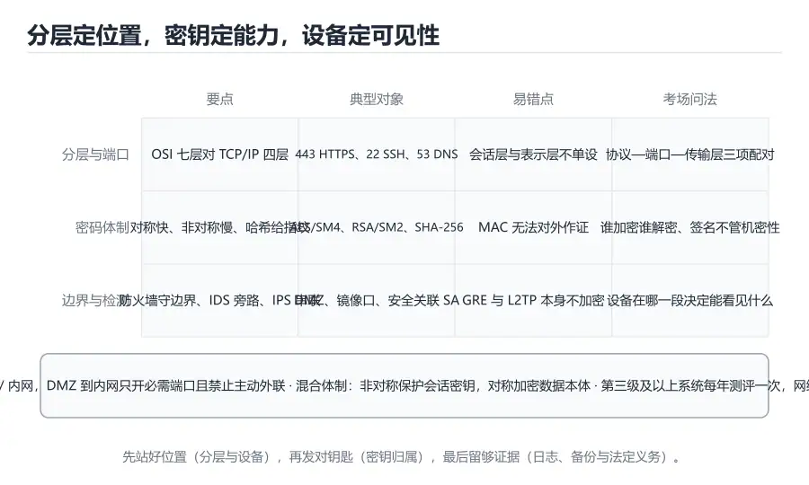

# 网络安全与信息安全基础



> 内容更新时间：2026-10-06 · 学习阶段：进阶 · 预计用时：50 分钟

## 本节知识框架

**课程定位**：所属分类 `ruankao`（软考初级与中级），课程主题 `网络安全与信息安全基础`，学习阶段 进阶，建议用时 50 分钟。这一域在上午卷里通常占 6~10 分，出题密度近年还在上升：网络安全协议与端口约一题，加密、哈希与签名两到三题，PKI 与密钥管理一到两题，防火墙、VPN 与入侵检测一到两题，恶意代码与备份恢复一题，信息安全等级保护与法律法规一到两题。

本课主线：先站好位置，再发对钥匙，最后留够证据。位置是分层模型与安全设备的部署点——搞清流量经过哪一层、设备串在哪一段，很多判断题当场就解了；钥匙是密码体制与密钥管理——对称快但分发难、非对称慢但能签名与分发会话密钥；证据是日志、审计、备份与法律义务——出了事能不能追溯、能不能在规定时间内把业务拉回来。

**学完本课应当能够**

- 按层说出常见协议的归属与默认端口，并解释为什么有的协议同时要两个端口。
- 区分对称加密、非对称加密、哈希、MAC 与数字签名各自的输入、输出与能保证的属性。
- 描述一次证书验证与签名验证的完整动作序列，指出吊销检查为什么不能省。
- 说明防火墙、IDS、IPS 的部署位置差异，以及 VPN 隧道协议在加密与封装上的不同选择。
- 用备份策略与恢复演练支撑给定的 RPO 与 RTO，并能复述等级保护五个级别与两部法律的基本义务。

### 复习清单

- [ ] 能在三十秒内写出 20、21、22、23、25、53、80、110、143、161、443、3389 分别属于哪个协议、走 TCP 还是 UDP。
- [ ] 能用「谁加密、谁解密」的口诀说清加密与签名里公钥私钥的用法差别。
- [ ] 能解释为什么实际系统要用非对称算法保护一把对称会话密钥，而不是用它加密全部数据。
- [ ] 能画出外网、DMZ、内网三区与防火墙、IPS、IDS 的相对位置，并标出镜像口在哪里。
- [ ] 能说出完全备份、增量备份、差异备份三者的备份量与恢复步骤差异，并把 RPO、RTO 对应到具体手段。

## 核心概念定义

| 术语 | 操作性定义（白话版） | 常见边界与风险 |
| --- | --- | --- |
| OSI 七层 | 物理、数据链路、网络、传输、会话、表示、应用，是一个参考模型而非实现。 | 易错：会话层与表示层在 TCP/IP 里被合进应用层，不要按七层去找实现。 |
| TCP/IP 四层 | 网络接口层、网际层、传输层、应用层，与 OSI 是一对多映射。 | 易错：ARP 把 IP 换成 MAC 地址，多数教材把它放在网络接口层与网际层之间，判断时看题干口径。 |
| 端口号 | 传输层用来区分同一主机上不同进程的 16 位编号，0~1023 为熟知端口。 | 易错：端口属于传输层概念，应用层协议名与端口要成对记忆。 |
| 对称加密 | 加解密同一把秘密密钥，DES、3DES、AES、SM4、RC4 都在这族里。 | 易错：速度快但密钥分发与规模爆炸是天生短板。 |
| 非对称加密 | 公钥与私钥成对，用一把只能用另一把解，RSA、ECC/SM2、ElGamal 属此类。 | 易错：运算量比对称大几个数量级，因此很少直接加密大文件。 |
| 哈希与摘要 | 把任意长度输入压成定长指纹，MD5、SHA-1、SHA-256、SM3 是常见算法。 | 易错：哈希不是加密，它不可逆也不保密，只提供完整性检测能力。 |
| MAC | 用共享密钥算出的消息认证码，HMAC 是哈希构造的典型实现。 | 易错：MAC 只能证明「我们俩之间没被改」，无法拿给第三方作证。 |
| 数字签名 | 用签名者私钥对消息摘要做的运算，验证靠对应公钥。 | 易错：签名不提供机密性，内容与签名是分开传输或附加的。 |
| PKI 与 CA | 公钥基础设施，由 CA 签发证书、RA 受理注册、CRL 或 OCSP 发布吊销状态。 | 易错：CA 不保管用户私钥，也不替用户签名。 |
| 数字证书 | 遵循 X.509 的数据结构，把主体身份与公钥绑定并由颁发机构签名。 | 易错：证书有效不等于可信，必须沿链找到信任锚并查吊销。 |
| 密钥管理 | 密钥从生成、分发、存储、使用、更新、归档到销毁的全生命周期控制。 | 易错：主密钥长期不变、会话密钥一次一密，两者混用会放大泄露后果。 |
| 防火墙 | 按策略放行或拒绝流量的边界设备，分包过滤、状态检测与应用代理几代。 | 易错：它管得住经过它的流量，管不住绕过它的通道与内部发起的攻击。 |
| IDS 与 IPS | 入侵检测系统旁路告警，入侵防御系统串联阻断。 | 易错：IDS 不改变流量，IPS 阻断会引入时延与单点风险。 |
| VPN 与隧道 | 在公共网络上用封装加加密构造出一条逻辑专用通道。 | 易错：GRE 只封装不加密，隧道本身不等于保密。 |
| 恶意代码 | 病毒、蠕虫、木马、后门、逻辑炸弹、勒索软件、Rootkit、间谍软件的统称。 | 易错：蠕虫能自我复制并主动传播，病毒需要宿主文件与人触发。 |
| 备份三型 | 完全备份存全部数据，增量备份只存上次备份后的改动，差异备份只存上次完全备份后的改动。 | 易错：增量的备份量最小而恢复链最长。 |
| RPO 与 RTO | 前者是允许丢失多久的数据，后者是允许业务中断多久。 | 易错：RPO 决定复制与备份频率，RTO 决定切换手段与备用容量。 |
| 等级保护 | 把信息系统按受破坏后的危害程度定为五个级别并施加相应安全要求。 | 易错：第三级要每年测评一次，定级、备案、测评、整改、监督是五个连续环节。 |
| 个人信息保护 | 以合法正当必要诚信为原则，围绕知情同意、最小范围与个人权利建立义务。 | 易错：单独同意与一般同意适用的情形不同，敏感个人信息要求更严。 |

## 原理与运行机制

**一、位置先于策略：分层模型与端口。** 判断一条流量能不能被某个设备看见，本质是问它在哪一层。包过滤防火墙看网络层与传输层的地址端口，状态检测多记一张会话表，应用代理 firewall 则要把协议解开看到应用层内容，于是也最慢。HTTPS 全程加密后，只看网络层与传输层的设备无法判断具体业务，这也是「加密流量占比升高，边界检测要往应用层和代理侧走」的原因。

端口要连着传输层选型一起记。HTTPS 使用 TCP 的 443 端口，SNMP 使用 UDP 的 161 端口（trap 另用 162），因为网管轮询丢几包无所谓、下次再问；FTP 有两条通道，21 端口承载命令与应答的控制连接、20 端口承载主动模式下的数据连接，两者颠倒就是常见干扰项；SSH 是面向连接的可靠通道跑在 TCP 22，Telnet 明文跑在 23；DNS 平时查询走 UDP 53、区域传送走 TCP 53，因为查询报文短小怕时延、传送数据大怕丢包；SMTP 25、POP3 110、IMAP 143、HTTP 80、RDP 3389、NTP 123/UDP、DHCP 67 与 68 也是选择题常客。

**二、加密体制：谁加密谁解密。** 对称加密是同一把钥匙开同一把锁，AES 分组长度 128 位、密钥 128、192 或 256 位三档，DES 是 64 位分组、56 位有效密钥，今天早已不具备强度。非对称加密是两把配对的钥匙，公钥可公开、私钥必须藏好，RSA 的安全性建立在大整数分解之上，ECC 与 SM2 用椭圆曲线离散对数，同等安全强度下密钥更短。用谁的钥匙来加密，决定谁能读：要保密就用接收方的公钥加密，接收方以自己的私钥解密；要证明来源就用发送方自己的私钥签名，任何人拿发送方的公钥都能验证。这两句口诀能解决一大半「公钥私钥谁用哪把」的题目。

混合体制是现实中的标准答案：实际系统多用非对称加密传送对称会话密钥，再用对称算法加密数据。TLS 握手里，客户端与服务器协商出只有双方知道的会话密钥（现代版本用 (EC)DHE 密钥交换并前向保密），记录层的数据全部交给 AES 这类对称算法，既解决了「密钥怎么交给陌生人」，也保住了吞吐。

哈希、MAC 与签名三件套的分工是：哈希给指纹（改一个 bit 摘要就变，但不防止别人换掉整条消息），MAC 给「只有共享密钥双方能算出来」的凭据（防篡改与伪造，但双方对称互信、无法对外作证），签名给「只有我能生成、大家都能验」的凭据（来源认证、完整性与抗否认）。把签名理解成「用私钥对摘要做的运算」，把验证理解成「用公钥还原摘要并与本地重算的摘要比对」，步骤顺序一旦背熟，排序题不必现场推理。

**三、PKI：让公钥可信。** 公钥本身只是一个数，关键是「这个公钥确实属于所称的那个主体」。CA 的解决办法是签一张 X.509 证书，里面装版本号、序列号、签名算法、颁发者、有效期、主体、主体公钥与扩展项，最后由颁发者用自己的私钥对整张证书签名。验证方的动作是有先后次序的：先取出随文件附送的证书读出公钥，再沿证书链一路向上核对每一级签发机构的签名、有效期与吊销状态（CRL 名单或 OCSP 在线响应），确认这张公钥可信之后才谈得上验签，最后用甲的公钥验签，还要沿证书链核对签发机构并查询有效期与吊销状态。跳过吊销检查的典型后果是「已泄露的密钥仍能通过验证」。

密钥管理比算法选型更容易出事。对称体系下 n 个用户两两通信需要 n(n−1)/2 把密钥，规模一上来就管不住，于是引入 KDC 分发临时会话密钥；非对称体系把分发难题转成身份绑定难题，靠 PKI 解决。无论哪种体制，密钥都要走完整的生命周期：生成用受保护的随机源、分发走安全信道或协商协议、存储放在 HSM 或操作系统密钥库里、定期轮换、离职与失窃时立即吊销、过期归档到只读介质。主密钥长期不变而会话密钥一次一密，是「泄露面最小化」的基本做法。

**四、边界与检测：设备放在哪一段。** 常见的三区模型是外网、DMZ、内网：对外提供服务的 Web 服务器放 DMZ，数据库放内网，DMZ 到内网只开必需端口且禁止主动外联，这就是「被攻破的 Web 机不能直连数据库」的落地形式。防火墙负责放行与拒绝；IDS 旁挂在镜像端口上只看不拦，负责发现与取证；IPS 串联在路径上，能阻断但也引入时延和单点故障。签名库能认出已知攻击（误报少、漏报新变种），异常模型能发现未知行为（漏报少、误报多），这两句话是判断 IDS 与 IPS 效果的固定考点。

VPN 用封装加加密把公共网络当专用链路用。IPSec 是一组协议而非单一隧道：AH 提供完整性与认证但不加密，ESP 既加密又认证，IKE 负责协商安全关联 SA；传输模式只改 IP 载荷、适合主机到主机，隧道模式连原 IP 头一起封进新头、适合站点到站点。L2TP 本身不加密，必须与 IPSec 叠加；PPTP 已被证明脆弱，不建议再用；SSL/TLS VPN 工作在 443 端口附近，客户端要求低、能做细到应用级的授权，适合移动办公；GRE 只封装不加密，常与 IPSec 搭配。

**五、韧性与合规：备份、恢复与法定义务。** 备份三型的取舍是「备份量与恢复链长度成反比」：完全备份占用空间最多，恢复时只需最新的一份备份；差异备份相对最近一次完全备份只存改动部分，恢复时只需完全备份加最新一次差异备份；增量备份的备份量最小，但要把完全备份之后的每一个增量档按序重放，链条越长越容易在中途出错。介质要异地存放、要定期做恢复演练——没验证过的备份等于没有备份。RPO 衡量允许丢失多少数据，RTO 衡量恢复业务需要多长时间：前者决定备份或复制的时间间隔与日志传送方式，后者决定用冷备、热备还是双活切换。「两地三中心」就是把同城与异地两层 RPO、RTO 叠加起来的常见架构。

等级保护把信息系统按遭到破坏后对客体造成的危害定为五个级别：第一级自主保护、第二级指导保护、第三级监督保护、第四级强制保护、第五级专控保护，第三级及以上须每年做一次等级测评。技术要求覆盖安全物理环境、安全通信网络、安全区域边界、安全计算环境与安全管理中心五个方面，管理要求覆盖制度、机构、人员、建设与运维。落地流程是定级、备案、等级测评、安全整改、监督检查五个环节，其中定级要经专家评审、主管部门核准并到公安机关备案。

法律层面记两部法的基本义务。网络安全法确立网络运行安全与网络信息安全两套规则：实行网络安全等级保护制度，制定内部安全管理制度和操作规程并确定网络安全负责人，采取防范计算机病毒与网络攻击的安全技术措施，重要数据库定期备份，留存网络日志不少于六个月，对用户个人信息严格保密并建立保护制度，发现缺陷、漏洞等风险时立即补救并按规定告知用户和向主管部门报告，发生安全事件时启动应急预案并向主管部门报告。个人信息保护法确立处理个人信息的规则：以合法、正当、必要和诚信为原则，目的明确、限定范围并公开规则，遵循最小必要原则收集，处理前履行告知并取得同意（向第三方提供、公开、处理敏感个人信息、跨境等情形要求单独同意），保障个人查阅、复制、更正、删除等权利，处理者要采取加密、去标识化、访问控制等技术措施，定期做合规审计与个人信息保护影响评估，达到规定规模的还要指定个人信息保护负责人并公开联系方式。这两部法与数据安全法共同构成合规基线，考题问的多是「哪些行为属于违反法定义务」这类判断题。

## 典型应用场景

| 场景 | 典型输入或前提 | 期望产物 |
| --- | --- | --- |
| 内网访问外部系统 | 员工笔记本在不可信网络 | SSL/TLS VPN 或 IPSec 隧道模式，配双因素认证 |
| 跨机构电子单据 | 需要证明来源且不可抵赖 | 哈希加数字签名，附时间戳与证书链验证结果 |
| 边界加固 | 对外站点与内部数据库共存 | DMZ 分区、最小放行端口、IPS 串联与 IDS 旁路镜像 |
| 口令存储 | 用户口令表可能被拖库 | 带盐的单向慢哈希，禁止可逆加密与明文 |
| 关键业务连续性 | 明确的 RPO 与 RTO 指标 | 完全加差异备份节奏、日志传送与备用切换演练 |
| 系统等保定级 | 新建的三级业务平台 | 定级备案材料、五个技术方面的整改清单与年度测评 |
| 违规外联排查 | 内部主机被控外发数据 | 全流量留存、代理审计与告警规则调优 |

## 代码/协议/SQL 示例

下面这组命令覆盖了证书查看、哈希核对、隧道与安全设备核查四类动作，注释里点明每一步在防什么。

```bash
# 1. 查看服务器证书链、有效期与是否仍受信（-showcerts 把链上的证书一并打出）
openssl s_client -connect 203.0.113.10:443 -servername www.gov.cn -showcerts </dev/null

# 2. 只看证书的有效期与主体，常用于日常巡检
openssl x509 -in server.pem -noout -subject -dates -issuer

# 3. 核对下载文件的完整性：两处摘要一致才认为未被篡改
sha256sum app-installer.iso
sha256sum app-installer.iso.sha256

# 4. 用 HMAC 与共享密钥生成消息认证码（密钥来自受控文件，不写进脚本）
openssl dgst -sha256 -mac HMAC -macopt hexkey:"$(cat /etc/app/hmac.key)" msg.txt
```

防火墙规则要按「先具体后一般」的顺序写，链内自上而下匹配、命中即止。下面这段的本意是放行 10.20.30.0/24 网段的 SSH 访问、其余一律拒绝，但两条 `-A` 追加的次序写反了：先把该网段的 SSH 全部 DROP，后面的 ACCEPT 永远轮不到；同时第二条 ACCEPT 没有限定源地址，等于对所有来源开放 22 端口。规则顺序颠倒，先 DROP 后 ACCEPT，且第二条无源地址限制等于对所有来源放行，这是这类现场排障里最典型的两个错。

```bash
# 错误写法：自上而下匹配，10.20.30.0/24 在第一条就被 DROP 掉
iptables -A INPUT -p tcp -s 10.20.30.0/24 --dport 22 -j DROP
iptables -A INPUT -p tcp --dport 22 -j ACCEPT

# 正确写法：具体放行在前、通用拒绝在后，并且用 -I 插到链首
iptables -I INPUT 1 -p tcp -s 10.20.30.0/24 --dport 22 -m conntrack --ctstate NEW -j ACCEPT
iptables -A INPUT -p tcp --dport 22 -j DROP

# 查看与保存规则，改完必须核一遍次序
iptables -L INPUT -n --line-numbers
service netfilter-persistent save
```

隧道与日志留存的两条常见检查：

```bash
# 确认 IPSec 安全关联是否建立（SA 存在才说明隧道真的在跑）
ip xfrm state
ip xfrm policy

# 留存网络日志不少于六个月是法定要求，先确认轮转策略没有把日志提前删除
logrotate -D /etc/logrotate.d/firewall
find /var/log/firewall -name '*.gz' -mtime +180
```

## 时间/空间复杂度或性能分析

安全这一域的数字大多来自两类代价：算力代价与规模代价。

算力代价方面，非对称算法一次运算的耗时通常是对称算法的百倍到千倍以上，因此 RSA 只用来保护一小段密钥或验证一个摘要，从不用于整份文件；哈希是单向函数里最快的一档，GB 级文件也能在几秒内出摘要，这正是「完整性检查用哈希、机密性用对称加密、来源认证用签名」这种分工的物理基础。DES 的 56 位有效密钥在专用并行设备上已经可以在小时级穷举，AES-128 目前仍是安全的下限推荐，SHA-1 已经出现可用碰撞，签名场景应改用 SHA-256 及以上。

规模代价方面，抗碰撞强度取决于生日攻击：一个 n 位哈希找碰撞的难度约是 2^(n/2) 量级，这就是 128 位 MD5 被认为偏弱、而 256 位 SHA-2 仍宽裕的原因。对称体系的密钥数量按 n(n−1)/2 增长，1000 个用户要维护近五十万把密钥，这解释了为什么大规模系统一定要转向 PKI 或 KDC。非对称体系把密钥数量降为每用户一对，代价是证书要有人签发、有人吊销，信任基础设施本身成了新的运维负担。

设备与策略这一层，性能问题同样能算：防火墙规则表是线性匹配，规则越多、越靠后的通用规则命中率越低，因此要把高频且具体的规则往前提；IPS 串联深度检测应用层内容会增加时延并按带宽折算许可证成本；IDS 旁路镜像不会成为瓶颈，但存储全流量日志的容量按「带宽 × 留存天数」估算，六个月留存要求往往直接变成一笔磁盘开销。备份的窗口同样可算：数据库 200 GB、日变更率 2%，完全备份每周日一次，则差异备份每天约 4 GB，而增量备份每天约 4 GB 且逐日累积；恢复时增量方案需要顺序重放七个档，时间成本按档位线性增加——这就是 RTO 紧张的业务更愿意用差异备份或直接上日志传送的原因。

| 指标 | 常见取值或结论 | 易错点 |
| --- | --- | --- |
| AES 分组长度 | 固定 128 位，密钥可选 128、192、256 位 | 把密钥长度当成分组长度 |
| DES 参数 | 64 位分组、56 位有效密钥 | 记成 64 位密钥 |
| 哈希抗碰撞 | n 位哈希约 2^(n/2) 次尝试 | 与 2^n 的原像抵抗混淆 |
| 对称密钥数量 | n 用户两两通信需 n(n−1)/2 把 | 漏掉「自己对自己」不算 |
| 隧道模式与传输模式 | 隧道模式连原 IP 头一起封装，适合站点到站点 | 以为传输模式也能做网关互连 |
| AH 与 ESP | AH 只认证不加密，ESP 既加密又认证 | 把 AH 当成加密协议 |
| 日志留存 | 网络日志留存不少于六个月 | 与备份保留周期混记 |
| 三级系统测评 | 每年一次等级测评 | 与二级「每两年一次」的口径混淆 |

## 常见误区与易错点

| 容易答错的做法 | 考场上的实际现象 | 原因与正确做法 |
| --- | --- | --- |
| 认为哈希算法可以还原原文 | 机密性题选错 | 哈希单向不可逆，保密要靠加密 |
| 说数字签名保证内容不被窃听 | 属性归属错 | 签名管来源、完整性与抗否认，不管机密性 |
| 用发送方公钥加密签名再验证 | 密钥归属反 | 签名用发送方私钥生成，用其公钥验证 |
| 验签通过就认定证书有效 | 漏掉吊销检查 | 还需核对有效期与 CRL 或 OCSP 状态 |
| 把 MAC 当成数字签名 | 抗否认性判断错 | MAC 用共享密钥，双方都能算，无法对外作证 |
| 以为防火墙能防内部人员与拨号外联 | 边界理解过窄 | 不经防火墙的通道它看不见 |
| 说 IPS 与 IDS 只是叫法不同 | 部署位置答错 | IDS 旁路告警，IPS 串联阻断 |
| 认为 VPN 隧道天然加密 | 协议选型错 | GRE 与 L2TP 本身不加密 |
| 把增量备份恢复当成只需两份备份 | 恢复步骤答错 | 增量要按序重放每一档，差异只需完全备份加最新一次差异 |
| 认为备份做完就不用演练 | 案例分析丢分 | 未验证过的备份不能作为恢复依据 |
| 认为定级由运营单位自己说了算 | 合规流程答错 | 需专家评审、主管部门核准并到公安机关备案 |
| 把个人信息处理当成取得同意即可 | 法定义务答不全 | 还需最小必要、安全措施、影响评估与个人权利响应 |

## 与其他知识点的关系

- **前置**：`ruankao_cs_basics` 的模运算与异或直接支撑 DES、AES 与校验码的理解；`ruankao_os_and_arch` 的进程、内存保护与中断机制是主机安全加固的基础。
- **并列**：`ruankao_db_and_sql` 的权限回收、参数化查询与审计日志是 SQL 注入防护的另一半，两课在「最小权限」这条原则上交汇；`ruankao_data_structure` 的树与散列是证书链校验、访问控制列表匹配的实现基础。
- **后续**：`ruankao_ood_uml` 的架构建模会用到本课的分区与设备位置思路画部署图，安全需求（认证、加密、审计）也常在用例图里以独立用例出现；下午科目的安全分析题要求把威胁、控制措施与恢复指标写成结构化答案。

## 自测题与参考答案

作答时先盖上答案区，每题限时 4 分钟；做完把错题对应的小节翻一遍，把密钥归属写在草稿上。

### 题目 1（单选题）

关于数字签名与哈希算法的分工，下列说法正确的是？

- A. 哈希把任意长度输入压成定长值，所以签名可以跳过摘要直接对全文做
- B. 签名同时提供机密性与抗否认性，接收方看不到明文也不算泄露
- C. 验证签名时用验证者自己的私钥还原摘要，再与本地重算的摘要比对
- D. 签名用签名者私钥对摘要运算，只保证来源、完整性与抗否认而不保证机密性

**参考答案**：D

**解析**：本题正确项是「签名用签名者私钥对摘要运算，只保证来源、完整性与抗否认而不保证机密性」。先算摘要再签，是因为非对称运算慢、分组长度有限，把长文压成定长指纹既省算力又便于一次覆盖全文；私钥只有签名者持有，所以别人无法伪造，而任何人拿对应公钥都能验证，这就构成抗否认。机密性要靠加密——要保密就用接收方的公钥加密内容，两件事不能混。干扰项「哈希把任意长度输入压成定长值，所以签名可以跳过摘要直接对全文做」把省算力这一步抹掉了，实际流程永远先做摘要；干扰项「签名同时提供机密性与抗否认性，接收方看不到明文也不算泄露」把属性归错了对象，签名内容与签名是分开传输或附加的；干扰项「验证签名时用验证者自己的私钥还原摘要，再与本地重算的摘要比对」混淆了密钥归属，验证用的是签名者的公钥，验证者的私钥只在它自己签名时出场。

### 题目 2（单选题）

下列关于协议默认端口与传输层选型的说法，正确的是？

- A. FTP 的 20 端口承载命令与应答，21 端口承载主动模式下的数据连接
- B. DNS 的区域传送走 UDP 53，日常查询走 TCP 53，因为查询报文大怕丢包
- C. SNMP 的网管轮询走 UDP 161，trap 另用 UDP 162，丢几包下次再问即可
- D. SSH 是无连接的数据报服务跑在 UDP 22，Telnet 是可靠传输跑在 TCP 23

**参考答案**：C

**解析**：本题正确项是「SNMP 的网管轮询走 UDP 161，trap 另用 UDP 162，丢几包下次再问即可」。网管周期性读取设备的管理信息库，单次查询报文短、能容忍丢失，靠下一轮轮询补齐即可，用 UDP 省掉三次握手与连接维护；trap 是设备主动上报，另走 162。端口要连着传输层一起记：SSH 面向连接跑 TCP 22，Telnet 明文跑 23，HTTPS 跑 TCP 443，POP3 110、IMAP 143、SMTP 25、HTTP 80、RDP 3389 都是选择题常客。干扰项「FTP 的 20 端口承载命令与应答，21 端口承载主动模式下的数据连接」把两个端口对调，21 是控制连接、20 才是主动模式的数据连接；干扰项「DNS 的区域传送走 UDP 53，日常查询走 TCP 53，因为查询报文大怕丢包」也把选型理由倒过来了，查询短小怕时延走 UDP，传送数据大怕丢包走 TCP；干扰项「SSH 是无连接的数据报服务跑在 UDP 22，Telnet 是可靠传输跑在 TCP 23」否定了 SSH 的可靠通道属性，二者都是 TCP。

### 题目 3（单选题）

关于 IPSec 与 VPN 隧道协议，下列说法正确的是？

- A. AH 同时提供加密与认证两项能力，是站点到站点场景的首选
- B. 传输模式连原 IP 头一起封装进新头，因此适合网关之间的互连
- C. L2TP 自带加密算法，单独使用就能满足链路的保密性要求
- D. 隧道模式把原 IP 头一并封进新头，适合站点到站点；GRE 只封装不加密

**参考答案**：D

**解析**：本题正确项是「隧道模式把原 IP 头一并封进新头，适合站点到站点；GRE 只封装不加密」。IPSec 是一组协议而不是单一隧道：AH 只提供完整性与认证、不加密，ESP 既加密又认证，IKE 负责协商安全关联 SA；传输模式只改 IP 载荷、适合主机到主机，隧道模式连原 IP 头一起封进新头、适合站点到站点的网关互连。说「VPN 隧道天然加密」是这类题最大的坑——L2TP 本身不加密必须与 IPSec 叠加，GRE 同样只封装不加密，PPTP 已被证明脆弱不建议再用。干扰项「AH 同时提供加密与认证两项能力，是站点到站点场景的首选」把 AH 当成了加密协议，要保密得用 ESP；干扰项「传输模式连原 IP 头一起封装进新头，因此适合网关之间的互连」把两种模式的封装范围写反；干扰项「L2TP 自带加密算法，单独使用就能满足链路的保密性要求」低估了封装与加密的分工，L2TP 需要 IPSec 提供加密。

### 题目 4（命令排错题）

下面这段 iptables 规则的本意是放行 10.20.30.0/24 网段的 SSH 访问、其余一律拒绝，但实际效果与预期不符，最可能的原因是什么？

```bash
iptables -A INPUT -p tcp -s 10.20.30.0/24 --dport 22 -j DROP
iptables -A INPUT -p tcp --dport 22 -j ACCEPT
```

- A. 两条规则都用 -A 追加且先 DROP 后 ACCEPT，链内自上而下命中即止，ACCEPT 永远轮不到
- B. --dport 22 必须写成 --destination-port 才能在 filter 表里被识别
- C. -s 指定网段时必须写子网掩码 255.255.255.0，CIDR 写法在新内核已被废弃
- D. SSH 走 UDP 协议，-p tcp 与 --dport 22 组合在一起根本匹配不到任何报文

**参考答案**：A

**解析**：本题正确项是「两条规则都用 -A 追加且先 DROP 后 ACCEPT，链内自上而下命中即止，ACCEPT 永远轮不到」。iptables 的规则链是自上而下线性匹配、命中即止，所以写法要「先具体后一般」：该网段的放行必须排在通用拒绝之前，追加到链尾还得用 -I INPUT 1 插到链首。这里第二条 ACCEPT 没有限定源地址，一旦顺序改对，就等于对所有来源开放 22 端口，两处要一起改——改完用 iptables -L INPUT -n --line-numbers 核一遍次序。干扰项「--dport 22 必须写成 --destination-port 才能在 filter 表里被识别」是伪语法问题，两个写法是同一选项的长短路；干扰项「-s 指定网段时必须写子网掩码 255.255.255.0，CIDR 写法在新内核已被废弃」与事实相反，CIDR 前缀长度正是 iptables 的标准写法；干扰项「SSH 走 UDP 协议，-p tcp 与 --dport 22 组合在一起根本匹配不到任何报文」搞错了传输层选型，SSH 是面向连接的 TCP 22。

### 题目 5（多选题）

关于三种备份策略与恢复指标，下列说法正确的是？

- A. 增量备份的备份量最小，但恢复时要按序重放完全备份之后的每一个增量档
- B. 差异备份只存上次完全备份之后的改动，恢复时只需完全备份加最新一次差异备份
- C. 三种备份的恢复步骤一样长，方案选择只取决于介质容量大小
- D. RPO 决定切换手段与备用容量，RTO 决定备份与复制的时间间隔
- E. 没做过恢复演练的备份不能作为业务恢复依据，介质还应按要求异地存放

**参考答案**：A、B、E

**解析**：多选题要同时选中「增量备份的备份量最小，但恢复时要按序重放完全备份之后的每一个增量档」、「差异备份只存上次完全备份之后的改动，恢复时只需完全备份加最新一次差异备份」与「没做过恢复演练的备份不能作为业务恢复依据，介质还应按要求异地存放」三条。三型备份的规律是备份量与恢复链长度成反比：完全备份占空间最多但恢复只取最新一份，增量最省空间却要把每个档顺序重放、链条越长越容易在中途出错，差异居中，因此 RTO 紧张的业务更愿意用差异备份或直接上日志传送。干扰项「三种备份的恢复步骤一样长，方案选择只取决于介质容量大小」把这条反比关系抹掉了，恢复时长同样是硬约束；干扰项「RPO 决定切换手段与备用容量，RTO 决定备份与复制的时间间隔」把两个指标的用途对调，RPO 管允许丢多久的数据、决定备份与复制间隔，RTO 管允许停多久业务、决定冷备热备双活怎么选。

### 题目 6（排序题）

把验证甲所发数字签名的四个动作按先后排列：

- A. 用甲的公钥对签名做还原运算，得到甲签名时所用的那份摘要
- B. 取出随文件附送的甲证书，读出证书里绑定的主体公钥
- C. 沿证书链逐级核对签发机构的签名、有效期与 CRL 或 OCSP 吊销状态
- D. 在本地用约定算法重算文件摘要，与还原出的摘要比对是否一致

**参考答案**：B → C → A → D

**解析**：本题顺序是「取出随文件附送的甲证书，读出证书里绑定的主体公钥」→「沿证书链逐级核对签发机构的签名、有效期与 CRL 或 OCSP 吊销状态」→「用甲的公钥对签名做还原运算，得到甲签名时所用的那份摘要」→「在本地用约定算法重算文件摘要，与还原出的摘要比对是否一致」。次序的关键在于「公钥本身只是一个数」：只有先确认这张证书可信、公钥确实属于所称的甲，验签结果才有意义，所以吊销检查不能省——跳过它的典型后果是已泄露的密钥仍能通过验证。最后一步比对的是两个摘要而不是原文，本地重算保证完整性，签名还原保证来源。

## 考点精讲

本课题库共 6 道题，下面逐题复述题干原文、答案字母（A 是第 1 个选项）与判断依据，字段内容与题库完全一致。

### 考点 1（单选题 · 签名与哈希分工）

- **题目**：关于数字签名与哈希算法的分工，下列说法正确的是？
- **答案**：D
- **正确项**：签名用签名者私钥对摘要运算，只保证来源、完整性与抗否认而不保证机密性
- **判断依据**：本题正确项是「签名用签名者私钥对摘要运算，只保证来源、完整性与抗否认而不保证机密性」。先算摘要再签，是因为非对称运算慢、分组长度有限，把长文压成定长指纹既省算力又便于一次覆盖全文；私钥只有签名者持有，所以别人无法伪造，而任何人拿对应公钥都能验证，这就构成抗否认。机密性要靠加密——要保密就用接收方的公钥加密内容，两件事不能混。干扰项「哈希把任意长度输入压成定长值，所以签名可以跳过摘要直接对全文做」把省算力这一步抹掉了，实际流程永远先做摘要；干扰项「签名同时提供机密性与抗否认性，接收方看不到明文也不算泄露」把属性归错了对象，签名内容与签名是分开传输或附加的；干扰项「验证签名时用验证者自己的私钥还原摘要，再与本地重算的摘要比对」混淆了密钥归属，验证用的是签名者的公钥，验证者的私钥只在它自己签名时出场。

### 考点 2（单选题 · 端口与传输层选型）

- **题目**：下列关于协议默认端口与传输层选型的说法，正确的是？
- **答案**：C
- **正确项**：SNMP 的网管轮询走 UDP 161，trap 另用 UDP 162，丢几包下次再问即可
- **判断依据**：本题正确项是「SNMP 的网管轮询走 UDP 161，trap 另用 UDP 162，丢几包下次再问即可」。网管周期性读取设备的管理信息库，单次查询报文短、能容忍丢失，靠下一轮轮询补齐即可，用 UDP 省掉三次握手与连接维护；trap 是设备主动上报，另走 162。端口要连着传输层一起记：SSH 面向连接跑 TCP 22，Telnet 明文跑 23，HTTPS 跑 TCP 443，POP3 110、IMAP 143、SMTP 25、HTTP 80、RDP 3389 都是选择题常客。干扰项「FTP 的 20 端口承载命令与应答，21 端口承载主动模式下的数据连接」把两个端口对调，21 是控制连接、20 才是主动模式的数据连接；干扰项「DNS 的区域传送走 UDP 53，日常查询走 TCP 53，因为查询报文大怕丢包」也把选型理由倒过来了，查询短小怕时延走 UDP，传送数据大怕丢包走 TCP；干扰项「SSH 是无连接的数据报服务跑在 UDP 22，Telnet 是可靠传输跑在 TCP 23」否定了 SSH 的可靠通道属性，二者都是 TCP。

### 考点 3（单选题 · IPSec 与隧道协议）

- **题目**：关于 IPSec 与 VPN 隧道协议，下列说法正确的是？
- **答案**：D
- **正确项**：隧道模式把原 IP 头一并封进新头，适合站点到站点；GRE 只封装不加密
- **判断依据**：本题正确项是「隧道模式把原 IP 头一并封进新头，适合站点到站点；GRE 只封装不加密」。IPSec 是一组协议而不是单一隧道：AH 只提供完整性与认证、不加密，ESP 既加密又认证，IKE 负责协商安全关联 SA；传输模式只改 IP 载荷、适合主机到主机，隧道模式连原 IP 头一起封进新头、适合站点到站点的网关互连。说「VPN 隧道天然加密」是这类题最大的坑——L2TP 本身不加密必须与 IPSec 叠加，GRE 同样只封装不加密，PPTP 已被证明脆弱不建议再用。干扰项「AH 同时提供加密与认证两项能力，是站点到站点场景的首选」把 AH 当成了加密协议，要保密得用 ESP；干扰项「传输模式连原 IP 头一起封装进新头，因此适合网关之间的互连」把两种模式的封装范围写反；干扰项「L2TP 自带加密算法，单独使用就能满足链路的保密性要求」低估了封装与加密的分工，L2TP 需要 IPSec 提供加密。

### 考点 4（命令排错题 · 规则链匹配次序）

- **题目**：下面这段 iptables 规则的本意是放行 10.20.30.0/24 网段的 SSH 访问、其余一律拒绝，但实际效果与预期不符，最可能的原因是什么？
- **答案**：A
- **正确项**：两条规则都用 -A 追加且先 DROP 后 ACCEPT，链内自上而下命中即止，ACCEPT 永远轮不到
- **判断依据**：本题正确项是「两条规则都用 -A 追加且先 DROP 后 ACCEPT，链内自上而下命中即止，ACCEPT 永远轮不到」。iptables 的规则链是自上而下线性匹配、命中即止，所以写法要「先具体后一般」：该网段的放行必须排在通用拒绝之前，追加到链尾还得用 -I INPUT 1 插到链首。这里第二条 ACCEPT 没有限定源地址，一旦顺序改对，就等于对所有来源开放 22 端口，两处要一起改——改完用 iptables -L INPUT -n --line-numbers 核一遍次序。干扰项「--dport 22 必须写成 --destination-port 才能在 filter 表里被识别」是伪语法问题，两个写法是同一选项的长短路；干扰项「-s 指定网段时必须写子网掩码 255.255.255.0，CIDR 写法在新内核已被废弃」与事实相反，CIDR 前缀长度正是 iptables 的标准写法；干扰项「SSH 走 UDP 协议，-p tcp 与 --dport 22 组合在一起根本匹配不到任何报文」搞错了传输层选型，SSH 是面向连接的 TCP 22。

### 考点 5（多选题 · 备份三型与恢复指标）

- **题目**：关于三种备份策略与恢复指标，下列说法正确的是？
- **答案**：A、B、E
- **正确项**：增量备份的备份量最小，但恢复时要按序重放完全备份之后的每一个增量档；差异备份只存上次完全备份之后的改动，恢复时只需完全备份加最新一次差异备份；没做过恢复演练的备份不能作为业务恢复依据，介质还应按要求异地存放
- **判断依据**：多选题要同时选中「增量备份的备份量最小，但恢复时要按序重放完全备份之后的每一个增量档」、「差异备份只存上次完全备份之后的改动，恢复时只需完全备份加最新一次差异备份」与「没做过恢复演练的备份不能作为业务恢复依据，介质还应按要求异地存放」三条。三型备份的规律是备份量与恢复链长度成反比：完全备份占空间最多但恢复只取最新一份，增量最省空间却要把每个档顺序重放、链条越长越容易在中途出错，差异居中，因此 RTO 紧张的业务更愿意用差异备份或直接上日志传送。干扰项「三种备份的恢复步骤一样长，方案选择只取决于介质容量大小」把这条反比关系抹掉了，恢复时长同样是硬约束；干扰项「RPO 决定切换手段与备用容量，RTO 决定备份与复制的时间间隔」把两个指标的用途对调，RPO 管允许丢多久的数据、决定备份与复制间隔，RTO 管允许停多久业务、决定冷备热备双活怎么选。

### 考点 6（排序题 · 证书链与验签次序）

- **题目**：把验证甲所发数字签名的四个动作按先后排列：
- **答案**：B → C → A → D
- **正确项**：取出甲证书读出主体公钥 → 沿证书链核对签名、有效期与吊销状态 → 用甲的公钥还原出签名时的摘要 → 本地重算文件摘要并与还原出的摘要比对
- **判断依据**：本题顺序是「取出随文件附送的甲证书，读出证书里绑定的主体公钥」→「沿证书链逐级核对签发机构的签名、有效期与 CRL 或 OCSP 吊销状态」→「用甲的公钥对签名做还原运算，得到甲签名时所用的那份摘要」→「在本地用约定算法重算文件摘要，与还原出的摘要比对是否一致」。次序的关键在于「公钥本身只是一个数」：只有先确认这张证书可信、公钥确实属于所称的甲，验签结果才有意义，所以吊销检查不能省——跳过它的典型后果是已泄露的密钥仍能通过验证。最后一步比对的是两个摘要而不是原文，本地重算保证完整性，签名还原保证来源。

## 术语速查

| 术语 | 一句话说明 |
| --- | --- |
| 熟知端口 | 0 到 1023 这一段由约定分配的端口号，协议与端口要成对记忆。 |
| 前向保密 | 长期私钥泄露后，先前记录的会话仍不能被解密，通常由临时 DH 交换实现。 |
| 信任锚 | 验证证书链时预先无条件信任的根证书，链上一旦断在这里整个验证就失败。 |
| 安全关联 | IPSec 中描述一单向加密参数的组合，包括 SPI、算法与密钥寿命。 |
| 误报与漏报 | 把正常流量判成攻击是误报，把攻击放过去是漏报，两类代价方向相反。 |
| 去标识化 | 让数据在不借助额外信息时无法识别到特定个人，与匿名化的可逆性不同。 |
| 恢复演练 | 用真实备份做一次完整恢复并计时，是验证 RPO 与 RTO 的唯一手段。 |
| 个人信息保护负责人 | 达到规定规模的处理者须指定的专职人员，负责安全合规并公开联系方式。 |

## 参考资料与复核

- 最后复核：2026-10-04
- 下次复核：2027-09-10
- 复核范围：分层模型与端口对应关系、DES 与 AES 的分组与密钥长度、哈希与签名的属性边界、X.509 证书验证动作序列、IPSec 的 AH 与 ESP 差异、备份三型与恢复步骤、等级保护五个级别与五个环节、网络安全法与个人信息保护法的义务条款要点。
- 来源性质：标准文件与法律文本的公开页，外加协议原文文档；本课核对关键词：443 端口、56 位有效密钥、单独同意、留存不少于六个月、隧道模式、恢复演练。

| 参考资料 | 本课用途 |
| --- | --- |
| [TLS 1.3 协议规范 RFC 8446](https://www.rfc-editor.org/rfc/rfc8446) | 握手流程、会话密钥建立与前向保密的实际做法 |
| [RFC 2104：HMAC 消息认证码定义](https://www.rfc-editor.org/rfc/rfc2104) | MAC 与哈希的分工、HMAC 的构造方式 |
| [国家法律法规数据库（网络安全法、个人信息保护法全文）](https://flk.npc.gov.cn/) | 法定义务的条文出处与最新修订状态 |
| [中国政府网（等级保护与网络安全政策发布）](https://www.gov.cn/) | 等级保护制度与监管要求的官方口径 |
| [国家标准全文公开系统（GB/T 22239 等）](https://openstd.samr.gov.cn/bzgk/gb/) | 等级保护基本要求与测评指标的标准原文 |
| [中国计算机技术职业资格网首页（软考官方门户）](https://www.ruankao.org.cn/) | 考试级别、科目设置与大纲入口 |

## 内容元数据

> 内容更新时间：2026-10-06 · 学习阶段：进阶 · 预计用时：50 分钟

- 内容版本：v2.0
- 分类归属：`ruankao`（软考初级与中级），本课为第 7 门（order 6）
- 适用考试：软件设计师 / 网络工程师 / 信息安全工程师（上午综合知识的安全与网络题区）
- 题量与题型：6 题（单选 3 题、命令排错 1 题、多选 1 题、排序 1 题），全部自主命题
- 质量口径：与 `tool/content_pipeline/validate_pack.js` 的结构与题库门禁对齐
- 相关课程：`ruankao_db_and_sql`、`ruankao_ood_uml`、`ruankao_data_structure`
- 说明：算法参数与协议行为属稳定内容，法律条文与等级保护要求以官方发布文本为准，涉及具体条款序号时需回读原文核对
