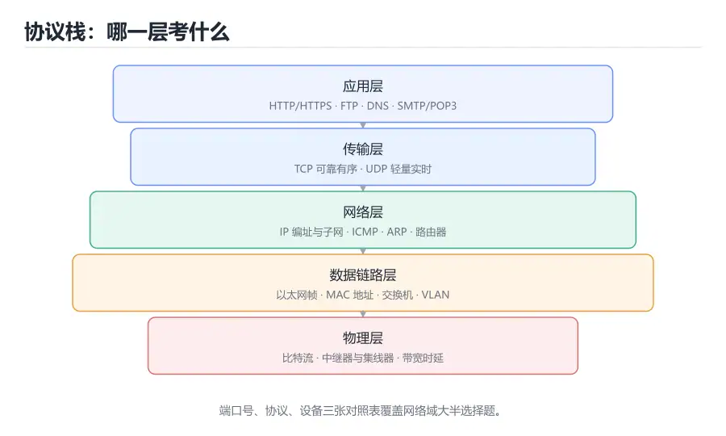

# 计算机网络与信息安全：协议栈、加密与攻击防范



## 本节知识框架

**课程定位**：所属分类 `ruankao`（软考初级与中级），课程主题 `计算机网络与信息安全`，学习阶段 基础，建议用时 45 分钟。这一域在上午卷通常占 8~12 分，其中网络约 6 分、信息安全约 4 分，是「背了就有分、算错就丢分」的混合区。

本课主线：先把五层协议栈立起来——每层只解决一件事，考什么就看落在哪一层；再用一把尺子量加密体制：机密性、完整性、可用性、不可否认性，四个安全目标各自对应哪种技术；最后把攻击与防范归成三类。

**学完本课应当能够**
- 说清每层的典型协议、设备与 PDU 名称，并解释端口号与 IP 地址分别管什么。
- 手算子网划分：给定前缀长度能算出子网数与可用主机数。
- 区分对称加密、非对称加密、摘要与数字签名，并说明 HTTPS 是怎么把三者串起来的。
- 认常见攻击（窃听、重放、篡改、拒绝服务、注入）并给出对应的防范手段。

### 复习清单

- [ ] 能默写五层模型每层的两个代表协议与一个代表设备。
- [ ] 能用一条公式解释为什么 /24 划成 /27 后每个子网只有 30 个可用地址。
- [ ] 能说清数字签名为什么用发送方的私钥、而加密为什么用接收方的公钥。
- [ ] 能列出至少 8 个常用协议的默认端口号，并说出它们走 TCP 还是 UDP。

## 核心概念定义

| 术语 | 操作性定义（白话版） | 常见边界与风险 |
| --- | --- | --- |
| OSI 与 TCP/IP | 前者是七层参考模型，后者实际用五层或四层表述，考试按「物理、数据链路、网络、传输、应用」五层答题。 | 易错：把会话层与表示层的职责安到应用层头上。 |
| PDU | 各层协议数据单元：比特、帧、分组（包）、报文段、消息。 | 易错：交换机处理帧，路由器处理分组，集线器只处理比特。 |
| IP 地址与分类 | 32 位点分十进制；A 类首字节 1~126，B 类 128~191，C 类 192~223，D 类组播，E 类保留。 | 易错：主机号全 0 表示网络本身、全 1 表示广播，都不能分配给主机。 |
| 私有地址 | 只在内部网络使用的三段地址：单个 A 段、连续 16 个 B 段、以及由 192 与 168 两个字节开头的连续 256 个 C 段。 | 易错：私有地址不能在公网路由表中被转发，需经地址转换出口。 |
| 子网划分 | 从主机位借若干位作子网位，把一个大网络切成多个小网络，减少广播域规模。 | 易错：可用主机数是 2 的 h 次方减 2，要扣掉网络地址与广播地址。 |
| ARP | 由已知的 IP 地址查询同网段主机的 MAC 地址，结果缓存在本机 ARP 表。 | 易错：ARP 只在同一个广播域内工作，跨网段要找网关的 MAC。 |
| ICMP | 网络层的差错与诊断报文，Ping 用回送请求与应答，路由跟踪靠超时报文。 | 易错：它不是传输层协议，也不承载用户数据。 |
| TCP 与 UDP | TCP 面向连接、可靠有序、有流量与拥塞控制；UDP 无连接、报文交付、实时性好。 | 易错：UDP 也校验和，只是不重传；DNS 与 DHCP 都跑在 UDP 上。 |
| 端口号 | 传输层用来区分同一主机上不同应用的 16 位编号，0~1023 为公认端口。 | 易错：端口是传输层概念，与 IP 一起构成套接字才能唯一定位一条连接。 |
| NAT | 网络地址转换，把内部私有地址映射成公网地址与端口，缓解地址不足。 | 易错：NAT 破坏端到端连通，需要额外机制支持外部主动发起的连接。 |
| 对称加密 | 加解密同一把密钥，速度快，代表算法 DES、3DES、AES、IDEA、RC4。 | 易错：DES 密钥有效长度 56 位、分组 64 位；AES 分组固定 128 位，密钥 128/192/256 位。 |
| 非对称加密 | 公钥与私钥成对，用一把另一把解，代表算法 RSA、ECC。 | 易错：速度慢，实际只用于交换会话密钥与签名，不用于大量数据。 |
| 摘要（哈希） | 把任意长度消息压成固定长度指纹，单向不可逆，代表 MD5、SHA 系列。 | 易错：摘要不是加密，它不提供机密性，只用于完整性校验。 |
| 数字签名 | 用发送方的私钥对摘要做变换，接收方用发送方公钥验证。 | 易错：它保证真实性、完整性与不可否认性，不保证内容机密。 |
| 数字证书与 CA | 由权威机构签发、把公钥绑定到主体身份的电子文档。 | 易错：证书用 CA 的私钥签名，验证时要用 CA 的公钥，不是主体自己的。 |
| 防火墙 | 依据访问控制在内外网之间实施检查的设备或系统，可分包过滤、应用级网关、状态检测。 | 易错：防火墙挡不住内部人员的攻击，也不天然具备查杀病毒能力。 |
| 入侵检测 | 通过采集与分析信息判断是否有越权与破坏行为，方法分误用检测与异常检测。 | 易错：IDS 只做检测与告警，主动阻断的是 IPS。 |
| 等级保护 | 我国把信息系统安全保护能力由低到高分为五级。 | 易错：第三级是安全标记保护级，第四级是结构化保护级，容易串位。 |

## 原理与运行机制

**一、五层协议栈：一层只干一件事。** 把一次网页请求想成寄快递：应用层写面单（HTTP 报文），传输层决定是走可靠的挂号信（TCP）还是加急不签收的平邮（UDP），网络层填收件地址并选路线（IP 与路由），链路层负责这一跳的搬运（以太网帧与 MAC 地址），物理层就是把比特变成光电信号。设备也按这个层次各管一段：集线器在物理层复制比特，所有端口同一个冲突域；交换机在链路层按 MAC 转发表逐帧转发，每个端口是一个独立冲突域但默认仍属同一广播域；路由器在网络层按路由表选路，天然隔开广播域。这条「设备—层次—寻址单位」的对应链能解掉大半选择题。

地址与端口的分工也是一句话：IP 地址找到那台机器，端口号找到那台机器上的那个程序。所以「一台主机上同时跑着 Web 与邮件服务而不串线」靠的是套接字（IP + 端口 + 协议）而不是 IP。

**二、算清地址：三步公式解决全部子网题。** 给定网络前缀长度，先算还剩下多少主机位 h = 32 − 前缀，可用主机数就是 2^h − 2；再算借了几位当子网位，子网数就是 2 的借位数次方。例：把 B 段的 172.16.5.0/24 划成 /27，子网位多了 3 位，得到 8 个子网；主机位剩 5 位，每个子网 2⁵ − 2 = 30 个可用地址。反过来问「每个子网要 25 台主机」时，取最小的 h 使 2^h − 2 ≥ 25，即 h = 5，前缀就定在 /27。掩码的算法是把前缀位全置 1，/27 对应 255.255.255.224，最后一个非 255 的字节里 224 = 128 + 64 + 32，正好是三个子网位。

顺带把时延算式立住，它和子网题一样是送分题：发送时延 = 数据长度 ÷ 带宽，传播时延 = 距离 ÷ 传播速率。1 KB 的分组在 1 Mbps 链路上要发 8192 ÷ 10⁶ ≈ 8.192 毫秒，走 1000 公里（速率 2×10⁸ 米每秒）要 5 毫秒。带宽越大发送时延越小，但传播时延一分不减——这就是「卫星链路带宽很高仍然卡顿」的原因。

**三、密码学的四件工具，各治一个病。** 先用一句话定位：

- 对称加密解决「内容别被人看见」，快，但密钥怎么送到对方手里是新问题。
- 非对称加密解决「密钥怎么送」，公钥可以公开广播，私钥自己留着；慢，所以不拿来加密正文。
- 摘要解决「内容有没有被改过」，它不加密，只是指纹。
- 数字签名解决「这封邮件究竟是谁发的、他事后能不能抵赖」。

于是标准做法是把四件工具串起来：发送方生成一个随机会话密钥，用它对称加密正文；再用接收方的公钥加密这把会话密钥，与密文一同发出；接收方用自己的私钥解出会话密钥，再解正文。这就是「数字信封」，它同时得到速度与密钥分发的好处。签名的方向则相反：发送方先对报文求摘要，再用自己的私钥变换这个摘要，得到签名附在报文后；接收方用发送方的公钥验证，同时自己重算摘要比对。这里最容易绕晕的是「加密用对方公钥、签名用自己私钥」，记法很简单：要让只有他能看的，就用他的钥匙锁；要证明是我干的，就用我的印章盖。

HTTPS 是这一套的落地：握手阶段用非对称算法协商出会话密钥，之后的数据传输走对称加密，证书由 CA 签发用于确认服务器身份。所以它同时提供机密性、完整性与服务器真实性，默认端口 443。

**四、攻击与防范一一对应。** 被动攻击只偷看不改（信息泄露、流量分析），防范手段是加密与隐蔽传输；主动攻击要动手（篡改、伪造、重放、拒绝服务），防范要靠完整性校验、认证与冗余防护。几个高频的对应关系：重放攻击靠时间戳、随机数或一次性口令防；ARP 欺骗靠静态绑定或 ARP 检测防护；拒绝服务靠流量清洗与带宽冗余，单靠防火墙效果有限；SQL 注入的根本解法是参数化查询，把用户输入与 SQL 结构分开；跨站脚本则靠输出转义与内容安全策略。备份策略三档要背结论：全备份最费时间最省恢复时间；增量备份最省空间但恢复要按顺序一路重放，最慢；差异备份介于两者之间，恢复只要最近一次全备份加最近一次差异备份。

我国把信息系统的安全保护能力分为五级，由低到高依次是用户自主保护级、系统审计保护级、安全标记保护级、结构化保护级、访问验证保护级。这个序列几乎每年考一次填空或排序，可以按「自主 → 审计 → 标记 → 结构 → 验证」五个词串记：能自主控制、事后能审计、给对象打安全标记、保护机制结构化、最后能验证访问。

## 典型应用场景

| 场景 | 典型输入或前提 | 期望产物 |
| --- | --- | --- |
| 校园网出口规划 | 需要隔离广播域并控制访问 | 划分子网、VLAN 与默认路由，配访问控制列表 |
| 政务系统定级 | 系统一旦受损影响社会秩序 | 按等级保护要求定级并落实技术与管理措施 |
| 网上支付 | 要求机密性、完整性与不可否认 | 数字信封 + 数字签名 + CA 证书体系 |
| 视频会议 | 容忍少量丢包但不能等重传 | 走 UDP 的实时传输协议，配合抖动缓冲 |
| 数据中心容灾 | 关键数据必须可恢复 | 全备 + 差异备份轮转，异地副本与定期演练 |
| 网站上线前评估 | 面向公网的表单与接口 | 威胁建模、参数化查询、内容安全策略与日志告警 |

## 代码/协议/SQL 示例

子网与时延这两类计算，写成五行代码就不会算错：

```python
def subnet(parent_prefix, child_prefix):
    subnets = 2 ** (child_prefix - parent_prefix)
    hosts = 2 ** (32 - child_prefix) - 2
    return subnets, hosts

def mask(prefix):
    return ".".join(str((0xFFFFFFFF << (32 - prefix) >> s) & 0xFF)
                   for s in (24, 16, 8, 0))

print(subnet(24, 27))          # (8, 30)
print(mask(27))                # 255.255.255.224
print(round(1024 * 8 / 1e6 * 1000, 3), round(1e6 / 2e8 * 1000, 3))   # 8.192 5.0
```

一段 Python 演示数字信封与签名的最小骨架，重点是把「谁的钥匙」这件事说清楚：

```python
import hashlib

def digest(msg):
    return hashlib.sha256(msg.encode()).hexdigest()

def seal(pub_key_of_receiver, session_key, cipher):
    return {"算法": "AES-128", "密文": cipher, "会话密钥(已用接收方公钥保护)": session_key}

def sign(sender_priv_key, msg):
    """真实做法是非对称算法对摘要做变换，这里用占位串示意流程。"""
    return f"SHA256({digest(msg)[:16]})-by-{sender_priv_key}"

def verify(sender_pub_key, msg, sig):
    return sig == sign(sender_pub_key.replace("pub", "priv"), msg)

body = "转账一万元到 6222 尾号 0330"
env = seal("receiver_pub", "sk-9f3a", "<密文略>")
sig = sign("sender_priv", body)
print(env)
print(sig, verify("sender_pub", body, sig))
```

命令行侧的三条排查命令，端口与协议对照背不住时用它现场确认：

```bash
dig +short www.ruankao.org.cn        # 查域名解析结果
traceroute -T -p 443 203.0.113.9      # 用 TCP 探测到 443 端口的路径
ss -tunlp | grep :443                 # 看本机哪个进程在监听 443
```

## 时间/空间复杂度或性能分析

这一域的性能讨论分网络与密码两块。

网络侧的三个时延各有分母：发送时延随带宽增大而减小，传播时延只与距离和介质有关，排队与处理时延取决于拥塞。链路总时延还受重传影响：TCP 在丢包率 p 的链路上，有效吞吐大致与 1/√p 成正比（这是 TCP 吞吐率的经典近似式），所以无线链路哪怕带宽很高，一点丢包就会让速度掉下去。拥塞控制四个阶段——慢启动指数增长、拥塞避免线性增长、快重传、快恢复——考的是「阈值怎么变」：超时就把阈值减半并回到慢启动，收到三个重复确认则走快恢复。路由算法的代价也值得记：距离矢量迭代次数与网络直径有关，链路状态用 Dijkstra 是 O(n²) 或 O(e log n)，与本课数据结构一节的结论一致。

密码侧的对比更直接：

| 工具 | 代表算法 | 密钥/摘要长度 | 速度 | 主要用途 |
| --- | --- | --- | --- | --- |
| 对称加密 | DES | 分组 64，密钥有效 56 | 极快 | 已被算力淘汰，仅作历史知识 |
| 对称加密 | 3DES | 最多 168（有效 112） | 快但比 DES 慢三倍 | 过渡方案 |
| 对称加密 | AES | 分组 128，密钥 128/192/256 | 快，硬件可加速 | 会话密钥加密正文 |
| 非对称加密 | RSA | 常用 2048 以上 | 慢若干数量级 | 密钥交换与签名 |
| 非对称加密 | ECC | 同等强度下密钥短得多 | 相对更省算力 | 移动端与证书 |
| 摘要 | MD5 / SHA-1 / SHA-256 | 128 / 160 / 256 位 | 单向、极快 | 完整性校验与口令存储 |
| 签名 | RSA / ECC + 摘要 | 摘要 + 非对称变换 | 中等 | 真实性与不可否认 |

结论一句话：对称快但分发难，非对称慢但能解决分发与抵赖，摘要提供完整性，签名提供不可否认——真实协议把它们全用上，HTTPS 就是模板。

## 常见误区与易错点

| 容易答错的做法 | 考场上的实际现象 | 原因与正确做法 |
| --- | --- | --- |
| 说交换机隔离广播域 | 设备题选错 | 默认只隔离冲突域，广播域要靠 VLAN 或路由器 |
| 把端口号归到网络层 | 层次对应题错 | 端口属传输层，IP 才属网络层 |
| 认为可用主机数等于 2 的 h 次方 | 子网计算丢分 | 要扣掉网络地址与广播地址，减 2 |
| 加密时用发送方公钥 | 概念方向题错 | 保证只有对方能读，应使用接收方公钥 |
| 用接收方私钥做签名 | 与加密混谈 | 签名必须用发送方私钥，验证用发送方公钥 |
| 说摘要算法能加密数据 | 完整性与机密性混用 | 摘要是单向指纹，不提供机密性 |
| 认为防火墙能防内部攻击 | 安全体系题错 | 边界设备管不住内部人员与已感染的内网主机 |
| 说增量备份恢复最快 | 备份三档题错 | 增量最省空间但恢复最慢，差异才介于两者之间 |
| 觉得 DDoS 只能靠拔网线 | 防范题选错 | 应结合流量清洗、带宽冗余与源认证 |
| 认为 UDP 完全没有校验 | 与 TCP 对比题错 | UDP 有检验和，只是不重传不排序 |
| 把等保第三级记成结构化保护级 | 排序或填空丢分 | 自主、审计、标记、结构、验证，按序对齐 |

## 与其他知识点的关系

- **前置**：`ruankao_cs_basics` 的模 2 运算与 CRC 是理解链路检错的前提；`ruankao_data_structure` 的图与最短路直接对应路由算法。
- **并列**：`ruankao_ip_law_standard` 里的标准化分级与本课的等级保护同属法规域，常一起出题；`ruankao_uml_patterns` 的部署图会用到本课的网络拓扑概念。
- **后续**：`ruankao_afternoon_case` 下午题偶尔以网络安全为背景考数据流图与数据库设计，本课的术语是读题基础。

## 自测题与参考答案

## 考点精讲

## 术语速查

| 术语 | 一句话说明 |
| --- | --- |
| 冲突域与广播域 | 冲突域是共享介质上可能同时发送的范围，广播域是一条广播帧能到达的范围。 |
| 子网掩码 | 与 IP 按位相与得到网络地址，用于判断两个地址是否在同一子网。 |
| 默认网关 | 本子网内用于转发外部流量的那台路由设备的接口地址。 |
| 套接字 | IP 地址、端口与协议组成的通信端点，一条 TCP 连接由两端套接字唯一确定。 |
| 数字信封 | 用会话密钥对称加密正文、再用接收方公钥加密会话密钥的组合方案。 |
| 会话密钥 | 一次通信临时生成的对称密钥，用完即弃，降低密钥泄露影响面。 |
| 证书链 | 从服务器证书逐级追溯到受信任根证书的路径，验证信任能否传递。 |
| 误用检测与异常检测 | 前者比对已知攻击特征，后者建立正常行为基线并报警偏离。 |
| 完整性、机密性、可用性 | 信息安全的三个基本目标，分别防篡改、防泄露、防中断。 |

## 参考资料与复核

- [中国计算机技术职业资格网首页（软考官方门户）](https://www.ruankao.org.cn/)
- [软件设计师考试大纲与考试介绍](https://www.ruankao.org.cn/exam/)
- [IANA 服务名与端口号登记表（端口对应关系的权威来源）](https://www.iana.org/assignments/service-names-port-numbers/service-names-port-numbers.xhtml)
- [RFC 791：互联网协议 IP（分层与地址结构的原始规范）](https://www.rfc-editor.org/rfc/rfc791)
- [中华人民共和国网络安全法全文（国家网信办发布页）](https://www.cac.gov.cn/2016-11/07/c_1119867116.htm)
- [FIPS 197：高级加密标准 AES 官方公告](https://csrc.nist.gov/pubs/fips/197/final)
- 最后复核：2026-10-06。端口与算法参数以登记表与标准文本为准，攻击与防范口径依教材通用结论。

## 内容元数据

> 内容更新时间：2026-10-06 · 学习阶段：基础 · 预计用时：45 分钟

- 内容版本：v1.0
- 适用考试：软件设计师 / 程序员（上午基础知识第 33~48 题区间）
- 相关课程：`ruankao_cs_basics`、`ruankao_ip_law_standard`、`ruankao_data_structure`
- 质量口径：与 `tool/content_pipeline/validate_pack.js` 的结构与题库门禁对齐
- 说明：安全法规与等保要求可能修订，报考当年请以官方网站发布的最新版本为准
