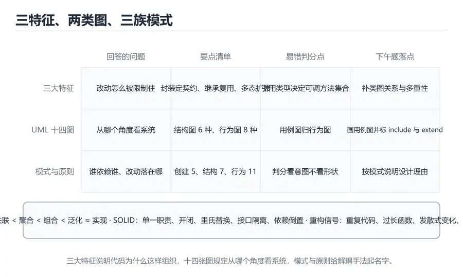

# 面向对象分析与设计：UML 与设计模式



> 内容更新时间：2026-10-06 · 学习阶段：进阶 · 预计用时：50 分钟

## 本节知识框架

**课程定位**：所属分类 `ruankao`（软考初级与中级），课程主题 `面向对象分析与设计`，学习阶段 进阶，建议用时 50 分钟。这一域在上午卷里通常占 8~12 分：面向对象三大特征与概念约一题，UML 图的归类与元素语义三到四题，用例图与类图关系两到三题，顺序图、状态图与活动图一到两题，设计模式一到两题， SOLID 原则与重构信号一到两题。下午的面向对象分析大题几乎全部落在这张地图上：给一段需求描述，要求画用例图、补类图关联、写顺序图消息，并按模式说明设计理由。

本课主线：先立三个特征，再摆两张清单。三大特征（封装、继承、多态）解释「为什么代码要这么组织」；UML 的十四种图是一张「从哪个角度看系统」的清单，结构图看骨架、行为图看动作；设计模式与 SOLID 是第三层，把反复出现的解耦手法命名，让「谁依赖谁、改动落在哪」有章可循。最后用 MVC 或 MVVM 把三层缝合到可运行的软件结构上。

**学完本课应当能够**

- 说清封装、继承、多态各自解决的问题，并能指出一个反例（继承被误用成组合）。
- 把 14 种图按结构图与行为图归位，说明每种图的元素记号与用途边界。
- 在类图里正确选用依赖、关联、聚合、组合、泛化、实现六种关系并标注多重性。
- 判断一段需求该配哪种模式，说出该模式的角色、意图与代价，并区分相邻模式的差异。
- 用 SOLID 五原则与常见重构信号评估一段代码的设计质量，给出改造方向。

### 复习清单

- [ ] 能用一句话分别说出结构图 6 种与行为图 8 种的名称，并把它们按「看骨架」与「看动作」分成两堆。
- [ ] 能画出聚合与组合在图形上的差别（空心菱形与实心菱形），并各给一个业务例子。
- [ ] 能说明 include 与 extend 的箭头方向、触发条件与扩展点位置。
- [ ] 能把顺序图的消息编号与通信图的 1、1.1 嵌套编号对应起来，说清两张图各自表达什么。
- [ ] 能写出五个创建型、七个结构型、十一个行为型模式中至少九个的适用场景，并解释为什么不用另一个相邻模式。

## 核心概念定义

| 术语 | 操作性定义（白话版） | 常见边界与风险 |
| --- | --- | --- |
| 对象与类 | 对象是状态加行为的具体实例，类是对一族对象的抽象描述，包含属性、操作与语义。 | 易错：类是模板不是实例，对象才有身份与生命周期。 |
| 封装 | 把数据与操作绑定在一起并隐藏内部实现，只通过公开接口与外界交互。 | 易错：封装不等于「一律私有」，而是把易变部分与稳定契约分开。 |
| 继承 | 子类复用父类的属性与操作并可扩展或重写，形成 is-a 层次。 | 易错：继承是强耦合，父类改动会波及全部子类，滥用会带来平行继承体系。 |
| 多态 | 同一消息发给不同对象得到不同实现，分编译期重载与运行期重写两种。 | 易错：运行期多态要靠父类引用指向子类对象，引用类型决定可调用的方法集合。 |
| 抽象与接口 | 抽取共同特征形成抽象类或接口，只约定契约不规定实现。 | 易错：抽象类可以有状态与构造逻辑，接口更偏向能力约定。 |
| UML 结构图 | 描述系统的静态骨架：类图、对象图、包图、构件图、部署图、组合结构图。 | 易错：用例图看起来像结构图，实际归在行为图里。 |
| UML 行为图 | 描述随时间或事件推进的动作：用例图、活动图、状态机图、顺序图、通信图、定时图、交互概览图。 | 易错：顺序图与通信图同属交互图，是行为图的子类。 |
| 用例与参与者 | 用例是系统为参与者提供价值的一项功能，参与者是系统外的角色而非具体人。 | 易错：用例不描述内部算法步骤，粒度是「一次完整业务目标」。 |
| include 与 extend | include 表示基础用例必然调用一段公共子用例；extend 表示满足条件时才插入的可选行为。 | 易错：两个箭头方向都指向被引用的一方，扩展用例上还要标注扩展点与条件。 |
| 关联与多重性 | 关联表达类之间的结构化连接，多重性写成 0..1、1、*、0..*、n..m 标在端点。 | 易错：多重性写在两端，分别表示「这一端的实例数」。 |
| 依赖 | 一种使用关系：一个类的变化会影响另一个类，常用带箭头的虚线表示。 | 易错：方法参数、局部变量、静态调用都构成依赖，但不是关联。 |
| 泛化与实现 | 泛化是是一般关系用实线加空心三角，实现是接口契约用虚线加空心三角。 | 易错：三角箭头永远指向被继承或被实现的父类与接口。 |
| 顺序图 | 以时间轴为主线的交互图，包含生命线、激活条、同步消息、返回消息与组合片段。 | 易错：alt、opt、loop、par 是组合片段的操作符，不是消息。 |
| 通信图 | 强调对象间连接结构的交互图，消息用带序号的箭头标在连线上。 | 易错：嵌套编号 1.1、1.2 表达的是同一个自调用内部的子消息。 |
| 活动图与状态图 | 活动图刻画工作流程的动线与分支汇合，状态图刻画一个对象生命周期的状态与转移。 | 易错：活动图的分支是控制流分岔，状态机的转移由事件触发并受监护条件约束。 |
| 构件图与部署图 | 构件图描述可替换的物理模块及其提供的与需求的接口，部署图描述软件在硬件节点上的分布。 | 易错：接口用小球与半圆槽表示，部署图要区分节点与制品。 |
| SOLID | 单一职责、开闭、里氏替换、接口隔离、依赖倒置五条设计原则的合称。 | 易错：依赖倒置说的是抽象层面的依赖方向，与「控制反转」这种运行机制不同层。 |
| 设计模式三族 | 创建型管对象怎么生，结构型管对象怎么搭，行为型管责任怎么分。 | 易错：同一个类图可用不同模式实现，判分看意图不看形状。 |
| MVC 与 MVVM | MVC 是模型、视图、控制器三分；MVVM 用视图模型加数据绑定替掉控制器。 | 易错：视图与模型之间不直接通信是这一族架构的底线。 |
| 重构 | 在不改变外部行为的前提下调整内部结构，让设计重新可读可扩展。 | 易错：重构要有测试兜底，与「顺手加个功能」不是一件事。 |

## 原理与运行机制

**一、三大特征解决三个不同的问题。** 封装回答「改动怎么被限制住」：把易变的实现藏进类内部，只留稳定的接口对外，于是内部重构不波及调用方。继承回答「复用怎么写最省」：把共同属性与操作抽到父类，子类只写差异，代价是耦合——父类一改，所有子类跟着受影响，所以判断能否继承要问一句「子类是不是父类的一种」，不是就不该继承。多态回答「扩展怎么写最稳」：调用方依赖抽象类型，新增一个子类不需要改调用点，这正是开闭原则的实现手段。三个特征配合的顺序通常是：先封装定契约，再抽象出接口，用多态把变化点变成可插拔的实现，继承只用来复用真正共性的部分。

**二、十四种图分两堆来记。** 结构图看骨架，行为图看动作。结构图 6 种：类图（类与关系）、对象图（某时刻的实例快照）、包图（分组与命名空间）、构件图（可替换物理模块与接口）、部署图（软件到硬件节点的映射）、组合结构图（类内部部件与连线）。行为图 8 种：用例图、活动图、状态机图，以及交互图家族的顺序图、通信图、定时图、交互概览图。全部属于行为图的一组是顺序图、状态图、活动图；而类图、构件图、部署图、对象图、包图都在结构图那一堆里，用例图是行为图这一类的常见误判点。

用例图先定参与者与用例，再定关系。参与者是人、外部系统或定时器扮演的角色，画成小人；用例画成椭圆，名称是「动词加宾语」的一次完整目标。include 把多个用例共有的步骤抽成独立用例，基础用例指向被包含用例，任何时候都会执行；extend 把偶发的分支抽出去，扩展用例指向基础用例，并在扩展点处带条件，例如「金额超限才触发的审批」。「登录」是基础用例，「记录审计日志」被它 include；「找回密码」extend 它，只有登录失败时才可选触发。

类图的六种关系按耦合强度排一条链：依赖 < 关联 < 聚合 < 组合 < 泛化 ≈ 实现。识别口诀是「线型加端点记号」：实线无箭头是双向关联，实线带箭头是单向关联或导航方向；带箭头的虚线是依赖；空心菱形是聚合，实心菱形是组合；实线加空心三角是泛化，虚线加空心三角是实现。聚合与组合都表达整体与部分，区别在生命周期与归属强度：部门与职工是聚合，一个职工可以同时在两个部门挂名，部门撤销了职工还在；公司与部门是组合，公司注销时部门随之消失，这叫「部分可以脱离整体独立存在、且一个部分可同时属于多个整体」，因此应当画成聚合关系，用带空心菱形的实线从部分指向整体。多重性写在关联端点，`1` 表示恰好一个，`0..1` 表示至多一个，`*` 表示任意多个，`1..*` 表示至少一个；关联名与角色名分别说明这条线的语义与两端各自扮演的身份，限定属性用花括号写在端点上，表示用它来做唯一选择。

交互这一层，顺序图与通信图表达同一批消息、突出点不同。顺序图把时间画成竖直方向：每条虚线是一个对象的生命线，矩形激活条表示正在执行，实线带实心箭头是同步调用，虚线箭头是返回，组合片段用 alt、opt、loop、par、break 标注条件与并发，「谁先谁后」一眼可见。通信图把对象画成节点、消息画成连线上的编号，「谁和谁说话」一眼可见，嵌套编号 1、1.1、1.2 表示第 1 条调用内部又发出两条子消息。做题时先看题目要的是时间关系还是结构关系，再决定读哪张图；反向题则会给一段场景描述，要求补消息。

活动图与状态图的分工要抠细。活动图是「流程图升级版」：动作结点用圆角矩形、对象用矩形、初态是实心圆、终态是靶心圆，判定是空心菱形（一个入口多个出口、按条件选一），合并在 UML 2 里与判定共用符号，分岔与汇合用粗横线（fork/join）表达并发，泳道划分责任归属。状态图围绕「一个对象的一生」：状态是圆角矩形，转移是有向边，边上写「事件 [监护条件] / 动作」三段式，内部活动用 entry、do、exit 标注，子状态机表示复合状态。判分点是：活动图关心工作走到哪一步，状态图关心收到某事件时对象该怎么反应；「订单从待支付到已发货」画成状态图更贴切，「一次退货审批流程」画成活动图更贴切。

**三、模式与原则是同一件事的两级表述。** SOLID 五原则给的是判据，模式给的是可复用解法。单一职责原则让一个类只承担一个变化原因，目的是降低耦合与改动波及面；开闭原则要求对扩展开放、对修改关闭，即新增行为靠加新类而不是改老类，这要靠抽象与多态落地；里氏替换原则要求子类可以替换父类出现的任何位置而不破坏程序行为，它约束继承不能被滥用成「缩小前置条件、放大后置条件」；接口隔离原则要求不强迫客户端依赖它用不到的方法，宁可用几个窄接口替代一个胖接口；依赖倒置原则要求高层模块不直接依赖低层实现，双方都依赖抽象，具体实现通过注入在运行期装配。

三族模式各挑高频的看。创建型：工厂方法把「造哪个类」推迟到子类，新增产品只加一个具体工厂；抽象工厂一次造出一族相互配套的产品；单例模式确保一个类只有一个实例并提供全局访问点，适合配置、连接池、日志器这类资源，但会带来隐式全局状态与测试困难；建造者把复杂对象的构建过程与表示分离，用于参数多、装配步骤有顺序的场景。结构型：适配器模式把已有接口转换为客户期望的接口，用来复用不匹配的存量代码；装饰器模式，用包装对象在运行期层层叠加职责，与继承派生 2^n 个子类的做法相对，代价是对象个数变多、调试要看穿几层；代理模式在不改变接口的前提下为访问加一层控制，用于远程调用、延迟加载、权限检查与日志，与装饰器的区别是「代理控制访问，装饰增加职责」。行为型：观察者模式让多个订阅者在一处状态变化时自动收到通知并被更新，代价是通知链不透明与潜在的内存泄漏；策略模式把一组可互换的算法各自封装成独立类，由上下文持有一个抽象策略引用，因此换算法不需要改调用点也不需要派生子类；模板方法在抽象类里固定算法骨架、把若干步骤留给子类实现，靠继承复用流程，与「对象组合加运行期替换」的策略模式互为对照，这也是「用策略替代模板方法里的可变步骤」这条重构建议的由来。

其余常考的模式可用一句话记住：职责链让请求沿一串处理者传递直到有人接手；命令把一次操作封装成对象以便排队与撤销；外观为一套复杂子系统提供统一简单接口；中介者用中间对象把网状调用换成星状；备忘录保存并恢复对象快照；状态模式把状态相关的行为分散到各状态对象；迭代器顺序访问集合而不暴露内部结构；访问者把作用于元素结构的操作分离出来。

**四、架构分层与重构信号。** MVC 里控制器接收输入、调用模型、再选择视图，视图与模型之间不直接通信，模型变化通过通知机制让视图更新；MVVM 用视图模型顶替控制器的位置，把界面状态与命令暴露成可绑定的属性，由数据绑定引擎负责双向同步，因此单元测试可以只测视图模型；MVP 则让呈现器持有视图接口，把交互逻辑从视图里彻底搬出来，代价是接口数量膨胀。选型的判据不是流行度，而是「界面交互复杂程度、可测试性要求、是否需要双向同步」三条。

重构的信号可以列成一张体检表：重复代码是最直接的动机；过长函数意味着抽象层次被压平；过大的类往往承担多个职责；过长的参数列表说明有对象该被整体传递；发散式变化是一个类因多种原因被改，霰弹式修改是一次改动要同时动多个类；依恋情结是方法更想访问别的类的数据；基本类型偏执是用字符串表达本该建模的概念；开关语句按类型分支说明该换成多态；平行继承体系与冗赘类提示结构冗余；循环依赖让两个模块谁也离不开谁。重构的底线是不改变外部行为、每一步都有测试通过，先把简单的事做对，再谈模式——「为了用模式而用模式」本身就是夸夸其谈未来性这一信号的典型表现。

## 典型应用场景

| 场景 | 典型输入或前提 | 期望产物 |
| --- | --- | --- |
| 需求梳理 | 一段自然语言业务描述 | 参与者、用例清单与 include 与 extend 关系 |
| 领域建模 | 名词提取出的概念与规则 | 类图：属性、方法、关系与多重性 |
| 接口时序设计 | 一次跨对象的调用 | 顺序图或通信图，含组合片段与返回 |
| 单据流转 | 有明确状态集合的业务对象 | 状态图，事件与监护条件齐全 |
| 审批流程 | 多角色参与的动线与并发分支 | 带泳道的活动图，fork 与 join 正确 |
| 存量代码复用 | 老接口与新客户端不匹配 | 适配器模式或外观模式的改造方案 |
| 插件式功能扩展 | 运行期可增减的功能项 | 装饰器或策略加依赖注入 |
| 遗留系统治理 | 重复代码与过长函数集中出现 | 重构序列：先提取方法再落模式 |

## 代码/协议/SQL 示例

下面的 Java 片段是可编译运行的策略模式实现，配合一个装饰器用法，用来把「换算法不改调用点」这件事量化出来。

```java
interface Strategy {
    int apply(int price);
}

class NoDiscount implements Strategy {
    public int apply(int price) {
        return price;
    }
}

class TenPercentOff implements Strategy {
    public int apply(int price) {
        return price * 9 / 10;
    }
}

class Checkout {
    private Strategy strategy = new NoDiscount();

    void setStrategy(Strategy strategy) {
        this.strategy = strategy;
    }

    int pay(int price) {
        return strategy.apply(price);
    }
}

public class Demo {
    public static void main(String[] args) {
        Checkout c = new Checkout();
        c.setStrategy(new TenPercentOff());
        System.out.println(c.pay(199) + " " + new Checkout().pay(199));
    }
}
```

保存为 Demo.java 后 `javac Demo.java && java Demo`，程序输出 179 199，与手算一致：第一个实例换了策略，199 乘 9 得 1791 再整除 10 得 179；第二个新实例仍用字段初始化的默认策略，返回原价 199。这段代码没有任何一处 if 判断折扣种类，新增折扣只加一个实现类，这就是开闭原则与策略模式合用的效果。

第二段把观察者模式与装饰器写在一起，注意两者的区别：前者解决「一处变化、多处通知」，后者解决「一层层加职责」。

```java
import java.util.ArrayList;
import java.util.List;

interface Listener {
    void onChange(int value);
}

class Subject {
    private final List<Listener> listeners = new ArrayList<>();
    private int value;

    void add(Listener l) {
        listeners.add(l);
    }

    void set(int v) {
        value = v;
        for (Listener l : listeners) {
            l.onChange(value);
        }
    }
}

interface Text {
    String render();
}

class PlainText implements Text {
    private final String body;

    PlainText(String body) {
        this.body = body;
    }

    public String render() {
        return body;
    }
}

class QuoteDecorator implements Text {
    private final Text wrapped;

    QuoteDecorator(Text wrapped) {
        this.wrapped = wrapped;
    }

    public String render() {
        return "\"" + wrapped.render() + "\"";
    }
}

class Runner {
    public static void main(String[] args) {
        Subject s = new Subject();
        s.add(v -> System.out.println("log:" + v));
        s.set(7);
        Text t = new QuoteDecorator(new QuoteDecorator(new PlainText("note")));
        System.out.println(t.render());
    }
}
```

两段代码对应本课两道题：前一段的输出是判断策略模式效果的依据，后一段里「两层装饰器把同一份正文包起来」正是运行期叠加职责的最小写法。类图侧的对应关系可以这样读：`QuoteDecorator implements Text` 是实现关系（虚线空心三角指向接口），`QuoteDecorator` 持有 `Text wrapped` 字段是单向关联（实线箭头），而 `Runner` 里的 lambda 表达式对 `Listener` 只构成依赖。

## 时间/空间复杂度或性能分析

面向对象设计的代价很少写在算法书上，但它真实存在，主要落在三处。

多态分派的成本：运行期绑定要让调用点查一次方法表或虚表，单次开销极小，但在紧循环里会阻碍内联优化。策略模式用对象持有引用再调用，等价于多一层的间接；模板方法靠继承在编译期定下骨架，间接层更薄却把可变步骤锁死在类层次里。设计上的结论是「流程稳定用模板方法，流程中某一步要频繁互换用策略」，性能只是次要因素，扩展性与可测试性才是主因。

对象数量的成本：装饰器每层是一个新对象，n 项可选功能最坏要套 n 层，如果用继承表达同样的组合数则是 2^n 个子类——类是编译期一次性生成、随包体积走、每个子类都要维护；对象是运行期按需创建、随堆占用走、可以随意拆卸。这是「功能可自由组合就用装饰、组合数固定就用继承」这条判据的来源。观察者的订阅者列表是另一种代价：通知是 O(k) 的遍历，k 是订阅者数，且注册后忘记反注册会让主题长期持有引用，形成内存泄漏型的「隐性空间增长」。

建模的收益与成本：结构图与行为图的价值在于把改动提前暴露。用例图划清范围，能提前挡掉「需求蔓延」；类图定下关系与多重性，等价于给数据库设计提前打了外键与连接方式的草稿；顺序图在写代码之前发现「少一个返回、少一个异常分支」，其修复成本远低于集成阶段。反面成本同样要算：图越多越容易与代码脱节，一旦过期反而误导。工程上的做法是把类图与部署图作为活文档随代码走，把活动图与用例图作为评审产物按里程碑更新。

| 设计选择 | 主要代价 | 什么时候选它 |
| --- | --- | --- |
| 继承复用 | 父类改动波及全部子类 | 类别层次确实是 is-a 且共性稳定 |
| 组合加委托 | 要多写转发代码 | 需要运行期换实现或规避层次爆炸 |
| 装饰器 | 对象层数增加、调试要看穿包装 | 可选功能自由组合、不能改原类 |
| 适配器 | 多一层转换与语义损耗 | 复用接口不匹配的存量组件 |
| 观察者 | 通知链不透明、易漏反注册 | 一对多依赖且订阅方彼此独立 |
| 单例 | 隐式全局状态、测试需替换实现 | 确有一处需要唯一实例与统一入口 |
| 模板方法 | 骨架改动影响所有子类 | 流程固定、个别步骤可变 |

## 常见误区与易错点

| 容易答错的做法 | 考场上的实际现象 | 原因与正确做法 |
| --- | --- | --- |
| 把用例图归进结构图 | 归类题选错 | 用例图描述系统行为，属于行为图 |
| 认为 include 箭头从被包含用例指向基础用例 | 图形题方向错 | 两个关系都指向被引用的一方 |
| 用实心菱形画聚合 | 类图评分丢分 | 空心菱形是聚合，实心菱形是组合 |
| 把多重性写在类名旁边 | 标注位置判错 | 多重性属于关联端点，写在连线两端 |
| 说依赖比关联耦合更强 | 排序题错位 | 依赖是暂时使用关系，弱于结构化关联 |
| 认为子类可以随意加强前置条件 | 里氏替换题答错 | 子类不得强化前提，也不能削弱结论 |
| 把代理与装饰混成一个模式 | 模式辨析丢分 | 代理控制访问，装饰增加职责 |
| 说单例模式没有任何缺点 | 方案评价题失分 | 隐式全局状态、并发问题与可测试性下降都是代价 |
| 认为 MVC 里视图可以直接调用模型 | 架构题判断错 | 视图与模型不直接通信，变化靠通知或绑定 |
| 把 MVVM 的数据绑定当成反射黑魔法 | 概念表述含糊 | 绑定由视图模型暴露可观察属性、由框架负责同步 |
| 见到重复代码就直接抽公共父类 | 用继承解决复用引发耦合 | 先判断是否 is-a，否则抽类或用委托 |
| 认为重构就是换更时髦的模式 | 案例分析答偏 | 重构不改变外部行为，且需要测试保护 |

## 与其他知识点的关系

- **前置**：`ruankao_data_structure` 的树与图用来读懂类层次的遍历与交互图的组合片段；`ruankao_cs_basics` 的抽象与编码概念是「接口与实现分离」这一思想的源头。
- **并列**：`ruankao_db_and_sql` 的外键与关联多重性对应，多对多关联落成中间关系表、一对多落成主外键，两课在「同一结构的不同视图」上交汇；`ruankao_net_security` 的认证与审计需求常以独立用例出现在用例图中，并在部署图上以区域边界方式落地。
- **后续**：`ruankao_os_and_arch` 的并发与资源共享问题在观察者与单例模式里都有对应的实现陷阱；下午科目的设计大题要求同时给出用例图、类图与顺序图并用模式术语解释设计理由，本课的三张清单正是它的答题骨架。

## 自测题与参考答案

作答时先盖上答案区，每题限时 4 分钟；做完把错题对应的小节翻一遍，图形记号照着课文再描一遍。

### 题目 1（单选题）

关于 UML 图的归类，下列全部属于行为图的一组是？

- A. 类图、构件图、部署图与对象图
- B. 用例图、活动图、状态机图与顺序图
- C. 包图、组合结构图、通信图与定时图
- D. 用例图、类图、交互概览图与部署图

**参考答案**：B

**解析**：本题正确项是「用例图、活动图、状态机图与顺序图」。行为图看动作，包括用例图、活动图、状态机图，以及交互图家族的顺序图、通信图、定时图与交互概览图，正好八种；结构图看骨架，包括类图、对象图、包图、构件图、部署图与组合结构图，正好六种。用例图看起来像结构图，是这道题唯一的陷阱，也是全库最高频的误判点。干扰项「类图、构件图、部署图与对象图」四个全在结构图那一堆里；干扰项「包图、组合结构图、通信图与定时图」把两张结构图混进了交互图；干扰项「用例图、类图、交互概览图与部署图」里类图与部署图属于结构图。

### 题目 2（单选题）

一个职工可以同时在两个部门挂名，部门撤销后职工仍然存在，部门与职工之间这条关系应画成？

- A. 组合关系，用带实心菱形的实线从职工一端指向部门一端
- B. 依赖关系，用带箭头的虚线并在端点上标注多重性 *
- C. 泛化关系，用实线加空心三角指向部门这一父类
- D. 聚合关系，用带空心菱形的实线且菱形画在部门这一端

**参考答案**：D

**解析**：本题正确项是「聚合关系，用带空心菱形的实线且菱形画在部门这一端」。整体与部分的关系分两档：部分能脱离整体独立存在、且能同时属于多个整体，就是聚合；部分的生命周期由整体掌管、整体消失部分随之消失，才是组合。职工挂在部门名下属于前者，公司与部门属于后者，判分时把「能否独立存在」和「能否多归属」两条各答一次最稳妥。菱形永远画在整体一侧。干扰项「组合关系，用带实心菱形的实线从职工一端指向部门一端」既判错了强度又把菱形放错了端；干扰项「依赖关系，用带箭头的虚线并在端点上标注多重性 *」混淆了使用关系与结构化连接，方法参数、局部变量才构成依赖；干扰项「泛化关系，用实线加空心三角指向部门这一父类」把 has-a 当成了 is-a，职工不是一种部门。

### 题目 3（单选题）

要把一组可互换的计费算法各自封装成独立类，由上下文持有抽象引用、运行期替换且新增算法不必修改调用点，应选哪个模式？

- A. 策略模式，用对象组合把算法族各自封装，换算法不需要修改上下文
- B. 模板方法模式，在抽象类里固定算法骨架并把可变步骤留给子类实现
- C. 适配器模式，把已有的算法接口转换为客户期望的接口之后再复用
- D. 外观模式，为整套算法子系统提供一个统一而简单的入口接口

**参考答案**：A

**解析**：本题正确项是「策略模式，用对象组合把算法族各自封装，换算法不需要修改上下文」。策略的两条要点是「一族算法可互换」与「上下文只持有抽象引用」，因此新增折扣只加一个实现类，调用点一行不动，这正是开闭原则的落地手段。它与模板方法互为对照：后者靠继承复用流程、编译期就定死了子类实现，前者靠组合与运行期替换。干扰项「模板方法模式，在抽象类里固定算法骨架并把可变步骤留给子类实现」也能消除 if 分支，但换算法要派生子类，不满足「运行期替换」这一条；干扰项「适配器模式，把已有的算法接口转换为客户期望的接口之后再复用」解决的是接口不匹配，不是算法可互换；干扰项「外观模式，为整套算法子系统提供一个统一而简单的入口接口」只减小编程接口面，不承担替换职责。

### 题目 4（代码阅读题）

阅读下面这段策略模式的 Java 代码，程序输出的结果是什么？

```java
interface Strategy {
    int apply(int price);
}

class NoDiscount implements Strategy {
    public int apply(int price) {
        return price;
    }
}

class TenPercentOff implements Strategy {
    public int apply(int price) {
        return price * 9 / 10;
    }
}

class Checkout {
    private Strategy strategy = new NoDiscount();

    void setStrategy(Strategy strategy) {
        this.strategy = strategy;
    }

    int pay(int price) {
        return strategy.apply(price);
    }
}

public class Demo {
    public static void main(String[] args) {
        Checkout c = new Checkout();
        c.setStrategy(new TenPercentOff());
        System.out.println(c.pay(199) + " " + new Checkout().pay(199));
    }
}
```

- A. 179.1 199
- B. 199 199
- C. 179 199
- D. 179 179

**参考答案**：C

**解析**：本题正确项是「179 199」。第一个实例先被 setStrategy 换成 TenPercentOff，199 乘 9 得 1791，再与 10 做整数除法得 179；后面那个 new Checkout() 是全新对象，字段初始化给的是默认策略 NoDiscount，直接返回原价 199。整段代码没有任何一处 if 判断折扣种类，新增折扣只加一个实现类，这就是开闭原则与策略模式合用的效果。干扰项「179.1 199」把整数运算当成了浮点运算，两个 int 相除结果仍是 int；干扰项「199 199」漏看了 setStrategy 已经生效；干扰项「179 179」误以为新对象沿用了 c 的策略，而策略引用是实例字段而不是静态字段。

### 题目 5（多选题）

关于交互图、活动图与状态图的读法，下列说法正确的是？

- A. alt、opt、loop 与 par 是顺序图里的消息类型，各代表一次同步调用
- B. 通信图用 1、1.1、1.2 的嵌套编号表达同一次自调用内部发出的子消息
- C. 状态图的转移不需要事件，只要监护条件为真就立即发生
- D. 活动图里的粗横线表示判定，空心菱形用来表示并发分岔与汇合
- E. 订单从待支付到已发货更适合画成状态图，一次退货审批流程更适合画成活动图

**参考答案**：B、E

**解析**：多选题要同时选中「通信图用 1、1.1、1.2 的嵌套编号表达同一次自调用内部发出的子消息」与「订单从待支付到已发货更适合画成状态图，一次退货审批流程更适合画成活动图」。通信图与顺序图表达同一批消息、突出点不同：顺序图把时间画成竖直方向，谁先谁后一眼可见；通信图把对象画成节点、消息画成连线上的编号，谁和谁说话一眼可见。而活动图关心工作走到哪一步，状态图关心收到某事件时对象该怎么反应，判分就把这句复述一遍。干扰项「alt、opt、loop 与 par 是顺序图里的消息类型，各代表一次同步调用」把组合片段的操作符当成了消息，实线带实心箭头的才是同步调用；干扰项「状态图的转移不需要事件，只要监护条件为真就立即发生」漏掉了触发条件，转移边写的是「事件 [监护条件] / 动作」三段式；干扰项「活动图里的粗横线表示判定，空心菱形用来表示并发分岔与汇合」把两个符号的职责对调了，判定与合并在 UML 2 里共用空心菱形，fork 与 join 才用粗横线。

### 题目 6（排序题）

把类图关系按耦合强度由弱到强的前四档排列：

- A. 组合：整体掌管部分的生命周期，用带实心菱形的实线表示
- B. 依赖：一个类的变化会影响另一个类，用带箭头的虚线表示
- C. 关联：类之间的结构化连接，用实线表示并在端点标多重性
- D. 聚合：整体与部分但部分可独立存在，用带空心菱形的实线表示

**参考答案**：B → C → D → A

**解析**：本题顺序是「依赖：一个类的变化会影响另一个类，用带箭头的虚线表示」→「关联：类之间的结构化连接，用实线表示并在端点标多重性」→「聚合：整体与部分但部分可独立存在，用带空心菱形的实线表示」→「组合：整体掌管部分的生命周期，用带实心菱形的实线表示」。这条强度链的后两档是泛化与实现，两者大致同级且都比组合强，因为子类与实现类要把父类和接口的契约整体接过来。识别口诀仍是「线型加端点记号」：虚线看依赖与实现，实线看关联、聚合、组合与泛化，菱形空心还是实心区分聚合与组合，三角箭头永远指向被继承或被实现的一方。

## 考点精讲

本课题库共 6 道题，下面逐题复述题干原文、答案字母（A 是第 1 个选项）与判断依据，字段内容与题库完全一致。

### 考点 1（单选题 · UML 图归类）

- **题目**：关于 UML 图的归类，下列全部属于行为图的一组是？
- **答案**：B
- **正确项**：用例图、活动图、状态机图与顺序图
- **判断依据**：本题正确项是「用例图、活动图、状态机图与顺序图」。行为图看动作，包括用例图、活动图、状态机图，以及交互图家族的顺序图、通信图、定时图与交互概览图，正好八种；结构图看骨架，包括类图、对象图、包图、构件图、部署图与组合结构图，正好六种。用例图看起来像结构图，是这道题唯一的陷阱，也是全库最高频的误判点。干扰项「类图、构件图、部署图与对象图」四个全在结构图那一堆里；干扰项「包图、组合结构图、通信图与定时图」把两张结构图混进了交互图；干扰项「用例图、类图、交互概览图与部署图」里类图与部署图属于结构图。

### 考点 2（单选题 · 聚合与组合）

- **题目**：一个职工可以同时在两个部门挂名，部门撤销后职工仍然存在，部门与职工之间这条关系应画成？
- **答案**：D
- **正确项**：聚合关系，用带空心菱形的实线且菱形画在部门这一端
- **判断依据**：本题正确项是「聚合关系，用带空心菱形的实线且菱形画在部门这一端」。整体与部分的关系分两档：部分能脱离整体独立存在、且能同时属于多个整体，就是聚合；部分的生命周期由整体掌管、整体消失部分随之消失，才是组合。职工挂在部门名下属于前者，公司与部门属于后者，判分时把「能否独立存在」和「能否多归属」两条各答一次最稳妥。菱形永远画在整体一侧。干扰项「组合关系，用带实心菱形的实线从职工一端指向部门一端」既判错了强度又把菱形放错了端；干扰项「依赖关系，用带箭头的虚线并在端点上标注多重性 *」混淆了使用关系与结构化连接，方法参数、局部变量才构成依赖；干扰项「泛化关系，用实线加空心三角指向部门这一父类」把 has-a 当成了 is-a，职工不是一种部门。

### 考点 3（单选题 · 策略与模板方法）

- **题目**：要把一组可互换的计费算法各自封装成独立类，由上下文持有抽象引用、运行期替换且新增算法不必修改调用点，应选哪个模式？
- **答案**：A
- **正确项**：策略模式，用对象组合把算法族各自封装，换算法不需要修改上下文
- **判断依据**：本题正确项是「策略模式，用对象组合把算法族各自封装，换算法不需要修改上下文」。策略的两条要点是「一族算法可互换」与「上下文只持有抽象引用」，因此新增折扣只加一个实现类，调用点一行不动，这正是开闭原则的落地手段。它与模板方法互为对照：后者靠继承复用流程、编译期就定死了子类实现，前者靠组合与运行期替换。干扰项「模板方法模式，在抽象类里固定算法骨架并把可变步骤留给子类实现」也能消除 if 分支，但换算法要派生子类，不满足「运行期替换」这一条；干扰项「适配器模式，把已有的算法接口转换为客户期望的接口之后再复用」解决的是接口不匹配，不是算法可互换；干扰项「外观模式，为整套算法子系统提供一个统一而简单的入口接口」只减小编程接口面，不承担替换职责。

### 考点 4（代码阅读题 · 策略模式落地）

- **题目**：阅读下面这段策略模式的 Java 代码，程序输出的结果是什么？
- **答案**：C
- **正确项**：179 199
- **判断依据**：本题正确项是「179 199」。第一个实例先被 setStrategy 换成 TenPercentOff，199 乘 9 得 1791，再与 10 做整数除法得 179；后面那个 new Checkout() 是全新对象，字段初始化给的是默认策略 NoDiscount，直接返回原价 199。整段代码没有任何一处 if 判断折扣种类，新增折扣只加一个实现类，这就是开闭原则与策略模式合用的效果。干扰项「179.1 199」把整数运算当成了浮点运算，两个 int 相除结果仍是 int；干扰项「199 199」漏看了 setStrategy 已经生效；干扰项「179 179」误以为新对象沿用了 c 的策略，而策略引用是实例字段而不是静态字段。

### 考点 5（多选题 · 三张图的读法）

- **题目**：关于交互图、活动图与状态图的读法，下列说法正确的是？
- **答案**：B、E
- **正确项**：通信图用 1、1.1、1.2 的嵌套编号表达同一次自调用内部发出的子消息；订单从待支付到已发货更适合画成状态图，一次退货审批流程更适合画成活动图
- **判断依据**：多选题要同时选中「通信图用 1、1.1、1.2 的嵌套编号表达同一次自调用内部发出的子消息」与「订单从待支付到已发货更适合画成状态图，一次退货审批流程更适合画成活动图」。通信图与顺序图表达同一批消息、突出点不同：顺序图把时间画成竖直方向，谁先谁后一眼可见；通信图把对象画成节点、消息画成连线上的编号，谁和谁说话一眼可见。而活动图关心工作走到哪一步，状态图关心收到某事件时对象该怎么反应，判分就把这句复述一遍。干扰项「alt、opt、loop 与 par 是顺序图里的消息类型，各代表一次同步调用」把组合片段的操作符当成了消息，实线带实心箭头的才是同步调用；干扰项「状态图的转移不需要事件，只要监护条件为真就立即发生」漏掉了触发条件，转移边写的是「事件 [监护条件] / 动作」三段式；干扰项「活动图里的粗横线表示判定，空心菱形用来表示并发分岔与汇合」把两个符号的职责对调了，判定与合并在 UML 2 里共用空心菱形，fork 与 join 才用粗横线。

### 考点 6（排序题 · 类图关系强度链）

- **题目**：把类图关系按耦合强度由弱到强的前四档排列：
- **答案**：B → C → D → A
- **正确项**：依赖用带箭头虚线 → 关联用实线并标多重性 → 聚合用带空心菱形实线 → 组合用带实心菱形实线
- **判断依据**：本题顺序是「依赖：一个类的变化会影响另一个类，用带箭头的虚线表示」→「关联：类之间的结构化连接，用实线表示并在端点标多重性」→「聚合：整体与部分但部分可独立存在，用带空心菱形的实线表示」→「组合：整体掌管部分的生命周期，用带实心菱形的实线表示」。这条强度链的后两档是泛化与实现，两者大致同级且都比组合强，因为子类与实现类要把父类和接口的契约整体接过来。识别口诀仍是「线型加端点记号」：虚线看依赖与实现，实线看关联、聚合、组合与泛化，菱形空心还是实心区分聚合与组合，三角箭头永远指向被继承或被实现的一方。

## 术语速查

| 术语 | 一句话说明 |
| --- | --- |
| is-a 与 has-a | 判断该用继承还是关联的口诀：是一种就用泛化，有一个就用关联或聚合。 |
| 组合片段 | 顺序图上用 alt、opt、loop、par 等操作符框出的一段条件或并发交互区域。 |
| 生命线 | 顺序图中贯穿上下的虚线，代表一个对象在交互期间的存在。 |
| 监护条件 | 状态转移边上写在方括号里的布尔判断，条件成立转移才可能发生。 |
| 扩展点 | 基础用例中声明可被扩展用例插入的位置，通常是一个业务锚点。 |
| 限定关联 | 在关联端点加上限定属性，用它把「一对多」查找变成「一对一」定位。 |
| 依赖倒置 | 高层与低层都依赖抽象，抽象不依赖细节，具体实现由外部装配进来。 |
| 数据绑定 | 视图模型的可观察属性与界面控件之间由框架维护的双向同步关系。 |
| 冗余代码 | 同一段逻辑出现在多处，是重构最常被引用的触发信号。 |

## 参考资料与复核

- 最后复核：2026-10-04
- 下次复核：2027-09-10
- 复核范围：三大特征的表述口径、结构图 6 种与行为图 8 种的归类、include 与 extend 的箭头方向、类图六种关系的图形记号与多重性写法、顺序图与通信图的分工、活动图与状态图的边界、SOLID 五原则的原文式表述、九个高频模式的意图与代价、MVC 与 MVVM 的差异。
- 来源性质：教材通用结论、语言规范与设计模式文档的公开页；本课核对关键词：空心菱形、虚线空心三角、扩展点、开闭原则、依赖倒置、数据绑定。

| 参考资料 | 本课用途 |
| --- | --- |
| [Java 语言规范第 21 版：类型与表达式章节](https://docs.oracle.com/javase/specs/jls/se21/html/jls-5.html) | 方法调用、表达式类型与运行期分派的规范依据 |
| [Refactoring.Guru 设计模式目录](https://refactoring.guru/design-patterns) | 创建型、结构型、行为型三族模式的意图与结构图 |
| [中国计算机技术职业资格网首页（软考官方门户）](https://www.ruankao.org.cn/) | 考试级别、科目设置与大纲入口 |
| [PostgreSQL 官方文档：SQL 语法教程](https://www.postgresql.org/docs/current/tutorial.html) | 类图关联转关系模式时校验外键与多重性的参照实现 |

## 内容元数据

> 内容更新时间：2026-10-06 · 学习阶段：进阶 · 预计用时：50 分钟

- 内容版本：v2.0
- 分类归属：`ruankao`（软考初级与中级），本课为第 8 门（order 7）
- 适用考试：软件设计师 / 系统架构设计师（上午综合知识的面向对象题区与下午设计大题）
- 题量与题型：6 题（单选 3 题、代码阅读 1 题、多选 1 题、排序 1 题），全部自主命题
- 质量口径：与 `tool/content_pipeline/validate_pack.js` 的结构与题库门禁对齐
- 相关课程：`ruankao_db_and_sql`、`ruankao_net_security`、`ruankao_data_structure`
- 说明：图的形式化定义随 UML 版本演进，本课文按教材常用的两类十四种口径组织，个别教材把制品图计入结构图时总数会到 15 种，判题以题干所用版本说明为准
