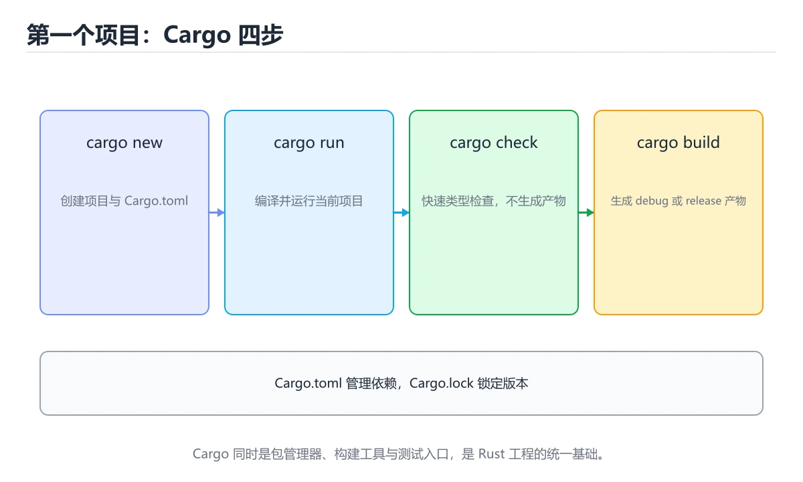
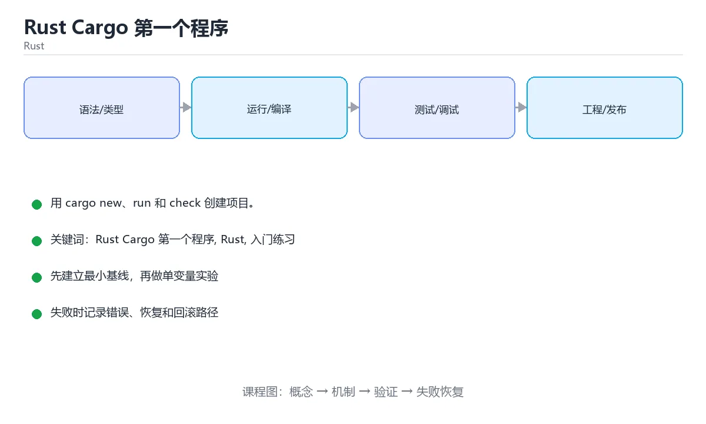

# Rust Cargo 第一个程序

> 内容更新时间：2026-10-06 · 学习阶段：入门 · 预计用时：35 分钟





## 本节知识框架

**课程定位**：所属分类 `rust`（Rust），课程主题 `Rust Cargo 第一个程序`，学习阶段 入门，建议用时 50 分钟。

本课主线：用 cargo new、run 和 check 创建项目。

**学完本课应当能够**
- 说清 `cargo new` 与 `Cargo.toml` 的含义与区别，并各举一个正例和一个反例。
- 用本课示例验证 `fn main` 的行为，记录输入、输出与失败条件。
- 遇到「不区分调试与发布配置」这类问题时，能说出触发条件与修复顺序。

### 复习清单

- [ ] 能讲清 Rust Cargo 第一个程序 与 Rust 的分工，并指出其中一个前提失效的边界。
- [ ] 能运行「Rust Cargo 第一个程序」的示例，记录输入、输出与第一次失败的现象。
- [ ] 能完成一次自测，并把错题对照错误表定位原因。

## 核心概念定义

| 术语 | 操作性定义 | 常见边界与风险 |
| --- | --- | --- |
| cargo new | 创建新项目，同时生成 Cargo.toml 与 src/main.rs。 | 它只生成最初的目录与两个文件：改包名要回头编辑 Cargo.toml，带依赖的项目也不能退回用 rustc 单独编译。 |
| Cargo.toml | 项目清单，记录包名、版本与依赖。 | 改完它忘记重新编译，旧产物不会反映新依赖；它只写版本范围，不提交 Cargo.lock 就仍会构建不可复现。 |
| fn main | 可执行程序的入口函数。 | 易错：把可执行语句写在函数之外的顶层；Rust 只允许在函数里执行代码，库 crate 更是没有 main 也照样编译。 |
| cargo check | 只做类型与借用检查、不产出二进制，是最快的反馈手段。 | 它不生成 target 下的可执行文件，所以运行期现象与 debug、release 的性能差距都得另跑 cargo run 才看得到。 |
| Cargo | Cargo 负责创建项目、管理依赖、编译和测试 | 用 rustc 单独编译带依赖的项目时依赖不会自动下载，这一段只能交回 Cargo 做。 |
| 借用 | 借用分为共享借用 &T 和可变借用 &mut T，同一时间要么多个共享借用，要么一个可变借用，不能同时存在 | 违反这条规则编译期就报错；但跨线程共享可变状态它管不到，得换成 Arc 与 Mutex 组合。 |

## 原理与运行机制

### 机制总览

**教材衔接：一句话入门**

用 cargo new、run 和 check 创建项目。

**教材衔接：Rust 基础机制速览**

### Cargo、crate 与模块

Cargo 负责创建项目、管理依赖、编译和测试。包由 crate 组成，库 crate 对外暴露 API，二进制 crate 提供可执行入口。模块用 `mod` 组织代码，`pub` 控制可见性，`use` 把路径引入当前作用域。`Cargo.toml` 声明依赖和版本，`Cargo.lock` 固定可复现的依赖解析结果。

### 所有权、借用与生命周期

Rust 用所有权在编译期管理内存：每个值有唯一所有者，所有者离开作用域时值被释放；赋值或传参会移动所有权，除非类型实现了 Copy。借用分为共享借用 `&T` 和可变借用 `&mut T`，同一时间要么多个共享借用，要么一个可变借用，不能同时存在。生命周期标注描述引用之间的关系，不是延长引用存活时间；大多数简单函数可以由编译器自动推导。

### 可变性、模式匹配与控制流

`let` 默认不可变，需要修改时加 `mut`。`if`、`match`、`while let` 和 `for` 都是表达式或控制结构，`match` 必须覆盖所有可能分支。`Option<T>` 表示可能有值，`Result<T,E>` 表示成功或失败，二者迫使调用方显式处理缺失和错误。`?` 运算符把错误向上传播，适合库函数；二进制入口可以决定是否记录并退出。

### 结构体、枚举与 trait

结构体组合数据，枚举表达互斥状态，trait 定义共享行为。泛型让函数和类型适用于多种具体类型，trait bound 约束泛型能力；单态化会在编译期为具体类型生成代码，因此运行时不牺牲性能但会增加二进制体积。迭代器是惰性的，`map`、`filter`、`collect` 等适配器可以组合成清晰的数据流水线，也要注意分配和借用限制。

### 并发与不安全代码

Rust 的类型系统能在编译期阻止数据竞争：`Send` 表示类型可以跨线程转移，`Sync` 表示可以安全共享引用。`Arc<Mutex<T>>` 是共享可变状态的常见组合，`Rc<RefCell<T>>` 只适合单线程。`unsafe` 不会关闭借用检查，而是把某些安全证明责任交给开发者；使用前必须写清前置条件、后置条件和失败后果。

**教材衔接：版本与时效**

- 版本提示：Rust Cargo 第一个程序 的行为在最近几个大版本里有过调整，升级「Rust Cargo 第一个程序」前先用 hello 复现当前输出，再对照官方发布说明逐条核对。
- 异步运行时与借用检查规则的变化会影响 Rust Cargo 第一个程序，要在 CI 中提前暴露。
- 升级「Rust Cargo 第一个程序」涉及的依赖前，先用 hello 复现当前行为，再逐项核对版本说明与破坏性变更。
- 官方发布说明：https://blog.rust-lang.org/

## 典型应用场景

**课程内置实验入口**：`sandbox:rust`，用于动手验证《Rust Cargo 第一个程序》的机制；实验结论不替代概念定义与复杂度分析。

**教材衔接：代码实验：把示例跑成证据**

### 实验一：建立基线

```rust
fn main() {
    println!("hello from Rust");
}
```

### 实验二：只改一个输入

沿用「Rust Cargo 第一个程序」的最小示例做一次单变量实验：

做完后用一句话写出「Rust Cargo 第一个程序」的结论：输入怎么变，结果才怎么变。

### 实验三：制造一个可控错误

在需要修改变量时去掉 mut，或者制造一次所有权转移后继续使用原变量。记录借用检查器的完整提示，理解它阻止了什么运行时错误。

### 实验四：用三句话复述

1. 在「Rust Cargo 第一个程序」里，hello 接受哪些输入，非法输入应该在哪里被挡住？
2. Rust Cargo 第一个程序 按什么顺序处理输入，在哪一步产生了状态变化或副作用？
3. 输出如何验证，失败时第一条可观察证据是什么？

**教材衔接：零基础通俗讲：Rust 与 Cargo 第一个项目**

### 一句话说清它是什么

Rust 用 cargo 管理项目：cargo new 建工程、cargo run 编译并运行、cargo build 只编译；程序入口是 fn main。

### 用生活比喻理解

把 cargo 想成装修队：你只说要建什么，它负责买材料（依赖）、施工（编译）和交钥匙（运行）。你不用手动搬每一块砖。

### 完整可运行代码

```rust
fn main() {
    println!("你好，Rust");
}
```

### 逐行拆开看

- `fn main()` 定义程序入口，fn 是 function 的缩写，函数体用花括号包围。
- `println!` 末尾的叹号表示这是一个宏，不是普通函数；它负责把格式化内容打印到标准输出。
- 字符串字面量用双引号，Rust 的字符串是 UTF-8 编码，中文可以直接写。
- Rust 语句以分号结尾，但表达式块的值可以省略分号作为返回值。
- 用 cargo new 生成的项目里有 src/main.rs 和 Cargo.toml，后者记录项目名和依赖。

### 把程序跑一遍

- 执行 `cargo new hello` 创建项目目录。
- 进入目录执行 `cargo run`，cargo 先编译再运行。
- 程序进入 main，执行 println 宏，屏幕输出「你好，Rust」。
- 编译产物放在 target/debug 下，正式发布用 `cargo build --release`。

### 新手最容易踩的坑

- 把 `println!` 的叹号漏掉：编译器会提示找不到名为 println 的函数。
- 用 rustc 单独编译带依赖的项目：依赖不会自动下载，应该用 cargo。
- 在函数外部写语句：Rust 只允许在函数里执行代码，顶层只能写声明。
- 以为调试构建够快：debug 与 release 的性能差距可能达到数倍。
- 修改 Cargo.toml 后忘记重新编译：旧产物不会自动反映新依赖。

### 动手练一练

- 修改输出文字，重新执行 cargo run。
- 用 cargo build 编译一次，找到生成的可执行文件路径。
- 在 Cargo.toml 里改项目名，观察编译产物的名字变化。

### 本课速查卡

把下面八行抄进自己的笔记，复习时只看这一页就能回忆整课：

| 复习项 | 本课要点 |
| --- | --- |
| 核心结论 | Rust 用 cargo 管理项目：cargo new 建工程、cargo run 编译并运行、cargo build 只编译；程序入口是 fn main。 |
| 最少要写的代码 | `fn main() {` |
| 正确做法 | 执行 `cargo new hello` 创建项目目录。 |
| 最常见的错误 | 把 `println!` 的叹号漏掉：编译器会提示找不到名为 println 的函数。 |
| 出错先查什么 | 先读第一条报错信息，再回到最小示例只改一个地方 |
| 怎么确认学会了 | 修改输出文字，重新执行 cargo run。 |
| 和别的知识点的关系 | 本课打下的语法与思维方式会被后面每一课反复用到 |
| 接下来做什么 | 合上教程，凭记忆把上面的最小代码重写一遍再运行 |

- **不区分调试与发布配置**：典型现象是两种配置下行为与性能不同却当成一回事；正确做法是明确使用的配置，并记录切换方式。
- **依赖不锁版本**：典型现象是构建结果不可复现；正确做法是提交锁文件并定期更新依赖。
- **忽略编译警告**：典型现象是潜在问题被长期掩盖；正确做法是把警告当错误处理，保持零警告构建。

### 最小验证场景

- 准备：保留 `rust` 示例的原始输入，先记录 `Rust Cargo 第一个程序` 的基线输出和完整运行命令。
- 观察：先核对 调用了 `main()`，再改变一个与 `cargo new` 相关的条件。
- 判定：新结果与 `Rust Cargo 第一个程序` 的基线不同不等于错误；只有当差异破坏了 `cargo new` 的定义或错误表中的约束，才判定为失败。

### 选择与边界

- 使用 `cargo new` 时，创建新项目，同时生成 Cargo.toml 与 src/main.rs。
- 使用 `Cargo.toml` 时，项目清单，记录包名、版本与依赖；不同版本与依赖组合的行为可能不同，升级或换环境前要按官方变更说明重新验证。
- 使用 `fn main` 时，可执行程序的入口函数。
- 使用 `cargo check` 时，只做类型与借用检查、不产出二进制，是最快的反馈手段；换编码、换字节序或换平台都可能改变结果，处理前先固定输入编码。
- 使用 `Cargo` 时，Cargo 负责创建项目、管理依赖、编译和测试；不同版本与依赖组合的行为可能不同，升级或换环境前要按官方变更说明重新验证。

## 代码/协议/SQL 示例

### 最小可验证示例

```rust
fn main() {
    println!("hello from Rust");
}
```

**教材衔接：最小示例**

```rust
fn main() {
    println!("hello from Rust");
}
```

**教材衔接：预期输出**

```text
hello from Rust
```

**运行方式**：运行 `Rust Cargo 第一个程序` 的示例时，用 `cargo run` 运行；编译期报错会直接指出所有权或类型问题。

## 时间/空间复杂度或性能分析

**性能关注点（Rust Cargo 第一个程序）**：零成本抽象不等于零开销：记录运行时间、内存峰值与编译时间。

**本课特有开销（Rust Cargo 第一个程序 · Rust Cargo 第一个程序）**：小文件看元数据开销，大文件看吞吐，两者要分别测量。

**测量方法**：以 `Rust Cargo 第一个程序` 的 `Rust Cargo 第一个程序` 场景为对象，固定输入跑一遍记录基线，再把规模或并发度提高一个数量级复测；两次结果的差值与波动范围才是结论依据。

## 常见误区与易错点

| 容易写错的做法 | 实际现象 | 原因与正确做法 |
| --- | --- | --- |
| 不区分调试与发布配置 | 两种配置下行为与性能不同却当成一回事。 | 明确使用的配置，并记录切换方式。 |
| 依赖不锁版本 | 构建结果不可复现。 | 提交锁文件并定期更新依赖。 |
| 忽略编译警告 | 潜在问题被长期掩盖。 | 把警告当错误处理，保持零警告构建。 |

### 现场 1：不区分调试与发布配置

**症状**：两种配置下行为与性能不同却当成一回事。

**根因与修复**：明确使用的配置，并记录切换方式。

**自检**：在本课示例里复现「不区分调试与发布配置」，改成明确使用的配置，并记录切换方式后重跑；如果症状消失且失败路径按预期变化，说明定位正确。

### 现场 2：依赖不锁版本

**症状**：构建结果不可复现。

**根因与修复**：提交锁文件并定期更新依赖。

**自检**：在本课示例里复现「依赖不锁版本」，改成提交锁文件并定期更新依赖后重跑；如果症状消失且失败路径按预期变化，说明定位正确。

### 现场 3：忽略编译警告

**症状**：潜在问题被长期掩盖。

**根因与修复**：把警告当错误处理，保持零警告构建。

**自检**：在本课示例里复现「忽略编译警告」，改成把警告当错误处理，保持零警告构建后重跑；如果症状消失且失败路径按预期变化，说明定位正确。

## 与其他知识点的关系

**教材衔接：复习与迁移**

## 自测题与参考答案

> 先独立作答，再对照参考答案；答案都能在本课正文、术语表或错误表里找到依据。

### 自测 1（概念复述）

不看正文，写出 `cargo new` 的操作性定义，并说明它与 `Cargo.toml` 的区别。

**参考答案**：创建新项目，同时生成 Cargo.toml 与 src/main.rs。

`Cargo.toml` 的定位是：项目清单，记录包名、版本与依赖；两者的差别要从适用对象与失败模式上说明。

### 自测 2（排错）

本课错误表记录了「不区分调试与发布配置」这类做法。请写出它会出现的现象、根因，以及修复顺序。

**参考答案**：现象是两种配置下行为与性能不同却当成一回事；正确做法是明确使用的配置，并记录切换方式。修复时先复现现象并保留证据，再改动一处假设重跑，确认现象消失。

### 自测 3（动手验证）

运行本课的 `rust` 示例，把其中的 `"hello from Rust"` 换成一个边界值后重新运行，记录输出与错误信息。

**参考答案**：正常输入下 `rust` 示例应当复现正文给出的结果；把 `"hello from Rust"` 换成边界值后，如果结果改变或报错，先核对它是否满足 `Rust Cargo 第一个程序` 中`cargo new` 的适用范围，再检查错误表里是否有同类现象。

### 自测 4（代码阅读）

阅读本课开头的 `rust` 示例，说明它体现了`cargo new` 的哪一条性质，并指出改动哪个输入会让这条性质不再成立。

**参考答案**：`cargo new` 的定义是 创建新项目，同时生成 Cargo.toml 与 src/main.rs，示例正是在实现这条定义。改动与 `cargo new` 有关的一个输入后，如果结果不再符合 `Rust Cargo 第一个程序` 的正文描述，就说明该性质只在当前前提成立。

### 自测 5（迁移）

把 `Rust Cargo 第一个程序` 的方法迁移到自己的项目：围绕 `cargo new` 写出一个与错误表同类的风险点，并说明触发条件和检验方式。

**参考答案**：例如「忽略编译警告」，它会导致潜在问题被长期掩盖；检验方式是按把警告当错误处理，保持零警告构建改一处再复现，确认现象消失且没有引入新的失败分支。

### 自测 6（对比）

用一个表格对比 `cargo new` 与 `Cargo.toml`：各写一行适用场景、一行失败表现。

**参考答案**：`cargo new` 的定义是创建新项目，同时生成 Cargo.toml 与 src/main.rs；`Cargo.toml` 的定义是项目清单，记录包名、版本与依赖。两者的失败表现分别对应本课错误表里与本术语相关的行。

### 自测 7（排错顺序）

面对「不区分调试与发布配置」引发的问题，请把“复现 两种配置下行为与性能不同却当成一回事 → 保留证据 → 明确使用的配置，并记录切换方式 → 回归验证”四步写成可执行的检查清单。

**参考答案**：第一步按两种配置下行为与性能不同却当成一回事复现；第二步记录输入、版本与完整报错；第三步按明确使用的配置，并记录切换方式只改一处；第四步重跑并确认失败路径也按预期变化。

### 自测 8（边界判断）

针对 `借用`，分别写出“可以使用”的条件和“结论不再成立”的条件。

**参考答案**：共享状态与调度顺序会改变结论，单线程或串行测试通过不等于并发下成立。 同时要把 `借用` 的定义 借用分为共享借用 &T 和可变借用 &mut T，同一时间要么多个共享借用，要么一个可变借用，不能同时存在 与实际输入逐项对照。

### 自测 9（机制重建）

不看正文，按输入、转换、输出、验证四段重建 `cargo new` → `Cargo.toml` → `fn main` → `cargo check` 的作用链。

**参考答案**：起点是 `cargo new` 的定义 创建新项目，同时生成 Cargo.toml 与 src/main.rs；中间每一步都保留可观察状态；终点由 `借用` 检查，失败时回到错误表定位第一个偏离定义的步骤。

### 自测 10（综合排错）

在 `Rust Cargo 第一个程序` 中，现象是 潜在问题被长期掩盖。请围绕 忽略编译警告 写出最小复现、关键证据、修复动作和回归验证，并说明为什么不能只凭一次运行下结论。

**参考答案**：先复现 忽略编译警告，记录输入与完整错误；再按 把警告当错误处理，保持零警告构建 只改一处。回归时同时跑正常路径和边界路径，只有两次结果都可解释，才把修复视为完成。

### 自测 11（一分钟复述）

用每分钟约 200 字的速度复述 `Rust Cargo 第一个程序`：先给主问题，再按顺序说出 `cargo new`、`Cargo.toml`、`fn main`、`cargo check`，最后给一个失败案例。

**自评标准**：主问题必须对应 用 cargo new、run 和 check 创建项目；每个术语都要能接上一句定义或边界；失败案例必须写成可观察现象，不能用“可能有风险”代替证据。

## 术语速查

| 术语 | 一句话说明 |
| --- | --- |
| `cargo new` | 创建新项目，同时生成 Cargo.toml 与 src/main.rs。 |
| `Cargo.toml` | 项目清单，记录包名、版本与依赖。 |
| `fn main` | 可执行程序的入口函数。 |
| `cargo check` | 只做类型与借用检查、不产出二进制，是最快的反馈手段。 |
| `Cargo` | Cargo 负责创建项目、管理依赖、编译和测试。 |
| `借用` | 借用分为共享借用 &T 和可变借用 &mut T，同一时间要么多个共享借用，要么一个可变借用，不能同时存在。 |

**术语关系**：`cargo new`（创建新项目） → `Cargo.toml`（项目清单） → `fn main`（可执行程序的入口函数） → `cargo check`（只做类型与借用检查、不产出二进制）。

## 考点精讲

`Rust Cargo 第一个程序` 的题库有 6 道题，下面逐题给出题干、正确项与判断依据：先自己作答，再核对正确项，最后回到正文对应小节复核。

### 考点 1：第 1 题

- **题目**：Cargo 项目中，cargo run 与 cargo check 的区别是？
- **正确项**：cargo run 编译并运行，cargo check 只做类型检查不生成产物
- **判断依据**：本题正确项是「cargo run 编译并运行，cargo check 只做类型检查不生成产物」。术语 cargo check（Rust Cargo 第一个程序）：只做类型与借用检查、不产出二进制，是最快的反馈手段，本题取「cargo run 编译并运行，cargo check 只做类型检查不生成产物」这条。易错点是不区分调试与发布配置，会造成两种配置下行为与性能不同却当成一回事，改法是明确使用的配置，并记录切换方式。

### 考点 2：第 2 题

- **题目**：Cargo.toml 文件在项目中承担什么职责？
- **正确项**：描述项目元数据与依赖
- **判断依据**：本题正确项是「描述项目元数据与依赖」。术语 Cargo.toml（Rust Cargo 第一个程序）：项目清单，记录包名、版本与依赖，本题取「描述项目元数据与依赖」这条。易错点是依赖不锁版本，会造成构建结果不可复现，改法是提交锁文件并定期更新依赖。

### 考点 3：第 3 题

- **题目**：Rust 中 println!("hello") 末尾的感叹号表示什么？
- **正确项**：这是宏调用，编译期会展开成格式化代码
- **判断依据**：本题正确项是「这是宏调用，编译期会展开成格式化代码」。术语 cargo new（Rust Cargo 第一个程序）：创建新项目，同时生成 Cargo.toml 与 src/main.rs，本题取「这是宏调用，编译期会展开成格式化代码」这条。易错点是忽略编译警告，会造成潜在问题被长期掩盖，改法是把警告当错误处理，保持零警告构建。

### 考点 4：第 4 题

- **题目**：围绕“Rust Cargo 第一个程序”中的 Rust Cargo 第一个程序、Rust、入门练习，下列哪两项是本课强调的实践判断？
- **正确项**：学习 Rust Cargo 第一个程序 时要同时说明输入、输出和失败路径，不能只看正常流程；验证 Rust 时要固定版本并覆盖边界输入，结论才可复现
- **判断依据**：按《Rust Cargo 第一个程序》的正文口径，本题要同时选中「学习 Rust Cargo 第一个程序 时要同时说明输入、输出和失败路径，不能只看正常流程」、「验证 Rust 时要固定版本并覆盖边界输入，结论才可复现」，漏掉任一项都算没答全。术语 Cargo（Rust Cargo 第一个程序）：Cargo 负责创建项目、管理依赖、编译和测试。易错点是不区分调试与发布配置，会造成两种配置下行为与性能不同却当成一回事，改法是明确使用的配置，并记录切换方式。

### 考点 5：第 5 题

- **题目**：填空：补齐下面这段术语说明中的空缺。课程 `用 cargo new、run 和 check 创建项目。`，这段说明是：`____` 负责创建项目、管理依赖、编译和测试。空缺处应填哪个术语？
- **正确项**：Cargo
- **判断依据**：涉及术语 cargo new：创建新项目，同时生成 Cargo.toml 与 src/main.rs。易错点：不区分调试与发布配置会造成两种配置下行为与性能不同却当成一回事。正确做法：明确使用的配置，并记录切换方式。判断时先确认输入和适用范围，对照 `Rust Cargo 第一个程序`、`Rust`、`入门练习` 复现一次，最后把错误表现与正确做法逐项对照。

### 考点 6：第 6 题

- **题目**：结合 `Rust Cargo 第一个程序` 中围绕 `cargo new` 的代码，哪一项说法与“用 cargo new、run 和 check 创建项目。”一致？
- **正确项**：cargo run 编译并运行，cargo check 只做类型检查不生成产物
- **判断依据**：本题正确项是「cargo run 编译并运行，cargo check 只做类型检查不生成产物」。术语 cargo new（Rust Cargo 第一个程序）：创建新项目，同时生成 Cargo.toml 与 src/main.rs，本题取「cargo run 编译并运行，cargo check 只做类型检查不生成产物」这条。易错点是忽略编译警告，会造成潜在问题被长期掩盖，改法是把警告当错误处理，保持零警告构建。

### 考点 7：`cargo new`

- **要点**：创建新项目，同时生成 Cargo.toml 与 src/main.rs。

### 考点 8：`Cargo.toml`

- **要点**：项目清单，记录包名、版本与依赖。
- **Cargo.toml 的边界**：不同版本与依赖组合的行为可能不同，升级或换环境前要按官方变更说明重新验证。

### 考点 9：`fn main`

- **要点**：可执行程序的入口函数。

### 考点 10：`cargo check`

- **要点**：只做类型与借用检查、不产出二进制，是最快的反馈手段。
- **cargo check 的边界**：换编码、换字节序或换平台都可能改变结果，处理前先固定输入编码。

### 考点 11：`Cargo`

- **要点**：Cargo 负责创建项目、管理依赖、编译和测试
- **Cargo 的边界**：不同版本与依赖组合的行为可能不同，升级或换环境前要按官方变更说明重新验证。

### 考点 12：`借用`

- **要点**：借用分为共享借用 &T 和可变借用 &mut T，同一时间要么多个共享借用，要么一个可变借用，不能同时存在
- **借用 的边界**：共享状态与调度顺序会改变结论，单线程或串行测试通过不等于并发下成立。

### 考点 13：排错——不区分调试与发布配置

- **现象**：两种配置下行为与性能不同却当成一回事。
- **处理**：明确使用的配置，并记录切换方式。

### 考点 14：排错——依赖不锁版本

- **现象**：构建结果不可复现。
- **处理**：提交锁文件并定期更新依赖。

### 考点 15：综合辨析——`cargo new` 与 `借用`

- **辨析点**：`cargo new` 的定义是 创建新项目，同时生成 Cargo.toml 与 src/main.rs；`借用` 的定义是 借用分为共享借用 &T 和可变借用 &mut T，同一时间要么多个共享借用，要么一个可变借用，不能同时存在。
- **答题要求**：面对 `Rust Cargo 第一个程序` 的题目，先判断描述的是 `cargo new` 还是 `借用`，再归到对应定义，最后写出一个会让该定义失效的边界输入。

### 考点 16：排错评分点

- **现象分**：能写出 两种配置下行为与性能不同却当成一回事，而不是只写“程序有错”。
- **证据分**：保留触发 不区分调试与发布配置 的输入、版本和错误原文。
- **修复分**：按 明确使用的配置，并记录切换方式 只改一处，并同时回归正常路径与边界路径。

## 内容元数据

- 内容版本：v2.0
- 最后更新：2026-10-06
- 学习阶段：入门
- 适用环境：Rust 1.85+ / Cargo；本课聚焦 Rust Cargo 第一个程序。
- 内容来源：内置结构化课程与工程实践整理
- 相关主题：Rust Cargo 第一个程序、Rust、入门练习
- 质量版本：P0 测验标准 + P1 覆盖扩展 + P2 体验补全

## 参考资料与复核

- 最后复核：2026-10-04
- 下次复核：2027-06-10
- 复核范围：版本兼容、API 行为、安全建议与工程实践
- 来源性质：官方文档、标准或权威教材；本课核对关键词：Rust Cargo 第一个程序、Rust、入门练习。

| 参考资料 | 本课用途 |
| --- | --- |
| [Cargo Book](https://doc.rust-lang.org/cargo/) | 依赖、工作区与发布 |
| [Rust 标准库](https://doc.rust-lang.org/std/) | 标准库 API 与容器 |
| [Rust 测试](https://doc.rust-lang.org/book/ch11-00-testing.html) | 单元测试与集成测试 |

| [本课术语索引：Rust Cargo 第一个程序](#核心概念定义) | 按本课输入、术语边界和错误表现逐项核对 |
> 「Rust Cargo 第一个程序」的链接用于离线阅读后的延伸核对；App 不会自动联网。