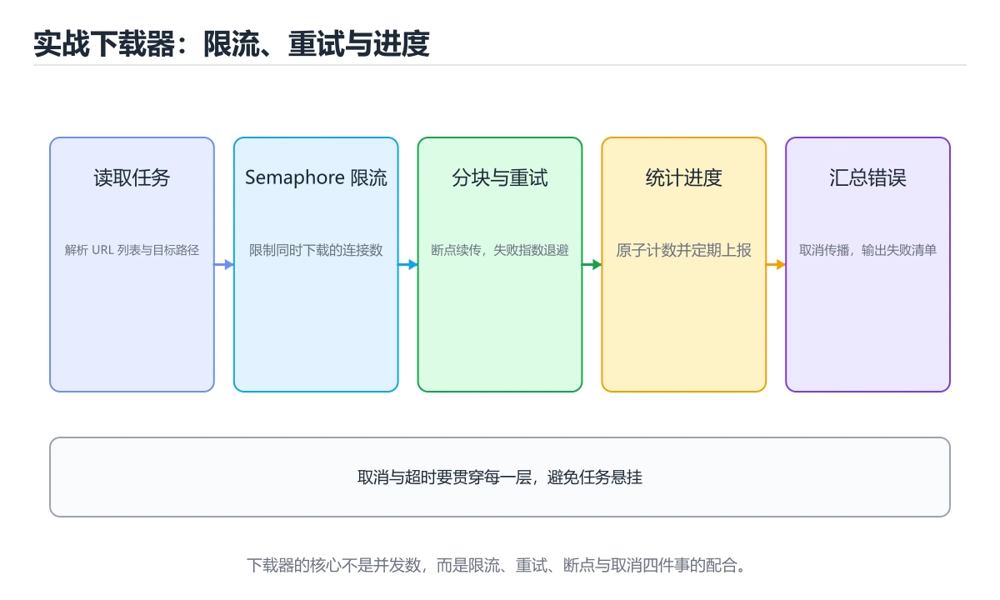
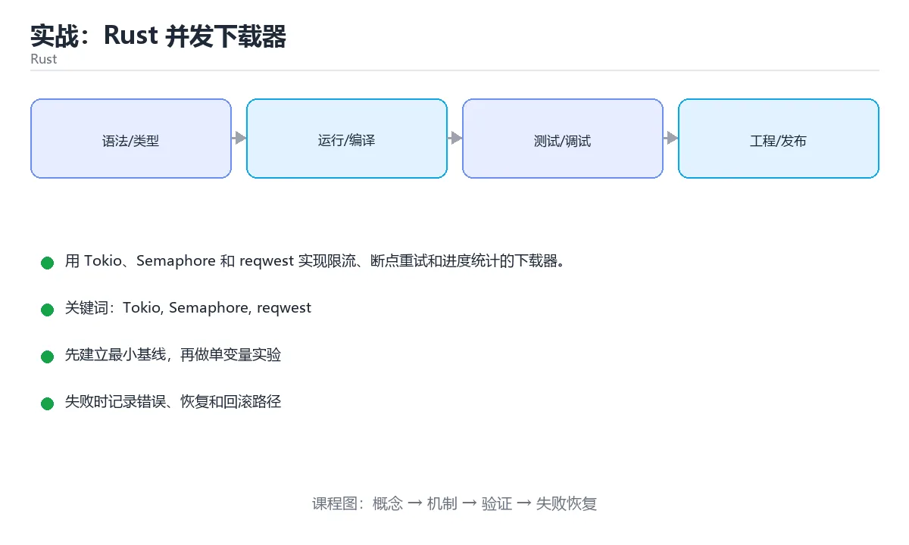

# 实战：Rust 并发下载器





> 内容更新时间：2026-10-06 · 学习阶段：高级 · 预计用时：60 分钟

## 本节知识框架

**课程定位**：所属分类 `rust`（Rust），课程主题 `实战：Rust 并发下载器`，学习阶段 高级，建议用时 75 分钟。

本课主线：用 Tokio、Semaphore 和 reqwest 实现限流、断点重试和进度统计的下载器。

**学完本课应当能够**
- 说清 `Tokio` 与 `并发` 的含义与区别，并各举一个正例和一个反例。
- 用本课示例验证 `重试` 的行为，记录输入、输出与失败条件。
- 遇到「无限 spawn」这类问题时，能说出触发条件与修复顺序。

### 复习清单

- [ ] 能不看正文复述本课核心术语，并指出一个边界或反例。
- [ ] 能运行或推演本课示例，记录输入、输出与失败现象。
- [ ] 能完成一次自测，并把错题对照错误表定位原因。

## 核心概念定义

| 术语 | 操作性定义 | 常见边界与风险 |
| --- | --- | --- |
| Tokio | Rust 的异步运行时：提供任务调度、定时器与异步 IO，配合 async/await 写高并发程序。 | 共享状态与调度顺序会改变结论，单线程或串行测试通过不等于并发下成立。 |
| 并发 | 本课涉及：Tokio、Semaphore、reqwest、并发、重试。 | 共享状态与调度顺序会改变结论，单线程或串行测试通过不等于并发下成立。 |
| 重试 | 用 Tokio、Semaphore 和 reqwest 实现限流、断点重试和进度统计的下载器。 | 易错：无法决定是否重试；正确做法是区分网络、HTTP 和磁盘错误。 |
| 信号量 | 用许可证限制同时进行的任务数，是异步并发里最常见的限流手段。 | 共享状态与调度顺序会改变结论，单线程或串行测试通过不等于并发下成立。 |
| Rust | Rust 是系统级语言，用编译期检查替代垃圾回收，做到内存安全与零成本抽象 | 静态检查只在编译期成立，运行期输入仍需校验。 |

## 原理与运行机制

### 机制总览

**教材衔接：技术栈**

- Rust 1.85
- Tokio
- reqwest
- futures
- indicatif

**教材衔接：架构与数据流**

```text
「实战：Rust 并发下载器」的链路可以写成：项目背景 → 技术栈 → 架构与数据流 → 功能范围。链上任何一环缺少可观察的输出，都不能算验证完成。
                 ↘ 失败分类 → 重试/回滚 → 错误响应
```

- 查询 Semaphore 时限定字段与分页范围，把全表扫描留作最后手段。
- 写路径要明确 Tokio 的事务边界、幂等键和失败补偿，不能留下半完成状态。
- 外部调用要设置超时、重试上限和降级策略。
- 每个关键阶段都要留下日志、指标或测试证据。

**教材衔接：功能范围**

- [ ] 读取下载清单
- [ ] 限制并发数
- [ ] 失败重试和退避
- [ ] 输出成功、失败和耗时统计

**教材衔接：实施步骤**

### 步骤 1：定义任务和结果结构

- 先列出 rust_project_downloader 这一步的输入、输出与中间产物，再动手实现。
- 为 Semaphore 补一个最小用例，明确通过标准再扩展规模。
- 失败处理：记录 Tokio 的错误类型、回滚动作和重试条件，避免把问题带到下一步。
- 证据留存：保留命令、输出、日志或截图，方便评审与复盘。

### 步骤 2：创建异步 HTTP 客户端

- 定位：这一节说明步骤 2：创建异步 HTTP 客户端在「实战：Rust 并发下载器」知识体系里的位置。
- 要点：本课涉及：Tokio、Semaphore、reqwest、并发、重试。
- 自检：能否用一个最小例子解释步骤 2：创建异步 HTTP 客户端？

### 步骤 3：用 Semaphore 限制并发

- 定位：这一节说明步骤 3：用 Semaphore 限制并发在「实战：Rust 并发下载器」知识体系里的位置。
- 要点：需要从清单文件批量下载文件，限制并发数，失败重试，支持超时和取消，并输出每个文件的大小与耗时。
- 自检：能否用一个最小例子解释步骤 3：用 Semaphore 限制并发？

### 步骤 4：加入超时、重试和错误分类

- 定位：这一节说明步骤 4：加入超时、重试和错误分类在「实战：Rust 并发下载器」知识体系里的位置。
- 要点：一句话摘要：用 Tokio、Semaphore 和 reqwest 实现限流、断点重试和进度统计的下载器。
- 自检：能否用一个最小例子解释步骤 4：加入超时、重试和错误分类？

### 步骤 5：写入临时文件后原子重命名

- 定位：这一节说明步骤 5：写入临时文件后原子重命名在「实战：Rust 并发下载器」知识体系里的位置。
- 要点：失败处理：记录错误类型、回滚动作和重试条件，避免把问题带到下一步。
- 自检：能否用一个最小例子解释步骤 5：写入临时文件后原子重命名？

### 步骤 6：汇总报告并补测试

「实战：Rust 并发下载器」的「步骤 6：汇总报告并补测试」一节补全如下：

- 定位：这一节说明步骤 6：汇总报告并补测试在「实战：Rust 并发下载器」知识体系里的位置。
- 要点：如果数据量或并发扩大 10 倍，最先出现的瓶颈在哪里？
- 自检：能否用一个最小例子解释步骤 6：汇总报告并补测试？

**教材衔接：建议目录结构**

**教材衔接：质量门禁**

- [ ] 格式化和静态检查通过，不遗留明显警告。
- [ ] 为 rust_project_downloader 补单元测试，并至少覆盖一条真实的外部依赖。
- [ ] 错误响应不泄露堆栈、SQL 和密钥。
- [ ] 配置来自环境变量或配置文件，不硬编码敏感信息。
- [ ] README 写清启动、测试、配置和回滚步骤。

**教材衔接：安全、成本与可观测性**

- 为 Semaphore 单独申请最小权限，并记录权限变更。
- rust_project_downloader 的参数先校验再使用，错误响应里不出现堆栈或 SQL。
- 密钥通过环境变量或密钥管理服务注入，并记录轮换方式。
- 给 Semaphore 的资源使用设定配额，超出后降级而不是拖垮整个进程。
- 至少记录 Tokio 的请求量、错误率、P95/P99 延迟与资源使用趋势。
- 为 rust_project_downloader 的失败留下可检索的日志字段，能按请求定位到具体环节。

**教材衔接：扩展任务**

- 支持断点续传
- 加入并发进度条
- 把清单和结果写入 SQLite

**教材衔接：实施记录与复盘**

每完成一步，记录以下内容：

1. 本步的输入、命令和输出是什么？
2. 遇到的最小失败是什么，如何定位和修复？
3. 哪个假设被验证或推翻？
4. 下一步的风险是什么，如何回滚？
5. 规模扩大 10 倍后，Semaphore 会先成为瓶颈还是先暴露一致性风险？

**教材衔接：完成标准**

- [ ] 能从干净环境按 README 启动项目。
- [ ] 至少 3 条 Tokio 相关自动化测试通过，其中一条覆盖失败路径。
- [ ] 能演示一次错误、一次恢复和一次回滚。
- [ ] 有一份资源或性能基线，能说明瓶颈在哪里。
- [ ] 能说清一个尚未解决的问题和下一步验证方法。

**教材衔接：版本与时效**

- 版本提示：Tokio 的行为在最近几个大版本里有过调整，升级「实战：Rust 并发下载器」前先用 rust_project_downloader 复现当前输出，再对照官方发布说明逐条核对。
- 异步运行时与借用检查规则的变化会影响 Tokio，要在 CI 中提前暴露。
- 升级「实战：Rust 并发下载器」涉及的依赖前，先用 rust_project_downloader 复现当前行为，再逐项核对版本说明与破坏性变更。
- 官方发布说明：https://blog.rust-lang.org/

### 四、「实战：Rust 并发下载器」的验收指标

| 指标 | 目标值 | 测量方式 | 不达标时的动作 |
| --- | --- | --- | --- |
| 至少记录 Tokio 的请求量、错误率、P95/P99 延迟与资源使用趋势。 | 用本课正文给出的阈值，没有就写实测基线 | 固定环境重复三次取中位数 | 回到对应小节定位，先修原因再重测 |
| | 延迟 | 记录 P50/P95/P99 | 用固定数据集逐步增加并发 | P99 持续上升或超时率增加 | | 用本课正文给出的阈值，没有就写实测基线 | 固定环境重复三次取中位数 | 回到对应小节定位，先修原因再重测 |
| | 存储 | 记录数据增长与索引大小 | 导入 10 倍数据并观察查询 | 磁盘、连接或锁等待成为瓶颈 | | 用本课正文给出的阈值，没有就写实测基线 | 固定环境重复三次取中位数 | 回到对应小节定位，先修原因再重测 |

### 五、评审记录模板

| 记录项 | 填写要求 |
| --- | --- |
| 项目标识 | `rust_project_downloader` |
| 本次范围 | 说明这一轮交付了「实战：Rust 并发下载器」的哪些部分 |
| 未完成项 | 列出与 Tokio 相关但本轮未做的内容 |
| 证据位置 | 指向 evidence/ 目录下的具体文件 |
| 风险与回滚 | 写清剩余风险、回滚步骤和验证方式 |
| 结论 | 通过 / 有条件通过 / 不通过，三者选一 |

## 典型应用场景

**课程内置实验入口**：`sandbox:rust`，用于动手验证《实战：Rust 并发下载器》的机制；实验结论不替代概念定义与复杂度分析。

**教材衔接：项目背景**

需要从清单文件批量下载文件，限制并发数，失败重试，支持超时和取消，并输出每个文件的大小与耗时。

一句话摘要：用 Tokio、Semaphore 和 reqwest 实现限流、断点重试和进度统计的下载器。

**教材衔接：项目交付物**

### 建议仓库结构

```text
src/main.rs
src/domain/
src/infra/
tests/
Cargo.toml
```

### 验收数据

```json
{
  "project": "rust_project_downloader",
  "scenario": "Tokio的正常路径",
  "input": {"case": "normal", "value": "rust_project_downloader"},
  "expected": {"ok": true, "checks": ["Tokio可复现", "Semaphore有记录"]},
  "failure_case": {"case": "Semaphore越界或缺失", "error": "validation_error"},
  "idempotency_key": "rust_project_downloader-001"
}
```

### 复盘模板

- **无限 spawn**：典型现象是连接和内存耗尽；正确做法是使用 Semaphore 或 JoinSet 限制。
- **直接覆盖目标文件**：典型现象是下载失败留下损坏文件；正确做法是写临时文件后原子重命名。
- **错误类型不分类**：典型现象是无法决定是否重试；正确做法是区分网络、HTTP 和磁盘错误。
- **忽略取消**：典型现象是退出时任务悬挂；正确做法是使用 select 和取消令牌。

### 最小验证场景

- 准备：保留 `text` 示例的原始输入，先记录 `实战：Rust 并发下载器` 的基线输出和完整运行命令。
- 判定：新结果与 `实战：Rust 并发下载器` 的基线不同不等于错误；只有当差异破坏了 `Tokio` 的定义或错误表中的约束，才判定为失败。

### 选择与边界

- 使用 `Tokio` 时，先满足它的定义：Rust 的异步运行时：提供任务调度、定时器与异步 IO，配合 async/await 写高并发程序；共享状态与调度顺序会改变结论，单线程或串行测试通过不等于并发下成立。
- 使用 `并发` 时，先满足它的定义：本课涉及：Tokio、Semaphore、reqwest、并发、重试；共享状态与调度顺序会改变结论，单线程或串行测试通过不等于并发下成立。
- 使用 `重试` 时，先满足它的定义：用 Tokio、Semaphore 和 reqwest 实现限流、断点重试和进度统计的下载器；易错：无法决定是否重试；正确做法是区分网络、HTTP 和磁盘错误。
- 使用 `信号量` 时，先满足它的定义：用许可证限制同时进行的任务数，是异步并发里最常见的限流手段；共享状态与调度顺序会改变结论，单线程或串行测试通过不等于并发下成立。
- 使用 `Rust` 时，先满足它的定义：Rust 是系统级语言，用编译期检查替代垃圾回收，做到内存安全与零成本抽象；静态检查只在编译期成立，运行期输入仍需校验。

## 代码/协议/SQL 示例

### 最小可验证示例

**教材衔接：示例数据与边界**

| 场景 | 输入 | 期望结果 | 检查点 |
| --- | --- | --- | --- |
| 正常路径 | 合法的最小数据集 | 成功返回并写入正确数据 | 状态码、数据库记录、日志 |
| 边界值 | 最大值、最小值或空集合 | 明确成功或给出可理解错误 | 不崩溃、不越界、不写半条数据 |
| 非法输入 | 类型错误、缺字段、超长内容 | 返回校验错误并指出字段 | 错误结构统一且不泄露内部信息 |
| 依赖失败 | 数据库不可用、超时、网络抖动 | 重试、降级或快速失败 | 可恢复、可观测、无重复副作用 |

**教材衔接：关键代码**

```rust
let semaphore = Arc::new(Semaphore::new(8));
let mut tasks = Vec::new();
for url in urls {
    let permit = semaphore.clone().acquire_owned().await?;
    tasks.push(tokio::spawn(async move {
        let _permit = permit;
        download(url).await
    }));
}
for task in tasks { println!("{:?}", task.await?); }
```

**教材衔接：验证命令与预期输出**

**教材衔接：测试与验收**

- 并发数不超过 Semaphore 上限
- 单个 URL 超时不会阻塞其他任务
- 失败任务按次数重试后进入失败列表

### 验收记录表

| 检查项 | 证据 | 结果 | 备注 |
| --- | --- | --- | --- |
| 最小路径可运行 | 启动命令与输出 |  |  |
| 失败路径可恢复 | 错误日志与重试 |  |  |
| 自动化测试通过 | 测试报告 |  |  |
| 配置和密钥安全 | 配置检查 |  |  |

## 时间/空间复杂度或性能分析

**性能关注点（实战：Rust 并发下载器）**：零成本抽象不等于零开销：记录运行时间、内存峰值与编译时间。

**本课特有开销（实战：Rust 并发下载器 · Tokio）**：并发度提高后要观察是否出现拐点：延迟上升而吞吐不增，说明瓶颈已转移。

**测量方法**：以 `实战：Rust 并发下载器` 的 `Tokio` 场景为对象，固定输入跑一遍记录基线，再把规模或并发度提高一个数量级复测；两次结果的差值与波动范围才是结论依据。

## 常见误区与易错点

| 容易写错的做法 | 实际现象 | 原因与正确做法 |
| --- | --- | --- |
| 无限 spawn | 连接和内存耗尽 | 使用 Semaphore 或 JoinSet 限制 |
| 直接覆盖目标文件 | 下载失败留下损坏文件 | 写临时文件后原子重命名 |
| 错误类型不分类 | 无法决定是否重试 | 区分网络、HTTP 和磁盘错误 |
| 忽略取消 | 退出时任务悬挂 | 使用 select 和取消令牌 |

### 现场 1：无限 spawn

**症状**：连接和内存耗尽。

**根因与修复**：使用 Semaphore 或 JoinSet 限制。

**自检**：在本课示例里复现「无限 spawn」，改成使用 Semaphore 或 JoinSet 限制后重跑；如果症状消失且失败路径按预期变化，说明定位正确。

### 现场 2：直接覆盖目标文件

**症状**：下载失败留下损坏文件。

**根因与修复**：写临时文件后原子重命名。

**自检**：在本课示例里复现「直接覆盖目标文件」，改成写临时文件后原子重命名后重跑；如果症状消失且失败路径按预期变化，说明定位正确。

### 现场 3：错误类型不分类

**症状**：无法决定是否重试。

**根因与修复**：区分网络、HTTP 和磁盘错误。

**自检**：在本课示例里复现「错误类型不分类」，改成区分网络、HTTP 和磁盘错误后重跑；如果症状消失且失败路径按预期变化，说明定位正确。

### 现场 4：忽略取消

**症状**：退出时任务悬挂。

**根因与修复**：使用 select 和取消令牌。

**自检**：在本课示例里复现「忽略取消」，改成使用 select 和取消令牌后重跑；如果症状消失且失败路径按预期变化，说明定位正确。

## 与其他知识点的关系

**教材衔接：复习与迁移**

### 测验回顾

1. Semaphore 许可被耗尽时，新下载任务会怎样？
   - 依据：在「实战：Rust 并发下载器」里，等待已有任务释放许可后再开始。acquireowned 在许可耗尽时会异步等待，直到某个任务完成并释放 permit。把“等待已有任务释放许可后再开始”代回「实战：Rust 并发下载器」里“Semaphore 许可被耗尽时”的例子核对，条件一旦改变，结论就要用Tokio、Semaphore、reqwest重新推导。
2. 下载写入为什么先写临时文件？
   - 依据：在「实战：Rust 并发下载器」里，失败时避免留下损坏的最终文件。临时文件完整写入后再原子重命名，保证最终文件可用。「实战：Rust 并发下载器」要求先交代Tokio、Semaphore、reqwest的前提再下结论，所以“失败时避免留下损坏的最终文件”只在题干“下载写入为什么先写临时文件”给定的条件下成立。
3. 下面这段 Rust 代码摘自「实战：Rust 并发下载器」的正文示例。关于这段代码，下面哪一项说法与实际内容相符？
   - 依据：在「实战：Rust 并发下载器」里，这段代码包含循环结构，同一段逻辑会被重复执行。这段代码出自「实战：Rust 并发下载器」的正文示例，围绕Tokio、Semaphore、reqwest展开；把输入或边界换成空值、极值或失败情况后，结论要以「实战：Rust 并发下载器」的实际运行结果为准。
4. 围绕“实战：Rust 并发下载器”中的 Tokio、Semaphore、reqwest，下列哪两项是本课强调的实践判断？
   - 依据：结论应落在学习 Tokio 时要同时说明输入、输出和失败路径。本课把实战：Rust 并发下载器拆成概念、示例与故障现场三部分，因此判断 Tokio 时必须同时交代输入、输出和失败路径，这使“学习 Tokio 时要同时说明输入、输出和失败路径，不能只看正常流程”成立。在实战：Rust 并发下载器里，判断 Semaphore 时要固定版本与边界输入，所以“验证 Semaphore 时要固定版本并覆盖边界输入，结论才可复现”才可复现。
5. 并发下载最需要监控什么？
   - 依据：这些指标能反映限流是否有效以及下游是否过载。作答时，先用Tokio建立输入与输出的基线，再把并发数，成功率代入边界条件核对，结论才能复现。「实战：Rust 并发下载器」要求先交代Tokio、Semaphore、reqwest的前提再下结论，所以“并发数，成功率”只在题干“并发下载最需要监控什么”给定的条件下成立。
6. 补全代码：「实战：Rust 并发下载器」示例中，下面这行代码缺少哪个关键字或函数名？请填入 ____。

## 自测题与参考答案

> 先独立作答，再对照参考答案；答案都能在本课正文、术语表或错误表里找到依据。

### 自测 1（概念复述）

不看正文，写出 `Tokio` 的操作性定义，并说明它与 `并发` 的区别。

**参考答案**：Rust 的异步运行时：提供任务调度、定时器与异步 IO，配合 async/await 写高并发程序。

`并发` 的定位是：本课涉及：Tokio、Semaphore、reqwest、并发、重试；两者的差别要从适用对象与失败模式上说明。

### 自测 2（排错）

本课错误表记录了「无限 spawn」这类做法。请写出它会出现的现象、根因，以及修复顺序。

**参考答案**：现象是连接和内存耗尽；正确做法是使用 Semaphore 或 JoinSet 限制。修复时先复现现象并保留证据，再改动一处假设重跑，确认现象消失。

### 自测 3（动手验证）

运行本课的 `text` 示例，改动其中一个输入后重新运行，记录输出与错误信息。

**参考答案**：正常输入下 `text` 示例应当复现正文给出的结果；改动输入后，如果结果改变或报错，先核对它是否满足 `实战：Rust 并发下载器` 中`Tokio` 的适用范围，再检查错误表里是否有同类现象。

### 自测 4（代码阅读）

阅读本课开头的 `text` 示例，说明它体现了`Tokio` 的哪一条性质，并指出改动哪个输入会让这条性质不再成立。

**参考答案**：`Tokio` 的定义是 Rust 的异步运行时：提供任务调度、定时器与异步 IO，配合 async/await 写高并发程序，示例正是在实现这条定义。改动与 `Tokio` 有关的一个输入后，如果结果不再符合 `实战：Rust 并发下载器` 的正文描述，就说明该性质只在当前前提成立。

### 自测 5（迁移）

把 `实战：Rust 并发下载器` 的方法迁移到自己的项目：围绕 `Tokio` 写出一个与错误表同类的风险点，并说明触发条件和检验方式。

**参考答案**：例如「忽略取消」，它会导致退出时任务悬挂；检验方式是按使用 select 和取消令牌改一处再复现，确认现象消失且没有引入新的失败分支。

### 自测 6（对比）

用一个表格对比 `Tokio` 与 `并发`：各写一行适用场景、一行失败表现。

**参考答案**：`Tokio` 的定义是Rust 的异步运行时：提供任务调度、定时器与异步 IO，配合 async/await 写高并发程序；`并发` 的定义是本课涉及：Tokio、Semaphore、reqwest、并发、重试。两者的失败表现分别对应本课错误表里与本术语相关的行。

### 自测 7（排错顺序）

面对「无限 spawn」引发的问题，请把“复现 连接和内存耗尽 → 保留证据 → 使用 Semaphore 或 JoinSet 限制 → 回归验证”四步写成可执行的检查清单。

**参考答案**：第一步按连接和内存耗尽复现；第二步记录输入、版本与完整报错；第三步按使用 Semaphore 或 JoinSet 限制只改一处；第四步重跑并确认失败路径也按预期变化。

### 自测 8（边界判断）

针对 `Rust`，分别写出“可以使用”的条件和“结论不再成立”的条件。

**参考答案**：静态检查只在编译期成立，运行期输入仍需校验。 同时要把 `Rust` 的定义 Rust 是系统级语言，用编译期检查替代垃圾回收，做到内存安全与零成本抽象 与实际输入逐项对照。

### 自测 9（机制重建）

不看正文，按输入、转换、输出、验证四段重建 `Tokio` → `并发` → `重试` → `信号量` 的作用链。

**参考答案**：起点是 `Tokio` 的定义 Rust 的异步运行时：提供任务调度、定时器与异步 IO，配合 async/await 写高并发程序；中间每一步都保留可观察状态；终点由 `Rust` 检查，失败时回到错误表定位第一个偏离定义的步骤。

### 自测 10（综合排错）

在 `实战：Rust 并发下载器` 中，现象是 退出时任务悬挂。请围绕 忽略取消 写出最小复现、关键证据、修复动作和回归验证，并说明为什么不能只凭一次运行下结论。

**参考答案**：先复现 忽略取消，记录输入与完整错误；再按 使用 select 和取消令牌 只改一处。回归时同时跑正常路径和边界路径，只有两次结果都可解释，才把修复视为完成。

### 自测 11（一分钟复述）

用每分钟约 200 字的速度复述 `实战：Rust 并发下载器`：先给主问题，再按顺序说出 `Tokio`、`并发`、`重试`、`信号量`，最后给一个失败案例。

**自评标准**：主问题必须对应 用 Tokio、Semaphore 和 reqwest 实现限流、断点重试和进度统计的下载器；每个术语都要能接上一句定义或边界；失败案例必须写成可观察现象，不能用“可能有风险”代替证据。

## 术语速查

| 术语 | 一句话说明 |
| --- | --- |
| `Tokio` | Rust 的异步运行时：提供任务调度、定时器与异步 IO，配合 async/await 写高并发程序。 |
| `并发` | 本课涉及：Tokio、Semaphore、reqwest、并发、重试。 |
| `重试` | 用 Tokio、Semaphore 和 reqwest 实现限流、断点重试和进度统计的下载器。 |
| `信号量` | 用许可证限制同时进行的任务数，是异步并发里最常见的限流手段。 |
| `Rust` | Rust 是系统级语言，用编译期检查替代垃圾回收，做到内存安全与零成本抽象。 |

**术语关系**：`Tokio`（Rust 的异步运行时：提供任务调度、定时器与异步 IO） → `并发`（本课涉及：Tokio、Semaphore、reqwest、并发、重试） → `重试`（用 Tokio、Semaphore 和 reqwest 实现限流、断点重试和进度统计的下载器） → `信号量`（用许可证限制同时进行的任务数）。

## 考点精讲

`实战：Rust 并发下载器` 的题库有 6 道题，下面逐题给出题干、正确项与判断依据：先自己作答，再核对正确项，最后回到正文对应小节复核。

### 考点 1：第 1 题

- **题目**：Semaphore 许可被耗尽时，新下载任务会怎样？
- **正确项**：等待已有任务释放许可后再开始
- **判断依据**：本题正确项是等待已有任务释放许可后再开始。术语 Tokio（实战：Rust 并发下载器）：Rust 的异步运行时：提供任务调度、定时器与异步 IO，配合 async/await 写高并发程序，本题取等待已有任务释放许可后再开始这条。易错点是无限 spawn会造成连接和内存耗尽，改法是使用 Semaphore 或 JoinSet 限制，干扰项立即失败退出正踩在这条上。

### 考点 2：第 2 题

- **题目**：下载写入为什么先写临时文件？
- **正确项**：失败时避免留下损坏的最终文件
- **判断依据**：本题正确项是失败时避免留下损坏的最终文件。术语 Tokio（实战：Rust 并发下载器）：Rust 的异步运行时：提供任务调度、定时器与异步 IO，配合 async/await 写高并发程序，本题取失败时避免留下损坏的最终文件这条。易错点是无限 spawn会造成连接和内存耗尽，改法是使用 Semaphore 或 JoinSet 限制，干扰项只是为了减少磁盘写入次数，但它只覆盖了部分情况正踩在这条上。

### 考点 3：第 3 题

- **题目**：这段 `rust` 代码对应 `实战：Rust 并发下载器` 的 `Tokio`。课程要解决的是用 Tokio、Semaphore 和 reqwest 实现限流、断点重试和进度统计的下载器。关于代码内容，哪一项说法准确？
- **正确项**：这段示例用于说明本课术语 `重试` 的行为
- **判断依据**：本题正确项是这段示例用于说明本课术语 `重试` 的行为。术语 `重试` 的行为。术语 `重试` 的行为。术语 `重试` 的行为。术语 Tokio（实战：Rust 并发下载器）：Rust 的异步运行时：提供任务调度、定时器与异步 IO，配合 async/await 写高并发程序，本题取这段示例用于说明本课术语 `重试` 的行为这条。易错点是无限 spawn会造成连接和内存耗尽，改法是使用 Semaphore 或 JoinSet 限制，干扰项代码里出现了 `密封类` 这个名字正踩在这条上。

### 考点 4：第 4 题

- **题目**：围绕“实战：Rust 并发下载器”中的 Tokio、Semaphore、reqwest，下列哪两项是本课强调的实践判断？
- **正确项**：学习 Tokio 时要同时说明输入、输出和失败路径，不能只看正常流程；验证 Semaphore 时要固定版本并覆盖边界输入，结论才可复现
- **判断依据**：本题正确项是学习 Tokio 时要同时说明输入、输出和失败路径，不能只看正常流程。术语 Tokio（实战：Rust 并发下载器）：Rust 的异步运行时：提供任务调度、定时器与异步 IO，配合 async/await 写高并发程序，本题取学习 Tokio 时要同时说明输入、输出和失败路径，不能只看正常流程这条。易错点是无限 spawn会造成连接和内存耗尽，改法是使用 Semaphore 或 JoinSet 限制，干扰项只要 Tokio 的常规示例通过，就可以跳过边界与异常路径正踩在这条上。

### 考点 5：第 5 题

- **题目**：并发下载最需要监控什么？
- **正确项**：并发数，成功率
- **判断依据**：本题正确项是并发数，成功率。术语 并发（实战：Rust 并发下载器）：本课涉及：Tokio、Semaphore、reqwest、并发、重试，本题取并发数，成功率这条。易错点是无限 spawn会造成连接和内存耗尽，改法是使用 Semaphore 或 JoinSet 限制，干扰项字体大小正踩在这条上。

### 考点 6：第 6 题

- **题目**：填空：补齐下面这段术语说明中的空缺。课程 `用 Tokio、Semaphore 和 reqwest 实现限流、断点重试和进度统计的下载器。`，这段说明是：`____`：Rust 的异步运行时：提供任务调度、定时器与异步 IO，配合 async/await 写高并发程序。空缺处应填哪个术语？
- **正确项**：Tokio
- **判断依据**：《实战：Rust 并发下载器》这题的填空口径是「Tokio」或「tokio」，正文写法与其中任一项一致即可。术语「Tokio」在本课里的界定是Rust 的异步运行时：提供任务调度、定时器与异步 IO，配合 async/await 写高并发程序，题干「填空：补齐下面这段术语说明中的空缺，课程 `用 Tokio、Sema」问的就是这一条。常见错法是无限 spawn，其后果是连接和内存耗尽。正确做法是使用 Semaphore 或 JoinSet 限制。

### 考点 7：`Tokio`

- **要点**：Rust 的异步运行时：提供任务调度、定时器与异步 IO，配合 async/await 写高并发程序。
- **Tokio 的边界**：共享状态与调度顺序会改变结论，单线程或串行测试通过不等于并发下成立。

### 考点 8：`并发`

- **要点**：本课涉及：Tokio、Semaphore、reqwest、并发、重试。
- **并发 的边界**：共享状态与调度顺序会改变结论，单线程或串行测试通过不等于并发下成立。

### 考点 9：`重试`

- **要点**：用 Tokio、Semaphore 和 reqwest 实现限流、断点重试和进度统计的下载器。
- **重试 的边界**：易错：无法决定是否重试；正确做法是区分网络、HTTP 和磁盘错误。

### 考点 10：`信号量`

- **要点**：用许可证限制同时进行的任务数，是异步并发里最常见的限流手段。
- **信号量 的边界**：共享状态与调度顺序会改变结论，单线程或串行测试通过不等于并发下成立。

### 考点 11：`Rust`

- **要点**：Rust 是系统级语言，用编译期检查替代垃圾回收，做到内存安全与零成本抽象
- **Rust 的边界**：静态检查只在编译期成立，运行期输入仍需校验。

### 考点 12：排错——无限 spawn

- **现象**：连接和内存耗尽。
- **处理**：使用 Semaphore 或 JoinSet 限制。

### 考点 13：排错——直接覆盖目标文件

- **现象**：下载失败留下损坏文件。
- **处理**：写临时文件后原子重命名。

### 考点 14：综合辨析——`Tokio` 与 `Rust`

- **辨析点**：`Tokio` 的定义是 Rust 的异步运行时：提供任务调度、定时器与异步 IO，配合 async/await 写高并发程序；`Rust` 的定义是 Rust 是系统级语言，用编译期检查替代垃圾回收，做到内存安全与零成本抽象。
- **答题要求**：面对 `实战：Rust 并发下载器` 的题目，先判断描述的是 `Tokio` 还是 `Rust`，再归到对应定义，最后写出一个会让该定义失效的边界输入。

### 考点 15：排错评分点

- **现象分**：能写出 连接和内存耗尽，而不是只写“程序有错”。
- **证据分**：保留触发 无限 spawn 的输入、版本和错误原文。
- **修复分**：按 使用 Semaphore 或 JoinSet 限制 只改一处，并同时回归正常路径与边界路径。

## 内容元数据

- 内容版本：v2.0
- 最后更新：2026-10-06
- 学习阶段：高级
- 适用环境：Rust 1.85+ / Cargo
；本课聚焦 Tokio。
- 内容来源：内置结构化课程与工程实践整理
- 相关主题：Tokio、Semaphore、reqwest、并发、重试
- 质量版本：P0 测验标准 + P1 覆盖扩展 + P2 体验补全

## 参考资料与复核

- 最后复核：2026-10-04
- 下次复核：2027-06-10
- 复核范围：版本兼容、API 行为、安全建议与工程实践
- 来源性质：官方文档、标准或权威教材；本课核对关键词：Tokio、Semaphore、reqwest、并发、重试。

| 参考资料 | 本课用途 |
| --- | --- |
| [Rust Async Book](https://rust-lang.github.io/async-book/) | 异步运行时与 Future |
| [Cargo Book](https://doc.rust-lang.org/cargo/) | 依赖、工作区与发布 |
| [The Rust Book](https://doc.rust-lang.org/book/) | 所有权、类型与工程实践 |

| [本课术语索引：实战：Rust 并发下载器](#核心概念定义) | 按本课输入、术语边界和错误表现逐项核对 |
> 「实战：Rust 并发下载器」的链接用于离线阅读后的延伸核对；App 不会自动联网。
## 项目专属规格

- 运行环境与版本要求以正文「环境准备」为准，跨平台需分别验证。
- 数据规模、并发量与失败率阈值由验收用例定义，不得私自放宽。
- 接口契约、错误码与日志格式在交付前冻结，变更须走评审。
