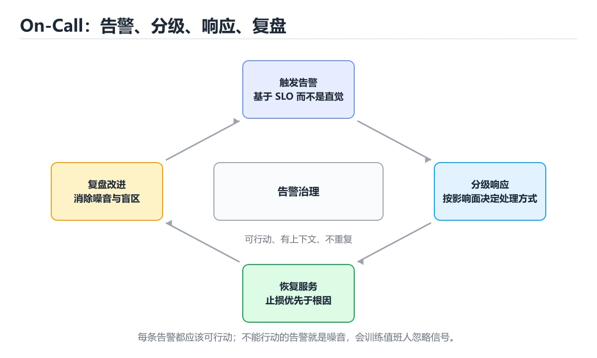
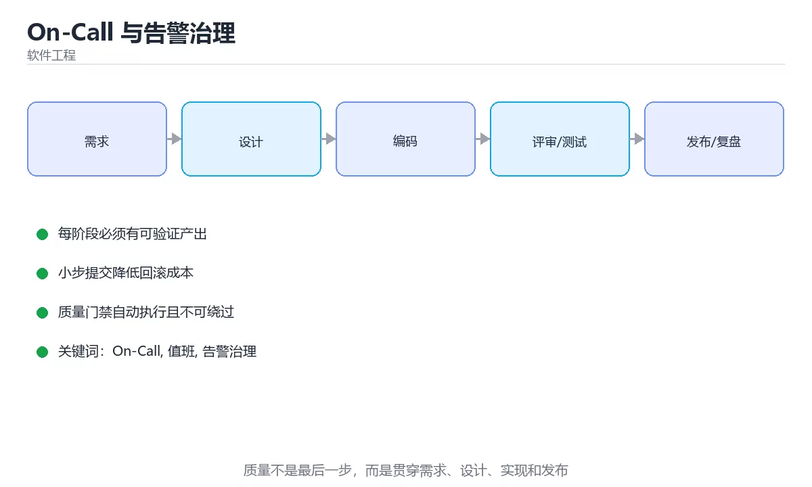

# On-Call 与告警治理

> 内容更新时间：2026-10-06 · 学习阶段：进阶 · 预计用时：35 分钟





## 本节知识框架

**课程定位**：所属分类 `software_engineering`（软件工程），课程主题 `On-Call 与告警治理`，学习阶段 进阶，建议用时 40 分钟。

本课主线：值班体系、告警质量指标、分级路由与噪声治理。

**学完本课应当能够**
- 说清 `On-Call` 与 `值班` 的含义与区别，并各举一个正例和一个反例。
- 用本课示例验证 `告警治理` 的行为，记录输入、输出与失败条件。
- 遇到「所有告警都发到同一个群」这类问题时，能说出触发条件与修复顺序。

### 复习清单

- [ ] 能不看正文复述本课核心术语，并指出一个边界或反例。
- [ ] 能运行或推演本课示例，记录输入、输出与失败现象。
- [ ] 能完成一次自测，并把错题对照错误表定位原因。

## 核心概念定义

| 术语 | 操作性定义 | 常见边界与风险 |
| --- | --- | --- |
| On-Call | 为一个虚构服务设计 On-Call 方案：监控指标、P0～P3 告警规则、值班表、升级路径、故障沟通模板和复盘行动项；用一次模拟故障演练验证流程是否可用。 | 易错：方案写完就以为能落地；本课要用一次模拟故障演练验证，告警没绑 Runbook、没有升级路径时，真出事仍会卡在单人手里。 |
| 值班 | 在轮班时间内负责接收告警、止损、升级和记录故障。 | 易错：问题卡在单人手里；正确做法是明确主备、升级时限和联系方式。 |
| 告警治理 | 关键关系：先分清「On-Call」与「值班」的职责，再理解「告警治理」的适用边界。 | 易错：只调阈值不管告警能不能执行，同源告警照样成风暴；每条都要有 Runbook、按级别分通道，并定期审计出无效告警。 |
| 误报 | 监控或安全工具把正常行为判为异常，过多误报会削弱告警可信度。 | 易错：半夜误报频发；正确做法是加持续时长与聚合，分级路由。 |

## 原理与运行机制

### 机制总览

**教材衔接：值班体系速查**

| 要素 | 做法 |
| --- | --- |
| 轮值周期 | 一周一轮较常见，跨时区用跟单式交接 |
| 交接内容 | 进行中的问题、脆弱点、即将上线的变更 |
| 响应时限 | P0/P1 15 分钟内确认，P2/P3 工作时间内处理 |
| 升级路径 | 明确「多久没解决就找谁」，避免单点扛 |
| 补偿机制 | 值班调休或补贴，保证可持续 |
| 新人保护 | 先跟班，再参与辅助值守，最后独立值班 |

**教材衔接：告警质量评估**

| 指标 | 含义 | 健康方向 |
| --- | --- | --- |
| 告警总量 | 单位时间触发的告警数 | 稳定或下降 |
| 有效率 | 需要人处理的告警占比 | 越高越好（一般目标 大于 70%） |
| 误报率 | 无需处理的占比 | 越低越好 |
| 平均确认时间 | 从触发到有人响应 | 分钟级 |
| 重复告警占比 | 同一问题反复触发 | 越低越好 |
| 无人处理告警数 | 长期未关闭的告警 | 应为 0 |

关键判断：**如果一个告警连续多次没人处理，要么它不该存在，要么响应流程有问题。**

**教材衔接：告警设计原则**

| 原则 | 说明 |
| --- | --- |
| 面向症状 | 告警用户可感知的问题，而非单一技术指标 |
| 基于 SLO | 用错误预算消耗速率触发，减少噪声 |
| 可执行 | 每条告警都有对应 Runbook |
| 分级路由 | 不同级别走不同通道（电话、群、工单） |
| 抑制与聚合 | 同源告警合并，避免风暴 |
| 持续时长 | 要求持续 N 分钟才触发，过滤抖动 |
| 定期评审 | 每季度清理无效告警 |

```python
from dataclasses import dataclass, field
from enum import Enum

class Channel(Enum):
    PHONE = "电话"
    CHAT = "群消息"
    TICKET = "工单"

@dataclass
class AlertRule:
    name: str
    severity: str                # P0 / P1 / P2 / P3
    channel: Channel
    duration_seconds: int        # 持续多久才触发，用于抑制抖动
    runbook: str = ""
    enabled: bool = True

    def is_actionable(self) -> bool:
        """可执行性：没有 Runbook 的告警在半夜只会制造恐慌。"""
        return bool(self.runbook.strip())

@dataclass
class AlertAudit:
    """告警审计：找出无效告警与噪声来源。"""

    rules: list = field(default_factory=list)
    triggered: dict = field(default_factory=dict)   # 名称 -> 触发次数
    acted: dict = field(default_factory=dict)       # 名称 -> 被处理的次数

    def noise_ratio(self) -> float:
        total = sum(self.triggered.values())
        handled = sum(self.acted.values())
        if total == 0:
            return 0.0
        return round(1 - handled / total, 4)

    def problems(self) -> list:
        issues = []
        for rule in self.rules:
            if rule.enabled and not rule.is_actionable():
                issues.append(f"{rule.name}：缺少 Runbook")
            if rule.severity == "P2" and rule.channel is Channel.PHONE:
                issues.append(f"{rule.name}：低优先级却走电话通道")
            if self.triggered.get(rule.name, 0) >= 10 and self.acted.get(rule.name, 0) == 0:
                issues.append(f"{rule.name}：长期无人处理，建议下线或改造")
            if rule.enabled and rule.duration_seconds == 0:
                issues.append(f"{rule.name}：未设置持续时长，容易抖动误报")
        return issues

audit = AlertAudit(
    rules=[AlertRule("接口错误率", "P1", Channel.CHAT, 300, "runbook/api-error.md")],
    triggered={"接口错误率": 12},
    acted={"接口错误率": 3},
)
print(audit.noise_ratio(), audit.problems())
```

**教材衔接：值班体验速查**

| 问题 | 对策 |
| --- | --- |
| 半夜被吵醒但无需处理 | 提高触发门槛、改通道、加抑制 |
| 告警太多看不过来 | 做告警分级与聚合，删无效项 |
| 不知道从哪查 | 每条告警配 Runbook 与看板链接 |
| 长期高压 | 轮值周期缩短、增加人手、补偿调休 |
| 新人不敢动 | 提供演练环境与决策树 |

## 典型应用场景

- **所有告警都发到同一个群**：典型现象是噪声淹没严重问题；正确做法是按影响分级并设置静默和聚合。
- **故障时先追根因不止损**：典型现象是用户影响持续扩大；正确做法是先回滚、限流或降级恢复服务。
- **值班没有升级路径**：典型现象是问题卡在单人手里；正确做法是明确主备、升级时限和联系方式。
- **复盘只写结论不改系统**：典型现象是同类事故重复发生；正确做法是行动项必须有负责人、期限和验证方式。

### 最小验证场景

- 准备：保留 `python` 示例的原始输入，先记录 `On-Call 与告警治理` 的基线输出和完整运行命令。
- 观察：先核对 调用了 `Channel()`，再改变一个与 `On-Call` 相关的条件。
- 判定：新结果与 `On-Call 与告警治理` 的基线不同不等于错误；只有当差异破坏了 `On-Call` 的定义或错误表中的约束，才判定为失败。

### 选择与边界

- 使用 `On-Call` 时，先满足它的定义：为一个虚构服务设计 On-Call 方案：监控指标、P0～P3 告警规则、值班表、升级路径、故障沟通模板和复盘行动项；用一次模拟故障演练验证流程是否可用；不同版本与依赖组合的行为可能不同，升级或换环境前要按官方变更说明重新验证。
- 使用 `值班` 时，先满足它的定义：在轮班时间内负责接收告警、止损、升级和记录故障；易错：问题卡在单人手里；正确做法是明确主备、升级时限和联系方式。
- 使用 `告警治理` 时，先满足它的定义：关键关系：先分清「On-Call」与「值班」的职责，再理解「告警治理」的适用边界。
- 使用 `误报` 时，先满足它的定义：监控或安全工具把正常行为判为异常，过多误报会削弱告警可信度；易错：半夜误报频发；正确做法是加持续时长与聚合，分级路由。

## 代码/协议/SQL 示例

**教材衔接：深入补充：On-Call 与告警治理**

前面已经建立了基本概念。这一节换一个角度，把On-Call 与告警治理放进真实工程里，
重点回答三件事：On-Call 为什么存在、内部如何运转、什么时候会失效。

### 一、核心模型

On-Call 的目标不是让工程师一直救火，而是通过告警分级、值班流程、故障响应和复盘治理，把系统从“人盯人”逐步变成“可自愈、可预警、可追责”。

```text
监控采集 → 告警规则 → 分级路由 → 值班响应 → 止损与恢复 → 沟通同步 → 复盘改进 → 规则优化
```

### 二、关键机制拆解

1. 告警必须可行动：每条告警都应说明影响、严重程度、排查入口和负责人。
2. 告警分级通常按用户影响和紧急程度划分，避免所有问题都打成 P0。
3. 值班表要明确主备、交接班、升级路径和响应时限，不能让问题无人接手。
4. 故障响应先止损再定位，常见手段包括回滚、限流、降级、切流和扩容。
5. 沟通要有固定频道、固定模板和固定节奏，避免多头指挥和信息丢失。
6. 无指责复盘关注系统和流程改进，不追究个人，但必须产出可验证的行动项。
7. 告警治理要持续降低噪声，否则值班人员会产生告警疲劳并忽略真正问题。

### 三、对照表：抓住容易混淆的边界

| 维度 | 一侧 | 另一侧 |
| --- | --- | --- |
| 监控 | 采集指标、日志和链路 | 回答系统现在发生了什么 |
| 告警 | 根据阈值或异常触发通知 | 回答什么时候需要人介入 |
| 止损 | 先恢复用户可用性 | 可能暂时牺牲部分功能 |
| 根因分析 | 事后定位根本原因 | 不应阻塞紧急恢复 |

### 四、工作示例

支付接口错误率升到 5%，值班先确认影响范围并回滚最近发布；随后查看日志和链路定位到数据库连接池耗尽；恢复后补充连接池监控、容量压测和发布前检查。

### 五、常见误区与失效边界

| 错误做法或假设 | 后果 | 正确做法 |
| --- | --- | --- |
| 所有告警都发到同一个群 | 噪声淹没严重问题 | 按影响分级并设置静默和聚合 |
| 故障时先追根因不止损 | 用户影响持续扩大 | 先回滚、限流或降级恢复服务 |
| 值班没有升级路径 | 问题卡在单人手里 | 明确主备、升级时限和联系方式 |
| 复盘只写结论不改系统 | 同类事故重复发生 | 行动项必须有负责人、期限和验证方式 |

### 六、场景推演

凌晨收到磁盘告警，值班先确认是否是预测性告警；若预计 30 分钟内写满，立即扩容或清理日志；同时通知相关方并记录时间线。恢复后分析日志增长原因，调整保留策略和容量预警阈值。

### 七、自测问答

**Q1：一条好告警必须具备什么？**

可行动、有影响说明、有分级、有排查入口和负责人。

**Q2：为什么先止损再定位？**

用户影响在持续扩大，恢复可用性优先于找到完整根因。

**Q3：无指责复盘的核心是什么？**

关注系统、流程和工具改进，而不是追究个人责任。

**Q4：告警疲劳如何治理？**

降低噪声、聚合重复告警、调整阈值并定期清理无效规则。

### 八、小项目：把知识变成可检查的产出

为一个虚构服务设计 On-Call 方案：监控指标、P0～P3 告警规则、值班表、升级路径、故障沟通模板和复盘行动项；用一次模拟故障演练验证流程是否可用。

### 九、适用边界

On-Call 流程不能替代系统可靠性设计。真正的目标是通过容量规划、灰度发布、自动回滚和可观测性减少需要人工介入的次数。

### 十、完成检查清单

- [ ] 能区分监控、告警和值班职责
- [ ] 能为告警设计分级与路由
- [ ] 能按先止损后定位处理故障
- [ ] 能组织一次无指责复盘
- [ ] 能持续治理告警噪声

### 十一、复习顺序

1. 用自己的话说明 duration_seconds 的作用，再说出它不适用的情况。
2. 再对照表逐行解释容易混淆的概念，每个概念补一个反例。
3. 跟着工作示例做一遍，改变一个条件并预测结果。
4. 用自测问答检查理解，错题回到对应小节重新阅读。
5. 最后完成 On-Call 的小项目，把结果、失败记录和复查清单整理成可提交产物。

> 复习不是重读一遍，而是离开原文重新产出：复述、改写、验证、复盘。

**运行方式**：运行 `On-Call 与告警治理` 的示例时，保存为 `.py` 文件后用 `python 文件名.py` 运行；第三方依赖先在虚拟环境里安装。

## 时间/空间复杂度或性能分析

**性能关注点（On-Call 与告警治理）**：质量成本体现在返工：记录缺陷发现阶段、评审耗时与自动化覆盖比例。

**测量方法**：以 `On-Call 与告警治理` 的 `On-Call` 场景为对象，固定输入跑一遍记录基线，再把规模或并发度提高一个数量级复测；两次结果的差值与波动范围才是结论依据。

## 常见误区与易错点

| 容易写错的做法 | 实际现象 | 原因与正确做法 |
| --- | --- | --- |
| 所有告警都发到同一个群 | 噪声淹没严重问题 | 按影响分级并设置静默和聚合 |
| 故障时先追根因不止损 | 用户影响持续扩大 | 先回滚、限流或降级恢复服务 |
| 值班没有升级路径 | 问题卡在单人手里 | 明确主备、升级时限和联系方式 |
| 复盘只写结论不改系统 | 同类事故重复发生 | 行动项必须有负责人、期限和验证方式 |
| 每个指标都配告警 | 告警疲劳，真问题被淹没 | 只对症状与 SLO 告警 |
| 告警没有 Runbook | 收到后不知从何下手 | 每条告警绑定处理步骤 |
| 单点指标直接触发电话 | 半夜误报频发 | 加持续时长与聚合，分级路由 |
| 无人处理也不清理 | 噪声长期存在 | 定期审计并下线无效告警 |
| 不记录响应时长 | 无法评估值班质量 | 统计确认时间与处理时长 |
| 让一个人长期值班 | 倦怠、离职风险 | 轮值 + 补偿 + 升级路径 |
| 交接只说「没什么事」 | 隐藏风险 | 交接进行中问题与脆弱点 |

### 现场 1：所有告警都发到同一个群

**症状**：噪声淹没严重问题。

**根因与修复**：按影响分级并设置静默和聚合。

**自检**：在本课示例里复现「所有告警都发到同一个群」，改成按影响分级并设置静默和聚合后重跑；如果症状消失且失败路径按预期变化，说明定位正确。

### 现场 2：故障时先追根因不止损

**症状**：用户影响持续扩大。

**根因与修复**：先回滚、限流或降级恢复服务。

**自检**：在本课示例里复现「故障时先追根因不止损」，改成先回滚、限流或降级恢复服务后重跑；如果症状消失且失败路径按预期变化，说明定位正确。

### 现场 3：值班没有升级路径

**症状**：问题卡在单人手里。

**根因与修复**：明确主备、升级时限和联系方式。

**自检**：在本课示例里复现「值班没有升级路径」，改成明确主备、升级时限和联系方式后重跑；如果症状消失且失败路径按预期变化，说明定位正确。

### 现场 4：复盘只写结论不改系统

**症状**：同类事故重复发生。

**根因与修复**：行动项必须有负责人、期限和验证方式。

**自检**：在本课示例里复现「复盘只写结论不改系统」，改成行动项必须有负责人、期限和验证方式后重跑；如果症状消失且失败路径按预期变化，说明定位正确。

### 现场 5：每个指标都配告警

**症状**：告警疲劳，真问题被淹没。

**根因与修复**：只对症状与 SLO 告警。

**自检**：在本课示例里复现「每个指标都配告警」，改成只对症状与 SLO 告警后重跑；如果症状消失且失败路径按预期变化，说明定位正确。

### 现场 6：告警没有 Runbook

**症状**：收到后不知从何下手。

**根因与修复**：每条告警绑定处理步骤。

**自检**：在本课示例里复现「告警没有 Runbook」，改成每条告警绑定处理步骤后重跑；如果症状消失且失败路径按预期变化，说明定位正确。

### 现场 7：单点指标直接触发电话

**症状**：半夜误报频发。

**根因与修复**：加持续时长与聚合，分级路由。

**自检**：在本课示例里复现「单点指标直接触发电话」，改成加持续时长与聚合，分级路由后重跑；如果症状消失且失败路径按预期变化，说明定位正确。

### 现场 8：无人处理也不清理

**症状**：噪声长期存在。

**根因与修复**：定期审计并下线无效告警。

**自检**：在本课示例里复现「无人处理也不清理」，改成定期审计并下线无效告警后重跑；如果症状消失且失败路径按预期变化，说明定位正确。

### 现场 9：不记录响应时长

**症状**：无法评估值班质量。

**根因与修复**：统计确认时间与处理时长。

**自检**：在本课示例里复现「不记录响应时长」，改成统计确认时间与处理时长后重跑；如果症状消失且失败路径按预期变化，说明定位正确。

## 与其他知识点的关系

- **先修**：`故障复盘与事故管理`。本课默认这些内容已经掌握。
- **相关或后续**：`技术债务管理`。本课术语会在这些课程里继续使用。
- **术语归属**：`On-Call`、`值班`、`告警治理` 的定义以本课「核心概念定义」为准，换到其他课程时先确认定义是否被改写。
- 同一分类的《技术写作与文档工程》也涉及 `Runbook`；两课衔接时先确认这个术语的定义是否一致。
- 同一分类的《故障复盘与事故管理》也涉及 `SLO`；两课衔接时先确认这个术语的定义是否一致。

## 自测题与参考答案

> 先独立作答，再对照参考答案；答案都能在本课正文、术语表或错误表里找到依据。

### 自测 1（概念复述）

不看正文，写出 `On-Call` 的操作性定义，并说明它与 `值班` 的区别。

**参考答案**：为一个虚构服务设计 On-Call 方案：监控指标、P0～P3 告警规则、值班表、升级路径、故障沟通模板和复盘行动项；用一次模拟故障演练验证流程是否可用。

`值班` 的定位是：在轮班时间内负责接收告警、止损、升级和记录故障；两者的差别要从适用对象与失败模式上说明。

### 自测 2（排错）

本课错误表记录了「所有告警都发到同一个群」这类做法。请写出它会出现的现象、根因，以及修复顺序。

**参考答案**：现象是噪声淹没严重问题；正确做法是按影响分级并设置静默和聚合。修复时先复现现象并保留证据，再改动一处假设重跑，确认现象消失。

### 自测 3（动手验证）

运行本课的 `python` 示例，把其中的 `"电话"` 换成一个边界值后重新运行，记录输出与错误信息。

**参考答案**：正常输入下 `python` 示例应当复现正文给出的结果；把 `"电话"` 换成边界值后，如果结果改变或报错，先核对它是否满足 `On-Call 与告警治理` 中`On-Call` 的适用范围，再检查错误表里是否有同类现象。

### 自测 4（代码阅读）

阅读本课开头的 `python` 示例，说明它体现了`On-Call` 的哪一条性质，并指出改动哪个输入会让这条性质不再成立。

**参考答案**：`On-Call` 的定义是 为一个虚构服务设计 On-Call 方案：监控指标、P0～P3 告警规则、值班表、升级路径、故障沟通模板和复盘行动项，用一次模拟故障演练验证流程是否可用，示例正是在实现这条定义。改动与 `On-Call` 有关的一个输入后，如果结果不再符合 `On-Call 与告警治理` 的正文描述，就说明该性质只在当前前提成立。

### 自测 5（迁移）

把 `On-Call 与告警治理` 的方法迁移到自己的项目：围绕 `On-Call` 写出一个与错误表同类的风险点，并说明触发条件和检验方式。

**参考答案**：例如「交接只说「没什么事」」，它会导致隐藏风险；检验方式是按交接进行中问题与脆弱点改一处再复现，确认现象消失且没有引入新的失败分支。

### 自测 6（对比）

用一个表格对比 `On-Call` 与 `值班`：各写一行适用场景、一行失败表现。

**参考答案**：`On-Call` 的定义是为一个虚构服务设计 On-Call 方案：监控指标、P0～P3 告警规则、值班表、升级路径、故障沟通模板和复盘行动项；用一次模拟故障演练验证流程是否可用；`值班` 的定义是在轮班时间内负责接收告警、止损、升级和记录故障。两者的失败表现分别对应本课错误表里与本术语相关的行。

### 自测 7（排错顺序）

面对「所有告警都发到同一个群」引发的问题，请把“复现 噪声淹没严重问题 → 保留证据 → 按影响分级并设置静默和聚合 → 回归验证”四步写成可执行的检查清单。

**参考答案**：第一步按噪声淹没严重问题复现；第二步记录输入、版本与完整报错；第三步按影响分级并设置静默和聚合只改一处；第四步重跑并确认失败路径也按预期变化。

### 自测 8（边界判断）

针对 `误报`，分别写出“可以使用”的条件和“结论不再成立”的条件。

**参考答案**：易错：半夜误报频发；正确做法是加持续时长与聚合，分级路由。 同时要把 `误报` 的定义 监控或安全工具把正常行为判为异常，过多误报会削弱告警可信度 与实际输入逐项对照。

### 自测 9（机制重建）

不看正文，按输入、转换、输出、验证四段重建 `On-Call` → `值班` → `告警治理` → `误报` 的作用链。

**参考答案**：起点是 `On-Call` 的定义 为一个虚构服务设计 On-Call 方案：监控指标、P0～P3 告警规则、值班表、升级路径、故障沟通模板和复盘行动项；用一次模拟故障演练验证流程是否可用；中间每一步都保留可观察状态；终点由 `误报` 检查，失败时回到错误表定位第一个偏离定义的步骤。

### 自测 10（综合排错）

在 `On-Call 与告警治理` 中，现象是 隐藏风险。请围绕 交接只说「没什么事」 写出最小复现、关键证据、修复动作和回归验证，并说明为什么不能只凭一次运行下结论。

**参考答案**：先复现 交接只说「没什么事」，记录输入与完整错误；再按 交接进行中问题与脆弱点 只改一处。回归时同时跑正常路径和边界路径，只有两次结果都可解释，才把修复视为完成。

### 自测 11（一分钟复述）

用每分钟约 200 字的速度复述 `On-Call 与告警治理`：先给主问题，再按顺序说出 `On-Call`、`值班`、`告警治理`、`误报`，最后给一个失败案例。

**自评标准**：主问题必须对应 值班体系、告警质量指标、分级路由与噪声治理；每个术语都要能接上一句定义或边界；失败案例必须写成可观察现象，不能用“可能有风险”代替证据。

## 术语速查

| 术语 | 一句话说明 |
| --- | --- |
| `On-Call` | 为一个虚构服务设计 On-Call 方案：监控指标、P0～P3 告警规则、值班表、升级路径、故障沟通模板和复盘行动项；用一次模拟故障演练验证流程是否可用。 |
| `值班` | 在轮班时间内负责接收告警、止损、升级和记录故障。 |
| `告警治理` | 关键关系：先分清「On-Call」与「值班」的职责，再理解「告警治理」的适用边界。 |
| `误报` | 监控或安全工具把正常行为判为异常，过多误报会削弱告警可信度。 |

**术语关系**：`On-Call`（为一个虚构服务设计 On-Call 方案：监控指标、P0～P3 告警规则、值班表、升级路径、故障沟通模板和复盘行动项） → `值班`（在轮班时间内负责接收告警、止损、升级和记录故障） → `告警治理`（关键关系：先分清「On-Call」与「值班」的职责） → `误报`（监控或安全工具把正常行为判为异常）。

## 考点精讲

`On-Call 与告警治理` 的题库有 6 道题，下面逐题给出题干、正确项与判断依据：先自己作答，再核对正确项，最后回到正文对应小节复核。

### 考点 1：第 1 题

- **题目**：围绕“On-Call 与告警治理”中的 On-Call、值班、告警治理，下列哪两项是本课强调的实践判断？
- **正确项**：学习 On-Call 时要同时说明输入、输出和失败路径，不能只看正常流程；验证 值班 时要固定版本并覆盖边界输入，结论才可复现
- **判断依据**：按《On-Call 与告警治理》的正文口径，本题要同时选中「学习 On-Call 时要同时说明输入、输出和失败路径，不能只看正常流程」、「验证 值班 时要固定版本并覆盖边界输入，结论才可复现」，漏掉任一项都算没答全。术语 On-Call（On-Call 与告警治理）：为一个虚构服务设计 On-Call 方案：监控指标、P0～P3 告警规则、值班表、升级路径、故障沟通模板和复盘行动项，用一次模拟故障演练验证流程是否可用。易错点是所有告警都发到同一个群，会造成噪声淹没严重问题，改法是按影响分级并设置静默和聚合。

### 考点 2：第 2 题

- **题目**：按“On-Call 与告警治理”中 On-Call、值班、告警治理 的实践顺序，把四个步骤排成从准备到复盘的合理顺序。
- **正确项**：先明确 On-Call 的输入、输出与约束 → 写出最小示例并核对 值班 的基线结果 → 只改一个变量，记录边界与失败路径的变化 → 固定版本与证据，把“On-Call 与告警治理”的结论写成可复现记录
- **判断依据**：按《On-Call 与告警治理》正文的先后，本题顺序是「先明确 On-Call 的输入、输出与约束」 → 「写出最小示例并核对 值班 的基线结果」 → 「只改一个变量，记录边界与失败路径的变化」 → 「固定版本与证据，把“On-Call 与告警治理”的结论写成可复现记录」。术语 On-Call（On-Call 与告警治理）：为一个虚构服务设计 On-Call 方案：监控指标、P0～P3 告警规则、值班表、升级路径、故障沟通模板和复盘行动项，用一次模拟故障演练验证流程是否可用。易错点是所有告警都发到同一个群会造成噪声淹没严重问题，改法是按影响分级并设置静默和聚合。

### 考点 3：第 3 题

- **题目**：低优先级告警应该走哪个通道？
- **正确项**：工单或工作时间内的群消息
- **判断依据**：本题正确项是「工单或工作时间内的群消息」。术语 On-Call（On-Call 与告警治理）：为一个虚构服务设计 On-Call 方案：监控指标、P0～P3 告警规则、值班表、升级路径、故障沟通模板和复盘行动项，用一次模拟故障演练验证流程是否可用，本题取「工单或工作时间内的群消息」这条。易错点是值班没有升级路径，会造成问题卡在单人手里，改法是明确主备、升级时限和联系方式。

### 考点 4：第 4 题

- **题目**：为了减少抖动导致的误报，告警通常需要配置？
- **正确项**：持续时长
- **判断依据**：术语 误报（On-Call 与告警治理）：监控或安全工具把正常行为判为异常，过多误报会削弱告警可信度，本题取「持续时长」这条。易错点是复盘只写结论不改系统，会造成同类事故重复发生，改法是行动项必须有负责人、期限和验证方式。易错点是每个指标都配告警，会造成告警疲劳，真问题被淹没，改法是只对症状与 SLO 告警。本课《On-Call 与告警治理》要解决的是值班体系、告警质量指标、分级路由与噪声治理，本题按「持续时长」这条判断。

### 考点 5：第 5 题

- **题目**：值班体系可持续的关键是？
- **正确项**：轮值，明确升级路径
- **判断依据**：本题正确项是「轮值，明确升级路径」。术语 值班（On-Call 与告警治理）：在轮班时间内负责接收告警、止损、升级和记录故障，本题取「轮值，明确升级路径」这条。易错点是每个指标都配告警，会造成告警疲劳，真问题被淹没，改法是只对症状与 SLO 告警。

### 考点 6：第 6 题

- **题目**：`On-Call 与告警治理` 的示例代码服务于“值班体系、告警质量指标、分级路由与噪声治理。”哪一条判断是正确的？
- **正确项**：用户可感知的症状与 SLO
- **判断依据**：本题正确项是「用户可感知的症状与 SLO」。术语 On-Call（On-Call 与告警治理）：为一个虚构服务设计 On-Call 方案：监控指标、P0～P3 告警规则、值班表、升级路径、故障沟通模板和复盘行动项，用一次模拟故障演练验证流程是否可用，本题取「用户可感知的症状与 SLO」这条。易错点是告警没有 Runbook，会造成收到后不知从何下手，改法是每条告警绑定处理步骤。

### 考点 7：`On-Call`

- **要点**：为一个虚构服务设计 On-Call 方案：监控指标、P0～P3 告警规则、值班表、升级路径、故障沟通模板和复盘行动项；用一次模拟故障演练验证流程是否可用。
- **On-Call 的边界**：不同版本与依赖组合的行为可能不同，升级或换环境前要按官方变更说明重新验证。

### 考点 8：`值班`

- **要点**：在轮班时间内负责接收告警、止损、升级和记录故障。
- **值班 的边界**：易错：问题卡在单人手里；正确做法是明确主备、升级时限和联系方式。

### 考点 9：`告警治理`

- **要点**：关键关系：先分清「On-Call」与「值班」的职责，再理解「告警治理」的适用边界。

### 考点 10：`误报`

- **要点**：监控或安全工具把正常行为判为异常，过多误报会削弱告警可信度。
- **误报 的边界**：易错：半夜误报频发；正确做法是加持续时长与聚合，分级路由。

### 考点 11：排错——所有告警都发到同一个群

- **现象**：噪声淹没严重问题。
- **处理**：按影响分级并设置静默和聚合。

### 考点 12：排错——故障时先追根因不止损

- **现象**：用户影响持续扩大。
- **处理**：先回滚、限流或降级恢复服务。

### 考点 13：综合辨析——`On-Call` 与 `误报`

- **辨析点**：`On-Call` 的定义是 为一个虚构服务设计 On-Call 方案：监控指标、P0～P3 告警规则、值班表、升级路径、故障沟通模板和复盘行动项；用一次模拟故障演练验证流程是否可用；`误报` 的定义是 监控或安全工具把正常行为判为异常，过多误报会削弱告警可信度。
- **答题要求**：面对 `On-Call 与告警治理` 的题目，先判断描述的是 `On-Call` 还是 `误报`，再归到对应定义，最后写出一个会让该定义失效的边界输入。

### 考点 14：排错评分点

- **现象分**：能写出 噪声淹没严重问题，而不是只写“程序有错”。
- **证据分**：保留触发 所有告警都发到同一个群 的输入、版本和错误原文。
- **修复分**：按 按影响分级并设置静默和聚合 只改一处，并同时回归正常路径与边界路径。

## 内容元数据

- 内容版本：v2.0
- 最后更新：2026-10-06
- 学习阶段：进阶
- 适用环境：通用软件工程实践；本课聚焦 On-Call。
- 内容来源：内置结构化课程与工程实践整理
- 相关主题：On-Call、值班、告警治理、误报、SLO、Runbook
- 质量版本：P0 测验标准 + P1 覆盖扩展 + P2 体验补全

## 参考资料与复核

- 最后复核：2026-10-04
- 下次复核：2027-10-24
- 复核范围：版本兼容、API 行为、安全建议与工程实践
- 来源性质：官方文档、标准或权威教材；本课核对关键词：On-Call、值班、告警治理、误报、SLO、Runbook。

| 参考资料 | 本课用途 |
| --- | --- |
| [ADR 文档](https://adr.github.io/) | 架构决策记录 |
| [Google SWE Book](https://abseil.io/resources/swe-book) | 工程规范、评审与维护 |
| [The Twelve-Factor App](https://12factor.net/) | 可部署应用设计原则 |

| [本课术语索引：On-Call 与告警治理](#核心概念定义) | 按本课输入、术语边界和错误表现逐项核对 |
> 「On-Call 与告警治理」的链接用于离线阅读后的延伸核对；App 不会自动联网。