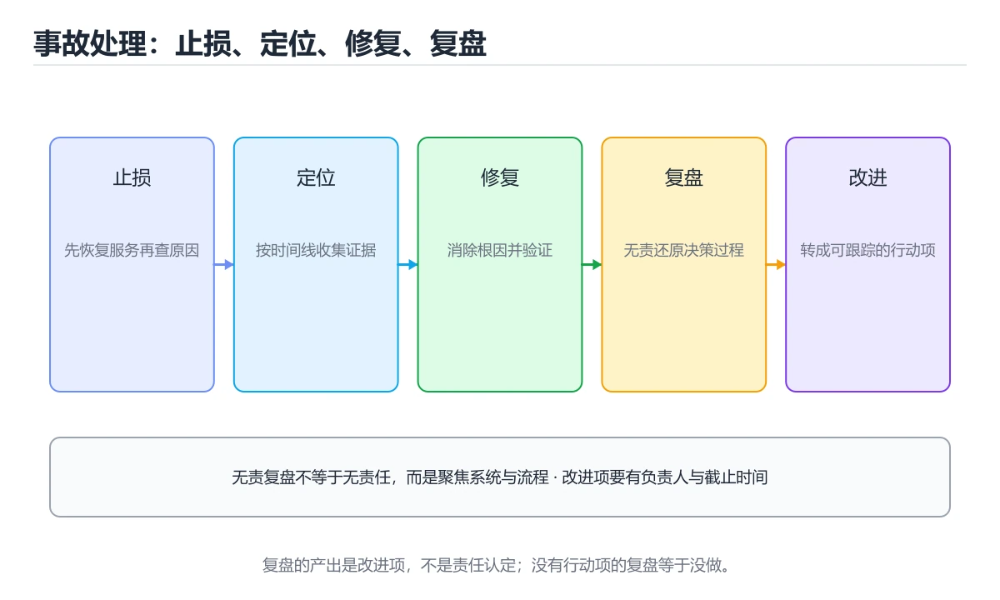
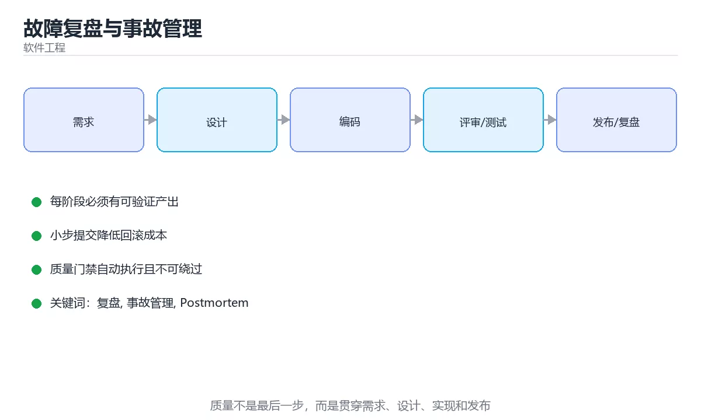

# 故障复盘与事故管理

> 内容更新时间：2026-10-06 · 学习阶段：进阶 · 预计用时：30 分钟





## 本节知识框架

**课程定位**：所属分类 `software_engineering`（软件工程），课程主题 `故障复盘与事故管理`，学习阶段 进阶，建议用时 40 分钟。

本课主线：事故分级、时间线记录、多因归因与改进项闭环。

**学完本课应当能够**
- 说清 `复盘` 与 `事故管理` 的含义与区别，并各举一个正例和一个反例。
- 用本课示例验证 `Postmortem` 的行为，记录输入、输出与失败条件。
- 遇到「复盘变成追责会」这类问题时，能说出触发条件与修复顺序。

### 复习清单

- [ ] 能不看正文复述本课核心术语，并指出一个边界或反例。
- [ ] 能运行或推演本课示例，记录输入、输出与失败现象。
- [ ] 能完成一次自测，并把错题对照错误表定位原因。

## 核心概念定义

| 术语 | 操作性定义 | 常见边界与风险 |
| --- | --- | --- |
| 复盘 | 事故或项目结束后还原时间线、根因和决策，产出可执行的改进项。 | 易错：信息隐瞒、无人敢报；正确做法是对事不对人，聚焦系统改进。 |
| 事故管理 | 从发现、分级、止损、沟通到复盘的完整流程，目标是缩短恢复时间并防止复发。 | 只在「从发现、分级、止损、沟通到复盘的完整流程，目标是缩短恢复时间并防止复发」这一前提下成立，换输入或换环境要重新验证。 |
| Postmortem | 关键关系：先分清「复盘」与「事故管理」的职责，再理解「Postmortem」的适用边界。 | 只在「关键关系：先分清「复盘」与「事故管理」的职责，再理解「Postmortem」的适用边界」这一前提下成立，换输入或换环境要重新验证。 |
| SLO | 服务等级目标：对可用性或延迟设定的可量化目标（如 99.9% 成功），是复盘与告警的基准。 | 结论随输入规模变化，小规模成立不代表大规模成立，需要重新测量。 |

## 原理与运行机制

### 机制总览

**教材衔接：事故分级速查**

| 级别 | 影响范围 | 响应要求 | 复盘要求 |
| --- | --- | --- | --- |
| P0 | 全站不可用或数据丢失 | 立即全员响应 | 必须复盘，24 小时内出初稿 |
| P1 | 核心功能大面积受影响 | 15 分钟内响应 | 必须复盘 |
| P2 | 部分用户受影响 | 1 小时内响应 | 视情况复盘 |
| P3 | 体验下降、无实质损失 | 工作时间处理 | 记录即可 |

分级的目的是让响应强度与影响匹配，避免小事惊动全员、大事无人牵头。

**教材衔接：复盘原则速查**

| 原则 | 说明 |
| --- | --- |
| 对事不对人 | 目标是改进系统，不是追责个人 |
| 时间线优先 | 先把事实按时间排出来，再讨论原因 |
| 多因归因 | 事故通常是多个条件叠加，避免单一「根本原因」 |
| 关注系统 | 问「为什么这个错误能造成这么大影响」 |
| 可验证结论 | 改进项必须可检查、有负责人与期限 |
| 公开透明 | 报告团队可见，避免同类问题重复发生 |

**教材衔接：改进项分类速查**

| 类别 | 目标 | 示例 |
| --- | --- | --- |
| 发现（detect） | 更早发现 | 增加关键路径监控、缩短告警延迟 |
| 缓解（mitigate） | 更快恢复 | 一键回滚、限流开关、降级预案 |
| 预防（prevent） | 降低发生概率 | 修复根因、增加测试与校验 |

健康的改进结构应三者都有；只做「预防」而忽略发现与缓解，意味着下次仍会长时间不可用。

## 典型应用场景

- **复盘变成追责会**：典型现象是信息隐瞒、无人敢报；正确做法是对事不对人，聚焦系统改进。
- **只写一个「根本原因」**：典型现象是同类问题再次发生；正确做法是多因归因，检查为何没被挡住。
- **改进项没有负责人与期限**：典型现象是永远是待办；正确做法是每条改进项有 owner 与截止时间。
- **只做预防不做发现与缓解**：典型现象是下次仍然长时间失血；正确做法是三类改进都要有。

### 最小验证场景

- 准备：保留 `text` 示例的原始输入，先记录 `故障复盘与事故管理` 的基线输出和完整运行命令。
- 观察：先核对 调用了 `priority()`，再改变一个与 `复盘` 相关的条件。
- 判定：新结果与 `故障复盘与事故管理` 的基线不同不等于错误；只有当差异破坏了 `复盘` 的定义或错误表中的约束，才判定为失败。

### 选择与边界

- 使用 `复盘` 时，先满足它的定义：事故或项目结束后还原时间线、根因和决策，产出可执行的改进项；易错：信息隐瞒、无人敢报；正确做法是对事不对人，聚焦系统改进。
- 使用 `事故管理` 时，先满足它的定义：从发现、分级、止损、沟通到复盘的完整流程，目标是缩短恢复时间并防止复发。
- 使用 `Postmortem` 时，先满足它的定义：关键关系：先分清「复盘」与「事故管理」的职责，再理解「Postmortem」的适用边界。
- 使用 `SLO` 时，先满足它的定义：服务等级目标：对可用性或延迟设定的可量化目标（如 99.9% 成功），是复盘与告警的基准；结论随输入规模变化，小规模成立不代表大规模成立，需要重新测量。

## 代码/协议/SQL 示例

**教材衔接：时间线模板**

```text
T0    (10:02) 变更发布，监控无异常
T0+3m (10:05) 错误率从 0.1% 升至 4%，告警触发
T0+5m (10:07) 值班同学确认告警并开始排查
T0+12m(10:14) 定位到新版本引入的缓存键冲突
T0+15m(10:17) 决定回滚
T0+20m(10:22) 回滚完成，错误率回落到 0.2%
T0+30m(10:32) 确认数据一致性，事故结束
```

时间线要记录**决策点**（为什么回滚而不是修复）与**信息缺口**（哪段时间没有监控覆盖）。

```python
from dataclasses import dataclass, field
from datetime import datetime, timedelta

@dataclass
class TimelineEvent:
    offset_minutes: int
    description: str
    is_decision: bool = False

@dataclass
class ActionItem:
    description: str
    owner: str
    due_days: int
    category: str                # detect / mitigate / prevent

    def priority(self) -> str:
        return {"detect": "P0", "mitigate": "P1", "prevent": "P2"}.get(self.category, "P2")

@dataclass
class Postmortem:
    title: str
    severity: str
    started_at: datetime
    duration_minutes: int = 0
    events: list = field(default_factory=list)
    actions: list = field(default_factory=list)

    def add_event(self, offset: int, description: str, is_decision: bool = False) -> None:
        self.events.append(TimelineEvent(offset, description, is_decision))

    def add_action(self, description: str, owner: str, due_days: int, category: str) -> None:
        self.actions.append(ActionItem(description, owner, due_days, category))

    def detector_lag(self) -> int:
        """发现时延：从事故发生到告警的时间，衡量监控能力。"""
        for event in sorted(self.events, key=lambda e: e.offset_minutes):
            if "告警" in event.description or "发现" in event.description:
                return event.offset_minutes
        return self.duration_minutes

    def quality_check(self) -> list:
        """复盘质量自检：没有改进项的复盘等于没做。"""
        problems = []
        if len(self.events) < 3:
            problems.append("时间线过于简略")
        if not any(event.is_decision for event in self.events):
            problems.append("未记录关键决策点")
        if not self.actions:
            problems.append("缺少改进项")
        if not any(action.category == "detect" for action in self.actions):
            problems.append("未改进发现能力（监控与告警）")
        return problems

report = Postmortem("缓存键冲突导致错误率上升", "P1", datetime.now(), duration_minutes=30)
report.add_event(3, "错误率升高，告警触发")
report.add_event(12, "定位到缓存键冲突", is_decision=True)
report.add_event(20, "回滚完成，指标恢复")
report.add_action("缓存键加入环境前缀", "张三", 3, "prevent")
print(report.detector_lag(), report.quality_check())
```

## 时间/空间复杂度或性能分析

**性能关注点（故障复盘与事故管理）**：质量成本体现在返工：记录缺陷发现阶段、评审耗时与自动化覆盖比例。

**测量方法**：以 `故障复盘与事故管理` 的 `复盘` 场景为对象，固定输入跑一遍记录基线，再把规模或并发度提高一个数量级复测；两次结果的差值与波动范围才是结论依据。

## 常见误区与易错点

| 容易写错的做法 | 实际现象 | 原因与正确做法 |
| --- | --- | --- |
| 复盘变成追责会 | 信息隐瞒、无人敢报 | 对事不对人，聚焦系统改进 |
| 只写一个「根本原因」 | 同类问题再次发生 | 多因归因，检查为何没被挡住 |
| 改进项没有负责人与期限 | 永远是待办 | 每条改进项有 owner 与截止时间 |
| 只做预防不做发现与缓解 | 下次仍然长时间失血 | 三类改进都要有 |
| 事故期间不记录时间点 | 复盘靠回忆、失真 | 值班时同步记录时间线 |
| 复盘报告不公开 | 其他团队重复踩坑 | 团队可见并归档 |
| 恢复后立刻关闭跟踪 | 改进项烂尾 | 定期回顾改进项完成率 |

### 现场 1：复盘变成追责会

**症状**：信息隐瞒、无人敢报。

**根因与修复**：对事不对人，聚焦系统改进。

**自检**：在本课示例里复现「复盘变成追责会」，改成对事不对人，聚焦系统改进后重跑；如果症状消失且失败路径按预期变化，说明定位正确。

### 现场 2：只写一个「根本原因」

**症状**：同类问题再次发生。

**根因与修复**：多因归因，检查为何没被挡住。

**自检**：在本课示例里复现「只写一个「根本原因」」，改成多因归因，检查为何没被挡住后重跑；如果症状消失且失败路径按预期变化，说明定位正确。

### 现场 3：改进项没有负责人与期限

**症状**：永远是待办。

**根因与修复**：每条改进项有 owner 与截止时间。

**自检**：在本课示例里复现「改进项没有负责人与期限」，改成每条改进项有 owner 与截止时间后重跑；如果症状消失且失败路径按预期变化，说明定位正确。

### 现场 4：只做预防不做发现与缓解

**症状**：下次仍然长时间失血。

**根因与修复**：三类改进都要有。

**自检**：在本课示例里复现「只做预防不做发现与缓解」，改成三类改进都要有后重跑；如果症状消失且失败路径按预期变化，说明定位正确。

### 现场 5：事故期间不记录时间点

**症状**：复盘靠回忆、失真。

**根因与修复**：值班时同步记录时间线。

**自检**：在本课示例里复现「事故期间不记录时间点」，改成值班时同步记录时间线后重跑；如果症状消失且失败路径按预期变化，说明定位正确。

### 现场 6：复盘报告不公开

**症状**：其他团队重复踩坑。

**根因与修复**：团队可见并归档。

**自检**：在本课示例里复现「复盘报告不公开」，改成团队可见并归档后重跑；如果症状消失且失败路径按预期变化，说明定位正确。

### 现场 7：恢复后立刻关闭跟踪

**症状**：改进项烂尾。

**根因与修复**：定期回顾改进项完成率。

**自检**：在本课示例里复现「恢复后立刻关闭跟踪」，改成定期回顾改进项完成率后重跑；如果症状消失且失败路径按预期变化，说明定位正确。

## 与其他知识点的关系

- **先修**：`技术写作与文档工程`。本课默认这些内容已经掌握。
- **相关或后续**：`On-Call 与告警治理`。本课术语会在这些课程里继续使用。
- **术语归属**：`复盘`、`事故管理`、`Postmortem` 的定义以本课「核心概念定义」为准，换到其他课程时先确认定义是否被改写。
- 同一分类的《On-Call 与告警治理》也涉及 `SLO`；两课衔接时先确认这个术语的定义是否一致。

## 自测题与参考答案

> 先独立作答，再对照参考答案；答案都能在本课正文、术语表或错误表里找到依据。

### 自测 1（概念复述）

不看正文，写出 `复盘` 的操作性定义，并说明它与 `事故管理` 的区别。

**参考答案**：事故或项目结束后还原时间线、根因和决策，产出可执行的改进项。

`事故管理` 的定位是：从发现、分级、止损、沟通到复盘的完整流程，目标是缩短恢复时间并防止复发；两者的差别要从适用对象与失败模式上说明。

### 自测 2（排错）

本课错误表记录了「复盘变成追责会」这类做法。请写出它会出现的现象、根因，以及修复顺序。

**参考答案**：现象是信息隐瞒、无人敢报；正确做法是对事不对人，聚焦系统改进。修复时先复现现象并保留证据，再改动一处假设重跑，确认现象消失。

### 自测 3（动手验证）

运行本课的 `text` 示例，把其中的 `10` 换成一个边界值后重新运行，记录输出与错误信息。

**参考答案**：正常输入下 `text` 示例应当复现正文给出的结果；把 `10` 换成边界值后，如果结果改变或报错，先核对它是否满足 `故障复盘与事故管理` 中`复盘` 的适用范围，再检查错误表里是否有同类现象。

### 自测 4（代码阅读）

阅读本课开头的 `text` 示例，说明它体现了`复盘` 的哪一条性质，并指出改动哪个输入会让这条性质不再成立。

**参考答案**：`复盘` 的定义是 事故或项目结束后还原时间线、根因和决策，产出可执行的改进项，示例正是在实现这条定义。改动与 `复盘` 有关的一个输入后，如果结果不再符合 `故障复盘与事故管理` 的正文描述，就说明该性质只在当前前提成立。

### 自测 5（迁移）

把 `故障复盘与事故管理` 的方法迁移到自己的项目：围绕 `复盘` 写出一个与错误表同类的风险点，并说明触发条件和检验方式。

**参考答案**：例如「恢复后立刻关闭跟踪」，它会导致改进项烂尾；检验方式是按定期回顾改进项完成率改一处再复现，确认现象消失且没有引入新的失败分支。

### 自测 6（对比）

用一个表格对比 `复盘` 与 `事故管理`：各写一行适用场景、一行失败表现。

**参考答案**：`复盘` 的定义是事故或项目结束后还原时间线、根因和决策，产出可执行的改进项；`事故管理` 的定义是从发现、分级、止损、沟通到复盘的完整流程，目标是缩短恢复时间并防止复发。两者的失败表现分别对应本课错误表里与本术语相关的行。

### 自测 7（排错顺序）

面对「复盘变成追责会」引发的问题，请把“复现 信息隐瞒、无人敢报 → 保留证据 → 对事不对人，聚焦系统改进 → 回归验证”四步写成可执行的检查清单。

**参考答案**：第一步按信息隐瞒、无人敢报复现；第二步记录输入、版本与完整报错；第三步按对事不对人，聚焦系统改进只改一处；第四步重跑并确认失败路径也按预期变化。

### 自测 8（边界判断）

针对 `SLO`，分别写出“可以使用”的条件和“结论不再成立”的条件。

**参考答案**：结论随输入规模变化，小规模成立不代表大规模成立，需要重新测量。 同时要把 `SLO` 的定义 服务等级目标：对可用性或延迟设定的可量化目标（如 99.9% 成功），是复盘与告警的基准 与实际输入逐项对照。

### 自测 9（机制重建）

不看正文，按输入、转换、输出、验证四段重建 `复盘` → `事故管理` → `Postmortem` → `SLO` 的作用链。

**参考答案**：起点是 `复盘` 的定义 事故或项目结束后还原时间线、根因和决策，产出可执行的改进项；中间每一步都保留可观察状态；终点由 `SLO` 检查，失败时回到错误表定位第一个偏离定义的步骤。

### 自测 10（综合排错）

在 `故障复盘与事故管理` 中，现象是 改进项烂尾。请围绕 恢复后立刻关闭跟踪 写出最小复现、关键证据、修复动作和回归验证，并说明为什么不能只凭一次运行下结论。

**参考答案**：先复现 恢复后立刻关闭跟踪，记录输入与完整错误；再按 定期回顾改进项完成率 只改一处。回归时同时跑正常路径和边界路径，只有两次结果都可解释，才把修复视为完成。

### 自测 11（一分钟复述）

用每分钟约 200 字的速度复述 `故障复盘与事故管理`：先给主问题，再按顺序说出 `复盘`、`事故管理`、`Postmortem`、`SLO`，最后给一个失败案例。

**自评标准**：主问题必须对应 事故分级、时间线记录、多因归因与改进项闭环；每个术语都要能接上一句定义或边界；失败案例必须写成可观察现象，不能用“可能有风险”代替证据。

## 术语速查

| 术语 | 一句话说明 |
| --- | --- |
| `复盘` | 事故或项目结束后还原时间线、根因和决策，产出可执行的改进项。 |
| `事故管理` | 从发现、分级、止损、沟通到复盘的完整流程，目标是缩短恢复时间并防止复发。 |
| `Postmortem` | 关键关系：先分清「复盘」与「事故管理」的职责，再理解「Postmortem」的适用边界。 |
| `SLO` | 服务等级目标：对可用性或延迟设定的可量化目标（如 99.9% 成功），是复盘与告警的基准。 |

**术语关系**：`复盘`（事故或项目结束后还原时间线、根因和决策） → `事故管理`（从发现、分级、止损、沟通到复盘的完整流程） → `Postmortem`（关键关系：先分清「复盘」与「事故管理」的职责） → `SLO`（服务等级目标：对可用性或延迟设定的可量化目标（如 99.9% 成功））。

## 考点精讲

`故障复盘与事故管理` 的题库有 6 道题，下面逐题给出题干、正确项与判断依据：先自己作答，再核对正确项，最后回到正文对应小节复核。

### 考点 1：第 1 题

- **题目**：组织一次故障复盘时，应当坚持的核心原则是什么？
- **正确项**：对事不对人，聚焦系统改进
- **判断依据**：本题正确项是「对事不对人，聚焦系统改进」。术语 复盘（故障复盘与事故管理）：事故或项目结束后还原时间线、根因和决策，产出可执行的改进项，本题取「对事不对人，聚焦系统改进」这条。易错点是复盘变成追责会，会造成信息隐瞒、无人敢报，改法是对事不对人，聚焦系统改进。

### 考点 2：第 2 题

- **题目**：围绕“故障复盘与事故管理”中的 复盘、事故管理、Postmortem，下列哪两项是本课强调的实践判断？
- **正确项**：学习 复盘 时要同时说明输入、输出和失败路径，不能只看正常流程；验证 事故管理 时要固定版本并覆盖边界输入，结论才可复现
- **判断依据**：按《故障复盘与事故管理》的正文口径，本题要同时选中「学习 复盘 时要同时说明输入、输出和失败路径，不能只看正常流程」、「验证 事故管理 时要固定版本并覆盖边界输入，结论才可复现」，漏掉任一项都算没答全。术语 复盘（故障复盘与事故管理）：事故或项目结束后还原时间线、根因和决策，产出可执行的改进项。易错点是只写一个「根本原因」，会造成同类问题再次发生，改法是多因归因，检查为何没被挡住。

### 考点 3：第 3 题

- **题目**：阅读这段事故时间线，下面哪项判断是正确的？
- **正确项**：时间线要记录决策点与信息缺口，复盘聚焦系统与流程改进而不是追究个人
- **判断依据**：本题正确项是「时间线要记录决策点与信息缺口，复盘聚焦系统与流程改进而不是追究个人」。术语 复盘（故障复盘与事故管理）：事故或项目结束后还原时间线、根因和决策，产出可执行的改进项，本题取「时间线要记录决策点与信息缺口，复盘聚焦系统与流程改进而不是追究个人」这条。易错点是改进项没有负责人与期限，会造成永远是待办，改法是每条改进项有 owner 与截止时间。

### 考点 4：第 4 题

- **题目**：为什么复盘不推荐只写一个「根本原因」？
- **正确项**：因为事故通常是多个条件叠加
- **判断依据**：本题正确项是「因为事故通常是多个条件叠加」。术语 复盘（故障复盘与事故管理）：事故或项目结束后还原时间线、根因和决策，产出可执行的改进项，本题取「因为事故通常是多个条件叠加」这条。易错点是只做预防不做发现与缓解，会造成下次仍然长时间失血，改法是三类改进都要有。

### 考点 5：第 5 题

- **题目**：改进项要能落地，必须有？
- **正确项**：负责人与截止时间
- **判断依据**：本题正确项是「负责人与截止时间」。术语 复盘（故障复盘与事故管理）：事故或项目结束后还原时间线、根因和决策，产出可执行的改进项，本题取「负责人与截止时间」这条。易错点是事故期间不记录时间点，会造成复盘靠回忆、失真，改法是值班时同步记录时间线。易错点是复盘报告不公开，会造成其他团队重复踩坑，改法是团队可见并归档。

### 考点 6：第 6 题

- **题目**：填空：补齐下面这段术语说明中的空缺。课程 `事故分级、时间线记录、多因归因与改进项闭环。`，这段说明是：关键关系：先分清「复盘」与「事故管理」的职责，再理解「`____`」的适用边界。空缺处应填哪个术语？
- **正确项**：Postmortem
- **判断依据**：《故障复盘与事故管理》这题的填空口径是「Postmortem」或「postmortem」，正文写法与其中任一项一致即可。术语「复盘」在本课里的界定是事故或项目结束后还原时间线、根因和决策，产出可执行的改进项，题干问的就是这一条。常见错法是复盘变成追责会，其后果是信息隐瞒、无人敢报。正确做法是对事不对人，聚焦系统改进。

### 考点 7：`复盘`

- **要点**：事故或项目结束后还原时间线、根因和决策，产出可执行的改进项。
- **复盘 的边界**：易错：信息隐瞒、无人敢报；正确做法是对事不对人，聚焦系统改进。

### 考点 8：`事故管理`

- **要点**：从发现、分级、止损、沟通到复盘的完整流程，目标是缩短恢复时间并防止复发。

### 考点 9：`Postmortem`

- **要点**：关键关系：先分清「复盘」与「事故管理」的职责，再理解「Postmortem」的适用边界。

### 考点 10：`SLO`

- **要点**：服务等级目标：对可用性或延迟设定的可量化目标（如 99.9% 成功），是复盘与告警的基准。
- **SLO 的边界**：结论随输入规模变化，小规模成立不代表大规模成立，需要重新测量。

### 考点 11：排错——复盘变成追责会

- **现象**：信息隐瞒、无人敢报。
- **处理**：对事不对人，聚焦系统改进。

### 考点 12：排错——只写一个「根本原因」

- **现象**：同类问题再次发生。
- **处理**：多因归因，检查为何没被挡住。

### 考点 13：综合辨析——`复盘` 与 `SLO`

- **辨析点**：`复盘` 的定义是 事故或项目结束后还原时间线、根因和决策，产出可执行的改进项；`SLO` 的定义是 服务等级目标：对可用性或延迟设定的可量化目标（如 99.9% 成功），是复盘与告警的基准。
- **答题要求**：面对 `故障复盘与事故管理` 的题目，先判断描述的是 `复盘` 还是 `SLO`，再归到对应定义，最后写出一个会让该定义失效的边界输入。

### 考点 14：排错评分点

- **现象分**：能写出 信息隐瞒、无人敢报，而不是只写“程序有错”。
- **证据分**：保留触发 复盘变成追责会 的输入、版本和错误原文。
- **修复分**：按 对事不对人，聚焦系统改进 只改一处，并同时回归正常路径与边界路径。

## 内容元数据

- 内容版本：v2.0
- 最后更新：2026-10-06
- 学习阶段：进阶
- 适用环境：通用软件工程实践；本课聚焦 复盘。
- 内容来源：内置结构化课程与工程实践整理
- 相关主题：复盘、事故管理、Postmortem、时间线、改进项、SLO
- 质量版本：P0 测验标准 + P1 覆盖扩展 + P2 体验补全

## 参考资料与复核

- 最后复核：2026-10-04
- 下次复核：2027-10-24
- 复核范围：版本兼容、API 行为、安全建议与工程实践
- 来源性质：官方文档、标准或权威教材；本课核对关键词：复盘、事故管理、Postmortem、时间线、改进项、SLO。

| 参考资料 | 本课用途 |
| --- | --- |
| [DORA 能力模型](https://dora.dev/) | 交付性能与工程效能 |
| [ADR 文档](https://adr.github.io/) | 架构决策记录 |
| [OWASP SAMM](https://owaspsamm.org/) | 软件安全成熟度 |

| [本课术语索引：故障复盘与事故管理](#核心概念定义) | 按本课输入、术语边界和错误表现逐项核对 |
> 「故障复盘与事故管理」的链接用于离线阅读后的延伸核对；App 不会自动联网。