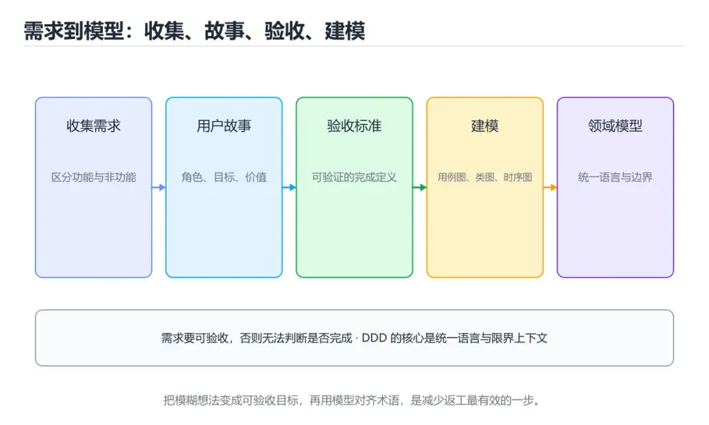
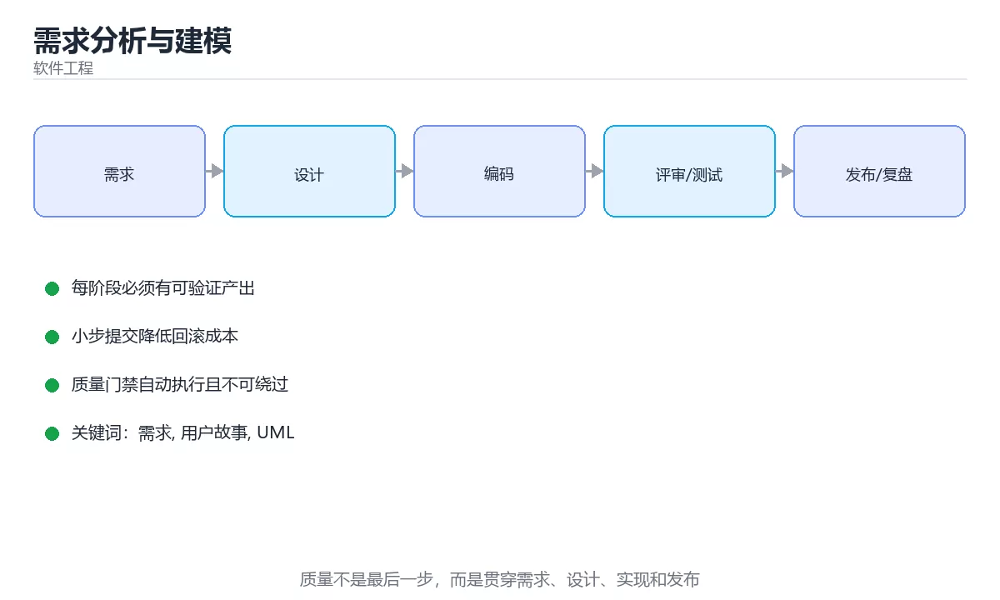

# 需求分析与建模

> 内容更新时间：2026-10-06 · 学习阶段：入门 · 预计用时：30 分钟





## 本节知识框架

**课程定位**：所属分类 `software_engineering`（软件工程），课程主题 `需求分析与建模`，学习阶段 入门，建议用时 35 分钟。

本课主线：功能/非功能需求、用户故事、UML 与 DDD、ADR。

**学完本课应当能够**
- 说清 `需求` 与 `用户故事` 的含义与区别，并各举一个正例和一个反例。
- 用本课示例验证 `UML` 的行为，记录输入、输出与失败条件。
- 遇到「只记录功能不记录质量指标」这类问题时，能说出触发条件与修复顺序。

### 复习清单

- [ ] 能不看正文复述本课核心术语，并指出一个边界或反例。
- [ ] 能运行或推演本课示例，记录输入、输出与失败现象。
- [ ] 能完成一次自测，并把错题对照错误表定位原因。

## 核心概念定义

| 术语 | 操作性定义 | 常见边界与风险 |
| --- | --- | --- |
| 需求 | 用户或业务希望系统解决的问题、约束和验收标准。 | 易错：写成“快速”“友好”“尽量”这类没法验收的话；这类词要转成具体指标，并补齐异常、超时与权限场景。 |
| 用户故事 | 从用户价值出发描述需求、场景和验收条件的小型需求单元。 | 只写角色、目标和价值不算完：示例的 `is_ready()` 少了验收标准或非功能需求就判定未就绪。 |
| UML | 统一建模语言：用类图、时序图等表达设计与交互，重点是沟通而不是图画得多漂亮。 | 易错：把六种图一次画全求大而全，结果没人维护；本课只要求复杂业务上的时序图与状态图。 |
| ADR | ADR（架构决策记录）用简短结构化文本记录：背景、决策、备选方案、后果。 | 易错：没人阅读；正确做法是小步迭代 + 图表 + ADR。 |
| 功能需求 | 用户可以下单 | 它只回答“做什么”：写了“用户可以下单”却没配验收标准，示例的就绪检查照样判它未就绪。 |
| 非功能需求 | P95 延迟低于 200 毫秒 | 它回答“做到什么程度”：像“登录要快”这类说法必须改成 95% 请求 500ms 内完成，才可测可监控。 |
| 约束 | 必须使用现有数据库 | 它限定设计空间而不是质量目标：一旦定下这条，P95 延迟这类指标就得按现有库能做到的程度重新核对。 |
| 假设 | 用户量不会超过 10 万 | 易错：假设失效无人发现；正确做法是显式列出并定期验证。 |

## 原理与运行机制

### 机制总览

**教材衔接：用户故事与验收标准**

格式：作为「角色」，我希望「功能」，以便「价值」。每个故事都应有可验证的验收标准（Given 前置条件 / When 操作 / Then 结果），否则无法判断完成。

好的故事满足 INVEST：独立、可协商、有价值、可估算、小、可测试。

**教材衔接：常用 UML 图**

| 图 | 用途 |
| --- | --- |
| 用例图 | 谁与系统交互、有哪些功能边界 |
| 类图 | 领域模型、类之间的关系（继承/组合/依赖） |
| 时序图 | 一次调用在对象间的消息顺序，排查交互设计 |
| 活动图 | 业务流程与分支条件 |
| 状态图 | 对象生命周期状态迁移（订单状态机） |
| 部署图 | 服务与基础设施拓扑 |

工程中不必画全，**时序图与状态图**对复杂业务最有价值。

**教材衔接：领域驱动设计（DDD）要点**

限界上下文（业务边界，不同上下文中「订单」含义可不同）、聚合与聚合根（一致性边界，一次事务只改一个聚合）、值对象（不可变、无标识，如金额）、领域事件（业务发生了什么，用于解耦）、防腐层（隔离外部模型）。

**教材衔接：文档与决策记录**

ADR（架构决策记录）用简短结构化文本记录：背景、决策、备选方案、后果。它的价值在于**让半年后的人知道当时为什么这么选**，避免反复推翻同一决策。

## 典型应用场景

- **只记录功能不记录质量指标**：典型现象是上线后性能和可用性无人负责；正确做法是把非功能需求写成可测量指标。
- **需求文档只写正常流程**：典型现象是异常和边界上线后才发现；正确做法是补齐失败、超时、重试和权限场景。
- **范围没有“不做什么”**：典型现象是项目不断膨胀；正确做法是明确范围外事项和变更流程。
- **模型追求大而全**：典型现象是文档没人维护；正确做法是只建立能驱动决策和验收的模型。

### 最小验证场景

- 准备：保留 `python` 示例的原始输入，先记录 `需求分析与建模` 的基线输出和完整运行命令。
- 观察：先核对 调用了 `text()`，再改变一个与 `需求` 相关的条件。
- 判定：新结果与 `需求分析与建模` 的基线不同不等于错误；只有当差异破坏了 `需求` 的定义或错误表中的约束，才判定为失败。

### 选择与边界

- 使用 `需求` 时，用户或业务希望系统解决的问题、约束和验收标准；易错：上线后性能和可用性无人负责；正确做法是把非功能需求写成可测量指标。
- 使用 `用户故事` 时，从用户价值出发描述需求、场景和验收条件的小型需求单元。
- 使用 `UML` 时，统一建模语言：用类图、时序图等表达设计与交互，重点是沟通而不是图画得多漂亮。
- 使用 `ADR` 时，ADR（架构决策记录）用简短结构化文本记录：背景、决策、备选方案、后果；易错：没人阅读；正确做法是小步迭代 + 图表 + ADR。

## 代码/协议/SQL 示例

**教材衔接：建模工具速查**

| 图 | 表达什么 | 什么时候用 |
| --- | --- | --- |
| 用例图 | 角色与系统功能关系 | 对齐范围 |
| 类图 | 领域对象与关系 | 领域建模 |
| 时序图 | 一次调用的消息顺序 | 交互设计 |
| 活动图 | 业务流程分支 | 复杂流程 |
| 状态图 | 状态与迁移 | 订单、审批 |
| ER 图 | 数据实体与关系 | 数据库设计 |
| C4 图 | 系统与容器上下文 | 架构沟通 |

```python
from dataclasses import dataclass, field

@dataclass
class AcceptanceCriterion:
    given: str
    when: str
    then: str

    def text(self) -> str:
        return f"假如 {self.given}，当 {self.when}，那么 {self.then}"

@dataclass
class UserStory:
    role: str
    goal: str
    value: str
    criteria: list = field(default_factory=list)
    non_functional: list = field(default_factory=list)

    def statement(self) -> str:
        return f"作为{self.role}，我想要{self.goal}，以便{self.value}"

    def is_ready(self) -> tuple[bool, str]:
        """就绪检查：验收标准、非功能需求与规模是否明确。"""
        if not self.criteria:
            return False, "缺少验收标准"
        if not self.non_functional:
            return False, "缺少非功能需求（性能、安全等）"
        return True, "就绪"

@dataclass
class DecisionRecord:
    """ADR：记录决策背景与后果，避免反复推翻。"""

    title: str
    context: str
    decision: str
    consequences: list
    status: str = "accepted"

    def render(self) -> str:
        items = "\n".join(f"- {item}" for item in self.consequences)
        return (
            f"# {self.title}\n\n状态：{self.status}\n\n"
            f"背景：{self.context}\n\n决策：{self.decision}\n\n后果：\n{items}"
        )

story = UserStory(
    role="学习者",
    goal="离线查看教程",
    value="在地铁上也能学习",
    criteria=[AcceptanceCriterion("无网络", "打开教程", "内容正常显示")],
    non_functional=["首屏加载小于 1 秒"],
)
print(story.statement(), story.is_ready())
```

**教材衔接：深入补充：需求分析与建模**

前面已经建立了基本概念。这一节换一个角度，把需求分析与建模放进真实工程里，
重点回答三件事：需求的两种类型 的机制、代价与边界。

### 一、核心模型

需求分析与建模把模糊想法转成可验证、可拆分、可验收的描述。关键不是画更多图，而是找到真正的利益相关者，明确边界、规则、异常和优先级。

```text
收集原始诉求 → 识别角色与目标 → 定义范围与约束 → 建立场景/用例 → 写验收标准 → 评审与变更管理
```

### 二、关键机制拆解

1. 功能需求描述系统做什么，非功能需求描述性能、可靠性、安全、可用性和可维护性等质量属性。
2. 用户故事强调角色、目标、价值，验收标准强调可观察结果，两者必须配合使用。
3. 用例从外部角色视角描述完整交互，包含前置条件、主流程、异常流程和后置条件。
4. 领域模型用实体、值对象、聚合和关系表达业务规则，不应直接照搬数据库表结构。
5. 需求必须可验证：出现“快速”“友好”“尽量”等词时，要转成具体指标。
6. 范围边界要写清“不做什么”，否则项目后期会被隐性需求不断扩张。
7. 需求变更要记录原因、影响、优先级和验收方式，不能只靠口头同步。

### 三、对照表：抓住容易混淆的边界

| 维度 | 一侧 | 另一侧 |
| --- | --- | --- |
| 功能需求 | 系统提供什么能力 | 回答“做什么” |
| 非功能需求 | 系统达到什么质量指标 | 回答“做到什么程度” |
| 用户故事 | 角色、目标与价值 | 适合迭代拆分和沟通 |
| 用例 | 完整交互与异常流程 | 适合覆盖复杂业务场景 |

### 四、工作示例

原始需求“登录要快”不可验收。改写为：“95% 的登录请求在 500ms 内完成；连续失败 5 次锁定 10 分钟；锁定期间返回 429 并提示剩余时间。”这样才可测试、可实现、可监控。

### 五、常见误区与失效边界

| 错误做法或假设 | 后果 | 正确做法 |
| --- | --- | --- |
| 只记录功能不记录质量指标 | 上线后性能和可用性无人负责 | 把非功能需求写成可测量指标 |
| 需求文档只写正常流程 | 异常和边界上线后才发现 | 补齐失败、超时、重试和权限场景 |
| 范围没有“不做什么” | 项目不断膨胀 | 明确范围外事项和变更流程 |
| 模型追求大而全 | 文档没人维护 | 只建立能驱动决策和验收的模型 |

### 六、场景推演

做一个退款功能，需求评审必须回答：谁可以发起、哪些订单可退、部分退款是否允许、退款失败如何重试、资金何时到账、重复请求如何幂等、如何审计。缺少任何一项都可能造成资金或合规事故。

### 七、自测问答

**Q1：用户故事为什么需要验收标准？**

故事描述价值，验收标准提供可测试的完成条件。

**Q2：非功能需求如何变得可验证？**

转成明确的指标、阈值、测量方法和观测窗口。

**Q3：领域模型和数据库模型有什么区别？**

领域模型表达业务规则，数据库模型还要考虑存储和性能。

**Q4：为什么要写范围外事项？**

它明确了预期边界，减少后期隐性扩张和争议。

### 八、小项目：把知识变成可检查的产出

选择一个你熟悉的小功能，写出一页需求：角色、目标、主流程、三条异常流程、五条验收标准、两项非功能指标和三条范围外事项；请另一位同学按文档复述并指出歧义。

### 九、适用边界

需求建模不能替代产品决策，也不能保证需求本身正确。它的作用是把假设显式化，让团队能在开发前发现冲突、遗漏和不可验证的描述。

### 十、完成检查清单

- [ ] 能区分功能与非功能需求
- [ ] 能为用户故事写可验证的验收标准
- [ ] 能用用例覆盖异常流程
- [ ] 能识别需求中的模糊词和隐藏假设
- [ ] 能维护变更记录与范围边界

### 十一、复习顺序

1. 合上教程复述 需求，确认能说出它解决的三个问题。
2. 再对照表逐行解释容易混淆的概念，每个概念补一个反例。
3. 跟着工作示例做一遍，改变一个条件并预测结果。
4. 用自测问答检查理解，错题回到对应小节重新阅读。
5. 把 用户故事 的实现、测试与复盘整理成一份可提交的产物。

> 复习不是重读一遍，而是离开原文重新产出：复述、改写、验证、复盘。

**运行方式**：运行 `需求分析与建模` 的示例时，保存为 `.py` 文件后用 `python 文件名.py` 运行；第三方依赖先在虚拟环境里安装。

## 时间/空间复杂度或性能分析

**性能关注点（需求分析与建模）**：质量成本体现在返工：记录缺陷发现阶段、评审耗时与自动化覆盖比例。

**测量方法**：以 `需求分析与建模` 的 `需求` 场景为对象，固定输入跑一遍记录基线，再把规模或并发度提高一个数量级复测；两次结果的差值与波动范围才是结论依据。

## 常见误区与易错点

| 容易写错的做法 | 实际现象 | 原因与正确做法 |
| --- | --- | --- |
| 只记录功能不记录质量指标 | 上线后性能和可用性无人负责 | 把非功能需求写成可测量指标 |
| 需求文档只写正常流程 | 异常和边界上线后才发现 | 补齐失败、超时、重试和权限场景 |
| 范围没有“不做什么” | 项目不断膨胀 | 明确范围外事项和变更流程 |
| 模型追求大而全 | 文档没人维护 | 只建立能驱动决策和验收的模型 |
| 只有功能需求 | 上线后性能不达标 | 同步定义非功能需求与验收阈值 |
| 验收标准模糊 | 完成标准争议 | 用可断言的条件描述 |
| 一次写超长需求文档 | 没人阅读 | 小步迭代 + 图表 + ADR |
| 不记录假设 | 假设失效无人发现 | 显式列出并定期验证 |
| 不记录决策记录 | 反复推翻同一决策 | 写 ADR 并纳入版本管理 |
| 跳过建模直接编码 | 返工多 | 复杂逻辑先画时序或状态图 |
| 需求与测试脱节 | 漏测关键场景 | 验收标准直接转为测试用例 |
| 不做干系人对齐 | 上线后需求变化 | 关键角色评审确认 |
| 忽略合规与隐私 | 上线被拦 | 需求阶段纳入合规检查 |
| 文档写完不维护 | 与实际不符 | 与代码同仓更新 |

### 现场 1：只记录功能不记录质量指标

**症状**：上线后性能和可用性无人负责。

**根因与修复**：把非功能需求写成可测量指标。

**自检**：在本课示例里复现「只记录功能不记录质量指标」，改成把非功能需求写成可测量指标后重跑；如果症状消失且失败路径按预期变化，说明定位正确。

### 现场 2：需求文档只写正常流程

**症状**：异常和边界上线后才发现。

**根因与修复**：补齐失败、超时、重试和权限场景。

**自检**：在本课示例里复现「需求文档只写正常流程」，改成补齐失败、超时、重试和权限场景后重跑；如果症状消失且失败路径按预期变化，说明定位正确。

### 现场 3：范围没有“不做什么”

**症状**：项目不断膨胀。

**根因与修复**：明确范围外事项和变更流程。

**自检**：在本课示例里复现「范围没有“不做什么”」，改成明确范围外事项和变更流程后重跑；如果症状消失且失败路径按预期变化，说明定位正确。

### 现场 4：模型追求大而全

**症状**：文档没人维护。

**根因与修复**：只建立能驱动决策和验收的模型。

**自检**：在本课示例里复现「模型追求大而全」，改成只建立能驱动决策和验收的模型后重跑；如果症状消失且失败路径按预期变化，说明定位正确。

### 现场 5：只有功能需求

**症状**：上线后性能不达标。

**根因与修复**：同步定义非功能需求与验收阈值。

**自检**：在本课示例里复现「只有功能需求」，改成同步定义非功能需求与验收阈值后重跑；如果症状消失且失败路径按预期变化，说明定位正确。

### 现场 6：验收标准模糊

**症状**：完成标准争议。

**根因与修复**：用可断言的条件描述。

**自检**：在本课示例里复现「验收标准模糊」，改成用可断言的条件描述后重跑；如果症状消失且失败路径按预期变化，说明定位正确。

### 现场 7：一次写超长需求文档

**症状**：没人阅读。

**根因与修复**：小步迭代 + 图表 + ADR。

**自检**：在本课示例里复现「一次写超长需求文档」，改成小步迭代 + 图表 + ADR后重跑；如果症状消失且失败路径按预期变化，说明定位正确。

### 现场 8：不记录假设

**症状**：假设失效无人发现。

**根因与修复**：显式列出并定期验证。

**自检**：在本课示例里复现「不记录假设」，改成显式列出并定期验证后重跑；如果症状消失且失败路径按预期变化，说明定位正确。

### 现场 9：不记录决策记录

**症状**：反复推翻同一决策。

**根因与修复**：写 ADR 并纳入版本管理。

**自检**：在本课示例里复现「不记录决策记录」，改成写 ADR 并纳入版本管理后重跑；如果症状消失且失败路径按预期变化，说明定位正确。

## 与其他知识点的关系

- **先修**：`测试策略`。本课默认这些内容已经掌握。
- **相关或后续**：`测试用例设计方法`。本课术语会在这些课程里继续使用。
- **术语归属**：`需求`、`用户故事`、`UML` 的定义以本课「核心概念定义」为准，换到其他课程时先确认定义是否被改写。
- 同一分类的《技术写作与文档工程》也涉及 `ADR`；两课衔接时先确认这个术语的定义是否一致。

## 自测题与参考答案

> 先独立作答，再对照参考答案；答案都能在本课正文、术语表或错误表里找到依据。

### 自测 1（概念复述）

不看正文，写出 `需求` 的操作性定义，并说明它与 `用户故事` 的区别。

**参考答案**：用户或业务希望系统解决的问题、约束和验收标准。

`用户故事` 的定位是：从用户价值出发描述需求、场景和验收条件的小型需求单元；两者的差别要从适用对象与失败模式上说明。

### 自测 2（排错）

本课错误表记录了「只记录功能不记录质量指标」这类做法。请写出它会出现的现象、根因，以及修复顺序。

**参考答案**：现象是上线后性能和可用性无人负责；正确做法是把非功能需求写成可测量指标。修复时先复现现象并保留证据，再改动一处假设重跑，确认现象消失。

### 自测 3（动手验证）

运行本课的 `python` 示例，把其中的 `"就绪检查：验收标准、非功能需求与规模是否明确。"` 换成一个边界值后重新运行，记录输出与错误信息。

**参考答案**：正常输入下 `python` 示例应当复现正文给出的结果；把 `"就绪检查：验收标准、非功能需求与规模是否明确。"` 换成边界值后，如果结果改变或报错，先核对它是否满足 `需求分析与建模` 中`需求` 的适用范围，再检查错误表里是否有同类现象。

### 自测 4（代码阅读）

阅读本课开头的 `python` 示例，说明它体现了`需求` 的哪一条性质，并指出改动哪个输入会让这条性质不再成立。

**参考答案**：`需求` 的定义是 用户或业务希望系统解决的问题、约束和验收标准，示例正是在实现这条定义。改动与 `需求` 有关的一个输入后，如果结果不再符合 `需求分析与建模` 的正文描述，就说明该性质只在当前前提成立。

### 自测 5（迁移）

把 `需求分析与建模` 的方法迁移到自己的项目：围绕 `需求` 写出一个与错误表同类的风险点，并说明触发条件和检验方式。

**参考答案**：例如「文档写完不维护」，它会导致与实际不符；检验方式是按与代码同仓更新改一处再复现，确认现象消失且没有引入新的失败分支。

### 自测 6（对比）

用一个表格对比 `需求` 与 `用户故事`：各写一行适用场景、一行失败表现。

**参考答案**：`需求` 的定义是用户或业务希望系统解决的问题、约束和验收标准；`用户故事` 的定义是从用户价值出发描述需求、场景和验收条件的小型需求单元。两者的失败表现分别对应本课错误表里与本术语相关的行。

### 自测 7（排错顺序）

面对「只记录功能不记录质量指标」引发的问题，请把“复现 上线后性能和可用性无人负责 → 保留证据 → 把非功能需求写成可测量指标 → 回归验证”四步写成可执行的检查清单。

**参考答案**：第一步按上线后性能和可用性无人负责复现；第二步记录输入、版本与完整报错；第三步按把非功能需求写成可测量指标只改一处；第四步重跑并确认失败路径也按预期变化。

### 自测 8（边界判断）

针对 `ADR`，分别写出“可以使用”的条件和“结论不再成立”的条件。

**参考答案**：易错：没人阅读；正确做法是小步迭代 + 图表 + ADR。 同时要把 `ADR` 的定义 ADR（架构决策记录）用简短结构化文本记录：背景、决策、备选方案、后果 与实际输入逐项对照。

### 自测 9（机制重建）

不看正文，按输入、转换、输出、验证四段重建 `需求` → `用户故事` → `UML` → `ADR` 的作用链。

**参考答案**：起点是 `需求` 的定义 用户或业务希望系统解决的问题、约束和验收标准；中间每一步都保留可观察状态；终点由 `ADR` 检查，失败时回到错误表定位第一个偏离定义的步骤。

### 自测 10（综合排错）

在 `需求分析与建模` 中，现象是 与实际不符。请围绕 文档写完不维护 写出最小复现、关键证据、修复动作和回归验证，并说明为什么不能只凭一次运行下结论。

**参考答案**：先复现 文档写完不维护，记录输入与完整错误；再按 与代码同仓更新 只改一处。回归时同时跑正常路径和边界路径，只有两次结果都可解释，才把修复视为完成。

### 自测 11（一分钟复述）

用每分钟约 200 字的速度复述 `需求分析与建模`：先给主问题，再按顺序说出 `需求`、`用户故事`、`UML`、`ADR`，最后给一个失败案例。

**自评标准**：主问题必须对应 功能/非功能需求、用户故事、UML 与 DDD、ADR；每个术语都要能接上一句定义或边界；失败案例必须写成可观察现象，不能用“可能有风险”代替证据。

## 术语速查

| 术语 | 一句话说明 |
| --- | --- |
| `需求` | 用户或业务希望系统解决的问题、约束和验收标准。 |
| `用户故事` | 从用户价值出发描述需求、场景和验收条件的小型需求单元。 |
| `UML` | 统一建模语言：用类图、时序图等表达设计与交互，重点是沟通而不是图画得多漂亮。 |
| `ADR` | ADR（架构决策记录）用简短结构化文本记录：背景、决策、备选方案、后果。 |

**术语关系**：`需求`（用户或业务希望系统解决的问题、约束和验收标准） → `用户故事`（从用户价值出发描述需求、场景和验收条件的小型需求单元） → `UML`（统一建模语言：用类图、时序图等表达设计与交互） → `ADR`（ADR（架构决策记录）用简短结构化文本记录：背景、决策、备选方案、后果）。

## 考点精讲

`需求分析与建模` 的题库有 6 道题，下面逐题给出题干、正确项与判断依据：先自己作答，再核对正确项，最后回到正文对应小节复核。

### 考点 1：第 1 题

- **题目**：阅读这条验收标准模板，下面哪项判断是正确的？
- **正确项**：用假如、当、那么写清前提、动作与预期结果，验收标准才能被测试化
- **判断依据**：本题正确项是「用假如、当、那么写清前提、动作与预期结果，验收标准才能被测试化」。术语 需求（需求分析与建模）：用户或业务希望系统解决的问题、约束和验收标准，本题取「用假如、当、那么写清前提、动作与预期结果，验收标准才能被测试化」这条。易错点是只记录功能不记录质量指标，会造成上线后性能和可用性无人负责，改法是把非功能需求写成可测量指标。

### 考点 2：第 2 题

- **题目**：想表达一次调用在多个对象间的消息顺序，应使用？
- **正确项**：时序图
- **判断依据**：术语 需求（需求分析与建模）：用户或业务希望系统解决的问题、约束和验收标准，本题取「时序图」这条。易错点是只记录功能不记录质量指标会造成上线后性能和可用性无人负责，改法是把非功能需求写成可测量指标，判断时先确认输入和适用范围，对照 `需求`、`用户故事`、`UML`、`DDD` 复现一次，最后把错误表现与正确做法逐项对照。

### 考点 3：第 3 题

- **题目**：ADR（架构决策记录）的价值是？
- **正确项**：记录决策背景与后果
- **判断依据**：本题正确项是「记录决策背景与后果」。术语 ADR（需求分析与建模）：ADR（架构决策记录）用简短结构化文本记录：背景、决策、备选方案、后果，本题取「记录决策背景与后果」这条。易错点是范围没有“不做什么”，会造成项目不断膨胀，改法是明确范围外事项和变更流程。

### 考点 4：第 4 题

- **题目**：需求文档里写用户故事时，推荐的标准格式是哪一种？
- **正确项**：「作为<角色>，我想要<目标>」
- **判断依据**：本题正确项是「作为<角色>，我想要<目标>」。术语 用户故事（需求分析与建模）：从用户价值出发描述需求、场景和验收条件的小型需求单元，本题取「作为<角色>，我想要<目标>」这条。易错点是模型追求大而全，会造成文档没人维护，改法是只建立能驱动决策和验收的模型。

### 考点 5：第 5 题

- **题目**：围绕“需求分析与建模”中的 需求、用户故事、UML，下列哪两项是本课强调的实践判断？
- **正确项**：验证 用户故事 时要固定版本并覆盖边界输入，结论才可复现；学习 需求 时要同时说明输入、输出和失败路径，不能只看正常流程
- **判断依据**：按《需求分析与建模》的正文口径，本题要同时选中「验证 用户故事 时要固定版本并覆盖边界输入，结论才可复现」、「学习 需求 时要同时说明输入、输出和失败路径，不能只看正常流程」，漏掉任一项都算没答全。术语 需求（需求分析与建模）：用户或业务希望系统解决的问题、约束和验收标准。易错点是只有功能需求，会造成上线后性能不达标，改法是同步定义非功能需求与验收阈值。

### 考点 6：第 6 题

- **题目**：下面几项都与 `需求` 有关，请按 `需求分析与建模` 的正文顺序排列；该课主线是功能/非功能需求、用户故事、UML 与 DDD、ADR。
- **正确项**：需求的两种类型 → 用户故事与验收标准 → 常用 UML 图 → 领域驱动设计（DDD）要点
- **判断依据**：按《需求分析与建模》正文的先后，本题顺序是「需求的两种类型」 → 「用户故事与验收标准」 → 「常用 UML 图」 → 「领域驱动设计（DDD）要点」。术语 需求（需求分析与建模）：用户或业务希望系统解决的问题、约束和验收标准。易错点是只记录功能不记录质量指标会造成上线后性能和可用性无人负责，改法是把非功能需求写成可测量指标。

### 考点 7：`需求`

- **要点**：用户或业务希望系统解决的问题、约束和验收标准。
- **需求 的边界**：易错：上线后性能和可用性无人负责；正确做法是把非功能需求写成可测量指标。

### 考点 8：`用户故事`

- **要点**：从用户价值出发描述需求、场景和验收条件的小型需求单元。

### 考点 9：`UML`

- **要点**：统一建模语言：用类图、时序图等表达设计与交互，重点是沟通而不是图画得多漂亮。

### 考点 10：`ADR`

- **要点**：ADR（架构决策记录）用简短结构化文本记录：背景、决策、备选方案、后果。
- **ADR 的边界**：易错：没人阅读；正确做法是小步迭代 + 图表 + ADR。

### 考点 11：排错——只记录功能不记录质量指标

- **现象**：上线后性能和可用性无人负责。
- **处理**：把非功能需求写成可测量指标。

### 考点 12：排错——需求文档只写正常流程

- **现象**：异常和边界上线后才发现。
- **处理**：补齐失败、超时、重试和权限场景。

### 考点 13：综合辨析——`需求` 与 `ADR`

- **辨析点**：`需求` 的定义是 用户或业务希望系统解决的问题、约束和验收标准；`ADR` 的定义是 ADR（架构决策记录）用简短结构化文本记录：背景、决策、备选方案、后果。
- **答题要求**：面对 `需求分析与建模` 的题目，先判断描述的是 `需求` 还是 `ADR`，再归到对应定义，最后写出一个会让该定义失效的边界输入。

### 考点 14：排错评分点

- **现象分**：能写出 上线后性能和可用性无人负责，而不是只写“程序有错”。
- **证据分**：保留触发 只记录功能不记录质量指标 的输入、版本和错误原文。
- **修复分**：按 把非功能需求写成可测量指标 只改一处，并同时回归正常路径与边界路径。

## 内容元数据

- 内容版本：v2.0
- 最后更新：2026-10-06
- 学习阶段：入门
- 适用环境：通用软件工程实践；本课聚焦 需求。
- 内容来源：内置结构化课程与工程实践整理
- 相关主题：需求、用户故事、UML、DDD、ADR
- 质量版本：P0 测验标准 + P1 覆盖扩展 + P2 体验补全

## 参考资料与复核

- 最后复核：2026-10-04
- 下次复核：2027-10-24
- 复核范围：版本兼容、API 行为、安全建议与工程实践
- 来源性质：官方文档、标准或权威教材；本课核对关键词：需求、用户故事、UML、DDD、ADR。

| 参考资料 | 本课用途 |
| --- | --- |
| [ADR 文档](https://adr.github.io/) | 架构决策记录 |
| [Google SWE Book](https://abseil.io/resources/swe-book) | 工程规范、评审与维护 |
| [OWASP SAMM](https://owaspsamm.org/) | 软件安全成熟度 |

| [本课术语索引：需求分析与建模](#核心概念定义) | 按本课输入、术语边界和错误表现逐项核对 |
> 「需求分析与建模」的链接用于离线阅读后的延伸核对；App 不会自动联网。