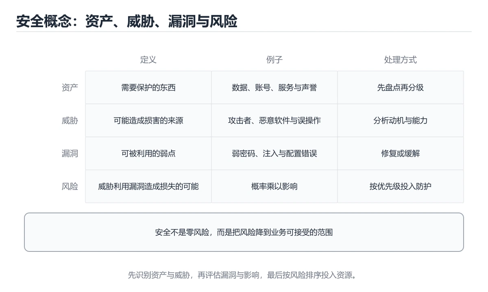
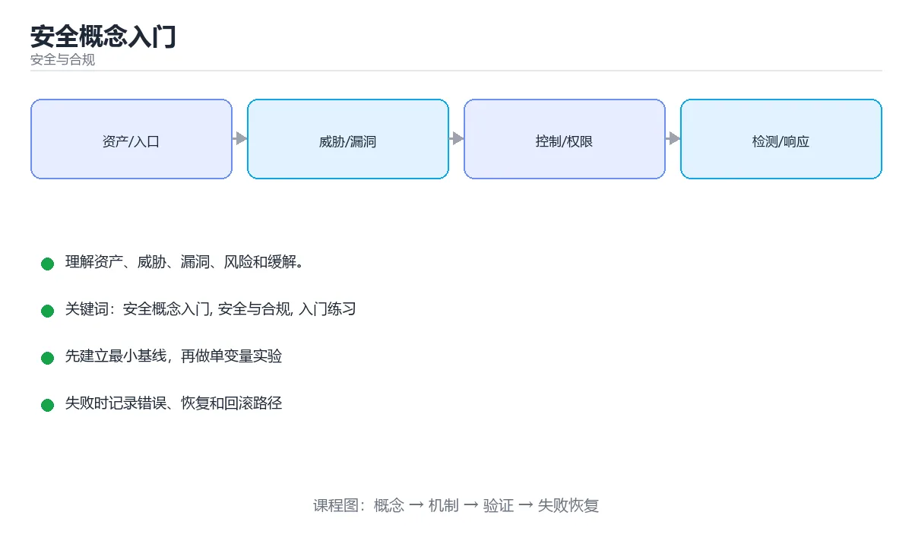

# 安全概念入门

> 内容更新时间：2026-10-06 · 学习阶段：基础 · 预计用时：35 分钟





## 本节知识框架

**课程定位**：所属分类 `security`（安全与合规），课程主题 `安全概念入门`，学习阶段 基础，建议用时 45 分钟。

本课主线：理解资产、威胁、漏洞、风险和缓解。

**学完本课应当能够**
- 说清 `威胁与攻击面` 与 `认证` 的含义与区别，并各举一个正例和一个反例。
- 用本课示例验证 `授权` 的行为，记录输入、输出与失败条件。
- 遇到「混淆加密与哈希」这类问题时，能说出触发条件与修复顺序。

### 复习清单

- [ ] 能不看正文复述本课核心术语，并指出一个边界或反例。
- [ ] 能运行或推演本课示例，记录输入、输出与失败现象。
- [ ] 能完成一次自测，并把错题对照错误表定位原因。

## 核心概念定义

| 术语 | 操作性定义 | 常见边界与风险 |
| --- | --- | --- |
| 威胁与攻击面 | 威胁是可能造成损害的因素，攻击面是系统暴露给外部的入口总和。 | 只在「威胁是可能造成损害的因素，攻击面是系统暴露给外部的入口总和」这一前提下成立，换输入或换环境要重新验证。 |
| 认证 | 确认「你是谁」，常见手段是口令、令牌、证书。 | 易错：登录用户可访问他人数据；正确做法是每个请求都校验数据归属与权限。 |
| 授权 | 确认「你能做什么」，认证之后按权限决定可访问的资源。 | 易错：登录用户可访问他人数据；正确做法是每个请求都校验数据归属与权限。 |
| 最小权限 | 每个主体只拿完成当前任务所需的权限，把事故影响限制在最小范围。 | 易错：内网横向移动无人阻挡；正确做法是内网同样做认证、分段与最小权限。 |
| 威胁 | 威胁是可能造成损害的事件或攻击者，漏洞是系统可被利用的弱点，风险是威胁利用漏洞造成损失的可能性和影响 | 只在「威胁是可能造成损害的事件或攻击者，漏洞是系统可被利用的弱点，风险是威胁利用漏洞造成损失的可能性和影响」这一前提下成立，换输入或换环境要重新验证。 |
| 加密 | 加密用密钥把明文变成密文，对称加密速度快，非对称加密便于密钥交换和签名 | 易错：口令被当成普通数据加密存储；正确做法是口令用加盐哈希，数据才用加密。 |
| 资产、威胁和行为主体是否明确？ | 日志、输入样例、测试或指标 | 只在「日志、输入样例、测试或指标」这一前提下成立，换输入或换环境要重新验证。 |
| 权限是否默认拒绝并最小化？ | 日志、输入样例、测试或指标 | 只在「日志、输入样例、测试或指标」这一前提下成立，换输入或换环境要重新验证。 |
| 输入、输出与审计是否都有控制？ | 日志、输入样例、测试或指标 | 只在「日志、输入样例、测试或指标」这一前提下成立，换输入或换环境要重新验证。 |
| 发现绕过时能否快速隔离和恢复？ | 日志、输入样例、测试或指标 | 只在「日志、输入样例、测试或指标」这一前提下成立，换输入或换环境要重新验证。 |
| 输入被污染 | schema、白名单、编码 | 换编码、换字节序或换平台都可能改变结果，处理前先固定输入编码。 |
| 权限过大 | 最小权限、临时凭证 | 权限与密钥策略变化会让结论失效，按最小权限并用真实凭据流程复验。 |
| 密钥泄露 | 密钥管理、轮换 | 权限与密钥策略变化会让结论失效，按最小权限并用真实凭据流程复验。 |
| 操作不可追溯 | 结构化审计日志 | 只在「结构化审计日志」这一前提下成立，换输入或换环境要重新验证。 |
| 恢复失败 | 备份、回滚、演练 | 隔离级别与并发事务会影响可见性，换级别或换存储引擎后要重新验证。 |

## 原理与运行机制

### 机制总览

**教材衔接：一句话入门**

理解资产、威胁、漏洞、风险和缓解。

**教材衔接：安全基础机制速览**

### 资产、威胁、漏洞与风险

安全工作的起点是资产：数据、账号、服务、代码和声誉都有价值。威胁是可能造成损害的事件或攻击者，漏洞是系统可被利用的弱点，风险是威胁利用漏洞造成损失的可能性和影响。风险 = 可能性 × 影响，控制措施通过降低概率或影响来管理风险。安全不是“消灭所有风险”，而是把风险降到可接受范围并保留证据。

### 机密性、完整性与可用性

CIA 三元组是安全目标的基础：机密性防止未授权读取，完整性防止未授权修改，可用性保证授权用户能及时访问。认证回答“你是谁”，授权回答“你能做什么”，审计记录“你做过什么”。身份验证应使用强密码、多因素认证和安全的会话管理；授权应遵循最小权限和职责分离。日志要记录关键决策，但不能泄露密码、令牌和敏感数据。

### 加密、哈希与密钥

加密用密钥把明文变成密文，对称加密速度快，非对称加密便于密钥交换和签名。哈希把任意长度输入映射成固定长度摘要，用于完整性校验；密码存储必须使用专门的慢哈希算法并加盐，不能用普通 SHA-256 直接保存密码。盐防止彩虹表，pepper 是额外的服务端秘密，密钥必须放在安全的密钥管理系统中，不能提交到代码仓库。

### 输入校验、注入与防御纵深

所有外部输入都不可信，包括表单、URL、Header、文件、第三方 API 和模型输出。输入校验应在边界层完成，输出编码要匹配目标上下文，SQL、命令、模板和日志都有不同的注入风险；参数化查询和最小权限是防止注入的核心。防御纵深要求网络、主机、应用和数据层各自有控制，不能只依赖一道防火墙或一次前端校验。

### 供应链、隐私与事件响应

依赖、构建工具、容器镜像和 CI 凭据都属于供应链范围。锁定版本、校验来源、扫描漏洞、限制发布权限，并保留可复现构建记录。隐私要求最小收集、明确目的、限制保留期限和可删除。发生安全事件时按准备、发现、遏制、根除、恢复和复盘推进，先止损再调查，保留证据链，最后把根因转化为可验证的改进项。

## 典型应用场景

**教材衔接：代码实验：把示例跑成证据**

### 实验一：建立基线

```python
asset = {"name": "用户数据库", "value": 5}
threat = {"name": "弱口令", "likelihood": 4}
vulnerability = {"name": "未启用多因素认证", "severity": 5}
risk = threat["likelihood"] * vulnerability["severity"]
print(asset["name"], threat["name"], risk)
```

### 实验二：只改一个输入

沿用「安全概念入门」的最小示例做一次单变量实验：

做完后用一句话写出「安全概念入门」的结论：输入怎么变，结果才怎么变。

### 实验三：制造一个可控错误

把 vulnerability 的一个参数换成不兼容的类型，先预测报错位置再实际运行；预测与实际的差异就是本课的考点。

### 实验四：用三句话复述

1. 先写清 安全概念入门 的输入契约：类型、范围、缺省值与非法值分别怎么处理？
2. vulnerability 的执行顺序里，哪一步会写数据或产生外部副作用？
3. 输出如何验证，失败时第一条可观察证据是什么？

- **混淆加密与哈希**：典型现象是口令被当成普通数据加密存储；正确做法是口令用加盐哈希，数据才用加密。
- **只做认证不做授权**：典型现象是登录用户可访问他人数据；正确做法是每个请求都校验数据归属与权限。
- **认为内网一定安全**：典型现象是内网横向移动无人阻挡；正确做法是内网同样做认证、分段与最小权限。

### 最小验证场景

- 准备：保留 `python` 示例的原始输入，先记录 `安全概念入门` 的基线输出和完整运行命令。
- 观察：先核对 调用了 `print()`，再改变一个与 `威胁与攻击面` 相关的条件。
- 判定：新结果与 `安全概念入门` 的基线不同不等于错误；只有当差异破坏了 `威胁与攻击面` 的定义或错误表中的约束，才判定为失败。

### 选择与边界

- 使用 `威胁与攻击面` 时，先满足它的定义：威胁是可能造成损害的因素，攻击面是系统暴露给外部的入口总和；只在「威胁是可能造成损害的因素，攻击面是系统暴露给外部的入口总和」这一前提下成立，换输入或换环境要重新验证。
- 使用 `认证` 时，先满足它的定义：确认「你是谁」，常见手段是口令、令牌、证书；易错：登录用户可访问他人数据；正确做法是每个请求都校验数据归属与权限。
- 使用 `授权` 时，先满足它的定义：确认「你能做什么」，认证之后按权限决定可访问的资源；易错：登录用户可访问他人数据；正确做法是每个请求都校验数据归属与权限。
- 使用 `最小权限` 时，先满足它的定义：每个主体只拿完成当前任务所需的权限，把事故影响限制在最小范围；易错：内网横向移动无人阻挡；正确做法是内网同样做认证、分段与最小权限。
- 使用 `威胁` 时，先满足它的定义：威胁是可能造成损害的事件或攻击者，漏洞是系统可被利用的弱点，风险是威胁利用漏洞造成损失的可能性和影响；只在「威胁是可能造成损害的事件或攻击者，漏洞是系统可被利用的弱点，风险是威胁利用漏洞造成损失的可能性和影响」这一前提下成立，换输入或换环境要重新验证。

## 代码/协议/SQL 示例

### 最小可验证示例

**教材衔接：最小示例**

**教材衔接：预期输出**

```text
用户数据库 弱口令 20
```

**运行方式**：运行 `安全概念入门` 的示例时，保存为 `.py` 文件后用 `python 文件名.py` 运行；第三方依赖先在虚拟环境里安装。

## 时间/空间复杂度或性能分析

**性能关注点（安全概念入门）**：加解密与校验开销随数据量增长：记录处理耗时、密钥长度与内存占用。

**本课特有开销（安全概念入门 · 安全概念入门）**：小文件看元数据开销，大文件看吞吐，两者要分别测量。

**测量方法**：以 `安全概念入门` 的 `安全概念入门` 场景为对象，固定输入跑一遍记录基线，再把规模或并发度提高一个数量级复测；两次结果的差值与波动范围才是结论依据。

## 常见误区与易错点

| 容易写错的做法 | 实际现象 | 原因与正确做法 |
| --- | --- | --- |
| 混淆加密与哈希 | 口令被当成普通数据加密存储。 | 口令用加盐哈希，数据才用加密。 |
| 只做认证不做授权 | 登录用户可访问他人数据。 | 每个请求都校验数据归属与权限。 |
| 认为内网一定安全 | 内网横向移动无人阻挡。 | 内网同样做认证、分段与最小权限。 |

### 现场 1：混淆加密与哈希

**症状**：口令被当成普通数据加密存储。

**根因与修复**：口令用加盐哈希，数据才用加密。

**自检**：在本课示例里复现「混淆加密与哈希」，改成口令用加盐哈希，数据才用加密后重跑；如果症状消失且失败路径按预期变化，说明定位正确。

### 现场 2：只做认证不做授权

**症状**：登录用户可访问他人数据。

**根因与修复**：每个请求都校验数据归属与权限。

**自检**：在本课示例里复现「只做认证不做授权」，改成每个请求都校验数据归属与权限后重跑；如果症状消失且失败路径按预期变化，说明定位正确。

### 现场 3：认为内网一定安全

**症状**：内网横向移动无人阻挡。

**根因与修复**：内网同样做认证、分段与最小权限。

**自检**：在本课示例里复现「认为内网一定安全」，改成内网同样做认证、分段与最小权限后重跑；如果症状消失且失败路径按预期变化，说明定位正确。

## 与其他知识点的关系

**教材衔接：复习与迁移**

## 自测题与参考答案

> 先独立作答，再对照参考答案；答案都能在本课正文、术语表或错误表里找到依据。

### 自测 1（概念复述）

不看正文，写出 `威胁与攻击面` 的操作性定义，并说明它与 `认证` 的区别。

**参考答案**：威胁是可能造成损害的因素，攻击面是系统暴露给外部的入口总和。

`认证` 的定位是：确认「你是谁」，常见手段是口令、令牌、证书；两者的差别要从适用对象与失败模式上说明。

### 自测 2（排错）

本课错误表记录了「混淆加密与哈希」这类做法。请写出它会出现的现象、根因，以及修复顺序。

**参考答案**：现象是口令被当成普通数据加密存储；正确做法是口令用加盐哈希，数据才用加密。修复时先复现现象并保留证据，再改动一处假设重跑，确认现象消失。

### 自测 3（动手验证）

运行本课的 `python` 示例，把其中的 `"name"` 换成一个边界值后重新运行，记录输出与错误信息。

**参考答案**：正常输入下 `python` 示例应当复现正文给出的结果；把 `"name"` 换成边界值后，如果结果改变或报错，先核对它是否满足 `安全概念入门` 中`威胁与攻击面` 的适用范围，再检查错误表里是否有同类现象。

### 自测 4（代码阅读）

阅读本课开头的 `python` 示例，说明它体现了`威胁与攻击面` 的哪一条性质，并指出改动哪个输入会让这条性质不再成立。

**参考答案**：`威胁与攻击面` 的定义是 威胁是可能造成损害的因素，攻击面是系统暴露给外部的入口总和，示例正是在实现这条定义。改动与 `威胁与攻击面` 有关的一个输入后，如果结果不再符合 `安全概念入门` 的正文描述，就说明该性质只在当前前提成立。

### 自测 5（迁移）

把 `安全概念入门` 的方法迁移到自己的项目：围绕 `威胁与攻击面` 写出一个与错误表同类的风险点，并说明触发条件和检验方式。

**参考答案**：例如「认为内网一定安全」，它会导致内网横向移动无人阻挡；检验方式是按内网同样做认证、分段与最小权限改一处再复现，确认现象消失且没有引入新的失败分支。

### 自测 6（对比）

用一个表格对比 `威胁与攻击面` 与 `认证`：各写一行适用场景、一行失败表现。

**参考答案**：`威胁与攻击面` 的定义是威胁是可能造成损害的因素，攻击面是系统暴露给外部的入口总和；`认证` 的定义是确认「你是谁」，常见手段是口令、令牌、证书。两者的失败表现分别对应本课错误表里与本术语相关的行。

### 自测 7（排错顺序）

面对「混淆加密与哈希」引发的问题，请把“复现 口令被当成普通数据加密存储 → 保留证据 → 口令用加盐哈希，数据才用加密 → 回归验证”四步写成可执行的检查清单。

**参考答案**：第一步按口令被当成普通数据加密存储复现；第二步记录输入、版本与完整报错；第三步按口令用加盐哈希，数据才用加密只改一处；第四步重跑并确认失败路径也按预期变化。

### 自测 8（边界判断）

针对 `加密`，分别写出“可以使用”的条件和“结论不再成立”的条件。

**参考答案**：易错：口令被当成普通数据加密存储；正确做法是口令用加盐哈希，数据才用加密。 同时要把 `加密` 的定义 加密用密钥把明文变成密文，对称加密速度快，非对称加密便于密钥交换和签名 与实际输入逐项对照。

### 自测 9（机制重建）

不看正文，按输入、转换、输出、验证四段重建 `威胁与攻击面` → `认证` → `授权` → `最小权限` 的作用链。

**参考答案**：起点是 `威胁与攻击面` 的定义 威胁是可能造成损害的因素，攻击面是系统暴露给外部的入口总和；中间每一步都保留可观察状态；终点由 `加密` 检查，失败时回到错误表定位第一个偏离定义的步骤。

### 自测 10（综合排错）

在 `安全概念入门` 中，现象是 内网横向移动无人阻挡。请围绕 认为内网一定安全 写出最小复现、关键证据、修复动作和回归验证，并说明为什么不能只凭一次运行下结论。

**参考答案**：先复现 认为内网一定安全，记录输入与完整错误；再按 内网同样做认证、分段与最小权限 只改一处。回归时同时跑正常路径和边界路径，只有两次结果都可解释，才把修复视为完成。

### 自测 11（一分钟复述）

用每分钟约 200 字的速度复述 `安全概念入门`：先给主问题，再按顺序说出 `威胁与攻击面`、`认证`、`授权`、`最小权限`，最后给一个失败案例。

**自评标准**：主问题必须对应 理解资产、威胁、漏洞、风险和缓解；每个术语都要能接上一句定义或边界；失败案例必须写成可观察现象，不能用“可能有风险”代替证据。

## 术语速查

| 术语 | 一句话说明 |
| --- | --- |
| `威胁与攻击面` | 威胁是可能造成损害的因素，攻击面是系统暴露给外部的入口总和。 |
| `认证` | 确认「你是谁」，常见手段是口令、令牌、证书。 |
| `授权` | 确认「你能做什么」，认证之后按权限决定可访问的资源。 |
| `最小权限` | 每个主体只拿完成当前任务所需的权限，把事故影响限制在最小范围。 |
| `威胁` | 威胁是可能造成损害的事件或攻击者，漏洞是系统可被利用的弱点，风险是威胁利用漏洞造成损失的可能性和影响。 |
| `加密` | 加密用密钥把明文变成密文，对称加密速度快，非对称加密便于密钥交换和签名。 |

**术语关系**：`威胁与攻击面`（威胁是可能造成损害的因素） → `认证`（确认「你是谁」） → `授权`（确认「你能做什么」） → `最小权限`（每个主体只拿完成当前任务所需的权限）。

## 考点精讲

`安全概念入门` 的题库有 6 道题，下面逐题给出题干、正确项与判断依据：先自己作答，再核对正确项，最后回到正文对应小节复核。

### 考点 1：第 1 题

- **题目**：在安全分析中，资产、威胁与漏洞的关系是？
- **正确项**：资产是需要保护的对象
- **判断依据**：这道题落在术语 `威胁` 上：威胁是可能造成损害的事件或攻击者，漏洞是系统可被利用的弱点，风险是威胁利用漏洞造成损失的可能性和影响。复习时把 `威胁` 的定义、适用边界和一个反例一起说清楚，再回到「核心概念定义」核对原文。

### 考点 2：第 2 题

- **题目**：示例中 risk 由 likelihood 与 severity 相乘得到，这体现了什么思路？
- **正确项**：用发生可能性与影响程度综合评估风险等级
- **判断依据**：这道题检验本课主问题：理解资产、威胁、漏洞、风险和缓解。复习时先复述本课主问题，再举一个会让结论失效的输入。

### 考点 3：第 3 题

- **题目**：围绕“安全概念入门”中的 安全概念入门、安全与合规、入门练习，下列哪两项是本课强调的实践判断？
- **正确项**：学习 安全概念入门 时要同时说明输入、输出和失败路径，不能只看正常流程；验证 安全与合规 时要固定版本并覆盖边界输入，结论才可复现
- **判断依据**：这道题检验本课主问题：理解资产、威胁、漏洞、风险和缓解。复习时先复述本课主问题，再举一个会让结论失效的输入。

### 考点 4：第 4 题

- **题目**：「漏洞」与「威胁」在概念上的区别是？
- **正确项**：漏洞是系统自身的弱点
- **判断依据**：这道题落在术语 `威胁` 上：威胁是可能造成损害的事件或攻击者，漏洞是系统可被利用的弱点，风险是威胁利用漏洞造成损失的可能性和影响。复习时把 `威胁` 的定义、适用边界和一个反例一起说清楚，再回到「核心概念定义」核对原文。

### 考点 5：第 5 题

- **题目**：填空：补齐下面这段术语说明中的空缺。课程 `理解资产、威胁、漏洞、风险和缓解。`，这段说明是：`____`：确认「你是谁」，常见手段是口令、令牌、证书。空缺处应填哪个术语？
- **正确项**：认证
- **判断依据**：这道题落在术语 `认证` 上：确认「你是谁」，常见手段是口令、令牌、证书。复习时把 `认证` 的定义、适用边界和一个反例一起说清楚，再回到「核心概念定义」核对原文。

### 考点 6：第 6 题

- **题目**：`安全概念入门` 的示例代码服务于“理解资产、威胁、漏洞、风险和缓解。”。哪一条判断是正确的？
- **正确项**：资产是需要保护的对象，威胁可能利用漏洞造成损害
- **判断依据**：这道题落在术语 `威胁` 上：威胁是可能造成损害的事件或攻击者，漏洞是系统可被利用的弱点，风险是威胁利用漏洞造成损失的可能性和影响。复习时把 `威胁` 的定义、适用边界和一个反例一起说清楚，再回到「核心概念定义」核对原文。

### 考点 7：`威胁与攻击面`

- **要点**：威胁是可能造成损害的因素，攻击面是系统暴露给外部的入口总和。
- **威胁与攻击面 的边界**：只在「威胁是可能造成损害的因素，攻击面是系统暴露给外部的入口总和」这一前提下成立，换输入或换环境要重新验证。

### 考点 8：`认证`

- **要点**：确认「你是谁」，常见手段是口令、令牌、证书。
- **认证 的边界**：易错：登录用户可访问他人数据；正确做法是每个请求都校验数据归属与权限。

### 考点 9：`授权`

- **要点**：确认「你能做什么」，认证之后按权限决定可访问的资源。
- **授权 的边界**：易错：登录用户可访问他人数据；正确做法是每个请求都校验数据归属与权限。

### 考点 10：`最小权限`

- **要点**：每个主体只拿完成当前任务所需的权限，把事故影响限制在最小范围。
- **最小权限 的边界**：易错：内网横向移动无人阻挡；正确做法是内网同样做认证、分段与最小权限。

### 考点 11：`威胁`

- **要点**：威胁是可能造成损害的事件或攻击者，漏洞是系统可被利用的弱点，风险是威胁利用漏洞造成损失的可能性和影响
- **威胁 的边界**：只在「威胁是可能造成损害的事件或攻击者，漏洞是系统可被利用的弱点，风险是威胁利用漏洞造成损失的可能性和影响」这一前提下成立，换输入或换环境要重新验证。

### 考点 12：`加密`

- **要点**：加密用密钥把明文变成密文，对称加密速度快，非对称加密便于密钥交换和签名
- **加密 的边界**：易错：口令被当成普通数据加密存储；正确做法是口令用加盐哈希，数据才用加密。

### 考点 13：排错——混淆加密与哈希

- **现象**：口令被当成普通数据加密存储。
- **处理**：口令用加盐哈希，数据才用加密。

### 考点 14：排错——只做认证不做授权

- **现象**：登录用户可访问他人数据。
- **处理**：每个请求都校验数据归属与权限。

### 考点 15：综合辨析——`威胁与攻击面` 与 `加密`

- **辨析点**：`威胁与攻击面` 的定义是 威胁是可能造成损害的因素，攻击面是系统暴露给外部的入口总和；`加密` 的定义是 加密用密钥把明文变成密文，对称加密速度快，非对称加密便于密钥交换和签名。
- **答题要求**：面对 `安全概念入门` 的题目，先判断描述的是 `威胁与攻击面` 还是 `加密`，再归到对应定义，最后写出一个会让该定义失效的边界输入。

### 考点 16：排错评分点

- **现象分**：能写出 口令被当成普通数据加密存储，而不是只写“程序有错”。
- **证据分**：保留触发 混淆加密与哈希 的输入、版本和错误原文。
- **修复分**：按 口令用加盐哈希，数据才用加密 只改一处，并同时回归正常路径与边界路径。

## 内容元数据

- 内容版本：v2.0
- 最后更新：2026-10-06
- 学习阶段：基础
- 适用环境：OWASP、云原生与合规安全实践；本课聚焦 安全概念入门。
- 内容来源：内置结构化课程与工程实践整理
- 相关主题：安全概念入门、安全与合规、入门练习
- 质量版本：P0 测验标准 + P1 覆盖扩展 + P2 体验补全

## 参考资料与复核

- [本课资料锚点 security_concept_intro](https://zh.wikipedia.org/w/index.php?search=security_concept_intro)

- 最后复核：2026-10-04
- 下次复核：2026-11-24
- 复核范围：版本兼容、API 行为、安全建议与工程实践
- 来源性质：官方文档、标准或权威教材；本课核对关键词：安全概念入门、安全与合规、入门练习。

| 参考资料 | 本课用途 |
| --- | --- |
| [CWE 弱点列表](https://cwe.mitre.org/) | 软件弱点分类 |
| [PortSwigger Web Security Academy](https://portswigger.net/web-security) | 漏洞原理与实验 |
| [OWASP ASVS](https://owasp.org/www-project-application-security-verification-standard/) | 应用安全验证要求 |

| [本课术语索引：安全概念入门](#核心概念定义) | 按本课输入、术语边界和错误表现逐项核对 |
> 「安全概念入门」的链接用于离线阅读后的延伸核对；App 不会自动联网。