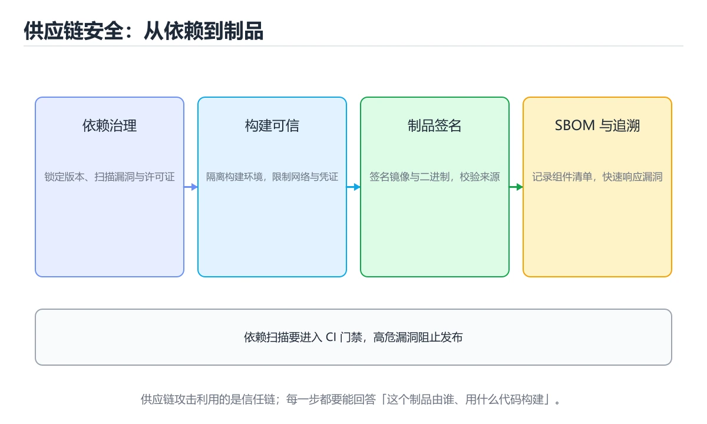
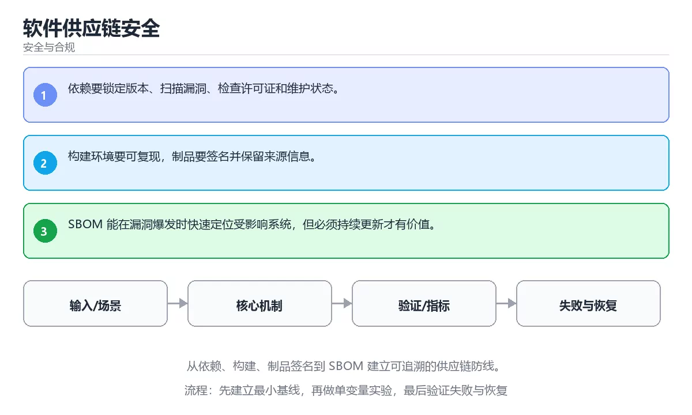

# 软件供应链安全

> 内容更新时间：2026-10-06 · 学习阶段：高级 · 预计用时：30 分钟





## 本节知识框架

**课程定位**：所属分类 `security`（安全与合规），课程主题 `软件供应链安全`，学习阶段 高级，建议用时 45 分钟。

本课主线：从依赖、构建、制品签名到 SBOM 建立可追溯的供应链防线。

**学完本课应当能够**
- 说清 `供应链` 与 `SBOM` 的含义与区别，并各举一个正例和一个反例。
- 用本课示例验证 `依赖漏洞` 的行为，记录输入、输出与失败条件。
- 遇到「依赖不锁版本也不校验来源」这类问题时，能说出触发条件与修复顺序。

### 复习清单

- [ ] 能不看正文复述本课核心术语，并指出一个边界或反例。
- [ ] 能运行或推演本课示例，记录输入、输出与失败现象。
- [ ] 能完成一次自测，并把错题对照错误表定位原因。

## 核心概念定义

| 术语 | 操作性定义 | 常见边界与风险 |
| --- | --- | --- |
| 供应链 | 依赖包、构建工具、镜像和发布渠道共同构成的软件来源链路。 | 不同版本与依赖组合的行为可能不同，升级或换环境前要按官方变更说明重新验证。 |
| SBOM | 软件物料清单，列出构建产物包含的组件、版本和依赖关系。 | 不同版本与依赖组合的行为可能不同，升级或换环境前要按官方变更说明重新验证。 |
| 依赖漏洞 | 按“软件供应链安全”中 供应链、SBOM、依赖漏洞 的实践顺序，把四个步骤排成从准备到复盘的合理顺序。 | 不同版本与依赖组合的行为可能不同，升级或换环境前要按官方变更说明重新验证。 |
| 制品签名 | 用私钥为构建产物签名，使用方校验来源和完整性，防止发布物被替换。 | 只在「用私钥为构建产物签名，使用方校验来源和完整性，防止发布物被替换」这一前提下成立，换输入或换环境要重新验证。 |

## 原理与运行机制

### 机制总览

**教材衔接：核心知识**

### 1. 依赖要锁定版本、扫描漏洞、检查许可证和维护状态。

- 关键做法：基线只保留 SBOM 必需的部分，其余条件一次加一个。
- 验证标准：SBOM 的异常路径有明确错误信息与恢复动作。

### 2. 构建环境要可复现，制品要签名并保留来源信息。

把这条结论放回「软件供应链安全」的完整流程里展开：

- 正文依据：能用自己的话解释：SBOM 能在漏洞爆发时快速定位受影响系统，但必须持续更新才有价值。
- 落地检查：把「2. 构建环境要可复现，制品要签名并保留来源信息。」改写成一条可执行的核对项，逐条验证输入、超时与失败路径。

### 3. SBOM 能在漏洞爆发时快速定位受影响系统，但必须持续更新才有价值。

把这条结论放回「软件供应链安全」的完整流程里展开：

- 正文依据：本课关键词：供应链、SBOM、依赖漏洞、制品签名。
- 落地检查：把「3. SBOM 能在漏洞爆发时快速定位受影响系统，但必须持续更新才有价值。」改写成一条可执行的核对项，逐条验证输入、超时与失败路径。

**教材衔接：关键流程**

**教材衔接：实践路径**

**教材衔接：安全落地补充：软件供应链安全**

### 一、资产、边界与信任

先回答：保护哪些数据、谁可以访问、哪些组件是信任边界、攻击者能从哪些入口进入。围绕「供应链、SBOM、依赖漏洞、制品签名」列出至少 3 个入口和对应的最小权限。

### 三、上线前安全清单

- [ ] 所有外部输入经过校验和输出编码。
- [ ] 认证、授权和会话失效逻辑有测试。
- [ ] 密钥不进入源码、镜像和日志。
- [ ] 依赖漏洞、许可证和来源已审查。
- [ ] 高风险操作有确认、审计和回滚。
- [ ] 安全事件有联系人和升级路径。

### 四、事件响应演练

围绕「软件供应链安全」构造一次 供应链 相关的越权或泄露场景，按发现、隔离、轮换、取证、恢复、复盘六步执行，记录时间线与剩余风险。

**教材衔接：验证步骤**

## 典型应用场景

- **依赖不锁版本也不校验来源**：典型现象是被投毒难以察觉；正确做法是锁定版本并校验完整性签名。
- **构建环境不固定**：典型现象是构建结果不可复现；正确做法是固定构建镜像与工具链版本。
- **只看直接依赖**：典型现象是传递依赖里的漏洞被忽略；正确做法是扫描完整依赖树并定期更新。

### 最小验证场景

- 准备：保留 `text` 示例的原始输入，先记录 `软件供应链安全` 的基线输出和完整运行命令。
- 观察：先核对 调用了 `sha256()`，再改变一个与 `供应链` 相关的条件。
- 判定：新结果与 `软件供应链安全` 的基线不同不等于错误；只有当差异破坏了 `供应链` 的定义或错误表中的约束，才判定为失败。

### 选择与边界

- 使用 `供应链` 时，先满足它的定义：依赖包、构建工具、镜像和发布渠道共同构成的软件来源链路；不同版本与依赖组合的行为可能不同，升级或换环境前要按官方变更说明重新验证。
- 使用 `SBOM` 时，先满足它的定义：软件物料清单，列出构建产物包含的组件、版本和依赖关系；不同版本与依赖组合的行为可能不同，升级或换环境前要按官方变更说明重新验证。
- 使用 `依赖漏洞` 时，先满足它的定义：按“软件供应链安全”中 供应链、SBOM、依赖漏洞 的实践顺序，把四个步骤排成从准备到复盘的合理顺序；不同版本与依赖组合的行为可能不同，升级或换环境前要按官方变更说明重新验证。
- 使用 `制品签名` 时，先满足它的定义：用私钥为构建产物签名，使用方校验来源和完整性，防止发布物被替换；只在「用私钥为构建产物签名，使用方校验来源和完整性，防止发布物被替换」这一前提下成立，换输入或换环境要重新验证。

## 代码/协议/SQL 示例

### 最小可验证示例

**教材衔接：最小可运行示例**

下面示例用于验证 供应链 的最小输入、处理和输出。先原样运行，再只修改一个值：

```python
import hashlib

digest = hashlib.sha256(b"password").hexdigest()
print(digest[:12])
```

**教材衔接：预期输出**

```text
5e884898da28
```

## 时间/空间复杂度或性能分析

**性能关注点（软件供应链安全）**：加解密与校验开销随数据量增长：记录处理耗时、密钥长度与内存占用。

**测量方法**：以 `软件供应链安全` 的 `供应链` 场景为对象，固定输入跑一遍记录基线，再把规模或并发度提高一个数量级复测；两次结果的差值与波动范围才是结论依据。

## 常见误区与易错点

| 容易写错的做法 | 实际现象 | 原因与正确做法 |
| --- | --- | --- |
| 依赖不锁版本也不校验来源 | 被投毒难以察觉。 | 锁定版本并校验完整性签名。 |
| 构建环境不固定 | 构建结果不可复现。 | 固定构建镜像与工具链版本。 |
| 只看直接依赖 | 传递依赖里的漏洞被忽略。 | 扫描完整依赖树并定期更新。 |

### 现场 1：依赖不锁版本也不校验来源

**症状**：被投毒难以察觉。

**根因与修复**：锁定版本并校验完整性签名。

**自检**：在本课示例里复现「依赖不锁版本也不校验来源」，改成锁定版本并校验完整性签名后重跑；如果症状消失且失败路径按预期变化，说明定位正确。

### 现场 2：构建环境不固定

**症状**：构建结果不可复现。

**根因与修复**：固定构建镜像与工具链版本。

**自检**：在本课示例里复现「构建环境不固定」，改成固定构建镜像与工具链版本后重跑；如果症状消失且失败路径按预期变化，说明定位正确。

### 现场 3：只看直接依赖

**症状**：传递依赖里的漏洞被忽略。

**根因与修复**：扫描完整依赖树并定期更新。

**自检**：在本课示例里复现「只看直接依赖」，改成扫描完整依赖树并定期更新后重跑；如果症状消失且失败路径按预期变化，说明定位正确。

## 与其他知识点的关系

**教材衔接：复习与迁移**

## 自测题与参考答案

> 先独立作答，再对照参考答案；答案都能在本课正文、术语表或错误表里找到依据。

### 自测 1（概念复述）

不看正文，写出 `供应链` 的操作性定义，并说明它与 `SBOM` 的区别。

**参考答案**：依赖包、构建工具、镜像和发布渠道共同构成的软件来源链路。

`SBOM` 的定位是：软件物料清单，列出构建产物包含的组件、版本和依赖关系；两者的差别要从适用对象与失败模式上说明。

### 自测 2（排错）

本课错误表记录了「依赖不锁版本也不校验来源」这类做法。请写出它会出现的现象、根因，以及修复顺序。

**参考答案**：现象是被投毒难以察觉；正确做法是锁定版本并校验完整性签名。修复时先复现现象并保留证据，再改动一处假设重跑，确认现象消失。

### 自测 3（动手验证）

运行本课的 `text` 示例，改动其中一个输入后重新运行，记录输出与错误信息。

**参考答案**：正常输入下 `text` 示例应当复现正文给出的结果；改动输入后，如果结果改变或报错，先核对它是否满足 `软件供应链安全` 中`供应链` 的适用范围，再检查错误表里是否有同类现象。

### 自测 4（代码阅读）

阅读本课开头的 `text` 示例，说明它体现了`供应链` 的哪一条性质，并指出改动哪个输入会让这条性质不再成立。

**参考答案**：`供应链` 的定义是 依赖包、构建工具、镜像和发布渠道共同构成的软件来源链路，示例正是在实现这条定义。改动与 `供应链` 有关的一个输入后，如果结果不再符合 `软件供应链安全` 的正文描述，就说明该性质只在当前前提成立。

### 自测 5（迁移）

把 `软件供应链安全` 的方法迁移到自己的项目：围绕 `供应链` 写出一个与错误表同类的风险点，并说明触发条件和检验方式。

**参考答案**：例如「只看直接依赖」，它会导致传递依赖里的漏洞被忽略；检验方式是按扫描完整依赖树并定期更新改一处再复现，确认现象消失且没有引入新的失败分支。

### 自测 6（对比）

用一个表格对比 `供应链` 与 `SBOM`：各写一行适用场景、一行失败表现。

**参考答案**：`供应链` 的定义是依赖包、构建工具、镜像和发布渠道共同构成的软件来源链路；`SBOM` 的定义是软件物料清单，列出构建产物包含的组件、版本和依赖关系。两者的失败表现分别对应本课错误表里与本术语相关的行。

### 自测 7（排错顺序）

面对「依赖不锁版本也不校验来源」引发的问题，请把“复现 被投毒难以察觉 → 保留证据 → 锁定版本并校验完整性签名 → 回归验证”四步写成可执行的检查清单。

**参考答案**：第一步按被投毒难以察觉复现；第二步记录输入、版本与完整报错；第三步按锁定版本并校验完整性签名只改一处；第四步重跑并确认失败路径也按预期变化。

### 自测 8（边界判断）

针对 `制品签名`，分别写出“可以使用”的条件和“结论不再成立”的条件。

**参考答案**：只在「用私钥为构建产物签名，使用方校验来源和完整性，防止发布物被替换」这一前提下成立，换输入或换环境要重新验证。 同时要把 `制品签名` 的定义 用私钥为构建产物签名，使用方校验来源和完整性，防止发布物被替换 与实际输入逐项对照。

### 自测 9（机制重建）

不看正文，按输入、转换、输出、验证四段重建 `供应链` → `SBOM` → `依赖漏洞` → `制品签名` 的作用链。

**参考答案**：起点是 `供应链` 的定义 依赖包、构建工具、镜像和发布渠道共同构成的软件来源链路；中间每一步都保留可观察状态；终点由 `制品签名` 检查，失败时回到错误表定位第一个偏离定义的步骤。

### 自测 10（综合排错）

在 `软件供应链安全` 中，现象是 传递依赖里的漏洞被忽略。请围绕 只看直接依赖 写出最小复现、关键证据、修复动作和回归验证，并说明为什么不能只凭一次运行下结论。

**参考答案**：先复现 只看直接依赖，记录输入与完整错误；再按 扫描完整依赖树并定期更新 只改一处。回归时同时跑正常路径和边界路径，只有两次结果都可解释，才把修复视为完成。

### 自测 11（一分钟复述）

用每分钟约 200 字的速度复述 `软件供应链安全`：先给主问题，再按顺序说出 `供应链`、`SBOM`、`依赖漏洞`、`制品签名`，最后给一个失败案例。

**自评标准**：主问题必须对应 从依赖、构建、制品签名到 SBOM 建立可追溯的供应链防线；每个术语都要能接上一句定义或边界；失败案例必须写成可观察现象，不能用“可能有风险”代替证据。

## 延伸阅读

想更直观地理解本课概念？推荐参阅以下图解专题：

- [图解 HTTPS 证书链与 TLS 握手](visual_https_cert.md)

## 术语速查

| 术语 | 一句话说明 |
| --- | --- |
| `供应链` | 依赖包、构建工具、镜像和发布渠道共同构成的软件来源链路。 |
| `SBOM` | 软件物料清单，列出构建产物包含的组件、版本和依赖关系。 |
| `依赖漏洞` | 按“软件供应链安全”中 供应链、SBOM、依赖漏洞 的实践顺序，把四个步骤排成从准备到复盘的合理顺序。 |
| `制品签名` | 用私钥为构建产物签名，使用方校验来源和完整性，防止发布物被替换。 |

**术语关系**：`供应链`（依赖包、构建工具、镜像和发布渠道共同构成的软件来源链路） → `SBOM`（软件物料清单） → `依赖漏洞`（按“软件供应链安全”中 供应链、SBOM、依赖漏洞 的实践顺序） → `制品签名`（用私钥为构建产物签名）。

## 考点精讲

`软件供应链安全` 的题库有 5 道题，下面逐题给出题干、正确项与判断依据：先自己作答，再核对正确项，最后回到正文对应小节复核。

### 考点 1：第 1 题

- **题目**：下面这段 `python` 代码来自 `软件供应链安全`。课程主线是从依赖、构建、制品签名到 SBOM 建立可追溯的供应链防线。代码与 `供应链` 有关。哪一项是代码里真实出现的内容？
- **正确项**：出现字面量 `password`
- **判断依据**：这道题落在术语 `供应链` 上：依赖包、构建工具、镜像和发布渠道共同构成的软件来源链路。复习时把 `供应链` 的定义、适用边界和一个反例一起说清楚，再回到「核心概念定义」核对原文。

### 考点 2：第 2 题

- **题目**：在 `软件供应链安全` 里，与 `供应链` 有关的说法中，哪一项最符合从依赖、构建、制品签名到 SBOM 建立可追溯的供应链防线。？
- **正确项**：构建环境要可复现，制品要签名并保留来源信息。
- **判断依据**：这道题落在术语 `供应链` 上：依赖包、构建工具、镜像和发布渠道共同构成的软件来源链路。复习时把 `供应链` 的定义、适用边界和一个反例一起说清楚，再回到「核心概念定义」核对原文。

### 考点 3：第 3 题

- **题目**：在 `软件供应链安全` 里，与 `供应链` 有关的说法中，哪一项最符合从依赖、构建、制品签名到 SBOM 建立可追溯的供应链防线。？（软件供应链安全·安全与合规 第 3 题）
- **正确项**：SBOM 能在漏洞爆发时快速定位受影响系统，但必须持续更新才有价值。
- **判断依据**：这道题落在术语 `供应链` 上：依赖包、构建工具、镜像和发布渠道共同构成的软件来源链路。复习时把 `供应链` 的定义、适用边界和一个反例一起说清楚，再回到「核心概念定义」核对原文。

### 考点 4：第 4 题

- **题目**：按“软件供应链安全”中 供应链、SBOM、依赖漏洞 的实践顺序，把四个步骤排成从准备到复盘的合理顺序。
- **正确项**：先明确 供应链 的输入、输出与约束 → 写出最小示例并核对 SBOM 的基线结果 → 只改一个变量，记录边界与失败路径的变化 → 固定版本与证据，把“软件供应链安全”的结论写成可复现记录
- **判断依据**：这道题落在术语 `供应链` 上：依赖包、构建工具、镜像和发布渠道共同构成的软件来源链路。复习时把 `供应链` 的定义、适用边界和一个反例一起说清楚，再回到「核心概念定义」核对原文。

### 考点 5：第 5 题

- **题目**：课程 `从依赖、构建、制品签名到 SBOM 建立可追溯的供应链防线。`。在 `软件供应链安全` 里，`供应链`、`SBOM` 与下面哪些选项属于同一层概念？（多选）
- **正确项**：供应链；SBOM
- **判断依据**：这道题落在术语 `供应链` 上：依赖包、构建工具、镜像和发布渠道共同构成的软件来源链路。复习时把 `供应链` 的定义、适用边界和一个反例一起说清楚，再回到「核心概念定义」核对原文。

### 考点 6：`供应链`

- **要点**：依赖包、构建工具、镜像和发布渠道共同构成的软件来源链路。
- **供应链 的边界**：不同版本与依赖组合的行为可能不同，升级或换环境前要按官方变更说明重新验证。

### 考点 7：`SBOM`

- **要点**：软件物料清单，列出构建产物包含的组件、版本和依赖关系。
- **SBOM 的边界**：不同版本与依赖组合的行为可能不同，升级或换环境前要按官方变更说明重新验证。

### 考点 8：`依赖漏洞`

- **要点**：按“软件供应链安全”中 供应链、SBOM、依赖漏洞 的实践顺序，把四个步骤排成从准备到复盘的合理顺序。
- **依赖漏洞 的边界**：不同版本与依赖组合的行为可能不同，升级或换环境前要按官方变更说明重新验证。

### 考点 9：`制品签名`

- **要点**：用私钥为构建产物签名，使用方校验来源和完整性，防止发布物被替换。
- **制品签名 的边界**：只在「用私钥为构建产物签名，使用方校验来源和完整性，防止发布物被替换」这一前提下成立，换输入或换环境要重新验证。

### 考点 10：排错——依赖不锁版本也不校验来源

- **现象**：被投毒难以察觉。
- **处理**：锁定版本并校验完整性签名。

### 考点 11：排错——构建环境不固定

- **现象**：构建结果不可复现。
- **处理**：固定构建镜像与工具链版本。

### 考点 12：综合辨析——`供应链` 与 `制品签名`

- **辨析点**：`供应链` 的定义是 依赖包、构建工具、镜像和发布渠道共同构成的软件来源链路；`制品签名` 的定义是 用私钥为构建产物签名，使用方校验来源和完整性，防止发布物被替换。
- **答题要求**：面对 `软件供应链安全` 的题目，先判断描述的是 `供应链` 还是 `制品签名`，再归到对应定义，最后写出一个会让该定义失效的边界输入。

### 考点 13：排错评分点

- **现象分**：能写出 被投毒难以察觉，而不是只写“程序有错”。
- **证据分**：保留触发 依赖不锁版本也不校验来源 的输入、版本和错误原文。
- **修复分**：按 锁定版本并校验完整性签名 只改一处，并同时回归正常路径与边界路径。

## 内容元数据

- 内容版本：v2.0
- 最后更新：2026-10-06
- 学习阶段：高级
- 适用环境：OWASP、云原生与合规安全实践；本课聚焦 供应链。
- 内容来源：内置结构化课程与工程实践整理
- 相关主题：供应链、SBOM、依赖漏洞、制品签名
- 质量版本：P0 测验标准 + P1 覆盖扩展 + P2 体验补全

## 参考资料与复核

- [本课资料锚点 security_supply_chain](https://zh.wikipedia.org/w/index.php?search=security_supply_chain)

- 最后复核：2026-10-04
- 下次复核：2026-11-24
- 复核范围：版本兼容、API 行为、安全建议与工程实践
- 来源性质：官方文档、标准或权威教材；本课核对关键词：供应链、SBOM、依赖漏洞、制品签名。

| 参考资料 | 本课用途 |
| --- | --- |
| [CWE 弱点列表](https://cwe.mitre.org/) | 软件弱点分类 |
| [PortSwigger Web Security Academy](https://portswigger.net/web-security) | 漏洞原理与实验 |
| [CIS Benchmarks](https://www.cisecurity.org/cis-benchmarks) | 系统安全基线 |

| [本课术语索引：软件供应链安全](#核心概念定义) | 按本课输入、术语边界和错误表现逐项核对 |
> 「软件供应链安全」的链接用于离线阅读后的延伸核对；App 不会自动联网。