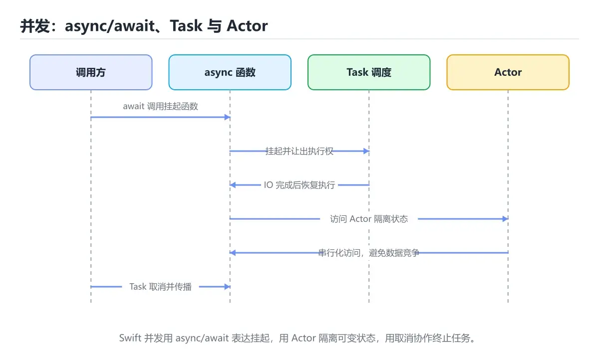
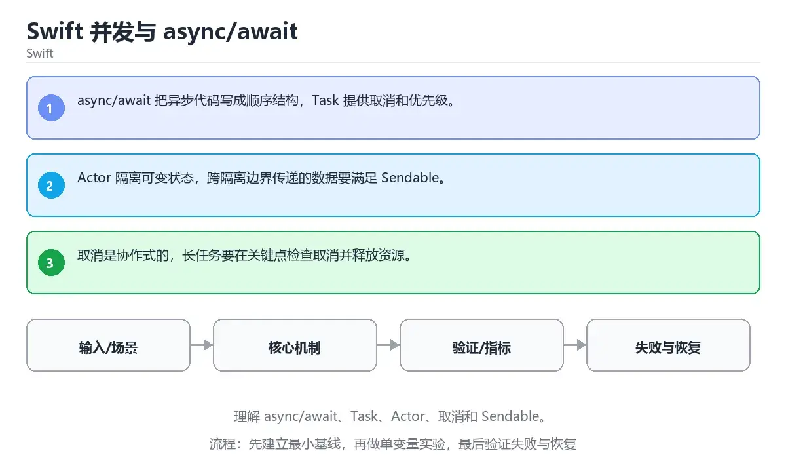

# Swift 并发与 async/await

> 内容更新时间：2026-10-06 · 学习阶段：高级 · 预计用时：40 分钟





## 本节知识框架

**课程定位**：所属分类 `swift`（Swift），课程主题 `Swift 并发与 async/await`，学习阶段 高级，建议用时 40 分钟。

本课主线：理解 async/await、Task、Actor、取消和 Sendable。

**学完本课应当能够**
- 说清 `async` 与 `Actor` 的含义与区别，并各举一个正例和一个反例。
- 用本课示例验证 `Task` 的行为，记录输入、输出与失败条件。
- 遇到「在主线程做耗时任务」这类问题时，能说出触发条件与修复顺序。

### 复习清单

- [ ] 能讲清 async 与 Actor 的分工，并指出其中一个前提失效的边界。
- [ ] 能跑通 async 的最小示例，记录一组正常输出和一组失败输出。
- [ ] 能完成一次自测，并把错题对照错误表定位原因。

## 核心概念定义

| 术语 | 操作性定义 | 常见边界与风险 |
| --- | --- | --- |
| async | 标记异步函数或异步块，使内部可以使用 await 而不阻塞调用线程。 | 标了 async 不等于工作自动离开主线程：耗时调用仍压在调用线程上，界面照样卡顿甚至无响应。 |
| Actor | 把状态封装在独立执行单元中，通过消息异步通信的并发模型。 | 隔离只在可变状态真被放进执行单元时才成立；共享状态漏了隔离标注，就会出现编译告警或运行期异常。 |
| Task | Swift 并发中的异步任务单元，可等待结果、取消或组合并发工作。 | 取消是协作式的：不在关键点检查并向下传播，页面都退出了任务还在跑，资源也没释放。 |
| Sendable | Swift 中标记类型可安全跨并发域传递的协议。 | 它管的是跨隔离边界传数据这一环：不满足就编译告警；标上它也不等于状态已被 Actor 隔离。 |

## 原理与运行机制

### async/await 不是线程，而是可挂起的状态机

调用一个 `async` 函数不会新开线程。编译器把函数体拆成若干段，在 `await` 处保存局部状态并让出执行权（挂起点），等被等待的操作完成后从挂起点恢复。恢复不保证回到原来的线程，因此：

- `async` 只表示"这里可能暂停"，不表示"这里在后台运行"。
- 真正决定在哪执行的，是函数或类型上的**隔离**（如 `@MainActor`）和任务使用的**执行器**。
- 挂起期间不占线程，所以少量线程可以支撑大量并发任务。

### Task 与结构化并发

`Task {}` 创建一个异步任务，继承当前 actor 隔离和优先级；`Task.detached {}` 不继承，适合完全独立的工作，但取消和优先级也不会自动传递。

结构化并发的三种常用形态：

- `async let`：并发启动固定数量的子任务，作用域结束时自动等待。
- `withTaskGroup`：动态数量的子任务，结果以任意顺序返回。
- `withThrowingTaskGroup`：子任务可抛错，任一失败会取消同组其他任务。

父任务取消会向下传播到子任务；子任务失败也会向上传播。这就是"结构化"：子任务的生命周期不会逃出父作用域。

```swift
async let a = fetchValue()
async let b = fetchValue()
let pair = await (a, b)
```

上面两个 `fetchValue()` 会并发执行；如果写成 `await fetchValue() + await fetchValue()`，则是串行。

### 取消是协作式的

取消只是把任务的 `isCancelled` 置为真，不会强行终止代码。任务必须在关键点主动检查：

- `Task.isCancelled` 或 `try Task.checkCancellation()`。
- 支持取消的 API 会在取消时抛 `CancellationError`，例如 `Task.sleep`、`URLSession.data`。
- `withTaskCancellationHandler` 用于在取消瞬间清理资源。
- `defer` 负责正常、抛错、取消三种路径上的清理。

循环、批量处理和网络请求之间都要插入检查点；否则页面退出了，任务还会跑完。

### Actor：用隔离换安全

`actor` 把可变状态包在自己的执行器里，外部只能通过 `await` 调用它的方法。同一个 actor 上的方法串行执行，因此 `value += 1` 不会并发竞争。

但 actor 是**可重入**的：方法内部遇到 `await` 时会挂起，别的消息可以插进来执行。所以下面这种写法仍然有竞态：

```swift
actor Balance {
    var amount = 100

    func withdraw(_ n: Int) async -> Bool {
        guard amount >= n else { return false }
        await audit(n)
        amount -= n
        return true
    }

    func audit(_ n: Int) async {}
}
```

`await audit(n)` 挂起期间其他调用可能已经把 `amount` 改小，恢复后直接扣减就会透支。修复方式是在挂起后重新检查状态，或把检查与修改放进同一个同步方法。

`@MainActor` 是作用在主线程上的全局 actor，UI 更新应放在这里；从后台任务回到主线程更新界面，靠的就是 `await MainActor.run` 或 `@MainActor` 标注。

### Sendable：跨隔离边界的数据契约

`Sendable` 表示一个值可以安全地在并发域之间传递。常见满足方式：

- 值类型（struct、enum）且成员都 Sendable。
- 不可变的 final class 且成员不可变。
- 通过 actor 隔离的可变状态。
- `@unchecked Sendable` 是开发者自己担保，编译器不再检查，必须配合锁或不可变约束。

Swift 6 的严格并发检查会把跨 actor 传递非 Sendable 类型视为错误。遇到报错时，优先改成值类型快照或把状态移进 actor，而不是直接加 `@unchecked`。

### 错误、优先级与执行器

- `async` 函数用 `throws` 传播错误；`Task` 的错误保存在 `task.value` 里，只有 `await` 时才会抛出。`Task { try ... }` 不 await 会静默吞掉错误。
- 优先级从 `.high` 到 `.background`，只影响调度倾向，不保证顺序；不要用优先级做同步。
- Swift 并发使用协作线程池，线程数约等于核数。在 `async` 函数里调用阻塞 API（`Thread.sleep`、信号量等待、同步 I/O）会占住池中的线程，任务多了就会饿死其他任务。

## 典型应用场景

**课程内置实验入口**：`sandbox:swift`，用于动手验证《Swift 并发与 async/await》的机制；实验结论不替代概念定义与复杂度分析。

### 五种常见现场

| 场景 | 正确做法 | 常见错误 |
| --- | --- | --- |
| 网络请求后更新 UI | `@MainActor` 标注 ViewModel，await 结果后直接赋值 | 在后台线程改 UI，触发线程检查告警 |
| 多接口并发聚合 | `async let` 或 TaskGroup 并发请求 | 逐个 await，串行等待 |
| 搜索输入防抖 | 保存 Task 句柄，新输入取消旧任务 | 每次输入都新建 Task 且不取消 |
| 大文件分片处理 | TaskGroup 限制并发度，分批处理 | 一次创建上万个任务 |
| 共享计数器或缓存 | actor 封装状态 | class 配锁与 async 混用，锁跨 await 失效 |

### 最小验证场景

- 准备：运行本课的 `fetchValue` 示例，记录 `answer=42` 与耗时基线。
- 观察：把两次串行 `await fetchValue()` 改成 `async let` 并发，比较总耗时。
- 判定：并发版本耗时接近单次调用；若没有变快，检查是否被 actor 串行化或被阻塞调用卡住。
- 失败信号：任务取消后仍打印完成、界面更新不在主线程，说明取消或隔离没有接好。

### 选择与边界

- `async` 适合 I/O 等待；CPU 密集计算要放进独立任务并控制并发度，否则只是换个地方占线程。
- `Actor` 适合保护小范围可变状态；跨 actor 频繁往返会成为瓶颈，必要时合并状态或批量调用。
- `Task` 的取消必须配合检查点；不检查取消的循环相当于不可取消。
- `Sendable` 是编译期约束，不是运行时锁；标了 Sendable 仍要保证值本身不可变或不共享。

## 代码/协议/SQL 示例

### 最小可验证示例：async 函数

```swift
func fetchValue() async -> Int { 42 }

@main
struct App {
    static func main() async {
        print("answer=\(await fetchValue())")
    }
}
```

```text
answer=42
```

### Actor 与 TaskGroup：并发累加

```swift
actor Counter {
    private var value = 0

    func increment() {
        value += 1
    }

    func current() -> Int {
        value
    }
}

func sumConcurrently(_ n: Int) async -> Int {
    await withTaskGroup(of: Int.self) { group in
        for i in 1...n {
            group.addTask { i }
        }
        var total = 0
        for await value in group {
            total += value
        }
        return total
    }
}

@main
struct Demo {
    static func main() async {
        let counter = Counter()
        await withTaskGroup(of: Void.self) { group in
            for _ in 0..<1000 {
                group.addTask { await counter.increment() }
            }
        }
        print("counter=\(await counter.current())")
        print("sum=\(await sumConcurrently(100))")
    }
}
```

```text
counter=1000
sum=5050
```

1000 次 `increment` 通过 actor 串行执行，结果恰好是 1000；`sumConcurrently` 把 1 到 100 分发成子任务，求和结果与串行一致，但等待可以重叠。

### 取消：在检查点退出

```swift
func downloadAll(_ ids: [Int]) async throws -> [Int] {
    var results: [Int] = []
    for id in ids {
        try Task.checkCancellation()
        try await Task.sleep(for: .milliseconds(100))
        results.append(id)
    }
    return results
}

@main
struct CancelDemo {
    static func main() async {
        let task = Task {
            try await downloadAll(Array(0..<10))
        }
        try? await Task.sleep(for: .milliseconds(250))
        task.cancel()
        do {
            let values = try await task.value
            print("values=\(values.count)")
        } catch is CancellationError {
            print("cancelled=true")
        } catch {
            print("error=\(error)")
        }
    }
}
```

```text
cancelled=true
```

250 ms 后取消，`checkCancellation()` 在下一次循环开头抛出 `CancellationError`。如果去掉这行检查，任务会跑完 10 次睡眠并打印 `values=10`，取消形同虚设。

## 时间/空间复杂度或性能分析

### 线程、挂起与任务开销

- 协作线程池的线程数约等于 CPU 核数；挂起与恢复在微秒级，创建线程在几十微秒到毫秒级。
- 每个 Task 都有分配与调度开销，百万级超短任务要改成批处理。
- 结构化并发保证父子生命周期，但也意味着父任务必须等所有子任务，长尾子任务会拖住整体完成时间。
- actor 串行执行：单个 actor 的吞吐上限固定，热点 actor 会成为瓶颈。

### 并发度怎么选

- **I/O 密集**：并发度可以高于核数，但受连接池、文件描述符和服务端限流约束。
- **CPU 密集**：并发度接近核数即可，再多只会增加切换与缓存失效。
- **分批执行**：1000 个文件可以每次并发 8 个处理，而不是一次全部启动。
- **观察拐点**：继续加并发后吞吐不增、P99 上升，说明瓶颈已转移到下游或锁竞争。

### 复杂度视角

- 时间复杂度仍由业务算法决定，并发不会减少总计算量，只改变等待的重叠程度。
- 空间上每个挂起点都要保存局部状态，深递归叠加大量任务会放大内存占用。
- Actor 的消息队列若没有入口限流，突发流量会堆积成延迟，必要时合并请求或批量写入。

### 测量方法

1. 用 Instruments 的 Swift Concurrency 模板观察任务创建、挂起、actor 等待与线程占用。
2. 用 `os_signpost` 标记关键区间，测端到端延迟，而不是只测单个函数耗时。
3. 固定输入比较串行与并发版本的 wall-clock 与 CPU 占用。
4. 逐步提高并发度找到吞吐拐点；拐点之后继续加并发只会让 P99 变差。
5. 记录取消后到资源释放的时间，避免退出页面后仍占着连接。

## 常见误区与易错点

| 容易写错的做法 | 实际现象 | 原因与正确做法 |
| --- | --- | --- |
| 在主线程做耗时任务 | 界面卡顿甚至无响应。 | 把耗时工作放进并发任务，回到主线程再更新界面。 |
| 不检查任务取消 | 页面退出后任务仍在运行。 | 在关键点检查取消并向下传播。 |
| 共享状态缺少隔离 | 编译告警或运行期异常。 | 用隔离标注与安全共享方式保护状态。 |
| 在 actor 的 await 之后直接改状态 | 状态可能已被其他调用修改，出现透支或重复。 | 挂起后重新检查，或把检查与修改放进同步方法。 |
| 用 Task.detached 逃避隔离 | 取消与优先级不继承，资源失控。 | 优先用 Task 继承上下文，确需分离时显式管理。 |
| 用 @unchecked Sendable 压掉告警 | 真实竞态被隐藏。 | 改成值类型快照或 actor 隔离。 |
| 在 async 函数里调用阻塞 API | 协作线程池被占满，其他任务饿死。 | 换成 async API，或放到专用线程并限流。 |
| 不 await Task 的结果 | 错误被静默吞掉，失败不可见。 | 保存句柄并在合适位置 await，或显式记录错误。 |

### 现场 1：在主线程做耗时任务

**症状**：界面卡顿甚至无响应。

**根因与修复**：把耗时工作放进并发任务，回到主线程再更新界面。

**自检**：在本课示例里复现「在主线程做耗时任务」，改成把耗时工作放进并发任务，回到主线程再更新界面后重跑；如果症状消失且失败路径按预期变化，说明定位正确。

### 现场 2：不检查任务取消

**症状**：页面退出后任务仍在运行。

**根因与修复**：在关键点检查取消并向下传播。

**自检**：在本课示例里复现「不检查任务取消」，改成在关键点检查取消并向下传播后重跑；如果症状消失且失败路径按预期变化，说明定位正确。

### 现场 3：共享状态缺少隔离

**症状**：编译告警或运行期异常。

**根因与修复**：用隔离标注与安全共享方式保护状态。

**自检**：在本课示例里复现「共享状态缺少隔离」，改成用隔离标注与安全共享方式保护状态后重跑；如果症状消失且失败路径按预期变化，说明定位正确。

## 与其他知识点的关系

| 关系 | 课程 | 为什么 |
| --- | --- | --- |
| 先修 | 《Swift 函数、闭包与协议》 | async/await 建立在闭包、错误传播与协议之上。 |
| 关联 | 《SwiftUI 与状态管理》 | UI 更新必须回到 MainActor，状态与并发边界直接相关。 |
| 关联 | 《Swift 测试与性能》 | 并发代码要用可控时钟和压力测试验证。 |
| 后续 | 《实战：SwiftUI iOS 客户端》 | 网络层与 ViewModel 会大量使用本课模式。 |

## 自测题与参考答案

> 先独立作答，再对照参考答案；答案都能在本课正文、术语表或错误表里找到依据。

### 自测 1（概念复述）

不看正文，写出 `async` 的操作性定义，并说明它与 `Actor` 的区别。

**参考答案**：标记异步函数或异步块，使内部可以使用 await 而不阻塞调用线程。

`Actor` 的定位是：把状态封装在独立执行单元中，通过消息异步通信的并发模型；两者的差别要从适用对象与失败模式上说明。

### 自测 2（排错）

本课错误表记录了「在主线程做耗时任务」这类做法。请写出它会出现的现象、根因，以及修复顺序。

**参考答案**：现象是界面卡顿甚至无响应；正确做法是把耗时工作放进并发任务，回到主线程再更新界面。修复时先复现现象并保留证据，再改动一处假设重跑，确认现象消失。

### 自测 3（动手验证）

运行本课的 `text` 示例，只改 async 的一个输入并比较两次输出，抄下第一条错误信息。

**参考答案**：正常输入下 `text` 示例应当复现正文给出的结果；改动输入后，如果结果改变或报错，先核对它是否满足 `Swift 并发与 async/await` 中`async` 的适用范围，再检查错误表里是否有同类现象。

### 自测 4（代码阅读）

阅读本课开头的 `text` 示例，说明它体现了`async` 的哪一条性质，并指出改动哪个输入会让这条性质不再成立。

**参考答案**：`async` 的定义是 标记异步函数或异步块，使内部可以使用 await 而不阻塞调用线程，示例正是在实现这条定义。改动与 `async` 有关的一个输入后，如果结果不再符合 `Swift 并发与 async/await` 的正文描述，就说明该性质只在当前前提成立。

### 自测 5（迁移）

把 `Swift 并发与 async/await` 的方法迁移到自己的项目：围绕 `async` 写出一个与错误表同类的风险点，并说明触发条件和检验方式。

**参考答案**：例如「共享状态缺少隔离」，它会导致编译告警或运行期异常；检验方式是按用隔离标注与安全共享方式保护状态改一处再复现，确认现象消失且没有引入新的失败分支。

### 自测 6（对比）

用一个表格对比 `async` 与 `Actor`：各写一行适用场景、一行失败表现。

**参考答案**：`async` 的定义是标记异步函数或异步块，使内部可以使用 await 而不阻塞调用线程；`Actor` 的定义是把状态封装在独立执行单元中，通过消息异步通信的并发模型。两者的失败表现分别对应本课错误表里与本术语相关的行。

### 自测 7（排错顺序）

面对「在主线程做耗时任务」引发的问题，请把“复现 界面卡顿甚至无响应 → 保留证据 → 把耗时工作放进并发任务，回到主线程再更新界面 → 回归验证”四步写成可执行的检查清单。

**参考答案**：第一步按界面卡顿甚至无响应复现；第二步记录输入、版本与完整报错；第三步按把耗时工作放进并发任务，回到主线程再更新界面只改一处；第四步重跑并确认失败路径也按预期变化。

### 自测 8（边界判断）

针对 `Sendable`，分别写出“可以使用”的条件和“结论不再成立”的条件。

**参考答案**：`Sendable` 适用于值类型或不可变引用类型跨隔离传递；如果类型包含可变引用且没有 actor 隔离，这个结论就不成立，应改成值快照或把状态移进 actor。

### 自测 9（机制重建）

不看正文，按输入、转换、输出、验证四段重建 `async` → `Actor` → `Task` → `Sendable` 的作用链。

**参考答案**：起点是 `async` 的定义 标记异步函数或异步块，使内部可以使用 await 而不阻塞调用线程；中间每一步都保留可观察状态；终点由 `Sendable` 检查，失败时回到错误表定位第一个偏离定义的步骤。

### 自测 10（综合排错）

在 `Swift 并发与 async/await` 中，现象是 编译告警或运行期异常。请围绕 共享状态缺少隔离 写出最小复现、关键证据、修复动作和回归验证，并说明为什么不能只凭一次运行下结论。

**参考答案**：先复现 共享状态缺少隔离，记录输入与完整错误；再按 用隔离标注与安全共享方式保护状态 只改一处。回归时同时跑正常路径和边界路径，只有两次结果都可解释，才把修复视为完成。

### 自测 11（一分钟复述）

用每分钟约 200 字的速度复述 `Swift 并发与 async/await`：先给主问题，再按顺序说出 `async`、`Actor`、`Task`、`Sendable`，最后给一个失败案例。

**自评标准**：主问题必须对应 理解 async/await、Task、Actor、取消和 Sendable；每个术语都要能接上一句定义或边界；失败案例必须写成可观察现象，不能用“可能有风险”代替证据。

## 延伸阅读

想更直观地理解本课概念？推荐参阅以下图解专题：

- [图解并发调度：线程、协程与 Goroutine](visual_concurrency_schedule.md)

## 术语速查

| 术语 | 一句话说明 |
| --- | --- |
| `async` | 标记异步函数或异步块，使内部可以使用 await 而不阻塞调用线程。 |
| `Actor` | 把状态封装在独立执行单元中，通过消息异步通信的并发模型。 |
| `Task` | Swift 并发中的异步任务单元，可等待结果、取消或组合并发工作。 |
| `Sendable` | Swift 中标记类型可安全跨并发域传递的协议。 |
| `结构化并发` | 子任务的生命周期受父作用域约束，父任务负责等待或取消。 |
| `协作式取消` | 取消只设置标志，任务需在检查点主动退出并清理。 |
| `Actor 隔离` | actor 的可变状态只能通过其方法访问，方法串行执行。 |
| `重入` | actor 方法在 await 处挂起时，其他消息可以插入执行。 |
| `@MainActor` | 绑定主线程的全局 actor，用于安全地更新 UI。 |
| `TaskGroup` | 动态创建子任务并按完成顺序收集结果的并发容器。 |
| `挂起点` | async 函数中可能暂停并让出线程的位置，通常由 await 标记。 |

**术语关系**：`async`（标记异步函数或异步块） → `Actor`（把状态封装在独立执行单元中） → `Task`（Swift 并发中的异步任务单元） → `Sendable`（Swift 中标记类型可安全跨并发域传递的协议）。

## 考点精讲

`Swift 并发与 async/await` 的题库有 6 道题，下面逐题给出题干、正确项与判断依据：先自己作答，再核对正确项，最后回到正文对应小节复核。

### 考点 1：第 1 题

- **题目**：在 `Swift 并发与 async/await` 里，与 `async` 有关的说法中，哪一项最符合理解 async/await、Task、Actor、取消和 Sendable？
- **正确项**：async/await 把异步代码写成顺序结构，Task 提供取消和优先级。
- **判断依据**：本题正确项是「async/await 把异步代码写成顺序结构，Task 提供取消和优先级」。术语 async（Swift 并发与 async/await）：标记异步函数或异步块，使内部可以使用 await 而不阻塞调用线程，本题取「async/await 把异步代码写成顺序结构，Task 提供取消和优先级」这条。易错点是在主线程做耗时任务，会造成界面卡顿甚至无响应，改法是把耗时工作放进并发任务，回到主线程再更新界面。

### 考点 2：第 2 题

- **题目**：围绕“Swift 并发与 async/await”中的 async、Actor、Task，下列哪两项是本课强调的实践判断？
- **正确项**：验证 Actor 时要固定版本并覆盖边界输入，结论才可复现；学习 async 时要同时说明输入、输出和失败路径，不能只看正常流程
- **判断依据**：按《Swift 并发与 async/await》的正文口径，本题要同时选中「验证 Actor 时要固定版本并覆盖边界输入，结论才可复现」、「学习 async 时要同时说明输入、输出和失败路径，不能只看正常流程」，漏掉任一项都算没答全。术语 async（Swift 并发与 async/await）：标记异步函数或异步块，使内部可以使用 await 而不阻塞调用线程。易错点是不检查任务取消，会造成页面退出后任务仍在运行，改法是在关键点检查取消并向下传播。

### 考点 3：第 3 题

- **题目**：在 `Swift 并发与 async/await` 里，与 `async` 有关的说法中，哪一项最符合理解 async/await、Task、Actor、取消和 Sendable？（Swift 并发与 async/await·Swift 第 3 题）
- **正确项**：取消是协作式的，长任务要在关键点检查取消并释放资源。
- **判断依据**：按《Swift 并发与 async/await》的正文口径，本题正确项是「取消是协作式的，长任务要在关键点检查取消并释放资源。」。术语「async」在本课里的界定是标记异步函数或异步块，使内部可以使用 await 而不阻塞调用线程，题干问的就是这一条。常见错法是不检查任务取消，其后果是页面退出后任务仍在运行。正确做法是在关键点检查取消并向下传播。

### 考点 4：第 4 题

- **题目**：`Swift 并发与 async/await` 的主线是：理解 async/await、Task、Actor、取消和 Sendable。下面哪一项与这条主线一致？
- **正确项**：理解 async/await，Task，Actor
- **判断依据**：本题正确项是「理解 async/await，Task，Actor」。术语 async（Swift 并发与 async/await）：标记异步函数或异步块，使内部可以使用 await 而不阻塞调用线程，本题取「理解 async/await，Task，Actor」这条。易错点是在主线程做耗时任务，会造成界面卡顿甚至无响应，改法是把耗时工作放进并发任务，回到主线程再更新界面。

### 考点 5：第 5 题

- **题目**：填空：补齐下面这段术语说明中的空缺。课程 `理解 async/await、Task、Actor、取消和 Sendable。`，这段说明是：`____`：Swift 并发中的异步任务单元，可等待结果、取消或组合并发工作。空缺处应填哪个术语？
- **正确项**：Task
- **判断依据**：《Swift 并发与 async/await》这题的填空口径是「Task」或「task」，正文写法与其中任一项一致即可。术语「async」在本课里的界定是标记异步函数或异步块，使内部可以使用 await 而不阻塞调用线程，题干问的就是这一条。常见错法是在主线程做耗时任务，其后果是界面卡顿甚至无响应。正确做法是把耗时工作放进并发任务，回到主线程再更新界面。

### 考点 6：第 6 题

- **题目**：结合 `Swift 并发与 async/await` 中围绕 `async` 的代码，哪一项说法与“理解 async/await、Task、Actor、取消和 Sendable。”一致？
- **正确项**：async/await 把异步代码写成顺序结构，Task 提供取消和优先级。
- **判断依据**：本题正确项是「async/await 把异步代码写成顺序结构，Task 提供取消和优先级」。术语 async（Swift 并发与 async/await）：标记异步函数或异步块，使内部可以使用 await 而不阻塞调用线程，本题取「async/await 把异步代码写成顺序结构，Task 提供取消和优先级」这条。易错点是共享状态缺少隔离，会造成编译告警或运行期异常，改法是用隔离标注与安全共享方式保护状态。

## 内容元数据

- 内容版本：v2.0
- 最后更新：2026-10-06
- 学习阶段：高级
- 适用环境：Swift 6 / Xcode 16+；本课聚焦 async。
- 内容来源：内置结构化课程与工程实践整理
- 相关主题：async、Actor、Task、Sendable
- 质量版本：P0 测验标准 + P1 覆盖扩展 + P2 体验补全

## 参考资料与复核

- 最后复核：2026-10-04
- 下次复核：2026-12-17
- 复核范围：版本兼容、API 行为、安全建议与工程实践
- 来源性质：官方文档、标准或权威教材；本课核对关键词：async、Actor、Task、Sendable。

| 参考资料 | 本课用途 |
| --- | --- |
| [Swift 并发](https://docs.swift.org/swift-book/documentation/the-swift-programming-language/concurrency/) | async/await 与 actor |
| [Apple 人机界面指南](https://developer.apple.com/design/human-interface-guidelines/) | iOS 设计规范与可访问性 |
| [Swift 官方文档](https://www.swift.org/documentation/) | 工具链、包管理与语言演进 |

| [本课术语索引：Swift 并发与 async/await](#核心概念定义) | 按本课输入、术语边界和错误表现逐项核对 |
> 「Swift 并发与 async/await」的链接用于离线阅读后的延伸核对；App 不会自动联网。