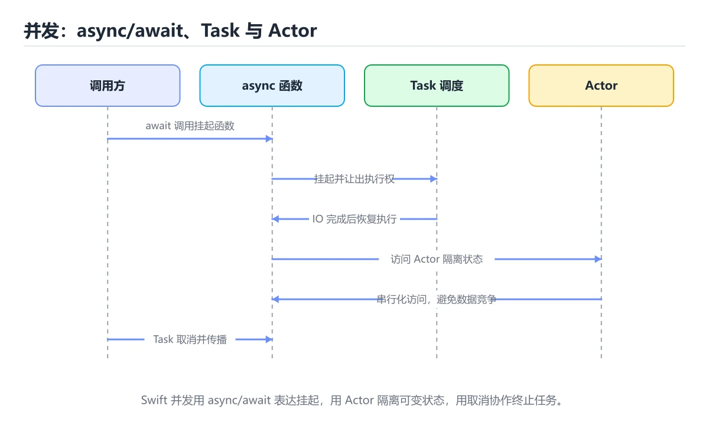
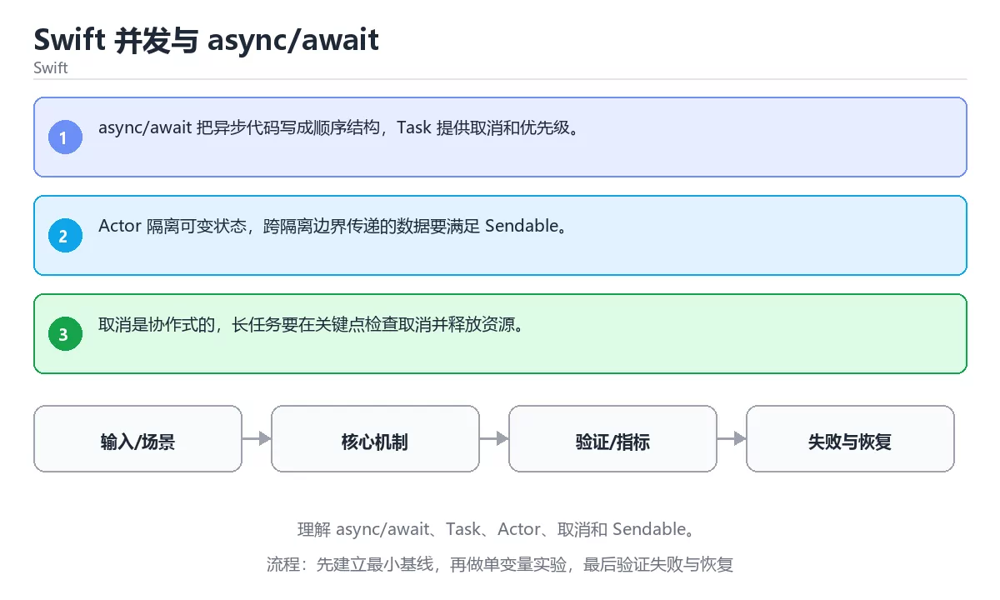

# Swift 并发与 async/await

> 内容更新时间：2026-10-06 · 学习阶段：高级 · 预计用时：25 分钟





## 本节知识框架

**课程定位**：所属分类 `swift`（Swift），课程主题 `Swift 并发与 async/await`，学习阶段 高级，建议用时 45 分钟。

本课主线：理解 async/await、Task、Actor、取消和 Sendable。

**学完本课应当能够**
- 说清 `async` 与 `Actor` 的含义与区别，并各举一个正例和一个反例。
- 用本课示例验证 `Task` 的行为，记录输入、输出与失败条件。
- 遇到「在主线程做耗时任务」这类问题时，能说出触发条件与修复顺序。

### 复习清单

- [ ] 能讲清 async 与 Actor 的分工，并指出其中一个前提失效的边界。
- [ ] 能跑通 async 的最小示例，记录一组正常输出和一组失败输出。
- [ ] 能完成一次自测，并把错题对照错误表定位原因。

## 核心概念定义

| 术语 | 操作性定义 | 常见边界与风险 |
| --- | --- | --- |
| async | 标记异步函数或异步块，使内部可以使用 await 而不阻塞调用线程。 | 标了 async 不等于工作自动离开主线程：耗时调用仍压在调用线程上，界面照样卡顿甚至无响应。 |
| Actor | 把状态封装在独立执行单元中，通过消息异步通信的并发模型。 | 隔离只在可变状态真被放进执行单元时才成立；共享状态漏了隔离标注，就会出现编译告警或运行期异常。 |
| Task | Swift 并发中的异步任务单元，可等待结果、取消或组合并发工作。 | 取消是协作式的：不在关键点检查并向下传播，页面都退出了任务还在跑，资源也没释放。 |
| Sendable | Swift 中标记类型可安全跨并发域传递的协议。 | 它管的是跨隔离边界传数据这一环：不满足就编译告警；标上它也不等于状态已被 Actor 隔离。 |

## 原理与运行机制

### 机制总览

**教材衔接：核心知识**

### 1. async/await 把异步代码写成顺序结构，Task 提供取消和优先级。

- 关键做法：先让 async 的最小示例可复现，再加入并发或规模条件。
- 验证标准：async 的结果可复现、错误可解释、失败能恢复。

### 2. Actor 隔离可变状态，跨隔离边界传递的数据要满足 Sendable。

把这条结论放回「Swift 并发与 async/await」的完整流程里展开：

- 正文依据：能用自己的话解释：async/await 把异步代码写成顺序结构，Task 提供取消和优先级。
- 落地检查：把「2. Actor 隔离可变状态，跨隔离边界传递的数据要满足 Sendable。」改写成一条可执行的核对项，逐条验证输入、超时与失败路径。

### 3. 取消是协作式的，长任务要在关键点检查取消并释放资源。

把这条结论放回「Swift 并发与 async/await」的完整流程里展开：

- 正文依据：能用自己的话解释：Actor 隔离可变状态，跨隔离边界传递的数据要满足 Sendable。
- 落地检查：把「3. 取消是协作式的，长任务要在关键点检查取消并释放资源。」改写成一条可执行的核对项，逐条验证输入、超时与失败路径。

**教材衔接：关键流程**

**教材衔接：实践路径**

**教材衔接：版本与时效**

- 迁移成本集中在并发边界，先把 Actor 的共享状态标出来。
- 升级前确认 async 的兼容范围，把不可回退的改动单独拆成一次提交。
- fetchValue 的写法在最近几个版本有变化，升级前先跑一遍测试。
- 官方发布说明：https://www.swift.org/blog/

## 典型应用场景

**课程内置实验入口**：`sandbox:swift`，用于动手验证《Swift 并发与 async/await》的机制；实验结论不替代概念定义与复杂度分析。

- **在主线程做耗时任务**：典型现象是界面卡顿甚至无响应；正确做法是把耗时工作放进并发任务，回到主线程再更新界面。
- **不检查任务取消**：典型现象是页面退出后任务仍在运行；正确做法是在关键点检查取消并向下传播。
- **共享状态缺少隔离**：典型现象是编译告警或运行期异常；正确做法是用隔离标注与安全共享方式保护状态。

### 最小验证场景

- 准备：保留 `text` 示例的原始输入，先记录 `Swift 并发与 async/await` 的基线输出和完整运行命令。
- 观察：先核对 调用了 `fetchValue()`，再改变一个与 `async` 相关的条件。
- 判定：新结果与 `Swift 并发与 async/await` 的基线不同不等于错误；只有当差异破坏了 `async` 的定义或错误表中的约束，才判定为失败。

### 选择与边界

- 使用 `async` 时，标记异步函数或异步块，使内部可以使用 await 而不阻塞调用线程；共享状态与调度顺序会改变结论，单线程或串行测试通过不等于并发下成立。
- 使用 `Actor` 时，把状态封装在独立执行单元中，通过消息异步通信的并发模型；共享状态与调度顺序会改变结论，单线程或串行测试通过不等于并发下成立。
- 使用 `Task` 时，Swift 并发中的异步任务单元，可等待结果、取消或组合并发工作；共享状态与调度顺序会改变结论，单线程或串行测试通过不等于并发下成立。
- 使用 `Sendable` 时，Swift 中标记类型可安全跨并发域传递的协议；共享状态与调度顺序会改变结论，单线程或串行测试通过不等于并发下成立。

## 代码/协议/SQL 示例

### 最小可验证示例

**教材衔接：最小可运行示例**

下面示例用于验证 async 的最小输入、处理和输出。先原样运行，再只修改一个值：

```swift
func fetchValue() async -> Int { 42 }

@main
struct App {
    static func main() async {
        print("answer=\(await fetchValue())")
    }
}
```

**教材衔接：预期输出**

```text
answer=42
```

## 时间/空间复杂度或性能分析

### 二、运行时与内存模型

**测量方法**：以 `Swift 并发与 async/await` 的 `async` 场景为对象，固定输入跑一遍记录基线，再把规模或并发度提高一个数量级复测；两次结果的差值与波动范围才是结论依据。

## 常见误区与易错点

| 容易写错的做法 | 实际现象 | 原因与正确做法 |
| --- | --- | --- |
| 在主线程做耗时任务 | 界面卡顿甚至无响应。 | 把耗时工作放进并发任务，回到主线程再更新界面。 |
| 不检查任务取消 | 页面退出后任务仍在运行。 | 在关键点检查取消并向下传播。 |
| 共享状态缺少隔离 | 编译告警或运行期异常。 | 用隔离标注与安全共享方式保护状态。 |

### 现场 1：在主线程做耗时任务

**症状**：界面卡顿甚至无响应。

**根因与修复**：把耗时工作放进并发任务，回到主线程再更新界面。

**自检**：在本课示例里复现「在主线程做耗时任务」，改成把耗时工作放进并发任务，回到主线程再更新界面后重跑；如果症状消失且失败路径按预期变化，说明定位正确。

### 现场 2：不检查任务取消

**症状**：页面退出后任务仍在运行。

**根因与修复**：在关键点检查取消并向下传播。

**自检**：在本课示例里复现「不检查任务取消」，改成在关键点检查取消并向下传播后重跑；如果症状消失且失败路径按预期变化，说明定位正确。

### 现场 3：共享状态缺少隔离

**症状**：编译告警或运行期异常。

**根因与修复**：用隔离标注与安全共享方式保护状态。

**自检**：在本课示例里复现「共享状态缺少隔离」，改成用隔离标注与安全共享方式保护状态后重跑；如果症状消失且失败路径按预期变化，说明定位正确。

## 与其他知识点的关系

**教材衔接：复习与迁移**

## 自测题与参考答案

> 先独立作答，再对照参考答案；答案都能在本课正文、术语表或错误表里找到依据。

### 自测 1（概念复述）

不看正文，写出 `async` 的操作性定义，并说明它与 `Actor` 的区别。

**参考答案**：标记异步函数或异步块，使内部可以使用 await 而不阻塞调用线程。

`Actor` 的定位是：把状态封装在独立执行单元中，通过消息异步通信的并发模型；两者的差别要从适用对象与失败模式上说明。

### 自测 2（排错）

本课错误表记录了「在主线程做耗时任务」这类做法。请写出它会出现的现象、根因，以及修复顺序。

**参考答案**：现象是界面卡顿甚至无响应；正确做法是把耗时工作放进并发任务，回到主线程再更新界面。修复时先复现现象并保留证据，再改动一处假设重跑，确认现象消失。

### 自测 3（动手验证）

运行本课的 `text` 示例，只改 async 的一个输入并比较两次输出，抄下第一条错误信息。

**参考答案**：正常输入下 `text` 示例应当复现正文给出的结果；改动输入后，如果结果改变或报错，先核对它是否满足 `Swift 并发与 async/await` 中`async` 的适用范围，再检查错误表里是否有同类现象。

### 自测 4（代码阅读）

阅读本课开头的 `text` 示例，说明它体现了`async` 的哪一条性质，并指出改动哪个输入会让这条性质不再成立。

**参考答案**：`async` 的定义是 标记异步函数或异步块，使内部可以使用 await 而不阻塞调用线程，示例正是在实现这条定义。改动与 `async` 有关的一个输入后，如果结果不再符合 `Swift 并发与 async/await` 的正文描述，就说明该性质只在当前前提成立。

### 自测 5（迁移）

把 `Swift 并发与 async/await` 的方法迁移到自己的项目：围绕 `async` 写出一个与错误表同类的风险点，并说明触发条件和检验方式。

**参考答案**：例如「共享状态缺少隔离」，它会导致编译告警或运行期异常；检验方式是按用隔离标注与安全共享方式保护状态改一处再复现，确认现象消失且没有引入新的失败分支。

### 自测 6（对比）

用一个表格对比 `async` 与 `Actor`：各写一行适用场景、一行失败表现。

**参考答案**：`async` 的定义是标记异步函数或异步块，使内部可以使用 await 而不阻塞调用线程；`Actor` 的定义是把状态封装在独立执行单元中，通过消息异步通信的并发模型。两者的失败表现分别对应本课错误表里与本术语相关的行。

### 自测 7（排错顺序）

面对「在主线程做耗时任务」引发的问题，请把“复现 界面卡顿甚至无响应 → 保留证据 → 把耗时工作放进并发任务，回到主线程再更新界面 → 回归验证”四步写成可执行的检查清单。

**参考答案**：第一步按界面卡顿甚至无响应复现；第二步记录输入、版本与完整报错；第三步按把耗时工作放进并发任务，回到主线程再更新界面只改一处；第四步重跑并确认失败路径也按预期变化。

### 自测 8（边界判断）

针对 `Sendable`，分别写出“可以使用”的条件和“结论不再成立”的条件。

**参考答案**：共享状态与调度顺序会改变结论，单线程或串行测试通过不等于并发下成立。 同时要把 `Sendable` 的定义 Swift 中标记类型可安全跨并发域传递的协议 与实际输入逐项对照。

### 自测 9（机制重建）

不看正文，按输入、转换、输出、验证四段重建 `async` → `Actor` → `Task` → `Sendable` 的作用链。

**参考答案**：起点是 `async` 的定义 标记异步函数或异步块，使内部可以使用 await 而不阻塞调用线程；中间每一步都保留可观察状态；终点由 `Sendable` 检查，失败时回到错误表定位第一个偏离定义的步骤。

### 自测 10（综合排错）

在 `Swift 并发与 async/await` 中，现象是 编译告警或运行期异常。请围绕 共享状态缺少隔离 写出最小复现、关键证据、修复动作和回归验证，并说明为什么不能只凭一次运行下结论。

**参考答案**：先复现 共享状态缺少隔离，记录输入与完整错误；再按 用隔离标注与安全共享方式保护状态 只改一处。回归时同时跑正常路径和边界路径，只有两次结果都可解释，才把修复视为完成。

### 自测 11（一分钟复述）

用每分钟约 200 字的速度复述 `Swift 并发与 async/await`：先给主问题，再按顺序说出 `async`、`Actor`、`Task`、`Sendable`，最后给一个失败案例。

**自评标准**：主问题必须对应 理解 async/await、Task、Actor、取消和 Sendable；每个术语都要能接上一句定义或边界；失败案例必须写成可观察现象，不能用“可能有风险”代替证据。

## 延伸阅读

想更直观地理解本课概念？推荐参阅以下图解专题：

- [图解并发调度：线程、协程与 Goroutine](visual_concurrency_schedule.md)

## 术语速查

| 术语 | 一句话说明 |
| --- | --- |
| `async` | 标记异步函数或异步块，使内部可以使用 await 而不阻塞调用线程。 |
| `Actor` | 把状态封装在独立执行单元中，通过消息异步通信的并发模型。 |
| `Task` | Swift 并发中的异步任务单元，可等待结果、取消或组合并发工作。 |
| `Sendable` | Swift 中标记类型可安全跨并发域传递的协议。 |

**术语关系**：`async`（标记异步函数或异步块） → `Actor`（把状态封装在独立执行单元中） → `Task`（Swift 并发中的异步任务单元） → `Sendable`（Swift 中标记类型可安全跨并发域传递的协议）。

## 考点精讲

`Swift 并发与 async/await` 的题库有 6 道题，下面逐题给出题干、正确项与判断依据：先自己作答，再核对正确项，最后回到正文对应小节复核。

### 考点 1：第 1 题

- **题目**：在 `Swift 并发与 async/await` 里，与 `async` 有关的说法中，哪一项最符合理解 async/await、Task、Actor、取消和 Sendable？
- **正确项**：async/await 把异步代码写成顺序结构，Task 提供取消和优先级。
- **判断依据**：本题正确项是「async/await 把异步代码写成顺序结构，Task 提供取消和优先级」。术语 async（Swift 并发与 async/await）：标记异步函数或异步块，使内部可以使用 await 而不阻塞调用线程，本题取「async/await 把异步代码写成顺序结构，Task 提供取消和优先级」这条。易错点是在主线程做耗时任务，会造成界面卡顿甚至无响应，改法是把耗时工作放进并发任务，回到主线程再更新界面。

### 考点 2：第 2 题

- **题目**：围绕“Swift 并发与 async/await”中的 async、Actor、Task，下列哪两项是本课强调的实践判断？
- **正确项**：验证 Actor 时要固定版本并覆盖边界输入，结论才可复现；学习 async 时要同时说明输入、输出和失败路径，不能只看正常流程
- **判断依据**：按《Swift 并发与 async/await》的正文口径，本题要同时选中「验证 Actor 时要固定版本并覆盖边界输入，结论才可复现」、「学习 async 时要同时说明输入、输出和失败路径，不能只看正常流程」，漏掉任一项都算没答全。术语 async（Swift 并发与 async/await）：标记异步函数或异步块，使内部可以使用 await 而不阻塞调用线程。易错点是不检查任务取消，会造成页面退出后任务仍在运行，改法是在关键点检查取消并向下传播。

### 考点 3：第 3 题

- **题目**：在 `Swift 并发与 async/await` 里，与 `async` 有关的说法中，哪一项最符合理解 async/await、Task、Actor、取消和 Sendable？（Swift 并发与 async/await·Swift 第 3 题）
- **正确项**：取消是协作式的，长任务要在关键点检查取消并释放资源。
- **判断依据**：按《Swift 并发与 async/await》的正文口径，本题正确项是「取消是协作式的，长任务要在关键点检查取消并释放资源。」。术语「async」在本课里的界定是标记异步函数或异步块，使内部可以使用 await 而不阻塞调用线程，题干问的就是这一条。常见错法是不检查任务取消，其后果是页面退出后任务仍在运行。正确做法是在关键点检查取消并向下传播。

### 考点 4：第 4 题

- **题目**：`Swift 并发与 async/await` 的主线是：理解 async/await、Task、Actor、取消和 Sendable。下面哪一项与这条主线一致？
- **正确项**：理解 async/await，Task，Actor
- **判断依据**：本题正确项是「理解 async/await，Task，Actor」。术语 async（Swift 并发与 async/await）：标记异步函数或异步块，使内部可以使用 await 而不阻塞调用线程，本题取「理解 async/await，Task，Actor」这条。易错点是在主线程做耗时任务，会造成界面卡顿甚至无响应，改法是把耗时工作放进并发任务，回到主线程再更新界面。

### 考点 5：第 5 题

- **题目**：填空：补齐下面这段术语说明中的空缺。课程 `理解 async/await、Task、Actor、取消和 Sendable。`，这段说明是：`____`：Swift 并发中的异步任务单元，可等待结果、取消或组合并发工作。空缺处应填哪个术语？
- **正确项**：Task
- **判断依据**：《Swift 并发与 async/await》这题的填空口径是「Task」或「task」，正文写法与其中任一项一致即可。术语「async」在本课里的界定是标记异步函数或异步块，使内部可以使用 await 而不阻塞调用线程，题干问的就是这一条。常见错法是在主线程做耗时任务，其后果是界面卡顿甚至无响应。正确做法是把耗时工作放进并发任务，回到主线程再更新界面。

### 考点 6：第 6 题

- **题目**：结合 `Swift 并发与 async/await` 中围绕 `async` 的代码，哪一项说法与“理解 async/await、Task、Actor、取消和 Sendable。”一致？
- **正确项**：async/await 把异步代码写成顺序结构，Task 提供取消和优先级。
- **判断依据**：本题正确项是「async/await 把异步代码写成顺序结构，Task 提供取消和优先级」。术语 async（Swift 并发与 async/await）：标记异步函数或异步块，使内部可以使用 await 而不阻塞调用线程，本题取「async/await 把异步代码写成顺序结构，Task 提供取消和优先级」这条。易错点是共享状态缺少隔离，会造成编译告警或运行期异常，改法是用隔离标注与安全共享方式保护状态。

### 考点 7：`async`

- **要点**：标记异步函数或异步块，使内部可以使用 await 而不阻塞调用线程。
- **async 的边界**：共享状态与调度顺序会改变结论，单线程或串行测试通过不等于并发下成立。

### 考点 8：`Actor`

- **要点**：把状态封装在独立执行单元中，通过消息异步通信的并发模型。
- **Actor 的边界**：共享状态与调度顺序会改变结论，单线程或串行测试通过不等于并发下成立。

### 考点 9：`Task`

- **要点**：Swift 并发中的异步任务单元，可等待结果、取消或组合并发工作。
- **Task 的边界**：共享状态与调度顺序会改变结论，单线程或串行测试通过不等于并发下成立。

### 考点 10：`Sendable`

- **要点**：Swift 中标记类型可安全跨并发域传递的协议。
- **Sendable 的边界**：共享状态与调度顺序会改变结论，单线程或串行测试通过不等于并发下成立。

### 考点 11：排错——在主线程做耗时任务

- **现象**：界面卡顿甚至无响应。
- **处理**：把耗时工作放进并发任务，回到主线程再更新界面。

### 考点 12：排错——不检查任务取消

- **现象**：页面退出后任务仍在运行。
- **处理**：在关键点检查取消并向下传播。

### 考点 13：综合辨析——`async` 与 `Sendable`

- **辨析点**：`async` 的定义是 标记异步函数或异步块，使内部可以使用 await 而不阻塞调用线程；`Sendable` 的定义是 Swift 中标记类型可安全跨并发域传递的协议。
- **答题要求**：面对 `Swift 并发与 async/await` 的题目，先判断描述的是 `async` 还是 `Sendable`，再归到对应定义，最后写出一个会让该定义失效的边界输入。

### 考点 14：排错评分点

- **现象分**：能写出 界面卡顿甚至无响应，而不是只写“程序有错”。
- **证据分**：保留触发 在主线程做耗时任务 的输入、版本和错误原文。
- **修复分**：按 把耗时工作放进并发任务，回到主线程再更新界面 只改一处，并同时回归正常路径与边界路径。

## 内容元数据

- 内容版本：v2.0
- 最后更新：2026-10-06
- 学习阶段：高级
- 适用环境：Swift 6 / Xcode 16+；本课聚焦 async。
- 内容来源：内置结构化课程与工程实践整理
- 相关主题：async、Actor、Task、Sendable
- 质量版本：P0 测验标准 + P1 覆盖扩展 + P2 体验补全

## 参考资料与复核

- 最后复核：2026-10-04
- 下次复核：2026-12-17
- 复核范围：版本兼容、API 行为、安全建议与工程实践
- 来源性质：官方文档、标准或权威教材；本课核对关键词：async、Actor、Task、Sendable。

| 参考资料 | 本课用途 |
| --- | --- |
| [Swift 并发](https://docs.swift.org/swift-book/documentation/the-swift-programming-language/concurrency/) | async/await 与 actor |
| [Apple 人机界面指南](https://developer.apple.com/design/human-interface-guidelines/) | iOS 设计规范与可访问性 |
| [Swift 官方文档](https://www.swift.org/documentation/) | 工具链、包管理与语言演进 |

| [本课术语索引：Swift 并发与 async/await](#核心概念定义) | 按本课输入、术语边界和错误表现逐项核对 |
> 「Swift 并发与 async/await」的链接用于离线阅读后的延伸核对；App 不会自动联网。