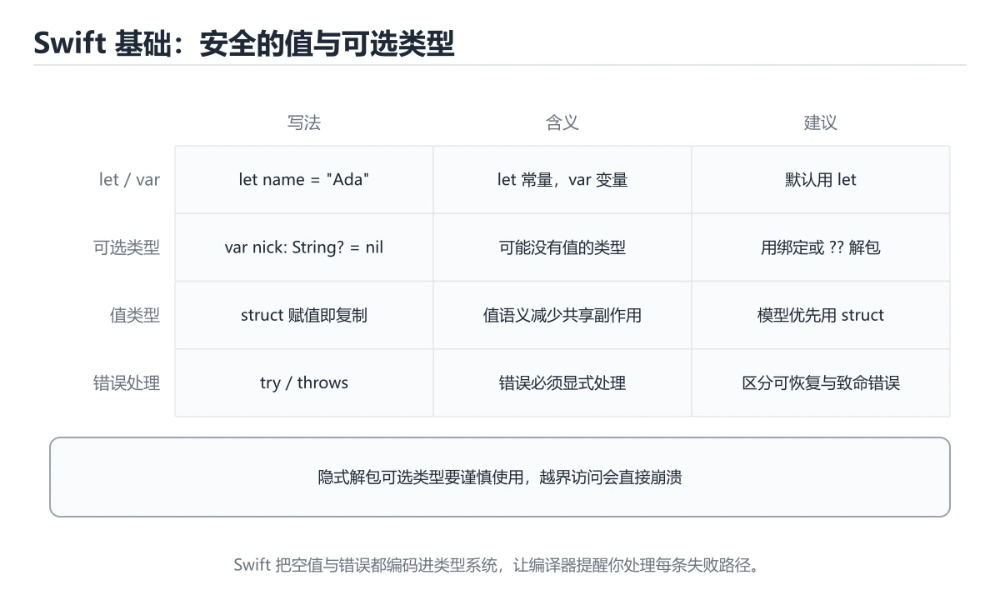
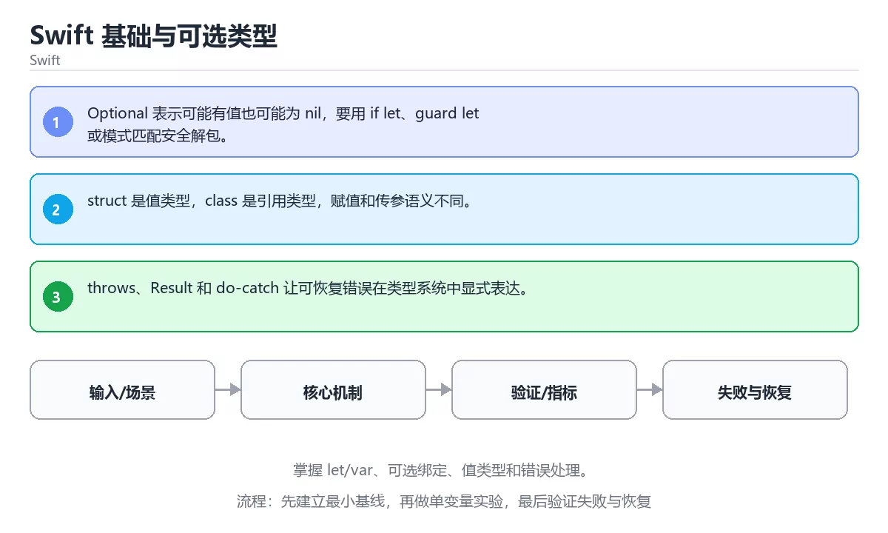

# Swift 基础与可选类型





> 内容更新时间：2026-10-06 · 学习阶段：基础 · 预计用时：40 分钟

## 本节知识框架

**课程定位**：所属分类 `swift`（Swift），课程主题 `Swift 基础与可选类型`，学习阶段 基础，建议用时 50 分钟。

本课主线：掌握 let/var、可选绑定、值类型和错误处理。

**学完本课应当能够**
- 说清 `Swift` 与 `Optional` 的含义与区别，并各举一个正例和一个反例。
- 用本课示例验证 `值类型` 的行为，记录输入、输出与失败条件。
- 遇到「强制解包可选值」这类问题时，能说出触发条件与修复顺序。

### 复习清单

- [ ] 能不看正文复述本课核心术语，并指出一个边界或反例。
- [ ] 能运行或推演本课示例，记录输入、输出与失败现象。
- [ ] 能完成一次自测，并把错题对照错误表定位原因。

## 核心概念定义

| 术语 | 操作性定义 | 常见边界与风险 |
| --- | --- | --- |
| Swift | Apple 推出的静态类型编程语言，用于 iOS、macOS 等平台开发。 | 静态检查只在编译期成立，运行期输入仍需校验。 |
| Optional | Optional 表示可能有值也可能为 nil，要用 if let、guard let 或模式匹配安全解包。 | 权限与密钥策略变化会让结论失效，按最小权限并用真实凭据流程复验。 |
| 值类型 | 「Swift、Optional、值类型、错误处理」说明变量生命周期、资源释放、并发模型和错误传播。 | 易错：修改后的行为与预期不符；正确做法是明确结构体与类的语义差异。 |
| 可选绑定 | 用 if let 或 guard let 解包可选值并绑定非空变量，替代危险的强制解包。 | 易错：运行期直接崩溃；正确做法是用可选绑定与默认值处理。 |
| 可选类型 | Optional 表示值可能为 nil，必须显式解包（if let、guard let）才能使用，从类型层面消除空指针 | 静态检查只在编译期成立，运行期输入仍需校验。 |
| 编译构建 | swiftc / xcodebuild | 只在「swiftc / xcodebuild」这一前提下成立，换输入或换环境要重新验证。 |
| 测试 | XCTest + async 测试 | 只在「XCTest + async 测试」这一前提下成立，换输入或换环境要重新验证。 |
| 性能 | Instruments / signpost | 只在「Instruments / signpost」这一前提下成立，换输入或换环境要重新验证。 |
| 发布 | TestFlight + App Store 审核 | 只在「TestFlight + App Store 审核」这一前提下成立，换输入或换环境要重新验证。 |
| let 与 var | let 绑定后不可重新赋值，var 才可以；编译器会把 let 的不变性用于优化，也替你拦住后续误改。 | 数组用 let 声明仍能 append，因为「不能重新绑定」不等于「内容不可变」。 |
| guard let | 在函数开头把可选值解包，解不开就立刻退出，后续代码里用的都是非可选的常量。 | else 分支必须强制退出作用域，写成空分支过不了编译。 |
| 写时复制 | struct 与 Array、Dictionary 的赋值语义是「值复制」，但底层只在真正修改时才分配副本。 | 语义上等价于深拷贝，性能上不等价；跨线程共享同一个可变引用时 COW 保护不了你。 |
| 错误处理 | throws 把失败写成返回值的一部分（要么成功要么抛错），调用方必须写 try 或 try? 才能继续。 | 用 try? 会把错误信息直接丢掉，只适合「失败无所谓」的场景。 |

## 原理与运行机制

### 机制总览

**教材衔接：核心知识**

### 1. Optional 表示可能有值也可能为 nil，要用 if let、guard let 或模式匹配安全解包。

- 关键做法：先用 uppercased 建立 Swift 的基线，再逐步加入边界与失败条件。
- 验证标准：uppercased 的输出能被他人复现，边界输入有对应用例。

### 2. struct 是值类型，class 是引用类型，赋值和传参语义不同。

把这条结论放回「Swift 基础与可选类型」的完整流程里展开：

- 正文依据：能用自己的话解释：Optional 表示可能有值也可能为 nil，要用 if let、guard let 或模式匹配安全解包。
- 落地检查：把「2. struct 是值类型，class 是引用类型，赋值和传参语义不同。」改写成一条可执行的核对项，逐条验证输入、超时与失败路径。

### 3. throws、Result 和 do-catch 让可恢复错误在类型系统中显式表达。

把这条结论放回「Swift 基础与可选类型」的完整流程里展开：

- 正文依据：能用自己的话解释：struct 是值类型，class 是引用类型，赋值和传参语义不同。
- 落地检查：把「3. throws、Result 和 do-catch 让可恢复错误在类型系统中显式表达。」改写成一条可执行的核对项，逐条验证输入、超时与失败路径。

**教材衔接：关键流程**

**教材衔接：实践路径**

**教材衔接：版本与时效**

- uppercased 涉及的跨 actor 调用需要逐个确认隔离规则。
- 升级前确认 Swift 的兼容范围，把不可回退的改动单独拆成一次提交。
- 把 Optional 的 UI 与测试代码分开，降低版本升级的影响面。
- 官方发布说明：https://www.swift.org/blog/

### 声明就决定了可变性

`let nickname = "ada"` 之后不能再写 `nickname = "bob"`，这不是约定而是编译期强制。选 let 还是 var 的判断依据只有一条：这个绑定在后面会不会被换成另一个值。集合类型容易让人误会——`var list = [1,2]` 和 `let list = [1,2]` 都能 `append`，因为 let 约束的是「绑定」，不是「内容」。想连内容一起锁住，靠的是把属性设计成不可变、或提供只读访问接口，而不是在 let 上做文章。

### 可选值的四条安全出路

`String?` 不是一个「可能为空的字符串」，它是另一种类型：要么装着 String，要么是 nil。编译器不允许你直接把 `String?` 当 `String` 用，必须先把这层剥掉，本课示例里的 `nickname?.uppercased() ?? "none"` 就同时用了两条路：

1. **可选链 `?.`**：左边是 nil 时整段表达式短路，结果仍是 nil，不会崩。
2. **空合运算符 `??`**：左边为 nil 时取右边默认值，于是 `print` 拿到的保证是 `String`。
3. **if let 绑定**：`if let name = nickname { 这里 name 是 String }`，分支外又回到可选世界，作用域清楚。
4. **guard let 提前退出**：适合「没有它就别往下走」的场景，解包结果在整个函数剩余部分可用。

而 `nickname!` 是把上面四条全跳过，直接向运行时赌一把：赌输了就是 `Fatal error: unexpectedly found nil while unwrapping an Optional value`，线上表现为闪退且日志里只剩一行。`String!`（隐式解包）只在「确定会在赋值之后才被使用」的极少数场景（例如接口连接前的 IBOutlet）勉强合理，从网络或文件解码出来的数据一个都不该用。

### 值类型与引用类型的分界

`struct` 是值类型：赋值、传参、从数组里取出，得到的都是一份独立副本，改动不会回声到原处。`class` 是引用类型：变量存的是同一个实例的引用，一边改另一边就能看到。判断该用哪个的标准不是「性能」，而是身份——需要「这两个东西是同一个对象」这种语义（共享状态、有生命周期、要比较指针身份）才用 class，其余优先 struct 加协议组合。

Array、Dictionary 的写法同样是值语义，但底层做了写时复制（Copy-on-Write）：赋值时只增加引用计数，真正要修改时才把缓冲区复制一份。所以「传一个数组会不会拷贝十万个元素」的答案取决于有没有人写它，而 `isKnownUniquelyReferenced` 之类的优化在跨线程共享同一份可变数据时并不会救你——那时缺的是同步，不是复制。

### 错误是值，不是异常栈

Swift 的 `throws` 把失败当成类型系统的一部分：函数签名里写了 `throws`，调用方就必须显式处理，编译器不给过。配合 `enum ... : Error` 定义具体错误种类，`do-catch` 里按类型分支处理，`try?` 降级成可选值（丢掉原因），`try!` 断言不会失败（失败即崩溃），后两者是逃生口而非常路。

这里最容易混的是「用 nil 表示失败」：`func find(id: Int) -> User?` 无法区分「这个 id 不存在」和「数据库查询炸了」，界面只能显示空白。正确的拆法是返回值只表达数据存在与否，环境层面的失败用 `throws` 抛出，两者不要共用一条通道。金额、库存这类要累加的量另有一条规则：用 `Decimal` 或以最小单位计的 `Int`，别用 `Double`，因为 0.1 在二进制浮点里根本无法精确表示，误差会随加法累积。

## 典型应用场景

**课程内置实验入口**：`sandbox:swift`，用于动手验证《Swift 基础与可选类型》的机制；实验结论不替代概念定义与复杂度分析。

- **强制解包可选值**：典型现象是运行期直接崩溃；正确做法是用可选绑定与默认值处理。
- **混淆值类型与引用类型**：典型现象是修改后的行为与预期不符；正确做法是明确结构体与类的语义差异。
- **用浮点计算金额**：典型现象是精度误差在多次运算后累积；正确做法是改用十进制或整数最小单位。

### 最小验证场景

- 准备：保留 `text` 示例的原始输入，先记录 `Swift 基础与可选类型` 的基线输出和完整运行命令。
- 观察：先核对 调用了 `print()`，再改变一个与 `Swift` 相关的条件。
- 判定：新结果与 `Swift 基础与可选类型` 的基线不同不等于错误；只有当差异破坏了 `Swift` 的定义或错误表中的约束，才判定为失败。

### 选择与边界

- 使用 `Swift` 时，先满足它的定义：Apple 推出的静态类型编程语言，用于 iOS、macOS 等平台开发；静态检查只在编译期成立，运行期输入仍需校验。
- 使用 `Optional` 时，先满足它的定义：Optional 表示可能有值也可能为 nil，要用 if let、guard let 或模式匹配安全解包；权限与密钥策略变化会让结论失效，按最小权限并用真实凭据流程复验。
- 使用 `值类型` 时，先满足它的定义：「Swift、Optional、值类型、错误处理」说明变量生命周期、资源释放、并发模型和错误传播；易错：修改后的行为与预期不符；正确做法是明确结构体与类的语义差异。
- 使用 `可选绑定` 时，先满足它的定义：用 if let 或 guard let 解包可选值并绑定非空变量，替代危险的强制解包；易错：运行期直接崩溃；正确做法是用可选绑定与默认值处理。
- 使用 `可选类型` 时，先满足它的定义：Optional 表示值可能为 nil，必须显式解包（if let、guard let）才能使用，从类型层面消除空指针；静态检查只在编译期成立，运行期输入仍需校验。

### 三个会反复遇到的写法

**表单提交前的必填校验**：十几个字段都是可选值时，逐个 `if let` 会把逻辑裹成洋葱。Swift 的写法是一串 `guard let`：任何一项取不到就 `return`，函数体后半段从头到尾都在非可选的命名值上操作，读起来是「先排除，再干活」。

**解码远端 JSON**：`JSONDecoder().decode(User.self, from: data)` 是 `throws` 调用，字段缺失、类型不符、数据为空都会走抛错路径。把模型属性写成可选值能让解码宽松一些，但代价是所有下游都要处理 nil；更常见的取舍是模型保持非可选、错误在 `catch` 里按种类翻译成用户能看懂的提示，而不是用 `try?` 换回一个 nil 然后什么都不做。

**列表里的一行更新**：`struct Row` 放进数组后，改动某一行的下标访问会触发写时复制；把 `Row` 换成 `class` 看似省了复制，实则让「同一行数据被两处同时改」成为可能。要共享就明确共享边界（谁拥有、谁只读），不要为了省一次复制换掉语义。

## 代码/协议/SQL 示例

### 最小可验证示例

**教材衔接：最小可运行示例**

下面这段代码演示 Swift 的最小路径，先原样运行，再按注释改一处：

```swift
let nickname: String? = "ada"
print(nickname?.uppercased() ?? "none")
```

**教材衔接：预期输出**

```text
ADA
```

### 第二步：把可选值变成必走的关口

上面的示例只有一层可选，实际项目里通常是一个「有就对，没有就走人」的判断。`guard let` 的写法让函数后半段只看到非可选值：

```swift
func greeting(_ raw: String?) -> String {
    guard let name = raw, !name.isEmpty else { return "访客" }
    return "你好，" + name.uppercased()
}

print(greeting("ada"))   // 你好，ADA
print(greeting(nil))     // 访客
print(greeting(""))      // 访客
```

三行调用正好覆盖三条路径：有值、压根没有值、有值但内容为空。把这三条跑齐，比写一句「看起来能编译」更有说服力。

### 完整示例：值语义与 throws 同时登场

金额一律用最小单位「分」记录，失败用 `throws` 上报，`struct` 保证每次传递都是独立副本。

```swift
enum CartError: Error {
    case invalidArgument
    case exceedsLimit(Int)
}

struct Cart {                              // 值类型：复制出去就是独立的一份
    private(set) var cents: Int = 0

    mutating func add(unitCents: Int, quantity: Int) throws {
        guard unitCents > 0, quantity > 0 else { throw CartError.invalidArgument }
        let added = unitCents * quantity
        guard cents + added <= 100_000 else { throw CartError.exceedsLimit(100_000) }
        cents += added                     // mutating：只有值类型才需要标这一步
    }
}

var cart = Cart()
let snapshot = cart                        // 此刻复制，之后互不影响
do {
    try cart.add(unitCents: 2000, quantity: 3)
    print("合计 \(cart.cents) 分，快照 \(snapshot.cents) 分")
    try cart.add(unitCents: 0, quantity: 1)
} catch CartError.invalidArgument {
    print("价格或数量非法")
} catch CartError.exceedsLimit(let limit) {
    print("超出上限 \(limit)")
} catch {
    print("未预期错误 \(error)")
}
```

```text
合计 6000 分，快照 0 分
价格或数量非法
```

注意 `snapshot` 一直是 0：如果 `Cart` 是 `class`，这里打印的就会是 6000，两处引用同一个对象。这个差别是值类型与引用类型最直观的分工，也是「修改后的行为与预期不符」这条易错点的常见来源。

### 练习

给 `add` 补一条边界数据 `unitCents: 1, quantity: 100_000`，先猜它命中哪个 catch 分支再运行验证。然后把 `guard` 换成 `if` 并删掉提前退出，看编译器在哪一行拒绝你——这条报错正是 Swift 用类型系统逼你处理失败的方式。

## 时间/空间复杂度或性能分析

**性能关注点（Swift 基础与可选类型）**：编译期优化与引用计数影响开销：记录构建时间、运行时间与内存峰值。

**本课特有开销（Swift 基础与可选类型 · Swift）**：并发度提高后要观察是否出现拐点：延迟上升而吞吐不增，说明瓶颈已转移。

**测量方法**：以 `Swift 基础与可选类型` 的 `Swift` 场景为对象，固定输入跑一遍记录基线，再把规模或并发度提高一个数量级复测；两次结果的差值与波动范围才是结论依据。

### 三项容易被忽略的开销

**引用计数的增减**：class 实例每多一处持有，就多一次 retain/release。把频繁创建的小对象从 class 换成 struct，省掉的不只是堆分配，还有这两次跨模块调用；反过来，把本该共享身份的对象写成 struct，会让「改了但别处没生效」变成要靠调试才能发现的问题。

**写时复制的那一次真复制**：`let copy = bigArray` 几乎免费，但 `copy[0] = 1` 会立刻触发整块缓冲区复制。在循环里反复「取出来改一下再放回去」，最坏情况会退化成每次 O(n)，表现为算法复杂度没变而耗时线性上涨。

**协议与泛型的派发方式**：通过具体类型直接调用可以内联；通过 `any P` 这样的存在类型调用要查方法表；跨模块的协议扩展默认实现还可能拿不到特化版本。这属于「同一份逻辑换个写法差几倍」的开销，要靠 Instruments 或至少靠前后两版的计时对比来确认，不能凭直觉。

### 编译期与运行期的责任划分

可选类型、`throws` 声明、值语义这些约束都在编译期生效，代价接近零；运行期真正要花钱的是解包后的分支预测、大 struct 的按位复制、以及抛错时的返回值传递。所以「为了性能把 String? 改成 String!」不但省不了多少，还把一次编译期检查换成了一次线上崩溃风险——这类交换在这门语言里基本永远是亏的。

## 常见误区与易错点

| 容易写错的做法 | 实际现象 | 原因与正确做法 |
| --- | --- | --- |
| 强制解包可选值 | 运行期直接崩溃。 | 用可选绑定与默认值处理。 |
| 混淆值类型与引用类型 | 修改后的行为与预期不符。 | 明确结构体与类的语义差异。 |
| 用浮点计算金额 | 精度误差在多次运算后累积。 | 改用十进制或整数最小单位。 |
| 用 try? 把抛错换成 nil | 失败原因被丢弃，界面上只剩一片空白。 | 只在「失败确实无所谓」时用 try?，其余写 do-catch 保留错误种类。 |
| 解码模型全字段都写成可选值 | 编译通过，但空值一路扩散到每个下游。 | 服务端保证的字段留非可选，真正可缺的才标可选并给默认展示。 |
| 在循环里取出数组改一格再放回去 | 每次写入都可能触发一次整块复制。 | 就地 `arr[i] = x` 连续写完，或改用 inout 与缓冲区指针批量处理。 |
| 需要共享状态却写成 struct | 改了副本，原处看不到变化。 | 有身份与生命周期就退回 class，并写清谁持有。 |

### 现场 1：强制解包可选值

**症状**：运行期直接崩溃。

**根因与修复**：用可选绑定与默认值处理。

**自检**：在本课示例里复现「强制解包可选值」，改成用可选绑定与默认值处理后重跑；如果症状消失且失败路径按预期变化，说明定位正确。

### 现场 2：混淆值类型与引用类型

**症状**：修改后的行为与预期不符。

**根因与修复**：明确结构体与类的语义差异。

**自检**：在本课示例里复现「混淆值类型与引用类型」，改成明确结构体与类的语义差异后重跑；如果症状消失且失败路径按预期变化，说明定位正确。

### 现场 3：用浮点计算金额

**症状**：精度误差在多次运算后累积。

**根因与修复**：改用十进制或整数最小单位。

**自检**：在本课示例里复现「用浮点计算金额」，改成改用十进制或整数最小单位后重跑；如果症状消失且失败路径按预期变化，说明定位正确。

### 现场 4：把 nil 同时当成「没有数据」和「出错了」

**症状**：接口超时与「这个用户没有订单」在界面上长得一模一样，都只有一句「暂无内容」，事后查不到当时到底发生了什么。

**根因与修复**：一条可选返回值同时承载了「数据缺失」和「流程失败」两件事。修法是数据确实可能不存在才用可选值，网络、解码、权限这类失败改成 `throws` 抛出具体错误种类，由调用方按种类分别提示。

**自检**：让接口分别处于「返回空数组」和「直接超时」两种状态各跑一遍，界面文案必须不同；如果两次仍显示同一句话，说明失败还是被压成了 nil。

## 与其他知识点的关系

**教材衔接：复习与迁移**

**和 Java 的对照**：Java 用 `Optional<User>` 包装类型来表达「可能没有」，取值时要 `.orElse()` 或 `.ifPresent()`；Swift 把可选性写进类型本身（`User?`），语法层面就禁止你把可选值当非可选值直接用。两者目标一致——把空指针错误从运行期挪到编译期——但 Swift 的约束更早也更硬，代价是到处都要显式解包。

**和 Kotlin 的对照**：Kotlin 的可空类型 `String?`、`?.`、`?:`、`!!` 与 Swift 的可选链、空合运算符、强制解包几乎一一同对应，唯一差别是 Kotlin 的可空性是平台类型可以「逃逸」的，从 Java 接口拿到的值可能带着不确定的可空标记；Swift 没有这个洞。

**和后续 iOS 课程的关系**：`throws` 与可选值是接口设计语言， UIKit 或 SwiftUI 章节里那些「可选的 delegate」「会抛错的 URLSession 调用」都靠本课这两样东西来读；ARC 与循环引用则在讲到 class 与闭包捕获时展开，本课只需要先建立「值类型没有引用计数共享」这个前提。

## 自测题与参考答案

> 先独立作答，再对照参考答案；答案都能在本课正文、术语表或错误表里找到依据。

### 自测 1（概念复述）

不看正文，写出 `Swift` 的操作性定义，并说明它与 `Optional` 的区别。

**参考答案**：Apple 推出的静态类型编程语言，用于 iOS、macOS 等平台开发。

`Optional` 的定位是：Optional 表示可能有值也可能为 nil，要用 if let、guard let 或模式匹配安全解包；两者的差别要从适用对象与失败模式上说明。

### 自测 2（排错）

本课错误表记录了「强制解包可选值」这类做法。请写出它会出现的现象、根因，以及修复顺序。

**参考答案**：现象是运行期直接崩溃；正确做法是用可选绑定与默认值处理。修复时先复现现象并保留证据，再改动一处假设重跑，确认现象消失。

### 自测 3（动手验证）

运行本课的 `text` 示例，改动其中一个输入后重新运行，记录输出与错误信息。

**参考答案**：正常输入下 `text` 示例应当复现正文给出的结果；改动输入后，如果结果改变或报错，先核对它是否满足 `Swift 基础与可选类型` 中`Swift` 的适用范围，再检查错误表里是否有同类现象。

### 自测 4（代码阅读）

阅读本课开头的 `text` 示例，说明它体现了`Swift` 的哪一条性质，并指出改动哪个输入会让这条性质不再成立。

**参考答案**：`Swift` 的定义是 Apple 推出的静态类型编程语言，用于 iOS、macOS 等平台开发，示例正是在实现这条定义。改动与 `Swift` 有关的一个输入后，如果结果不再符合 `Swift 基础与可选类型` 的正文描述，就说明该性质只在当前前提成立。

### 自测 5（迁移）

把 `Swift 基础与可选类型` 的方法迁移到自己的项目：围绕 `Swift` 写出一个与错误表同类的风险点，并说明触发条件和检验方式。

**参考答案**：例如「用浮点计算金额」，它会导致精度误差在多次运算后累积；检验方式是按改用十进制或整数最小单位改一处再复现，确认现象消失且没有引入新的失败分支。

### 自测 6（对比）

用一个表格对比 `Swift` 与 `Optional`：各写一行适用场景、一行失败表现。

**参考答案**：`Swift` 的定义是Apple 推出的静态类型编程语言，用于 iOS、macOS 等平台开发；`Optional` 的定义是Optional 表示可能有值也可能为 nil，要用 if let、guard let 或模式匹配安全解包。两者的失败表现分别对应本课错误表里与本术语相关的行。

### 自测 7（排错顺序）

面对「强制解包可选值」引发的问题，请把“复现 运行期直接崩溃 → 保留证据 → 用可选绑定与默认值处理 → 回归验证”四步写成可执行的检查清单。

**参考答案**：第一步按运行期直接崩溃复现；第二步记录输入、版本与完整报错；第三步按用可选绑定与默认值处理只改一处；第四步重跑并确认失败路径也按预期变化。

### 自测 8（边界判断）

针对 `可选类型`，分别写出“可以使用”的条件和“结论不再成立”的条件。

**参考答案**：静态检查只在编译期成立，运行期输入仍需校验。 同时要把 `可选类型` 的定义 Optional 表示值可能为 nil，必须显式解包（if let、guard let）才能使用，从类型层面消除空指针 与实际输入逐项对照。

### 自测 9（机制重建）

不看正文，按输入、转换、输出、验证四段重建 `Swift` → `Optional` → `值类型` → `可选绑定` 的作用链。

**参考答案**：起点是 `Swift` 的定义 Apple 推出的静态类型编程语言，用于 iOS、macOS 等平台开发；中间每一步都保留可观察状态；终点由 `可选类型` 检查，失败时回到错误表定位第一个偏离定义的步骤。

### 自测 10（综合排错）

在 `Swift 基础与可选类型` 中，现象是 精度误差在多次运算后累积。请围绕 用浮点计算金额 写出最小复现、关键证据、修复动作和回归验证，并说明为什么不能只凭一次运行下结论。

**参考答案**：先复现 用浮点计算金额，记录输入与完整错误；再按 改用十进制或整数最小单位 只改一处。回归时同时跑正常路径和边界路径，只有两次结果都可解释，才把修复视为完成。

### 自测 11（一分钟复述）

用每分钟约 200 字的速度复述 `Swift 基础与可选类型`：先给主问题，再按顺序说出 `Swift`、`Optional`、`值类型`、`可选绑定`，最后给一个失败案例。

**自评标准**：主问题必须对应 掌握 let/var、可选绑定、值类型和错误处理；每个术语都要能接上一句定义或边界；失败案例必须写成可观察现象，不能用“可能有风险”代替证据。

## 术语速查

| 术语 | 一句话说明 |
| --- | --- |
| `Swift` | Apple 推出的静态类型编程语言，用于 iOS、macOS 等平台开发。 |
| `Optional` | Optional 表示可能有值也可能为 nil，要用 if let、guard let 或模式匹配安全解包。 |
| `值类型` | 「Swift、Optional、值类型、错误处理」说明变量生命周期、资源释放、并发模型和错误传播。 |
| `可选绑定` | 用 if let 或 guard let 解包可选值并绑定非空变量，替代危险的强制解包。 |
| `可选类型` | Optional 表示值可能为 nil，必须显式解包（if let、guard let）才能使用，从类型层面消除空指针。 |
| `guard let` | 在作用域开头解包可选值，解不开就立刻退出，后续代码只见到非可选常量。 |
| `空合运算符` | `a ?? b`：左侧为 nil 时取右侧默认值，是把可选值收敛成具体类型的最短写法。 |
| `隐式解包可选值` | 形如 `String!`，取值时自动强解，一旦为 nil 立即崩溃，只用于确定先赋值后使用的场景。 |
| `写时复制` | 值类型赋值只增引用计数，真正写入时才复制底层存储。 |
| `throws` | 把失败写进函数签名，调用方必须 try 并处理，错误对象保留失败原因。 |

**术语关系**：`Swift`（Apple 推出的静态类型编程语言） → `Optional`（Optional 表示可能有值也可能为 nil） → `值类型`（「Swift、Optional、值类型、错误处理」说明变量生命周期、资源释放、并发模型和错误传播） → `可选绑定`（用 if let 或 guard let 解包可选值并绑定非空变量）。

## 考点精讲

`Swift 基础与可选类型` 的题库有 6 道题，下面逐题给出题干、正确项与判断依据：先自己作答，再核对正确项，最后回到正文对应小节复核。

### 考点 1：第 1 题

- **题目**：在 `Swift 基础与可选类型` 里，与 `Swift` 有关的说法中，哪一项最符合掌握 let/var、可选绑定、值类型和错误处理？
- **正确项**：Optional 表示可能有值也可能为 nil，要用 if let
- **判断依据**：本题正确项是「Optional 表示可能有值也可能为 nil，要用 if let」。术语 Swift（Swift 基础与可选类型）：Apple 推出的静态类型编程语言，用于 iOS、macOS 等平台开发，本题取「Optional 表示可能有值也可能为 nil，要用 if let」这条。易错点是强制解包可选值，会造成运行期直接崩溃，改法是用可选绑定与默认值处理。

### 考点 2：第 2 题

- **题目**：`Swift 基础与可选类型` 的示例代码用于验证 `Swift`，其背景是掌握 let/var、可选绑定、值类型和错误处理。代码的真实内容是下面哪一项？
- **正确项**：出现字面量 `ada`
- **判断依据**：本题正确项是「出现字面量 `ada`」。术语 Swift（Swift 基础与可选类型）：Apple 推出的静态类型编程语言，用于 iOS、macOS 等平台开发，本题取「出现字面量 `ada`」这条。易错点是混淆值类型与引用类型，会造成修改后的行为与预期不符，改法是明确结构体与类的语义差异。本题干扰项「出现字面量 `my-lib`」不成立：展示代码里找不到 `my-lib`。

### 考点 3：第 3 题

- **题目**：在 `Swift 基础与可选类型` 里，与 `Swift` 有关的说法中，哪一项最符合掌握 let/var、可选绑定、值类型和错误处理？（Swift 基础与可选类型·Swift 第 3 题）
- **正确项**：throws
- **判断依据**：本题正确项是「throws」。术语 Swift（Swift 基础与可选类型）：Apple 推出的静态类型编程语言，用于 iOS、macOS 等平台开发，本题取「throws」这条。易错点是用浮点计算金额，会造成精度误差在多次运算后累积，改法是改用十进制或整数最小单位。

### 考点 4：第 4 题

- **题目**：`Swift 基础与可选类型` 的主线是：掌握 let/var、可选绑定、值类型和错误处理。下面哪一项与这条主线一致？
- **正确项**：掌握 let/var、可选绑定、值类型和错误处理。
- **判断依据**：本题正确项是「掌握 let/var、可选绑定、值类型和错误处理」。术语 Swift（Swift 基础与可选类型）：Apple 推出的静态类型编程语言，用于 iOS、macOS 等平台开发，本题取「掌握 let/var、可选绑定、值类型和错误处理」这条。易错点是强制解包可选值，会造成运行期直接崩溃，改法是用可选绑定与默认值处理。

### 考点 5：第 5 题

- **题目**：课程 `掌握 let/var、可选绑定、值类型和错误处理。`。在 `Swift 基础与可选类型` 里，`Swift`、`Optional` 与下面哪些选项属于同一层概念？（多选）
- **正确项**：Swift；Optional
- **判断依据**：按《Swift 基础与可选类型》的正文口径，本题要同时选中「Swift」、「Optional」，漏掉任一项都算没答全。术语 Swift（Swift 基础与可选类型）：Apple 推出的静态类型编程语言，用于 iOS、macOS 等平台开发。易错点是混淆值类型与引用类型，会造成修改后的行为与预期不符，改法是明确结构体与类的语义差异。

### 考点 6：第 6 题

- **题目**：下面几项都与 `Swift` 有关，请按 `Swift 基础与可选类型` 的正文顺序排列；该课主线是掌握 let/var、可选绑定、值类型和错误处理。
- **正确项**：核心知识 → 关键流程 → 实践路径 → 常见误区
- **判断依据**：按《Swift 基础与可选类型》正文的先后，本题顺序是「核心知识」 → 「关键流程」 → 「实践路径」 → 「常见误区」。术语「Swift」在本课里的界定是Apple 推出的静态类型编程语言，用于 iOS、macOS 等平台开发，题干问的就是这一条。常见错法是强制解包可选值，其后果是运行期直接崩溃。正确做法是用可选绑定与默认值处理。

### 考点 7：`Swift`

- **要点**：Apple 推出的静态类型编程语言，用于 iOS、macOS 等平台开发。
- **Swift 的边界**：静态检查只在编译期成立，运行期输入仍需校验。

### 考点 8：`Optional`

- **要点**：Optional 表示可能有值也可能为 nil，要用 if let、guard let 或模式匹配安全解包。
- **Optional 的边界**：权限与密钥策略变化会让结论失效，按最小权限并用真实凭据流程复验。

### 考点 9：`值类型`

- **要点**：「Swift、Optional、值类型、错误处理」说明变量生命周期、资源释放、并发模型和错误传播。
- **值类型 的边界**：易错：修改后的行为与预期不符；正确做法是明确结构体与类的语义差异。

### 考点 10：`可选绑定`

- **要点**：用 if let 或 guard let 解包可选值并绑定非空变量，替代危险的强制解包。
- **可选绑定 的边界**：易错：运行期直接崩溃；正确做法是用可选绑定与默认值处理。

### 考点 11：`可选类型`

- **要点**：Optional 表示值可能为 nil，必须显式解包（if let、guard let）才能使用，从类型层面消除空指针
- **可选类型 的边界**：静态检查只在编译期成立，运行期输入仍需校验。

### 考点 12：排错——强制解包可选值

- **现象**：运行期直接崩溃。
- **处理**：用可选绑定与默认值处理。

### 考点 13：排错——混淆值类型与引用类型

- **现象**：修改后的行为与预期不符。
- **处理**：明确结构体与类的语义差异。

### 考点 14：综合辨析——`Swift` 与 `可选类型`

- **辨析点**：`Swift` 的定义是 Apple 推出的静态类型编程语言，用于 iOS、macOS 等平台开发；`可选类型` 的定义是 Optional 表示值可能为 nil，必须显式解包（if let、guard let）才能使用，从类型层面消除空指针。
- **答题要求**：面对 `Swift 基础与可选类型` 的题目，先判断描述的是 `Swift` 还是 `可选类型`，再归到对应定义，最后写出一个会让该定义失效的边界输入。

### 考点 15：排错评分点

- **现象分**：能写出 运行期直接崩溃，而不是只写“程序有错”。
- **证据分**：保留触发 强制解包可选值 的输入、版本和错误原文。
- **修复分**：按 用可选绑定与默认值处理 只改一处，并同时回归正常路径与边界路径。

## 内容元数据

- 内容版本：v2.0
- 最后更新：2026-10-06
- 学习阶段：基础
- 适用环境：Swift 6 / Xcode 16+；本课聚焦 Swift。
- 内容来源：内置结构化课程与工程实践整理
- 相关主题：Swift、Optional、值类型、错误处理
- 质量版本：P0 测验标准 + P1 覆盖扩展 + P2 体验补全

## 参考资料与复核

- 最后复核：2026-10-04
- 下次复核：2026-12-17
- 复核范围：版本兼容、API 行为、安全建议与工程实践
- 来源性质：官方文档、标准或权威教材；本课核对关键词：Swift、Optional、值类型、错误处理。

| 参考资料 | 本课用途 |
| --- | --- |
| [Swift 语言指南](https://docs.swift.org/swift-book/documentation/the-swift-programming-language/) | 语法、类型与内存模型 |
| [Apple 人机界面指南](https://developer.apple.com/design/human-interface-guidelines/) | iOS 设计规范与可访问性 |
| [Apple 内存管理](https://developer.apple.com/documentation/swift/automatic-reference-counting) | ARC 与循环引用 |

| [本课术语索引：Swift 基础与可选类型](#核心概念定义) | 按本课输入、术语边界和错误表现逐项核对 |
> 「Swift 基础与可选类型」的链接用于离线阅读后的延伸核对；App 不会自动联网。