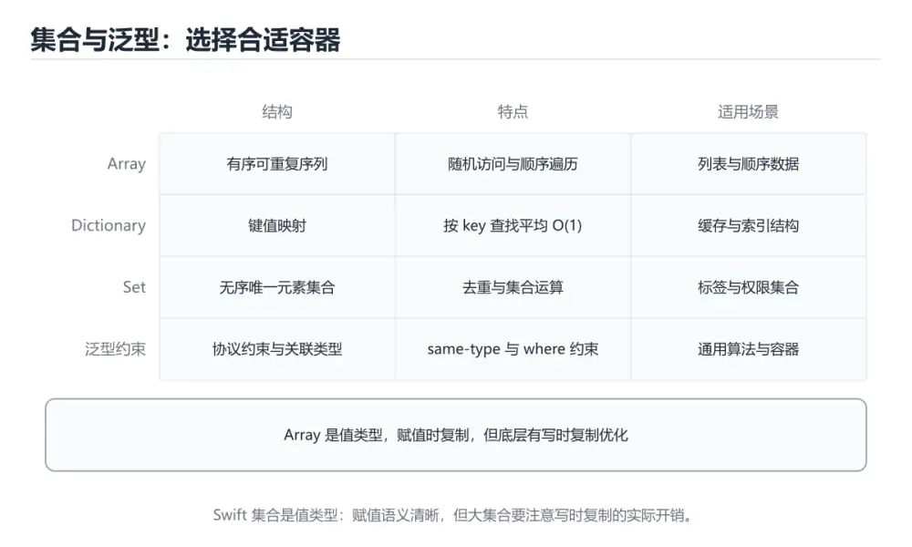
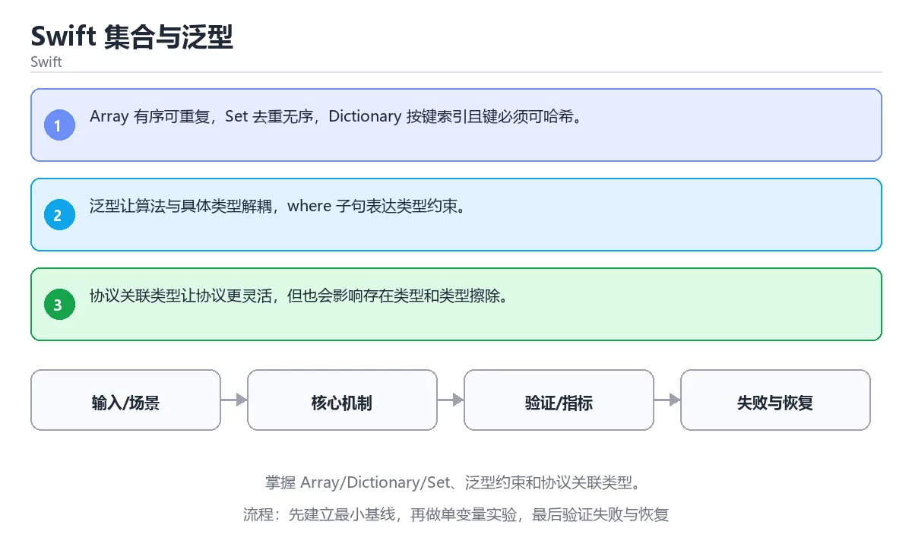

# Swift 集合与泛型





> 内容更新时间：2026-10-06 · 学习阶段：进阶 · 预计用时：30 分钟

## 本节知识框架

**课程定位**：所属分类 `swift`（Swift），课程主题 `Swift 集合与泛型`，学习阶段 进阶，建议用时 45 分钟。

本课主线：掌握 Array/Dictionary/Set、泛型约束和协议关联类型。

**学完本课应当能够**
- 说清 `集合` 与 `泛型` 的含义与区别，并各举一个正例和一个反例。
- 用本课示例验证 `约束` 的行为，记录输入、输出与失败条件。
- 遇到「遍历时修改集合」这类问题时，能说出触发条件与修复顺序。

### 复习清单

- [ ] 能不看正文复述本课核心术语，并指出一个边界或反例。
- [ ] 能运行或推演本课示例，记录输入、输出与失败现象。
- [ ] 能完成一次自测，并把错题对照错误表定位原因。

## 核心概念定义

| 术语 | 操作性定义 | 常见边界与风险 |
| --- | --- | --- |
| 集合 | 不保证顺序、通常不允许重复元素的数据结构。 | 易错：行为不可预测或直接崩溃；正确做法是先收集改动，遍历结束后统一处理。 |
| 泛型 | 把类型作为参数复用同一套逻辑，同时让编译器保留类型检查。 | 静态检查只在编译期成立，运行期输入仍需校验。 |
| 约束 | 检查点 1：按Swift 集合与泛型中 集合、泛型、约束 的实践顺序，把四个步骤排成从准备到复盘的合理顺序。 | 静态检查只在编译期成立，运行期输入仍需校验。 |
| 关联类型 | 二、运行时与内存模型：围绕「集合、泛型、约束、关联类型」说明变量生命周期、资源释放、并发模型和错误传播。 | 共享状态与调度顺序会改变结论，单线程或串行测试通过不等于并发下成立。 |

## 原理与运行机制

### 机制总览

**教材衔接：核心知识**

### 1. Array 有序可重复，Set 去重无序，Dictionary 按键索引且键必须可哈希。

- 关键做法：基线只保留 泛型 必需的部分，其余条件一次加一个。
- 验证标准：集合 的结果可复现、错误可解释、失败能恢复。

### 2. 泛型让算法与具体类型解耦，where 子句表达类型约束。

把这条结论放回「Swift 集合与泛型」的完整流程里展开：

- 正文依据：能用自己的话解释：泛型让算法与具体类型解耦，where 子句表达类型约束。
- 落地检查：把「2. 泛型让算法与具体类型解耦，where 子句表达类型约束。」改写成一条可执行的核对项，逐条验证输入、超时与失败路径。

### 3. 协议关联类型让协议更灵活，但也会影响存在类型和类型擦除。

把这条结论放回「Swift 集合与泛型」的完整流程里展开：

- 正文依据：能用自己的话解释：协议关联类型让协议更灵活，但也会影响存在类型和类型擦除。
- 落地检查：把「3. 协议关联类型让协议更灵活，但也会影响存在类型和类型擦除。」改写成一条可执行的核对项，逐条验证输入、超时与失败路径。

**教材衔接：关键流程**

**教材衔接：实践路径**

**教材衔接：语言专项实践：Swift 集合与泛型**

### 一、工具链

| 阶段 | 推荐工具 | 验收标准 |
| --- | --- | --- |
| 编译构建 | swiftc / xcodebuild | 命令可复现且错误能被定位 |
| 测试 | XCTest + async 测试 | 命令可复现且错误能被定位 |
| 性能 | Instruments / signpost | 命令可复现且错误能被定位 |
| 发布 | TestFlight + App Store 审核 | 命令可复现且错误能被定位 |

### 二、运行时与内存模型

围绕「集合、泛型、约束、关联类型」说明变量生命周期、资源释放、并发模型和错误传播。语言语法只是入口，真正决定行为的是运行时、标准库和平台约束。

### 四、发布检查

**教材衔接：版本与时效**

- 迁移成本集中在并发边界，先把 泛型 的共享状态标出来。
- 升级前先用 scores 建立基线：记录版本、命令和输出，升级后只比较这些可观察量。
- scores 的写法在最近几个版本有变化，升级前先跑一遍测试。
- 官方发布说明：https://www.swift.org/blog/

### 先建立一个直觉

本课的摘要可以当作一张地图：掌握 Array/Dictionary/Set、泛型约束和协议关联类型。

### 逐步拆解

1. 澄清输入与目标。先写清「Swift 集合与泛型」要解决的问题、合法输入范围和成功标准，再进入后续步骤。
2. 描述处理过程。把「集合、泛型、约束、关联类型」映射到具体步骤，每步都要求能单独验证。
3. 定义输出。明确 集合 与 泛型 各自的产物，以及失败时留下什么证据。
4. 让「Swift 集合与泛型」的失败路径尽早暴露：把集合推到边界值，记录错误信息、重试或降级动作，以及人工兜底条件。
5. 选一个只有两三步的集合例子，先写出预期输出，再运行确认；不一致时先怀疑前提而不是代码。

### 把正文串成一条执行链

- **三、测试策略**：- 单元测试覆盖核心规则和边界

### 从测验反推易错点

**检查点 1：按Swift 集合与泛型中 集合、泛型、约束 的实践顺序，把四个步骤排成从准备到复盘的合理顺序。**

- 参考判断：先明确 集合 的输入、输出与约束
- 解析：在本课的练习里，顺序应当是：先明确 集合 的输入、输出与约束 → 写出最小示例并核对 泛型 的基线结果 → 只改一个变量，记录边界与失败路径的变化 → 固定版本与证据，把本课的结论写成可复现记录。这个顺序把 集合 的输入、输出和约束放在最前面，在Swift 集合与泛型里避免概念没对齐就开始调参。第二步用 泛型 建立可核对的基线，在Swift 集合与泛型里第三步才允许改变一个变量并观察失败路径。最后一步把本课的版本、证据与结论固定下来，别人才能复现同样的结果。
- 自问：如果去掉题干里的一个限定词，结论还成立吗？

- 参考判断：泛型让算法与具体类型解耦，where 子句表达类型约束。

- 参考判断：协议关联类型让协议更灵活，但也会影响存在类型和类型擦除。

**检查点 4：本课的核心学习目标是什么？**

- 参考判断：掌握 Array/Dictionary/Set

**检查点 5：以下哪些术语与Swift 集合与泛型直接相关？（多选）**

- 参考判断：集合、泛型

### 变式训练

1. 把 集合 放进一个只有单机、没有额外依赖的小项目，先保证正确再扩展。
2. 扩大 泛型 的规模，记录本课结论在哪一个量级开始不成立。
3. 制造一次 集合 相关的依赖超时或错误输入，要求错误可解释且不留半完成状态。
5. 减少一个输入字段后重跑 scores，记录失败信息出现在哪一层，据此判断这个字段是必填还是可推导。
6. 把 集合 的方案切换到低资源设备，重新评估默认参数、超时和降级策略。

### 迁移案例库

围绕 scores 重复同一套方法，每完成一轮就把差异写进笔记。

#### 迁移案例 1：围绕「集合」做一次小实验

**验收**：至少给出一个反例，说明集合在什么情况下会失效；只写成功案例不算通过。

#### 迁移案例 2：围绕「泛型」做一次小实验

**步骤**：
1. 复述当前方案对「泛型」的假设，写成一句可证伪的话。

#### 迁移案例 3：围绕「约束」做一次小实验

**步骤**：
1. 复述当前方案对「约束」的假设，写成一句可证伪的话。

#### 迁移案例 4：围绕「关联类型」做一次小实验

**步骤**：
1. 复述当前方案对「关联类型」的假设，写成一句可证伪的话。

#### 迁移案例 5：围绕「集合」做一次小实验

**步骤**：

#### 迁移案例 6：围绕「泛型」做一次小实验

**步骤**：

#### 迁移案例 7：围绕「约束」做一次小实验

**步骤**：

#### 迁移案例 8：围绕「关联类型」做一次小实验

**步骤**：

#### 迁移案例 9：围绕「集合」做一次小实验

**步骤**：

#### 迁移案例 10：围绕「泛型」做一次小实验

**步骤**：

#### 迁移案例 11：围绕「约束」做一次小实验

**步骤**：

#### 迁移案例 12：围绕「关联类型」做一次小实验

**步骤**：

#### 迁移案例 13：围绕「集合」做一次小实验

**步骤**：

#### 迁移案例 14：围绕「泛型」做一次小实验

**步骤**：

#### 迁移案例 15：围绕「约束」做一次小实验

**步骤**：

#### 迁移案例 16：围绕「关联类型」做一次小实验

**步骤**：

<!-- p0-depth-v2:end -->

**教材衔接：验证步骤**

## 典型应用场景

**课程内置实验入口**：`sandbox:swift`，用于动手验证《Swift 集合与泛型》的机制；实验结论不替代概念定义与复杂度分析。

**教材衔接：深度拓展与实战**

这一节把「Swift 集合与泛型」正文里的定义、代码和失败模式串成一条可操作的复习路线。

### 边界条件与常见反例

「Swift 集合与泛型」的边界不只包括最大最小值，还要覆盖空、重复和失败：

### 工程检查表

- [ ] 能否用自己的话说明Swift 集合与泛型解决什么问题，以及它不负责什么？
- [ ] 能否说明 集合 的正常输出，以及失败时留下的错误信息？
- [ ] 能否解释本课关键词在真实项目中的边界与取舍？
- [ ] 能否说明 泛型 在新场景下需要补充什么前提？

### 最小验证场景

- 准备：保留 `text` 示例的原始输入，先记录 `Swift 集合与泛型` 的基线输出和完整运行命令。
- 观察：先核对 调用了 `sorted()`，再改变一个与 `集合` 相关的条件。
- 判定：新结果与 `Swift 集合与泛型` 的基线不同不等于错误；只有当差异破坏了 `集合` 的定义或错误表中的约束，才判定为失败。

### 选择与边界

- 使用 `集合` 时，先满足它的定义：不保证顺序、通常不允许重复元素的数据结构；易错：行为不可预测或直接崩溃；正确做法是先收集改动，遍历结束后统一处理。
- 使用 `泛型` 时，先满足它的定义：把类型作为参数复用同一套逻辑，同时让编译器保留类型检查；静态检查只在编译期成立，运行期输入仍需校验。
- 使用 `约束` 时，先满足它的定义：检查点 1：按Swift 集合与泛型中 集合、泛型、约束 的实践顺序，把四个步骤排成从准备到复盘的合理顺序；静态检查只在编译期成立，运行期输入仍需校验。
- 使用 `关联类型` 时，先满足它的定义：二、运行时与内存模型：围绕「集合、泛型、约束、关联类型」说明变量生命周期、资源释放、并发模型和错误传播；共享状态与调度顺序会改变结论，单线程或串行测试通过不等于并发下成立。

## 代码/协议/SQL 示例

### 最小可验证示例

**教材衔接：最小可运行示例**

下面的示例覆盖「Swift 集合与泛型」中 集合 的核心路径。先原样运行，再按注释改一处：

```swift
let scores = ["a": 90, "b": 72]
let passed = scores.filter { $0.value >= 80 }.keys.sorted()
print(passed)
```

**教材衔接：预期输出**

```text
["a"]
```

## 时间/空间复杂度或性能分析

**性能关注点（Swift 集合与泛型）**：编译期优化与引用计数影响开销：记录构建时间、运行时间与内存峰值。

**本课特有开销（Swift 集合与泛型 · 集合）**：索引能减少扫描行数，但会增加写入与存储开销，需要同时记录读、写两侧代价。

**测量方法**：以 `Swift 集合与泛型` 的 `集合` 场景为对象，固定输入跑一遍记录基线，再把规模或并发度提高一个数量级复测；两次结果的差值与波动范围才是结论依据。

## 常见误区与易错点

| 容易写错的做法 | 实际现象 | 原因与正确做法 |
| --- | --- | --- |
| 遍历时修改集合 | 行为不可预测或直接崩溃。 | 先收集改动，遍历结束后统一处理。 |
| 高阶函数链过长 | 中间结果多且可读性差。 | 适度组合，必要时改回显式循环。 |
| 忽视复制语义 | 改了副本却以为原集合变了。 | 明确复制时机，需要共享时改用引用类型。 |

### 现场 1：遍历时修改集合

**症状**：行为不可预测或直接崩溃。

**根因与修复**：先收集改动，遍历结束后统一处理。

**自检**：在本课示例里复现「遍历时修改集合」，改成先收集改动，遍历结束后统一处理后重跑；如果症状消失且失败路径按预期变化，说明定位正确。

### 现场 2：高阶函数链过长

**症状**：中间结果多且可读性差。

**根因与修复**：适度组合，必要时改回显式循环。

**自检**：在本课示例里复现「高阶函数链过长」，改成适度组合，必要时改回显式循环后重跑；如果症状消失且失败路径按预期变化，说明定位正确。

### 现场 3：忽视复制语义

**症状**：改了副本却以为原集合变了。

**根因与修复**：明确复制时机，需要共享时改用引用类型。

**自检**：在本课示例里复现「忽视复制语义」，改成明确复制时机，需要共享时改用引用类型后重跑；如果症状消失且失败路径按预期变化，说明定位正确。

## 与其他知识点的关系

**教材衔接：复习与迁移**

## 自测题与参考答案

> 先独立作答，再对照参考答案；答案都能在本课正文、术语表或错误表里找到依据。

### 自测 1（概念复述）

不看正文，写出 `集合` 的操作性定义，并说明它与 `泛型` 的区别。

**参考答案**：不保证顺序、通常不允许重复元素的数据结构。

`泛型` 的定位是：把类型作为参数复用同一套逻辑，同时让编译器保留类型检查；两者的差别要从适用对象与失败模式上说明。

### 自测 2（排错）

本课错误表记录了「遍历时修改集合」这类做法。请写出它会出现的现象、根因，以及修复顺序。

**参考答案**：现象是行为不可预测或直接崩溃；正确做法是先收集改动，遍历结束后统一处理。修复时先复现现象并保留证据，再改动一处假设重跑，确认现象消失。

### 自测 3（动手验证）

运行本课的 `text` 示例，改动其中一个输入后重新运行，记录输出与错误信息。

**参考答案**：正常输入下 `text` 示例应当复现正文给出的结果；改动输入后，如果结果改变或报错，先核对它是否满足 `Swift 集合与泛型` 中`集合` 的适用范围，再检查错误表里是否有同类现象。

### 自测 4（代码阅读）

阅读本课开头的 `text` 示例，说明它体现了`集合` 的哪一条性质，并指出改动哪个输入会让这条性质不再成立。

**参考答案**：`集合` 的定义是 不保证顺序、通常不允许重复元素的数据结构，示例正是在实现这条定义。改动与 `集合` 有关的一个输入后，如果结果不再符合 `Swift 集合与泛型` 的正文描述，就说明该性质只在当前前提成立。

### 自测 5（迁移）

把 `Swift 集合与泛型` 的方法迁移到自己的项目：围绕 `集合` 写出一个与错误表同类的风险点，并说明触发条件和检验方式。

**参考答案**：例如「忽视复制语义」，它会导致改了副本却以为原集合变了；检验方式是按明确复制时机，需要共享时改用引用类型改一处再复现，确认现象消失且没有引入新的失败分支。

### 自测 6（对比）

用一个表格对比 `集合` 与 `泛型`：各写一行适用场景、一行失败表现。

**参考答案**：`集合` 的定义是不保证顺序、通常不允许重复元素的数据结构；`泛型` 的定义是把类型作为参数复用同一套逻辑，同时让编译器保留类型检查。两者的失败表现分别对应本课错误表里与本术语相关的行。

### 自测 7（排错顺序）

面对「遍历时修改集合」引发的问题，请把“复现 行为不可预测或直接崩溃 → 保留证据 → 先收集改动，遍历结束后统一处理 → 回归验证”四步写成可执行的检查清单。

**参考答案**：第一步按行为不可预测或直接崩溃复现；第二步记录输入、版本与完整报错；第三步按先收集改动，遍历结束后统一处理只改一处；第四步重跑并确认失败路径也按预期变化。

### 自测 8（边界判断）

针对 `关联类型`，分别写出“可以使用”的条件和“结论不再成立”的条件。

**参考答案**：共享状态与调度顺序会改变结论，单线程或串行测试通过不等于并发下成立。 同时要把 `关联类型` 的定义 二、运行时与内存模型：围绕「集合、泛型、约束、关联类型」说明变量生命周期、资源释放、并发模型和错误传播 与实际输入逐项对照。

### 自测 9（机制重建）

不看正文，按输入、转换、输出、验证四段重建 `集合` → `泛型` → `约束` → `关联类型` 的作用链。

**参考答案**：起点是 `集合` 的定义 不保证顺序、通常不允许重复元素的数据结构；中间每一步都保留可观察状态；终点由 `关联类型` 检查，失败时回到错误表定位第一个偏离定义的步骤。

### 自测 10（综合排错）

在 `Swift 集合与泛型` 中，现象是 改了副本却以为原集合变了。请围绕 忽视复制语义 写出最小复现、关键证据、修复动作和回归验证，并说明为什么不能只凭一次运行下结论。

**参考答案**：先复现 忽视复制语义，记录输入与完整错误；再按 明确复制时机，需要共享时改用引用类型 只改一处。回归时同时跑正常路径和边界路径，只有两次结果都可解释，才把修复视为完成。

### 自测 11（一分钟复述）

用每分钟约 200 字的速度复述 `Swift 集合与泛型`：先给主问题，再按顺序说出 `集合`、`泛型`、`约束`、`关联类型`，最后给一个失败案例。

**自评标准**：主问题必须对应 掌握 Array/Dictionary/Set、泛型约束和协议关联类型；每个术语都要能接上一句定义或边界；失败案例必须写成可观察现象，不能用“可能有风险”代替证据。

## 术语速查

| 术语 | 一句话说明 |
| --- | --- |
| `集合` | 不保证顺序、通常不允许重复元素的数据结构。 |
| `泛型` | 把类型作为参数复用同一套逻辑，同时让编译器保留类型检查。 |
| `约束` | 检查点 1：按Swift 集合与泛型中 集合、泛型、约束 的实践顺序，把四个步骤排成从准备到复盘的合理顺序。 |
| `关联类型` | 二、运行时与内存模型：围绕「集合、泛型、约束、关联类型」说明变量生命周期、资源释放、并发模型和错误传播。 |

**术语关系**：`集合`（不保证顺序、通常不允许重复元素的数据结构） → `泛型`（把类型作为参数复用同一套逻辑） → `约束`（检查点 1：按Swift 集合与泛型中 集合、泛型、约束 的实践顺序） → `关联类型`（二、运行时与内存模型：围绕「集合、泛型、约束、关联类型」说明变量生命周期、资源释放、并发模型和错误传播）。

## 考点精讲

`Swift 集合与泛型` 的题库有 6 道题，下面逐题给出题干、正确项与判断依据：先自己作答，再核对正确项，最后回到正文对应小节复核。

### 考点 1：第 1 题

- **题目**：按“Swift 集合与泛型”中 集合、泛型、约束 的实践顺序，把四个步骤排成从准备到复盘的合理顺序。
- **正确项**：先明确 集合 的输入、输出与约束 → 写出最小示例并核对 泛型 的基线结果 → 只改一个变量，记录边界与失败路径的变化 → 固定版本与证据，把“Swift 集合与泛型”的结论写成可复现记录
- **判断依据**：本题正确项是先明确 集合 的输入、输出与约束。术语 集合（Swift 集合与泛型）：不保证顺序、通常不允许重复元素的数据结构，本题取先明确 集合 的输入、输出与约束这条。易错点是遍历时修改集合会造成行为不可预测或直接崩溃，改法是先收集改动，遍历结束后统一处理，干扰项写出最小示例并核对 泛型 的基线结果正踩在这条上。

### 考点 2：第 2 题

- **题目**：在 `Swift 集合与泛型` 里，与 `集合` 有关的说法中，哪一项最符合掌握 Array/Dictionary/Set、泛型约束和协议关联类型。？
- **正确项**：泛型让算法与具体类型解耦，where 子句表达类型约束。
- **判断依据**：本题正确项是泛型让算法与具体类型解耦，where 子句表达类型约束。术语 集合（Swift 集合与泛型）：不保证顺序、通常不允许重复元素的数据结构，本题取泛型让算法与具体类型解耦，where 子句表达类型约束这条。易错点是遍历时修改集合会造成行为不可预测或直接崩溃，改法是先收集改动，遍历结束后统一处理，干扰项ARC 自动管理引用计数，但强引用环需要 weak 或 unowned 打破正踩在这条上。

### 考点 3：第 3 题

- **题目**：在 `Swift 集合与泛型` 里，与 `集合` 有关的说法中，哪一项最符合掌握 Array/Dictionary/Set、泛型约束和协议关联类型。？（Swift 集合与泛型·Swift 第 3 题）
- **正确项**：协议关联类型让协议更灵活，但也会影响存在类型和类型擦除。
- **判断依据**：本题正确项是协议关联类型让协议更灵活，但也会影响存在类型和类型擦除。术语 集合（Swift 集合与泛型）：不保证顺序、通常不允许重复元素的数据结构，本题取协议关联类型让协议更灵活，但也会影响存在类型和类型擦除这条。易错点是遍历时修改集合会造成行为不可预测或直接崩溃，改法是先收集改动，遍历结束后统一处理，干扰项协议定义能力，协议扩展提供默认实现，但默认实现不会自动获得动态派发正踩在这条上。

### 考点 4：第 4 题

- **题目**：`Swift 集合与泛型` 的主线是：掌握 Array/Dictionary/Set、泛型约束和协议关联类型。下面哪一项与这条主线一致？
- **正确项**：掌握 Array/Dictionary/Set
- **判断依据**：本题正确项是掌握 Array/Dictionary/Set。术语 集合（Swift 集合与泛型）：不保证顺序、通常不允许重复元素的数据结构，本题取掌握 Array/Dictionary/Set这条。易错点是遍历时修改集合会造成行为不可预测或直接崩溃，改法是先收集改动，遍历结束后统一处理，干扰项掌握 let/var、可选绑定、值类型和错误处理正踩在这条上。

### 考点 5：第 5 题

- **题目**：课程 `掌握 Array/Dictionary/Set、泛型约束和协议关联类型。`。在 `Swift 集合与泛型` 里，`集合`、`泛型` 与下面哪些选项属于同一层概念？（多选）
- **正确项**：集合；泛型
- **判断依据**：术语 集合（Swift 集合与泛型）：不保证顺序、通常不允许重复元素的数据结构，本题取集合这条。易错点是遍历时修改集合会造成行为不可预测或直接崩溃，改法是先收集改动，遍历结束后统一处理，判断时先确认输入和适用范围，对照 `集合`、`泛型`、`约束`、`关联类型` 复现一次，最后把错误表现与正确做法逐项对照，干扰项POST正踩在这条上。

### 考点 6：第 6 题

- **题目**：结合 `Swift 集合与泛型` 中围绕 `集合` 的代码，哪一项说法与“掌握 Array/Dictionary/Set、泛型约束和协议关联类型。”一致？
- **正确项**：Array 有序可重复，Set 去重无序，Dictionary 按键索引且键必须可哈希。
- **判断依据**：本题正确项是Array 有序可重复，Set 去重无序，Dictionary 按键索引且键必须可哈希。术语 集合（Swift 集合与泛型）：不保证顺序、通常不允许重复元素的数据结构，本题取Array 有序可重复，Set 去重无序，Dictionary 按键索引且键必须可哈希这条。易错点是遍历时修改集合会造成行为不可预测或直接崩溃，改法是先收集改动，遍历结束后统一处理，干扰项优先使用 struct 和协议组合表达可组合的值语义，需要共享身份时再用 class正踩在这条上。

### 考点 7：`集合`

- **要点**：不保证顺序、通常不允许重复元素的数据结构。
- **集合 的边界**：易错：行为不可预测或直接崩溃；正确做法是先收集改动，遍历结束后统一处理。

### 考点 8：`泛型`

- **要点**：把类型作为参数复用同一套逻辑，同时让编译器保留类型检查。
- **泛型 的边界**：静态检查只在编译期成立，运行期输入仍需校验。

### 考点 9：`约束`

- **要点**：检查点 1：按Swift 集合与泛型中 集合、泛型、约束 的实践顺序，把四个步骤排成从准备到复盘的合理顺序。
- **约束 的边界**：静态检查只在编译期成立，运行期输入仍需校验。

### 考点 10：`关联类型`

- **要点**：二、运行时与内存模型：围绕「集合、泛型、约束、关联类型」说明变量生命周期、资源释放、并发模型和错误传播。
- **关联类型 的边界**：共享状态与调度顺序会改变结论，单线程或串行测试通过不等于并发下成立。

### 考点 11：排错——遍历时修改集合

- **现象**：行为不可预测或直接崩溃。
- **处理**：先收集改动，遍历结束后统一处理。

### 考点 12：排错——高阶函数链过长

- **现象**：中间结果多且可读性差。
- **处理**：适度组合，必要时改回显式循环。

### 考点 13：综合辨析——`集合` 与 `关联类型`

- **辨析点**：`集合` 的定义是 不保证顺序、通常不允许重复元素的数据结构；`关联类型` 的定义是 二、运行时与内存模型：围绕「集合、泛型、约束、关联类型」说明变量生命周期、资源释放、并发模型和错误传播。
- **答题要求**：面对 `Swift 集合与泛型` 的题目，先判断描述的是 `集合` 还是 `关联类型`，再归到对应定义，最后写出一个会让该定义失效的边界输入。

### 考点 14：排错评分点

- **现象分**：能写出 行为不可预测或直接崩溃，而不是只写“程序有错”。
- **证据分**：保留触发 遍历时修改集合 的输入、版本和错误原文。
- **修复分**：按 先收集改动，遍历结束后统一处理 只改一处，并同时回归正常路径与边界路径。

## 内容元数据

- 内容版本：v2.0
- 最后更新：2026-10-06
- 学习阶段：进阶
- 适用环境：Swift 6 / Xcode 16+；本课聚焦 集合。
- 内容来源：内置结构化课程与工程实践整理
- 相关主题：集合、泛型、约束、关联类型
- 质量版本：P0 测验标准 + P1 覆盖扩展 + P2 体验补全

## 参考资料与复核

- [本课资料锚点 swift_collections](https://zh.wikipedia.org/w/index.php?search=swift_collections)

- 最后复核：2026-10-04
- 下次复核：2026-12-17
- 复核范围：版本兼容、API 行为、安全建议与工程实践
- 来源性质：官方文档、标准或权威教材；本课核对关键词：集合、泛型、约束、关联类型。

| 参考资料 | 本课用途 |
| --- | --- |
| [Swift 语言指南](https://docs.swift.org/swift-book/documentation/the-swift-programming-language/) | 语法、类型与内存模型 |
| [Apple 人机界面指南](https://developer.apple.com/design/human-interface-guidelines/) | iOS 设计规范与可访问性 |
| [Swift 并发](https://docs.swift.org/swift-book/documentation/the-swift-programming-language/concurrency/) | async/await 与 actor |

| [本课术语索引：Swift 集合与泛型](#核心概念定义) | 按本课输入、术语边界和错误表现逐项核对 |
> 「Swift 集合与泛型」的链接用于离线阅读后的延伸核对；App 不会自动联网。