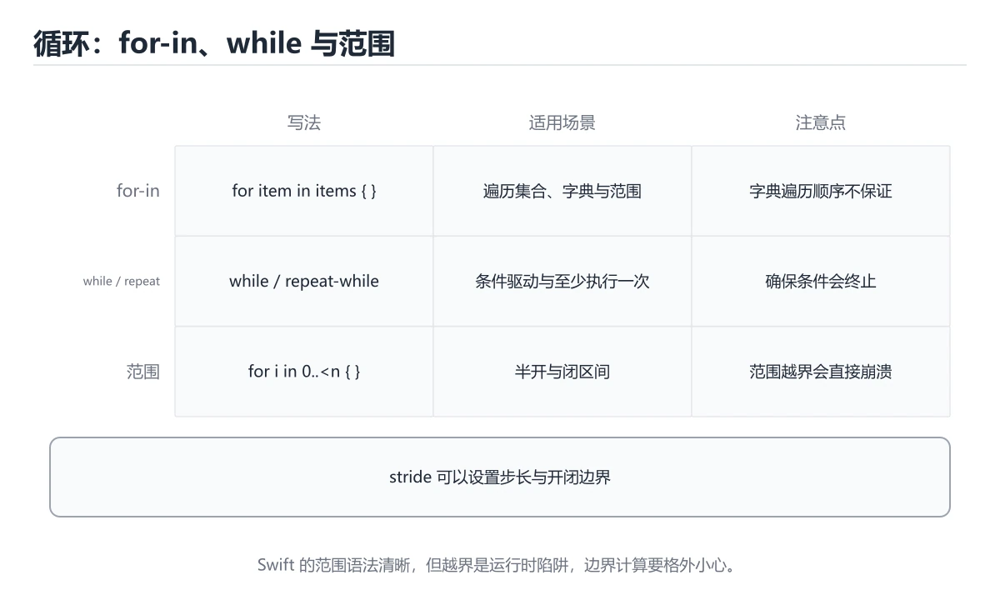
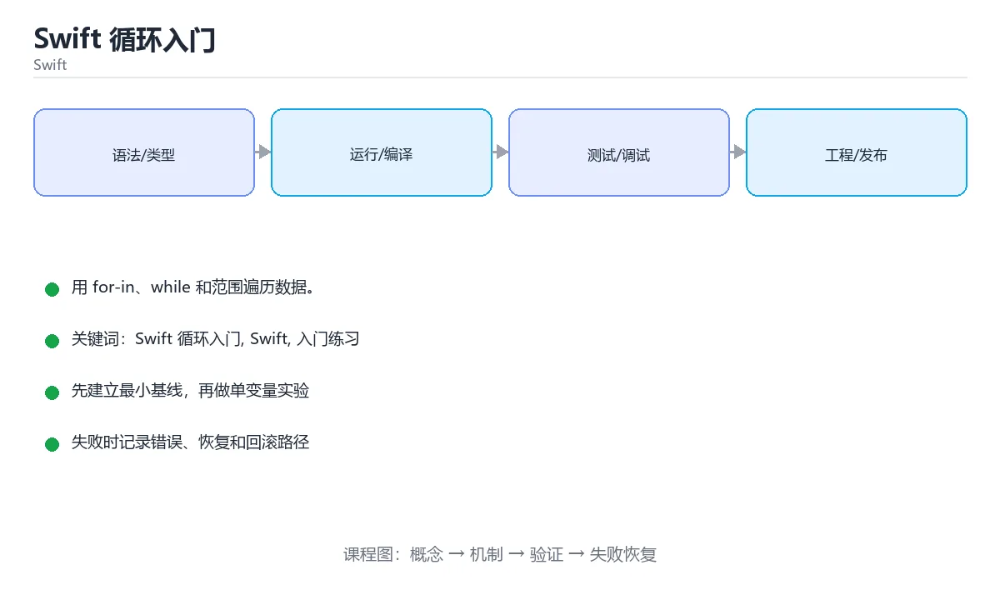

# Swift 循环入门

> 内容更新时间：2026-10-06 · 学习阶段：入门 · 预计用时：30 分钟





## 本节知识框架

**课程定位**：所属分类 `swift`（Swift），课程主题 `Swift 循环入门`，学习阶段 入门，建议用时 55 分钟。

本课主线：用 for-in、while 和范围遍历数据。

**学完本课应当能够**
- 说清 `for-in` 与 `while 循环` 的含义与区别，并各举一个正例和一个反例。
- 用本课示例验证 `repeat-while` 的行为，记录输入、输出与失败条件。
- 遇到「循环里修改集合」这类问题时，能说出触发条件与修复顺序。

### 复习清单

- [ ] 能不看正文复述本课核心术语，并指出一个边界或反例。
- [ ] 能运行或推演本课示例，记录输入、输出与失败现象。
- [ ] 能完成一次自测，并把错题对照错误表定位原因。

## 核心概念定义

| 术语 | 操作性定义 | 常见边界与风险 |
| --- | --- | --- |
| for-in | 遍历区间、数组或字典，是最常用的循环写法。 | 只在「遍历区间、数组或字典，是最常用的循环写法」这一前提下成立，换输入或换环境要重新验证。 |
| while 循环 | 条件为真时执行，适合次数不确定的场景。 | 只在「条件为真时执行，适合次数不确定的场景」这一前提下成立，换输入或换环境要重新验证。 |
| repeat-while | 先执行一次再判断条件，循环体至少执行一次。 | 只在「先执行一次再判断条件，循环体至少执行一次」这一前提下成立，换输入或换环境要重新验证。 |
| break 与 continue | break 结束整个循环，continue 跳过本轮剩余语句。 | 只在「break 结束整个循环，continue 跳过本轮剩余语句」这一前提下成立，换输入或换环境要重新验证。 |
| 区间运算符 | a...b 是闭区间，a..<b 是左闭右开区间。 | 只在「a...b 是闭区间，a..<b 是左闭右开区间」这一前提下成立，换输入或换环境要重新验证。 |
| 闭包 | 闭包捕获外部变量，默认是引用捕获；需要修改捕获值或在并发环境中使用时，要明确捕获列表和所有权 | 共享状态与调度顺序会改变结论，单线程或串行测试通过不等于并发下成立。 |

## 原理与运行机制

### 机制总览

**教材衔接：一句话入门**

用 for-in、while 和范围遍历数据。

**教材衔接：Swift 基础机制速览**

### 编译、常量与变量

Swift 使用 LLVM 编译成原生代码，Xcode 和 Swift Package Manager 是主要工具链。`let` 声明常量，`var` 声明变量；优先使用 let，让编译器帮助你发现意外修改。类型推断根据初始值确定类型，公共 API 和复杂表达式仍应显式标注。字符串、数组、字典和集合都有值语义，赋值或传参时发生写时复制，修改副本通常不会影响原值。

### 可选值、解包与空安全

`Optional` 表示可能有值也可能为 nil，必须显式处理。`if let`、`guard let`、`??` 和可选链 `?.` 是常用解包方式；强制解包 `!` 只应在逻辑上绝不可能为空且有测试保证时使用。`guard` 适合提前退出，让正常路径保持在函数主体层级。区分“值为 nil”和“值为空字符串/空数组”，不要把两者混为一谈。

### 函数、闭包与参数标签

Swift 函数支持参数标签、默认参数、可变参数、输入输出参数和抛出错误。参数标签让调用点更接近自然语言，`_` 可以省略标签。闭包捕获外部变量，默认是引用捕获；需要修改捕获值或在并发环境中使用时，要明确捕获列表和所有权。尾随闭包语法让回调、排序和异步代码更易读，但嵌套过深时应提取成命名函数。

### 结构体、类、协议与扩展

结构体是值类型，类是引用类型；优先使用结构体表达数据，除非需要继承、身份或共享可变状态。协议定义能力契约，扩展可以为已有类型添加方法，泛型让算法适用于多种类型。协议组合、关联类型和 existential 各有取舍。属性观察器、计算属性和懒加载属性让状态管理更清晰，但要避免在初始化完成前访问依赖属性。

### 内存、并发与错误处理

Swift 使用 ARC 自动管理引用计数，强引用循环会让对象无法释放；闭包捕获 self 时使用 `[weak self]` 或 `[unowned self]` 要理解生命周期。错误用 `throws` 和 `try` 传播，`defer` 负责清理。结构化并发使用 async/await、Task 和 actor 隔离共享状态；并发代码仍要处理取消、优先级和数据竞争。测试时分别覆盖值语义、可选值边界和异步失败路径。

**教材衔接：版本与时效**

- 迁移成本集中在并发边界，先把 Swift 的共享状态标出来。
- 升级前确认 Swift 循环入门 的兼容范围，把不可回退的改动单独拆成一次提交。
- total 的写法在最近几个版本有变化，升级前先跑一遍测试。
- 官方发布说明：https://www.swift.org/blog/

### 一、工具链

| 阶段 | 推荐工具 | 验收标准 |
| --- | --- | --- |
| 编译构建 | swiftc / xcodebuild | 命令可复现且错误能被定位 |
| 测试 | XCTest + async 测试 | 命令可复现且错误能被定位 |
| 性能 | Instruments / signpost | 命令可复现且错误能被定位 |
| 发布 | TestFlight + App Store 审核 | 命令可复现且错误能被定位 |

### 二、运行时与内存模型

「Swift 循环入门」的「二、运行时与内存模型」一节补全如下：

- 定位：这一节说明二、运行时与内存模型在「Swift 循环入门」知识体系里的位置。
- 检查点：固定版本与输入重跑《Swift 循环入门》，记录两次差异并定位不稳定条件。
- 自检：能否用一个最小例子解释二、运行时与内存模型？

## 典型应用场景

**课程内置实验入口**：`sandbox:swift`，用于动手验证《Swift 循环入门》的机制；实验结论不替代概念定义与复杂度分析。

**教材衔接：代码实验：把示例跑成证据**

### 实验一：建立基线

```swift
var total = 0
for i in 1...5 {
    total += i
}
print("total=\(total)")
```

### 实验二：只改一个输入

沿用「Swift 循环入门」的最小示例做一次单变量实验：

做完后用一句话写出「Swift 循环入门」的结论：输入怎么变，结果才怎么变。

### 实验三：制造一个可控错误

把 Swift 循环入门 相关的那一行改成边界值（空、极值或类型不符），记录第一条错误信息、发生位置和恢复方式。

### 实验四：用三句话复述

1. Swift 循环入门 的输入是什么，哪些取值合法，哪些属于边界或非法范围？
2. 在 代码实验：把示例跑成证据 里，Swift 的状态是在什么条件下被改变的？
3. 输出如何验证，失败时第一条可观察证据是什么？

- **循环里修改集合**：典型现象是遍历结果不确定；正确做法是先收集待改元素，循环结束后统一处理。
- **区间边界写错**：典型现象是多遍历或少遍历一次；正确做法是明确区间开闭。
- **用下标遍历越界**：典型现象是运行期直接崩溃；正确做法是直接遍历元素，需要下标时使用安全的遍历方式。

### 最小验证场景

- 准备：保留 `swift` 示例的原始输入，先记录 `Swift 循环入门` 的基线输出和完整运行命令。
- 观察：先核对 调用了 `print()`，再改变一个与 `for-in` 相关的条件。
- 判定：新结果与 `Swift 循环入门` 的基线不同不等于错误；只有当差异破坏了 `for-in` 的定义或错误表中的约束，才判定为失败。

### 选择与边界

- 使用 `for-in` 时，先满足它的定义：遍历区间、数组或字典，是最常用的循环写法；只在「遍历区间、数组或字典，是最常用的循环写法」这一前提下成立，换输入或换环境要重新验证。
- 使用 `while 循环` 时，先满足它的定义：条件为真时执行，适合次数不确定的场景；只在「条件为真时执行，适合次数不确定的场景」这一前提下成立，换输入或换环境要重新验证。
- 使用 `repeat-while` 时，先满足它的定义：先执行一次再判断条件，循环体至少执行一次；只在「先执行一次再判断条件，循环体至少执行一次」这一前提下成立，换输入或换环境要重新验证。
- 使用 `break 与 continue` 时，先满足它的定义：break 结束整个循环，continue 跳过本轮剩余语句；只在「break 结束整个循环，continue 跳过本轮剩余语句」这一前提下成立，换输入或换环境要重新验证。
- 使用 `区间运算符` 时，先满足它的定义：a...b 是闭区间，a..<b 是左闭右开区间；只在「a...b 是闭区间，a..<b 是左闭右开区间」这一前提下成立，换输入或换环境要重新验证。

## 代码/协议/SQL 示例

### 最小可验证示例

**教材衔接：最小示例**

**教材衔接：预期输出**

```text
total=15
```

**教材衔接：零基础通俗讲：Swift 循环**

### 一句话说清它是什么

for-in 用来遍历区间或集合，while 按条件重复；`1...5` 是闭区间包含两端，`1..<5` 不包含终点。

### 用生活比喻理解

闭区间像排队买票时说的「1 到 5 号」，含头含尾；半开区间像切蛋糕时说的「从这刀到那刀之前」，终点不在其中。

### 完整可运行代码

```swift
var total = 0

for i in 1...5 {
    total += i
    print("加入 \(i) 后累计 \(total)")
}

while total < 20 {
    total += 5
}

print("最终结果：\(total)")
```

### 逐行拆开看

- `var total = 0` 声明可变累加器。
- `for i in 1...5` 用闭区间依次取 1 到 5。
- `total += i` 每轮把当前值累加进去。
- 循环体里的字符串插值嵌入 i 和 total。
- `while total < 20` 每轮开始前重新判断条件。
- 循环外的 print 只执行一次。

### 把程序跑一遍

- for 结束后 total 是 15。
- while 第一轮把 15 加到 20。
- 再次判断条件不成立，退出循环。
- 输出「最终结果：20」；如果写成 `1..<5`，结果会少 5。

### 新手最容易踩的坑

- 混淆闭区间和半开区间：写错符号会造成差一错误。
- 在 for-in 里修改被遍历的集合：会触发运行时错误。
- 用 stride 时参数写反：从大到小要用负数步长。
- 忘记 var：循环里修改累加器会编译失败。
- 在循环条件里调用耗时计算：条件每轮求值，可能拖慢程序。

### 动手练一练

- 把区间改成 `1..<5`，观察结果差异。
- 用 stride 每隔 2 取一个数并累加。
- 用 repeat-while 重写循环，比较与 while 的执行次数差异。

### 本课速查卡

把下面八行抄进自己的笔记，复习时只看这一页就能回忆整课：

| 复习项 | 本课要点 |
| --- | --- |
| 核心结论 | for-in 用来遍历区间或集合，while 按条件重复；`1...5` 是闭区间包含两端，`1..<5` 不包含终点。 |
| 最少要写的代码 | `var total = 0` |
| 正确做法 | for 结束后 total 是 15。 |
| 最常见的错误 | 混淆闭区间和半开区间：写错符号会造成差一错误。 |
| 出错先查什么 | 先读第一条报错信息，再回到最小示例只改一个地方 |
| 怎么确认学会了 | 把区间改成 `1..<5`，观察结果差异。 |
| 和别的知识点的关系 | 本课打下的语法与思维方式会被后面每一课反复用到 |
| 接下来做什么 | 合上教程，凭记忆把上面的最小代码重写一遍再运行 |

**运行方式**：运行 `Swift 循环入门` 的示例时，用 `swift 文件名.swift` 运行脚本，或在 Xcode 工程里运行。

## 时间/空间复杂度或性能分析

**性能关注点（Swift 循环入门）**：编译期优化与引用计数影响开销：记录构建时间、运行时间与内存峰值。

**本课特有开销（Swift 循环入门 · Swift 循环入门）**：并发度提高后要观察是否出现拐点：延迟上升而吞吐不增，说明瓶颈已转移。

**测量方法**：以 `Swift 循环入门` 的 `Swift 循环入门` 场景为对象，固定输入跑一遍记录基线，再把规模或并发度提高一个数量级复测；两次结果的差值与波动范围才是结论依据。

## 常见误区与易错点

| 容易写错的做法 | 实际现象 | 原因与正确做法 |
| --- | --- | --- |
| 循环里修改集合 | 遍历结果不确定。 | 先收集待改元素，循环结束后统一处理。 |
| 区间边界写错 | 多遍历或少遍历一次。 | 明确区间开闭。 |
| 用下标遍历越界 | 运行期直接崩溃。 | 直接遍历元素，需要下标时使用安全的遍历方式。 |

### 现场 1：循环里修改集合

**症状**：遍历结果不确定。

**根因与修复**：先收集待改元素，循环结束后统一处理。

**自检**：在本课示例里复现「循环里修改集合」，改成先收集待改元素，循环结束后统一处理后重跑；如果症状消失且失败路径按预期变化，说明定位正确。

### 现场 2：区间边界写错

**症状**：多遍历或少遍历一次。

**根因与修复**：明确区间开闭。

**自检**：在本课示例里复现「区间边界写错」，改成明确区间开闭后重跑；如果症状消失且失败路径按预期变化，说明定位正确。

### 现场 3：用下标遍历越界

**症状**：运行期直接崩溃。

**根因与修复**：直接遍历元素，需要下标时使用安全的遍历方式。

**自检**：在本课示例里复现「用下标遍历越界」，改成直接遍历元素，需要下标时使用安全的遍历方式后重跑；如果症状消失且失败路径按预期变化，说明定位正确。

## 与其他知识点的关系

**教材衔接：复习与迁移**

## 自测题与参考答案

> 先独立作答，再对照参考答案；答案都能在本课正文、术语表或错误表里找到依据。

### 自测 1（概念复述）

不看正文，写出 `for-in` 的操作性定义，并说明它与 `while 循环` 的区别。

**参考答案**：遍历区间、数组或字典，是最常用的循环写法。

`while 循环` 的定位是：条件为真时执行，适合次数不确定的场景；两者的差别要从适用对象与失败模式上说明。

### 自测 2（排错）

本课错误表记录了「循环里修改集合」这类做法。请写出它会出现的现象、根因，以及修复顺序。

**参考答案**：现象是遍历结果不确定；正确做法是先收集待改元素，循环结束后统一处理。修复时先复现现象并保留证据，再改动一处假设重跑，确认现象消失。

### 自测 3（动手验证）

运行本课的 `swift` 示例，把其中的 `"total=\(total)"` 换成一个边界值后重新运行，记录输出与错误信息。

**参考答案**：正常输入下 `swift` 示例应当复现正文给出的结果；把 `"total=\(total)"` 换成边界值后，如果结果改变或报错，先核对它是否满足 `Swift 循环入门` 中`for-in` 的适用范围，再检查错误表里是否有同类现象。

### 自测 4（代码阅读）

阅读本课开头的 `swift` 示例，说明它体现了`for-in` 的哪一条性质，并指出改动哪个输入会让这条性质不再成立。

**参考答案**：`for-in` 的定义是 遍历区间、数组或字典，是最常用的循环写法，示例正是在实现这条定义。改动与 `for-in` 有关的一个输入后，如果结果不再符合 `Swift 循环入门` 的正文描述，就说明该性质只在当前前提成立。

### 自测 5（迁移）

把 `Swift 循环入门` 的方法迁移到自己的项目：围绕 `for-in` 写出一个与错误表同类的风险点，并说明触发条件和检验方式。

**参考答案**：例如「用下标遍历越界」，它会导致运行期直接崩溃；检验方式是按直接遍历元素，需要下标时使用安全的遍历方式改一处再复现，确认现象消失且没有引入新的失败分支。

### 自测 6（对比）

用一个表格对比 `for-in` 与 `while 循环`：各写一行适用场景、一行失败表现。

**参考答案**：`for-in` 的定义是遍历区间、数组或字典，是最常用的循环写法；`while 循环` 的定义是条件为真时执行，适合次数不确定的场景。两者的失败表现分别对应本课错误表里与本术语相关的行。

### 自测 7（排错顺序）

面对「循环里修改集合」引发的问题，请把“复现 遍历结果不确定 → 保留证据 → 先收集待改元素，循环结束后统一处理 → 回归验证”四步写成可执行的检查清单。

**参考答案**：第一步按遍历结果不确定复现；第二步记录输入、版本与完整报错；第三步按先收集待改元素，循环结束后统一处理只改一处；第四步重跑并确认失败路径也按预期变化。

### 自测 8（边界判断）

针对 `闭包`，分别写出“可以使用”的条件和“结论不再成立”的条件。

**参考答案**：共享状态与调度顺序会改变结论，单线程或串行测试通过不等于并发下成立。 同时要把 `闭包` 的定义 闭包捕获外部变量，默认是引用捕获；需要修改捕获值或在并发环境中使用时，要明确捕获列表和所有权 与实际输入逐项对照。

### 自测 9（机制重建）

不看正文，按输入、转换、输出、验证四段重建 `for-in` → `while 循环` → `repeat-while` → `break 与 continue` 的作用链。

**参考答案**：起点是 `for-in` 的定义 遍历区间、数组或字典，是最常用的循环写法；中间每一步都保留可观察状态；终点由 `闭包` 检查，失败时回到错误表定位第一个偏离定义的步骤。

### 自测 10（综合排错）

在 `Swift 循环入门` 中，现象是 运行期直接崩溃。请围绕 用下标遍历越界 写出最小复现、关键证据、修复动作和回归验证，并说明为什么不能只凭一次运行下结论。

**参考答案**：先复现 用下标遍历越界，记录输入与完整错误；再按 直接遍历元素，需要下标时使用安全的遍历方式 只改一处。回归时同时跑正常路径和边界路径，只有两次结果都可解释，才把修复视为完成。

### 自测 11（一分钟复述）

用每分钟约 200 字的速度复述 `Swift 循环入门`：先给主问题，再按顺序说出 `for-in`、`while 循环`、`repeat-while`、`break 与 continue`，最后给一个失败案例。

**自评标准**：主问题必须对应 用 for-in、while 和范围遍历数据；每个术语都要能接上一句定义或边界；失败案例必须写成可观察现象，不能用“可能有风险”代替证据。

## 术语速查

| 术语 | 一句话说明 |
| --- | --- |
| `for-in` | 遍历区间、数组或字典，是最常用的循环写法。 |
| `while 循环` | 条件为真时执行，适合次数不确定的场景。 |
| `repeat-while` | 先执行一次再判断条件，循环体至少执行一次。 |
| `break 与 continue` | break 结束整个循环，continue 跳过本轮剩余语句。 |
| `区间运算符` | a...b 是闭区间，a..<b 是左闭右开区间。 |
| `闭包` | 闭包捕获外部变量，默认是引用捕获；需要修改捕获值或在并发环境中使用时，要明确捕获列表和所有权。 |

**术语关系**：`for-in`（遍历区间、数组或字典） → `while 循环`（条件为真时执行） → `repeat-while`（先执行一次再判断条件） → `break 与 continue`（break 结束整个循环）。

## 考点精讲

`Swift 循环入门` 的题库有 5 道题，下面逐题给出题干、正确项与判断依据：先自己作答，再核对正确项，最后回到正文对应小节复核。

### 考点 1：第 1 题

- **题目**：围绕“Swift 循环入门”中的 Swift 循环入门、Swift、入门练习，下列哪两项是本课强调的实践判断？
- **正确项**：验证 Swift 时要固定版本并覆盖边界输入，结论才可复现；学习 Swift 循环入门 时要同时说明输入、输出和失败路径，不能只看正常流程
- **判断依据**：本题正确项是验证 Swift 时要固定版本并覆盖边界输入，结论才可复现。术语 for-in（Swift 循环入门）：遍历区间、数组或字典，是最常用的循环写法，本题取验证 Swift 时要固定版本并覆盖边界输入，结论才可复现这条。易错点是循环里修改集合会造成遍历结果不确定，改法是先收集待改元素，循环结束后统一处理，干扰项只要 Swift 循环入门 的常规示例通过，就可以跳过边界与异常路径正踩在这条上。

### 考点 2：第 2 题

- **题目**：阅读 `Swift 循环入门` 的 `for-in` 示例。它服务于用 for-in、while 和范围遍历数据。代码中实际包含下列哪一项？
- **正确项**：出现字面量 `total=\(total)`
- **判断依据**：本题正确项是出现字面量 `total=\(total)`。术语 for-in（Swift 循环入门）：遍历区间、数组或字典，是最常用的循环写法，本题取出现字面量 `total=\(total)`这条。易错点是循环里修改集合会造成遍历结果不确定，改法是先收集待改元素，循环结束后统一处理，干扰项出现字面量 `onFailed`正踩在这条上。

### 考点 3：第 3 题

- **题目**：需要以步长 2 遍历 0 到 10，正确的写法是？
- **正确项**：for i in stride(from: 0, through: 10, by: 2)
- **判断依据**：本题正确项是for i in stride(from: 0, through: 10, by: 2)。术语 for-in（Swift 循环入门）：遍历区间、数组或字典，是最常用的循环写法，本题取for i in stride(from: 0, through: 10, by: 2)这条。易错点是循环里修改集合会造成遍历结果不确定，改法是先收集待改元素，循环结束后统一处理，干扰项for i in 0..2...10正踩在这条上。

### 考点 4：第 4 题

- **题目**：Swift 中 repeat-while 与 while 的区别是？
- **正确项**：repeat-while 先执行一次循环体，再判断条件
- **判断依据**：本题正确项是repeat-while 先执行一次循环体，再判断条件。术语 repeat-while（Swift 循环入门）：先执行一次再判断条件，循环体至少执行一次，本题取repeat-while 先执行一次循环体，再判断条件这条。易错点是循环里修改集合会造成遍历结果不确定，改法是先收集待改元素，循环结束后统一处理，干扰项while 至少执行一次，repeat-while 可能不执行正踩在这条上。

### 考点 5：第 5 题

- **题目**：填空：补齐下面这段术语说明中的空缺。课程 `用 for-in、while 和范围遍历数据。`，这段说明是：`____`：a...b 是闭区间，a..<b 是左闭右开区间。空缺处应填哪个术语？
- **正确项**：区间运算符
- **判断依据**：《Swift 循环入门》这题的填空口径是「区间运算符」，正文写法与其中任一项一致即可。术语「for-in」在本课里的界定是遍历区间、数组或字典，是最常用的循环写法，题干「填空：补齐下面这段术语说明中的空缺，课程 `用 for-in、whi」问的就是这一条。常见错法是循环里修改集合，其后果是遍历结果不确定。正确做法是先收集待改元素，循环结束后统一处理。

### 考点 6：`for-in`

- **要点**：遍历区间、数组或字典，是最常用的循环写法。
- **for-in 的边界**：只在「遍历区间、数组或字典，是最常用的循环写法」这一前提下成立，换输入或换环境要重新验证。

### 考点 7：`while 循环`

- **要点**：条件为真时执行，适合次数不确定的场景。
- **while 循环 的边界**：只在「条件为真时执行，适合次数不确定的场景」这一前提下成立，换输入或换环境要重新验证。

### 考点 8：`repeat-while`

- **要点**：先执行一次再判断条件，循环体至少执行一次。
- **repeat-while 的边界**：只在「先执行一次再判断条件，循环体至少执行一次」这一前提下成立，换输入或换环境要重新验证。

### 考点 9：`break 与 continue`

- **要点**：break 结束整个循环，continue 跳过本轮剩余语句。
- **break 与 continue 的边界**：只在「break 结束整个循环，continue 跳过本轮剩余语句」这一前提下成立，换输入或换环境要重新验证。

### 考点 10：`区间运算符`

- **要点**：a...b 是闭区间，a..<b 是左闭右开区间。
- **区间运算符 的边界**：只在「a...b 是闭区间，a..<b 是左闭右开区间」这一前提下成立，换输入或换环境要重新验证。

### 考点 11：`闭包`

- **要点**：闭包捕获外部变量，默认是引用捕获；需要修改捕获值或在并发环境中使用时，要明确捕获列表和所有权
- **闭包 的边界**：共享状态与调度顺序会改变结论，单线程或串行测试通过不等于并发下成立。

### 考点 12：排错——循环里修改集合

- **现象**：遍历结果不确定。
- **处理**：先收集待改元素，循环结束后统一处理。

### 考点 13：排错——区间边界写错

- **现象**：多遍历或少遍历一次。
- **处理**：明确区间开闭。

### 考点 14：综合辨析——`for-in` 与 `闭包`

- **辨析点**：`for-in` 的定义是 遍历区间、数组或字典，是最常用的循环写法；`闭包` 的定义是 闭包捕获外部变量，默认是引用捕获；需要修改捕获值或在并发环境中使用时，要明确捕获列表和所有权。
- **答题要求**：面对 `Swift 循环入门` 的题目，先判断描述的是 `for-in` 还是 `闭包`，再归到对应定义，最后写出一个会让该定义失效的边界输入。

### 考点 15：排错评分点

- **现象分**：能写出 遍历结果不确定，而不是只写“程序有错”。
- **证据分**：保留触发 循环里修改集合 的输入、版本和错误原文。
- **修复分**：按 先收集待改元素，循环结束后统一处理 只改一处，并同时回归正常路径与边界路径。

## 内容元数据

- 内容版本：v2.0
- 最后更新：2026-10-06
- 学习阶段：入门
- 适用环境：Swift 6 / Xcode 16+；本课聚焦 Swift 循环入门。
- 内容来源：内置结构化课程与工程实践整理
- 相关主题：Swift 循环入门、Swift、入门练习
- 质量版本：P0 测验标准 + P1 覆盖扩展 + P2 体验补全

## 参考资料与复核

- [本课资料锚点 swift_loops](https://zh.wikipedia.org/w/index.php?search=swift_loops)

- 最后复核：2026-10-04
- 下次复核：2026-12-17
- 复核范围：版本兼容、API 行为、安全建议与工程实践
- 来源性质：官方文档、标准或权威教材；本课核对关键词：Swift 循环入门、Swift、入门练习。

| 参考资料 | 本课用途 |
| --- | --- |
| [Apple 人机界面指南](https://developer.apple.com/design/human-interface-guidelines/) | iOS 设计规范与可访问性 |
| [Swift 官方文档](https://www.swift.org/documentation/) | 工具链、包管理与语言演进 |
| [SwiftUI 文档](https://developer.apple.com/documentation/swiftui) | 声明式界面与状态 |

| [本课术语索引：Swift 循环入门](#核心概念定义) | 按本课输入、术语边界和错误表现逐项核对 |
> 「Swift 循环入门」的链接用于离线阅读后的延伸核对；App 不会自动联网。