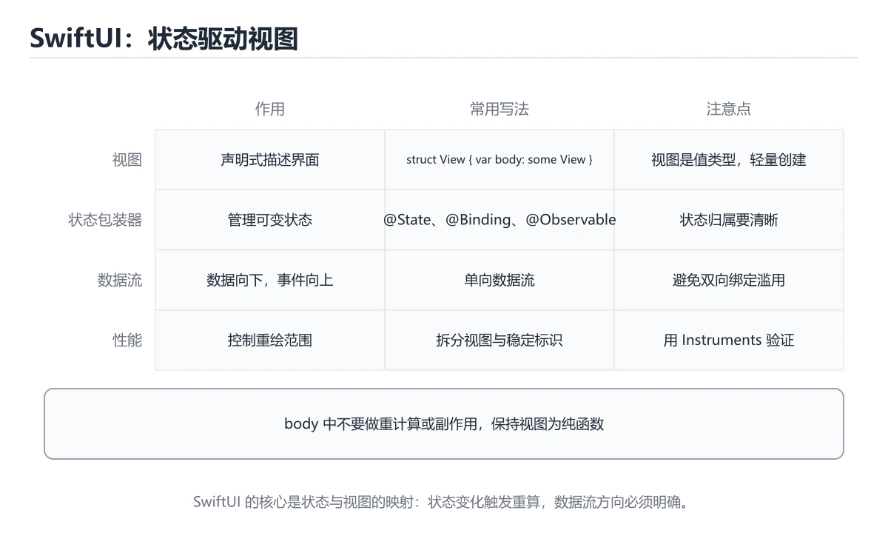
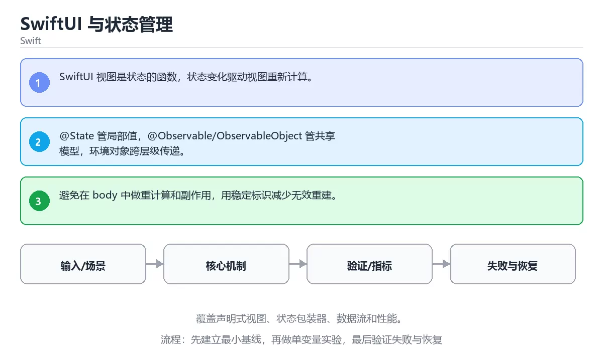

# SwiftUI 与状态管理

> 内容更新时间：2026-10-06 · 学习阶段：高级 · 预计用时：25 分钟





## 本节知识框架

**课程定位**：所属分类 `swift`（Swift），课程主题 `SwiftUI 与状态管理`，学习阶段 高级，建议用时 40 分钟。

本课主线：覆盖声明式视图、状态包装器、数据流和性能。

**学完本课应当能够**
- 说清 `SwiftUI` 与 `状态` 的含义与区别，并各举一个正例和一个反例。
- 用本课示例验证 `数据流` 的行为，记录输入、输出与失败条件。
- 遇到「在视图构建里做副作用」这类问题时，能说出触发条件与修复顺序。

### 复习清单

- [ ] 能不看正文复述本课核心术语，并指出一个边界或反例。
- [ ] 能运行或推演本课示例，记录输入、输出与失败现象。
- [ ] 能完成一次自测，并把错题对照错误表定位原因。

## 核心概念定义

| 术语 | 操作性定义 | 常见边界与风险 |
| --- | --- | --- |
| SwiftUI | Apple 的声明式 UI 框架，用状态驱动视图并跨 Apple 平台复用。 | 缓存与状态残留会让结果过期，先明确失效策略再判断正确性。 |
| 状态 | 系统在某一时刻保存的数据与条件，变化时会驱动界面或流程更新。 | 易错：界面显示不同步；正确做法是明确单一数据源并向下传递。 |
| 数据流 | 按“SwiftUI 与状态管理”中 SwiftUI、状态、数据流 的实践顺序，把四个步骤排成从准备到复盘的合理顺序。 | 缓存与状态残留会让结果过期，先明确失效策略再判断正确性。 |
| 视图 | 二、运行时与内存模型：围绕「SwiftUI、状态、数据流、视图」说明变量生命周期、资源释放、并发模型和错误传播。 | 易错：视图重建导致重复执行；正确做法是副作用放到任务或数据层。 |

## 原理与运行机制

### 机制总览

1. **建立输入**：把「SwiftUI」按本课定义整理成可观察、可重复的输入条件。
2. **执行转换**：围绕「状态」执行本课的核心步骤；每一步都记录中间状态，避免只看最终输出。
3. **产生输出**：得到「数据流」后，用正文示例或协议/SQL 结果核对输出是否符合预期。
4. **改变一个条件**：只替换一个边界条件或环境参数，观察「SwiftUI 与状态管理」的结论是否仍然成立。

| 阶段 | 关注对象 | 失败时应检查 |
| --- | --- | --- |
| 输入 | SwiftUI | 类型、范围、编码、版本或前置状态是否满足定义。 |
| 处理 | 状态 | 顺序、可见性、锁、路由、事务或调度规则是否被破坏。 |
| 输出 | 数据流 | 结果是否可复现，错误是否被正确传播而不是被吞掉。 |

**教材衔接：核心知识**

### 1. SwiftUI 视图是状态的函数，状态变化驱动视图重新计算。

- 关键做法：先让 SwiftUI 的最小示例可复现，再加入并发或规模条件。
- 验证标准：CounterView 的输出能被他人复现，边界输入有对应用例。

### 2. @State 管局部值，@Observable/ObservableObject 管共享模型，环境对象跨层级传递。

把这条结论放回「SwiftUI 与状态管理」的完整流程里展开：

- 正文依据：能用自己的话解释：SwiftUI 视图是状态的函数，状态变化驱动视图重新计算。
- 落地检查：把「2. @State 管局部值，@Observable/ObservableObject 管共享模型，环境对象跨层级传递。」改写成一条可执行的核对项，逐条验证输入、超时与失败路径。

### 3. 避免在 body 中做重计算和副作用，用稳定标识减少无效重建。

把这条结论放回「SwiftUI 与状态管理」的完整流程里展开：

- 正文依据：本课关键词：SwiftUI、状态、数据流、视图。
- 落地检查：把「3. 避免在 body 中做重计算和副作用，用稳定标识减少无效重建。」改写成一条可执行的核对项，逐条验证输入、超时与失败路径。

**教材衔接：关键流程**

**教材衔接：实践路径**

**教材衔接：语言专项实践：SwiftUI 与状态管理**

### 一、工具链

| 阶段 | 推荐工具 | 验收标准 |
| --- | --- | --- |
| 编译构建 | swiftc / xcodebuild | 命令可复现且错误能被定位 |
| 测试 | XCTest + async 测试 | 命令可复现且错误能被定位 |
| 性能 | Instruments / signpost | 命令可复现且错误能被定位 |
| 发布 | TestFlight + App Store 审核 | 命令可复现且错误能被定位 |

### 四、发布检查

**教材衔接：版本与时效**

- Swift 6.x 默认开启更严格的数据竞争检查；SwiftUI 的并发边界要先梳理。
- 升级前确认 SwiftUI 的兼容范围，把不可回退的改动单独拆成一次提交。
- SwiftUI 与 Swift Testing 迭代最快；SwiftUI 的示例要注明工具链版本。
- 官方发布说明：https://www.swift.org/blog/

## 典型应用场景

**课程内置实验入口**：`sandbox:swift`，用于动手验证《SwiftUI 与状态管理》的机制；实验结论不替代概念定义与复杂度分析。

**教材衔接：深度拓展与实战**

这一节把 SwiftUI 的定义、CounterView 的代码与常见失败串成一条复习路线。

### 工程检查表

- [ ] 能否用自己的话说明SwiftUI 与状态管理解决什么问题，以及它不负责什么？
- [ ] 能否用「SwiftUI 与状态管理」的最小示例复现一次失败并解释原因？
- [ ] 能否解释本课关键词在真实项目中的边界与取舍？
- [ ] 能否说明 状态 在新场景下需要补充什么前提？

### 最小验证场景

- 准备：保留 `text` 示例的原始输入，先记录 `SwiftUI 与状态管理` 的基线输出和完整运行命令。
- 观察：先核对 调用了 `Button()`，再改变一个与 `SwiftUI` 相关的条件。
- 判定：新结果与 `SwiftUI 与状态管理` 的基线不同不等于错误；只有当差异破坏了 `SwiftUI` 的定义或错误表中的约束，才判定为失败。

### 选择与边界

- 使用 `SwiftUI` 时，先满足它的定义：Apple 的声明式 UI 框架，用状态驱动视图并跨 Apple 平台复用；缓存与状态残留会让结果过期，先明确失效策略再判断正确性。
- 使用 `状态` 时，先满足它的定义：系统在某一时刻保存的数据与条件，变化时会驱动界面或流程更新；易错：界面显示不同步；正确做法是明确单一数据源并向下传递。
- 使用 `数据流` 时，先满足它的定义：按“SwiftUI 与状态管理”中 SwiftUI、状态、数据流 的实践顺序，把四个步骤排成从准备到复盘的合理顺序；缓存与状态残留会让结果过期，先明确失效策略再判断正确性。
- 使用 `视图` 时，先满足它的定义：二、运行时与内存模型：围绕「SwiftUI、状态、数据流、视图」说明变量生命周期、资源释放、并发模型和错误传播；易错：视图重建导致重复执行；正确做法是副作用放到任务或数据层。

## 代码/协议/SQL 示例

### 最小可验证示例

**教材衔接：最小可运行示例**

下面这段代码演示 SwiftUI 的最小路径，先原样运行，再按注释改一处：

```swift
struct CounterView: View {
    @State private var count = 0

    var body: some View {
        Button("count=\(count)") { count += 1 }
    }
}
```

**教材衔接：预期输出**

```text
界面显示一个按钮：初始文案为 count=0，每次点击后数字加一
```

## 时间/空间复杂度或性能分析

**性能关注点（SwiftUI 与状态管理）**：编译期优化与引用计数影响开销：记录构建时间、运行时间与内存峰值。

**本课特有开销（SwiftUI 与状态管理 · SwiftUI）**：并发度提高后要观察是否出现拐点：延迟上升而吞吐不增，说明瓶颈已转移。

**测量方法**：以 `SwiftUI 与状态管理` 的 `SwiftUI` 场景为对象，固定输入跑一遍记录基线，再把规模或并发度提高一个数量级复测；两次结果的差值与波动范围才是结论依据。

## 常见误区与易错点

| 容易写错的做法 | 实际现象 | 原因与正确做法 |
| --- | --- | --- |
| 在视图构建里做副作用 | 视图重建导致重复执行。 | 副作用放到任务或数据层。 |
| 状态源多处重复 | 界面显示不同步。 | 明确单一数据源并向下传递。 |
| 过度使用双向绑定 | 状态来源混乱。 | 只在需要编辑时使用绑定。 |

### 现场 1：在视图构建里做副作用

**症状**：视图重建导致重复执行。

**根因与修复**：副作用放到任务或数据层。

**自检**：在本课示例里复现「在视图构建里做副作用」，改成副作用放到任务或数据层后重跑；如果症状消失且失败路径按预期变化，说明定位正确。

### 现场 2：状态源多处重复

**症状**：界面显示不同步。

**根因与修复**：明确单一数据源并向下传递。

**自检**：在本课示例里复现「状态源多处重复」，改成明确单一数据源并向下传递后重跑；如果症状消失且失败路径按预期变化，说明定位正确。

### 现场 3：过度使用双向绑定

**症状**：状态来源混乱。

**根因与修复**：只在需要编辑时使用绑定。

**自检**：在本课示例里复现「过度使用双向绑定」，改成只在需要编辑时使用绑定后重跑；如果症状消失且失败路径按预期变化，说明定位正确。

## 与其他知识点的关系

**教材衔接：复习与迁移**

## 自测题与参考答案

> 先独立作答，再对照参考答案；答案都能在本课正文、术语表或错误表里找到依据。

### 自测 1（概念复述）

不看正文，写出 `SwiftUI` 的操作性定义，并说明它与 `状态` 的区别。

**参考答案**：Apple 的声明式 UI 框架，用状态驱动视图并跨 Apple 平台复用。

`状态` 的定位是：系统在某一时刻保存的数据与条件，变化时会驱动界面或流程更新；两者的差别要从适用对象与失败模式上说明。

### 自测 2（排错）

本课错误表记录了「在视图构建里做副作用」这类做法。请写出它会出现的现象、根因，以及修复顺序。

**参考答案**：现象是视图重建导致重复执行；正确做法是副作用放到任务或数据层。修复时先复现现象并保留证据，再改动一处假设重跑，确认现象消失。

### 自测 3（动手验证）

运行本课的 `text` 示例，改动其中一个输入后重新运行，记录输出与错误信息。

**参考答案**：正常输入下 `text` 示例应当复现正文给出的结果；改动输入后，如果结果改变或报错，先核对它是否满足 `SwiftUI 与状态管理` 中`SwiftUI` 的适用范围，再检查错误表里是否有同类现象。

### 自测 4（代码阅读）

阅读本课开头的 `text` 示例，说明它体现了`SwiftUI` 的哪一条性质，并指出改动哪个输入会让这条性质不再成立。

**参考答案**：`SwiftUI` 的定义是 Apple 的声明式 UI 框架，用状态驱动视图并跨 Apple 平台复用，示例正是在实现这条定义。改动与 `SwiftUI` 有关的一个输入后，如果结果不再符合 `SwiftUI 与状态管理` 的正文描述，就说明该性质只在当前前提成立。

### 自测 5（迁移）

把 `SwiftUI 与状态管理` 的方法迁移到自己的项目：围绕 `SwiftUI` 写出一个与错误表同类的风险点，并说明触发条件和检验方式。

**参考答案**：例如「过度使用双向绑定」，它会导致状态来源混乱；检验方式是按只在需要编辑时使用绑定改一处再复现，确认现象消失且没有引入新的失败分支。

### 自测 6（对比）

用一个表格对比 `SwiftUI` 与 `状态`：各写一行适用场景、一行失败表现。

**参考答案**：`SwiftUI` 的定义是Apple 的声明式 UI 框架，用状态驱动视图并跨 Apple 平台复用；`状态` 的定义是系统在某一时刻保存的数据与条件，变化时会驱动界面或流程更新。两者的失败表现分别对应本课错误表里与本术语相关的行。

### 自测 7（排错顺序）

面对「在视图构建里做副作用」引发的问题，请把“复现 视图重建导致重复执行 → 保留证据 → 副作用放到任务或数据层 → 回归验证”四步写成可执行的检查清单。

**参考答案**：第一步按视图重建导致重复执行复现；第二步记录输入、版本与完整报错；第三步按副作用放到任务或数据层只改一处；第四步重跑并确认失败路径也按预期变化。

### 自测 8（边界判断）

针对 `视图`，分别写出“可以使用”的条件和“结论不再成立”的条件。

**参考答案**：易错：视图重建导致重复执行；正确做法是副作用放到任务或数据层。 同时要把 `视图` 的定义 二、运行时与内存模型：围绕「SwiftUI、状态、数据流、视图」说明变量生命周期、资源释放、并发模型和错误传播 与实际输入逐项对照。

### 自测 9（机制重建）

不看正文，按输入、转换、输出、验证四段重建 `SwiftUI` → `状态` → `数据流` → `视图` 的作用链。

**参考答案**：起点是 `SwiftUI` 的定义 Apple 的声明式 UI 框架，用状态驱动视图并跨 Apple 平台复用；中间每一步都保留可观察状态；终点由 `视图` 检查，失败时回到错误表定位第一个偏离定义的步骤。

### 自测 10（综合排错）

在 `SwiftUI 与状态管理` 中，现象是 状态来源混乱。请围绕 过度使用双向绑定 写出最小复现、关键证据、修复动作和回归验证，并说明为什么不能只凭一次运行下结论。

**参考答案**：先复现 过度使用双向绑定，记录输入与完整错误；再按 只在需要编辑时使用绑定 只改一处。回归时同时跑正常路径和边界路径，只有两次结果都可解释，才把修复视为完成。

### 自测 11（一分钟复述）

用每分钟约 200 字的速度复述 `SwiftUI 与状态管理`：先给主问题，再按顺序说出 `SwiftUI`、`状态`、`数据流`、`视图`，最后给一个失败案例。

**自评标准**：主问题必须对应 覆盖声明式视图、状态包装器、数据流和性能；每个术语都要能接上一句定义或边界；失败案例必须写成可观察现象，不能用“可能有风险”代替证据。

## 术语速查

| 术语 | 一句话说明 |
| --- | --- |
| `SwiftUI` | Apple 的声明式 UI 框架，用状态驱动视图并跨 Apple 平台复用。 |
| `状态` | 系统在某一时刻保存的数据与条件，变化时会驱动界面或流程更新。 |
| `数据流` | 按“SwiftUI 与状态管理”中 SwiftUI、状态、数据流 的实践顺序，把四个步骤排成从准备到复盘的合理顺序。 |
| `视图` | 二、运行时与内存模型：围绕「SwiftUI、状态、数据流、视图」说明变量生命周期、资源释放、并发模型和错误传播。 |

**术语关系**：`SwiftUI`（Apple 的声明式 UI 框架） → `状态`（系统在某一时刻保存的数据与条件） → `数据流`（按“SwiftUI 与状态管理”中 SwiftUI、状态、数据流 的实践顺序） → `视图`（二、运行时与内存模型：围绕「SwiftUI、状态、数据流、视图」说明变量生命周期、资源释放、并发模型和错误传播）。

## 考点精讲

`SwiftUI 与状态管理` 的题库有 6 道题，下面逐题给出题干、正确项与判断依据：先自己作答，再核对正确项，最后回到正文对应小节复核。

### 考点 1：第 1 题

- **题目**：按“SwiftUI 与状态管理”中 SwiftUI、状态、数据流 的实践顺序，把四个步骤排成从准备到复盘的合理顺序。
- **正确项**：先明确 SwiftUI 的输入、输出与约束 → 写出最小示例并核对 状态 的基线结果 → 只改一个变量，记录边界与失败路径的变化 → 固定版本与证据，把“SwiftUI 与状态管理”的结论写成可复现记录
- **判断依据**：按《SwiftUI 与状态管理》正文的先后，本题顺序是「先明确 SwiftUI 的输入、输出与约束」 → 「写出最小示例并核对 状态 的基线结果」 → 「只改一个变量，记录边界与失败路径的变化」 → 「固定版本与证据，把“SwiftUI 与状态管理”的结论写成可复现记录」。术语 SwiftUI（SwiftUI 与状态管理）：Apple 的声明式 UI 框架，用状态驱动视图并跨 Apple 平台复用。易错点是在视图构建里做副作用会造成视图重建导致重复执行，改法是副作用放到任务或数据层。

### 考点 2：第 2 题

- **题目**：在 `SwiftUI 与状态管理` 里，与 `SwiftUI` 有关的说法中，哪一项最符合覆盖声明式视图、状态包装器、数据流和性能？
- **正确项**：@State 管局部值
- **判断依据**：本题正确项是「@State 管局部值」。术语 SwiftUI（SwiftUI 与状态管理）：Apple 的声明式 UI 框架，用状态驱动视图并跨 Apple 平台复用，本题取「@State 管局部值」这条。易错点是状态源多处重复，会造成界面显示不同步，改法是明确单一数据源并向下传递。

### 考点 3：第 3 题

- **题目**：在 `SwiftUI 与状态管理` 里，与 `SwiftUI` 有关的说法中，哪一项最符合覆盖声明式视图、状态包装器、数据流和性能？（SwiftUI 与状态管理·Swift 第 3 题）
- **正确项**：避免在 body 中做重计算和副作用，用稳定标识减少无效重建。
- **判断依据**：本题正确项是「避免在 body 中做重计算和副作用，用稳定标识减少无效重建」。术语 SwiftUI（SwiftUI 与状态管理）：Apple 的声明式 UI 框架，用状态驱动视图并跨 Apple 平台复用，本题取「避免在 body 中做重计算和副作用，用稳定标识减少无效重建」这条。易错点是过度使用双向绑定，会造成状态来源混乱，改法是只在需要编辑时使用绑定。

### 考点 4：第 4 题

- **题目**：`SwiftUI 与状态管理` 的主线是：覆盖声明式视图、状态包装器、数据流和性能。下面哪一项与这条主线一致？
- **正确项**：覆盖声明式视图、状态包装器、数据流和性能。
- **判断依据**：本题正确项是「覆盖声明式视图、状态包装器、数据流和性能」。术语 SwiftUI（SwiftUI 与状态管理）：Apple 的声明式 UI 框架，用状态驱动视图并跨 Apple 平台复用，本题取「覆盖声明式视图、状态包装器、数据流和性能」这条。易错点是在视图构建里做副作用，会造成视图重建导致重复执行，改法是副作用放到任务或数据层。

### 考点 5：第 5 题

- **题目**：课程 `覆盖声明式视图、状态包装器、数据流和性能。`。在 `SwiftUI 与状态管理` 里，`SwiftUI`、`状态` 与下面哪些选项属于同一层概念？（多选）
- **正确项**：SwiftUI；状态
- **判断依据**：按《SwiftUI 与状态管理》的正文口径，本题要同时选中「SwiftUI」、「状态」，漏掉任一项都算没答全。术语 SwiftUI（SwiftUI 与状态管理）：Apple 的声明式 UI 框架，用状态驱动视图并跨 Apple 平台复用。易错点是状态源多处重复，会造成界面显示不同步，改法是明确单一数据源并向下传递。

### 考点 6：第 6 题

- **题目**：结合 `SwiftUI 与状态管理` 中围绕 `SwiftUI` 的代码，哪一项说法与“覆盖声明式视图、状态包装器、数据流和性能。”一致？
- **正确项**：SwiftUI 视图是状态的函数，状态变化驱动视图重新计算。
- **判断依据**：本题正确项是「SwiftUI 视图是状态的函数，状态变化驱动视图重新计算」。术语 SwiftUI（SwiftUI 与状态管理）：Apple 的声明式 UI 框架，用状态驱动视图并跨 Apple 平台复用，本题取「SwiftUI 视图是状态的函数，状态变化驱动视图重新计算」这条。易错点是过度使用双向绑定，会造成状态来源混乱，改法是只在需要编辑时使用绑定。

### 考点 7：`SwiftUI`

- **要点**：Apple 的声明式 UI 框架，用状态驱动视图并跨 Apple 平台复用。
- **SwiftUI 的边界**：缓存与状态残留会让结果过期，先明确失效策略再判断正确性。

### 考点 8：`状态`

- **要点**：系统在某一时刻保存的数据与条件，变化时会驱动界面或流程更新。
- **状态 的边界**：易错：界面显示不同步；正确做法是明确单一数据源并向下传递。

### 考点 9：`数据流`

- **要点**：按“SwiftUI 与状态管理”中 SwiftUI、状态、数据流 的实践顺序，把四个步骤排成从准备到复盘的合理顺序。
- **数据流 的边界**：缓存与状态残留会让结果过期，先明确失效策略再判断正确性。

### 考点 10：`视图`

- **要点**：二、运行时与内存模型：围绕「SwiftUI、状态、数据流、视图」说明变量生命周期、资源释放、并发模型和错误传播。
- **视图 的边界**：易错：视图重建导致重复执行；正确做法是副作用放到任务或数据层。

### 考点 11：排错——在视图构建里做副作用

- **现象**：视图重建导致重复执行。
- **处理**：副作用放到任务或数据层。

### 考点 12：排错——状态源多处重复

- **现象**：界面显示不同步。
- **处理**：明确单一数据源并向下传递。

### 考点 13：综合辨析——`SwiftUI` 与 `视图`

- **辨析点**：`SwiftUI` 的定义是 Apple 的声明式 UI 框架，用状态驱动视图并跨 Apple 平台复用；`视图` 的定义是 二、运行时与内存模型：围绕「SwiftUI、状态、数据流、视图」说明变量生命周期、资源释放、并发模型和错误传播。
- **答题要求**：面对 `SwiftUI 与状态管理` 的题目，先判断描述的是 `SwiftUI` 还是 `视图`，再归到对应定义，最后写出一个会让该定义失效的边界输入。

### 考点 14：排错评分点

- **现象分**：能写出 视图重建导致重复执行，而不是只写“程序有错”。
- **证据分**：保留触发 在视图构建里做副作用 的输入、版本和错误原文。
- **修复分**：按 副作用放到任务或数据层 只改一处，并同时回归正常路径与边界路径。

## 内容元数据

- 内容版本：v2.0
- 最后更新：2026-10-06
- 学习阶段：高级
- 适用环境：Swift 6 / Xcode 16+；本课聚焦 SwiftUI。
- 内容来源：内置结构化课程与工程实践整理
- 相关主题：SwiftUI、状态、数据流、视图
- 质量版本：P0 测验标准 + P1 覆盖扩展 + P2 体验补全

## 参考资料与复核

- 最后复核：2026-10-04
- 下次复核：2026-12-17
- 复核范围：版本兼容、API 行为、安全建议与工程实践
- 来源性质：官方文档、标准或权威教材；本课核对关键词：SwiftUI、状态、数据流、视图。

| 参考资料 | 本课用途 |
| --- | --- |
| [SwiftUI 文档](https://developer.apple.com/documentation/swiftui) | 声明式界面与状态 |
| [Swift 官方文档](https://www.swift.org/documentation/) | 工具链、包管理与语言演进 |
| [Swift 并发](https://docs.swift.org/swift-book/documentation/the-swift-programming-language/concurrency/) | async/await 与 actor |

| [本课术语索引：SwiftUI 与状态管理](#核心概念定义) | 按本课输入、术语边界和错误表现逐项核对 |
> 「SwiftUI 与状态管理」的链接用于离线阅读后的延伸核对；App 不会自动联网。