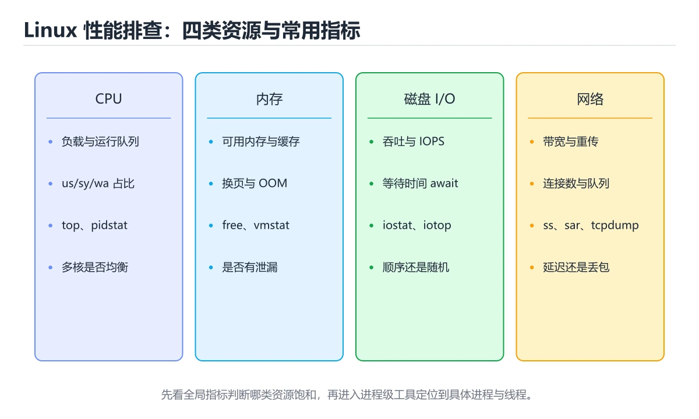
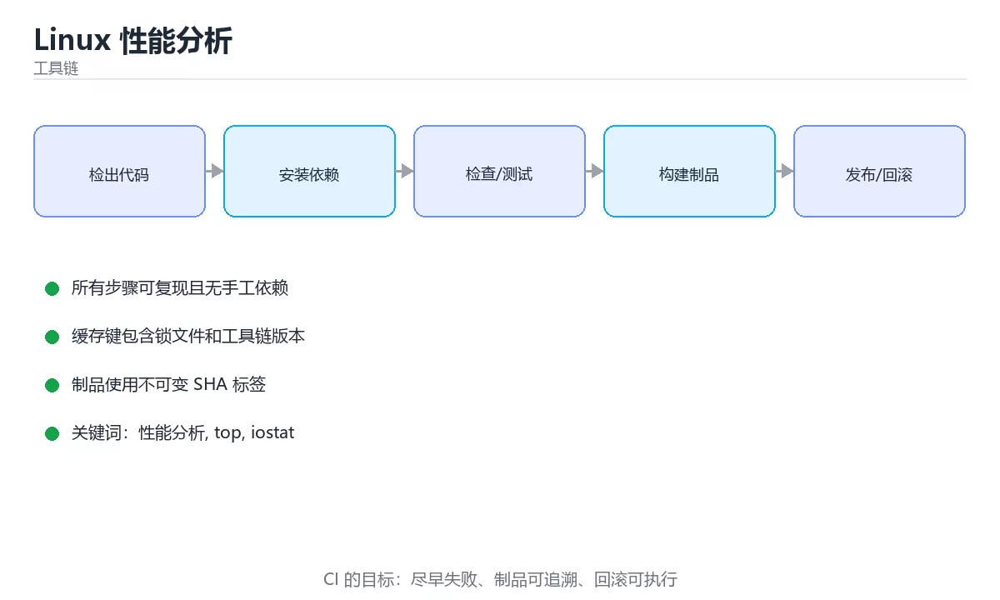

# Linux 性能分析

> 内容更新时间：2026-10-06 · 学习阶段：高级 · 预计用时：30 分钟





## 本节知识框架

**课程定位**：所属分类 `toolchain`（工具链），课程主题 `Linux 性能分析`，学习阶段 高级，建议用时 35 分钟。

本课主线：CPU/内存/IO/网络排查与火焰图。

**学完本课应当能够**
- 说清 `性能分析` 与 `top` 的含义与区别，并各举一个正例和一个反例。
- 用本课示例验证 `iostat` 的行为，记录输入、输出与失败条件。
- 遇到「只看 CPU 使用率」这类问题时，能说出触发条件与修复顺序。

### 复习清单

- [ ] 能不看正文复述本课核心术语，并指出一个边界或反例。
- [ ] 能运行或推演本课示例，记录输入、输出与失败现象。
- [ ] 能完成一次自测，并把错题对照错误表定位原因。

## 核心概念定义

| 术语 | 操作性定义 | 常见边界与风险 |
| --- | --- | --- |
| 性能分析 | 通过测量和证据找出资源消耗与瓶颈原因，区分现象、假设和根因。 | 易错：只看 CPU 使用率就下结论，漏掉 IO 与内存瓶颈；要按 USE 方法对四类资源逐个查，先分清现象和根因。 |
| top | Linux 实时查看进程 CPU、内存、负载和线程状态的命令。 | 易错：只扫一眼负载数字就下结论；负载高但 CPU 空闲时其实在等 IO，要看 us/sy/wa 分布，容器里还可能读到宿主机指标。 |
| iostat | Linux 查看磁盘吞吐、利用率和 I/O 等待的工具。 | 易错：忽略 IO 等待；正确做法是看 `vmstat` 的 `wa` 与 `iostat`。 |
| perf | perf record -F 99 -p <pid> -g -- sleep 30 采集后生成火焰图，横轴是时间占比，纵轴是调用栈。 | 易错：性能影响与数据量过大；正确做法是限定时长与频率。 |
| 火焰图 | perf record -F 99 -p <pid> -g -- sleep 30 采集后生成火焰图，横轴是时间占比，纵轴是调用栈。越宽的函数占用 CPU 越多，是定位热点最直观的方式。 | 易错：把横轴读成调用先后，或采样时长与频率不匹配问题导致结果偏差；宽度只代表 CPU 时间占比，越宽才是热点。 |

## 原理与运行机制

### 机制总览

**教材衔接：先建立全局观**

性能问题先分清四类资源：**CPU、内存、磁盘 IO、网络**。排查顺序是先看全局负载，再定位到进程，最后深入系统调用与调用栈。

**教材衔接：常用工具与指标**

| 工具 | 关注点 |
| --- | --- |
| top / htop | 负载、CPU 使用、内存占用 |
| vmstat 1 | 运行队列 r、换页 si/so、上下文切换 |
| iostat -x 1 | 磁盘 %util、await、IOPS |
| free -h | 可用内存、Swap 使用 |
| sar / pidstat | 历史趋势与单进程资源 |
| ss -s / netstat | 连接数、监听端口、TCP 状态 |
| perf top / perf record | CPU 热点函数、火焰图 |

**教材衔接：快速判断**

1. 负载高但 CPU 空闲 → 多在等 IO（磁盘或网络）。
2. `si/so` 持续非零 → 内存不足在换页，性能会断崖式下降。
3. `%util` 接近 100% 且 await 高 → 磁盘瓶颈。
4. 上下文切换极高 → 锁竞争或线程过多。
5. 大量 TIME_WAIT / CLOSE_WAIT → 连接未正确复用或未关闭。

**教材衔接：一次完整排查流程**

第一步用 `uptime` 与 `top` 看负载和 CPU 分布（us/sy/wa/id）；第二步用 `vmstat`、`iostat`、`free` 判断是 CPU、内存还是 IO 受限；第三步用 `pidstat`、`ss` 锁定具体进程与连接；第四步用 `perf`、`strace` 深入函数与系统调用；最后结合应用日志与 APM 链路确认根因。

**教材衔接：火焰图**

`perf record -F 99 -p <pid> -g -- sleep 30` 采集后生成火焰图，横轴是时间占比，纵轴是调用栈。**越宽的函数占用 CPU 越多**，是定位热点最直观的方式。

**教材衔接：排查原则**

1. 先测量再优化，不要凭直觉改代码。
2. 一次只改一个变量，改动后复测对比。
3. 区分「吞吐量」与「延迟」，二者优化方向常常相反。
4. 在压测环境复现问题，生产上优先用只读工具（避免影响业务）。
5. 记录基线与变更，性能优化是长期工程。

**教材衔接：一套可复制的排查脚本**

| 步骤 | 命令 | 看什么 |
| --- | --- | --- |
| 1 全局水位 | uptime、top | 负载、us/sy/wa/id 分布 |
| 2 内存与换页 | free -h、vmstat 1 | 可用内存、si/so 是否持续非零 |
| 3 磁盘 IO | iostat -x 1 | %util 是否接近 100%、await 是否偏高 |
| 4 进程定位 | pidstat -u -d 1、top -H | 哪个进程/线程在消耗 |
| 5 网络 | ss -s、sar -n DEV 1 | 连接数、重传、带宽是否打满 |
| 6 深入 | perf top/record、strace -p | 热点函数与阻塞的系统调用 |

判定口诀：**CPU 高看 us/sy（用户态还是内核态）；wa 高看磁盘；si/so 非零看内存；负载高但 CPU 空闲看 IO 等待**。压测时同时记录这些指标，才能区分"应用慢"与"资源不够"。

常用组合示例：怀疑 GC 频繁用 `pidstat -u 1` 观察 CPU 周期性峰值；怀疑锁竞争用 `perf lock` 或 `strace -c -p` 统计 futex 调用；怀疑 DNS 慢用 `strace -e trace=network -p` 看 connect 前的解析耗时。

**教材衔接：USE 方法与工具速查**

| 资源 | 利用率 | 饱和度 | 错误 | 工具 |
| --- | --- | --- | --- | --- |
| CPU | `%user+%sys` | 运行队列长度 | 硬件错误 | `top`、`vmstat`、`pidstat` |
| 内存 | 已用比例 | swap 换页 si/so | OOM 记录 | `free`、`vmstat`、`dmesg` |
| 磁盘 | `%util` | 队列长度 await | IO 错误 | `iostat`、`iotop` |
| 网络 | 带宽利用率 | 重传与丢包 | 错误计数 | `sar -n`、`ss`、`ip -s` |
| GPU | 使用率 | 显存占用 | Xid 错误 | `nvidia-smi`、`dcgm` |

## 典型应用场景

**教材衔接：应用层常见原因**

| 现象 | 常见原因 |
| --- | --- |
| CPU 打满 | 死循环、正则回溯、序列化开销、GC 频繁 |
| 内存增长 | 缓存无上限、连接未释放、内存泄漏 |
| 延迟抖动 | GC 停顿、锁竞争、线程池过小 |
| IO 等待高 | 日志同步刷盘、大文件读写、数据库慢查询 |

- **只看 CPU 使用率**：典型现象是漏掉 IO 与内存瓶颈；正确做法是用 USE 方法逐个资源检查。
- **高负载但 CPU 空闲就下结论**：典型现象是忽略 IO 等待；正确做法是看 `vmstat` 的 `wa` 与 `iostat`。
- **用平均值判断性能**：典型现象是长尾被掩盖；正确做法是看 P95/P99 与最差值。
- **在共享机器上测性能**：典型现象是数据不可复现；正确做法是隔离环境并固定配置。

### 最小验证场景

- 准备：保留 `bash` 示例的原始输入，先记录 `Linux 性能分析` 的基线输出和完整运行命令。
- 观察：先核对 调用了 `severity()`，再改变一个与 `性能分析` 相关的条件。
- 判定：新结果与 `Linux 性能分析` 的基线不同不等于错误；只有当差异破坏了 `性能分析` 的定义或错误表中的约束，才判定为失败。

### 选择与边界

- 使用 `性能分析` 时，通过测量和证据找出资源消耗与瓶颈原因，区分现象、假设和根因。
- 使用 `top` 时，Linux 实时查看进程 CPU、内存、负载和线程状态的命令；共享状态与调度顺序会改变结论，单线程或串行测试通过不等于并发下成立。
- 使用 `iostat` 时，Linux 查看磁盘吞吐、利用率和 I/O 等待的工具；易错：忽略 IO 等待；正确做法是看 `vmstat` 的 `wa` 与 `iostat`。
- 使用 `perf` 时，perf record -F 99 -p <pid> -g -- sleep 30 采集后生成火焰图，横轴是时间占比，纵轴是调用栈；易错：性能影响与数据量过大；正确做法是限定时长与频率。
- 使用 `火焰图` 时，perf record -F 99 -p <pid> -g -- sleep 30 采集后生成火焰图，横轴是时间占比，纵轴是调用栈。越宽的函数占用 CPU 越多，是定位热点最直观的方式；越界、悬垂引用与释放顺序会破坏结论，必须在边界输入下复验。

## 代码/协议/SQL 示例

**教材衔接：排查顺序速查**

| 步骤 | 动作 | 命令 |
| --- | --- | --- |
| 1 现象 | 确认慢在哪一层 | 用户反馈、端到端延迟 |
| 2 负载 | 系统整体压力 | `uptime`、`vmstat 1` |
| 3 资源 | 找饱和资源 | `top`、`iostat`、`free` |
| 4 进程 | 定位到具体进程 | `pidstat -p <pid> 1` |
| 5 热点 | 定位函数与调用栈 | `perf top`、火焰图 |
| 6 验证 | 改一处再测 | 前后对比同口径指标 |

```bash
# 一、整体：负载、CPU、内存、IO、换页
uptime && vmstat 1 5

# 二、进程级：谁在吃 CPU、内存、IO
pidstat -u -r -d 1 3
ps -eo pid,ppid,pcpu,pmem,rss,etime,cmd --sort=-pcpu | head

# 三、磁盘与网络
iostat -xz 1 3 | tail -20
sar -n DEV 1 3 | tail -10

# 四、热点函数与火焰图（采样 30 秒）
perf record -F 99 -g -p <pid> -- sleep 30
perf report --stdio | head -30

# 五、系统调用与文件：看谁在拖慢
strace -c -f -p <pid> &        # 统计系统调用耗时占比
sleep 10 && kill %1
lsof -p <pid> | wc -l          # 文件描述符数量
```

```python
from dataclasses import dataclass

@dataclass
class UseFinding:
    resource: str
    utilization: float      # 0 到 1
    saturation: float       # 0 到 1
    errors: int = 0

    def severity(self) -> str:
        if self.errors > 0:
            return "P1：存在错误，优先排查"
        if self.saturation > 0.8:
            return "P1：饱和过高，已有排队"
        if self.utilization > 0.85:
            return "P2：利用率偏高，接近瓶颈"
        return "正常"

def analyze(findings: list) -> list:
    """按严重程度排序，输出排查优先级。"""
    return sorted(
        ((f.resource, f.severity()) for f in findings),
        key=lambda item: item[1],
    )

def little_law(concurrency: float, latency_s: float) -> float:
    """由并发与延迟推算可达吞吐，用于容量估算。"""
    if latency_s <= 0:
        raise ValueError("延迟必须为正")
    return round(concurrency / latency_s, 2)

findings = [
    UseFinding("cpu", 0.62, 0.15),
    UseFinding("disk", 0.93, 0.88, errors=0),
    UseFinding("network", 0.4, 0.2, errors=3),
]
print(analyze(findings))
print(little_law(concurrency=20, latency_s=0.05))
```

**运行方式**：运行 `Linux 性能分析` 的示例时，用 `bash 文件名.sh` 运行；先 `bash -n` 做语法检查更稳妥。

## 时间/空间复杂度或性能分析

**性能关注点（Linux 性能分析）**：构建与流水线看总时长：记录构建耗时、缓存命中率与失败重试次数。

**本课特有开销（Linux 性能分析 · 性能分析）**：重试与超时会成倍放大尾延迟，记录 P99 而不是平均值。

**测量方法**：以 `Linux 性能分析` 的 `性能分析` 场景为对象，固定输入跑一遍记录基线，再把规模或并发度提高一个数量级复测；两次结果的差值与波动范围才是结论依据。

## 常见误区与易错点

| 容易写错的做法 | 实际现象 | 原因与正确做法 |
| --- | --- | --- |
| 只看 CPU 使用率 | 漏掉 IO 与内存瓶颈 | 用 USE 方法逐个资源检查 |
| 高负载但 CPU 空闲就下结论 | 忽略 IO 等待 | 看 `vmstat` 的 `wa` 与 `iostat` |
| 用平均值判断性能 | 长尾被掩盖 | 看 P95/P99 与最差值 |
| 在共享机器上测性能 | 数据不可复现 | 隔离环境并固定配置 |
| 无基线直接优化 | 无法证明收益 | 先记录基线数据 |
| 一次改多个参数 | 无法归因 | 一次只改一个变量 |
| 忽略采样频率影响 | 结果偏差 | 采样频率与时长要匹配问题 |
| 生产长时间 perf 采样 | 性能影响与数据量过大 | 限定时长与频率 |
| 忽略容器配额 | 看到的是宿主机指标 | 检查 cgroup 限制 |
| 优化完不回归 | 问题复发 | 加监控与回归测试 |

### 现场 1：只看 CPU 使用率

**症状**：漏掉 IO 与内存瓶颈。

**根因与修复**：用 USE 方法逐个资源检查。

**自检**：在本课示例里复现「只看 CPU 使用率」，改成用 USE 方法逐个资源检查后重跑；如果症状消失且失败路径按预期变化，说明定位正确。

### 现场 2：高负载但 CPU 空闲就下结论

**症状**：忽略 IO 等待。

**根因与修复**：看 `vmstat` 的 `wa` 与 `iostat`。

**自检**：在本课示例里复现「高负载但 CPU 空闲就下结论」，改成看 `vmstat` 的 `wa` 与 `iostat`后重跑；如果症状消失且失败路径按预期变化，说明定位正确。

### 现场 3：用平均值判断性能

**症状**：长尾被掩盖。

**根因与修复**：看 P95/P99 与最差值。

**自检**：在本课示例里复现「用平均值判断性能」，改成看 P95/P99 与最差值后重跑；如果症状消失且失败路径按预期变化，说明定位正确。

### 现场 4：在共享机器上测性能

**症状**：数据不可复现。

**根因与修复**：隔离环境并固定配置。

**自检**：在本课示例里复现「在共享机器上测性能」，改成隔离环境并固定配置后重跑；如果症状消失且失败路径按预期变化，说明定位正确。

### 现场 5：无基线直接优化

**症状**：无法证明收益。

**根因与修复**：先记录基线数据。

**自检**：在本课示例里复现「无基线直接优化」，改成先记录基线数据后重跑；如果症状消失且失败路径按预期变化，说明定位正确。

### 现场 6：一次改多个参数

**症状**：无法归因。

**根因与修复**：一次只改一个变量。

**自检**：在本课示例里复现「一次改多个参数」，改成一次只改一个变量后重跑；如果症状消失且失败路径按预期变化，说明定位正确。

### 现场 7：忽略采样频率影响

**症状**：结果偏差。

**根因与修复**：采样频率与时长要匹配问题。

**自检**：在本课示例里复现「忽略采样频率影响」，改成采样频率与时长要匹配问题后重跑；如果症状消失且失败路径按预期变化，说明定位正确。

### 现场 8：生产长时间 perf 采样

**症状**：性能影响与数据量过大。

**根因与修复**：限定时长与频率。

**自检**：在本课示例里复现「生产长时间 perf 采样」，改成限定时长与频率后重跑；如果症状消失且失败路径按预期变化，说明定位正确。

### 现场 9：忽略容器配额

**症状**：看到的是宿主机指标。

**根因与修复**：检查 cgroup 限制。

**自检**：在本课示例里复现「忽略容器配额」，改成检查 cgroup 限制后重跑；如果症状消失且失败路径按预期变化，说明定位正确。

## 与其他知识点的关系

- **先修**：`Terraform 与基础设施即代码`。本课默认这些内容已经掌握。
- **相关或后续**：`API 网关与负载均衡`。本课术语会在这些课程里继续使用。
- **术语归属**：`性能分析`、`top`、`iostat` 的定义以本课「核心概念定义」为准，换到其他课程时先确认定义是否被改写。

## 自测题与参考答案

> 先独立作答，再对照参考答案；答案都能在本课正文、术语表或错误表里找到依据。

### 自测 1（概念复述）

不看正文，写出 `性能分析` 的操作性定义，并说明它与 `top` 的区别。

**参考答案**：通过测量和证据找出资源消耗与瓶颈原因，区分现象、假设和根因。

`top` 的定位是：Linux 实时查看进程 CPU、内存、负载和线程状态的命令；两者的差别要从适用对象与失败模式上说明。

### 自测 2（排错）

本课错误表记录了「只看 CPU 使用率」这类做法。请写出它会出现的现象、根因，以及修复顺序。

**参考答案**：现象是漏掉 IO 与内存瓶颈；正确做法是用 USE 方法逐个资源检查。修复时先复现现象并保留证据，再改动一处假设重跑，确认现象消失。

### 自测 3（动手验证）

运行本课的 `bash` 示例，把其中的 `1` 换成一个边界值后重新运行，记录输出与错误信息。

**参考答案**：正常输入下 `bash` 示例应当复现正文给出的结果；把 `1` 换成边界值后，如果结果改变或报错，先核对它是否满足 `Linux 性能分析` 中`性能分析` 的适用范围，再检查错误表里是否有同类现象。

### 自测 4（代码阅读）

阅读本课开头的 `bash` 示例，说明它体现了`性能分析` 的哪一条性质，并指出改动哪个输入会让这条性质不再成立。

**参考答案**：`性能分析` 的定义是 通过测量和证据找出资源消耗与瓶颈原因，区分现象、假设和根因，示例正是在实现这条定义。改动与 `性能分析` 有关的一个输入后，如果结果不再符合 `Linux 性能分析` 的正文描述，就说明该性质只在当前前提成立。

### 自测 5（迁移）

把 `Linux 性能分析` 的方法迁移到自己的项目：围绕 `性能分析` 写出一个与错误表同类的风险点，并说明触发条件和检验方式。

**参考答案**：例如「优化完不回归」，它会导致问题复发；检验方式是按加监控与回归测试改一处再复现，确认现象消失且没有引入新的失败分支。

### 自测 6（对比）

用一个表格对比 `性能分析` 与 `top`：各写一行适用场景、一行失败表现。

**参考答案**：`性能分析` 的定义是通过测量和证据找出资源消耗与瓶颈原因，区分现象、假设和根因；`top` 的定义是Linux 实时查看进程 CPU、内存、负载和线程状态的命令。两者的失败表现分别对应本课错误表里与本术语相关的行。

### 自测 7（排错顺序）

面对「只看 CPU 使用率」引发的问题，请把“复现 漏掉 IO 与内存瓶颈 → 保留证据 → 用 USE 方法逐个资源检查 → 回归验证”四步写成可执行的检查清单。

**参考答案**：第一步按漏掉 IO 与内存瓶颈复现；第二步记录输入、版本与完整报错；第三步按用 USE 方法逐个资源检查只改一处；第四步重跑并确认失败路径也按预期变化。

### 自测 8（边界判断）

针对 `火焰图`，分别写出“可以使用”的条件和“结论不再成立”的条件。

**参考答案**：越界、悬垂引用与释放顺序会破坏结论，必须在边界输入下复验。 同时要把 `火焰图` 的定义 perf record -F 99 -p <pid> -g -- sleep 30 采集后生成火焰图，横轴是时间占比，纵轴是调用栈。越宽的函数占用 CPU 越多，是定位热点最直观的方式 与实际输入逐项对照。

### 自测 9（机制重建）

不看正文，按输入、转换、输出、验证四段重建 `性能分析` → `top` → `iostat` → `perf` 的作用链。

**参考答案**：起点是 `性能分析` 的定义 通过测量和证据找出资源消耗与瓶颈原因，区分现象、假设和根因；中间每一步都保留可观察状态；终点由 `火焰图` 检查，失败时回到错误表定位第一个偏离定义的步骤。

### 自测 10（综合排错）

在 `Linux 性能分析` 中，现象是 问题复发。请围绕 优化完不回归 写出最小复现、关键证据、修复动作和回归验证，并说明为什么不能只凭一次运行下结论。

**参考答案**：先复现 优化完不回归，记录输入与完整错误；再按 加监控与回归测试 只改一处。回归时同时跑正常路径和边界路径，只有两次结果都可解释，才把修复视为完成。

### 自测 11（一分钟复述）

用每分钟约 200 字的速度复述 `Linux 性能分析`：先给主问题，再按顺序说出 `性能分析`、`top`、`iostat`、`perf`，最后给一个失败案例。

**自评标准**：主问题必须对应 CPU/内存/IO/网络排查与火焰图；每个术语都要能接上一句定义或边界；失败案例必须写成可观察现象，不能用“可能有风险”代替证据。

## 术语速查

| 术语 | 一句话说明 |
| --- | --- |
| `性能分析` | 通过测量和证据找出资源消耗与瓶颈原因，区分现象、假设和根因。 |
| `top` | Linux 实时查看进程 CPU、内存、负载和线程状态的命令。 |
| `iostat` | Linux 查看磁盘吞吐、利用率和 I/O 等待的工具。 |
| `perf` | perf record -F 99 -p <pid> -g -- sleep 30 采集后生成火焰图，横轴是时间占比，纵轴是调用栈。 |
| `火焰图` | perf record -F 99 -p <pid> -g -- sleep 30 采集后生成火焰图，横轴是时间占比，纵轴是调用栈。越宽的函数占用 CPU 越多，是定位热点最直观的方式。 |

**术语关系**：`性能分析`（通过测量和证据找出资源消耗与瓶颈原因） → `top`（Linux 实时查看进程 CPU、内存、负载和线程状态的命令） → `iostat`（Linux 查看磁盘吞吐、利用率和 I/O 等待的工具） → `perf`（perf record -F 99 -p <pid> -g -- sleep 30 采集后生成火焰图）。

## 考点精讲

`Linux 性能分析` 的题库有 6 道题，下面逐题给出题干、正确项与判断依据：先自己作答，再核对正确项，最后回到正文对应小节复核。

### 考点 1：第 1 题

- **题目**：围绕“Linux 性能分析”中的 性能分析、top、iostat，下列哪两项是本课强调的实践判断？
- **正确项**：学习 性能分析 时要同时说明输入、输出和失败路径，不能只看正常流程；验证 top 时要固定版本并覆盖边界输入，结论才可复现
- **判断依据**：按《Linux 性能分析》的正文口径，本题要同时选中「学习 性能分析 时要同时说明输入、输出和失败路径，不能只看正常流程」、「验证 top 时要固定版本并覆盖边界输入，结论才可复现」，漏掉任一项都算没答全。术语 性能分析（Linux 性能分析）：通过测量和证据找出资源消耗与瓶颈原因，区分现象、假设和根因。易错点是只看 CPU 使用率，会造成漏掉 IO 与内存瓶颈，改法是用 USE 方法逐个资源检查。

### 考点 2：第 2 题

- **题目**：火焰图中函数条越宽说明？
- **正确项**：该函数占用 CPU 时间越多
- **判断依据**：本题正确项是「该函数占用 CPU 时间越多」。术语 火焰图（Linux 性能分析）：perf record -F 99 -p <pid> -g -- sleep 30 采集后生成火焰图，横轴是时间占比，纵轴是调用栈，越宽的函数占用 CPU 越多，是定位热点最直观的方式，本题取「该函数占用 CPU 时间越多」这条。易错点是高负载但 CPU 空闲就下结论，会造成忽略 IO 等待，改法是看 `vmstat` 的 `wa` 与 `iostat`。

### 考点 3：第 3 题

- **题目**：开始一次性能优化工作前，应当遵守的基本原则是什么？
- **正确项**：先测量再优化
- **判断依据**：本题正确项是「先测量再优化」。术语 性能分析（Linux 性能分析）：通过测量和证据找出资源消耗与瓶颈原因，区分现象、假设和根因，本题取「先测量再优化」这条。易错点是用平均值判断性能，会造成长尾被掩盖，改法是看 P95/P99 与最差值。易错点是在共享机器上测性能，会造成数据不可复现，改法是隔离环境并固定配置。

### 考点 4：第 4 题

- **题目**：iostat 中 %util 接近 100% 说明什么？
- **正确项**：磁盘几乎一直处于忙碌状态
- **判断依据**：本题正确项是「磁盘几乎一直处于忙碌状态」。术语 iostat（Linux 性能分析）：Linux 查看磁盘吞吐、利用率和 I/O 等待的工具，本题取「磁盘几乎一直处于忙碌状态」这条。易错点是在共享机器上测性能，会造成数据不可复现，改法是隔离环境并固定配置。

### 考点 5：第 5 题

- **题目**：`Linux 性能分析` 的示例代码用于验证 `性能分析`，其背景是CPU/内存/IO/网络排查与火焰图。代码的真实内容是下面哪一项？
- **正确项**：调用了 `analyze()`
- **判断依据**：本题正确项是「调用了 `analyze()`」。术语 性能分析（Linux 性能分析）：通过测量和证据找出资源消耗与瓶颈原因，区分现象、假设和根因，本题取「调用了 `analyze()`」这条。易错点是无基线直接优化，会造成无法证明收益，改法是先记录基线数据。本题干扰项「调用了 `PythonOperator()`」不成立：展示代码里找不到 `PythonOperator()`。

### 考点 6：第 6 题

- **题目**：把 `Linux 性能分析` 中与 `性能分析` 有关的步骤调整为正确顺序；该课主线是CPU/内存/IO/网络排查与火焰图。
- **正确项**：先测量再优化，不要凭直觉改代码 → 一次只改一个变量，改动后复测对比 → 区分「吞吐量」与「延迟」，二者优化方向常常相反 → 在压测环境复现问题，生产上优先用只读工具（避免影响业务）
- **判断依据**：按《Linux 性能分析》正文的先后，本题顺序是「先测量再优化，不要凭直觉改代码」 → 「一次只改一个变量，改动后复测对比」 → 「区分「吞吐量」与「延迟」，二者优化方向常常相反」 → 「在压测环境复现问题，生产上优先用只读工具（避免影响业务）」。术语 性能分析（Linux 性能分析）：通过测量和证据找出资源消耗与瓶颈原因，区分现象、假设和根因。易错点是一次改多个参数会造成无法归因，改法是一次只改一个变量。

### 考点 7：`性能分析`

- **要点**：通过测量和证据找出资源消耗与瓶颈原因，区分现象、假设和根因。

### 考点 8：`top`

- **要点**：Linux 实时查看进程 CPU、内存、负载和线程状态的命令。
- **top 的边界**：共享状态与调度顺序会改变结论，单线程或串行测试通过不等于并发下成立。

### 考点 9：`iostat`

- **要点**：Linux 查看磁盘吞吐、利用率和 I/O 等待的工具。
- **iostat 的边界**：易错：忽略 IO 等待；正确做法是看 `vmstat` 的 `wa` 与 `iostat`。

### 考点 10：`perf`

- **要点**：perf record -F 99 -p <pid> -g -- sleep 30 采集后生成火焰图，横轴是时间占比，纵轴是调用栈。
- **perf 的边界**：易错：性能影响与数据量过大；正确做法是限定时长与频率。

### 考点 11：`火焰图`

- **要点**：perf record -F 99 -p <pid> -g -- sleep 30 采集后生成火焰图，横轴是时间占比，纵轴是调用栈。越宽的函数占用 CPU 越多，是定位热点最直观的方式。
- **火焰图 的边界**：越界、悬垂引用与释放顺序会破坏结论，必须在边界输入下复验。

### 考点 12：排错——只看 CPU 使用率

- **现象**：漏掉 IO 与内存瓶颈。
- **处理**：用 USE 方法逐个资源检查。

### 考点 13：排错——高负载但 CPU 空闲就下结论

- **现象**：忽略 IO 等待。
- **处理**：看 `vmstat` 的 `wa` 与 `iostat`。

### 考点 14：综合辨析——`性能分析` 与 `火焰图`

- **辨析点**：`性能分析` 的定义是 通过测量和证据找出资源消耗与瓶颈原因，区分现象、假设和根因；`火焰图` 的定义是 perf record -F 99 -p <pid> -g -- sleep 30 采集后生成火焰图，横轴是时间占比，纵轴是调用栈。越宽的函数占用 CPU 越多，是定位热点最直观的方式。
- **答题要求**：面对 `Linux 性能分析` 的题目，先判断描述的是 `性能分析` 还是 `火焰图`，再归到对应定义，最后写出一个会让该定义失效的边界输入。

### 考点 15：排错评分点

- **现象分**：能写出 漏掉 IO 与内存瓶颈，而不是只写“程序有错”。
- **证据分**：保留触发 只看 CPU 使用率 的输入、版本和错误原文。
- **修复分**：按 用 USE 方法逐个资源检查 只改一处，并同时回归正常路径与边界路径。

## 内容元数据

- 内容版本：v2.0
- 最后更新：2026-10-06
- 学习阶段：高级
- 适用环境：Git / Docker / Kubernetes / CI 平台；本课聚焦 性能分析。
- 内容来源：内置结构化课程与工程实践整理
- 相关主题：性能分析、top、iostat、perf、火焰图
- 质量版本：P0 测验标准 + P1 覆盖扩展 + P2 体验补全

## 参考资料与复核

- 最后复核：2026-10-04
- 下次复核：2027-08-24
- 复核范围：版本兼容、API 行为、安全建议与工程实践
- 来源性质：官方文档、标准或权威教材；本课核对关键词：性能分析、top、iostat、perf、火焰图。

| 参考资料 | 本课用途 |
| --- | --- |
| [CMake 文档](https://cmake.org/documentation/) | 跨平台构建与依赖 |
| [GitHub Actions](https://docs.github.com/actions) | CI/CD 工作流 |
| [Gradle 文档](https://docs.gradle.org/current/userguide/userguide.html) | 构建脚本与插件 |

| [本课术语索引：Linux 性能分析](#核心概念定义) | 按本课输入、术语边界和错误表现逐项核对 |
> 「Linux 性能分析」的链接用于离线阅读后的延伸核对；App 不会自动联网。