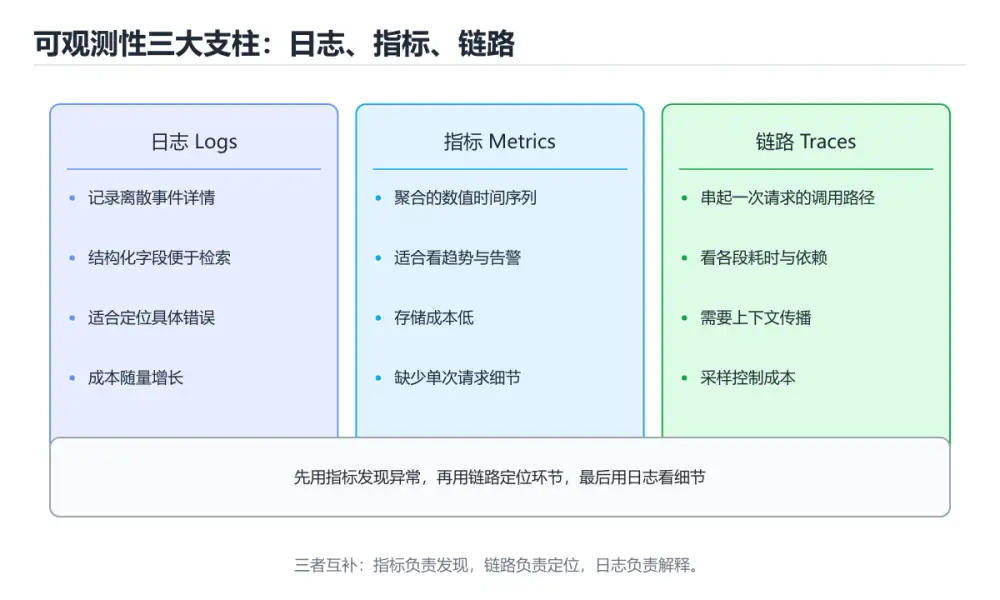
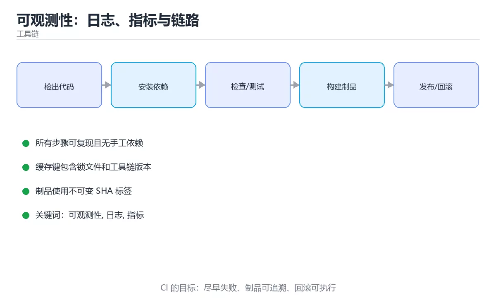

# 可观测性：日志、指标与链路

> 内容更新时间：2026-10-06 · 学习阶段：进阶 · 预计用时：35 分钟





## 本节知识框架

**课程定位**：所属分类 `toolchain`（工具链），课程主题 `可观测性：日志、指标与链路`，学习阶段 进阶，建议用时 40 分钟。

本课主线：三支柱、结构化日志、SLO 与告警设计。

**学完本课应当能够**
- 说清 `trace_id` 与 `可观测性` 的含义与区别，并各举一个正例和一个反例。
- 用本课示例验证 `链路追踪` 的行为，记录输入、输出与失败条件。
- 遇到「只加日志不做指标」这类问题时，能说出触发条件与修复顺序。

### 复习清单

- [ ] 能不看正文复述 可观测性，并指出 日志 的一个边界或反例。
- [ ] 能用「可观测性：日志、指标与链路」的示例复现结果，并说明日志出错时输出的第一条信息。
- [ ] 能完成一次自测，并把错题对照错误表定位原因。

## 核心概念定义

| 术语 | 操作性定义 | 常见边界与风险 |
| --- | --- | --- |
| trace_id | 每条日志带 trace_id、service、level，方便串联。 | 只在 HTTP 头里传还不够，日志不落 trace_id 就串不起来；正文要求全链路透传，才能从慢链路直接跳到对应日志。 |
| 可观测性 | 可观测性：日志、指标与链路解决了什么问题，而不是只背术语。 | 三支柱各答一问：指标说「出问题了」、链路说「慢在哪一段」、日志说「为什么错」；只补其中一样就断在中间。 |
| 链路追踪 | Trace: 一次用户请求。 | 易错：把一次请求的每个 span 全量采下来，成本失控；本课按级别采样、错误全采，才留得下「慢在哪一段」这条线索。 |
| SLO | 服务级目标，用可量化指标和窗口定义用户可接受的可靠性水平。 | 易错：无法判断是否该发版；正确做法是定义 SLO 与错误预算策略。 |

## 原理与运行机制

### 机制总览

**教材衔接：三大支柱**

| 支柱 | 回答的问题 | 典型工具 |
| --- | --- | --- |
| 日志 Logs | 到底发生了什么 | ELK、Loki、CloudWatch |
| 指标 Metrics | 系统整体健康吗、趋势如何 | Prometheus + Grafana |
| 链路 Traces | 一次请求慢在哪一段 | Jaeger、Tempo、SkyWalking |

三者缺一不可：指标告诉你「出问题了」，链路告诉你「慢在哪」，日志告诉你「为什么错」。

**教材衔接：结构化日志**

```json
{"level":"error","ts":"2026-10-02T08:12:33Z","service":"order",
 "trace_id":"a1b2c3","user_id":"u_88","msg":"payment failed",
 "order_id":"o_1001","error":"timeout"}
```

要点：

1. 用 JSON 而不是拼接字符串，便于检索与聚合。
2. 每条日志带 `trace_id`、`service`、`level`，方便串联。
3. 日志分级（debug/info/warn/error），生产默认 info 以上。
4. 绝不记录密码、令牌、身份证号等敏感信息。
5. 关键路径记录耗时与结果，而不是只记「开始/结束」。

**教材衔接：落地清单**

1. 统一日志格式与 trace 透传（HTTP 头携带 trace_id）。
2. 为每个服务定义 3~5 个黄金指标：延迟、流量、错误、饱和度。
3. 仪表盘按「用户视角 → 服务视角 → 资源视角」分层。
4. 告警分级：P0 电话、P1 群消息、P2 工单，并写清处理手册。
5. 定期演练：故意注入故障，验证监控与告警是否能及时发现。

**教材衔接：从告警到定位的固定动作**

1. 先看仪表盘的总体水位（错误率、延迟、流量），确认影响面。
2. 按时间对齐最近的变更（发布、配置、依赖升级）。
3. 用 trace 找最慢的 span，再跳对应服务的日志（靠 trace_id 串联）。
4. 确认是单实例还是全局：单实例先摘除，全局先考虑回滚或降级。

**教材衔接：三大支柱速查**

| 支柱 | 内容 | 回答的问题 | 成本 |
| --- | --- | --- | --- |
| 指标（Metrics） | 数值型聚合 | 现在健康吗 | 低 |
| 日志（Logs） | 事件明细 | 到底发生了什么 | 高 |
| 链路（Traces） | 请求调用树 | 慢在哪一环 | 中 |

**教材衔接：告警设计速查**

| 原则 | 说明 |
| --- | --- |
| 面向症状 | 告警用户可感知的问题，而非单个指标 |
| 基于 SLO | 用错误预算消耗速率触发 |
| 可执行 | 每条告警都有明确处理步骤 |
| 分级 | P1 立即处理、P2 当日、P3 观察 |
| 降噪 | 合并同类告警，抑制抖动 |
| 防疲劳 | 定期清理长期无效告警 |

## 典型应用场景

- **只加日志不做指标**：典型现象是无法实时发现问题；正确做法是指标告警 + 日志定位。
- **平均延迟当唯一指标**：典型现象是长尾被掩盖；正确做法是用 P95/P99 与错误率。
- **指标维度太高**：典型现象是存储与查询成本爆炸；正确做法是控制标签基数。
- **告警基于单点阈值**：典型现象是频繁误报；正确做法是用持续时长与错误预算。

### 最小验证场景

- 准备：保留 `json` 示例的原始输入，先记录 `可观测性：日志、指标与链路` 的基线输出和完整运行命令。
- 观察：先核对 出现字面量 `level`，再改变一个与 `trace_id` 相关的条件。
- 判定：新结果与 `可观测性：日志、指标与链路` 的基线不同不等于错误；只有当差异破坏了 `trace_id` 的定义或错误表中的约束，才判定为失败。

### 选择与边界

- 使用 `trace_id` 时，每条日志带 `trace_id`、`service`、`level`，方便串联。
- 使用 `可观测性` 时，可观测性：日志、指标与链路解决了什么问题，而不是只背术语。
- 使用 `链路追踪` 时，Trace: 一次用户请求；网络延迟、超时与版本协商会改变行为，只在真实链路或多版本客户端上验证才算数。
- 使用 `SLO` 时，服务级目标，用可量化指标和窗口定义用户可接受的可靠性水平；易错：无法判断是否该发版；正确做法是定义 SLO 与错误预算策略。

## 代码/协议/SQL 示例

**教材衔接：指标四类**

```text
Counter    只增不减：请求总数、错误总数
Gauge      可增可减：当前连接数、队列长度、内存占用
Histogram  分布统计：请求延迟分桶，可算 P50/P95/P99
Summary    分位数统计：客户端计算，聚合性较差
```

**平均值会骗人**：关注 P95 / P99 延迟，以及错误率、饱和度（CPU/内存/队列）。

**教材衔接：链路追踪**

```text
Trace: 一次用户请求
  ├── Span: HTTP GET /orders       120 ms
  │     ├── Span: 查询数据库        35 ms
  │     └── Span: 调用支付服务      70 ms
  └── Span: 写缓存                  5 ms
```

用 OpenTelemetry 统一采集（SDK 埋点 + Collector 转发），避免绑定单一厂商；trace_id 同时写进日志，就能从慢链路直接跳到对应日志。

**教材衔接：SLI、SLO 与错误预算**

```text
SLI：可测量的指标，如「请求成功率」「P95 延迟」
SLO：目标，如「99.9% 的请求在 300ms 内成功」
错误预算：1 - SLO，允许的失败额度；用完就冻结新功能、先修稳定性
```

告警要基于**用户可感知的症状**（错误率、延迟），而不是每个内部指标都报警，否则会疲于奔命。

**教材衔接：告警规则示例**

基于三个黄金信号（延迟、流量、错误）设计，避免"每个指标都报警"：

| 告警 | 表达式（PromQL 思路） | 阈值建议 | 级别 |
| --- | --- | --- | --- |
| 错误率过高 | 5 分钟 5xx 比例 | > 1% 持续 5 分钟 | P0 |
| 延迟劣化 | P95 请求耗时 | > 500ms 持续 10 分钟 | P0 |
| 流量异常下跌 | QPS 同比昨日 | 下降 > 50% | P1 |
| 资源饱和 | CPU 使用率 | > 80% 持续 15 分钟 | P1 |
| 队列积压 | 消息 lag | > 10 万且持续增长 | P1 |
| 依赖超时 | 下游调用超时率 | > 5% | P1 |

设计要点：**用持续时长过滤抖动**（`for: 5m`）、**按症状而非原因告警**（"错误率高"而不是"某台机器 CPU 高"）、**每条告警都要有处置手册**（先看什么、怎么回滚）。

**教材衔接：方法论速查**

| 方法 | 关注点 | 指标 |
| --- | --- | --- |
| RED | 服务视角 | 请求速率、错误率、耗时 |
| USE | 资源视角 | 利用率、饱和度、错误 |
| 四个黄金信号 | 综合 | 延迟、流量、错误、饱和度 |

| 信号 | 说明 |
| --- | --- |
| 流量 | QPS 或每秒事件数 |
| 延迟 | P50 / P95 / P99，区分成功与失败 |
| 错误 | 显式错误与隐式错误（如返回 200 但内容错误） |
| 饱和度 | 队列长度、CPU 排队、连接池占用 |

```python
from dataclasses import dataclass, field

def percentile(values: list, p: float) -> float:
    """分位数计算，报表口径统一。"""
    if not values:
        raise ValueError("空集合")
    ordered = sorted(values)
    if len(ordered) == 1:
        return float(ordered[0])
    position = (len(ordered) - 1) * p
    lower = int(position)
    upper = min(lower + 1, len(ordered) - 1)
    weight = position - lower
    return ordered[lower] * (1 - weight) + ordered[upper] * weight

@dataclass
class SloWindow:
    """SLO 与错误预算：用滑动窗口评估达标情况。"""

    target: float                 # 例如 0.999
    total: int = 0
    bad: int = 0
    samples: list = field(default_factory=list)

    def record(self, latency_ms: float, error: bool, threshold_ms: float = 300) -> None:
        self.total += 1
        if error or latency_ms > threshold_ms:
            self.bad += 1
        self.samples.append(latency_ms)

    @property
    def availability(self) -> float:
        return 1.0 if self.total == 0 else round(1 - self.bad / self.total, 6)

    def error_budget_left(self) -> float:
        """剩余错误预算比例：耗尽意味着要冻结变更。"""
        allowed = 1 - self.target
        used_ratio = (self.bad / self.total) / allowed if self.total else 0.0
        return round(max(0.0, 1 - used_ratio), 4)

    def report(self) -> dict:
        return {
            "availability": self.availability,
            "target": self.target,
            "error_budget_left": self.error_budget_left(),
            "p95_ms": round(percentile(self.samples, 0.95), 2) if self.samples else 0,
            "total": self.total,
        }

window = SloWindow(target=0.999)
for latency in [120, 150, 200, 900, 130]:
    window.record(latency, error=False, threshold_ms=300)
print(window.report())
```

## 时间/空间复杂度或性能分析

**性能关注点（可观测性：日志、指标与链路）**：构建与流水线看总时长：记录构建耗时、缓存命中率与失败重试次数。

**测量方法**：以 `可观测性：日志、指标与链路` 的 `可观测性` 场景为对象，固定输入跑一遍记录基线，再把规模或并发度提高一个数量级复测；两次结果的差值与波动范围才是结论依据。

## 常见误区与易错点

| 容易写错的做法 | 实际现象 | 原因与正确做法 |
| --- | --- | --- |
| 只加日志不做指标 | 无法实时发现问题 | 指标告警 + 日志定位 |
| 平均延迟当唯一指标 | 长尾被掩盖 | 用 P95/P99 与错误率 |
| 指标维度太高 | 存储与查询成本爆炸 | 控制标签基数 |
| 告警基于单点阈值 | 频繁误报 | 用持续时长与错误预算 |
| 采样率过高 | 成本失控 | 按级别采样，错误全采 |
| 日志不带 trace ID | 无法串联 | 全链路透传 |
| 只监控基础设施 | 业务问题漏掉 | 加业务指标与关键路径 |
| 无 SLO | 无法判断是否该发版 | 定义 SLO 与错误预算策略 |
| 告警无处理手册 | 收到后不知做什么 | 每条告警配 runbook |
| 不清理旧告警 | 告警疲劳 | 定期评审删减 |

### 现场 1：只加日志不做指标

**症状**：无法实时发现问题。

**根因与修复**：指标告警 + 日志定位。

**自检**：在本课示例里复现「只加日志不做指标」，改成指标告警 + 日志定位后重跑；如果症状消失且失败路径按预期变化，说明定位正确。

### 现场 2：平均延迟当唯一指标

**症状**：长尾被掩盖。

**根因与修复**：用 P95/P99 与错误率。

**自检**：在本课示例里复现「平均延迟当唯一指标」，改成用 P95/P99 与错误率后重跑；如果症状消失且失败路径按预期变化，说明定位正确。

### 现场 3：指标维度太高

**症状**：存储与查询成本爆炸。

**根因与修复**：控制标签基数。

**自检**：在本课示例里复现「指标维度太高」，改成控制标签基数后重跑；如果症状消失且失败路径按预期变化，说明定位正确。

### 现场 4：告警基于单点阈值

**症状**：频繁误报。

**根因与修复**：用持续时长与错误预算。

**自检**：在本课示例里复现「告警基于单点阈值」，改成用持续时长与错误预算后重跑；如果症状消失且失败路径按预期变化，说明定位正确。

### 现场 5：采样率过高

**症状**：成本失控。

**根因与修复**：按级别采样，错误全采。

**自检**：在本课示例里复现「采样率过高」，改成按级别采样，错误全采后重跑；如果症状消失且失败路径按预期变化，说明定位正确。

### 现场 6：日志不带 trace ID

**症状**：无法串联。

**根因与修复**：全链路透传。

**自检**：在本课示例里复现「日志不带 trace ID」，改成全链路透传后重跑；如果症状消失且失败路径按预期变化，说明定位正确。

### 现场 7：只监控基础设施

**症状**：业务问题漏掉。

**根因与修复**：加业务指标与关键路径。

**自检**：在本课示例里复现「只监控基础设施」，改成加业务指标与关键路径后重跑；如果症状消失且失败路径按预期变化，说明定位正确。

### 现场 8：无 SLO

**症状**：无法判断是否该发版。

**根因与修复**：定义 SLO 与错误预算策略。

**自检**：在本课示例里复现「无 SLO」，改成定义 SLO 与错误预算策略后重跑；如果症状消失且失败路径按预期变化，说明定位正确。

### 现场 9：告警无处理手册

**症状**：收到后不知做什么。

**根因与修复**：每条告警配 runbook。

**自检**：在本课示例里复现「告警无处理手册」，改成每条告警配 runbook后重跑；如果症状消失且失败路径按预期变化，说明定位正确。

## 与其他知识点的关系

| 关系 | 课程 | 为什么 |
| --- | --- | --- |
| 关联 | 《Terraform 与基础设施即代码》 | 用于横向比较或把本课结论迁移到相邻主题。 |
| 关联 | 《日志与可观测性：九种生态横向对照》 | 用于横向比较或把本课结论迁移到相邻主题。 |
| 前置顺序 | 《CI/CD 与 GitHub Actions》 | 同分类中安排在本课之前，建议先完成其自测。 |
| 后续顺序 | 《API 网关与负载均衡》 | 同分类中安排在本课之后，会继续使用本课术语。 |

- **相关或后续**：`Terraform 与基础设施即代码`、`日志与可观测性：九种生态横向对照`。本课术语会在这些课程里继续使用。
- **术语归属**：`trace_id`、`可观测性`、`链路追踪` 的定义以本课「核心概念定义」为准，换到其他课程时先确认定义是否被改写。
- 同一分类的《调试与日志》也涉及 `日志`；两课衔接时先确认这个术语的定义是否一致。

## 自测题与参考答案

> 先独立作答，再对照参考答案；答案都能在本课正文、术语表或错误表里找到依据。

### 自测 1（概念复述）

不看正文，写出 `trace_id` 的操作性定义，并说明它与 `可观测性` 的区别。

**参考答案**：每条日志带 `trace_id`、`service`、`level`，方便串联。

`可观测性` 的定位是：可观测性：日志、指标与链路解决了什么问题，而不是只背术语；两者的差别要从适用对象与失败模式上说明。

### 自测 2（排错）

本课错误表记录了「只加日志不做指标」这类做法。请写出它会出现的现象、根因，以及修复顺序。

**参考答案**：现象是无法实时发现问题；正确做法是指标告警 + 日志定位。修复时先复现现象并保留证据，再改动一处假设重跑，确认现象消失。

### 自测 3（动手验证）

运行本课的 `json` 示例，把其中的 `"level"` 换成一个边界值后重新运行，记录输出与错误信息。

**参考答案**：正常输入下 `json` 示例应当复现正文给出的结果；把 `"level"` 换成边界值后，如果结果改变或报错，先核对它是否满足 `可观测性：日志、指标与链路` 中`trace_id` 的适用范围，再检查错误表里是否有同类现象。

### 自测 4（代码阅读）

阅读本课开头的 `json` 示例，说明它体现了`trace_id` 的哪一条性质，并指出改动哪个输入会让这条性质不再成立。

**参考答案**：`trace_id` 的定义是 每条日志带 `trace_id`、`service`、`level`，方便串联，示例正是在实现这条定义。改动与 `trace_id` 有关的一个输入后，如果结果不再符合 `可观测性：日志、指标与链路` 的正文描述，就说明该性质只在当前前提成立。

### 自测 5（迁移）

把 `可观测性：日志、指标与链路` 的方法迁移到自己的项目：围绕 `trace_id` 写出一个与错误表同类的风险点，并说明触发条件和检验方式。

**参考答案**：例如「不清理旧告警」，它会导致告警疲劳；检验方式是按定期评审删减改一处再复现，确认现象消失且没有引入新的失败分支。

### 自测 6（对比）

用一个表格对比 `trace_id` 与 `可观测性`：各写一行适用场景、一行失败表现。

**参考答案**：`trace_id` 的定义是每条日志带 `trace_id`、`service`、`level`，方便串联；`可观测性` 的定义是可观测性：日志、指标与链路解决了什么问题，而不是只背术语。两者的失败表现分别对应本课错误表里与本术语相关的行。

### 自测 7（排错顺序）

面对「只加日志不做指标」引发的问题，请把“复现 无法实时发现问题 → 保留证据 → 指标告警 + 日志定位 → 回归验证”四步写成可执行的检查清单。

**参考答案**：第一步按无法实时发现问题复现；第二步记录输入、版本与完整报错；第三步按指标告警 + 日志定位只改一处；第四步重跑并确认失败路径也按预期变化。

### 自测 8（边界判断）

针对 `SLO`，分别写出“可以使用”的条件和“结论不再成立”的条件。

**参考答案**：易错：无法判断是否该发版；正确做法是定义 SLO 与错误预算策略。 同时要把 `SLO` 的定义 服务级目标，用可量化指标和窗口定义用户可接受的可靠性水平 与实际输入逐项对照。

### 自测 9（机制重建）

不看正文，按输入、转换、输出、验证四段重建 `trace_id` → `可观测性` → `链路追踪` → `SLO` 的作用链。

**参考答案**：起点是 `trace_id` 的定义 每条日志带 `trace_id`、`service`、`level`，方便串联；中间每一步都保留可观察状态；终点由 `SLO` 检查，失败时回到错误表定位第一个偏离定义的步骤。

### 自测 10（综合排错）

在 `可观测性：日志、指标与链路` 中，现象是 告警疲劳。请围绕 不清理旧告警 写出最小复现、关键证据、修复动作和回归验证，并说明为什么不能只凭一次运行下结论。

**参考答案**：先复现 不清理旧告警，记录输入与完整错误；再按 定期评审删减 只改一处。回归时同时跑正常路径和边界路径，只有两次结果都可解释，才把修复视为完成。

### 自测 11（一分钟复述）

用每分钟约 200 字的速度复述 `可观测性：日志、指标与链路`：先给主问题，再按顺序说出 `trace_id`、`可观测性`、`链路追踪`、`SLO`，最后给一个失败案例。

**自评标准**：主问题必须对应 三支柱、结构化日志、SLO 与告警设计；每个术语都要能接上一句定义或边界；失败案例必须写成可观察现象，不能用“可能有风险”代替证据。

## 延伸阅读

想更直观地理解本课概念？推荐参阅以下图解专题：

- [图解一次网页请求的完整链路](visual_http_timeline.md)

## 术语速查

| 术语 | 一句话说明 |
| --- | --- |
| `trace_id` | 每条日志带 `trace_id`、`service`、`level`，方便串联。 |
| `可观测性` | 可观测性：日志、指标与链路解决了什么问题，而不是只背术语。 |
| `链路追踪` | Trace: 一次用户请求。 |
| `SLO` | 服务级目标，用可量化指标和窗口定义用户可接受的可靠性水平。 |

**术语关系**：`trace_id`（每条日志带 `trace_id`、`service`、`level`） → `可观测性`（可观测性：日志、指标与链路解决了什么问题） → `链路追踪`（Trace: 一次用户请求） → `SLO`（服务级目标）。

## 考点精讲

`可观测性：日志、指标与链路` 的题库有 6 道题，下面逐题给出题干、正确项与判断依据：先自己作答，再核对正确项，最后回到正文对应小节复核。

### 考点 1：第 1 题

- **题目**：按“可观测性：日志、指标与链路”中 可观测性、日志、指标 的实践顺序，把四个步骤排成从准备到复盘的合理顺序。
- **正确项**：先明确 可观测性 的输入、输出与约束 → 写出最小示例并核对 日志 的基线结果 → 只改一个变量，记录边界与失败路径的变化 → 固定版本与证据，把“可观测性：日志、指标与链路”的结论写成可复现记录
- **判断依据**：按《可观测性：日志、指标与链路》正文的先后，本题顺序是「先明确 可观测性 的输入、输出与约束」 → 「写出最小示例并核对 日志 的基线结果」 → 「只改一个变量，记录边界与失败路径的变化」 → 「固定版本与证据，把“可观测性：日志、指标与链路”的结论写成可复现记录」。《可观测性：日志、指标与链路》整课的主线是三支柱、结构化日志、SLO 与告警设计，本题按这条主线判定。常见错法是只加日志不做指标，其后果是无法实时发现问题。正确做法是指标告警 + 日志定位。

### 考点 2：第 2 题

- **题目**：围绕“可观测性：日志、指标与链路”中的 可观测性、日志、指标，下列哪两项是本课强调的实践判断？
- **正确项**：学习 可观测性 时要同时说明输入、输出和失败路径，不能只看正常流程；验证 日志 时要固定版本并覆盖边界输入，结论才可复现
- **判断依据**：按《可观测性：日志、指标与链路》的正文口径，本题要同时选中「学习 可观测性 时要同时说明输入、输出和失败路径，不能只看正常流程」、「验证 日志 时要固定版本并覆盖边界输入，结论才可复现」，漏掉任一项都算没答全。《可观测性：日志、指标与链路》整课的主线是三支柱、结构化日志、SLO 与告警设计，本题按这条主线判定。常见错法是只加日志不做指标，其后果是无法实时发现问题。正确做法是指标告警 + 日志定位。干扰项「把 日志 的单次运行结果当成所有版本和规模都成立」与题干「围绕可观测性：日志、指标与链路中的 可观测性、日志、指标，下列哪两项是本课强调的实践判断？」的要求对不上，应排除。

### 考点 3：第 3 题

- **题目**：把日志、指标与链路串联起来的关键是？
- **正确项**：trace_id
- **判断依据**：本题正确项是「trace_id」。术语 trace_id（可观测性：日志、指标与链路）：每条日志带 `trace_id`、`service`、`level`，方便串联，本题取「trace_id」这条。易错点是指标维度太高，会造成存储与查询成本爆炸，改法是控制标签基数。

### 考点 4：第 4 题

- **题目**：可观测性体系里，指标（metrics）与日志（logs）的分工是什么？
- **正确项**：指标适合聚合与告警，成本低
- **判断依据**：本题正确项是「指标适合聚合与告警，成本低」。术语 trace_id（可观测性：日志、指标与链路）：每条日志带 `trace_id`、`service`、`level`，方便串联，本题取「指标适合聚合与告警，成本低」这条。易错点是告警基于单点阈值，会造成频繁误报，改法是用持续时长与错误预算。

### 考点 5：第 5 题

- **题目**：RED 方法关注的三个指标是？
- **正确项**：速率（Rate）
- **判断依据**：本题正确项是「速率（Rate）」。术语 trace_id（可观测性：日志、指标与链路）：每条日志带 `trace_id`、`service`、`level`，方便串联，本题取「速率（Rate）」这条。易错点是采样率过高，会造成成本失控，改法是按级别采样，错误全采。

### 考点 6：第 6 题

- **题目**：结合 `可观测性：日志、指标与链路` 中围绕 `trace_id` 的代码，哪一项说法与“三支柱、结构化日志、SLO 与告警设计。”一致？
- **正确项**：日志、指标、链路
- **判断依据**：本题正确项是「日志、指标、链路」。术语 trace_id（可观测性：日志、指标与链路）：每条日志带 `trace_id`、`service`、`level`，方便串联，本题取「日志、指标、链路」这条。易错点是日志不带 trace ID，会造成无法串联，改法是全链路透传。

### 考点 7：`trace_id`

- **要点**：每条日志带 `trace_id`、`service`、`level`，方便串联。

### 考点 8：`可观测性`

- **要点**：可观测性：日志、指标与链路解决了什么问题，而不是只背术语。

### 考点 9：`链路追踪`

- **要点**：Trace: 一次用户请求。
- **链路追踪 的边界**：网络延迟、超时与版本协商会改变行为，只在真实链路或多版本客户端上验证才算数。

### 考点 10：`SLO`

- **要点**：服务级目标，用可量化指标和窗口定义用户可接受的可靠性水平。
- **SLO 的边界**：易错：无法判断是否该发版；正确做法是定义 SLO 与错误预算策略。

### 考点 11：排错——只加日志不做指标

- **现象**：无法实时发现问题。
- **处理**：指标告警 + 日志定位。

### 考点 12：排错——平均延迟当唯一指标

- **现象**：长尾被掩盖。
- **处理**：用 P95/P99 与错误率。

### 考点 13：综合辨析——`trace_id` 与 `SLO`

- **辨析点**：`trace_id` 的定义是 每条日志带 `trace_id`、`service`、`level`，方便串联；`SLO` 的定义是 服务级目标，用可量化指标和窗口定义用户可接受的可靠性水平。
- **答题要求**：面对 `可观测性：日志、指标与链路` 的题目，先判断描述的是 `trace_id` 还是 `SLO`，再归到对应定义，最后写出一个会让该定义失效的边界输入。

### 考点 14：排错评分点

- **现象分**：能写出 无法实时发现问题，而不是只写“程序有错”。
- **证据分**：保留触发 只加日志不做指标 的输入、版本和错误原文。
- **修复分**：按 指标告警 + 日志定位 只改一处，并同时回归正常路径与边界路径。

## 内容元数据

- 内容版本：v2.0
- 最后更新：2026-10-06
- 学习阶段：进阶
- 适用环境：Git / Docker / Kubernetes / CI 平台；本课聚焦 可观测性。
；本课聚焦 可观测性。
- 内容来源：内置结构化课程与工程实践整理
- 相关主题：可观测性、日志、指标、链路追踪、SLO
- 质量版本：P0 测验标准 + P1 覆盖扩展 + P2 体验补全

## 参考资料与复核

- 最后复核：2026-10-04
- 下次复核：2027-08-24
- 复核范围：版本兼容、API 行为、安全建议与工程实践
- 来源性质：官方文档、标准或权威教材；本课核对关键词：可观测性、日志、指标、链路追踪、SLO。

| 参考资料 | 本课用途 |
| --- | --- |
| [CMake 文档](https://cmake.org/documentation/) | 跨平台构建与依赖 |
| [Docker 文档](https://docs.docker.com/) | 镜像、容器与网络 |
| [Maven 指南](https://maven.apache.org/guides/) | Java 构建与依赖 |

| [本课术语索引：可观测性：日志、指标与链路](#核心概念定义) | 按本课输入、术语边界和错误表现逐项核对 |
> 「可观测性：日志、指标与链路」的链接用于离线阅读后的延伸核对；App 不会自动联网。