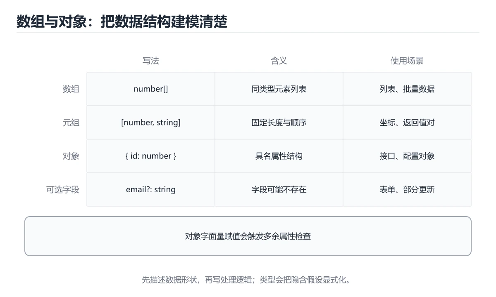
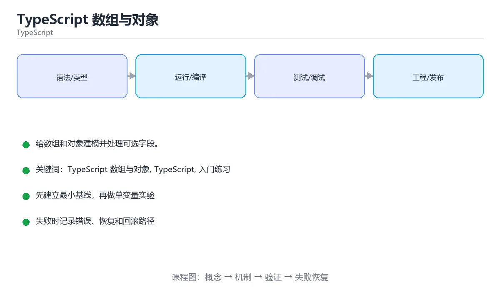

# TypeScript 数组与对象

> 内容更新时间：2026-10-06 · 学习阶段：基础 · 预计用时：30 分钟





## 本节知识框架

**课程定位**：所属分类 `typescript`（TypeScript），课程主题 `TypeScript 数组与对象`，学习阶段 基础，建议用时 45 分钟。

本课主线：给数组和对象建模并处理可选字段。

**学完本课应当能够**
- 说清 `元组 tuple` 与 `索引签名` 的含义与区别，并各举一个正例和一个反例。
- 用本课示例验证 `解构` 的行为，记录输入、输出与失败条件。
- 遇到「用索引直接访问元素」这类问题时，能说出触发条件与修复顺序。

### 复习清单

- [ ] 能不看正文复述本课核心术语，并指出一个边界或反例。
- [ ] 能运行或推演本课示例，记录输入、输出与失败现象。
- [ ] 能完成一次自测，并把错题对照错误表定位原因。

## 核心概念定义

| 术语 | 操作性定义 | 常见边界与风险 |
| --- | --- | --- |
| 元组 tuple | 固定长度且每个位置类型可以不同的数组，如 [string, number]。 | 定长与各位置类型只约束到编译期，类型编译后被擦除，外部数据仍要在边界处校验长度与形状。 |
| 索引签名 | 用 [key: string]: T 描述不定数量的同类属性。 | 值类型不一致就塞不进去；开严格索引检查后，取一个不存在的键会拿到空值，直接用就会炸。 |
| 解构 | 从数组或对象里直接取出需要的值，同时可以给默认值。 | 数组解构靠位置对齐，写成 `[, value]` 跳过首项时错位就取到键；对象解构则要求变量名与属性名一致。 |
| TypeScript | 在 JavaScript 上增加静态类型系统的语言，编译后可运行在浏览器或 Node.js。 | 编译产物仍是 JavaScript，类型标注替代不了输入校验；外部数据要在边界处验证，strict 能提前暴露 null 与隐式 any。 |
| 窄化 | 窄化只在当前控制流内有效，异步回调或闭包中类型可能重新变宽，需要重新检查或保存稳定值 | typeof、in 这类守卫出了当前控制流就失效，把窄化结果带进异步回调前要保存稳定值或重新检查。 |
| 泛型 | 泛型让函数和类型在保持类型关系的同时复用逻辑，约束 extends 限制可接受的类型 | extends 约束在 tsc 编译期生效，编译后类型参数被擦除；工具类型嵌套过深还会降低可读性。 |
| 核心结论 | 给数组和对象标注类型后，map、filter、reduce 这些链式操作会在每一步保留类型信息，写错属性名立刻就能发现。 | 写错属性名在编译期就报错，但类型正确不代表业务数据正确，链式调用接的外部输入仍要在边界处校验。 |
| 最少要写的代码 | `type Product = {` | 类型别名只描述形状、不产生运行时代码；编译后它就被擦除，光写这一行挡不住传进来的脏数据。 |
| 正确做法 | reduce 遍历两个商品，sum 依次变成 199 和 298，输出「总价 298」。 | 总价对不上时先核对 reduce 是否真被调用、每步属性名有没有写错；初值算错不会被编译器抓住，得自己复算。 |
| 最常见的错误 | 只写 `const products = [...]` 不加标注：类型虽然能推断，但跨文件复用时不清晰。 | 类型由初始值推断，局部变量够用；公共 API 与复杂对象仍要显式标注，否则跨文件复用时难以核对。 |
| 出错先查什么 | 先读第一条报错信息，再回到最小示例只改一个地方 | 连锁报错常由同一处引起，一次改好几处就分不清是哪条消除了它；先解决挡住编译的那一条。 |
| 怎么确认学会了 | 给 products 增加一个商品，确保总价结果跟着变。 | 加完商品总价没跟着变，多半是新行没满足 Product 的形状；这一步只加数据，别顺手改掉累加的写法。 |
| 和别的知识点的关系 | 本课打下的语法与思维方式会被后面每一课反复用到 | 索引签名与窄化在后续课里还会再出现，两课对同一术语的界定可能不同，衔接时先核对定义有没有被改写。 |
| 接下来做什么 | 合上教程，凭记忆把上面的最小代码重写一遍再运行 | 默写出来的代码仍要先过编译才算数：只记住形状却漏掉字段和初值，类型报错依旧挡住运行。 |

## 原理与运行机制

### 机制总览

**教材衔接：一句话入门**

给数组和对象建模并处理可选字段。

**教材衔接：TypeScript 基础机制速览**

### 编译期类型与运行时 JavaScript

TypeScript 在 JavaScript 之上增加静态类型检查，编译后类型信息会被擦除，运行时仍然是 JavaScript。因此类型标注不能替代输入校验，外部数据仍要在边界处验证。`tsc` 负责类型检查和输出，现代项目通常由构建工具调用它。开启 `strict` 能提前发现 null、隐式 any 和函数参数问题，是学习类型系统的重要反馈来源。

### 类型推断、注解与窄化

TypeScript 能从初始值推断类型，局部变量通常不需要重复写注解；公共 API、复杂对象和空值边界适合显式标注。联合类型表示“可能是几种类型之一”，通过 `typeof`、`in`、`instanceof`、判别字段和自定义类型守卫进行窄化。窄化只在当前控制流内有效，异步回调或闭包中类型可能重新变宽，需要重新检查或保存稳定值。

### 接口、类型别名与结构化类型

接口和类型别名都能描述对象形状，接口适合可扩展的公共契约，类型别名适合联合、交叉和函数类型。TypeScript 使用结构化类型：只要对象具有所需成员，就认为它满足类型，不要求显式继承。索引签名、可选属性和只读属性会影响赋值与读取。`unknown` 比 `any` 安全，使用前必须窄化；`never` 表示不可能的值，常用于穷尽检查。

### 泛型、工具类型与模块

泛型让函数和类型在保持类型关系的同时复用逻辑，约束 `extends` 限制可接受的类型。工具类型 `Partial`、`Pick`、`Omit`、`Record` 能从已有类型派生新类型，但过度嵌套会降低可读性。模块使用 `import`/`export`，类型导入使用 `import type` 可以避免生成无用运行时代码。声明文件描述第三方库的类型，缺少类型时应优先找官方类型包，而不是到处使用 any。

### 严格模式与工程实践

`strictNullChecks` 把 null 和 undefined 纳入类型系统，`noImplicitAny` 禁止隐式 any，`noUncheckedIndexedAccess` 让索引访问结果可能为 undefined。类型断言 `as` 只告诉编译器“相信我”，不会改变运行时行为；能用窄化就不用断言。类型测试、运行时校验和端到端测试要配合使用，类型正确不代表业务数据正确。

**教材衔接：版本与时效**

- 版本提示：TypeScript 数组与对象 的行为在最近几个大版本里有过调整，升级「TypeScript 数组与对象」前先用 entries 复现当前输出，再对照官方发布说明逐条核对。
- 升级「TypeScript 数组与对象」涉及的依赖前，先用 entries 复现当前行为，再逐项核对版本说明与破坏性变更。

## 典型应用场景

**教材衔接：代码实验：把示例跑成证据**

### 实验一：建立基线

```typescript
const scores: Record<string, number> = { a: 90, b: 72 };
const passed = Object.entries(scores).filter(([, value]) => value >= 80);
console.log(passed.map(([key]) => key).join(","));
```

### 实验二：只改一个输入

沿用「TypeScript 数组与对象」的最小示例做一次单变量实验：

做完后用一句话写出「TypeScript 数组与对象」的结论：输入怎么变，结果才怎么变。

### 实验三：制造一个可控错误

把 TypeScript 数组与对象 相关的那一行改成边界值（空、极值或类型不符），记录第一条错误信息、发生位置和恢复方式。

### 实验四：用三句话复述

1. 在「TypeScript 数组与对象」里，entries 接受哪些输入，非法输入应该在哪里被挡住？
2. 在 代码实验：把示例跑成证据 里，TypeScript 的状态是在什么条件下被改变的？
3. 输出如何验证，失败时第一条可观察证据是什么？

- **用索引直接访问元素**：典型现象是越界时拿到空值却没有处理；正确做法是开启严格检查并在使用前处理空值。
- **对象结构随意扩展**：典型现象是类型与真实数据不一致；正确做法是用接口或类型别名约束结构。
- **忽略数组方法的副作用**：典型现象是原数组被就地修改导致状态错乱；正确做法是明确方法是否就地修改，需要时使用不可变写法。

### 最小验证场景

- 准备：保留 `typescript` 示例的原始输入，先记录 `TypeScript 数组与对象` 的基线输出和完整运行命令。
- 观察：先核对 调用了 `reduce()`，再改变一个与 `元组 tuple` 相关的条件。
- 判定：新结果与 `TypeScript 数组与对象` 的基线不同不等于错误；只有当差异破坏了 `元组 tuple` 的定义或错误表中的约束，才判定为失败。

### 选择与边界

- 使用 `元组 tuple` 时，先满足它的定义：固定长度且每个位置类型可以不同的数组，如 [string, number]；静态检查只在编译期成立，运行期输入仍需校验。
- 使用 `索引签名` 时，先满足它的定义：用 [key: string]: T 描述不定数量的同类属性。
- 使用 `解构` 时，先满足它的定义：从数组或对象里直接取出需要的值，同时可以给默认值。
- 使用 `TypeScript` 时，先满足它的定义：在 JavaScript 上增加静态类型系统的语言，编译后可运行在浏览器或 Node.js；静态检查只在编译期成立，运行期输入仍需校验。
- 使用 `窄化` 时，先满足它的定义：窄化只在当前控制流内有效，异步回调或闭包中类型可能重新变宽，需要重新检查或保存稳定值；静态检查只在编译期成立，运行期输入仍需校验。

## 代码/协议/SQL 示例

### 最小可验证示例

**教材衔接：最小示例**

**教材衔接：预期输出**

```text
a
```

**运行方式**：运行 `TypeScript 数组与对象` 的示例时，保存为 `.ts` 后先编译或用 `ts-node` 运行；类型报错先解决再运行。

## 时间/空间复杂度或性能分析

**性能关注点（TypeScript 数组与对象）**：编译期类型检查与运行期代码是两套开销：分别记录构建时间与运行时耗时。

**本课特有开销（TypeScript 数组与对象 · TypeScript 数组与对象）**：索引能减少扫描行数，但会增加写入与存储开销，需要同时记录读、写两侧代价。

**测量方法**：以 `TypeScript 数组与对象` 的 `TypeScript 数组与对象` 场景为对象，固定输入跑一遍记录基线，再把规模或并发度提高一个数量级复测；两次结果的差值与波动范围才是结论依据。

## 常见误区与易错点

| 容易写错的做法 | 实际现象 | 原因与正确做法 |
| --- | --- | --- |
| 用索引直接访问元素 | 越界时拿到空值却没有处理。 | 开启严格检查并在使用前处理空值。 |
| 对象结构随意扩展 | 类型与真实数据不一致。 | 用接口或类型别名约束结构。 |
| 忽略数组方法的副作用 | 原数组被就地修改导致状态错乱。 | 明确方法是否就地修改，需要时使用不可变写法。 |

### 现场 1：用索引直接访问元素

**症状**：越界时拿到空值却没有处理。

**根因与修复**：开启严格检查并在使用前处理空值。

**自检**：在本课示例里复现「用索引直接访问元素」，改成开启严格检查并在使用前处理空值后重跑；如果症状消失且失败路径按预期变化，说明定位正确。

### 现场 2：对象结构随意扩展

**症状**：类型与真实数据不一致。

**根因与修复**：用接口或类型别名约束结构。

**自检**：在本课示例里复现「对象结构随意扩展」，改成用接口或类型别名约束结构后重跑；如果症状消失且失败路径按预期变化，说明定位正确。

### 现场 3：忽略数组方法的副作用

**症状**：原数组被就地修改导致状态错乱。

**根因与修复**：明确方法是否就地修改，需要时使用不可变写法。

**自检**：在本课示例里复现「忽略数组方法的副作用」，改成明确方法是否就地修改，需要时使用不可变写法后重跑；如果症状消失且失败路径按预期变化，说明定位正确。

## 与其他知识点的关系

**教材衔接：复习与迁移**

## 自测题与参考答案

> 先独立作答，再对照参考答案；答案都能在本课正文、术语表或错误表里找到依据。

### 自测 1（概念复述）

不看正文，写出 `元组 tuple` 的操作性定义，并说明它与 `索引签名` 的区别。

**参考答案**：固定长度且每个位置类型可以不同的数组，如 [string, number]。

`索引签名` 的定位是：用 [key: string]: T 描述不定数量的同类属性；两者的差别要从适用对象与失败模式上说明。

### 自测 2（排错）

本课错误表记录了「用索引直接访问元素」这类做法。请写出它会出现的现象、根因，以及修复顺序。

**参考答案**：现象是越界时拿到空值却没有处理；正确做法是开启严格检查并在使用前处理空值。修复时先复现现象并保留证据，再改动一处假设重跑，确认现象消失。

### 自测 3（动手验证）

运行本课的 `typescript` 示例，把其中的 `"键盘"` 换成一个边界值后重新运行，记录输出与错误信息。

**参考答案**：正常输入下 `typescript` 示例应当复现正文给出的结果；把 `"键盘"` 换成边界值后，如果结果改变或报错，先核对它是否满足 `TypeScript 数组与对象` 中`元组 tuple` 的适用范围，再检查错误表里是否有同类现象。

### 自测 4（代码阅读）

阅读本课开头的 `typescript` 示例，说明它体现了`元组 tuple` 的哪一条性质，并指出改动哪个输入会让这条性质不再成立。

**参考答案**：`元组 tuple` 的定义是 固定长度且每个位置类型可以不同的数组，如 [string, number]，示例正是在实现这条定义。改动与 `元组 tuple` 有关的一个输入后，如果结果不再符合 `TypeScript 数组与对象` 的正文描述，就说明该性质只在当前前提成立。

### 自测 5（迁移）

把 `TypeScript 数组与对象` 的方法迁移到自己的项目：围绕 `元组 tuple` 写出一个与错误表同类的风险点，并说明触发条件和检验方式。

**参考答案**：例如「忽略数组方法的副作用」，它会导致原数组被就地修改导致状态错乱；检验方式是按明确方法是否就地修改，需要时使用不可变写法改一处再复现，确认现象消失且没有引入新的失败分支。

### 自测 6（对比）

用一个表格对比 `元组 tuple` 与 `索引签名`：各写一行适用场景、一行失败表现。

**参考答案**：`元组 tuple` 的定义是固定长度且每个位置类型可以不同的数组，如 [string, number]；`索引签名` 的定义是用 [key: string]: T 描述不定数量的同类属性。两者的失败表现分别对应本课错误表里与本术语相关的行。

### 自测 7（排错顺序）

面对「用索引直接访问元素」引发的问题，请把“复现 越界时拿到空值却没有处理 → 保留证据 → 开启严格检查并在使用前处理空值 → 回归验证”四步写成可执行的检查清单。

**参考答案**：第一步按越界时拿到空值却没有处理复现；第二步记录输入、版本与完整报错；第三步按开启严格检查并在使用前处理空值只改一处；第四步重跑并确认失败路径也按预期变化。

### 自测 8（边界判断）

针对 `泛型`，分别写出“可以使用”的条件和“结论不再成立”的条件。

**参考答案**：静态检查只在编译期成立，运行期输入仍需校验。 同时要把 `泛型` 的定义 泛型让函数和类型在保持类型关系的同时复用逻辑，约束 extends 限制可接受的类型 与实际输入逐项对照。

### 自测 9（机制重建）

不看正文，按输入、转换、输出、验证四段重建 `元组 tuple` → `索引签名` → `解构` → `TypeScript` 的作用链。

**参考答案**：起点是 `元组 tuple` 的定义 固定长度且每个位置类型可以不同的数组，如 [string, number]；中间每一步都保留可观察状态；终点由 `泛型` 检查，失败时回到错误表定位第一个偏离定义的步骤。

### 自测 10（综合排错）

在 `TypeScript 数组与对象` 中，现象是 原数组被就地修改导致状态错乱。请围绕 忽略数组方法的副作用 写出最小复现、关键证据、修复动作和回归验证，并说明为什么不能只凭一次运行下结论。

**参考答案**：先复现 忽略数组方法的副作用，记录输入与完整错误；再按 明确方法是否就地修改，需要时使用不可变写法 只改一处。回归时同时跑正常路径和边界路径，只有两次结果都可解释，才把修复视为完成。

### 自测 11（一分钟复述）

用每分钟约 200 字的速度复述 `TypeScript 数组与对象`：先给主问题，再按顺序说出 `元组 tuple`、`索引签名`、`解构`、`TypeScript`，最后给一个失败案例。

**自评标准**：主问题必须对应 给数组和对象建模并处理可选字段；每个术语都要能接上一句定义或边界；失败案例必须写成可观察现象，不能用“可能有风险”代替证据。

## 术语速查

| 术语 | 一句话说明 |
| --- | --- |
| `元组 tuple` | 固定长度且每个位置类型可以不同的数组，如 [string, number]。 |
| `索引签名` | 用 [key: string]: T 描述不定数量的同类属性。 |
| `解构` | 从数组或对象里直接取出需要的值，同时可以给默认值。 |
| `TypeScript` | 在 JavaScript 上增加静态类型系统的语言，编译后可运行在浏览器或 Node.js。 |
| `窄化` | 窄化只在当前控制流内有效，异步回调或闭包中类型可能重新变宽，需要重新检查或保存稳定值。 |
| `泛型` | 泛型让函数和类型在保持类型关系的同时复用逻辑，约束 extends 限制可接受的类型。 |

**术语关系**：`元组 tuple`（固定长度且每个位置类型可以不同的数组） → `索引签名`（用 [key: string]: T 描述不定数量的同类属性） → `解构`（从数组或对象里直接取出需要的值） → `TypeScript`（在 JavaScript 上增加静态类型系统的语言）。

## 考点精讲

`TypeScript 数组与对象` 的题库有 5 道题，下面逐题给出题干、正确项与判断依据：先自己作答，再核对正确项，最后回到正文对应小节复核。

### 考点 1：第 1 题

- **题目**：围绕“TypeScript 数组与对象”中的 TypeScript 数组与对象、TypeScript、入门练习，下列哪两项是本课强调的实践判断？
- **正确项**：验证 TypeScript 时要固定版本并覆盖边界输入，结论才可复现；学习 TypeScript 数组与对象 时要同时说明输入、输出和失败路径，不能只看正常流程
- **判断依据**：按《TypeScript 数组与对象》的正文口径，本题要同时选中「验证 TypeScript 时要固定版本并覆盖边界输入，结论才可复现」、「学习 TypeScript 数组与对象 时要同时说明输入、输出和失败路径，不能只看正常流程」，漏掉任一项都算没答全。术语 TypeScript（TypeScript 数组与对象）：在 JavaScript 上增加静态类型系统的语言，编译后可运行在浏览器或 Node.js。易错点是用索引直接访问元素，会造成越界时拿到空值却没有处理，改法是开启严格检查并在使用前处理空值。

### 考点 2：第 2 题

- **题目**：Object.entries(scores) 的返回类型特点是什么？
- **正确项**：每个元素是「键, 值」组成的元组，可以解构读取
- **判断依据**：本题正确项是「每个元素是「键, 值」组成的元组，可以解构读取」。术语 解构（TypeScript 数组与对象）：从数组或对象里直接取出需要的值，同时可以给默认值，本题取「每个元素是「键, 值」组成的元组，可以解构读取」这条。易错点是对象结构随意扩展，会造成类型与真实数据不一致，改法是用接口或类型别名约束结构。

### 考点 3：第 3 题

- **题目**：这段 `typescript` 代码对应 `TypeScript 数组与对象` 的 `元组 tuple`。课程要解决的是给数组和对象建模并处理可选字段。关于代码内容，哪一项说法准确？
- **正确项**：调用了 `Object.entries()`
- **判断依据**：本题正确项是「调用了 `Object.entries()`」。术语 元组 tuple（TypeScript 数组与对象）：固定长度且每个位置类型可以不同的数组，如 [string, number]，本题取「调用了 `Object.entries()`」这条。易错点是忽略数组方法的副作用，会造成原数组被就地修改导致状态错乱，改法是明确方法是否就地修改，需要时使用不可变写法。本题干扰项「出现字面量 `replicas`」不成立：展示代码里找不到 `replicas`。

### 考点 4：第 4 题

- **题目**：TypeScript 数组与对象示例运行后输出什么？
- **正确项**：a，过滤出分数不低于 80 的键并以逗号连接
- **判断依据**：本题正确项是「a，过滤出分数不低于 80 的键并以逗号连接」。术语 TypeScript（TypeScript 数组与对象）：在 JavaScript 上增加静态类型系统的语言，编译后可运行在浏览器或 Node.js，本题取「a，过滤出分数不低于 80 的键并以逗号连接」这条。易错点是用索引直接访问元素，会造成越界时拿到空值却没有处理，改法是开启严格检查并在使用前处理空值。

### 考点 5：第 5 题

- **题目**：填空：补齐下面这段术语说明中的空缺。课程 `给数组和对象建模并处理可选字段。`，这段说明是：`____`：在 JavaScript 上增加静态类型系统的语言，编译后可运行在浏览器或 Node.js。空缺处应填哪个术语？
- **正确项**：TypeScript
- **判断依据**：《TypeScript 数组与对象》这题的填空口径是「TypeScript」或「typescript」，正文写法与其中任一项一致即可。术语「TypeScript」在本课里的界定是在 JavaScript 上增加静态类型系统的语言，编译后可运行在浏览器或 Node.js（TypeScript 数组与对象），题干问的就是这一条。常见错法是用索引直接访问元素，其后果是越界时拿到空值却没有处理。正确做法是开启严格检查并在使用前处理空值。

### 考点 6：`元组 tuple`

- **要点**：固定长度且每个位置类型可以不同的数组，如 [string, number]。
- **元组 tuple 的边界**：静态检查只在编译期成立，运行期输入仍需校验。

### 考点 7：`索引签名`

- **要点**：用 [key: string]: T 描述不定数量的同类属性。

### 考点 8：`解构`

- **要点**：从数组或对象里直接取出需要的值，同时可以给默认值。

### 考点 9：`TypeScript`

- **要点**：在 JavaScript 上增加静态类型系统的语言，编译后可运行在浏览器或 Node.js。
- **TypeScript 的边界**：静态检查只在编译期成立，运行期输入仍需校验。

### 考点 10：`窄化`

- **要点**：窄化只在当前控制流内有效，异步回调或闭包中类型可能重新变宽，需要重新检查或保存稳定值
- **窄化 的边界**：静态检查只在编译期成立，运行期输入仍需校验。

### 考点 11：`泛型`

- **要点**：泛型让函数和类型在保持类型关系的同时复用逻辑，约束 extends 限制可接受的类型
- **泛型 的边界**：静态检查只在编译期成立，运行期输入仍需校验。

### 考点 12：排错——用索引直接访问元素

- **现象**：越界时拿到空值却没有处理。
- **处理**：开启严格检查并在使用前处理空值。

### 考点 13：排错——对象结构随意扩展

- **现象**：类型与真实数据不一致。
- **处理**：用接口或类型别名约束结构。

### 考点 14：综合辨析——`元组 tuple` 与 `泛型`

- **辨析点**：`元组 tuple` 的定义是 固定长度且每个位置类型可以不同的数组，如 [string, number]；`泛型` 的定义是 泛型让函数和类型在保持类型关系的同时复用逻辑，约束 extends 限制可接受的类型。
- **答题要求**：面对 `TypeScript 数组与对象` 的题目，先判断描述的是 `元组 tuple` 还是 `泛型`，再归到对应定义，最后写出一个会让该定义失效的边界输入。

### 考点 15：排错评分点

- **现象分**：能写出 越界时拿到空值却没有处理，而不是只写“程序有错”。
- **证据分**：保留触发 用索引直接访问元素 的输入、版本和错误原文。
- **修复分**：按 开启严格检查并在使用前处理空值 只改一处，并同时回归正常路径与边界路径。

## 内容元数据

- 内容版本：v2.0
- 最后更新：2026-10-06
- 学习阶段：基础
- 适用环境：TypeScript 5.x / Node.js 22+
；本课聚焦 TypeScript 数组与对象。
- 内容来源：内置结构化课程与工程实践整理
- 相关主题：TypeScript 数组与对象、TypeScript、入门练习
- 质量版本：P0 测验标准 + P1 覆盖扩展 + P2 体验补全

## 参考资料与复核

- 最后复核：2026-10-04
- 下次复核：2027-03-17
- 复核范围：版本兼容、API 行为、安全建议与工程实践
- 来源性质：官方文档、标准或权威教材；本课核对关键词：TypeScript 数组与对象、TypeScript、入门练习。

| 参考资料 | 本课用途 |
| --- | --- |
| [TypeScript Handbook](https://www.typescriptlang.org/docs/handbook/intro.html) | 类型系统与语言指南 |
| [Utility Types](https://www.typescriptlang.org/docs/handbook/utility-types.html) | 内置类型变换 |
| [泛型文档](https://www.typescriptlang.org/docs/handbook/2/generics.html) | 泛型约束与复用 |

| [本课术语索引：TypeScript 数组与对象](#核心概念定义) | 按本课输入、术语边界和错误表现逐项核对 |
> 「TypeScript 数组与对象」的链接用于离线阅读后的延伸核对；App 不会自动联网。