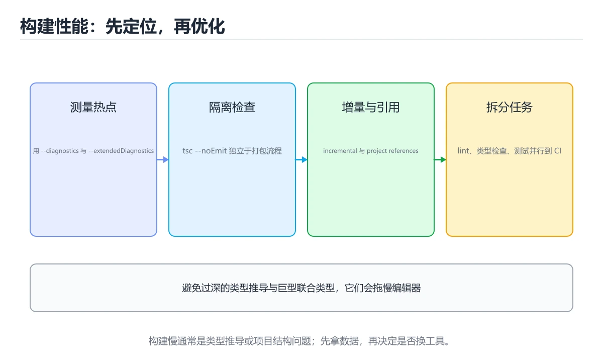
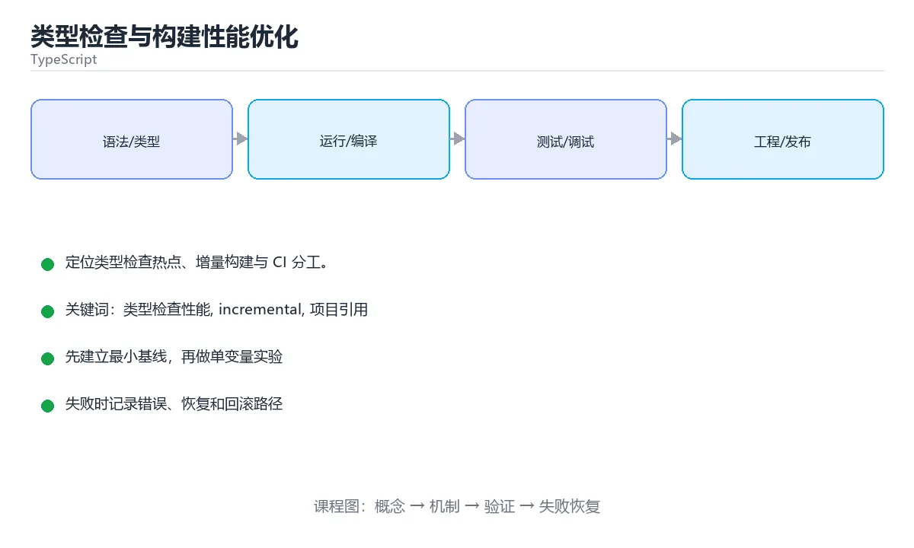

# 类型检查与构建性能优化

> 内容更新时间：2026-10-06 · 学习阶段：高级 · 预计用时：40 分钟





## 本节知识框架

**课程定位**：所属分类 `typescript`（TypeScript），课程主题 `类型检查与构建性能优化`，学习阶段 高级，建议用时 45 分钟。

本课主线：定位类型检查热点、增量构建与 CI 分工。

**学完本课应当能够**
- 说清 `项目引用` 与 `增量编译` 的含义与区别，并各举一个正例和一个反例。
- 用本课示例验证 `转译器` 的行为，记录输入、输出与失败条件。
- 遇到「没有基线数据」这类问题时，能说出触发条件与修复顺序。

### 复习清单

- [ ] 能不看正文复述本课核心术语，并指出一个边界或反例。
- [ ] 能运行或推演本课示例，记录输入、输出与失败现象。
- [ ] 能完成一次自测，并把错题对照错误表定位原因。

## 核心概念定义

| 术语 | 操作性定义 | 常见边界与风险 |
| --- | --- | --- |
| 项目引用 | TypeScript 把多个工程拆分并用引用表达构建依赖，支持增量构建。 | 易错：改一行全量检查；正确做法是用项目引用拆分。 |
| 增量编译 | 复用上次的构建信息只重编译改动的部分，注意及时清理缓存避免脏产物。 | 它靠 `.tsbuildinfo` 复用上次结果：缓存被删就退回每次都全量，产物不洁时还要及时清掉重来。 |
| 转译器 | esbuild、swc 这类只做语法转换的高速工具，负责开发期速度而不做类型检查。 | esbuild、swc 只换语法不查类型，类型错误会被原样带进产物；开发期用它们，提交前仍要单独跑 tsc。 |
| 类型检查门禁 | 在 CI 里单独运行 tsc --noEmit，保证类型错误不会被转译器吞掉。 | 这道 `tsc --noEmit` 不能由转译或打包顶替：只跑打包不跑它，类型错误就跟着产物进了线上。 |
| 巨量联合类型（上千成员） | 每处判断都要遍历 | 易错：把上百个字面量拼成一个巨型 union 到处判断，每次类型收窄都要遍历一遍才快不起来；应拆成多个小 union。 |
| 递归类型无深度限制 | 推导爆炸 | 易错：递归类型没有终止深度，编译器一路展开就推导爆炸；要给它设递归出口，或把中间结果抽成具名类型缓存。 |
| 交叉类型层层叠加 | 属性合并极慢 | 易错：用 & 把很多小类型层层叠加，属性合并开销随层数上涨、报错也更难读；该扁平成一个明确接口而非无限交叉。 |
| 在类型里做复杂字符串运算 | 编译器负担重 | 类型层的字符串拼接每处收窄都要重新推导，负担压在编译器上；该简化就简化，或抽成具名类型缓存结果。 |
| 全量 include 包含测试与脚本 | 检查范围膨胀 | 易错：include 一把罩进 tests、scripts 和生成物，参与检查的文件数暴涨；日常只留 src，测试交给 CI 单独跑。 |

## 原理与运行机制

### 机制总览

**教材衔接：CI 中的分工**

| 阶段 | 工具 | 目的 |
| --- | --- | --- |
| 转译 / 打包 | esbuild、SWC、Vite | 快速产出产物 |
| 类型检查 | `tsc --noEmit` | 独立门禁，不可省略 |
| 体积门禁 | 打包分析 | 主包超过阈值则失败 |
| 缓存 | 依赖与 tsbuildinfo | 加速重复构建 |

注意：**打包器不做类型检查**，CI 必须单独跑一次 `tsc --noEmit`。

**教材衔接：版本与时效**

- 版本提示：类型检查性能 的行为在最近几个大版本里有过调整，升级「类型检查与构建性能优化」前先用 compilerOptions 复现当前输出，再对照官方发布说明逐条核对。
- 升级「类型检查与构建性能优化」涉及的依赖前，先用 compilerOptions 复现当前行为，再逐项核对版本说明与破坏性变更。

## 典型应用场景

- **没有基线数据**：典型现象是不知道优化有没有效果；正确做法是先用 `--extendedDiagnostics`。
- **删掉 `.tsbuildinfo`**：典型现象是每次都全量；正确做法是加入缓存并保留。
- **把 `skipLibCheck` 当万能**：典型现象是自己代码的问题被掩盖；正确做法是它只跳第三方声明。
- **用 barrel 全量导出**：典型现象是检查范围爆炸；正确做法是直接从具体模块导入。

### 最小验证场景

- 准备：保留 `jsonc` 示例的原始输入，先记录 `类型检查与构建性能优化` 的基线输出和完整运行命令。
- 观察：先核对 出现字面量 `compilerOptions`，再改变一个与 `项目引用` 相关的条件。
- 判定：新结果与 `类型检查与构建性能优化` 的基线不同不等于错误；只有当差异破坏了 `项目引用` 的定义或错误表中的约束，才判定为失败。

### 选择与边界

- 使用 `项目引用` 时，先满足它的定义：TypeScript 把多个工程拆分并用引用表达构建依赖，支持增量构建；易错：改一行全量检查；正确做法是用项目引用拆分。
- 使用 `增量编译` 时，先满足它的定义：复用上次的构建信息只重编译改动的部分，注意及时清理缓存避免脏产物；静态检查只在编译期成立，运行期输入仍需校验。
- 使用 `转译器` 时，先满足它的定义：esbuild、swc 这类只做语法转换的高速工具，负责开发期速度而不做类型检查；静态检查只在编译期成立，运行期输入仍需校验。
- 使用 `类型检查门禁` 时，先满足它的定义：在 CI 里单独运行 tsc --noEmit，保证类型错误不会被转译器吞掉；静态检查只在编译期成立，运行期输入仍需校验。

## 代码/协议/SQL 示例

### 最小可验证示例

```jsonc
// 推荐的 tsconfig 组合：类型检查快、职责清晰
{
  "compilerOptions": {
    "incremental": true,
    "tsBuildInfoFile": "./node_modules/.cache/tsbuildinfo",
    "skipLibCheck": true,
    "strict": true,
    "noEmit": true,
    "isolatedModules": true,
    "moduleDetection": "force"
  },
  "include": ["src", "tests", "types"],
  "exclude": ["dist", "node_modules", "coverage"]
}
```

**教材衔接：提速手段速查**

| 手段 | 效果 | 代价 |
| --- | --- | --- |
| `skipLibCheck: true` | 跳过依赖声明文件检查 | 依赖类型错误不会被发现 |
| 项目引用 + `composite` | 只重检查改动项目 | 配置复杂 |
| `incremental` + `tsBuildInfoFile` | 复用上次结果 | 需要缓存产物 |
| 收窄 `include` | 减少参与文件 | 需确保不漏文件 |
| 避免巨型联合与深层泛型 | 减少推导爆炸 | 需要重构类型 |
| 拆包与懒加载 | 减小主包体积 | 增加分包复杂度 |
| 用 SWC / esbuild 转译 | 转译极快 | 不做类型检查，需单独跑 tsc |

```json
{
  "scripts": {
    "typecheck": "tsc --noEmit",
    "typecheck:trace": "tsc --noEmit --generateTrace .trace",
    "build": "vite build",
    "size": "source-map-explorer dist/assets/*.js"
  }
}
```

**教材衔接：零基础详解：让 TypeScript 构建变快**

### 一句话说清它是什么

大项目变慢通常来自三处：**类型检查太慢、重复构建、缓存没命中**。
解决思路是：拆分项目、增量构建、并行与缓存，以及别让类型检查挡住开发。

### 用生活比喻理解

| 手段 | 比喻 | 说明 |
| --- | --- | --- |
| 项目引用 | 分车间生产 | 每个子项目独立编译 |
| 增量构建 | 只修坏掉的零件 | 用 `.tsbuildinfo` 记录状态 |
| 转译器 | 快速流水线 | esbuild 与 swc 只转译不检查 |
| 缓存 | 复用上次成果 | 输入没变就不重跑 |
| 并行 | 多线开工 | 多个包同时构建 |

### 第一步：先测量，别猜

```bash
# 类型检查耗时
time npx tsc --noEmit --extendedDiagnostics

# 看哪些文件最耗时
npx tsc --noEmit --generateTrace trace
npx @typescript/analyze-trace trace
```

`--extendedDiagnostics` 会输出「检查了多少文件、用了多少内存、最慢的环节」，先看这些数字。

### 第二步：项目引用与增量

```json
// 根 tsconfig.json
{
  "files": [],
  "references": [
    { "path": "./packages/types" },
    { "path": "./packages/ui" },
    { "path": "./apps/web" }
  ]
}
```

```json
// packages/ui/tsconfig.json
{
  "extends": "../config/tsconfig.base.json",
  "compilerOptions": {
    "composite": true,
    "incremental": true,
    "tsBuildInfoFile": "./dist/.tsbuildinfo",
    "declaration": true,
    "outDir": "./dist",
    "rootDir": "./src"
  },
  "include": ["src"]
}
```

```bash
npx tsc --build          # 只重新编译有变化的部分
npx tsc --build --clean  # 清理
```

### 第三步：开发用转译，提交前再检查

| 场景 | 工具 | 说明 |
| --- | --- | --- |
| 本地开发热更新 | Vite、esbuild、swc | 只转译，毫秒级反馈 |
| 提交前与 CI | `tsc --noEmit` | 完整类型检查 |
| 库产物 | tsup、rollup | 产出 ESM/CJS 与 d.ts |

**不要指望打包器做类型检查**，两边分工才能又快又稳。

### 第四步：配置层面的提速开关

```json
{
  "compilerOptions": {
    "incremental": true,
    "skipLibCheck": true,
    "isolatedModules": true,
    "moduleDetection": "force",
    "noEmit": true
  },
  "exclude": ["node_modules", "dist", "**/*.test.ts"]
}
```

| 选项 | 作用 | 注意 |
| --- | --- | --- |
| `incremental` | 复用上次结果 | 保留 `.tsbuildinfo` |
| `skipLibCheck` | 跳过第三方声明检查 | 只跳第三方，不跳自己的代码 |
| `exclude` 测试文件 | 减少检查量 | CI 里再单独检查测试 |
| `isolatedModules` | 每个文件独立转译 | 兼容 esbuild 与 swc |
| `composite` | 支持项目引用 | 必须配 `declaration` |

### 第五步：CI 里的并行与缓存

```yaml
jobs:
  typecheck:
    steps:
      - uses: actions/checkout@v4
      - uses: actions/setup-node@v4
        with: { node-version: 22, cache: npm }
      - run: npm ci
      - uses: actions/cache@v4
        with:
          path: "**/*.tsbuildinfo"
          key: tsbuild-${{ github.sha }}
          restore-keys: tsbuild-
      - run: npx tsc --build
```

在 monorepo 里再配合 `turbo run typecheck --filter='...[origin/main]'`，只检查受影响的包。

### 什么时候该重构而不是调参数

| 症状 | 建议 |
| --- | --- |
| 单个文件几千行 | 拆分模块 |
| 类型体操层层嵌套 | 简化或加缓存类型 |
| 一个包要检查上万文件 | 按职责拆成多个子项目 |
| 循环依赖多 | 抽出公共包 |
| 每个文件都 import 整个 barrel | 直接从具体文件导入 |

**barrel 文件（`index.ts` 汇总导出）很方便，但会让类型检查范围大幅膨胀**，大项目里要谨慎。

### 新手最容易踩的八个坑

| 坑 | 现象 | 正确做法 |
| --- | --- | --- |
| 没有基线数据 | 不知道优化有没有效果 | 先用 `--extendedDiagnostics` |
| 删掉 `.tsbuildinfo` | 每次都全量 | 加入缓存并保留 |
| 把 `skipLibCheck` 当万能 | 自己代码的问题被掩盖 | 它只跳第三方声明 |
| 用 barrel 全量导出 | 检查范围爆炸 | 直接从具体模块导入 |
| 开发时跑完整类型检查 | 热更新变慢 | 开发用转译，提交前检查 |
| CI 每次都全量构建 | 时间随代码线性增长 | 增量加受影响分析 |
| 单进程串行跑所有包 | 浪费机器 | 并行 job 或任务编排 |
| 只看总耗时 | 找不到瓶颈 | 看 trace 定位 |

### 学完自测

- [ ] 能说出项目引用解决的什么问题。
- [ ] 知道 `incremental` 依赖哪个文件。
- [ ] 能说出 `skipLibCheck` 的边界。
- [ ] 知道为什么 barrel 文件会拖慢类型检查。
- [ ] 能说出 CI 里加速的三条手段。

## 时间/空间复杂度或性能分析

| 手段 | 命令 | 看什么 |
| --- | --- | --- |
| 生成耗时报告 | `tsc --noEmit --extendedDiagnostics` | 总时间、文件数、类型数 |
| 定位最慢文件 | `tsc --noEmit --generateTrace trace` | trace 里的耗时热点 |
| 检查项目引用 | `tsc --build --verbose` | 是否真的增量 |
| 打包分析 | `vite build --mode analyze` 或 source-map-explorer | 产物体积构成 |
| 依赖体积 | `npx vite-bundle-visualizer` | 哪个依赖最大 |

**测量方法**：以 `类型检查与构建性能优化` 的 `类型检查性能` 场景为对象，固定输入跑一遍记录基线，再把规模或并发度提高一个数量级复测；两次结果的差值与波动范围才是结论依据。

## 常见误区与易错点

| 容易写错的做法 | 实际现象 | 原因与正确做法 |
| --- | --- | --- |
| 没有基线数据 | 不知道优化有没有效果 | 先用 `--extendedDiagnostics` |
| 删掉 `.tsbuildinfo` | 每次都全量 | 加入缓存并保留 |
| 把 `skipLibCheck` 当万能 | 自己代码的问题被掩盖 | 它只跳第三方声明 |
| 用 barrel 全量导出 | 检查范围爆炸 | 直接从具体模块导入 |
| 开发时跑完整类型检查 | 热更新变慢 | 开发用转译，提交前检查 |
| CI 每次都全量构建 | 时间随代码线性增长 | 增量加受影响分析 |
| 单进程串行跑所有包 | 浪费机器 | 并行 job 或任务编排 |
| 只看总耗时 | 找不到瓶颈 | 看 trace 定位 |
| 用 `skipLibCheck` 掩盖自身错误 | 自己的类型错误仍在 | 它只跳过 .d.ts，按需使用 |
| 只跑打包不跑类型检查 | 类型错误进线上 | CI 加 `tsc --noEmit` |
| 打开 incremental 但不缓存产物 | 每次都全量 | CI 持久化 tsbuildinfo |
| 单项目包含所有代码 | 改一行全量检查 | 用项目引用拆分 |
| 盲目内联所有依赖 | 主包巨大 | 按路由拆包、懒加载 |
| 只看构建总时长 | 不知优化方向 | 用 extendedDiagnostics 定位 |
| 用 skipLibCheck 掩盖自身错误 | 自己的类型错误仍在。 | 它只跳过 .d.ts，按需使用。 |

### 现场 1：没有基线数据

**症状**：不知道优化有没有效果。

**根因与修复**：先用 `--extendedDiagnostics`。

**自检**：在本课示例里复现「没有基线数据」，改成先用 `--extendedDiagnostics`后重跑；如果症状消失且失败路径按预期变化，说明定位正确。

### 现场 2：删掉 `.tsbuildinfo`

**症状**：每次都全量。

**根因与修复**：加入缓存并保留。

**自检**：在本课示例里复现「删掉 `.tsbuildinfo`」，改成加入缓存并保留后重跑；如果症状消失且失败路径按预期变化，说明定位正确。

### 现场 3：把 `skipLibCheck` 当万能

**症状**：自己代码的问题被掩盖。

**根因与修复**：它只跳第三方声明。

**自检**：在本课示例里复现「把 `skipLibCheck` 当万能」，改成它只跳第三方声明后重跑；如果症状消失且失败路径按预期变化，说明定位正确。

### 现场 4：用 barrel 全量导出

**症状**：检查范围爆炸。

**根因与修复**：直接从具体模块导入。

**自检**：在本课示例里复现「用 barrel 全量导出」，改成直接从具体模块导入后重跑；如果症状消失且失败路径按预期变化，说明定位正确。

### 现场 5：开发时跑完整类型检查

**症状**：热更新变慢。

**根因与修复**：开发用转译，提交前检查。

**自检**：在本课示例里复现「开发时跑完整类型检查」，改成开发用转译，提交前检查后重跑；如果症状消失且失败路径按预期变化，说明定位正确。

### 现场 6：CI 每次都全量构建

**症状**：时间随代码线性增长。

**根因与修复**：增量加受影响分析。

**自检**：在本课示例里复现「CI 每次都全量构建」，改成增量加受影响分析后重跑；如果症状消失且失败路径按预期变化，说明定位正确。

### 现场 7：单进程串行跑所有包

**症状**：浪费机器。

**根因与修复**：并行 job 或任务编排。

**自检**：在本课示例里复现「单进程串行跑所有包」，改成并行 job 或任务编排后重跑；如果症状消失且失败路径按预期变化，说明定位正确。

### 现场 8：只看总耗时

**症状**：找不到瓶颈。

**根因与修复**：看 trace 定位。

**自检**：在本课示例里复现「只看总耗时」，改成看 trace 定位后重跑；如果症状消失且失败路径按预期变化，说明定位正确。

### 现场 9：用 `skipLibCheck` 掩盖自身错误

**症状**：自己的类型错误仍在。

**根因与修复**：它只跳过 .d.ts，按需使用。

**自检**：在本课示例里复现「用 `skipLibCheck` 掩盖自身错误」，改成它只跳过 .d.ts，按需使用后重跑；如果症状消失且失败路径按预期变化，说明定位正确。

## 与其他知识点的关系

- **先修**：`TypeScript 测试策略`。本课默认这些内容已经掌握。
- **相关或后续**：`实战：TypeScript 类型安全 CLI`。本课术语会在这些课程里继续使用。
- **术语归属**：`项目引用`、`增量编译`、`转译器` 的定义以本课「核心概念定义」为准，换到其他课程时先确认定义是否被改写。
- 同一分类的《TypeScript 编译与运行性能》也涉及 `项目引用`；两课衔接时先确认这个术语的定义是否一致。

## 自测题与参考答案

> 先独立作答，再对照参考答案；答案都能在本课正文、术语表或错误表里找到依据。

### 自测 1（概念复述）

不看正文，写出 `项目引用` 的操作性定义，并说明它与 `增量编译` 的区别。

**参考答案**：TypeScript 把多个工程拆分并用引用表达构建依赖，支持增量构建。

`增量编译` 的定位是：复用上次的构建信息只重编译改动的部分，注意及时清理缓存避免脏产物；两者的差别要从适用对象与失败模式上说明。

### 自测 2（排错）

本课错误表记录了「没有基线数据」这类做法。请写出它会出现的现象、根因，以及修复顺序。

**参考答案**：现象是不知道优化有没有效果；正确做法是先用 `--extendedDiagnostics`。修复时先复现现象并保留证据，再改动一处假设重跑，确认现象消失。

### 自测 3（动手验证）

运行本课的 `jsonc` 示例，把其中的 `"compilerOptions"` 换成一个边界值后重新运行，记录输出与错误信息。

**参考答案**：正常输入下 `jsonc` 示例应当复现正文给出的结果；把 `"compilerOptions"` 换成边界值后，如果结果改变或报错，先核对它是否满足 `类型检查与构建性能优化` 中`项目引用` 的适用范围，再检查错误表里是否有同类现象。

### 自测 4（代码阅读）

阅读本课开头的 `jsonc` 示例，说明它体现了`项目引用` 的哪一条性质，并指出改动哪个输入会让这条性质不再成立。

**参考答案**：`项目引用` 的定义是 TypeScript 把多个工程拆分并用引用表达构建依赖，支持增量构建，示例正是在实现这条定义。改动与 `项目引用` 有关的一个输入后，如果结果不再符合 `类型检查与构建性能优化` 的正文描述，就说明该性质只在当前前提成立。

### 自测 5（迁移）

把 `类型检查与构建性能优化` 的方法迁移到自己的项目：围绕 `项目引用` 写出一个与错误表同类的风险点，并说明触发条件和检验方式。

**参考答案**：例如「用 skipLibCheck 掩盖自身错误」，它会导致自己的类型错误仍在；检验方式是按它只跳过 .d.ts，按需使用改一处再复现，确认现象消失且没有引入新的失败分支。

### 自测 6（对比）

用一个表格对比 `项目引用` 与 `增量编译`：各写一行适用场景、一行失败表现。

**参考答案**：`项目引用` 的定义是TypeScript 把多个工程拆分并用引用表达构建依赖，支持增量构建；`增量编译` 的定义是复用上次的构建信息只重编译改动的部分，注意及时清理缓存避免脏产物。两者的失败表现分别对应本课错误表里与本术语相关的行。

### 自测 7（排错顺序）

面对「没有基线数据」引发的问题，请把“复现 不知道优化有没有效果 → 保留证据 → 先用 `--extendedDiagnostics` → 回归验证”四步写成可执行的检查清单。

**参考答案**：第一步按不知道优化有没有效果复现；第二步记录输入、版本与完整报错；第三步按先用 `--extendedDiagnostics`只改一处；第四步重跑并确认失败路径也按预期变化。

### 自测 8（边界判断）

针对 `类型检查门禁`，分别写出“可以使用”的条件和“结论不再成立”的条件。

**参考答案**：静态检查只在编译期成立，运行期输入仍需校验。 同时要把 `类型检查门禁` 的定义 在 CI 里单独运行 tsc --noEmit，保证类型错误不会被转译器吞掉 与实际输入逐项对照。

### 自测 9（机制重建）

不看正文，按输入、转换、输出、验证四段重建 `项目引用` → `增量编译` → `转译器` → `类型检查门禁` 的作用链。

**参考答案**：起点是 `项目引用` 的定义 TypeScript 把多个工程拆分并用引用表达构建依赖，支持增量构建；中间每一步都保留可观察状态；终点由 `类型检查门禁` 检查，失败时回到错误表定位第一个偏离定义的步骤。

### 自测 10（综合排错）

在 `类型检查与构建性能优化` 中，现象是 自己的类型错误仍在。请围绕 用 skipLibCheck 掩盖自身错误 写出最小复现、关键证据、修复动作和回归验证，并说明为什么不能只凭一次运行下结论。

**参考答案**：先复现 用 skipLibCheck 掩盖自身错误，记录输入与完整错误；再按 它只跳过 .d.ts，按需使用 只改一处。回归时同时跑正常路径和边界路径，只有两次结果都可解释，才把修复视为完成。

### 自测 11（一分钟复述）

用每分钟约 200 字的速度复述 `类型检查与构建性能优化`：先给主问题，再按顺序说出 `项目引用`、`增量编译`、`转译器`、`类型检查门禁`，最后给一个失败案例。

**自评标准**：主问题必须对应 定位类型检查热点、增量构建与 CI 分工；每个术语都要能接上一句定义或边界；失败案例必须写成可观察现象，不能用“可能有风险”代替证据。

## 术语速查

| 术语 | 一句话说明 |
| --- | --- |
| `项目引用` | TypeScript 把多个工程拆分并用引用表达构建依赖，支持增量构建。 |
| `增量编译` | 复用上次的构建信息只重编译改动的部分，注意及时清理缓存避免脏产物。 |
| `转译器` | esbuild、swc 这类只做语法转换的高速工具，负责开发期速度而不做类型检查。 |
| `类型检查门禁` | 在 CI 里单独运行 tsc --noEmit，保证类型错误不会被转译器吞掉。 |

**术语关系**：`项目引用`（TypeScript 把多个工程拆分并用引用表达构建依赖） → `增量编译`（复用上次的构建信息只重编译改动的部分） → `转译器`（esbuild、swc 这类只做语法转换的高速工具） → `类型检查门禁`（在 CI 里单独运行 tsc --noEmit）。

## 考点精讲

`类型检查与构建性能优化` 的题库有 6 道题，下面逐题给出题干、正确项与判断依据：先自己作答，再核对正确项，最后回到正文对应小节复核。

### 考点 1：第 1 题

- **题目**：围绕“类型检查与构建性能优化”中的 类型检查性能、incremental、项目引用，下列哪两项是本课强调的实践判断？
- **正确项**：验证 incremental 时要固定版本并覆盖边界输入，结论才可复现；学习 类型检查性能 时要同时说明输入、输出和失败路径，不能只看正常流程
- **判断依据**：按《类型检查与构建性能优化》的正文口径，本题要同时选中「验证 incremental 时要固定版本并覆盖边界输入，结论才可复现」、「学习 类型检查性能 时要同时说明输入、输出和失败路径，不能只看正常流程」，漏掉任一项都算没答全。术语 项目引用（类型检查与构建性能优化）：TypeScript 把多个工程拆分并用引用表达构建依赖，支持增量构建。易错点是没有基线数据，会造成不知道优化有没有效果，改法是先用 `--extendedDiagnostics`。

### 考点 2：第 2 题

- **题目**：这段 `typescript` 代码对应 `类型检查与构建性能优化` 的 `项目引用`。课程要解决的是定位类型检查热点、增量构建与 CI 分工。关于代码内容，哪一项说法准确？
- **正确项**：出现字面量 `tsBuildInfoFile`
- **判断依据**：本题正确项是「出现字面量 `tsBuildInfoFile`」。术语 项目引用（类型检查与构建性能优化）：TypeScript 把多个工程拆分并用引用表达构建依赖，支持增量构建，本题取「出现字面量 `tsBuildInfoFile`」这条。易错点是删掉 `.tsbuildinfo`，会造成每次都全量，改法是加入缓存并保留。本题干扰项「出现字面量 `10.20.0.0/16`」不成立：展示代码里找不到 `10.20.0.0/16`。

### 考点 3：第 3 题

- **题目**：大仓库中让类型检查只覆盖改动部分，常用？
- **正确项**：项目引用（composite）加增量构建
- **判断依据**：本题正确项是「项目引用（composite）加增量构建」。术语 项目引用（类型检查与构建性能优化）：TypeScript 把多个工程拆分并用引用表达构建依赖，支持增量构建，本题取「项目引用（composite）加增量构建」这条。易错点是把 `skipLibCheck` 当万能，会造成自己代码的问题被掩盖，改法是它只跳第三方声明。

### 考点 4：第 4 题

- **题目**：CI 中打包器与类型检查的分工是？
- **正确项**：打包器只转译
- **判断依据**：本题正确项是「打包器只转译」。术语 项目引用（类型检查与构建性能优化）：TypeScript 把多个工程拆分并用引用表达构建依赖，支持增量构建，本题取「打包器只转译」这条。易错点是用 barrel 全量导出，会造成检查范围爆炸，改法是直接从具体模块导入。

### 考点 5：第 5 题

- **题目**：哪种类型写法最容易拖慢编译？
- **正确项**：上千成员的巨型联合类型与无深度限制的递归类型
- **判断依据**：本题正确项是「上千成员的巨型联合类型与无深度限制的递归类型」。术语 项目引用（类型检查与构建性能优化）：TypeScript 把多个工程拆分并用引用表达构建依赖，支持增量构建，本题取「上千成员的巨型联合类型与无深度限制的递归类型」这条。易错点是开发时跑完整类型检查，会造成热更新变慢，改法是开发用转译，提交前检查。

### 考点 6：第 6 题

- **题目**：填空：补齐下面这段术语说明中的空缺。课程 `定位类型检查热点、增量构建与 CI 分工。`，这段说明是：`____`：复用上次的构建信息只重编译改动的部分，注意及时清理缓存避免脏产物。空缺处应填哪个术语？
- **正确项**：增量编译
- **判断依据**：涉及术语 增量编译：复用上次的构建信息只重编译改动的部分，注意及时清理缓存避免脏产物。易错点：没有基线数据会造成不知道优化有没有效果。正确做法：先用 `--extendedDiagnostics`。判断时先确认输入和适用范围，对照 `类型检查性能`、`incremental`、`项目引用`、`skipLibCheck` 复现一次，最后把错误表现与正确做法逐项对照。

### 考点 7：`项目引用`

- **要点**：TypeScript 把多个工程拆分并用引用表达构建依赖，支持增量构建。
- **项目引用 的边界**：易错：改一行全量检查；正确做法是用项目引用拆分。

### 考点 8：`增量编译`

- **要点**：复用上次的构建信息只重编译改动的部分，注意及时清理缓存避免脏产物。
- **增量编译 的边界**：静态检查只在编译期成立，运行期输入仍需校验。

### 考点 9：`转译器`

- **要点**：esbuild、swc 这类只做语法转换的高速工具，负责开发期速度而不做类型检查。
- **转译器 的边界**：静态检查只在编译期成立，运行期输入仍需校验。

### 考点 10：`类型检查门禁`

- **要点**：在 CI 里单独运行 tsc --noEmit，保证类型错误不会被转译器吞掉。
- **类型检查门禁 的边界**：静态检查只在编译期成立，运行期输入仍需校验。

### 考点 11：排错——没有基线数据

- **现象**：不知道优化有没有效果。
- **处理**：先用 `--extendedDiagnostics`。

### 考点 12：排错——删掉 `.tsbuildinfo`

- **现象**：每次都全量。
- **处理**：加入缓存并保留。

### 考点 13：综合辨析——`项目引用` 与 `类型检查门禁`

- **辨析点**：`项目引用` 的定义是 TypeScript 把多个工程拆分并用引用表达构建依赖，支持增量构建；`类型检查门禁` 的定义是 在 CI 里单独运行 tsc --noEmit，保证类型错误不会被转译器吞掉。
- **答题要求**：面对 `类型检查与构建性能优化` 的题目，先判断描述的是 `项目引用` 还是 `类型检查门禁`，再归到对应定义，最后写出一个会让该定义失效的边界输入。

### 考点 14：排错评分点

- **现象分**：能写出 不知道优化有没有效果，而不是只写“程序有错”。
- **证据分**：保留触发 没有基线数据 的输入、版本和错误原文。
- **修复分**：按 先用 `--extendedDiagnostics` 只改一处，并同时回归正常路径与边界路径。

## 内容元数据

- 内容版本：v2.0
- 最后更新：2026-10-06
- 学习阶段：高级
- 适用环境：TypeScript 5.x / Node.js 22+
；本课聚焦 类型检查性能。
- 内容来源：内置结构化课程与工程实践整理
- 相关主题：类型检查性能、incremental、项目引用、skipLibCheck、体积门禁
- 质量版本：P0 测验标准 + P1 覆盖扩展 + P2 体验补全

## 参考资料与复核

- 最后复核：2026-10-04
- 下次复核：2027-03-17
- 复核范围：版本兼容、API 行为、安全建议与工程实践
- 来源性质：官方文档、标准或权威教材；本课核对关键词：类型检查性能、incremental、项目引用、skipLibCheck、体积门禁。

| 参考资料 | 本课用途 |
| --- | --- |
| [项目引用](https://www.typescriptlang.org/docs/handbook/project-references.html) | 大型项目拆分与增量构建 |
| [Everyday Types](https://www.typescriptlang.org/docs/handbook/2/everyday-types.html) | 常用类型与收窄 |
| [泛型文档](https://www.typescriptlang.org/docs/handbook/2/generics.html) | 泛型约束与复用 |

| [本课术语索引：类型检查与构建性能优化](#核心概念定义) | 按本课输入、术语边界和错误表现逐项核对 |
> 「类型检查与构建性能优化」的链接用于离线阅读后的延伸核对；App 不会自动联网。