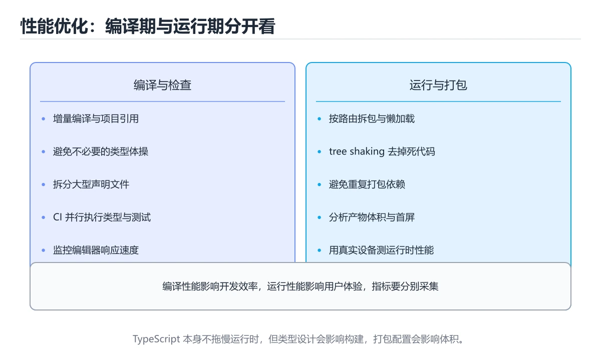
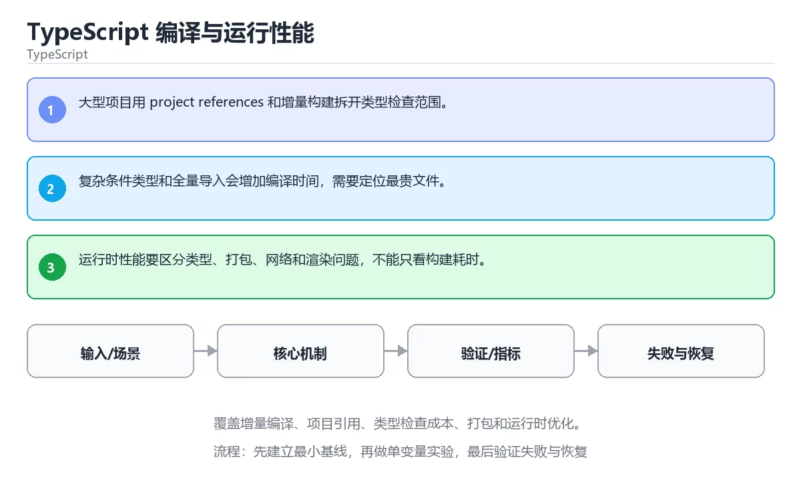

# TypeScript 编译与运行性能

> 内容更新时间：2026-10-06 · 学习阶段：高级 · 预计用时：25 分钟





## 本节知识框架

**课程定位**：所属分类 `typescript`（TypeScript），课程主题 `TypeScript 编译与运行性能`，学习阶段 高级，建议用时 40 分钟。

本课主线：覆盖增量编译、项目引用、类型检查成本、打包和运行时优化。

**学完本课应当能够**
- 说清 `增量编译` 与 `项目引用` 的含义与区别，并各举一个正例和一个反例。
- 用本课示例验证 `打包` 的行为，记录输入、输出与失败条件。
- 遇到「只关注编译时间」这类问题时，能说出触发条件与修复顺序。

### 复习清单

- [ ] 能不看正文复述本课核心术语，并指出一个边界或反例。
- [ ] 能运行或推演本课示例，记录输入、输出与失败现象。
- [ ] 能完成一次自测，并把错题对照错误表定位原因。

## 核心概念定义

| 术语 | 操作性定义 | 常见边界与风险 |
| --- | --- | --- |
| 增量编译 | 只重新编译发生变化的文件和受影响依赖，缩短大型项目的反馈时间。 | 不同版本与依赖组合的行为可能不同，升级或换环境前要按官方变更说明重新验证。 |
| 项目引用 | TypeScript 把多个工程拆分并用引用表达构建依赖，支持增量构建。 | 不同版本与依赖组合的行为可能不同，升级或换环境前要按官方变更说明重新验证。 |
| 打包 | 按“TypeScript 编译与运行性能”中 增量编译、项目引用、打包 的实践顺序，把四个步骤排成从准备到复盘的合理顺序。 | 结论随输入规模变化，小规模成立不代表大规模成立，需要重新测量。 |
| 性能 | 系统在给定负载下表现出的吞吐、延迟、资源占用和稳定性。 | 易错：运行时性能被忽略；正确做法是分别评估编译与运行时，并做基准对比。 |
| 条件类型 | TypeScript 根据类型关系在编译期选择结果类型的类型运算 | 静态检查只在编译期成立，运行期输入仍需校验。 |

## 原理与运行机制

### 机制总览

**教材衔接：核心知识**

### 1. 大型项目用 project references 和增量构建拆开类型检查范围。

- 关键做法：基线只保留 项目引用 必需的部分，其余条件一次加一个。
- 验证标准：console 的输出能被他人复现，边界输入有对应用例。

### 2. 复杂条件类型和全量导入会增加编译时间，需要定位最贵文件。

把这条结论放回「TypeScript 编译与运行性能」的完整流程里展开：

- 正文依据：能用自己的话解释：运行时性能要区分类型、打包、网络和渲染问题，不能只看构建耗时。
- 落地检查：把「2. 复杂条件类型和全量导入会增加编译时间，需要定位最贵文件。」改写成一条可执行的核对项，逐条验证输入、超时与失败路径。

### 3. 运行时性能要区分类型、打包、网络和渲染问题，不能只看构建耗时。

把这条结论放回「TypeScript 编译与运行性能」的完整流程里展开：

- 正文依据：关键做法：先用最小示例建立基线，再逐步加入边界、失败和性能条件。
- 落地检查：把「3. 运行时性能要区分类型、打包、网络和渲染问题，不能只看构建耗时。」改写成一条可执行的核对项，逐条验证输入、超时与失败路径。

**教材衔接：关键流程**

**教材衔接：实践路径**

**教材衔接：版本与时效**

- 版本提示：增量编译 的行为在最近几个大版本里有过调整，升级「TypeScript 编译与运行性能」前先用 console 复现当前输出，再对照官方发布说明逐条核对。
- 升级「TypeScript 编译与运行性能」涉及的依赖前，先用 console 复现当前行为，再逐项核对版本说明与破坏性变更。

## 典型应用场景

**教材衔接：深度拓展与实战**

这一节把「TypeScript 编译与运行性能」的判断依据、示例和反例整理成复习步骤。

### 工程检查表

- [ ] 能否用自己的话说明TypeScript 编译与运行性能解决什么问题，以及它不负责什么？
- [ ] 能否指出 console 最小示例的输入、输出和一条失败路径？
- [ ] 能否解释本课关键词在真实项目中的边界与取舍？
- [ ] 能否说明 项目引用 在新场景下需要补充什么前提？

### 最小验证场景

- 准备：保留 `text` 示例的原始输入，先记录 `TypeScript 编译与运行性能` 的基线输出和完整运行命令。
- 观察：先核对 调用了 `from()`，再改变一个与 `增量编译` 相关的条件。
- 判定：新结果与 `TypeScript 编译与运行性能` 的基线不同不等于错误；只有当差异破坏了 `增量编译` 的定义或错误表中的约束，才判定为失败。

### 选择与边界

- 使用 `增量编译` 时，先满足它的定义：只重新编译发生变化的文件和受影响依赖，缩短大型项目的反馈时间；不同版本与依赖组合的行为可能不同，升级或换环境前要按官方变更说明重新验证。
- 使用 `项目引用` 时，先满足它的定义：TypeScript 把多个工程拆分并用引用表达构建依赖，支持增量构建；不同版本与依赖组合的行为可能不同，升级或换环境前要按官方变更说明重新验证。
- 使用 `打包` 时，先满足它的定义：按“TypeScript 编译与运行性能”中 增量编译、项目引用、打包 的实践顺序，把四个步骤排成从准备到复盘的合理顺序；结论随输入规模变化，小规模成立不代表大规模成立，需要重新测量。
- 使用 `性能` 时，先满足它的定义：系统在给定负载下表现出的吞吐、延迟、资源占用和稳定性；易错：运行时性能被忽略；正确做法是分别评估编译与运行时，并做基准对比。
- 使用 `条件类型` 时，先满足它的定义：TypeScript 根据类型关系在编译期选择结果类型的类型运算；静态检查只在编译期成立，运行期输入仍需校验。

## 代码/协议/SQL 示例

### 最小可验证示例

**教材衔接：最小可运行示例**

先用下面的示例确认 增量编译 的基线，再只改一个与 项目引用 相关的值：

```typescript
const values = Array.from({ length: 1000 }, (_, i) => i);
const total = values.reduce((sum, value) => sum + value, 0);
console.log(`total=${total}`);
```

**教材衔接：预期输出**

```text
total=499500
```

## 时间/空间复杂度或性能分析

**性能关注点（TypeScript 编译与运行性能）**：编译期类型检查与运行期代码是两套开销：分别记录构建时间与运行时耗时。

**本课特有开销（TypeScript 编译与运行性能 · 增量编译）**：小文件看元数据开销，大文件看吞吐，两者要分别测量。

**测量方法**：以 `TypeScript 编译与运行性能` 的 `增量编译` 场景为对象，固定输入跑一遍记录基线，再把规模或并发度提高一个数量级复测；两次结果的差值与波动范围才是结论依据。

## 常见误区与易错点

| 容易写错的做法 | 实际现象 | 原因与正确做法 |
| --- | --- | --- |
| 只关注编译时间 | 运行时性能被忽略。 | 分别评估编译与运行时，并做基准对比。 |
| 类型体操写得过于复杂 | 编译变慢且报错难懂。 | 在类型表达力和可维护性之间取舍。 |
| 不做产物分析 | 体积膨胀无法定位来源。 | 分析构建产物并按需加载。 |

### 现场 1：只关注编译时间

**症状**：运行时性能被忽略。

**根因与修复**：分别评估编译与运行时，并做基准对比。

**自检**：在本课示例里复现「只关注编译时间」，改成分别评估编译与运行时，并做基准对比后重跑；如果症状消失且失败路径按预期变化，说明定位正确。

### 现场 2：类型体操写得过于复杂

**症状**：编译变慢且报错难懂。

**根因与修复**：在类型表达力和可维护性之间取舍。

**自检**：在本课示例里复现「类型体操写得过于复杂」，改成在类型表达力和可维护性之间取舍后重跑；如果症状消失且失败路径按预期变化，说明定位正确。

### 现场 3：不做产物分析

**症状**：体积膨胀无法定位来源。

**根因与修复**：分析构建产物并按需加载。

**自检**：在本课示例里复现「不做产物分析」，改成分析构建产物并按需加载后重跑；如果症状消失且失败路径按预期变化，说明定位正确。

## 与其他知识点的关系

| 关系 | 课程 | 为什么 |
| --- | --- | --- |
| 先修 | 《TypeScript 运行时校验与边界》 | 本课会直接使用它的概念或操作前提。 |
| 关联 | 《TypeScript 第一个类型》 | 用于横向比较或把本课结论迁移到相邻主题。 |
| 前置顺序 | 《TypeScript 运行时校验与边界》 | 同分类中安排在本课之前，建议先完成其自测。 |

**教材衔接：复习与迁移**

## 自测题与参考答案

> 先独立作答，再对照参考答案；答案都能在本课正文、术语表或错误表里找到依据。

### 自测 1（概念复述）

不看正文，写出 `增量编译` 的操作性定义，并说明它与 `项目引用` 的区别。

**参考答案**：只重新编译发生变化的文件和受影响依赖，缩短大型项目的反馈时间。

`项目引用` 的定位是：TypeScript 把多个工程拆分并用引用表达构建依赖，支持增量构建；两者的差别要从适用对象与失败模式上说明。

### 自测 2（排错）

本课错误表记录了「只关注编译时间」这类做法。请写出它会出现的现象、根因，以及修复顺序。

**参考答案**：现象是运行时性能被忽略；正确做法是分别评估编译与运行时，并做基准对比。修复时先复现现象并保留证据，再改动一处假设重跑，确认现象消失。

### 自测 3（动手验证）

运行本课的 `text` 示例，改动其中一个输入后重新运行，记录输出与错误信息。

**参考答案**：正常输入下 `text` 示例应当复现正文给出的结果；改动输入后，如果结果改变或报错，先核对它是否满足 `TypeScript 编译与运行性能` 中`增量编译` 的适用范围，再检查错误表里是否有同类现象。

### 自测 4（代码阅读）

阅读本课开头的 `text` 示例，说明它体现了`增量编译` 的哪一条性质，并指出改动哪个输入会让这条性质不再成立。

**参考答案**：`增量编译` 的定义是 只重新编译发生变化的文件和受影响依赖，缩短大型项目的反馈时间，示例正是在实现这条定义。改动与 `增量编译` 有关的一个输入后，如果结果不再符合 `TypeScript 编译与运行性能` 的正文描述，就说明该性质只在当前前提成立。

### 自测 5（迁移）

把 `TypeScript 编译与运行性能` 的方法迁移到自己的项目：围绕 `增量编译` 写出一个与错误表同类的风险点，并说明触发条件和检验方式。

**参考答案**：例如「不做产物分析」，它会导致体积膨胀无法定位来源；检验方式是按分析构建产物并按需加载改一处再复现，确认现象消失且没有引入新的失败分支。

### 自测 6（对比）

用一个表格对比 `增量编译` 与 `项目引用`：各写一行适用场景、一行失败表现。

**参考答案**：`增量编译` 的定义是只重新编译发生变化的文件和受影响依赖，缩短大型项目的反馈时间；`项目引用` 的定义是TypeScript 把多个工程拆分并用引用表达构建依赖，支持增量构建。两者的失败表现分别对应本课错误表里与本术语相关的行。

### 自测 7（排错顺序）

面对「只关注编译时间」引发的问题，请把“复现 运行时性能被忽略 → 保留证据 → 分别评估编译与运行时，并做基准对比 → 回归验证”四步写成可执行的检查清单。

**参考答案**：第一步按运行时性能被忽略复现；第二步记录输入、版本与完整报错；第三步按分别评估编译与运行时，并做基准对比只改一处；第四步重跑并确认失败路径也按预期变化。

### 自测 8（边界判断）

针对 `条件类型`，分别写出“可以使用”的条件和“结论不再成立”的条件。

**参考答案**：静态检查只在编译期成立，运行期输入仍需校验。 同时要把 `条件类型` 的定义 TypeScript 根据类型关系在编译期选择结果类型的类型运算 与实际输入逐项对照。

### 自测 9（机制重建）

不看正文，按输入、转换、输出、验证四段重建 `增量编译` → `项目引用` → `打包` → `性能` 的作用链。

**参考答案**：起点是 `增量编译` 的定义 只重新编译发生变化的文件和受影响依赖，缩短大型项目的反馈时间；中间每一步都保留可观察状态；终点由 `条件类型` 检查，失败时回到错误表定位第一个偏离定义的步骤。

### 自测 10（综合排错）

在 `TypeScript 编译与运行性能` 中，现象是 体积膨胀无法定位来源。请围绕 不做产物分析 写出最小复现、关键证据、修复动作和回归验证，并说明为什么不能只凭一次运行下结论。

**参考答案**：先复现 不做产物分析，记录输入与完整错误；再按 分析构建产物并按需加载 只改一处。回归时同时跑正常路径和边界路径，只有两次结果都可解释，才把修复视为完成。

### 自测 11（一分钟复述）

用每分钟约 200 字的速度复述 `TypeScript 编译与运行性能`：先给主问题，再按顺序说出 `增量编译`、`项目引用`、`打包`、`性能`，最后给一个失败案例。

**自评标准**：主问题必须对应 覆盖增量编译、项目引用、类型检查成本、打包和运行时优化；每个术语都要能接上一句定义或边界；失败案例必须写成可观察现象，不能用“可能有风险”代替证据。

## 术语速查

| 术语 | 一句话说明 |
| --- | --- |
| `增量编译` | 只重新编译发生变化的文件和受影响依赖，缩短大型项目的反馈时间。 |
| `项目引用` | TypeScript 把多个工程拆分并用引用表达构建依赖，支持增量构建。 |
| `打包` | 按“TypeScript 编译与运行性能”中 增量编译、项目引用、打包 的实践顺序，把四个步骤排成从准备到复盘的合理顺序。 |
| `性能` | 系统在给定负载下表现出的吞吐、延迟、资源占用和稳定性。 |
| `条件类型` | TypeScript 根据类型关系在编译期选择结果类型的类型运算。 |

**术语关系**：`增量编译`（只重新编译发生变化的文件和受影响依赖） → `项目引用`（TypeScript 把多个工程拆分并用引用表达构建依赖） → `打包`（按“TypeScript 编译与运行性能”中 增量编译、项目引用、打包 的实践顺序） → `性能`（系统在给定负载下表现出的吞吐、延迟、资源占用和稳定性）。

## 考点精讲

`TypeScript 编译与运行性能` 的题库有 6 道题，下面逐题给出题干、正确项与判断依据：先自己作答，再核对正确项，最后回到正文对应小节复核。

### 考点 1：第 1 题

- **题目**：在 `TypeScript 编译与运行性能` 里，与 `增量编译` 有关的说法中，哪一项最符合覆盖增量编译、项目引用、类型检查成本、打包和运行时优化。？
- **正确项**：大型项目用 project references 和增量构建拆开类型检查范围。
- **判断依据**：本题正确项是「大型项目用 project references 和增量构建拆开类型检查范围」。术语 增量编译（TypeScript 编译与运行性能）：只重新编译发生变化的文件和受影响依赖，缩短大型项目的反馈时间，本题取「大型项目用 project references 和增量构建拆开类型检查范围」这条。易错点是只关注编译时间，会造成运行时性能被忽略，改法是分别评估编译与运行时，并做基准对比。

### 考点 2：第 2 题

- **题目**：按“TypeScript 编译与运行性能”中 增量编译、项目引用、打包 的实践顺序，把四个步骤排成从准备到复盘的合理顺序。
- **正确项**：先明确 增量编译 的输入、输出与约束 → 写出最小示例并核对 项目引用 的基线结果 → 只改一个变量，记录边界与失败路径的变化 → 固定版本与证据，把“TypeScript 编译与运行性能”的结论写成可复现记录
- **判断依据**：按《TypeScript 编译与运行性能》正文的先后，本题顺序是「先明确 增量编译 的输入、输出与约束」 → 「写出最小示例并核对 项目引用 的基线结果」 → 「只改一个变量，记录边界与失败路径的变化」 → 「固定版本与证据，把“TypeScript 编译与运行性能”的结论写成可复现记录」。术语 增量编译（TypeScript 编译与运行性能）：只重新编译发生变化的文件和受影响依赖，缩短大型项目的反馈时间。易错点是只关注编译时间会造成运行时性能被忽略，改法是分别评估编译与运行时，并做基准对比。

### 考点 3：第 3 题

- **题目**：在 `TypeScript 编译与运行性能` 里，与 `增量编译` 有关的说法中，哪一项最符合覆盖增量编译、项目引用、类型检查成本、打包和运行时优化。？（TypeScript 编译与运行性能·TypeScript 第 3 题）
- **正确项**：运行时性能要区分类型、打包、网络和渲染问题，不能只看构建耗时。
- **判断依据**：本题正确项是「运行时性能要区分类型、打包、网络和渲染问题，不能只看构建耗时」。术语 增量编译（TypeScript 编译与运行性能）：只重新编译发生变化的文件和受影响依赖，缩短大型项目的反馈时间，本题取「运行时性能要区分类型、打包、网络和渲染问题，不能只看构建耗时」这条。易错点是不做产物分析，会造成体积膨胀无法定位来源，改法是分析构建产物并按需加载。

### 考点 4：第 4 题

- **题目**：`TypeScript 编译与运行性能` 的主线是：覆盖增量编译、项目引用、类型检查成本、打包和运行时优化。下面哪一项与这条主线一致？
- **正确项**：覆盖增量编译、项目引用、类型检查成本、打包和运行时优化。
- **判断依据**：本题正确项是「覆盖增量编译、项目引用、类型检查成本、打包和运行时优化」。术语 增量编译（TypeScript 编译与运行性能）：只重新编译发生变化的文件和受影响依赖，缩短大型项目的反馈时间，本题取「覆盖增量编译、项目引用、类型检查成本、打包和运行时优化」这条。易错点是只关注编译时间，会造成运行时性能被忽略，改法是分别评估编译与运行时，并做基准对比。

### 考点 5：第 5 题

- **题目**：课程 `覆盖增量编译、项目引用、类型检查成本、打包和运行时优化。`。在 `TypeScript 编译与运行性能` 里，`增量编译`、`项目引用` 与下面哪些选项属于同一层概念？（多选）
- **正确项**：增量编译；项目引用
- **判断依据**：按《TypeScript 编译与运行性能》的正文口径，本题要同时选中「增量编译」、「项目引用」，漏掉任一项都算没答全。术语 增量编译（TypeScript 编译与运行性能）：只重新编译发生变化的文件和受影响依赖，缩短大型项目的反馈时间。易错点是只关注编译时间会造成运行时性能被忽略，改法是分别评估编译与运行时，并做基准对比。

### 考点 6：第 6 题

- **题目**：结合 `TypeScript 编译与运行性能` 中围绕 `增量编译` 的代码，哪一项说法与“覆盖增量编译、项目引用、类型检查成本、打包和运行时优化。”一致？
- **正确项**：大型项目用 project references 和增量构建拆开类型检查范围。
- **判断依据**：本题正确项是「大型项目用 project references 和增量构建拆开类型检查范围」。术语 增量编译（TypeScript 编译与运行性能）：只重新编译发生变化的文件和受影响依赖，缩短大型项目的反馈时间，本题取「大型项目用 project references 和增量构建拆开类型检查范围」这条。易错点是不做产物分析，会造成体积膨胀无法定位来源，改法是分析构建产物并按需加载。

### 考点 7：`增量编译`

- **要点**：只重新编译发生变化的文件和受影响依赖，缩短大型项目的反馈时间。
- **增量编译 的边界**：不同版本与依赖组合的行为可能不同，升级或换环境前要按官方变更说明重新验证。

### 考点 8：`项目引用`

- **要点**：TypeScript 把多个工程拆分并用引用表达构建依赖，支持增量构建。
- **项目引用 的边界**：不同版本与依赖组合的行为可能不同，升级或换环境前要按官方变更说明重新验证。

### 考点 9：`打包`

- **要点**：按“TypeScript 编译与运行性能”中 增量编译、项目引用、打包 的实践顺序，把四个步骤排成从准备到复盘的合理顺序。
- **打包 的边界**：结论随输入规模变化，小规模成立不代表大规模成立，需要重新测量。

### 考点 10：`性能`

- **要点**：系统在给定负载下表现出的吞吐、延迟、资源占用和稳定性。
- **性能 的边界**：易错：运行时性能被忽略；正确做法是分别评估编译与运行时，并做基准对比。

### 考点 11：`条件类型`

- **要点**：TypeScript 根据类型关系在编译期选择结果类型的类型运算
- **条件类型 的边界**：静态检查只在编译期成立，运行期输入仍需校验。

### 考点 12：排错——只关注编译时间

- **现象**：运行时性能被忽略。
- **处理**：分别评估编译与运行时，并做基准对比。

### 考点 13：排错——类型体操写得过于复杂

- **现象**：编译变慢且报错难懂。
- **处理**：在类型表达力和可维护性之间取舍。

### 考点 14：综合辨析——`增量编译` 与 `条件类型`

- **辨析点**：`增量编译` 的定义是 只重新编译发生变化的文件和受影响依赖，缩短大型项目的反馈时间；`条件类型` 的定义是 TypeScript 根据类型关系在编译期选择结果类型的类型运算。
- **答题要求**：面对 `TypeScript 编译与运行性能` 的题目，先判断描述的是 `增量编译` 还是 `条件类型`，再归到对应定义，最后写出一个会让该定义失效的边界输入。

### 考点 15：排错评分点

- **现象分**：能写出 运行时性能被忽略，而不是只写“程序有错”。
- **证据分**：保留触发 只关注编译时间 的输入、版本和错误原文。
- **修复分**：按 分别评估编译与运行时，并做基准对比 只改一处，并同时回归正常路径与边界路径。

## 内容元数据

- 内容版本：v2.0
- 最后更新：2026-10-06
- 学习阶段：高级
- 适用环境：TypeScript 5.x / Node.js 22+；本课聚焦 增量编译。
- 内容来源：内置结构化课程与工程实践整理
- 相关主题：增量编译、项目引用、打包、性能
- 质量版本：P0 测验标准 + P1 覆盖扩展 + P2 体验补全

## 参考资料与复核

- 最后复核：2026-10-04
- 下次复核：2027-03-17
- 复核范围：版本兼容、API 行为、安全建议与工程实践
- 来源性质：官方文档、标准或权威教材；本课核对关键词：增量编译、项目引用、打包、性能。

| 参考资料 | 本课用途 |
| --- | --- |
| [项目引用](https://www.typescriptlang.org/docs/handbook/project-references.html) | 大型项目拆分与增量构建 |
| [Everyday Types](https://www.typescriptlang.org/docs/handbook/2/everyday-types.html) | 常用类型与收窄 |
| [TypeScript Node 指南](https://nodejs.org/en/learn/typescript) | Node 中的 TypeScript |

| [本课术语索引：TypeScript 编译与运行性能](#核心概念定义) | 按本课输入、术语边界和错误表现逐项核对 |
> 「TypeScript 编译与运行性能」的链接用于离线阅读后的延伸核对；App 不会自动联网。