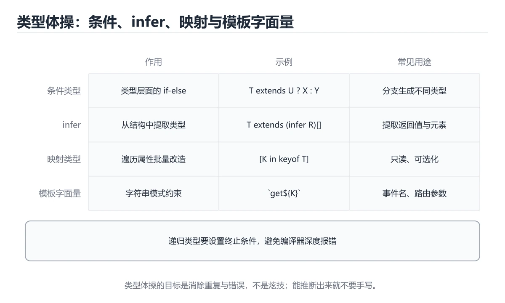
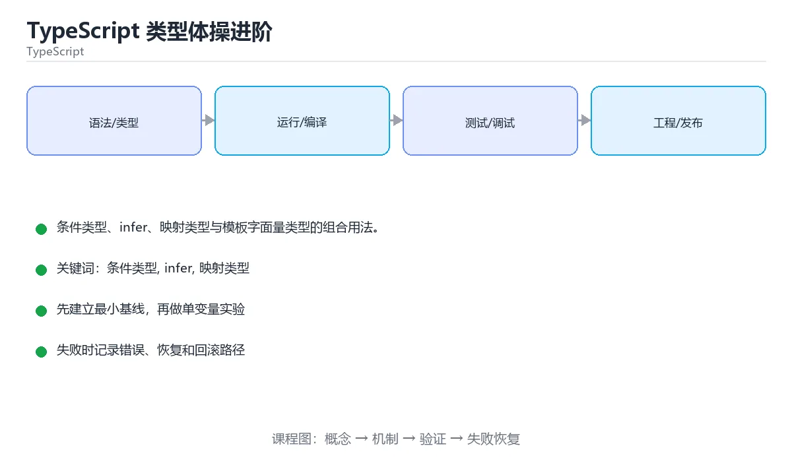

# TypeScript 类型体操进阶





> 内容更新时间：2026-10-06 · 学习阶段：高级 · 预计用时：30 分钟

## 本节知识框架

**课程定位**：所属分类 `typescript`（TypeScript），课程主题 `TypeScript 类型体操进阶`，学习阶段 高级，建议用时 50 分钟。

本课主线：条件类型、infer、映射类型与模板字面量类型的组合用法。

**学完本课应当能够**
- 说清 `条件类型` 与 `映射类型` 的含义与区别，并各举一个正例和一个反例。
- 用本课示例验证 `infer` 的行为，记录输入、输出与失败条件。
- 遇到「类型写得太绕」这类问题时，能说出触发条件与修复顺序。

### 复习清单

- [ ] 能不看正文复述本课核心术语，并指出一个边界或反例。
- [ ] 能运行或推演本课示例，记录输入、输出与失败现象。
- [ ] 能完成一次自测，并把错题对照错误表定位原因。

## 核心概念定义

| 术语 | 操作性定义 | 常见边界与风险 |
| --- | --- | --- |
| 条件类型 | TypeScript 根据类型关系在编译期选择结果类型的类型运算。 | 条件类型对联合类型会自动分配，成员被拆开逐个判断，要整体判断得用 [T] extends [U] 这种方括号写法。 |
| 映射类型 | TypeScript 根据已有类型批量生成属性变换后的新类型。 | 映射类型批量改的是类型里的属性形状，运行时对象不会跟着被转换，深层结构也不会自动递归。 |
| infer | 在条件类型里声明待推断的类型变量，用来实现 ReturnType 一类工具类型。 | infer 只在 extends 右侧的模式里才推断得出来，位置放错或模式对不上就报错，示例里的 U 要靠 Unwrap 递归才剥得干净。 |
| 模板字面量类型 | 用反引号把字符串类型拼起来，可以对路由参数或事件名做类型约束。 | 模板字面量类型只能拼接字面量字符串，传入宽泛的 string 会退化成 string 让约束失效，拼路由或事件名要先收窄成字面量。 |
| 条件类型 | 按条件选择类型 | 条件类型少写假分支时，不匹配的输入会落到意外的结果上，必须明确 never 或其它兜底分支才不出错。 |
| infer | 在条件类型中提取类型 | infer 提取出的类型只在匹配到的那条分支里可用，条件走假分支时那个类型变量根本不存在，不能拿来到处用。 |
| 映射类型 | 批量改造属性 | 它一次变换类型里的全部属性，深层对象不会自动跟着改；键名要变还得靠键重映射，像本课的 `Getters`。 |
| 模板字面量类型 | 在类型层拼字符串 | 拼出的字符串要借映射类型的 as 重映射才能变成键名（示例的 Listeners），光在类型里拼字符串并不会给对象补字段。 |
| 只需要复用已有类型的部分字段 | `Pick` / `Omit` | 字段少到两三行就能写完时，直接手写一个新接口比套 `Pick` / `Omit` 更好读。 |
| 需要按条件分支 | 条件类型 | 类型层的条件分支编译完就定死了，运行时并不会照着它走 if；要按真实取值分派还得写普通判断。 |
| 需要从复杂类型中提取 | `infer` | 复杂类型要先用条件类型摆好形状才谈得上提取，一次只剥一层，套娃式的 `Promise<Promise<number>>` 得靠递归。 |
| 需要批量转换属性 | 映射类型 | 映射类型批量改属性只发生在类型层，运行时对象不会因此被加工，深一层的变换得另写递归类型。 |
| 需要构造字符串键 | 模板字面量类型 | 模板字面量拼出的字符串键只是类型约束，运行时对象把键名写错了也不会报错，仍需断言或校验兜底。 |
| 需要运行时校验 | zod 等库（类型只在编译期存在） | 这里靠的正是类型编译后被擦除、运行期无类型可用：接口返回的 JSON 要交给 zod 做运行时校验，光有静态类型挡不住脏数据。 |
| 条件类型 | if 判断 | 把它当普通 if 用会踩空：条件类型只在编译期按类型关系选分支，真实数据的取值分支还得靠运行时判断。 |
| infer | 拆包裹 | 包裹得先被条件类型认出形状才拆得开，例如 `T extends Promise<infer U>`；套娃的 Promise 要递归才剥到底。 |
| 映射类型 | 批量加工 | 加工只停在最外层属性上，往里一层就停住了；深层要一起变换得写成递归类型逐层剥开。 |
| 模板字面量 | 字符串拼接 | 拼出来的是类型层面的键名，如 `get${Capitalize<string & K>}`；运行时真实的键名它一个也不检查。 |
| 递归类型 | 逐层剥开 | 易错：编译报错或超深；正确做法是设计明确的递归出口。 |
| 从 schema 推导类型 | ✅ 用工具类型 | 从 schema 推导的类型只活在编译期，schema 与真实响应不一致时它照样通过检查，这类派生类型挡不住运行时脏数据。 |
| 包装库的类型（如 Result、Option） | ✅ 有条件类型 | 用条件类型拆 Result、Option 这层包装，靠的是库里声明的类型结构，包装形状一改就匹配不上；真实值仍要在运行时另行判断。 |
| 只想少写几个字段 | ❌ 直接写更清楚 | 省下的只是两三行声明，代价是别人得先展开工具类型才看得见字段形状。 |
| 团队没人看得懂 | ❌ 退回到简单写法 | 复杂到要靠注释才读得懂时就该拆成命名类型；没人能维护的类型等于没起约束作用。 |
| Partial<T> | 全部可选 | 可选之后每个字段读出来都可能缺，取用要先处理空值；它只是类型变化，运行时不会替你补默认值。 |
| Required<T> | 全部必填 | 去掉问号只发生在类型层，数据里缺的字段不会因此被填上；调用方仍要真的把每个字段传齐。 |
| Readonly<T> | 全部只读 | 它只锁最外层属性，深层对象不会自动只读；想连里层一起锁得像本课 `DeepReadonly` 那样递归加工。 |
| Pick<T, K> | 保留指定字段 | K 要和原类型的键名逐字对齐，原类型增删字段后这里跟着报错；它不会顺手把可选字段变成必填。 |
| Omit<T, K> | 排除指定字段 | 排除项一多，剩下的到底是什么形状就没人看得懂，属于「类型写得太绕」；想留的字段少时反过来用 `Pick`。 |
| Record<K, V> | 构造映射 | K 得是能当键的类型；`Record` 只描述形状，运行时那个对象还得自己构造，字段该缺还是缺。 |
| Exclude<T, U> | 从联合中排除 | 它只对联合类型有意义，传进去的是普通对象类型就筛不出东西；结果可能落到 `never`，不匹配分支要接住。 |
| Extract<T, U> | 从联合中提取 | 它和 `Exclude` 正好反着来，筛完可能是空联合；当白名单用时不匹配那条分支要显式写清楚。 |
| NonNullable<T> | 去掉 null 与 undefined | 类型层擦掉空值不等于数据里没有空值；运行时字段真是空，取属性照样出问题。 |
| ReturnType<F> | 取返回类型 | `ReturnType<F>` 取到的是声明的返回类型，异步函数会拿到 Promise 而不是里面的结果类型，要取内部值还得再套 Awaited。 |
| Awaited<T> | 解开 Promise | 它解的是类型上的 Promise，等不到真正的异步结果；套了几层就得递归几层，参考本课 `Unwrap`。 |
| 类型写得太绕 | 报错没人看得懂 | 易错：报错没人看得懂；正确做法是拆成命名类型并加注释。 |
| 忘了 as const | 推断成宽泛类型 | 忘了 as const 时字面量被推成 string、number 等宽泛类型，条件类型和模板字面量拿不到具体字面量就匹配不上。 |
| 递归层数太深 | 编译器报「实例化过深」 | 易错：编译器报「实例化过深」；正确做法是限制层数或改实现。 |
| 条件类型没写 never | 得到意外结果 | 假分支空着，不匹配的输入就会落到别的结果上；联合传进来还会被逐项处理，要整体判断就套方括号写法。 |
| 在运行时用类型 | 报错或无效 | 易错：报错或无效；正确做法是类型只在编译期存在。 |
| 用体操处理业务逻辑 | 难维护 | 易错：难维护；正确做法是用普通代码表达。 |
| 忽略分配式条件类型 | 联合被逐项处理 | 易错：联合被逐项处理；正确做法是需要整体判断时用 `[T] extends [U]`。 |
| 版本差异 | 老版本不支持某些语法 | 易错：老版本不支持某些语法；正确做法是先确认 TS 版本。 |

## 原理与运行机制

### 机制总览

**教材衔接：工程约束速查**

| 约束 | 原因 |
| --- | --- |
| 给复杂类型写注释与示例 | 后来者要能看懂 |
| 用测试验证类型（类型断言与编译） | 类型逻辑也会出错 |
| 控制深度与递归层数 | 过深会让编译器变慢甚至报错 |
| 导出类型时给语义化别名 | 报错信息更可读 |
| 不用类型体操做业务建模 | 可读性优先于炫技 |

**教材衔接：版本与时效**

- 版本提示：条件类型 的行为在最近几个大版本里有过调整，升级「TypeScript 类型体操进阶」前先用 DeepReadonly 复现当前输出，再对照官方发布说明逐条核对。
- 升级前确认 条件类型 的兼容范围，把不可回退的改动单独拆成一次提交。

## 典型应用场景

- **类型写得太绕**：典型现象是报错没人看得懂；正确做法是拆成命名类型并加注释。
- **忘了 `as const`**：典型现象是推断成宽泛类型；正确做法是常量加 `as const`。
- **递归层数太深**：典型现象是编译器报「实例化过深」；正确做法是限制层数或改实现。
- **条件类型没写 `never`**：典型现象是得到意外结果；正确做法是明确不匹配时的分支。

### 最小验证场景

- 准备：保留 `ts` 示例的原始输入，先记录 `TypeScript 类型体操进阶` 的基线输出和完整运行命令。
- 观察：先核对 出现字面量 ` | `，再改变一个与 `条件类型` 相关的条件。
- 判定：新结果与 `TypeScript 类型体操进阶` 的基线不同不等于错误；只有当差异破坏了 `条件类型` 的定义或错误表中的约束，才判定为失败。

### 选择与边界

- 使用 `条件类型` 时，先满足它的定义：TypeScript 根据类型关系在编译期选择结果类型的类型运算；易错：得到意外结果；正确做法是明确不匹配时的分支。
- 使用 `映射类型` 时，先满足它的定义：TypeScript 根据已有类型批量生成属性变换后的新类型；静态检查只在编译期成立，运行期输入仍需校验。
- 使用 `infer` 时，先满足它的定义：在条件类型里声明待推断的类型变量，用来实现 ReturnType 一类工具类型；静态检查只在编译期成立，运行期输入仍需校验。
- 使用 `模板字面量类型` 时，先满足它的定义：用反引号把字符串类型拼起来，可以对路由参数或事件名做类型约束；静态检查只在编译期成立，运行期输入仍需校验。

## 代码/协议/SQL 示例

### 最小可验证示例

```ts
// 1. 条件类型 + infer：取出函数返回类型与 Promise 内部类型
type Unwrap<T> = T extends Promise<infer U> ? Unwrap<U> : T;
type Value = Unwrap<Promise<Promise<number>>>;   // number
// 2. 映射类型 + 键重映射：把字段改成 getX 形式
type Getters<T> = {
  [K in keyof T as `get${Capitalize<string & K>}`]: () => T[K];
};
interface User {
  id: string;
  name: string;
}
type UserGetters = Getters<User>;
// { getId: () => string; getName: () => string }
// 3. 递归条件类型：深层只读
type DeepReadonly<T> = {
  readonly [K in keyof T]: T[K] extends object ? DeepReadonly<T[K]> : T[K];
};
// 4. 联合类型分配：自动对每个成员生效
type ToArray<T> = T extends unknown ? T[] : never;
type Result = ToArray<"a" | "b">;                // "a"[] | "b"[]
// 5. 模板字面量类型 + 映射：为事件总线生成类型安全的方法
type EventMap = { userCreated: { id: string }; userDeleted: { id: string } };
type Listeners = {
  [K in keyof EventMap as `on${Capitalize<string & K>}`]: (payload: EventMap[K]) => void;
};
```

**教材衔接：原文最小示例**

## 时间/空间复杂度或性能分析

**性能关注点（TypeScript 类型体操进阶）**：编译期类型检查与运行期代码是两套开销：分别记录构建时间与运行时耗时。

**测量方法**：以 `TypeScript 类型体操进阶` 的 `条件类型` 场景为对象，固定输入跑一遍记录基线，再把规模或并发度提高一个数量级复测；两次结果的差值与波动范围才是结论依据。

## 常见误区与易错点

| 容易写错的做法 | 实际现象 | 原因与正确做法 |
| --- | --- | --- |
| 类型写得太绕 | 报错没人看得懂 | 拆成命名类型并加注释 |
| 忘了 `as const` | 推断成宽泛类型 | 常量加 `as const` |
| 递归层数太深 | 编译器报「实例化过深」 | 限制层数或改实现 |
| 条件类型没写 `never` | 得到意外结果 | 明确不匹配时的分支 |
| 在运行时用类型 | 报错或无效 | 类型只在编译期存在 |
| 用体操处理业务逻辑 | 难维护 | 用普通代码表达 |
| 忽略分配式条件类型 | 联合被逐项处理 | 需要整体判断时用 `[T] extends [U]` |
| 版本差异 | 老版本不支持某些语法 | 先确认 TS 版本 |
| 嵌套过深的条件类型 | 编译变慢、报错难读 | 拆成多个命名类型 |
| 忘记分布式联合类型行为 | 结果与预期不符 | 用 `[T] extends [U]` 阻断分配 |
| 在类型里做运行时判断 | 无法实现 | 类型编译后消失，运行时用校验库 |
| 递归类型无终止条件 | 编译报错或超深 | 设计明确的递归出口 |
| 用 `any` 兜底复杂类型 | 类型安全失效 | 用 `unknown` 加收窄 |
| 没有类型测试 | 类型改动悄悄破坏调用方 | 用类型断言与 CI 编译检查 |

### 现场 1：类型写得太绕

**症状**：报错没人看得懂。

**根因与修复**：拆成命名类型并加注释。

**自检**：在本课示例里复现「类型写得太绕」，改成拆成命名类型并加注释后重跑；如果症状消失且失败路径按预期变化，说明定位正确。

### 现场 2：忘了 `as const`

**症状**：推断成宽泛类型。

**根因与修复**：常量加 `as const`。

**自检**：在本课示例里复现「忘了 `as const`」，改成常量加 `as const`后重跑；如果症状消失且失败路径按预期变化，说明定位正确。

### 现场 3：递归层数太深

**症状**：编译器报「实例化过深」。

**根因与修复**：限制层数或改实现。

**自检**：在本课示例里复现「递归层数太深」，改成限制层数或改实现后重跑；如果症状消失且失败路径按预期变化，说明定位正确。

### 现场 4：条件类型没写 `never`

**症状**：得到意外结果。

**根因与修复**：明确不匹配时的分支。

**自检**：在本课示例里复现「条件类型没写 `never`」，改成明确不匹配时的分支后重跑；如果症状消失且失败路径按预期变化，说明定位正确。

### 现场 5：在运行时用类型

**症状**：报错或无效。

**根因与修复**：类型只在编译期存在。

**自检**：在本课示例里复现「在运行时用类型」，改成类型只在编译期存在后重跑；如果症状消失且失败路径按预期变化，说明定位正确。

### 现场 6：用体操处理业务逻辑

**症状**：难维护。

**根因与修复**：用普通代码表达。

**自检**：在本课示例里复现「用体操处理业务逻辑」，改成用普通代码表达后重跑；如果症状消失且失败路径按预期变化，说明定位正确。

### 现场 7：忽略分配式条件类型

**症状**：联合被逐项处理。

**根因与修复**：需要整体判断时用 `[T] extends [U]`。

**自检**：在本课示例里复现「忽略分配式条件类型」，改成需要整体判断时用 `[T] extends [U]`后重跑；如果症状消失且失败路径按预期变化，说明定位正确。

### 现场 8：版本差异

**症状**：老版本不支持某些语法。

**根因与修复**：先确认 TS 版本。

**自检**：在本课示例里复现「版本差异」，改成先确认 TS 版本后重跑；如果症状消失且失败路径按预期变化，说明定位正确。

### 现场 9：嵌套过深的条件类型

**症状**：编译变慢、报错难读。

**根因与修复**：拆成多个命名类型。

**自检**：在本课示例里复现「嵌套过深的条件类型」，改成拆成多个命名类型后重跑；如果症状消失且失败路径按预期变化，说明定位正确。

## 与其他知识点的关系

- **先修**：`TypeScript 实战：全栈类型安全`。本课默认这些内容已经掌握。
- **相关或后续**：`TypeScript Node 后端开发`。本课术语会在这些课程里继续使用。
- **术语归属**：`条件类型`、`映射类型`、`infer` 的定义以本课「核心概念定义」为准，换到其他课程时先确认定义是否被改写。
- 同一分类的《TypeScript 工具类型与声明文件》也涉及 `映射类型`；两课衔接时先确认这个术语的定义是否一致。
- 同一分类的《TypeScript 类型收窄与泛型》也涉及 `infer`；两课衔接时先确认这个术语的定义是否一致。

## 自测题与参考答案

> 先独立作答，再对照参考答案；答案都能在本课正文、术语表或错误表里找到依据。

### 自测 1（概念复述）

不看正文，写出 `条件类型` 的操作性定义，并说明它与 `映射类型` 的区别。

**参考答案**：TypeScript 根据类型关系在编译期选择结果类型的类型运算。

`映射类型` 的定位是：TypeScript 根据已有类型批量生成属性变换后的新类型；两者的差别要从适用对象与失败模式上说明。

### 自测 2（排错）

本课错误表记录了「类型写得太绕」这类做法。请写出它会出现的现象、根因，以及修复顺序。

**参考答案**：现象是报错没人看得懂；正确做法是拆成命名类型并加注释。修复时先复现现象并保留证据，再改动一处假设重跑，确认现象消失。

### 自测 3（动手验证）

运行本课的 `ts` 示例，把其中的 `"a"` 换成一个边界值后重新运行，记录输出与错误信息。

**参考答案**：正常输入下 `ts` 示例应当复现正文给出的结果；把 `"a"` 换成边界值后，如果结果改变或报错，先核对它是否满足 `TypeScript 类型体操进阶` 中`条件类型` 的适用范围，再检查错误表里是否有同类现象。

### 自测 4（代码阅读）

阅读本课开头的 `ts` 示例，说明它体现了`条件类型` 的哪一条性质，并指出改动哪个输入会让这条性质不再成立。

**参考答案**：`条件类型` 的定义是 TypeScript 根据类型关系在编译期选择结果类型的类型运算，示例正是在实现这条定义。改动与 `条件类型` 有关的一个输入后，如果结果不再符合 `TypeScript 类型体操进阶` 的正文描述，就说明该性质只在当前前提成立。

### 自测 5（迁移）

把 `TypeScript 类型体操进阶` 的方法迁移到自己的项目：围绕 `条件类型` 写出一个与错误表同类的风险点，并说明触发条件和检验方式。

**参考答案**：例如「没有类型测试」，它会导致类型改动悄悄破坏调用方；检验方式是按用类型断言与 CI 编译检查改一处再复现，确认现象消失且没有引入新的失败分支。

### 自测 6（对比）

用一个表格对比 `条件类型` 与 `映射类型`：各写一行适用场景、一行失败表现。

**参考答案**：`条件类型` 的定义是TypeScript 根据类型关系在编译期选择结果类型的类型运算；`映射类型` 的定义是TypeScript 根据已有类型批量生成属性变换后的新类型。两者的失败表现分别对应本课错误表里与本术语相关的行。

### 自测 7（排错顺序）

面对「类型写得太绕」引发的问题，请把“复现 报错没人看得懂 → 保留证据 → 拆成命名类型并加注释 → 回归验证”四步写成可执行的检查清单。

**参考答案**：第一步按报错没人看得懂复现；第二步记录输入、版本与完整报错；第三步按拆成命名类型并加注释只改一处；第四步重跑并确认失败路径也按预期变化。

### 自测 8（边界判断）

针对 `模板字面量类型`，分别写出“可以使用”的条件和“结论不再成立”的条件。

**参考答案**：静态检查只在编译期成立，运行期输入仍需校验。 同时要把 `模板字面量类型` 的定义 用反引号把字符串类型拼起来，可以对路由参数或事件名做类型约束 与实际输入逐项对照。

### 自测 9（机制重建）

不看正文，按输入、转换、输出、验证四段重建 `条件类型` → `映射类型` → `infer` → `模板字面量类型` 的作用链。

**参考答案**：起点是 `条件类型` 的定义 TypeScript 根据类型关系在编译期选择结果类型的类型运算；中间每一步都保留可观察状态；终点由 `模板字面量类型` 检查，失败时回到错误表定位第一个偏离定义的步骤。

### 自测 10（综合排错）

在 `TypeScript 类型体操进阶` 中，现象是 类型改动悄悄破坏调用方。请围绕 没有类型测试 写出最小复现、关键证据、修复动作和回归验证，并说明为什么不能只凭一次运行下结论。

**参考答案**：先复现 没有类型测试，记录输入与完整错误；再按 用类型断言与 CI 编译检查 只改一处。回归时同时跑正常路径和边界路径，只有两次结果都可解释，才把修复视为完成。

### 自测 11（一分钟复述）

用每分钟约 200 字的速度复述 `TypeScript 类型体操进阶`：先给主问题，再按顺序说出 `条件类型`、`映射类型`、`infer`、`模板字面量类型`，最后给一个失败案例。

**自评标准**：主问题必须对应 条件类型、infer、映射类型与模板字面量类型的组合用法；每个术语都要能接上一句定义或边界；失败案例必须写成可观察现象，不能用“可能有风险”代替证据。

## 术语速查

| 术语 | 一句话说明 |
| --- | --- |
| `条件类型` | TypeScript 根据类型关系在编译期选择结果类型的类型运算。 |
| `映射类型` | TypeScript 根据已有类型批量生成属性变换后的新类型。 |
| `infer` | 在条件类型里声明待推断的类型变量，用来实现 ReturnType 一类工具类型。 |
| `模板字面量类型` | 用反引号把字符串类型拼起来，可以对路由参数或事件名做类型约束。 |

**术语关系**：`条件类型`（TypeScript 根据类型关系在编译期选择结果类型的类型运算） → `映射类型`（TypeScript 根据已有类型批量生成属性变换后的新类型） → `infer`（在条件类型里声明待推断的类型变量） → `模板字面量类型`（用反引号把字符串类型拼起来）。

## 考点精讲

`TypeScript 类型体操进阶` 的题库有 6 道题，下面逐题给出题干、正确项与判断依据：先自己作答，再核对正确项，最后回到正文对应小节复核。

### 考点 1：第 1 题

- **题目**：围绕“TypeScript 类型体操进阶”中的 条件类型、infer、映射类型，下列哪两项是本课强调的实践判断？
- **正确项**：学习 条件类型 时要同时说明输入、输出和失败路径，不能只看正常流程；验证 infer 时要固定版本并覆盖边界输入，结论才可复现
- **判断依据**：按《TypeScript 类型体操进阶》的正文口径，本题要同时选中「学习 条件类型 时要同时说明输入、输出和失败路径，不能只看正常流程」、「验证 infer 时要固定版本并覆盖边界输入，结论才可复现」，漏掉任一项都算没答全。术语 条件类型（TypeScript 类型体操进阶）：TypeScript 根据类型关系在编译期选择结果类型的类型运算。易错点是类型写得太绕，会造成报错没人看得懂，改法是拆成命名类型并加注释。

### 考点 2：第 2 题

- **题目**：这段 `typescript` 代码对应 `TypeScript 类型体操进阶` 的 `条件类型`。课程要解决的是条件类型、infer、映射类型与模板字面量类型的组合用法。关于代码内容，哪一项说法准确？
- **正确项**：代码里出现了 `User` 这个名字
- **判断依据**：本题正确项是「代码里出现了 `User` 这个名字」。术语 条件类型（TypeScript 类型体操进阶）：TypeScript 根据类型关系在编译期选择结果类型的类型运算，本题取「代码里出现了 `User` 这个名字」这条。易错点是忘了 `as const`，会造成推断成宽泛类型，改法是常量加 `as const`。本题干扰项「出现字面量 `Chrome`」不成立：展示代码里找不到 `Chrome`。

### 考点 3：第 3 题

- **题目**：条件类型对联合类型会自动「分配」，想阻断这种分配应该？
- **正确项**：用 [T] extends [U] 这种方括号写法
- **判断依据**：本题正确项是「用 [T] extends [U] 这种方括号写法」。术语 条件类型（TypeScript 类型体操进阶）：TypeScript 根据类型关系在编译期选择结果类型的类型运算，本题取「用 [T] extends [U] 这种方括号写法」这条。易错点是递归层数太深，会造成编译器报「实例化过深」，改法是限制层数或改实现。

### 考点 4：第 4 题

- **题目**：关于类型体操的工程建议，正确的是？
- **正确项**：拆分命名类型，写注释与类型测试
- **判断依据**：本题正确项是「拆分命名类型，写注释与类型测试」。术语 条件类型（TypeScript 类型体操进阶）：TypeScript 根据类型关系在编译期选择结果类型的类型运算，本题取「拆分命名类型，写注释与类型测试」这条。易错点是条件类型没写 `never`，会造成得到意外结果，改法是明确不匹配时的分支。

### 考点 5：第 5 题

- **题目**：模板字面量类型最典型的用途是？
- **正确项**：约束字符串键的命名格式（如 getX、onX）
- **判断依据**：本题正确项是「约束字符串键的命名格式（如 getX、onX）」。术语 模板字面量类型（TypeScript 类型体操进阶）：用反引号把字符串类型拼起来，可以对路由参数或事件名做类型约束，本题取「约束字符串键的命名格式（如 getX、onX）」这条。易错点是在运行时用类型，会造成报错或无效，改法是类型只在编译期存在。

### 考点 6：第 6 题

- **题目**：填空：补齐下面这段术语说明中的空缺。课程 `条件类型、infer、映射类型与模板字面量类型的组合用法。`，这段说明是：`____`：在条件类型里声明待推断的类型变量，用来实现 ReturnType 一类工具类型。空缺处应填哪个术语？
- **正确项**：infer
- **判断依据**：涉及术语 条件类型：TypeScript 根据类型关系在编译期选择结果类型的类型运算。易错点：类型写得太绕会造成报错没人看得懂。正确做法：拆成命名类型并加注释。判断时先确认输入和适用范围，对照 `条件类型`、`infer`、`映射类型`、`模板字面量类型` 复现一次，最后把错误表现与正确做法逐项对照。

### 考点 7：`条件类型`

- **要点**：TypeScript 根据类型关系在编译期选择结果类型的类型运算。
- **条件类型 的边界**：易错：得到意外结果；正确做法是明确不匹配时的分支。

### 考点 8：`映射类型`

- **要点**：TypeScript 根据已有类型批量生成属性变换后的新类型。
- **映射类型 的边界**：静态检查只在编译期成立，运行期输入仍需校验。

### 考点 9：`infer`

- **要点**：在条件类型里声明待推断的类型变量，用来实现 ReturnType 一类工具类型。
- **infer 的边界**：静态检查只在编译期成立，运行期输入仍需校验。

### 考点 10：`模板字面量类型`

- **要点**：用反引号把字符串类型拼起来，可以对路由参数或事件名做类型约束。
- **模板字面量类型 的边界**：静态检查只在编译期成立，运行期输入仍需校验。

### 考点 11：排错——类型写得太绕

- **现象**：报错没人看得懂。
- **处理**：拆成命名类型并加注释。

### 考点 12：排错——忘了 `as const`

- **现象**：推断成宽泛类型。
- **处理**：常量加 `as const`。

### 考点 13：综合辨析——`条件类型` 与 `模板字面量类型`

- **辨析点**：`条件类型` 的定义是 TypeScript 根据类型关系在编译期选择结果类型的类型运算；`模板字面量类型` 的定义是 用反引号把字符串类型拼起来，可以对路由参数或事件名做类型约束。
- **答题要求**：面对 `TypeScript 类型体操进阶` 的题目，先判断描述的是 `条件类型` 还是 `模板字面量类型`，再归到对应定义，最后写出一个会让该定义失效的边界输入。

### 考点 14：排错评分点

- **现象分**：能写出 报错没人看得懂，而不是只写“程序有错”。
- **证据分**：保留触发 类型写得太绕 的输入、版本和错误原文。
- **修复分**：按 拆成命名类型并加注释 只改一处，并同时回归正常路径与边界路径。

## 内容元数据

- 内容版本：v2.0
- 最后更新：2026-10-06
- 学习阶段：高级
- 适用环境：TypeScript 5.x / Node.js 22+
；本课聚焦 条件类型。
- 内容来源：内置结构化课程与工程实践整理
- 相关主题：条件类型、infer、映射类型、模板字面量类型、类型体操
- 质量版本：P0 测验标准 + P1 覆盖扩展 + P2 体验补全

## 参考资料与复核

- 最后复核：2026-10-04
- 下次复核：2027-03-17
- 复核范围：版本兼容、API 行为、安全建议与工程实践
- 来源性质：官方文档、标准或权威教材；本课核对关键词：条件类型、infer、映射类型、模板字面量类型、类型体操。

| 参考资料 | 本课用途 |
| --- | --- |
| [Utility Types](https://www.typescriptlang.org/docs/handbook/utility-types.html) | 内置类型变换 |
| [TypeScript Handbook](https://www.typescriptlang.org/docs/handbook/intro.html) | 类型系统与语言指南 |
| [TypeScript 发布说明](https://www.typescriptlang.org/docs/release-notes/) | 版本变化与兼容性 |

| [本课术语索引：TypeScript 类型体操进阶](#核心概念定义) | 按本课输入、术语边界和错误表现逐项核对 |
> 「TypeScript 类型体操进阶」的链接用于离线阅读后的延伸核对；App 不会自动联网。