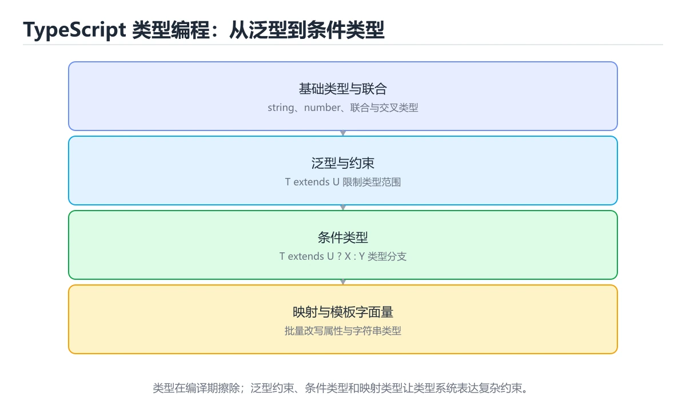
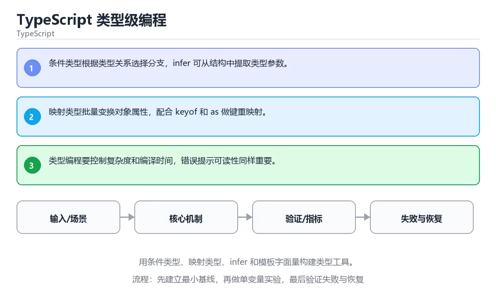

# TypeScript 类型级编程

> 内容更新时间：2026-10-06 · 学习阶段：高级 · 预计用时：30 分钟





## 本节知识框架

**课程定位**：所属分类 `typescript`（TypeScript），课程主题 `TypeScript 类型级编程`，学习阶段 高级，建议用时 45 分钟。

本课主线：用条件类型、映射类型、infer 和模板字面量构建类型工具。

**学完本课应当能够**
- 说清 `条件类型` 与 `映射类型` 的含义与区别，并各举一个正例和一个反例。
- 用本课示例验证 `infer` 的行为，记录输入、输出与失败条件。
- 遇到「类型级技巧用得过多」这类问题时，能说出触发条件与修复顺序。

### 复习清单

- [ ] 能不看正文复述本课核心术语，并指出一个边界或反例。
- [ ] 能运行或推演本课示例，记录输入、输出与失败现象。
- [ ] 能完成一次自测，并把错题对照错误表定位原因。

## 核心概念定义

| 术语 | 操作性定义 | 常见边界与风险 |
| --- | --- | --- |
| 条件类型 | TypeScript 根据类型关系在编译期选择结果类型的类型运算。 | 裸类型参数是联合时会按成员逐个分发再合并结果；它的行为在大版本里调整过，升级前先复现当前推导输出。 |
| 映射类型 | TypeScript 根据已有类型批量生成属性变换后的新类型。 | 它只变换类型层面的属性，接口返回的 JSON 在编译器眼里仍是宽类型；真正落地要靠 zod 解析或类型守卫。 |
| infer | 条件类型里的推断关键字：从待判断类型中提取局部类型变量，用来实现 ReturnType 一类工具类型。 | `ReturnType`、`Parameters`、`Awaited` 都靠它从函数签名或 Promise 结构里抽参数；别依赖推断的巧合，关键处显式标注。 |
| 模板字面量 | TypeScript 在类型层面拼接字符串模式，可约束命名格式或提取子串。 | 它按分隔符递归切分时，连续分隔符会留下空串；要跳过空串就得在递归里判断当前段是否为空再接着切。 |
| 输入与前提是否满足 | 日志、输入样例、测试或指标 | 易错：类型级代码的输入是类型而非运行值，日志和断点抓不到；只能靠 `extends` 约束和最小示例类型来验证前提。 |
| 核心步骤是否产生了预期中间结果 | 日志、输入样例、测试或指标 | 易错：递归与映射类型的中间结果多是元组，肉眼不好核对；用常量把它钉成具体类型再比对推导结果。 |
| 失败路径是否可观测、可恢复 | 日志、输入样例、测试或指标 | 易错：类型级失败只体现在编译期红线、运行期不留痕，报错还难读；要靠显式约束与注释指明错在哪一分支。 |
| 资源、权限与成本是否在预算内 | 日志、输入样例、测试或指标 | 易错：这里的成本是编译时间与维护复杂度而非算力；技巧堆太多会拖慢编译、放大报错，收益不明确就别上。 |

## 原理与运行机制

### 机制总览

**教材衔接：核心知识**

### 1. 条件类型根据类型关系选择分支，infer 可从结构中提取类型参数。

- 关键做法：先让 条件类型 的最小示例可复现，再加入并发或规模条件。
- 验证标准：extends 的输出能被他人复现，边界输入有对应用例。

### 2. 映射类型批量变换对象属性，配合 keyof 和 as 做键重映射。

把这条结论放回「TypeScript 类型级编程」的完整流程里展开：

- 正文依据：能用自己的话解释：条件类型根据类型关系选择分支，infer 可从结构中提取类型参数。
- 落地检查：把「2. 映射类型批量变换对象属性，配合 keyof 和 as 做键重映射。」改写成一条可执行的核对项，逐条验证输入、超时与失败路径。

### 3. 类型编程要控制复杂度和编译时间，错误提示可读性同样重要。

把这条结论放回「TypeScript 类型级编程」的完整流程里展开：

- 正文依据：能用自己的话解释：映射类型批量变换对象属性，配合 keyof 和 as 做键重映射。
- 落地检查：把「3. 类型编程要控制复杂度和编译时间，错误提示可读性同样重要。」改写成一条可执行的核对项，逐条验证输入、超时与失败路径。

**教材衔接：关键流程**

**教材衔接：实践路径**

**教材衔接：版本与时效**

- 版本提示：条件类型 的行为在最近几个大版本里有过调整，升级「TypeScript 类型级编程」前先用 extends 复现当前输出，再对照官方发布说明逐条核对。
- 升级前确认 条件类型 的兼容范围，把不可回退的改动单独拆成一次提交。

## 典型应用场景

**教材衔接：深度拓展与实战**

这一节把 条件类型 的结论、extends 的示例与反例整理成可执行的复习步骤。

### 工程检查表

- [ ] 能否用自己的话说明TypeScript 类型级编程解决什么问题，以及它不负责什么？
- [ ] 能否用「TypeScript 类型级编程」的最小示例复现一次失败并解释原因？
- [ ] 能否解释本课关键词在真实项目中的边界与取舍？
- [ ] 能否说明 映射类型 在新场景下需要补充什么前提？

### 最小验证场景

- 准备：保留 `text` 示例的原始输入，先记录 `TypeScript 类型级编程` 的基线输出和完整运行命令。
- 观察：先核对 调用了 `log()`，再改变一个与 `条件类型` 相关的条件。
- 判定：新结果与 `TypeScript 类型级编程` 的基线不同不等于错误；只有当差异破坏了 `条件类型` 的定义或错误表中的约束，才判定为失败。

### 选择与边界

- 使用 `条件类型` 时，TypeScript 根据类型关系在编译期选择结果类型的类型运算；静态检查只在编译期成立，运行期输入仍需校验。
- 使用 `映射类型` 时，TypeScript 根据已有类型批量生成属性变换后的新类型；静态检查只在编译期成立，运行期输入仍需校验。
- 使用 `infer` 时，条件类型里的推断关键字：从待判断类型中提取局部类型变量，用来实现 ReturnType 一类工具类型；静态检查只在编译期成立，运行期输入仍需校验。
- 使用 `模板字面量` 时，TypeScript 在类型层面拼接字符串模式，可约束命名格式或提取子串；静态检查只在编译期成立，运行期输入仍需校验。

## 代码/协议/SQL 示例

### 最小可验证示例

**教材衔接：最小可运行示例**

下面这段代码演示 条件类型 的最小路径，先原样运行，再按注释改一处：

```typescript
type Split<S extends string> = S extends `${infer Head},${infer Tail}`
  ? [Head, ...Split<Tail>]
  : [S];

const items: Split<"a,b,c"> = ["a", "b", "c"];
console.log(items.join("-"));
```

**教材衔接：预期输出**

```text
a-b-c
```

### 进阶示例：把分隔符做成类型参数

最小示例只按逗号切分；下面把分隔符抽成参数，并给出对应的推导结果：

```typescript
type SplitBy<S extends string, D extends string> =
  S extends `${infer Head}${D}${infer Tail}`
    ? [Head, ...SplitBy<Tail, D>]
    : [S];

type Parts = SplitBy<"x|y|z", "|">;   // ["x", "y", "z"]
const count = (p: Parts) => p.length; // 3
```

```text
Parts = ["x", "y", "z"]，count 返回 3；
SplitBy<"a,,b", ","> 得到 ["a", "", "b"]，连续分隔符会留下空串。
```

动手练习：把最后一条改成跳过空串的版本，思路是在递归时判断 Head 是不是 ""，是就直接递归 Tail。

## 时间/空间复杂度或性能分析

**性能关注点（TypeScript 类型级编程）**：编译期类型检查与运行期代码是两套开销：分别记录构建时间与运行时耗时。

**测量方法**：以 `TypeScript 类型级编程` 的 `条件类型` 场景为对象，固定输入跑一遍记录基线，再把规模或并发度提高一个数量级复测；两次结果的差值与波动范围才是结论依据。

## 常见误区与易错点

| 容易写错的做法 | 实际现象 | 原因与正确做法 |
| --- | --- | --- |
| 类型级技巧用得过多 | 编译变慢且难以维护。 | 只在收益明确时使用类型级编程。 |
| 类型报错信息不友好 | 使用者看不懂错在哪里。 | 用清晰的约束与注释降低理解成本。 |
| 依赖推断的巧合 | 升级后行为变化。 | 显式标注关键类型。 |

### 现场 1：类型级技巧用得过多

**症状**：编译变慢且难以维护。

**根因与修复**：只在收益明确时使用类型级编程。

**自检**：在本课示例里复现「类型级技巧用得过多」，改成只在收益明确时使用类型级编程后重跑；如果症状消失且失败路径按预期变化，说明定位正确。

### 现场 2：类型报错信息不友好

**症状**：使用者看不懂错在哪里。

**根因与修复**：用清晰的约束与注释降低理解成本。

**自检**：在本课示例里复现「类型报错信息不友好」，改成用清晰的约束与注释降低理解成本后重跑；如果症状消失且失败路径按预期变化，说明定位正确。

### 现场 3：依赖推断的巧合

**症状**：升级后行为变化。

**根因与修复**：显式标注关键类型。

**自检**：在本课示例里复现「依赖推断的巧合」，改成显式标注关键类型后重跑；如果症状消失且失败路径按预期变化，说明定位正确。

## 与其他知识点的关系

**教材衔接：复习与迁移**

类型级编程和运行时校验是互补的两件事：编译期能用 `Pick`、`Omit`、`Partial` 这类映射类型把对象形状收窄，但接口返回的 JSON 在编译器眼里仍是宽类型，真正落地要靠 zod 解析器或手写类型守卫。模板字面量类型常和事件名、路由路径这类字符串约定配合，把键统一拼成 `on${Capitalize<K>}` 这样的回调名，改名时编译期会立刻报出来。infer 是这些工具类型的地基，`ReturnType`、`Parameters`、`Awaited` 都靠它从函数签名或 Promise 结构里抽出类型参数。

## 自测题与参考答案

> 先独立作答，再对照参考答案；答案都能在本课正文、术语表或错误表里找到依据。

### 自测 1（概念复述）

不看正文，写出 `条件类型` 的操作性定义，并说明它与 `映射类型` 的区别。

**参考答案**：TypeScript 根据类型关系在编译期选择结果类型的类型运算。

`映射类型` 的定位是：TypeScript 根据已有类型批量生成属性变换后的新类型；两者的差别要从适用对象与失败模式上说明。

### 自测 2（排错）

本课错误表记录了「类型级技巧用得过多」这类做法。请写出它会出现的现象、根因，以及修复顺序。

**参考答案**：现象是编译变慢且难以维护；正确做法是只在收益明确时使用类型级编程。修复时先复现现象并保留证据，再改动一处假设重跑，确认现象消失。

### 自测 3（动手验证）

运行本课的 `text` 示例，改动其中一个输入后重新运行，记录输出与错误信息。

**参考答案**：正常输入下 `text` 示例应当复现正文给出的结果；改动输入后，如果结果改变或报错，先核对它是否满足 `TypeScript 类型级编程` 中`条件类型` 的适用范围，再检查错误表里是否有同类现象。

### 自测 4（代码阅读）

阅读本课开头的 `text` 示例，说明它体现了`条件类型` 的哪一条性质，并指出改动哪个输入会让这条性质不再成立。

**参考答案**：`条件类型` 的定义是 TypeScript 根据类型关系在编译期选择结果类型的类型运算，示例正是在实现这条定义。改动与 `条件类型` 有关的一个输入后，如果结果不再符合 `TypeScript 类型级编程` 的正文描述，就说明该性质只在当前前提成立。

### 自测 5（迁移）

把 `TypeScript 类型级编程` 的方法迁移到自己的项目：围绕 `条件类型` 写出一个与错误表同类的风险点，并说明触发条件和检验方式。

**参考答案**：例如「依赖推断的巧合」，它会导致升级后行为变化；检验方式是按显式标注关键类型改一处再复现，确认现象消失且没有引入新的失败分支。

### 自测 6（对比）

用一个表格对比 `条件类型` 与 `映射类型`：各写一行适用场景、一行失败表现。

**参考答案**：`条件类型` 的定义是TypeScript 根据类型关系在编译期选择结果类型的类型运算；`映射类型` 的定义是TypeScript 根据已有类型批量生成属性变换后的新类型。两者的失败表现分别对应本课错误表里与本术语相关的行。

### 自测 7（排错顺序）

面对「类型级技巧用得过多」引发的问题，请把“复现 编译变慢且难以维护 → 保留证据 → 只在收益明确时使用类型级编程 → 回归验证”四步写成可执行的检查清单。

**参考答案**：第一步按编译变慢且难以维护复现；第二步记录输入、版本与完整报错；第三步按只在收益明确时使用类型级编程只改一处；第四步重跑并确认失败路径也按预期变化。

### 自测 8（边界判断）

针对 `模板字面量`，分别写出“可以使用”的条件和“结论不再成立”的条件。

**参考答案**：静态检查只在编译期成立，运行期输入仍需校验。 同时要把 `模板字面量` 的定义 TypeScript 在类型层面拼接字符串模式，可约束命名格式或提取子串 与实际输入逐项对照。

### 自测 9（机制重建）

不看正文，按输入、转换、输出、验证四段重建 `条件类型` → `映射类型` → `infer` → `模板字面量` 的作用链。

**参考答案**：起点是 `条件类型` 的定义 TypeScript 根据类型关系在编译期选择结果类型的类型运算；中间每一步都保留可观察状态；终点由 `模板字面量` 检查，失败时回到错误表定位第一个偏离定义的步骤。

### 自测 10（综合排错）

在 `TypeScript 类型级编程` 中，现象是 升级后行为变化。请围绕 依赖推断的巧合 写出最小复现、关键证据、修复动作和回归验证，并说明为什么不能只凭一次运行下结论。

**参考答案**：先复现 依赖推断的巧合，记录输入与完整错误；再按 显式标注关键类型 只改一处。回归时同时跑正常路径和边界路径，只有两次结果都可解释，才把修复视为完成。

### 自测 11（一分钟复述）

用每分钟约 200 字的速度复述 `TypeScript 类型级编程`：先给主问题，再按顺序说出 `条件类型`、`映射类型`、`infer`、`模板字面量`，最后给一个失败案例。

**自评标准**：主问题必须对应 用条件类型、映射类型、infer 和模板字面量构建类型工具；每个术语都要能接上一句定义或边界；失败案例必须写成可观察现象，不能用“可能有风险”代替证据。

## 术语速查

| 术语 | 一句话说明 |
| --- | --- |
| `条件类型` | TypeScript 根据类型关系在编译期选择结果类型的类型运算。 |
| `映射类型` | TypeScript 根据已有类型批量生成属性变换后的新类型。 |
| `infer` | 条件类型里的推断关键字：从待判断类型中提取局部类型变量，用来实现 ReturnType 一类工具类型。 |
| `模板字面量` | TypeScript 在类型层面拼接字符串模式，可约束命名格式或提取子串。 |
| `键重映射` | 映射类型里用 `as` 子句改写属性键，例如给每个键加前缀或过滤掉不想要的字段。 |
| `分发条件类型` | 当裸类型参数是联合类型时，条件类型会按成员逐个计算，再把各分支结果合并成联合类型。 |

**术语关系**：`条件类型`（TypeScript 根据类型关系在编译期选择结果类型的类型运算） → `映射类型`（TypeScript 根据已有类型批量生成属性变换后的新类型） → `infer`（条件类型里的推断关键字：从待判断类型中提取局部类型变量） → `模板字面量`（TypeScript 在类型层面拼接字符串模式）。

## 考点精讲

`TypeScript 类型级编程` 的题库有 6 道题，下面逐题给出题干、正确项与判断依据：先自己作答，再核对正确项，最后回到正文对应小节复核。

### 考点 1：第 1 题

- **题目**：在 `TypeScript 类型级编程` 里，与 `条件类型` 有关的说法中，哪一项最符合用条件类型、映射类型、infer 和模板字面量构建类型工具？
- **正确项**：条件类型根据类型关系选择分支，infer 可从结构中提取类型参数。
- **判断依据**：本题正确项是「条件类型根据类型关系选择分支，infer 可从结构中提取类型参数」。术语 条件类型（TypeScript 类型级编程）：TypeScript 根据类型关系在编译期选择结果类型的类型运算，本题取「条件类型根据类型关系选择分支，infer 可从结构中提取类型参数」这条。易错点是类型级技巧用得过多，会造成编译变慢且难以维护，改法是只在收益明确时使用类型级编程。

### 考点 2：第 2 题

- **题目**：代码语言为 `typescript`，选自 `TypeScript 类型级编程` 的 `条件类型` 部分。课程问题为用条件类型、映射类型、infer 和模板字面量构建类型工具。哪一项描述与代码一致？
- **正确项**：出现字面量 `a,b,c`
- **判断依据**：本题正确项是「出现字面量 `a,b,c`」。术语 条件类型（TypeScript 类型级编程）：TypeScript 根据类型关系在编译期选择结果类型的类型运算，本题取「出现字面量 `a,b,c`」这条。易错点是类型报错信息不友好，使用者看不懂错在哪里，改法是用清晰的约束与注释降低理解成本。本题干扰项「出现字面量 `JWT`」不成立：展示代码里找不到 `JWT`。

### 考点 3：第 3 题

- **题目**：在 `TypeScript 类型级编程` 里，与 `条件类型` 有关的说法中，哪一项最符合用条件类型、映射类型、infer 和模板字面量构建类型工具？（TypeScript 类型级编程·TypeScript 第 3 题）
- **正确项**：类型编程要控制复杂度和编译时间，错误提示可读性同样重要。
- **判断依据**：本题正确项是「类型编程要控制复杂度和编译时间，错误提示可读性同样重要」。术语 条件类型（TypeScript 类型级编程）：TypeScript 根据类型关系在编译期选择结果类型的类型运算，本题取「类型编程要控制复杂度和编译时间，错误提示可读性同样重要」这条。易错点是依赖推断的巧合，会造成升级后行为变化，改法是显式标注关键类型。

### 考点 4：第 4 题

- **题目**：`TypeScript 类型级编程` 的主线是：用条件类型、映射类型、infer 和模板字面量构建类型工具。下面哪一项与这条主线一致？
- **正确项**：用条件类型、映射类型、infer 和模板字面量构建类型工具。
- **判断依据**：本题正确项是「用条件类型、映射类型、infer 和模板字面量构建类型工具」。术语 条件类型（TypeScript 类型级编程）：TypeScript 根据类型关系在编译期选择结果类型的类型运算，本题取「用条件类型、映射类型、infer 和模板字面量构建类型工具」这条。易错点是类型级技巧用得过多，会造成编译变慢且难以维护，改法是只在收益明确时使用类型级编程。

### 考点 5：第 5 题

- **题目**：课程 `用条件类型、映射类型、infer 和模板字面量构建类型工具。`。在 `TypeScript 类型级编程` 里，`条件类型`、`映射类型` 与下面哪些选项属于同一层概念？（多选）
- **正确项**：条件类型；映射类型
- **判断依据**：按《TypeScript 类型级编程》的正文口径，本题要同时选中「条件类型」、「映射类型」，漏掉任一项都算没答全。术语 条件类型（TypeScript 类型级编程）：TypeScript 根据类型关系在编译期选择结果类型的类型运算。易错点是类型级技巧用得过多会造成编译变慢且难以维护，改法是只在收益明确时使用类型级编程。

### 考点 6：第 6 题

- **题目**：下面几项都与 `条件类型` 有关，请按 `TypeScript 类型级编程` 的正文顺序排列；该课主线是用条件类型、映射类型、infer 和模板字面量构建类型工具。
- **正确项**：核心知识 → 关键流程 → 实践路径 → 常见误区
- **判断依据**：按《TypeScript 类型级编程》正文的先后，本题顺序是「核心知识」 → 「关键流程」 → 「实践路径」 → 「常见误区」。术语「条件类型」在本课里的界定是TypeScript 根据类型关系在编译期选择结果类型的类型运算，题干问的就是这一条。常见错法是类型级技巧用得过多，其后果是编译变慢且难以维护。正确做法是只在收益明确时使用类型级编程。

### 考点 7：`条件类型`

- **要点**：TypeScript 根据类型关系在编译期选择结果类型的类型运算。
- **条件类型 的边界**：静态检查只在编译期成立，运行期输入仍需校验。

### 考点 8：`映射类型`

- **要点**：TypeScript 根据已有类型批量生成属性变换后的新类型。
- **映射类型 的边界**：静态检查只在编译期成立，运行期输入仍需校验。

### 考点 9：`infer`

- **要点**：条件类型里的推断关键字：从待判断类型中提取局部类型变量，用来实现 ReturnType 一类工具类型。
- **infer 的边界**：静态检查只在编译期成立，运行期输入仍需校验。

### 考点 10：`模板字面量`

- **要点**：TypeScript 在类型层面拼接字符串模式，可约束命名格式或提取子串。
- **模板字面量 的边界**：静态检查只在编译期成立，运行期输入仍需校验。

### 考点 11：排错——类型级技巧用得过多

- **现象**：编译变慢且难以维护。
- **处理**：只在收益明确时使用类型级编程。

### 考点 12：排错——类型报错信息不友好

- **现象**：使用者看不懂错在哪里。
- **处理**：用清晰的约束与注释降低理解成本。

### 考点 13：综合辨析——`条件类型` 与 `模板字面量`

- **辨析点**：`条件类型` 的定义是 TypeScript 根据类型关系在编译期选择结果类型的类型运算；`模板字面量` 的定义是 TypeScript 在类型层面拼接字符串模式，可约束命名格式或提取子串。
- **答题要求**：面对 `TypeScript 类型级编程` 的题目，先判断描述的是 `条件类型` 还是 `模板字面量`，再归到对应定义，最后写出一个会让该定义失效的边界输入。

### 考点 14：排错评分点

- **现象分**：能写出 编译变慢且难以维护，而不是只写“程序有错”。
- **证据分**：保留触发 类型级技巧用得过多 的输入、版本和错误原文。
- **修复分**：按 只在收益明确时使用类型级编程 只改一处，并同时回归正常路径与边界路径。

## 内容元数据

- 内容版本：v2.0
- 最后更新：2026-10-06
- 学习阶段：高级
- 适用环境：TypeScript 5.x / Node.js 22+；本课聚焦 条件类型。
- 内容来源：内置结构化课程与工程实践整理
- 相关主题：条件类型、映射类型、infer、模板字面量
- 质量版本：P0 测验标准 + P1 覆盖扩展 + P2 体验补全

## 参考资料与复核

- 最后复核：2026-10-04
- 下次复核：2027-03-17
- 复核范围：版本兼容、API 行为、安全建议与工程实践
- 来源性质：官方文档、标准或权威教材；本课核对关键词：条件类型、映射类型、infer、模板字面量。

| 参考资料 | 本课用途 |
| --- | --- |
| [Utility Types](https://www.typescriptlang.org/docs/handbook/utility-types.html) | 内置类型变换 |
| [Everyday Types](https://www.typescriptlang.org/docs/handbook/2/everyday-types.html) | 常用类型与收窄 |
| [TypeScript Node 指南](https://nodejs.org/en/learn/typescript) | Node 中的 TypeScript |

| [本课术语索引：TypeScript 类型级编程](#核心概念定义) | 按本课输入、术语边界和错误表现逐项核对 |
> 「TypeScript 类型级编程」的链接用于离线阅读后的延伸核对；App 不会自动联网。