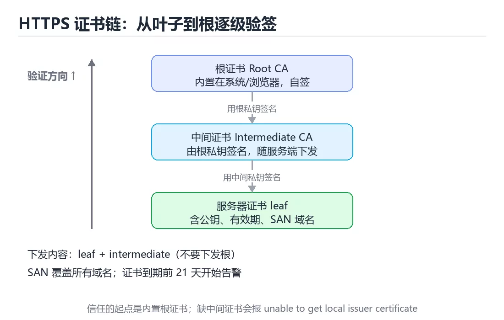
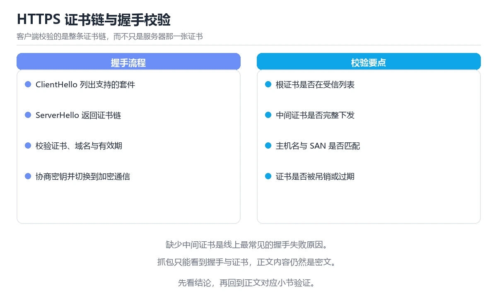

# 图解 HTTPS 证书链与 TLS 握手

> 内容更新时间：2026-10-06 · 学习阶段：进阶 · 预计用时：35 分钟

## 本节知识框架

**课程定位**：所属分类 `visual_guide`（图解专题），课程主题 `图解 HTTPS 证书链与 TLS 握手`，学习阶段 进阶，建议用时 45 分钟。

本课主线：证书链结构、TLS 1.3 握手、命令验证与五类常见证书错误。

**学完本课应当能够**
- 说清 `HTTPS` 与 `证书链` 的含义与区别，并各举一个正例和一个反例。
- 用本课示例验证 `TLS` 的行为，记录输入、输出与失败条件。
- 遇到「`certificate has expired`」这类问题时，能说出触发条件与修复顺序。

### 复习清单

- [ ] 能不看正文复述本课核心术语，并指出一个边界或反例。
- [ ] 能运行或推演本课示例，记录输入、输出与失败现象。
- [ ] 能完成一次自测，并把错题对照错误表定位原因。

**本课配图**





## 核心概念定义

| 术语 | 操作性定义 | 常见边界与风险 |
| --- | --- | --- |
| HTTPS | 在 HTTP 下使用 TLS 提供加密、身份认证和完整性保护。 | 网络延迟、超时与版本协商会改变行为，只在真实链路或多版本客户端上验证才算数。 |
| 证书链 | 从站点证书经过中间证书到受信根证书的签名验证路径。 | 只在「从站点证书经过中间证书到受信根证书的签名验证路径」这一前提下成立，换输入或换环境要重新验证。 |
| TLS | 传输层安全协议：握手协商密钥并用证书验证身份，之后的数据对称加密传输。 | 易错：扫描不合格；正确做法是至少 1.2，优先 1.3。 |
| SAN | TLS 证书中列出可被该证书代表的域名或 IP，客户端据此校验主机名。 | 易错：SAN 里没有这个域名；正确做法是重新签发或改域名。 |
| 续期 | 在证书或令牌到期前重新签发或更新，避免服务因过期而中断。 | 易错：证书过期；正确做法是续期并配置自动续期。 |

## 原理与运行机制

### 机制总览

**教材衔接：一句话说清**

HTTPS 等于 HTTP 加 TLS。TLS 解决三个问题：**加密、完整性、身份认证**。
身份认证靠**证书链**，而信任的起点是系统或浏览器内置的**根证书**。

**教材衔接：深入补充：图解 HTTPS 证书链与 TLS 握手 的取舍与边界**

### 一、把概念放回真实约束

| 观察到的现象 | 背后的机制 | 验证方式 | 常见误判 |
| --- | --- | --- | --- |
| 延迟突然升高 | 队列堆积或重传 | 分段计时与指标对照 | 只盯平均值 |
| 状态看似随机 | 并发交错或缓存失效 | 固定随机种子复现 | 把时序问题当逻辑错误 |
| 结果与预期不符 | 默认值与边界规则 | 构造最小输入 | 忽略版本差异 |

### 四、自测清单

- 能否用一句话说出图解 HTTPS 证书链与 TLS 握手解决的核心问题与不适用场景？
- 能否画出 HTTPS 的数据流或状态变化，并标出失败路径？
- 把 CertificateVerify 的输入推到边界，说明本课哪一条结论会先失效。
- 能否写出一条可复现的验证命令，让别人独立得到相同结论？

## 典型应用场景

- **`certificate has expired`**：典型现象是证书过期；正确做法是续期并配置自动续期。
- **`unable to get local issuer certificate`**：典型现象是中间证书没下发；正确做法是配置完整链。
- **`hostname mismatch`**：典型现象是SAN 里没有这个域名；正确做法是重新签发或改域名。
- **`self signed certificate`**：典型现象是自签证书；正确做法是内网导入根证书或用正式 CA。

### 最小验证场景

- 准备：保留 `text` 示例的原始输入，先记录 `图解 HTTPS 证书链与 TLS 握手` 的基线输出和完整运行命令。
- 观察：先核对 出现字面量 `7 天内不会过期`，再改变一个与 `HTTPS` 相关的条件。
- 判定：新结果与 `图解 HTTPS 证书链与 TLS 握手` 的基线不同不等于错误；只有当差异破坏了 `HTTPS` 的定义或错误表中的约束，才判定为失败。

### 选择与边界

- 使用 `HTTPS` 时，先满足它的定义：在 HTTP 下使用 TLS 提供加密、身份认证和完整性保护；网络延迟、超时与版本协商会改变行为，只在真实链路或多版本客户端上验证才算数。
- 使用 `证书链` 时，先满足它的定义：从站点证书经过中间证书到受信根证书的签名验证路径；只在「从站点证书经过中间证书到受信根证书的签名验证路径」这一前提下成立，换输入或换环境要重新验证。
- 使用 `TLS` 时，先满足它的定义：传输层安全协议：握手协商密钥并用证书验证身份，之后的数据对称加密传输；易错：扫描不合格；正确做法是至少 1.2，优先 1.3。
- 使用 `SAN` 时，先满足它的定义：TLS 证书中列出可被该证书代表的域名或 IP，客户端据此校验主机名；易错：SAN 里没有这个域名；正确做法是重新签发或改域名。
- 使用 `续期` 时，先满足它的定义：在证书或令牌到期前重新签发或更新，避免服务因过期而中断；易错：证书过期；正确做法是续期并配置自动续期。

## 代码/协议/SQL 示例

**教材衔接：一张图看懂证书链**

```text
        ┌──────────────────────────────┐
        │  根证书 Root CA              │  ← 内置在系统/浏览器，自签
        │  subject = Root CA           │
        │  issuer  = Root CA           │
        └───────────────┬──────────────┘
                        │ 用根私钥签名
                        ▼
        ┌──────────────────────────────┐
        │  中间证书 Intermediate CA     │  ← 服务器通常一并下发
        │  subject = Intermediate CA   │
        │  issuer  = Root CA           │
        └───────────────┬──────────────┘
                        │ 用中间私钥签名
                        ▼
        ┌──────────────────────────────┐
        │  服务器证书 leaf              │  ← 部署在服务器上
        │  subject = example.com       │
        │  issuer  = Intermediate CA   │
        │  含公钥、有效期、SAN 域名      │
        └──────────────────────────────┘

验证方向：从叶子往上逐级验签，直到找到一个受信任的根
```

| 字段 | 作用 |
| --- | --- |
| `subject` | 这张证书发给谁 |
| `issuer` | 由谁签名 |
| `SAN` | 覆盖哪些域名（现代校验看它，不看 CN） |
| 有效期 | `notBefore` 到 `notAfter` |
| 公钥 | 用于密钥交换与签名校验 |

**教材衔接：TLS 1.3 握手（简化）**

```text
客户端                                          服务端
   │ ① ClientHello（版本、密码套件、随机数、密钥共享）      │
   ├──────────────────────────────────────────────────────►│
   │                                                       │
   │ ② ServerHello（选定参数、密钥共享）                     │
   │   + 证书链                                             │
   │   + CertificateVerify（用私钥签名，证明持有私钥）        │
   │   + Finished                                          │
   │◄──────────────────────────────────────────────────────┤
   │                                                       │
   │ ③ Finished                                            │
   ├──────────────────────────────────────────────────────►│
   │                                                       │
   ▼ 双方派生会话密钥，开始加密通信（1-RTT）                  ▼
```

| 版本 | 握手往返 | 特点 |
| --- | --- | --- |
| TLS 1.2 | 2-RTT | 兼容性好，配置复杂 |
| TLS 1.3 | 1-RTT，复用可 0-RTT | 更快、默认更安全 |

**注意**：0-RTT 有重放风险，只适合幂等的请求。

**教材衔接：用命令行验证证书链**

```bash
# 查看服务器下发的完整证书链
openssl s_client -connect example.com:443 -servername example.com -showcerts </dev/null

# 只看叶子证书的关键信息
echo | openssl s_client -connect example.com:443 -servername example.com 2>/dev/null \
  | openssl x509 -noout -subject -issuer -dates -ext subjectAltName

# 检查证书是否即将过期（7 天内）
echo | openssl s_client -connect example.com:443 2>/dev/null \
  | openssl x509 -noout -checkend 604800 && echo "7 天内不会过期"
```

**教材衔接：五类常见证书错误**

| 报错 | 原因 | 处理 |
| --- | --- | --- |
| `certificate has expired` | 证书过期 | 续期并配置自动续期 |
| `unable to get local issuer certificate` | 中间证书没下发 | 配置完整链 |
| `hostname mismatch` | SAN 里没有这个域名 | 重新签发或改域名 |
| `self signed certificate` | 自签证书 | 内网导入根证书或用正式 CA |
| `certificate revoked` | 证书被吊销 | 更换证书 |

```bash
# 一次排查多个域名
for host in example.com www.example.com; do
  echo "=== $host ==="
  echo | openssl s_client -connect "$host:443" -servername "$host" 2>/dev/null \
    | openssl x509 -noout -subject -issuer -dates
done
```

**教材衔接：部署时的四个要点**

```text
1. 下发完整链：叶子 + 中间（根证书不要下发）
2. 开启 TLS 1.3 与会话复用，关闭 SSLv3 与 TLS 1.0/1.1
3. 配置自动续期，并对剩余天数告警（例如少于 21 天）
4. 用工具体检配置：testssl.sh 或 SSL Labs
```

```bash
# testssl.sh 快速体检
./testssl.sh --protocols --certificate example.com
```

## 时间/空间复杂度或性能分析

**性能关注点（图解 HTTPS 证书链与 TLS 握手）**：图解类课程的性能点在渲染与交互响应：记录首屏时间与交互延迟。

**测量方法**：以 `图解 HTTPS 证书链与 TLS 握手` 的 `HTTPS` 场景为对象，固定输入跑一遍记录基线，再把规模或并发度提高一个数量级复测；两次结果的差值与波动范围才是结论依据。

## 常见误区与易错点

| 容易写错的做法 | 实际现象 | 原因与正确做法 |
| --- | --- | --- |
| `certificate has expired` | 证书过期 | 续期并配置自动续期 |
| `unable to get local issuer certificate` | 中间证书没下发 | 配置完整链 |
| `hostname mismatch` | SAN 里没有这个域名 | 重新签发或改域名 |
| `self signed certificate` | 自签证书 | 内网导入根证书或用正式 CA |
| `certificate revoked` | 证书被吊销 | 更换证书 |
| 只部署叶子证书 | 部分客户端报链不完整 | 一并下发中间证书 |
| 把根证书也下发 | 多余且增大体积 | 只发叶子与中间 |
| 只看 CN 忽略 SAN | 新浏览器校验失败 | 保证 SAN 覆盖所有域名 |
| 到期才想起来 | 线上中断 | 自动续期加提前告警 |
| 对外用自签证书 | 用户看到警告 | 使用受信任 CA |
| 关闭证书校验 | 中间人攻击 | 生产环境必须校验 |
| 只开 TLS 1.0 | 扫描不合格 | 至少 1.2，优先 1.3 |
| 忽略吊销检查 | 泄露证书仍可用 | 启用 OCSP 或 CRL 检查 |

### 现场 1：`certificate has expired`

**症状**：证书过期。

**根因与修复**：续期并配置自动续期。

**自检**：在本课示例里复现「`certificate has expired`」，改成续期并配置自动续期后重跑；如果症状消失且失败路径按预期变化，说明定位正确。

### 现场 2：`unable to get local issuer certificate`

**症状**：中间证书没下发。

**根因与修复**：配置完整链。

**自检**：在本课示例里复现「`unable to get local issuer certificate`」，改成配置完整链后重跑；如果症状消失且失败路径按预期变化，说明定位正确。

### 现场 3：`hostname mismatch`

**症状**：SAN 里没有这个域名。

**根因与修复**：重新签发或改域名。

**自检**：在本课示例里复现「`hostname mismatch`」，改成重新签发或改域名后重跑；如果症状消失且失败路径按预期变化，说明定位正确。

### 现场 4：`self signed certificate`

**症状**：自签证书。

**根因与修复**：内网导入根证书或用正式 CA。

**自检**：在本课示例里复现「`self signed certificate`」，改成内网导入根证书或用正式 CA后重跑；如果症状消失且失败路径按预期变化，说明定位正确。

### 现场 5：`certificate revoked`

**症状**：证书被吊销。

**根因与修复**：更换证书。

**自检**：在本课示例里复现「`certificate revoked`」，改成更换证书后重跑；如果症状消失且失败路径按预期变化，说明定位正确。

### 现场 6：只部署叶子证书

**症状**：部分客户端报链不完整。

**根因与修复**：一并下发中间证书。

**自检**：在本课示例里复现「只部署叶子证书」，改成一并下发中间证书后重跑；如果症状消失且失败路径按预期变化，说明定位正确。

### 现场 7：把根证书也下发

**症状**：多余且增大体积。

**根因与修复**：只发叶子与中间。

**自检**：在本课示例里复现「把根证书也下发」，改成只发叶子与中间后重跑；如果症状消失且失败路径按预期变化，说明定位正确。

### 现场 8：只看 CN 忽略 SAN

**症状**：新浏览器校验失败。

**根因与修复**：保证 SAN 覆盖所有域名。

**自检**：在本课示例里复现「只看 CN 忽略 SAN」，改成保证 SAN 覆盖所有域名后重跑；如果症状消失且失败路径按预期变化，说明定位正确。

### 现场 9：到期才想起来

**症状**：线上中断。

**根因与修复**：自动续期加提前告警。

**自检**：在本课示例里复现「到期才想起来」，改成自动续期加提前告警后重跑；如果症状消失且失败路径按预期变化，说明定位正确。

## 与其他知识点的关系

**教材衔接：HTTPS 与性能的关系**

```text
连接建立成本：TCP 握手 1 RTT + TLS 握手 1 RTT
  复用连接与会话复用能省掉大部分成本

额外成本：加解密（现代 CPU 开销很小）、证书校验（可缓存）

优化手段：
  · 开启 HTTP/2 或 HTTP/3 多路复用
  · 启用会话复用与会话票据
  · 就近部署（CDN）减少 RTT
  · 使用 ECDSA 证书（握手更快、体积更小）
```

**教材衔接：复习与迁移**

## 自测题与参考答案

> 先独立作答，再对照参考答案；答案都能在本课正文、术语表或错误表里找到依据。

### 自测 1（概念复述）

不看正文，写出 `HTTPS` 的操作性定义，并说明它与 `证书链` 的区别。

**参考答案**：在 HTTP 下使用 TLS 提供加密、身份认证和完整性保护。

`证书链` 的定位是：从站点证书经过中间证书到受信根证书的签名验证路径；两者的差别要从适用对象与失败模式上说明。

### 自测 2（排错）

本课错误表记录了「`certificate has expired`」这类做法。请写出它会出现的现象、根因，以及修复顺序。

**参考答案**：现象是证书过期；正确做法是续期并配置自动续期。修复时先复现现象并保留证据，再改动一处假设重跑，确认现象消失。

### 自测 3（动手验证）

运行本课的 `text` 示例，改动其中一个输入后重新运行，记录输出与错误信息。

**参考答案**：正常输入下 `text` 示例应当复现正文给出的结果；改动输入后，如果结果改变或报错，先核对它是否满足 `图解 HTTPS 证书链与 TLS 握手` 中`HTTPS` 的适用范围，再检查错误表里是否有同类现象。

### 自测 4（代码阅读）

阅读本课开头的 `text` 示例，说明它体现了`HTTPS` 的哪一条性质，并指出改动哪个输入会让这条性质不再成立。

**参考答案**：`HTTPS` 的定义是 在 HTTP 下使用 TLS 提供加密、身份认证和完整性保护，示例正是在实现这条定义。改动与 `HTTPS` 有关的一个输入后，如果结果不再符合 `图解 HTTPS 证书链与 TLS 握手` 的正文描述，就说明该性质只在当前前提成立。

### 自测 5（迁移）

把 `图解 HTTPS 证书链与 TLS 握手` 的方法迁移到自己的项目：围绕 `HTTPS` 写出一个与错误表同类的风险点，并说明触发条件和检验方式。

**参考答案**：例如「忽略吊销检查」，它会导致泄露证书仍可用；检验方式是按启用 OCSP 或 CRL 检查改一处再复现，确认现象消失且没有引入新的失败分支。

### 自测 6（对比）

用一个表格对比 `HTTPS` 与 `证书链`：各写一行适用场景、一行失败表现。

**参考答案**：`HTTPS` 的定义是在 HTTP 下使用 TLS 提供加密、身份认证和完整性保护；`证书链` 的定义是从站点证书经过中间证书到受信根证书的签名验证路径。两者的失败表现分别对应本课错误表里与本术语相关的行。

### 自测 7（排错顺序）

面对「`certificate has expired`」引发的问题，请把“复现 证书过期 → 保留证据 → 续期并配置自动续期 → 回归验证”四步写成可执行的检查清单。

**参考答案**：第一步按证书过期复现；第二步记录输入、版本与完整报错；第三步按续期并配置自动续期只改一处；第四步重跑并确认失败路径也按预期变化。

### 自测 8（边界判断）

针对 `续期`，分别写出“可以使用”的条件和“结论不再成立”的条件。

**参考答案**：易错：证书过期；正确做法是续期并配置自动续期。 同时要把 `续期` 的定义 在证书或令牌到期前重新签发或更新，避免服务因过期而中断 与实际输入逐项对照。

### 自测 9（机制重建）

不看正文，按输入、转换、输出、验证四段重建 `HTTPS` → `证书链` → `TLS` → `SAN` 的作用链。

**参考答案**：起点是 `HTTPS` 的定义 在 HTTP 下使用 TLS 提供加密、身份认证和完整性保护；中间每一步都保留可观察状态；终点由 `续期` 检查，失败时回到错误表定位第一个偏离定义的步骤。

### 自测 10（综合排错）

在 `图解 HTTPS 证书链与 TLS 握手` 中，现象是 泄露证书仍可用。请围绕 忽略吊销检查 写出最小复现、关键证据、修复动作和回归验证，并说明为什么不能只凭一次运行下结论。

**参考答案**：先复现 忽略吊销检查，记录输入与完整错误；再按 启用 OCSP 或 CRL 检查 只改一处。回归时同时跑正常路径和边界路径，只有两次结果都可解释，才把修复视为完成。

### 自测 11（一分钟复述）

用每分钟约 200 字的速度复述 `图解 HTTPS 证书链与 TLS 握手`：先给主问题，再按顺序说出 `HTTPS`、`证书链`、`TLS`、`SAN`，最后给一个失败案例。

**自评标准**：主问题必须对应 证书链结构、TLS 1.3 握手、命令验证与五类常见证书错误；每个术语都要能接上一句定义或边界；失败案例必须写成可观察现象，不能用“可能有风险”代替证据。

## 术语速查

| 术语 | 一句话说明 |
| --- | --- |
| `HTTPS` | 在 HTTP 下使用 TLS 提供加密、身份认证和完整性保护。 |
| `证书链` | 从站点证书经过中间证书到受信根证书的签名验证路径。 |
| `TLS` | 传输层安全协议：握手协商密钥并用证书验证身份，之后的数据对称加密传输。 |
| `SAN` | TLS 证书中列出可被该证书代表的域名或 IP，客户端据此校验主机名。 |
| `续期` | 在证书或令牌到期前重新签发或更新，避免服务因过期而中断。 |

**术语关系**：`HTTPS`（在 HTTP 下使用 TLS 提供加密、身份认证和完整性保护） → `证书链`（从站点证书经过中间证书到受信根证书的签名验证路径） → `TLS`（传输层安全协议：握手协商密钥并用证书验证身份） → `SAN`（TLS 证书中列出可被该证书代表的域名或 IP）。

## 考点精讲

`图解 HTTPS 证书链与 TLS 握手` 的题库有 5 道题，下面逐题给出题干、正确项与判断依据：先自己作答，再核对正确项，最后回到正文对应小节复核。

### 考点 1：第 1 题

- **题目**：围绕“图解 HTTPS 证书链与 TLS 握手”中的 HTTPS、证书链、TLS，下列哪两项是本课强调的实践判断？
- **正确项**：验证 证书链 时要固定版本并覆盖边界输入，结论才可复现；学习 HTTPS 时要同时说明输入、输出和失败路径，不能只看正常流程
- **判断依据**：本题正确项是验证 证书链 时要固定版本并覆盖边界输入，结论才可复现。术语 HTTPS（图解 HTTPS 证书链与 TLS 握手）：在 HTTP 下使用 TLS 提供加密、身份认证和完整性保护，本题取验证 证书链 时要固定版本并覆盖边界输入，结论才可复现这条。易错点是`certificate has expired`会造成证书过期，改法是续期并配置自动续期，干扰项只要 HTTPS 的常规示例通过，就可以跳过边界与异常路径正踩在这条上。

### 考点 2：第 2 题

- **题目**：`图解 HTTPS 证书链与 TLS 握手` 的示例代码用于验证 `HTTPS`，其背景是证书链结构、TLS 1.3 握手、命令验证与五类常见证书错误。代码的真实内容是下面哪一项？
- **正确项**：出现字面量 `7 天内不会过期`
- **判断依据**：本题正确项是出现字面量 `7 天内不会过期`。术语 HTTPS（图解 HTTPS 证书链与 TLS 握手）：在 HTTP 下使用 TLS 提供加密、身份认证和完整性保护，本题取出现字面量 `7 天内不会过期`这条。易错点是`certificate has expired`会造成证书过期，改法是续期并配置自动续期，干扰项出现字面量 `error`正踩在这条上。

### 考点 3：第 3 题

- **题目**：关于 TLS 1.3 的 0-RTT，正确的说法是？
- **正确项**：存在重放风险，只适合幂等请求
- **判断依据**：本题正确项是存在重放风险，只适合幂等请求。术语 TLS（图解 HTTPS 证书链与 TLS 握手）：传输层安全协议：握手协商密钥并用证书验证身份，之后的数据对称加密传输，本题取存在重放风险，只适合幂等请求这条。易错点是`certificate has expired`会造成证书过期，改法是续期并配置自动续期，干扰项只能用于 HTTP/1.1正踩在这条上。

### 考点 4：第 4 题

- **题目**：部署 HTTPS 时，下列哪项做法是正确的？
- **正确项**：部署叶子加中间证书
- **判断依据**：本题正确项是部署叶子加中间证书。术语 HTTPS（图解 HTTPS 证书链与 TLS 握手）：在 HTTP 下使用 TLS 提供加密、身份认证和完整性保护，本题取部署叶子加中间证书这条。易错点是`certificate has expired`会造成证书过期，改法是续期并配置自动续期，干扰项关闭证书校验以提升性能正踩在这条上。

### 考点 5：第 5 题

- **题目**：填空：补齐下面这段术语说明中的空缺。课程 `证书链结构、TLS 1.3 握手、命令验证与五类常见证书错误。`，这段说明是：`____`：从站点证书经过中间证书到受信根证书的签名验证路径。空缺处应填哪个术语？
- **正确项**：证书链
- **判断依据**：涉及术语 证书链：从站点证书经过中间证书到受信根证书的签名验证路径。易错点：`certificate has expired`会造成证书过期。正确做法：续期并配置自动续期。判断时先确认输入和适用范围，对照 `HTTPS`、`证书链`、`TLS`、`SAN` 复现一次，最后把错误表现与正确做法逐项对照。

### 考点 6：`HTTPS`

- **要点**：在 HTTP 下使用 TLS 提供加密、身份认证和完整性保护。
- **HTTPS 的边界**：网络延迟、超时与版本协商会改变行为，只在真实链路或多版本客户端上验证才算数。

### 考点 7：`证书链`

- **要点**：从站点证书经过中间证书到受信根证书的签名验证路径。
- **证书链 的边界**：只在「从站点证书经过中间证书到受信根证书的签名验证路径」这一前提下成立，换输入或换环境要重新验证。

### 考点 8：`TLS`

- **要点**：传输层安全协议：握手协商密钥并用证书验证身份，之后的数据对称加密传输。
- **TLS 的边界**：易错：扫描不合格；正确做法是至少 1.2，优先 1.3。

### 考点 9：`SAN`

- **要点**：TLS 证书中列出可被该证书代表的域名或 IP，客户端据此校验主机名。
- **SAN 的边界**：易错：SAN 里没有这个域名；正确做法是重新签发或改域名。

### 考点 10：`续期`

- **要点**：在证书或令牌到期前重新签发或更新，避免服务因过期而中断。
- **续期 的边界**：易错：证书过期；正确做法是续期并配置自动续期。

### 考点 11：排错——`certificate has expired`

- **现象**：证书过期。
- **处理**：续期并配置自动续期。

### 考点 12：排错——`unable to get local issuer certificate`

- **现象**：中间证书没下发。
- **处理**：配置完整链。

### 考点 13：综合辨析——`HTTPS` 与 `续期`

- **辨析点**：`HTTPS` 的定义是 在 HTTP 下使用 TLS 提供加密、身份认证和完整性保护；`续期` 的定义是 在证书或令牌到期前重新签发或更新，避免服务因过期而中断。
- **答题要求**：面对 `图解 HTTPS 证书链与 TLS 握手` 的题目，先判断描述的是 `HTTPS` 还是 `续期`，再归到对应定义，最后写出一个会让该定义失效的边界输入。

### 考点 14：排错评分点

- **现象分**：能写出 证书过期，而不是只写“程序有错”。
- **证据分**：保留触发 `certificate has expired` 的输入、版本和错误原文。
- **修复分**：按 续期并配置自动续期 只改一处，并同时回归正常路径与边界路径。

## 内容元数据

- 内容版本：v2.0
- 最后更新：2026-10-06
- 学习阶段：进阶
- 适用环境：通用图解与系统原理；本课聚焦 HTTPS。
- 内容来源：内置结构化课程与工程实践整理
- 相关主题：HTTPS、证书链、TLS、SAN、续期
- 质量版本：P0 测验标准 + P1 覆盖扩展 + P2 体验补全

## 参考资料与复核

- 最后复核：2026-10-04
- 下次复核：2027-07-10
- 复核范围：版本兼容、API 行为、安全建议与工程实践
- 来源性质：官方文档、标准或权威教材；本课核对关键词：HTTPS、证书链、TLS、SAN、续期。

| 参考资料 | 本课用途 |
| --- | --- |
| [Cloudflare Learning](https://www.cloudflare.com/learning/) | 网络流程与概念图解 |
| [MDN 浏览器工作原理](https://developer.mozilla.org/docs/Web/Performance/How_browsers_work) | 从请求到渲染的流程 |
| [PlantUML 文档](https://plantuml.com/) | UML 与架构图表达 |

| [本课术语索引：图解 HTTPS 证书链与 TLS 握手](#核心概念定义) | 按本课输入、术语边界和错误表现逐项核对 |
> 「图解 HTTPS 证书链与 TLS 握手」的链接用于离线阅读后的延伸核对；App 不会自动联网。