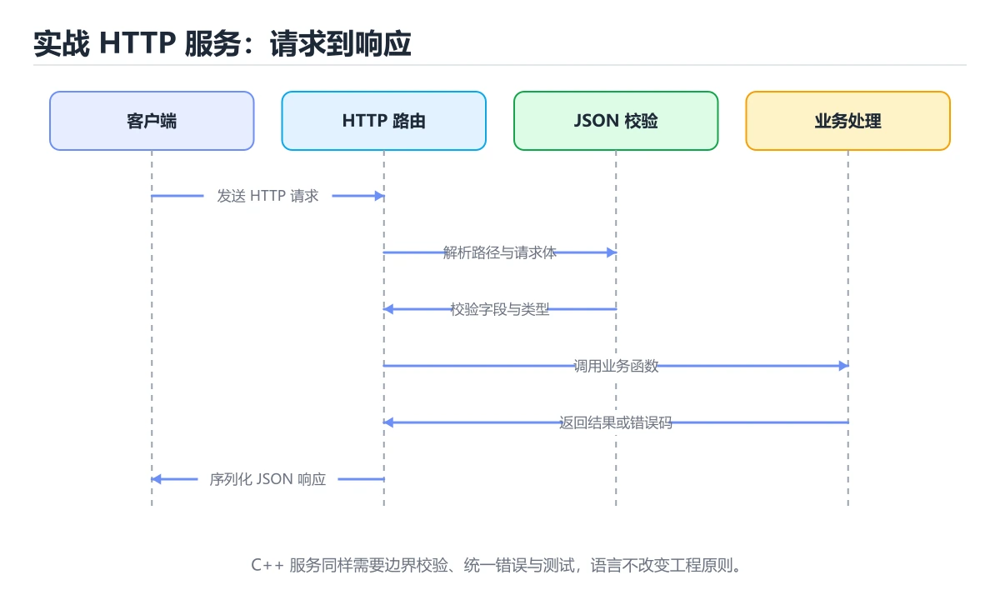
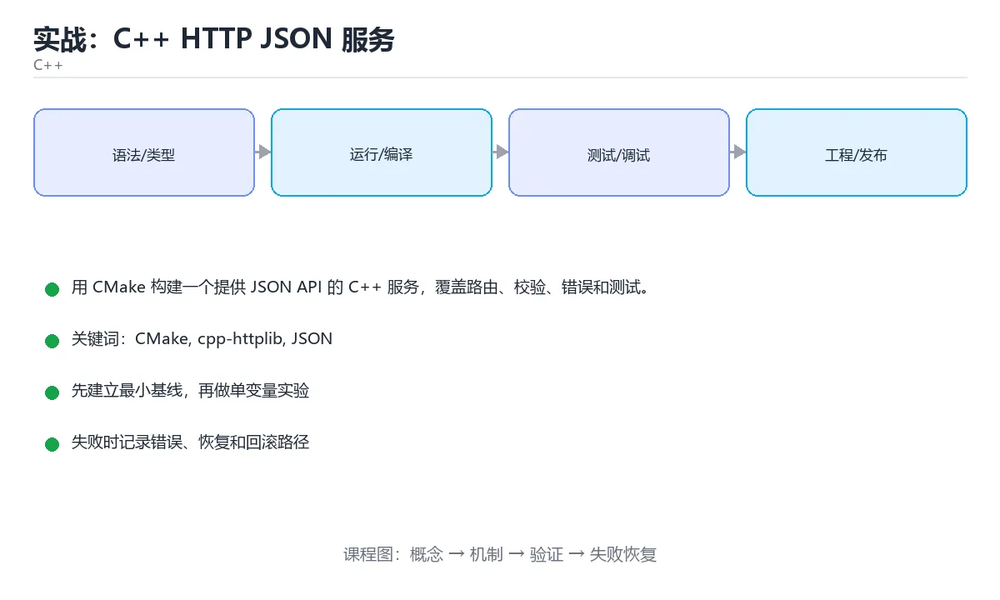

# 实战：C++ HTTP JSON 服务

> 内容更新时间：2026-10-06 · 学习阶段：高级 · 预计用时：60 分钟





## 本节知识框架

上一课你搭好了 CMake 多文件项目的骨架。现在，我们要在这个骨架上长出血肉——一个真正能跑的 HTTP 服务。

想象你开了一家餐厅。厨房（CMake）已经建好了，现在需要：一个前台接待（cpp-httplib 接收 HTTP 请求）、一本菜单（路由表定义哪些 URL 对应哪些功能）、一套点餐规则（JSON 格式约定）、一个储物间（内存或数据库存任务数据），以及一个质检员（Catch2 单元测试 + Sanitizer）。

本课带你从零搭建一个 C++ HTTP JSON 服务：接收请求、解析参数、校验数据、返回 JSON 响应，还能处理错误和并发访问。

**学完本课你会掌握：**
- 用 cpp-httplib 搭建一个最小 HTTP 服务
- 用 nlohmann/json 处理 JSON 请求和响应
- 用 RAII 管理资源生命周期，避免内存泄漏
- 用互斥量保护共享数据，防止数据竞争
- 用 Catch2 写单元测试，用 Sanitizer 做体检

**先修知识：** 《实战：CMake 多文件项目》里的 CMake 目标、CTest 和 Sanitizer 是本课的前提。后续课程《实战：C++ 任务数据库 CLI》会把内存存储替换为 SQLite。

### 复习清单

- [ ] 能说出 RAII 在 HTTP 服务中的作用，并举一个资源泄漏的反例
- [ ] 能用 cpp-httplib 实现 GET 和 POST 路由，并处理 JSON 校验
- [ ] 能解释为什么共享容器需要加锁，以及不加锁会出现什么现象

## 核心概念定义

| 术语 | 一句话说明 |
| --- | --- |
| `CMake` | 跨平台构建系统：用 CMakeLists.txt 描述目标与依赖，生成 Makefile 或 Ninja 工程。 |
| `cpp-httplib` | 一个单头文件的 C++ HTTP 库，不需要额外编译，包含进来就能用。 |
| `RAII` | 资源获取即初始化——把资源绑定到对象生命周期，对象销毁时自动释放资源。 |
| `单元测试` | 对最小功能单元（一个函数、一个路由）做独立验证，确保改动不会破坏已有行为。 |
| `可观测性` | 由日志、指标与链路追踪组成，能在不重启、不改代码的前提下问出新问题。 |

## 原理与运行机制

### 技术栈一览

| 组件 | 角色 | 为什么选它 |
| --- | --- | --- |
| C++20 | 语言标准 | 支持 `std::format`、`std::span` 等现代特性 |
| CMake | 构建系统 | 跨平台，与 vcpkg/Conan 集成好 |
| cpp-httplib | HTTP 服务 | 单头文件，零依赖，适合教学和小型服务 |
| nlohmann/json | JSON 处理 | API 直观，错误处理完善 |
| Catch2 | 测试框架 | 轻量，与 CTest 集成方便 |

### 架构与数据流

把这个服务想象成一条流水线：

```text
客户端请求 → cpp-httplib 接收 → 路由分发 → 参数校验 → 业务逻辑 → JSON 序列化 → HTTP 响应
```

每一步都可能出错，所以我们要在关键节点设置「关卡」：
- 路由分发前：检查 HTTP 方法是否合法
- 参数校验：检查 JSON 格式和必填字段
- 业务逻辑：用 try-catch 捕获异常，转换为统一错误响应
- 响应阶段：设置正确的 Content-Type 和状态码

### 第一步：最小 HTTP 服务

```cpp
#include <httplib.h>
#include <nlohmann/json.hpp>

int main() {
  httplib::Server svr;
  svr.Get("/health", [](const auto&, auto& res) {
    res.set_content(R"({"status":"ok"})", "application/json");
  });
  svr.listen("0.0.0.0", 8080);
}
```

这段代码做了什么？创建一个 HTTP 服务器，注册一个 GET /health 路由，访问时返回 JSON 字符串 `{"status":"ok"}` 和 200 状态码。这就是服务代码访问 GET /health 时会返回什么的答案。

### 第二步：用 RAII 管理资源

RAII 在本项目中的典型作用是什么？自动管理资源和生命周期。

```cpp
// 用 unique_ptr 管理数据库连接
class Database {
public:
    Database(const std::string& path) { /* 打开连接 */ }
    ~Database() { /* 关闭连接 */ }
    // 禁止拷贝
    Database(const Database&) = delete;
    Database& operator=(const Database&) = delete;
};
```

当 `Database` 对象离开作用域时，析构函数自动关闭连接——不需要手动 `close()`，也不会在异常路径上忘记释放资源。这就是 RAII 的精髓：把资源绑定到对象的生命周期。

### 第三步：处理并发与线程安全

当多个请求同时到达时，它们会同时访问共享的任务容器。如果不加保护，就会出现数据竞争——一个线程在写，另一个线程在读，读到的可能是半成品。

共享任务容器最安全的默认策略是什么？用锁保护读写并缩小临界区。

```cpp
#include <mutex>
#include <vector>

std::mutex tasks_mutex;
std::vector<Task> tasks;

// 读取时加锁
auto get_tasks() {
    std::lock_guard<std::mutex> lock(tasks_mutex);
    return tasks;  // 返回副本，缩小临界区
}
```

### 第四步：统一错误处理

异常直接穿透请求线程会导致什么？服务崩溃或连接中断。正确做法是在边界捕获并转换为错误响应。

```cpp
svr.Post("/tasks", [](const auto& req, auto& res) {
    try {
        auto body = nlohmann::json::parse(req.body);
        // 业务逻辑...
    } catch (const nlohmann::json::exception& e) {
        res.status = 400;
        res.set_content(R"({"error":"invalid json"})", "application/json");
    } catch (const std::exception& e) {
        res.status = 500;
        res.set_content(R"({"error":"internal"})", "application/json");
    }
});
```

### 第五步：补 Catch2 单元测试

```cpp
#include <catch2/catch_test_macros.hpp>
#include <httplib.h>

TEST_CASE("health 端点返回 200", "[http]") {
    httplib::Client cli("localhost", 8080);
    auto res = cli.Get("/health");
    REQUIRE(res->status == 200);
    auto body = nlohmann::json::parse(res->body);
    CHECK(body["status"] == "ok");
}

TEST_CASE("不存在的任务返回 404", "[http]") {
    httplib::Client cli("localhost", 8080);
    auto res = cli.Get("/tasks/99999");
    REQUIRE(res->status == 404);
}

TEST_CASE("非法 JSON 返回 400", "[http]") {
    httplib::Client cli("localhost", 8080);
    auto res = cli.Post("/tasks", "not json", "application/json");
    REQUIRE(res->status == 400);
}
```

### 第六步：开启 Sanitizer 做验收

为什么要在测试中开启 Sanitizer？发现越界、泄漏和数据竞争。Sanitizer 能在测试阶段就暴露那些「偶尔出现、难以复现」的并发问题。

### 项目专属规格

本项目用 CMake 构建一个提供 JSON API 的 C++ 服务，覆盖路由、校验、错误和测试。核心关键词：CMake、cpp-httplib、JSON、RAII、单元测试。

验收场景：
1. 正常路径：GET /health 返回 `{"status":"ok"}`，POST /tasks 创建任务并返回 201
2. 边界路径：重复提交同一幂等键不产生副作用
3. 失败路径：非法 JSON 返回 400，不存在的任务返回 404
4. 幂等路径：同一请求执行两次结果一致
5. 回滚路径：服务重启后数据一致

### 项目交付物

建议仓库结构：

```text
src/
  server.cpp
  task_store.cpp
  routes.cpp
include/
  task_store.h
  routes.h
tests/
  server_test.cpp
  task_store_test.cpp
CMakeLists.txt
```

### 验证命令与预期输出

| 阶段 | 命令 | 预期输出 |
| --- | --- | --- |
| 配置构建 | `cmake -S . -B build -DCMAKE_BUILD_TYPE=Debug` | 生成 CMake 缓存且无错误 |
| 编译 | `cmake --build build --parallel` | 目标全部编译成功且无警告 |
| 启动服务 | `./build/server` | 监听 0.0.0.0:8080 |
| 健康检查 | `curl http://localhost:8080/health` | `{"status":"ok"}` |
| 运行测试 | `ctest --test-dir build --output-on-failure` | 所有测试用例通过 |

## 典型应用场景

### 场景一：健康检查端点

最简单的应用就是暴露一个 `/health` 端点，让监控系统知道服务还活着。返回 `{"status":"ok"}` 和 200 状态码，运维脚本定期轮询就能及时发现服务故障。

### 场景二：任务 CRUD API

把内存中的 `std::vector<Task>` 作为存储，通过 POST 创建任务、GET 查询任务、DELETE 删除任务。每个请求都经过 JSON 校验和异常捕获，确保非法输入返回 400 而不是服务崩溃。

### 场景三：并发安全的共享服务

多个客户端同时请求时，用 `std::mutex` 保护共享的任务容器。读操作返回副本（缩小临界区），写操作在锁内完成。这样即使高并发也不会出现数据竞争。

## 代码/协议/SQL 示例

### CMakeLists.txt 关键配置

```cmake
cmake_minimum_required(VERSION 3.20)
project(task_service LANGUAGES CXX)
set(CMAKE_CXX_STANDARD 20)

# cpp-httplib 是单头文件库
add_library(httplib INTERFACE)
target_include_directories(httplib INTERFACE third_party/cpp-httplib)

# 服务主程序
add_executable(server src/server.cpp src/task_store.cpp src/routes.cpp)
target_include_directories(server PRIVATE include)
target_link_libraries(server PRIVATE httplib nlohmann_json::nlohmann_json)

# 测试
enable_testing()
add_executable(server_test tests/server_test.cpp tests/task_store_test.cpp)
target_link_libraries(server_test PRIVATE server_lib Catch2::Catch2WithMain)
add_test(NAME server_test COMMAND server_test)
```

### 完整路由示例

```cpp
// 按 CMake、cpp-httplib、JSON 的实践顺序组织代码
// 1. CMake 管理依赖和构建
// 2. cpp-httplib 接收和分发请求
// 3. nlohmann/json 解析和序列化数据
// 4. RAII 管理资源生命周期

svr.Get("/tasks/:id", [](const auto& req, auto& res) {
    auto id = req.path_params.at("id");
    auto task = store.find(id);
    if (!task) {
        res.status = 404;
        res.set_content(R"({"error":"not found"})", "application/json");
        return;
    }
    res.set_content(task->to_json().dump(), "application/json");
});
```

## 时间/空间复杂度或性能分析

**请求延迟**：cpp-httplib 是同步模型，每个请求一个线程。对于 JSON 解析和序列化，nlohmann/json 的性能在同类库中属于中等偏上。

**内存占用**：共享任务容器用 `std::vector<Task>` 存储，内存随任务数线性增长。加锁的开销在临界区很小时可以忽略。

**并发瓶颈**：当并发请求超过线程池大小时，新请求会排队等待。解决方案：用异步 I/O 或增加线程数。

**测量方法**：用 `wrk` 或 `hey` 做压测，记录 P50/P95/P99 延迟。逐步增加并发数，观察延迟拐点。

## 常见误区与易错点

| 容易写错的做法 | 实际现象 | 正确做法 |
| --- | --- | --- |
| 异常直接穿透请求线程 | 服务崩溃或连接中断 | 在边界捕获并转换为错误响应 |
| 共享容器无锁读写 | 数据竞争 | 使用互斥量或不可变快照 |
| CMake 把所有文件塞进一个目标 | 编译慢且无法复用 | 拆成库、服务和测试目标 |
| 只编译不开启警告 | 未定义行为被隐藏 | 开启 -Wall -Wextra 和 Sanitizer |

### 现场排错：异常穿透请求线程

**症状**：服务偶尔崩溃，日志里只看到 `terminate called after throwing an instance of...`。

**根因**：cpp-httplib 的请求处理函数里抛了异常，但没有被捕获，异常穿透到主线程导致 `std::terminate`。

**修复**：在每个路由处理函数的最外层加 try-catch，把异常转换为 500 错误响应。

### 现场排错：共享容器数据竞争

**症状**：高并发下偶尔出现数据丢失或读到脏数据，但单线程测试一切正常。

**根因**：多个线程同时读写 `std::vector`，没有加锁保护。

**修复**：用 `std::mutex` 保护共享容器，临界区尽量小——读完就释放锁，不要在持锁状态下做 JSON 序列化。

## 与其他知识点的关系

- **先修**：《实战：CMake 多文件项目》。本课直接使用了上一课的 CMake 目标、CTest 和 Sanitizer。
- **后续**：《实战：C++ 任务数据库 CLI》。下一课会把内存存储替换为 SQLite，并加入命令行参数解析。
- **术语衔接**：《内存管理与智能指针》和《类与面向对象》都涉及 `RAII`，本课是 RAII 在真实项目中的具体应用。

### 知识脉络

```text
构建、调试与工程实践 → 实战：CMake 多文件项目
    ↓
实战：C++ HTTP JSON 服务（cpp-httplib、JSON、RAII、并发）  ← 你在这里
    ↓
实战：C++ 任务数据库 CLI（SQLite、CLI11、持久化）
```

## 自测题与参考答案

> 先独立作答，再对照参考答案。

### 自测 1：RAII 在 HTTP 服务中的典型作用是什么？

**参考答案**：自动管理资源和生命周期。比如数据库连接、文件句柄、网络套接字，都可以通过 RAII 绑定到对象的生命周期，对象销毁时自动释放，避免泄漏。

### 自测 2：为什么要在测试中开启 Sanitizer？

**参考答案**：发现越界、泄漏和数据竞争。很多并发问题在单线程测试中不会出现，Sanitizer 能在测试阶段暴露这些问题。

### 自测 3：共享任务容器最安全的默认策略是什么？

**参考答案**：用锁保护读写并缩小临界区。读操作返回副本而不是引用，避免持锁时间过长。

## 考点精讲

本课题库有 6 道题，下面逐题讲解。

### 考点 1

**题目**：RAII 在本项目中的典型作用是什么？

**答案**：自动管理资源和生命周期

**讲解**：RAII（Resource Acquisition Is Initialization）是 C++ 的核心惯用法。在本项目中，数据库连接、HTTP 客户端、文件句柄等资源都通过 RAII 管理——对象创建时获取资源，对象销毁时自动释放。

### 考点 2

- **题目**：按“实战：C++ HTTP JSON 服务”中 CMake、cpp-httplib、JSON 的实践顺序，把四个步骤排成从准备到复盘的合理顺序。

**答案**：先明确 CMake 的输入、输出与约束 → 写出最小示例并核对 cpp-httplib 的基线结果 → 只改一个变量，记录边界与失败路径的变化 → 固定版本与证据，把"实战：C++ HTTP JSON 服务"的结论写成可复现记录

**讲解**：先用 CMake 搭好构建框架（输入：源码文件；输出：可执行文件；约束：依赖版本），然后用 cpp-httplib 写出最小服务并验证基线，接着逐步加入 JSON 处理、错误处理和并发保护，最后固定版本并记录所有验证结果。

### 考点 3

**题目**：为什么要在测试中开启 Sanitizer？

**答案**：发现越界、泄漏和数据竞争

**讲解**：Sanitizer 在编译时插入检查代码，运行时自动检测内存问题。数据竞争尤其危险——它可能只在高并发下偶尔出现，手动测试几乎无法覆盖。

### 考点 4

**题目**：共享任务容器最安全的默认策略是什么？

**答案**：用锁保护读写并缩小临界区

**讲解**：`std::mutex` 是最基本的同步手段。关键是让临界区尽可能小——加锁、读/写数据、解锁，三步完成。不要在持锁状态下做 JSON 序列化或网络 I/O。

### 考点 5

**题目**：这段服务代码访问 GET /health 时会返回什么？

**答案**：JSON 字符串 {"status":"ok"} 和 200

**讲解**：`res.set_content(R"({"status":"ok"})", "application/json")` 设置了响应体和 Content-Type。cpp-httplib 默认返回 200 状态码。所以客户端收到的是 200 + `{"status":"ok"}`。

### 考点 6

**题目**：关于 `CMake`，下列哪些说法与 `实战：C++ HTTP JSON 服务` 的正文一致？判断时以用 CMake 构建一个提供 JSON API 的 C++ 服务，覆盖路由、校验、错误和测试。为主线。（多选）

**答案**：400；自动管理资源和生命周期

**讲解**：CMake 负责构建系统组织，RAII 负责资源管理。两者在本项目中分别解决了「怎么编译」和「怎么管理资源」两个核心问题。400 是非法 JSON 请求的错误状态码。

## 术语速查

| 术语 | 一句话说明 |
| --- | --- |
| `cpp-httplib` | 单头文件 C++ HTTP 库，包含即用，适合教学和小型服务。 |
| `nlohmann/json` | C++ 最流行的 JSON 库，API 直观，支持序列化/反序列化。 |
| `RAII` | 资源获取即初始化，对象销毁时自动释放资源，避免泄漏。 |
| `互斥量` | 保护共享数据的同步原语，同一时刻只允许一个线程访问。 |
| `幂等键` | 客户端提供的唯一标识，防止同一请求被重复执行产生副作用。 |

## 内容元数据

- 内容版本：v2.0
- 最后更新：2026-10-06
- 学习阶段：高级
- 适用环境：C++20 / GCC 13+ 或 Clang 17+
- 内容来源：内置结构化课程与工程实践整理
- 相关主题：CMake、cpp-httplib、JSON、RAII、单元测试

## 参考资料与复核

- 最后复核：2026-10-04
- 下次复核：2027-05-10
- 复核范围：HTTP 服务行为、JSON 处理、并发安全与测试覆盖
- 来源性质：官方文档、标准或权威教材

| 参考资料 | 本课用途 |
| --- | --- |
| [cpp-httplib 仓库](https://github.com/yhirose/cpp-httplib) | 单头文件 HTTP 库的 API 文档与示例 |
| [nlohmann/json 文档](https://github.com/nlohmann/json) | JSON 序列化/反序列化与错误处理 |
| [HTTP/1.1 规范](https://www.rfc-editor.org/rfc/rfc7231) | HTTP 方法、状态码与头部字段的权威定义 |
