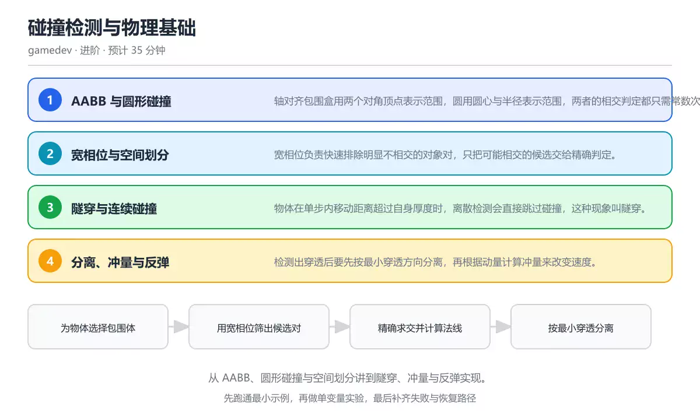
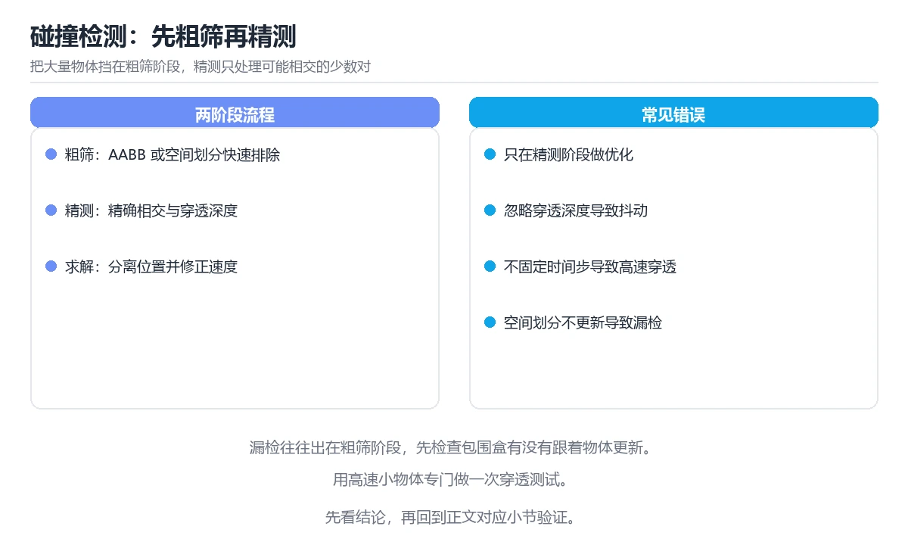

# 碰撞检测与物理基础

> 内容更新时间：2026-10-06 · 学习阶段：intermediate · 预计用时：45 分钟

你有没有想过，游戏里的角色撞墙时为什么不会穿过去？子弹打中敌人时，引擎怎么知道"打中了"？两个球碰在一起，为什么能自然地弹开？这些效果的背后，都是一套叫做"碰撞检测与物理响应"的机制在工作。

今天我们就从零开始，搞懂游戏引擎是怎么处理碰撞的。不需要你提前学过物理引擎，只要玩过游戏就行——我们用游戏里的真实场景来理解每一个概念。



## 本节知识框架

**今天的目标**：搞懂游戏是怎么知道"两个东西撞上了"，以及撞上之后怎么处理。

想象你在做一个 2D 小游戏：屏幕上有几十个方块和圆形在移动。每一帧你都要回答两个问题——"谁和谁撞了？"和"撞上之后怎么办？"。第一个问题就是**碰撞检测**，第二个问题就是**物理响应**。

学完这一课，你会：
- 理解 AABB（轴对齐包围盒）和圆形碰撞的检测原理
- 知道"宽相位"和"窄相位"分别在干什么
- 明白"隧穿"是什么，以及怎么防止高速物体穿过墙壁
- 能写出基础的碰撞分离和冲量计算代码

**先修与衔接**：本课是「图形与游戏开发」分类的第 4 课。你需要对 2D 坐标系和基本向量运算有初步了解。学完后按 `gamedev` 分类顺序继续。

### 复习清单

- [ ] 能用自己的话解释 AABB 相交判定为什么只需要比较投影
- [ ] 能说出宽相位和窄相位各自的任务，以及为什么需要分两步
- [ ] 能解释"隧穿"现象出现的原因，并说出至少两种解决办法
- [ ] 能推演一段碰撞分离代码的执行过程，说出为什么选穿透更浅的轴

**本课配图**



## 核心概念定义

先认识几个核心术语，后面每一节都会用到它们：

| 术语 | 一句话说明 |
| --- | --- |
| AABB | 轴对齐包围盒——一个跟坐标轴平行的矩形框，把物体"包"起来。只需要左上角坐标和宽高就能表示。 |
| 宽相位 | 碰撞检测的第一轮筛选：用便宜的方法快速排除"明显没撞上"的对象对，只留下"可能撞了"的候选。 |
| 窄相位 | 碰撞检测的第二轮精判：对宽相位筛出来的候选对，做精确的相交计算，得到碰撞法线和穿透深度。 |
| 隧穿 | 高速物体在一帧之内"穿过"了墙壁或另一个物体，引擎没有检测到碰撞的现象。 |
| 法线 | 碰撞法线——一个指向"分离方向"的单位向量，告诉你该把两个物体往哪个方向推开。 |
| 恢复系数 | 衡量碰撞后"弹回多少"的参数。1 表示完全弹性碰撞（像超级弹力球），0 表示完全不弹（像泥巴）。 |
| 冲量 | 碰撞瞬间施加的"力"，用来改变物体的速度。质量大的物体速度变化小，质量小的变化大。 |

## 原理与运行机制

### 第一步：用包围盒快速判断"撞没撞"

#### AABB 碰撞检测

AABB 是最简单的碰撞检测方式。你可以把每个物体想象成一个快递盒子——这个盒子的边都跟坐标轴平行，不会歪。

判断两个 AABB 是否相交，本质就是判断它们在 x 轴和 y 轴上的投影是否都重叠。就像两辆车在十字路口——横向上有重叠，纵向上也有重叠，那它们就撞上了。只要有一个方向没重叠，就不会撞。

```text
盒子 A：x 范围 [1, 5]，y 范围 [2, 6]
盒子 B：x 范围 [3, 7]，y 范围 [4, 8]

x 轴：A 的右边界 5 > B 的左边界 3 ✓，A 的左边界 1 < B 的右边界 7 ✓ → x 重叠
y 轴：A 的上边界 6 > B 的下边界 4 ✓，A 的下边界 2 < B 的上边界 8 ✓ → y 重叠
两个方向都重叠 → 两个盒子相交！
```

AABB 的好处是计算特别快——只需要 4 次比较。坏处也很明显：它只能表示"正放的矩形"。如果你的角色旋转了 45 度，AABB 会把四个角都包进去，留下大量空隙，精确度就下降了。

#### 圆形碰撞检测

圆形碰撞更简单：算两个圆心的距离，跟两个半径之和比较就行了。

```text
圆 P 圆心 (1, 2)，半径 3
圆 Q 圆心 (5, 6)，半径 2

圆心距离的平方 = (5-1)² + (6-2)² = 16 + 16 = 32
半径之和的平方 = (3+2)² = 25

32 > 25 → 圆心距离大于半径之和 → 两个圆不相交
```

注意这里比较的是"距离的平方"而不是"距离"——省掉了一次开方运算，在游戏里每帧都要算成千上万次碰撞，省掉开方就是实打实的性能提升。

#### 工程做法

实际游戏里，通常先用 AABB 或圆形这种"便宜"的包围体做第一轮筛选，只对"可能撞了"的物体对再做更精确的形状级检测。就像医院的分诊台：先用体温枪快速筛一遍，有异常的再送去做详细检查。

### 第二步：宽相位——快速排除"不可能撞"的对象

如果你的游戏场景里有 1000 个物体，两两比较就需要算 1000 × 999 / 2 ≈ 50 万次。这还只是一帧！60 FPS 就是每秒 3000 万次比较，显然不现实。

**宽相位**就是为了解决这个问题。它的思路很简单：把空间切成小块，每个物体只需要跟同一个格子（或相邻格子）里的物体比较就行了。

常见的空间划分方式有：

- **均匀网格**：把场景切成固定大小的格子，像棋盘一样。简单好实现，但格子太大或太小都不行。
- **四叉树**：递归地把空间一分为四，物体密集的地方分得细，稀疏的地方分得粗。自适应能力强。
- **排序扫描线**：把所有物体按某个坐标排序，用扫描线扫过去，只检查在扫描范围内重叠的对象对。

不管用哪种方法，目标都一样：把 O(n²) 的两两比较降到接近 O(n)。就像你在一间教室里找人聊天——你不会跟教室里每个人都聊一遍，而是先看看谁坐在你附近。

格子尺寸怎么选？一个经验法则是跟场景中物体的平均大小挂钩。格子太大，每个格子里塞满物体，跟不做划分差不多；格子太小，一个物体跨了好几个格子，反而要重复比较。

### 第三步：隧穿——高速物体的"鬼穿墙"问题

想象一颗子弹以每秒 2000 像素的速度飞行，帧率是 60 FPS。那么每一帧子弹移动大约 33 像素。如果面前有一面 10 像素厚的墙，子弹在这一帧的起点在墙左边，终点在墙右边——离散检测只看起点和终点两个位置，两个位置都不在墙里面，所以判定"没撞上"。子弹就这么"穿"过去了。

这就是**隧穿**（tunneling）——高速物体在单步内越过目标而未被检测到。

怎么解决？有几种常用方法：

1. **线段扫掠检测**：不只看起点和终点，而是把物体的运动轨迹当成一条线段，检查这条线段有没有跟墙壁相交。相当于从"拍照"变成"录像"。
2. **限制单步位移**：不管速度多快，每一帧最多移动一个物体厚度的距离。超出的部分留到下一帧再走。简单粗暴但有效。
3. **按速度阈值启用连续检测**：只对速度超过某个阈值的物体开启连续检测，低速物体继续用便宜的离散检测。在效果和性能之间取平衡。

注意：**不要对全部物体都开启连续检测**。连续检测的开销远高于离散检测，全部开启会让帧时间暴涨。只对子弹、快速移动的道具等关键物体开启就够了。

### 第四步：碰撞响应——分离、法线与冲量

检测到碰撞之后，还要做三件事：

#### 1. 位置分离

两个物体重叠了，首先要做的是把它们"推开"——沿着穿透最浅的方向分离。就像两个人在走廊里撞上了，你会选择从更宽敞的那一侧绕过去，而不是硬挤。

#### 2. 碰撞法线

法线就是"推开方向"的单位向量。对于 AABB，法线通常就是穿透最浅那个轴的方向。对于圆形碰撞，法线就是两个圆心的连线方向。法线不仅决定分离方向，还参与后续的冲量计算。

#### 3. 冲量与反弹

冲量是碰撞瞬间的"力"，用来改变物体的速度。计算公式跟动量守恒和恢复系数有关：

```text
冲量大小 = -(1 + 恢复系数) × 相对速度在法线方向的分量 / (1/质量A + 1/质量B)
```

- 恢复系数 = 1：完全弹性碰撞，像台球碰撞，几乎不损失能量
- 恢复系数 = 0：完全非弹性碰撞，像两个泥巴球撞在一起粘住了
- 游戏中的常见值：0.3 ~ 0.8 之间，看你想让物体"弹"到什么程度

质量大的物体速度变化小，质量小的变化大——这跟现实世界的直觉一致。一颗乒乓球撞上保龄球，乒乓球弹得老远，保龄球几乎不动。

#### 关键顺序

碰撞处理的顺序很重要，搞错了就会出 bug：

```text
宽相位筛出候选对 → 精确求交得到法线与穿透深度 → 按最小穿透方向分离 → 按冲量更新速度
```

如果先算冲量再分离，残留的穿透会让物体在同一帧反复触发碰撞检测，产生抖动。一定要**先分离，再算冲量**。

## 典型应用场景

### 场景 1：2D 平台游戏的角色碰撞

在平台跳跃游戏里，角色通常用 AABB 表示。地面、墙壁、天花板也都是 AABB。检测角色是否着地，就是检测角色的 AABB 和地面的 AABB 是否相交。分离时，因为角色是从上方落下的，y 方向的穿透更浅，所以沿 y 轴分离——把角色推到地面上方。

### 场景 2：弹幕射击游戏

弹幕游戏里可能有上百颗子弹同时飞行。每颗子弹用圆形碰撞体表示（子弹是圆的嘛），敌人也用圆形。宽相位用均匀网格把屏幕分成若干区域，子弹只需要跟同区域内的敌人做精确检测。对于速度特别快的 Boss 弹幕，开启线段扫掠防止穿过玩家。

### 场景 3：物理沙盒游戏

像《Angry Birds》这样的游戏，需要真实的物理反弹效果。碰撞检测出穿透后，先分离位置，再根据两个物体的质量和恢复系数计算冲量。石头鸟（质量大）撞上木块（质量小），木块飞出去很远，石头鸟几乎不减速——这就是冲量分配的效果。

## 代码/协议/SQL 示例

### 最小示例：AABB 与圆形碰撞检测

```python
def aabb_hit(a, b):
    """判断两个 AABB 是否相交"""
    return (a.x < b.x + b.w and a.x + a.w > b.x and
            a.y < b.y + b.h and a.y + a.h > b.y)

def circles_hit(p, r1, q, r2):
    """判断两个圆是否相交（比较距离平方，省掉开方）"""
    dx, dy = q.x - p.x, q.y - p.y
    return dx * dx + dy * dy <= (r1 + r2) ** 2
```

`aabb_hit` 的逻辑就是前面说的"四个方向都重叠才相交"。`a.x < b.x + b.w` 表示 A 的左边界在 B 的右边界左边，四个条件都满足就说明两个盒子在 x 和 y 方向都有重叠。

### 碰撞分离代码

```python
def resolve_overlap(a, b):
    """沿穿透更浅的轴分离两个重叠的 AABB"""
    overlap_x = min(a.x + a.w, b.x + b.w) - max(a.x, b.x)
    overlap_y = min(a.y + a.h, b.y + b.h) - max(a.y, b.y)
    # 沿穿透更浅的方向分离，避免一次推开过多
    if overlap_x < overlap_y:
        shift = overlap_x / 2
        a.x -= shift
        b.x += shift
    else:
        shift = overlap_y / 2
        a.y -= shift
        b.y += shift
```

这段代码做了三件事：
1. 算出 x 和 y 两个方向上的穿透深度（`overlap_x` 和 `overlap_y`）
2. 比较哪个方向穿透更浅
3. 沿更浅的方向把两个物体各推开一半

为什么各推一半而不是把一个推到底？因为两个物体可能都在移动，只推一个会导致另一个看起来"粘"在上面。各推一半更公平，视觉效果也更自然。

### 完整碰撞处理流程

```text
1. 为每个物体创建 AABB 或圆形包围体
2. 宽相位：用空间划分（网格/四叉树）筛出候选对
3. 窄相位：对候选对做精确相交检测，得到碰撞法线和穿透深度
4. 位置分离：沿法线方向按穿透深度推开物体
5. 速度更新：根据质量、恢复系数计算冲量，更新速度
```

### 动手练一练

1. 修改 `resolve_overlap`，让两个物体质量不同时按质量比例分配分离距离（质量大的少推，质量小的多推）。
2. 写一个 `circle_resolve_overlap` 函数，实现两个圆的碰撞分离。提示：法线方向就是两个圆心的连线方向。
3. 让一颗"子弹"以每帧 50 像素的速度穿过一面 10 像素厚的墙，用离散检测验证隧穿现象，再用线段扫掠验证能检测到碰撞。

### 本课速查卡

| 复习项 | 本课要点 |
| --- | --- |
| 核心结论 | 碰撞检测分两步：宽相位快速排除 + 窄相位精确判定；碰撞响应也是两步：先分离位置，再计算冲量更新速度 |
| 最便宜的检测 | AABB 相交只需 4 次比较，圆形碰撞只需 1 次距离平方比较 |
| 最常见的错误 | 先算冲量再分离，导致物体抖动；对全部物体开启连续检测，导致帧率暴跌 |
| 出错先查什么 | 先看是宽相位漏了候选对，还是窄相位算错了法线方向 |
| 怎么确认学会了 | 能独立写出碰撞检测 + 分离 + 冲量计算的完整流程 |

## 时间/空间复杂度或性能分析

碰撞检测的性能直接关系到游戏帧率。我们来拆解一下各环节的开销：

**宽相位**：
- 不做空间划分：O(n²)，1000 个物体就要 50 万次比较，帧率直接崩
- 均匀网格：O(n)，每个物体只跟相邻格子里的物体比较
- 四叉树：O(n log n)，自适应划分，物体分布不均匀时效果好

**窄相位**：
- AABB vs AABB：4 次比较，O(1)，几乎不花时间
- 圆 vs 圆：1 次减法 + 1 次乘法 + 1 次比较，O(1)
- 复杂多边形 vs 多边形：取决于顶点数，可能到 O(n) 或更高

**性能建议**：
- 帧预算决定一切：60 FPS 意味着每帧只有 16.7 毫秒，碰撞检测通常只能分到 2-3 毫秒
- 先用包围体筛选，再用精确检测——这是游戏引擎的通用做法
- 只对高速或关键物体开启连续检测
- 在目标机型上做性能测试，不要只看 PC 上的帧率

## 常见误区与易错点

| 容易犯的错误 | 会出现什么 | 怎么修 |
| --- | --- | --- |
| 只用离散检测处理高速物体 | 子弹穿过墙壁，角色卡进地形 | 对高速物体使用线段扫掠检测，或限制单步最大位移 |
| 先算冲量再分离位置 | 物体在同一帧反复碰撞，疯狂抖动 | 先按最小穿透方向分离，再计算冲量 |
| 对全部物体做两两碰撞检测 | 物体一多帧率就暴跌（O(n²)） | 引入空间划分做宽相位，只对候选对做精确判定 |
| 对全部物体开启连续检测 | 帧时间暴涨，低端机型直接卡死 | 按速度阈值筛选，只对高速物体开启 |
| 格子尺寸跟物体大小脱钩 | 格子太大等于没划分，格子太小重复比较 | 格子尺寸与场景中物体的平均尺寸挂钩 |

### 重点讲两个新手必踩的坑

**坑 1：高速物体隧穿**

```text
场景：子弹速度 2000 px/s，帧率 60 FPS，墙厚 10 px
每帧位移 = 2000 / 60 ≈ 33 px

帧 N：子弹在 x=100（墙在 x=110 到 x=120）
帧 N+1：子弹在 x=133

离散检测：帧 N 不在墙内，帧 N+1 也不在墙内 → 判定"没撞上"
实际情况：子弹从 x=100 飞到 x=133，经过了 x=110~120 的墙 → 应该撞上
```

修复方法：用线段扫掠，检查从 x=100 到 x=133 的线段是否与墙相交。或者限制每帧最多移动 10 px（一个墙厚），超出的 23 px 留到下一帧。

**坑 2：分离顺序搞反**

```text
错误顺序：先算冲量 → 再分离
结果：两个物体还重叠着就开始算冲量，速度改了但位置没改，
      下一帧检测发现还在重叠，又触发碰撞，又改速度 → 抖动

正确顺序：先分离 → 再算冲量
结果：位置已经分开，冲量只改速度，不会反复触发
```

## 与其他知识点的关系

- **先修**：你需要了解 2D 坐标系、向量的基本运算（加减法、点积）。如果不熟，建议先复习一下高中数学的向量部分。
- **后续**：《ECS 与性能分析》——碰撞检测是 ECS 架构中最典型的"系统"之一，学完本课后再看 ECS 怎么组织碰撞代码会更有感觉。
- **术语衔接**：本课学的 `AABB`、`宽相位`、`隧穿`、`法线`、`冲量` 是物理引擎的核心词汇，后面的课程会反复用到。

## 自测题与参考答案

> 先独立作答，再对照参考答案。

### 自测 1

用自己的话解释：为什么 AABB 相交判定只需要检查 x 和 y 轴上的投影是否重叠？

**参考答案**：因为 AABB 的边都跟坐标轴平行，所以两个盒子相交当且仅当它们在每一个轴上的投影都重叠。只要有一个轴上的投影不重叠，两个盒子就一定不相交——就像十字路口的两辆车，横向或纵向有一个方向没重叠就不会撞上。

### 自测 2

宽相位和窄相位分别在做什么？为什么不能只做窄相位？

**参考答案**：宽相位用便宜的方法（空间划分）快速排除明显不相交的对象对，窄相位对剩下的候选对做精确检测。不能只做窄相位是因为窄相位虽然精确但开销大，如果对所有物体两两做精确检测，复杂度是 O(n²)，物体一多帧率就崩了。

### 自测 3

一颗子弹以每帧 50 像素的速度飞行，面前有一面 5 像素厚的墙。用离散检测会发生什么？怎么解决？

**参考答案**：子弹在帧 N 在墙左边，帧 N+1 在墙右边（移动了 50 px，远超墙厚 5 px），离散检测只看两帧的位置，都不在墙内，所以判定没撞上——这就是隧穿。解决方法：用线段扫掠检测（检查运动轨迹是否与墙相交），或限制每帧最多移动 5 px。

### 自测 4

以下代码中，如果 `overlap_x == overlap_y`，会走哪个分支？为什么这样设计没问题？

```python
if overlap_x < overlap_y:
    shift = overlap_x / 2
    a.x -= shift
    b.x += shift
else:
    shift = overlap_y / 2
    a.y -= shift
    b.y += shift
```

**参考答案**：走 `else` 分支（沿 y 轴分离）。当两个方向穿透深度相等时，选哪个轴都可以，不会导致错误。`else` 分支只是兜底，不代表 y 轴一定"更好"。代码不会报错，只是选择了其中一个方向。

### 自测 5

为什么碰撞处理要先分离再算冲量？如果顺序反了会怎样？

**参考答案**：因为如果两个物体还重叠着就计算冲量，速度虽然改了但位置没改，下一帧检测时还是重叠的，又会触发碰撞响应，导致物体在同一帧反复碰撞并不断改变速度——表现出来就是疯狂抖动。先分离确保位置不再重叠，再算冲量只改速度，就不会反复触发了。

## 术语速查

| 术语 | 一句话说明 |
| --- | --- |
| AABB | 轴对齐包围盒，用两个对角点（或左上角+宽高）表示的矩形，碰撞检测最便宜的形状。 |
| 宽相位 | 碰撞检测第一轮：用空间划分快速排除不可能相交的对象对，把候选数量从 O(n²) 降到接近 O(n)。 |
| 窄相位 | 碰撞检测第二轮：对候选对做精确相交检测，得到法线和穿透深度。 |
| 隧穿 | 高速物体一帧飞过头，离散检测没发现碰撞。用线段扫掠或限制位移来解决。 |
| 法线 | 碰撞法线，指向分离方向的单位向量，决定"往哪推"和"往哪弹"。 |
| 恢复系数 | 碰撞后弹回多少：1 = 完全弹性，0 = 完全不弹，游戏里常用 0.3~0.8。 |
| 冲量 | 碰撞瞬间的力，改变物体速度。质量大的速度变化小，质量小的变化大。 |

## 考点精讲

`碰撞检测与物理基础` 的题库有 5 道题，下面逐题讲解。先自己试着作答，再核对答案和解析。

### 考点 1：第 1 题

- **题目**：两个轴对齐包围盒相交的判定本质是什么？
- **选项**：
  - A. 两个盒子在 x 与 y 轴上的投影都重叠
  - B. 两个盒子的中心点重合
  - C. 两个盒子的面积相等
  - D. 两个盒子的顶点数量相同，需要额外的验证与维护
- **答案**：A
- **解析**：AABB 的相交判定就是区间重叠判定。两个盒子相交，当且仅当它们在 x 轴上的投影重叠，并且在 y 轴上的投影也重叠。中心点重合、面积相等、顶点数量相同都不是相交的判定条件——两个盒子可以中心不同但投影重叠（相交），也可以中心相同但大小不同（也相交）。

### 考点 2：第 2 题

- **题目**：宽相位的主要目的是什么？
- **选项**：
  - A. 精确计算碰撞点的法线
  - B. 计算物体质量与动量
  - C. 生成物理材质的纹理
  - D. 快速排除明显不相交的对象对
- **答案**：D
- **解析**：宽相位是碰撞检测的第一轮筛选，用空间划分（网格、四叉树等）快速排除"明显没撞上"的对象对，只把"可能撞了"的候选交给窄相位做精确判定。法线计算是窄相位的事，质量和动量是碰撞响应的事，纹理跟碰撞检测完全无关。

### 考点 3：第 3 题

- **题目**：以下哪些做法可以缓解高速物体的隧穿？（多选）
- **选项**：
  - A. 对高速物体使用线段扫掠检测
  - B. 限制单个时间步内的最大位移
  - C. 对全部物体强制开启连续检测
  - D. 把速度阈值作为是否启用连续检测的依据
- **答案**：ABD
- **解析**：A 线段扫掠把运动轨迹当成线段检查相交，能检测到离散检测会跳过的碰撞。B 限制单步位移让物体不会一帧飞太远，从根本上避免隧穿。D 按速度阈值筛选只对高速物体开启连续检测，既防隧穿又保性能。C 对全部物体强制开启连续检测虽然能防隧穿，但开销太大，不是合理的工程做法。

### 考点 4：第 4 题

- **题目**：请按一次碰撞处理的合理顺序排列步骤。
- **选项**：
  - A. 按最小穿透方向分离
  - B. 宽相位筛出候选对
  - C. 精确求交得到法线与穿透深度
  - D. 按冲量更新速度
- **答案**：BCAD
- **解析**：正确的碰撞处理顺序是：先用宽相位缩小范围（B），再精确求交得到碰撞信息（C），然后按最小穿透方向分离位置（A），最后用冲量更新速度（D）。如果先算冲量再分离（把 A 和 D 的顺序搞反），残留穿透会让物体反复触发碰撞，产生抖动。

### 考点 5：第 5 题

- **题目**：阅读这段碰撞处理代码，下面哪项判断是正确的？
- **选项**：
  - A. 沿穿透更浅的轴各分离一半，避免单次推开过多
  - B. 两个盒子总是沿 x 轴分离
  - C. 分离之后不再需要计算冲量
  - D. overlap_x 与 overlap_y 相等时函数会报错
- **答案**：A
- **解析**：代码比较 `overlap_x` 和 `overlap_y`，选穿透更浅的方向，把两个物体各推开一半。这样做的好处是避免沿错误方向推开过多。B 错误——只有当 `overlap_x < overlap_y` 时才沿 x 轴分离。C 错误——分离只修正位置，速度还需要后续用冲量更新。D 错误——相等时走 `else` 分支，沿 y 轴分离，不会报错。

## 内容元数据

- 内容版本：v2.0
- 最后更新：2026-10-06
- 学习阶段：intermediate
- 适用环境：通用游戏引擎（2D）
- 内容来源：内置结构化课程与游戏引擎工程实践整理
- 相关主题：碰撞检测、物理引擎、AABB、空间划分、冲量

## 参考资料与复核

- 最后复核：2026-10-04
- 下次复核：2027-04-24
- 来源性质：官方文档、权威教材与游戏引擎工程实践整理

| 参考资料 | 本课用途 |
| --- | --- |
| [Real-Time Collision Detection 书籍主页](https://realtimecollisiondetection.net/) | 碰撞检测算法的系统讲解，AABB、空间划分、连续检测的权威参考 |
| [Godot 物理与碰撞文档](https://docs.godotengine.org/en/stable/tutorials/physics/physics_introduction.html) | 游戏引擎中碰撞检测与物理响应的实际实现 |
| [Box2D 文档与源码](https://box2d.org/documentation/) | 2D 物理引擎的开源实现，宽相位、窄相位、冲量计算的工程参考 |
