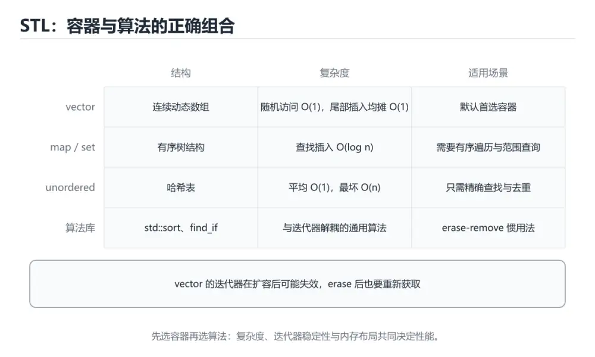
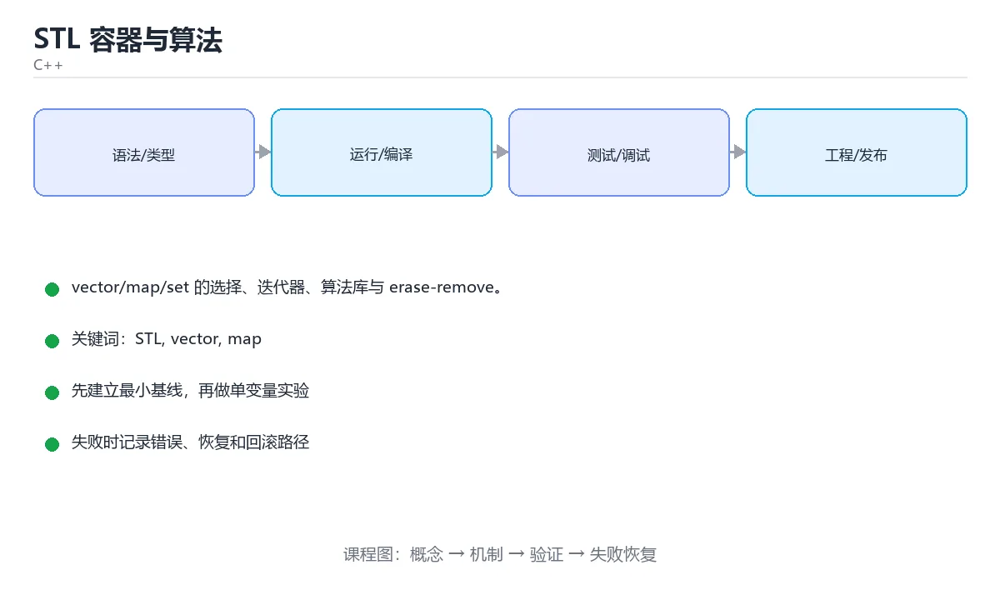

# STL 容器与算法





> 内容更新时间：2026-10-06 · 学习阶段：进阶 · 预计用时：55 分钟

## 本节知识框架

STL 的设计思路其实很简单：**把「存数据」和「处理数据」分开**。

想象一个厨房：
- **容器**（vector、map、set）是各种收纳盒——有的按顺序排（vector），有的按标签找（map），有的自动去重（set）。
- **迭代器**是你的手指——指向收纳盒里的某个位置，能前后移动。
- **算法**（sort、find、transform）是加工机器——不管食材从哪个收纳盒来，只要手指能指到，机器就能加工。

三者用统一的接口拼在一起，所以你学会一套就能通用。不确定用什么容器？先选 `vector`，它就像厨房里的万能砧板。

本课主线：**vector/map/set 的选择、迭代器、算法库与 erase-remove**。

学完这课你会：
- 知道什么时候用 vector、什么时候用 map 或 unordered_map
- 理解迭代器失效的原因和预防方法
- 熟练使用 sort、find、accumulate 等常用算法

## 核心概念定义

| 术语 | 一句话说明 |
| --- | --- |
| STL | 标准模板库，把「存数据」（容器）和「处理数据」（算法）通过迭代器连接起来。 |
| vector | C++ 标准库中的动态数组，连续存储元素并支持自动扩容。默认容器首选。 |
| 迭代器 | 容器与算法之间的统一接口，像一个能前后移动的手指，指向某个元素。 |
| algorithm | C++ 标准库算法头文件 `<algorithm>`，提供排序、查找、变换等泛型算法。 |
| erase-remove | 删除容器中满足条件元素的惯用法：先用 `remove_if` 移动元素，再用 `erase` 截断。 |
| 迭代器失效 | 容器结构变化（如扩容、插入、删除）后，原有迭代器不再有效，继续使用会崩溃。 |

## 原理与运行机制

### 容器选型：不确定就用 vector

选容器的思路就像选收纳工具：

1. **不确定就用 `vector`**——连续内存、缓存友好、随机访问快。
2. **需要按键查找** → `unordered_map`（无需有序，最快）或 `map`（需要有序遍历）。
3. **需要去重** → `set` / `unordered_set`。
4. **频繁在中间插删** → `list`（但缓存不友好，往往仍不如 vector）。

| 容器 | 结构 | 查找 | 插入删除 | 典型用途 |
| --- | --- | --- | --- | --- |
| `vector` | 动态数组 | O(n) | 尾部 O(1) | **默认选择** |
| `deque` | 双端队列 | O(n) | 两端 O(1) | 双端进出 |
| `list` | 双向链表 | O(n) | 已知位置 O(1) | 频繁中间插入 |
| `map` / `set` | 红黑树 | O(log n) | O(log n) | 需要有序 |
| `unordered_map` | 哈希表 | 平均 O(1) | 平均 O(1) | 需要极速查找 |
| `array` | 固定数组 | O(n) | 长度不可变 | 编译期确定大小 |

### 迭代器：容器与算法的桥梁

迭代器是容器与算法之间的统一接口。不管数据存在 vector 还是 list 里，只要提供迭代器，算法就能工作。

```cpp
for (auto it = nums.begin(); it != nums.end(); ++it) {
    std::cout << *it << ' ';
}

nums.erase(std::remove(nums.begin(), nums.end(), 1), nums.end());  // erase-remove
```

注意：修改容器结构（如 `push_back`）可能让迭代器失效。

### 算法库：加工机器

```cpp
#include <algorithm>
#include <numeric>

std::sort(nums.begin(), nums.end());                   // 升序
auto it = std::find(nums.begin(), nums.end(), 4);      // 查找
int total = std::accumulate(nums.begin(), nums.end(), 0); // 累加
std::reverse(nums.begin(), nums.end());                 // 反转
auto [min_it, max_it] = std::minmax_element(nums.begin(), nums.end());

bool all_positive = std::all_of(nums.begin(), nums.end(),
                                [](int x) { return x > 0; });
```

### lambda 与算法配合

```cpp
std::vector<std::string> names{"tom", "alice", "bob"};

std::sort(names.begin(), names.end(),
          [](const std::string& a, const std::string& b) {
              return a.size() < b.size();
          });

auto count = std::count_if(names.begin(), names.end(),
                           [](const auto& n) { return n.size() > 3; });
```

## 典型应用场景

- **默认排序容器**：用 `vector` + `std::sort`。
- **词频统计**：用 `unordered_map<string, int>`。
- **需要有序遍历**：用 `map` 或先 sort vector。
- **删除满足条件的元素**：用 erase-remove 惯用法或 C++20 的 `std::erase_if`。

## 代码/协议/SQL 示例

### 基本容器操作

```cpp
#include <vector>
#include <unordered_map>
#include <string>

std::vector<int> nums{3, 1, 2};
nums.push_back(4);
nums[0] = 9;

std::unordered_map<std::string, int> ages;
ages["小明"] = 18;
if (auto it = ages.find("小明"); it != ages.end()) {
    std::cout << it->second;
}
```

### 一段代码走完常用操作

```cpp
#include <algorithm>
#include <iostream>
#include <map>
#include <numeric>
#include <string>
#include <unordered_map>
#include <vector>

int main() {
    std::vector<int> nums{5, 3, 1, 4, 2};
    std::sort(nums.begin(), nums.end());
    auto it = std::find(nums.begin(), nums.end(), 4);
    int sum = std::accumulate(nums.begin(), nums.end(), 0);
    std::cout << "sum=" << sum << " found=" << *it << '\n';

    std::unordered_map<std::string, int> freq;
    for (const auto& word : {"a", "b", "a", "c", "a"}) {
        ++freq[word];
    }
    for (const auto& [word, count] : freq) {
        std::cout << word << '=' << count << ' ';
    }
    std::cout << '\n';

    std::map<std::string, int> ordered(freq.begin(), freq.end());
    for (const auto& [word, count] : ordered) {
        std::cout << word << ':' << count << ' ';
    }
}
```

### 词频统计前五名

```cpp
#include <algorithm>
#include <iostream>
#include <sstream>
#include <string>
#include <unordered_map>
#include <vector>

int main() {
    const std::string text = "the quick brown fox jumps over the lazy dog the fox";
    std::unordered_map<std::string, int> freq;

    std::istringstream stream(text);
    for (std::string word; stream >> word; ) {
        ++freq[word];
    }

    std::vector<std::pair<std::string, int>> items(freq.begin(), freq.end());
    std::sort(items.begin(), items.end(), [](const auto& a, const auto& b) {
        return a.second != b.second ? a.second > b.second : a.first < b.first;
    });

    for (std::size_t i = 0; i < std::min<std::size_t>(5, items.size()); ++i) {
        std::cout << items[i].first << ": " << items[i].second << '\n';
    }
    std::cout << "unique words: " << freq.size() << '\n';
}
```

编译运行：`g++ -std=c++17 wordcount.cpp -o wordcount && ./wordcount`

### 性能与安全习惯

```cpp
std::vector<int> v;
v.reserve(1000);          // 预分配，避免多次扩容与拷贝
v.push_back(1);
v.emplace_back(2);        // 原地构造，少一次移动
v.at(0);                  // 带越界检查，越界抛异常
v[0];                     // 不检查，追求速度时用
```

## 时间/空间复杂度或性能分析

各容器和算法的复杂度是选择容器的关键依据：

| 操作 | vector | map | unordered_map |
| --- | --- | --- | --- |
| 随机访问 | O(1) | O(log n) | 平均 O(1) |
| 插入（尾部/键） | 尾部均摊 O(1) | O(log n) | 平均 O(1) |
| 查找 | O(n) | O(log n) | 平均 O(1) |
| 删除 | O(n) | O(log n) | 平均 O(1) |

- **sort**：平均 O(n log n)
- **find**：O(n)
- **lower_bound**（需已排序）：O(log n)
- **accumulate**：O(n)

性能建议：已知规模就 `reserve`；传容器用 `const&` 避免拷贝；`emplace_back` 比 `push_back` 少一次移动。

## 常见误区与易错点

| 容易写错的做法 | 实际现象 | 原因与正确做法 |
| --- | --- | --- |
| 扩容后继续用旧迭代器 | 迭代器失效，崩溃 | 扩容后重新获取迭代器 |
| 遍历中删元素 | 迭代器失效 | 用 erase 的返回值或 erase_if |
| 在 `unordered_map` 里存自定义键 | 编译错误 | 提供 `std::hash` 与 `operator==` |
| 用 `map` 当极速查找 | 比哈希慢 | 无顺序需求就用 `unordered_map` |
| 忘了 `reserve` | 反复扩容影响性能 | 已知规模就预留 |
| `vector<bool>` 当普通容器 | 行为特殊 | 用 `deque<bool>` 或 `vector<char>` |
| 用 `[]` 越界访问 | 未定义行为 | 关键路径用 `at()` |
| 拷贝大容器 | 性能差 | 传 `const&`，或用移动 |

## 与其他知识点的关系

- **先修**：《模板与泛型编程》——STL 的容器和算法全是模板实现的。
- **后续**：《现代 C++ 特性》——C++17/20 给 STL 加了 `string_view`、`span`、`erase_if` 等新接口。
- **术语衔接**：本课的 `STL`、`vector`、`迭代器` 在后续课程中会继续使用。
- **关联**：《C++ Concepts 与 Ranges》——Ranges 是 STL 算法的下一代写法。

## 自测题与参考答案

### 自测 1

vector 和 map 的区别是什么？什么时候用哪个？

**参考答案**：`vector` 是动态数组，随机访问 O(1)，查找 O(n)。`map` 是红黑树，查找 O(log n)，自动按键排序。不确定就用 vector；需要按键查找用 unordered_map；需要有序遍历用 map。

### 自测 2

什么是迭代器失效？怎么避免？

**参考答案**：容器结构变化（如 push_back 触发扩容、erase 删除元素）后，原有迭代器不再指向有效位置。避免方法：扩容后重新获取迭代器；遍历时用 erase 的返回值更新迭代器。

### 自测 3

erase-remove 惯用法是怎么工作的？

**参考答案**：`std::remove_if` 把不需要删除的元素移到前面，返回新的逻辑末尾迭代器。然后 `vector::erase` 从该位置截断到 `end()`，真正删除多余元素。C++20 起可以直接用 `std::erase_if`。

## 考点精讲

本课的题库有 6 道题，下面逐题讲解。

### 考点 1

**题目**：`STL 容器与算法` 的示例代码用于验证 `STL`，其背景是vector/map/set 的选择、迭代器、算法库与 erase-remove。代码的真实内容是下面哪一项？

**正确项**：调用了 `reverse()`

**讲解**：本课的示例代码中出现了 `std::reverse()` 算法调用，展示了 STL 算法库的用法。

### 考点 2

- **题目**：围绕“STL 容器与算法”中的 STL、vector、map，下列哪两项是本课强调的实践判断？

**正确项**：
- 验证 vector 时要固定版本并覆盖边界输入，结论才可复现
- 学习 STL 时要同时说明输入、输出和失败路径，不能只看正常流程

**讲解**：学习 STL 不能只跑通正常例子。验证 vector 行为时要固定编译器版本、覆盖边界输入；学习 STL 时要同时考虑正常流程和失败路径（比如迭代器失效）。

### 考点 3

**题目**：erase-remove 惯用法的作用是？

**正确项**：删除满足条件的元素

**讲解**：erase-remove 先用 `remove_if` 把不删除的元素移到前面，再用 `erase` 截掉尾部多余部分。效果就是删除容器中所有满足条件的元素。

### 考点 4

**题目**：std::map 与 std::unordered_map 的底层结构区别是？

**正确项**：map 通常用红黑树（有序）

**讲解**：`map` 底层是红黑树，元素按键有序排列，查找 O(log n)。`unordered_map` 底层是哈希表，无序但查找平均 O(1)。需要排序用 map，追求速度用 unordered_map。

### 考点 5

**题目**：下面哪种操作最容易让 vector 的迭代器失效？

**正确项**：插入元素触发扩容

**讲解**：vector 扩容时会把数据搬到新的内存位置，所有指向旧位置的迭代器、指针、引用全部失效。预防方法：提前 `reserve` 足够的空间。

### 考点 6

**题目**：填空：补齐下面这段术语说明中的空缺。课程 `vector/map/set 的选择、迭代器、算法库与 erase-remove。`，这段说明是：`____`：C++ 标准库中的动态数组，连续存储元素并支持自动扩容。空缺处应填哪个术语？

**正确项**：vector

**讲解**：`vector` 就是 C++ 标准库中的动态数组。它连续存储元素，尾部插入均摊 O(1)，满了就自动扩容。

## 术语速查

| 术语 | 一句话说明 |
| --- | --- |
| STL | 标准模板库，把容器、迭代器、算法三者解耦。 |
| vector | 动态数组，连续存储，默认容器首选。 |
| 迭代器 | 容器与算法之间的统一接口，像能移动的手指。 |
| algorithm | 标准库算法头文件，提供排序、查找、变换等泛型算法。 |
| erase-remove | 删除容器中满足条件元素的惯用法。 |
| 迭代器失效 | 容器结构变化后原有迭代器不再有效。 |

## 复习清单

- [ ] 能说出 vector、map、unordered_map 各自的复杂度和适用场景。
- [ ] 能运行或推演本课的 wordcount 示例，记录输入、输出与失败现象。
- [ ] 能完成一次自测，并把错题对照错误表定位原因。

## 参考资料与复核

- 最后复核：2026-10-04
- 下次复核：2027-05-10
- 复核范围：版本兼容、API 行为、安全建议与工程实践

| 参考资料 | 本课用途 |
| --- | --- |
| [cppreference 标准库](https://en.cppreference.com/w/cpp/standard_library) | 标准库组件索引 |
| [C++ 容器](https://en.cppreference.com/w/cpp/container) | 各容器的接口与复杂度 |
| [C++ 算法](https://en.cppreference.com/w/cpp/algorithm) | 算法库完整列表与用法 |

## 内容元数据

- 内容版本：v2.0
- 最后更新：2026-10-06
- 学习阶段：进阶
- 适用环境：C++20 / GCC 13+ 或 Clang 17+
- 内容来源：内置结构化课程与工程实践整理
- 相关主题：STL、vector、map、unordered_map、迭代器、algorithm
- 质量版本：P0 测验标准 + P1 覆盖扩展 + P2 体验补全
