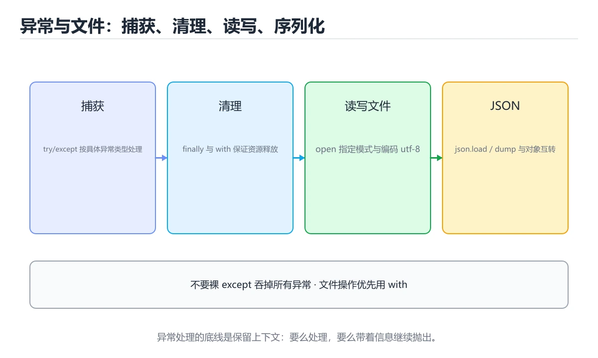
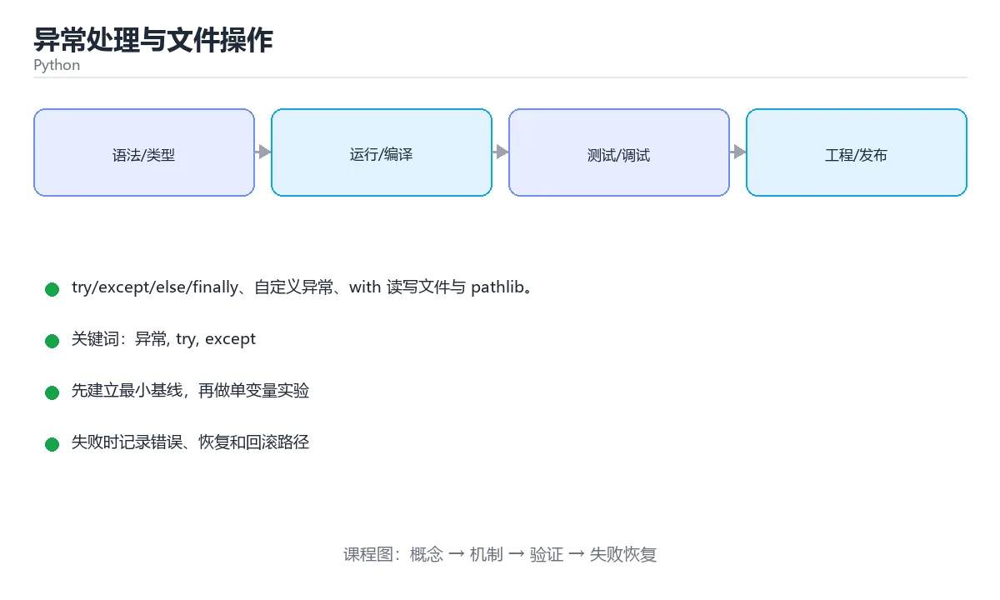

# 异常处理与文件操作

> 内容更新时间：2026-10-06 · 学习阶段：进阶 · 预计用时：60 分钟

> 学习阶段：进阶 · 预计用时：60 分钟 · 更新时间：2026-10-06





---

## 本节知识框架

想象你是一名餐厅经理。正常情况下，厨师做菜、服务员上菜、顾客用餐，一切顺畅——这就是程序的「正常流程」。但万一厨房着火了怎么办？你不能让整个餐厅跟着一起烧掉，而是需要一套应急预案：先灭火、再疏散顾客、最后通知保险公司。

**异常处理**就是程序的「应急预案」，**文件操作**则是让程序把数据「写进日记本」保存下来的能力。

本课主线：`try/except/else/finally` 四大金刚、自定义异常、`with` 读写文件与 `pathlib` 路径处理。

**学完本课你应当能够：**

- 说清 `ValueError` 和「异常」到底是什么意思，能举出生活中的例子
- 用 `with` 语句安全地读写文件，知道为什么它比手动 `close()` 靠谱
- 遇到「裸 `except:`」这种写法时，能说出问题在哪、怎么修

### 从概念到验证的学习链条

1. **`ValueError`**：先认识最常见的异常之一——值不对，再理解为什么程序需要「报错机制」
2. **异常**：理解程序出错时的「控制流偏转」，学会捕获和处理
3. **上下文管理器**：掌握 `with` 语句如何自动帮你「善后」
4. **异常链**：学会用 `raise ... from` 保留错误现场，像侦探一样追溯根因

**先修与衔接**：本课是「Python」分类的第 13 课。先修内容：《类与对象》。相关或后续课程：《模块、包与虚拟环境》、《异常处理与文件 IO》、《错误处理与调试》。

### 复习清单

- [ ] 能不看正文复述 `try/except/else/finally` 各自的执行时机
- [ ] 能运行本课示例，记录输入、输出与失败现象
- [ ] 能完成自测，并把错题对照错误表定位原因

---

## 核心概念定义

| 术语 | 通俗解释 | 一句话定义 | 常见边界与风险 |
| --- | --- | --- | --- |
| ValueError | 类型对但值不合法——就像你填表时性别栏写了"火星" | 常见异常：`ValueError` 值不合法、`TypeError` 类型不匹配、`KeyError` 字典键不存在、`IndexError` 下标越界、`FileNotFoundError` 文件不存在 | 静态检查只在编译期成立，运行期输入仍需校验 |
| 异常 | 程序跑偏了——就像开车时突然爆胎 | 程序执行中偏离正常控制流的错误事件，需要捕获、传播或转换 | 易错：连 Ctrl+C 都吞掉，问题被掩盖；正确做法是指明具体异常类型 |
| 上下文管理器 | 自动善后管家——离开房间自动关灯关空调 | with 语句在进入与退出时自动获取和释放资源，文件与锁都靠它保证释放 | 共享状态与调度顺序会改变结论，单线程或串行测试通过不等于并发下成立 |
| 异常链 | 错误接力赛——保留「第一个倒下的多米诺骨牌」 | 用 raise ... from 保留原始异常，traceback 里才能看到真正的起因 | 只在「用 raise ... from 保留原始异常，traceback 里才能看到真正的起因」这一前提下成立 |

---

## 原理与运行机制

### 用生活场景理解异常处理

想象你在厨房做菜：

| 编程概念 | 厨房类比 | 说明 |
| --- | --- | --- |
| `try` | 试着做一道菜 | 可能出错的代码放在这里 |
| `except` | 做糊了的补救方案 | 按异常类型分别处理，比如糊了重做、盐多了加水 |
| `else` | 做菜成功才摆盘 | 没有异常时执行 |
| `finally` | 不管成功失败都要洗锅 | 无论怎样都会执行，用于释放资源 |
| `with` | 请了个自动清洁厨师 | 离开代码块自动关闭文件 |

### try/except 的执行流程

```text
程序进入 try 块
    ↓
逐行执行 try 中的代码
    ↓
  出错了？──是──→ 跳转到匹配的 except 块
    │                    ↓
    │              执行 except 中的补救代码
    │                    ↓
    否 ──→ 执行 else 块 → 执行 finally 块 → 继续后续代码
                              ↑
              except 执行完也会到这里 ──┘
```

**关键原则**：`finally` 块就像一个守信用的管家——不管发生什么，它都会出现。

### 异常传播机制

当一个异常没有被 `except` 捕获时，它会像水往低处流一样，沿着调用栈向上传播，直到被某层 `try/except` 接住，或者到达程序最外层导致程序崩溃并打印 traceback。

### 文件操作的底层逻辑

打开文件就像借书：你需要先「借」（`open`），然后「阅读」（`read`），最后「归还」（`close`）。如果你借了书忘记还，图书馆的资源就被占用了。`with` 语句就像一个自动还书机——不管你读没读完，离开时它都会帮你归还。

---

## 典型应用场景

### 场景一：用户输入不可信

用户可能输入任何东西。当你用 `int()` 把字符串转成整数时，用户输入 `"abc"` 就会触发 `ValueError`。这时候你需要 `try/except` 来优雅地处理：

```python
try:
    age = int(input("请输入你的年龄："))
except ValueError:
    print("输入的不是整数，请重新输入！")
```

### 场景二：文件可能不存在

读取配置文件时，文件可能还没创建、可能被删除、可能路径写错了。用 `try/except` 可以优雅应对：

```python
try:
    with open("config.json", "r", encoding="utf-8") as f:
        config = f.read()
except FileNotFoundError:
    print("配置文件不存在，使用默认设置")
```

### 场景三：网络请求可能超时

访问外部服务时，超时、断网、服务器宕机都是常态。异常处理让你的程序不会因为这些「外部意外」而崩溃。

### 场景四：数据校验与自定义异常

当业务逻辑需要报告错误时，自定义异常让代码更清晰：

```python
class InsufficientBalanceError(Exception):
    """余额不足异常"""
    pass

def withdraw(balance, amount):
    if amount > balance:
        raise InsufficientBalanceError(f"余额不足：当前 {balance}，取款 {amount}")
    return balance - amount
```

---

## 代码/协议/SQL 示例

### 示例一：try/except/else/finally 完整结构

```python
try:
    number = int("abc")
except ValueError as error:
    print("格式错误：", error)
except (TypeError, KeyError):
    print("类型或键错误")
else:
    print("没有异常时执行")
finally:
    print("无论如何都会执行，用于释放资源")
```

**运行结果**：

```text
格式错误： invalid literal for int() with base 10: 'abc'
无论如何都会执行，用于释放资源
```

注意：`else` 没有执行，因为 `try` 中出了异常。`finally` 始终执行。

### 示例二：抛出异常与自定义异常

```python
def set_age(age):
    if age < 0:
        raise ValueError(f"年龄不能为负：{age}")
    return age

class BalanceError(Exception):
    """自定义异常：余额不足。"""

try:
    raise BalanceError("余额不足")
except BalanceError as error:
    print(error)
```

### 示例三：用 with 安全读写文件

```python
# 写文件（覆盖）
with open("notes.txt", "w", encoding="utf-8") as file:
    file.write("第一行\n")

# 追加
with open("notes.txt", "a", encoding="utf-8") as file:
    file.write("第二行\n")

# 读文件
with open("notes.txt", "r", encoding="utf-8") as file:
    for line in file:
        print(line.rstrip())
```

**为什么一定要写 `encoding="utf-8"`？** 就像不同国家用不同语言，不同系统可能用不同编码。中文 Windows 默认用 GBK，而大多数现代工具用 UTF-8。不指定的话，就像用日语词典查法语——会乱码。

### 示例四：pathlib 现代路径处理

```python
from pathlib import Path
import json

path = Path("data") / "config.json"
path.parent.mkdir(parents=True, exist_ok=True)

path.write_text(json.dumps({"debug": True}, ensure_ascii=False), encoding="utf-8")
config = json.loads(path.read_text(encoding="utf-8"))
print(config["debug"])
```

### 示例五：异常链——保留错误现场

```python
import json
from pathlib import Path

def load_config(path: str) -> dict:
    file = Path(path)
    if not file.exists():
        raise FileNotFoundError(f"配置文件不存在：{file}")

    try:
        data = json.loads(file.read_text(encoding="utf-8"))
    except json.JSONDecodeError as exc:
        raise ValueError(f"配置不是合法 JSON：{exc}") from exc

    if not isinstance(data, dict):
        raise ValueError("配置顶层必须是对象")
    return data

try:
    print(load_config("config.json"))
except (FileNotFoundError, ValueError) as err:
    print("加载失败：", err)
```

这里 `raise ValueError(...) from exc` 就是异常链——它保留了原始的 `JSONDecodeError`，让你排查问题时能看到「真正的起因」。就像破案时保留现场证据，不让后来者只看到表面现象。

### 常见异常速查表

| 异常 | 什么时候出现 | 典型例子 | 处理建议 |
| --- | --- | --- | --- |
| `ValueError` | 类型对但值不对 | `int("abc")` | 校验输入或用 try/except 提示 |
| `TypeError` | 类型不匹配 | `"a" + 1` | 显式转换类型 |
| `KeyError` | 字典键不存在 | `d["no_key"]` | 用 `.get()` 或先判断 |
| `IndexError` | 下标越界 | `lst[100]` | 先检查长度 |
| `FileNotFoundError` | 文件不存在 | `open("nofile.txt")` | 判断存在或用 try/except |
| `ZeroDivisionError` | 除以 0 | `1 / 0` | 先判断分母 |
| `AttributeError` | 对象没有该属性 | `None.upper()` | 检查拼写与空值 |
| `PermissionError` | 没有读写权限 | 读系统文件 | 检查路径与权限 |
| `UnicodeDecodeError` | 编码不匹配 | 用 GBK 读 UTF-8 文件 | 明确 `encoding="utf-8"` |

### 文件操作模式速查

| 模式 | 含义 | 文件不存在时 | 是否清空原内容 |
| --- | --- | --- | --- |
| `r` | 只读 | 报错 | 否 |
| `w` | 只写（覆盖） | 新建 | **是** |
| `a` | 追加 | 新建 | 否 |
| `x` | 独占创建 | 新建 | 新建 |
| `r+` | 读写 | 报错 | 否 |
| `rb` / `wb` | 二进制读写 | 同上 | 同上 |

### 异常处理写法对照

| 目的 | 推荐写法 |
| --- | --- |
| 兜住指定异常 | `except ValueError as exc:` |
| 多个异常同一处理 | `except (ValueError, TypeError):` |
| 无论是否异常都要清理 | `finally:` 或 `with` |
| 无异常时执行 | `try` 的 `else:` 分支 |
| 重新抛出并保留堆栈 | `raise`（不带参数）或 `raise NewError(...) from exc` |
| 记录完整堆栈 | `logging.exception("上下文")` |

---

## 时间/空间复杂度或性能分析

### 异常处理的性能特征

**好消息**：在没有异常发生时，`try/except` 几乎没有额外开销。Python 的异常处理采用「零成本异常」模型——正常路径不付出额外代价，只有真正抛出异常时才有构造 traceback 对象的开销。

**类比**：就像买保险——平时不花钱（几乎为零），出了事才理赔。所以你不需要担心「写了 try/except 会让程序变慢」。

### 文件操作的性能要点

| 操作方式 | 内存占用 | 适用场景 |
| --- | --- | --- |
| `f.read()` 一次读全部 | 与文件大小成正比 | 小文件（< 100MB） |
| `for line in f:` 逐行读 | 恒定，只占一行大小 | 大文件、日志文件 |
| `f.readlines()` | 与文件大小成正比 + 列表开销 | 不推荐用于大文件 |
| 分块读取 `f.read(chunk_size)` | 与 chunk_size 成正比 | 二进制文件、超大文件 |

**测量建议**：固定输入跑一遍记录基线，再把文件规模提高一个数量级复测；两次结果的差值才是结论依据。

### with 语句的开销

`with` 语句在底层调用了 `__enter__` 和 `__exit__` 两个方法，开销极小（纳秒级）。相比手动 `try/finally` + `close()`，代码更简洁、更安全，几乎没有性能损失。

---

## 常见误区与易错点

| 容易写错的做法 | 实际现象 | 正确做法 |
| --- | --- | --- |
| 用裸 `except:` | 连 Ctrl+C 都吞掉，问题被掩盖 | 指明具体异常类型 |
| 用异常代替判断 | 逻辑绕、性能差 | 能用 `if` 判断就判断 |
| 忘写 `encoding` | 中文乱码 | 一律写 `utf-8` |
| 用 `"w"` 追加 | 原文件被清空 | 追加用 `"a"` |
| 不用 `with` | 异常时文件句柄不释放 | 始终用 `with` |
| 路径写死绝对路径 | 换机器就跑不了 | 用 `pathlib.Path` 拼接 |
| 读大文件用 `read()` | 内存爆掉 | 逐行迭代 |
| 在 `finally` 里返回 | 覆盖掉真正的返回值 | 别在 `finally` 中返回 |
| `except Exception: pass` | 真实 bug 被吞掉 | 至少记录日志；只捕获预期异常 |
| 把 `try` 包住一大段代码 | 定位困难，还可能误捕无关错误 | 只包住可能失败的最小片段 |
| 用 `+` 拼路径 | 跨平台分隔符出错 | 用 `pathlib.Path` 的 `/` 运算 |

### 误区详解一：裸 except 为什么这么危险？

```python
# 错误示范
try:
    do_something()
except:          # 这像一个万能垃圾桶，什么都往里扔
    pass

# 正确做法
try:
    do_something()
except ValueError as e:   # 只捕获你预期能处理的异常
    print(f"值错误：{e}")
```

裸 `except:` 就像在火灾报警器上贴了个胶带——什么警报都听不见了，包括真正的火灾。它甚至会捕获 `KeyboardInterrupt`（Ctrl+C），让你连程序都停不掉。

### 误区详解二："w" 和 "a" 的区别

```python
# 危险操作：用 "w" 会清空文件！
with open("diary.txt", "w", encoding="utf-8") as f:
    f.write("今天学了异常处理\n")   # 原来的内容全没了！

# 安全做法：用 "a" 追加
with open("diary.txt", "a", encoding="utf-8") as f:
    f.write("今天学了异常处理\n")   # 新内容加在最后
```

记住：`"w"` 像橡皮擦（先擦后写），`"a"` 像铅笔（直接在后面加）。

---

## 与其他知识点的关系

### 知识图谱

```text
《类与对象》（先修）
    ↓ 提供 class 语法基础
《异常处理与文件操作》（本课）
    ↓ 学会 try/except、with、pathlib
    ├──→《模块、包与虚拟环境》（后续：用异常处理导入错误）
    ├──→《异常处理与文件 IO》（后续：更深入的 IO 操作）
    └──→《错误处理与调试》（后续：日志、调试器）
```

### 容易混淆的相邻概念

- **`ValueError` vs `TypeError`**：`ValueError` 是「类型对了但值不对」（比如 `int("abc")`），`TypeError` 是「类型本身就不对」（比如 `"1" + 1`）。就像你填对了表格但内容写错了 vs 你拿错了表格。
- **`with` vs `try/finally`**：两者都能保证资源释放，但 `with` 更简洁、更 Pythonic。`with` 底层其实就是 `try/finally` 的语法糖。
- **`raise` vs `raise ... from`**：普通 `raise` 会丢失原始异常信息，`raise ... from` 会保留异常链，让调试更容易。

---

## 自测题与参考答案

### 自测 1：try/except/else/finally 的执行时机

**题目**：如果 `try` 块中没有异常，哪些块会被执行？

**参考答案**：`try` → `else` → `finally`。`except` 块不会执行，因为没有异常需要捕获。

### 自测 2：文件模式辨析

**题目**：`"w"`、`"a"`、`"x"` 三种模式有什么区别？

**参考答案**：`"w"` 覆盖写（文件不存在则新建，存在则清空）；`"a"` 追加写（不清空原内容）；`"x"` 独占创建（文件已存在则报错，不会意外覆盖）。

### 自测 3：排错练习

**题目**：以下代码有什么问题？如何修复？

```python
try:
    data = json.loads(raw_text)
except:
    pass
```

**参考答案**：问题在于裸 `except:` 会吞掉所有异常（包括 `KeyboardInterrupt`），而且 `pass` 让错误完全静默。修复：指明 `except json.JSONDecodeError`，并至少记录日志。

### 自测 4：代码阅读

**题目**：运行以下代码，输出是什么？

```python
try:
    x = int("42")
except ValueError:
    print("A")
else:
    print("B")
finally:
    print("C")
```

**参考答案**：输出 `B` 然后 `C`。因为 `int("42")` 成功，没有异常，所以走 `else` 分支；`finally` 始终执行。

### 自测 5：自定义异常

**题目**：写一个自定义异常类 `AgeError`，继承自 `Exception`。

**参考答案**：

```python
class AgeError(Exception):
    """年龄不合法异常"""
    pass
```

---

## 术语速查

| 术语 | 一句话说明 |
| --- | --- |
| `ValueError` | 常见异常：`ValueError` 值不合法、`TypeError` 类型不匹配、`KeyError` 字典键不存在、`IndexError` 下标越界、`FileNotFoundError` 文件不存在 |
| `异常` | 程序执行中偏离正常控制流的错误事件，需要捕获、传播或转换 |
| `上下文管理器` | with 语句在进入与退出时自动获取和释放资源，文件与锁都靠它保证释放 |
| `异常链` | 用 raise ... from 保留原始异常，traceback 里才能看到真正的起因 |
| `try` | 包裹可能出错的代码，等待异常发生 |
| `except` | 捕获并处理特定类型的异常 |
| `else` | try 中没有异常时执行的分支 |
| `finally` | 无论是否异常都执行的清理代码 |
| `with` | 自动管理资源的语法，离开代码块自动释放 |
| `pathlib` | Python 3 推荐的路径处理库，用 `/` 运算符拼接路径 |
| `raise` | 主动抛出异常 |
| `encoding` | 文件编码，处理文本时始终指定 `utf-8` |

**术语关系链**：`ValueError`（值不合法） → `异常`（控制流偏转） → `上下文管理器`（自动释放资源） → `异常链`（保留原始异常）

---

## 考点精讲

本课题库共有 6 道题。下面逐题给出题干、选项、正确答案与解析。建议先自己作答，再核对答案。

### 考点 1：第 1 题（多选题）

**题目**：围绕“异常处理与文件操作”中的 异常、try、except，下列哪两项是本课强调的实践判断？

- A. 学习 异常 时要同时说明输入、输出和失败路径，不能只看正常流程
- B. 只要 异常 的常规示例通过，就可以跳过边界与异常路径
- C. 验证 try 时要固定版本并覆盖边界输入，结论才可复现
- D. 把 try 的单次运行结果当成所有版本和规模都成立

**正确答案**：A、C

**解析**：学习异常不能只看「正常情况不出错」，必须同时考虑失败路径（输入了什么、出了什么错、怎么处理的）。验证 try 时也要固定环境版本、覆盖边界输入（如空字符串、极大值、特殊字符），结论才可复现。B 和 D 都是典型的「只看 happy path」的错误思维。

### 考点 2：第 2 题（代码阅读题）

**题目**：这段 `python` 代码对应 `异常处理与文件操作` 的 `ValueError`。课程要解决的是try/except/else/finally、自定义异常、with 读写文件与 pathlib。关于代码内容，哪一项说法准确？

- A. 出现字面量 `OrderPaid`
- B. 出现字面量 `写放大系数：SSD 寿命评估的关键指标。`
- C. 出现字面量 `api`
- D. 出现字面量 `无论如何都会执行，用于释放资源`

**正确答案**：D

**解析**：本课的核心示例中，`finally` 块里出现了 `print("无论如何都会执行，用于释放资源")`。这正是 `finally` 的核心特征——不管 try 中是否发生异常，它都会执行。其他选项中的字面量不属于本课代码。

### 考点 3：第 3 题

**题目**：下面哪种异常处理方式最不推荐？

- A. 捕获具体的 ValueError，但这会引入新的复杂度，需要额外的验证与维护
- B. 记录日志后重新抛出
- C. except Exception: pass 静默吞掉所有异常
- D. 使用 finally 释放资源

**正确答案**：C

**解析**：`except Exception: pass` 是最危险的做法——它像一个万能消音器，把所有错误（包括你没预料到的 bug）都吞掉了。程序表面上「正常运行」，实际上问题被掩盖了，排查时完全没有线索。正确做法是：只捕获你预期能处理的异常，并至少记录日志。

### 考点 4：第 4 题

**题目**：读取一个不存在的文件，会抛出哪个异常？

- A. KeyError
- B. FileNotFoundError
- C. 抛出 IndexError
- D. TypeError

**正确答案**：B

**解析**：`FileNotFoundError` 是 Python 专门用于「文件不存在」的异常。`KeyError` 是字典键不存在，`IndexError` 是列表下标越界，`TypeError` 是类型不匹配。每种异常都有自己的「管辖范围」，记住它们的触发场景很重要。

### 考点 5：第 5 题

**题目**：自定义异常类通常继承自？

- A. Error
- B. BaseException
- C. Exception
- D. object

**正确答案**：C

**解析**：自定义异常应该继承 `Exception`，而不是 `BaseException`。`BaseException` 是所有异常的根类，但它还包括 `SystemExit`、`KeyboardInterrupt` 等不应该被普通异常处理捕获的异常。继承 `Exception` 才能让你的自定义异常被 `except Exception` 正确捕获，同时不会干扰系统级异常。

### 考点 6：第 6 题（填空题）

**题目**：填空：补齐下面这段术语说明中的空缺。课程 `try/except/else/finally、自定义异常、with 读写文件与 pathlib。`，这段说明是：`____`：用 raise ... from 保留原始异常，traceback 里才能看到真正的起因。空缺处应填哪个术语？

**正确答案**：异常链

**解析**：异常链（Exception Chaining）是 Python 3 引入的特性。当你用 `raise NewError("...") from original_error` 时，Python 会把原始异常作为新异常的 `__cause__` 保存下来。这样 traceback 中会显示「The above exception was the direct cause of the following exception」，帮你追溯错误的真正起源。

---

## 内容元数据

- 内容版本：v2.0
- 最后更新：2026-10-06
- 学习阶段：进阶
- 适用环境：Python 3.12+
- 内容来源：内置结构化课程与工程实践整理
- 相关主题：异常、try、except、with、文件、pathlib
- 质量版本：P0 测验标准 + P1 覆盖扩展 + P2 体验补全

---

## 参考资料与复核

- 最后复核：2026-10-04
- 下次复核：2026-11-10
- 复核范围：版本兼容、API 行为、安全建议与工程实践
- 来源性质：官方文档、标准或权威教材

| 参考资料 | 本课用途 |
| --- | --- |
| [Python 官方教程 - 异常处理](https://docs.python.org/3/tutorial/errors.html) | try/except/else/finally 语法与异常传播机制 |
| [Python 语言参考 - 异常模型](https://docs.python.org/3/reference/executionmodel.html) | 异常类的继承层次与异常链原理 |
| [Python 官方教程 - 文件读写](https://docs.python.org/3/tutorial/inputoutput.html#reading-and-writing-files) | open() 函数、文件模式与 with 语句 |
| [pathlib 官方文档](https://docs.python.org/3/library/pathlib.html) | 面向对象的路径操作 API |
| [Python 内置异常文档](https://docs.python.org/3/library/exceptions.html) | 所有内置异常类的完整列表与说明 |
| [PEP 3134 - 异常链与嵌套异常](https://peps.python.org/pep-3134/) | raise ... from 语法的设计动机与规范 |
