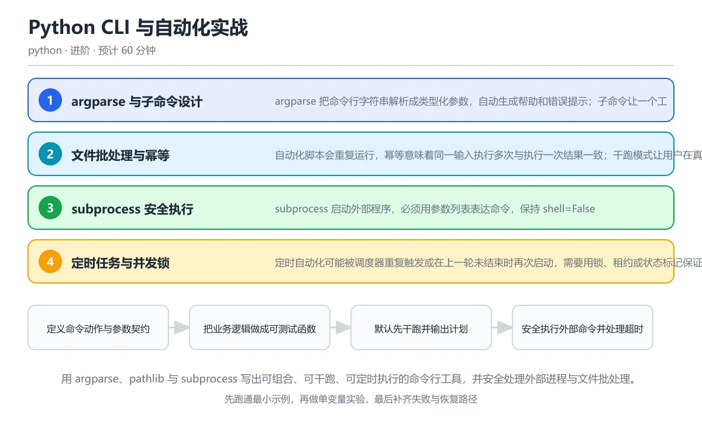

# Python CLI 与自动化实战

> 内容更新时间：2026-10-06 · 学习阶段：进阶 · 预计用时：60 分钟

分类：python。关键词：argparse、subprocess、自动化、幂等、CLI。用 argparse、pathlib 与 subprocess 写出可组合、可干跑、可定时执行的命令行工具，并安全处理外部进程与文件批处理。



---

嗨，欢迎来到本课！你有没有想过，那些看起来很"专业"的命令行工具——比如 `git commit`、`docker run`、`pip install`——到底是怎么做出来的？其实你也可以写一个。本课就带你从零开始，用 Python 打造自己的命令行工具，让它像瑞士军刀一样好用、安全、可重复运行。

打个比方：如果说写脚本就像在厨房里照菜谱做菜，那写 CLI 工具就是设计一台自动炒菜机——你不仅要让菜炒得好，还要让机器能接受指令（参数）、能预览步骤（dry-run）、能安全停机（退出码），而且重复按按钮也不会把菜炒糊（幂等）。

## 本节知识框架

本课属于 Python 分类的第 22 课，学习阶段为进阶，建议用时 60 分钟。先修内容是《Python 标准库实战工具箱》——如果你已经熟悉 `Path`、`aware datetime` 这些概念，那就万事俱备了。

**学完本课你将能够：**
- 解释什么是 CLI 和子命令，并能各举一个正例和反例
- 用本课示例验证入口点的行为，记录输入、输出与失败条件
- 遇到"用 shell 字符串拼接外部命令"的问题时，说出触发条件与修复方法

**核心概念链条（像搭积木一样层层递进）：**

1. **CLI** → 命令行工具的"大门"，用户通过它跟程序对话
2. **子命令** → 大门里面的不同"房间"，每个房间做不同的事（比如 scan、sync）
3. **入口点** → 门牌号到函数的映射，让操作系统知道敲哪个命令调用哪段代码
4. **subprocess** → 让你的 Python 程序去"叫"另一个程序干活
5. **幂等** → 不管执行一次还是十次，结果都一样——就像电梯按钮，按多少次都只来一趟
6. **退出码** → 程序结束时给操作系统留的"便条"，0 代表成功，非 0 代表出了问题

**后续衔接：** 《Python 异常、日志与文件 I/O 进阶》和《Python 项目架构：分层、配置与依赖注入》会继续用到这些概念。

## 核心概念定义

别被术语吓到——每个概念我都配了一个生活类比，帮你快速建立直觉。

| 术语 | 一句话定义（通俗版） | 生活类比 | 常见踩坑 |
| --- | --- | --- | --- |
| CLI | 通过命令行参数和标准输入输出与用户交互的程序接口 | 就像餐厅的点餐窗口：你递进去一张单子（参数），服务员端出菜（输出） | 用 shell 字符串拼接外部命令，路径中的空格和特殊字符可能改变命令含义 |
| 子命令 | 一个命令行工具下按动作划分的独立参数集合，例如 scan 与 sync | 像瑞士军刀上的不同工具——刀片、剪刀、开瓶器各自独立 | 子命令之间的参数不共享，别指望在 scan 里定义的参数在 sync 里自动可用 |
| 入口点 | 包元数据中声明的可执行命令到 Python 函数的映射 | 像电话簿：你拨 `filetool` 这个号码，操作系统帮你接通对应的 Python 函数 | 入口点函数不要在 import 时就执行副作用，否则一导入就"炸" |
| subprocess | Python 启动外部程序并管理其输入输出、返回码和超时的标准库模块 | 像你派了一个跑腿小哥去办事，你要等他回来、看他带回的结果、还要设个超时 | shell=True 会让输入进入 shell 解释器，产生命令注入漏洞 |
| 幂等 | 同一操作执行多次与执行一次产生相同最终状态的属性 | 像电梯按钮：不管你按了多少次，电梯只来一趟 | 缓存和状态残留会让结果过期，要先明确失效策略 |
| 退出码 | 程序结束时返回给操作系统的整数状态，通常零表示成功、非零表示失败 | 像考试交卷时老师给的等级——0 分代表"满分通过"，其他分数代表"有问题" | 只检查命令是否启动，不检查返回码，外部程序失败后会继续处理错误结果 |

## 原理与运行机制

### 整体流程一览

想象你在经营一家快递公司。整个流程是这样的：

```text
接单（解析参数） → 分拣（路由到子命令） → 预览清单（dry-run） → 派送（执行操作） → 签收确认（退出码）
```

下面我把每个环节拆开讲。

### 1. argparse 与子命令设计——"接单窗口"

argparse 就像你快递公司的接单系统。客户（用户）填一张单子（命令行参数），系统自动检查格式、类型，还自动生成帮助文档。

**生活类比：** 你去银行办事，取号机让你选"存款""取款""转账"——这就是子命令。每个业务需要填的表格不同（参数不同），但取号机本身是同一个（同一个 CLI 工具）。

```python
import argparse
from pathlib import Path

def build_parser():
    parser = argparse.ArgumentParser(prog="filetool", description="文件管理小助手")
    sub = parser.add_subparsers(dest="command", required=True)

    # 子命令 1：scan —— 扫描文件
    scan = sub.add_parser("scan", help="统计目录中的文件")
    scan.add_argument("path", type=Path, help="要扫描的目录")
    scan.add_argument("--ext", default=".md", help="文件扩展名，默认 .md")

    # 子命令 2：clean —— 清理临时文件
    clean = sub.add_parser("clean", help="清理临时文件")
    clean.add_argument("path", type=Path, help="要清理的目录")
    clean.add_argument("--apply", action="store_true", help="真正执行删除（默认只预览）")

    return parser
```

**关键要点：**
- `add_argument` 定义每个参数的名称、类型、默认值和帮助文本
- `add_subparsers` 创建子命令，`required=True` 保证用户必须选一个动作
- `parse_args` 失败时自动以非零退出码结束，不用你手动处理

**注意：** 命令行参数不是可靠配置源，密码、API 密钥等敏感信息不要通过参数传递，因为它们会出现在进程列表中，任何人都能看到。

### 2. 文件批处理与幂等——"预览清单"

**生活类比：** 你要搬家，搬家公司的做法是先上门评估，给你一份清单："我们会搬这些家具、拆这些架子"。你确认没问题后，他们才动手。这就是 dry-run（干跑）的思想。

幂等又是什么？想象你家的灯开关——如果是普通开关，按两次等于没按（开→关→开→关），这不是幂等。但如果是"按一下到最亮"的开关，不管你按 1 次还是 10 次，结果都是最亮——这就是幂等。

```python
def scan_files(directory, ext):
    """扫描目录中匹配扩展名的文件"""
    files = sorted(p for p in directory.rglob(f"*{ext}") if p.is_file())
    return files

def clean_files(directory, apply=False):
    """清理临时文件，默认只预览"""
    targets = list(directory.rglob("*.tmp"))
    for t in targets:
        if apply:
            t.unlink()
            print(f"已删除: {t}")
        else:
            print(f"[预览] 将删除: {t}")
    print(f"共 {'删除' if apply else '预览'} {len(targets)} 个文件")
```

**关键要点：**
- 先扫描生成动作列表，再根据 `--apply` 决定是否真正执行
- 用内容哈希或目标状态判断文件是否已经处理过，避免重复操作
- 批量操作要限制单次影响范围，危险操作要求显式确认

### 3. subprocess 安全执行——"派跑腿小哥"

**生活类比：** 你需要去银行取一份文件，但你不想自己去，于是派了一个跑腿小哥（subprocess）。你要做三件事：(1) 写清楚要取什么（参数列表）；(2) 给小哥设个截止时间（timeout）；(3) 小哥回来后检查他取的对不对（返回码）。

```python
import subprocess

def run_external(command_args, timeout=30):
    """安全执行外部命令"""
    try:
        result = subprocess.run(
            command_args,          # 参数列表，不用 shell 拼接！
            check=True,            # 非零退出码时抛异常
            capture_output=True,   # 捕获 stdout 和 stderr
            text=True,             # 输出当文本处理
            timeout=timeout        # 超时限制
        )
        return result.stdout
    except subprocess.CalledProcessError as e:
        print(f"命令失败，退出码: {e.returncode}")
        print(f"错误信息: {e.stderr}")
        raise
    except subprocess.TimeoutExpired:
        print(f"命令超时（{timeout}秒），已终止")
        raise
```

**最重要的规则：** 永远用参数列表 `['prog', arg]`，永远不要 `shell=True` 加字符串拼接。为什么？因为如果路径里有空格或特殊字符，shell 会把它们解释成命令的一部分，造成命令注入——就像你让跑腿小哥"去银行取文件顺便把ATM机搬回来"。

### 4. 定时任务与并发锁——"防止重复派单"

**生活类比：** 你设了闹钟每天 8 点吃药。但如果昨天忘了吃，今天闹钟响的时候你吃了两颗——这就出问题了。定时任务也一样：上一轮还没跑完，下一轮又启动了，两个实例同时处理同一批数据，就会重复扣款、重复发送。

解决方案就是"锁"——像洗手间的门锁，进去的人锁上门，外面的人看到"有人"就等一会儿。

```python
import json, time
from pathlib import Path

def acquire_lock(lock_path, ttl=300):
    """获取带过期时间的文件锁"""
    lock = Path(lock_path)
    if lock.exists():
        data = json.loads(lock.read_text())
        if time.time() < data["expires"]:
            print("锁仍有效，另一个实例正在运行，退出。")
            return False
        print("锁已过期，清理残留锁。")
        lock.unlink()

    lock.write_text(json.dumps({
        "owner": "filetool",
        "expires": time.time() + ttl
    }))
    return True

def release_lock(lock_path):
    """释放锁"""
    Path(lock_path).unlink(missing_ok=True)
```

### 5. 打包为可安装命令——"给你的工具起个名字"

**生活类比：** 你写了一个很棒的菜谱，但每次做菜都要翻笔记本找。如果把它印成一本正式出版的书，别人在书店就能直接买到——入口点就是帮你把脚本变成"正式出版"的命令。

在 `pyproject.toml` 中声明：

```text
[project.scripts]
filetool = "mytool.cli:main"
```

安装后用户直接敲 `filetool scan ./data --ext .csv` 就能用，不用记 `python /path/to/cli.py`。

### 关键流程总结

```text
定义命令动作与参数契约 → 把业务逻辑做成可测试函数 → 默认先干跑并输出计划 → 安全执行外部命令并处理超时 → 记录退出码与可恢复状态
```


**教材衔接：项目专属规格**
## 典型应用场景

**场景 1：批量重命名照片**
你旅行回来有 2000 张照片，文件名乱七八糟。写一个 CLI 工具，先 dry-run 预览重命名方案，确认无误后再执行。幂等保证重复运行不会出问题。

**场景 2：定时清理日志**
服务器日志越来越多，你写一个清理脚本用 cron 每天跑。加锁防止重复执行，检查返回码确保清理命令真的成功了。

**场景 3：项目脚手架生成器**
像 `create-react-app` 那样，一个命令生成整个项目结构。子命令区分 `init`、`add`、`remove`，入口点让 `pip install` 后直接可用。

**场景 4：数据管道调度**
用 subprocess 调用多个数据处理脚本，每个脚本检查退出码，失败时记录日志并从中断点恢复。

## 代码/协议/SQL 示例

### 完整示例：filetool 命令行工具

下面是一个完整的、可以运行的 CLI 工具，融合了本课所有核心概念：

```python
#!/usr/bin/env python3
"""filetool —— 一个文件管理 CLI 工具示例"""
import argparse
import subprocess
import sys
import json
import time
from pathlib import Path

def build_parser():
    """构建命令行参数解析器"""
    parser = argparse.ArgumentParser(
        prog="filetool",
        description="文件管理小助手：扫描、清理、格式化"
    )
    sub = parser.add_subparsers(dest="command", required=True)

    # scan 子命令
    scan = sub.add_parser("scan", help="统计目录中的文件")
    scan.add_argument("path", type=Path, help="要扫描的目录路径")
    scan.add_argument("--ext", default=".md", help="文件扩展名过滤，默认 .md")

    # clean 子命令
    clean = sub.add_parser("clean", help="清理临时文件")
    clean.add_argument("path", type=Path, help="要清理的目录")
    clean.add_argument("--apply", action="store_true",
                       help="真正执行删除（默认只预览）")

    # fmt 子命令：调用外部格式化工具
    fmt = sub.add_parser("fmt", help="格式化文件（调用外部工具）")
    fmt.add_argument("path", type=Path, help="要格式化的文件")

    return parser

def cmd_scan(args):
    """处理 scan 子命令"""
    files = sorted(p for p in args.path.rglob(f"*{args.ext}") if p.is_file())
    print(f"文件数: {len(files)}")
    if files:
        print(f"首个文件: {files[0].name}")
    return 0

def cmd_clean(args):
    """处理 clean 子命令（默认 dry-run）"""
    targets = list(args.path.rglob("*.tmp"))
    for t in targets:
        if args.apply:
            t.unlink()
            print(f"已删除: {t}")
        else:
            print(f"[预览] 将删除: {t}")
    action = "删除" if args.apply else "预览"
    print(f"共 {action} {len(targets)} 个文件")
    return 0

def cmd_fmt(args):
    """处理 fmt 子命令（安全调用外部程序）"""
    try:
        result = subprocess.run(
            ["black", "--check", str(args.path)],
            check=True,
            capture_output=True,
            text=True,
            timeout=30
        )
        print("格式检查通过")
        return 0
    except subprocess.CalledProcessError as e:
        print(f"格式检查未通过，退出码: {e.returncode}")
        return 1
    except subprocess.TimeoutExpired:
        print("格式检查超时")
        return 2
    except FileNotFoundError:
        print("未找到 black 命令，请先安装: pip install black")
        return 3

def main(argv=None):
    args = build_parser().parse_args(argv)
    handlers = {
        "scan": cmd_scan,
        "clean": cmd_clean,
        "fmt": cmd_fmt,
    }
    handler = handlers.get(args.command)
    if handler:
        return handler(args)
    return 2

if __name__ == "__main__":
    raise SystemExit(main())
```

### 运行示例

```text
# 扫描 data 目录下的 .csv 文件
$ python filetool.py scan data --ext .csv
文件数: 3
首个文件: users.csv

# 预览清理（默认 dry-run）
$ python filetool.py clean ./build
[预览] 将删除: build/cache.tmp
[预览] 将删除: build/output.tmp
共 预览 2 个文件

# 真正执行清理
$ python filetool.py clean ./build --apply
已删除: build/cache.tmp
已删除: build/output.tmp
共 删除 2 个文件
```

### 批处理脚本的常见错误示例

下面这段代码是"反面教材"——它为什么可能覆盖错误文件？

```python
# 危险！不要直接运行这段代码
for path in Path('.').glob('*.txt'):
    path.rename(path.with_suffix('.md'))
```

**问题分析：**
1. 没有检查目标 `.md` 文件是否已存在——`rename` 在 Windows 上会报错，在某些系统上会覆盖
2. 没有 dry-run 模式——第一次运行就直接改了
3. 没有根目录限制——`Path('.')` 是当前工作目录，范围可能过大
4. 没有回滚机制——改错了无法恢复

**正确做法：**

```python
def safe_rename(directory, apply=False):
    """安全的批量重命名，带冲突检查和 dry-run"""
    root = Path(directory).resolve()
    plans = []
    for path in root.glob('*.txt'):
        target = path.with_suffix('.md')
        if target.exists():
            print(f"[冲突] 目标已存在: {target}")
            continue
        plans.append((path, target))

    for src, dst in plans:
        if apply:
            src.rename(dst)
            print(f"已重命名: {src.name} → {dst.name}")
        else:
            print(f"[预览] {src.name} → {dst.name}")
    print(f"共 {'重命名' if apply else '预览'} {len(plans)} 个文件")
```

## 时间/空间复杂度或性能分析

### 各操作的性能特征

| 操作 | 时间复杂度 | 空间复杂度 | 性能瓶颈 |
| --- | --- | --- | --- |
| argparse 解析参数 | O(n)，n 为参数个数 | O(n) | 参数极多时（>10000）才有感知 |
| Path.rglob 遍历目录 | O(N)，N 为文件总数 | O(D)，D 为匹配文件数 | 深层嵌套目录、网络文件系统 |
| subprocess.run 调用外部程序 | 取决于外部程序 | 取决于输出大小 | 网络延迟、大输出捕获 |
| 文件锁操作 | O(1) | O(1) | 磁盘 I/O |

### 性能测量方法

**类比：** 就像测车速，你要先定一段固定距离（固定输入），跑一次记录基线时间，然后把载重量提高 10 倍再跑一次。两次结果的差值才是你关心的。

```python
import time

def measure_performance(func, *args, repeat=3):
    """测量函数执行时间"""
    times = []
    for _ in range(repeat):
        start = time.perf_counter()
        func(*args)
        elapsed = time.perf_counter() - start
        times.append(elapsed)
    avg = sum(times) / len(times)
    print(f"平均耗时: {avg:.4f}秒 (跑 {repeat} 次)")
    return avg
```

### 需要关注的性能边界

- **argparse**：参数数量正常（<100）时几乎零开销；但位置参数过多会让工具难以组合
- **subprocess**：`capture_output=True` 会把所有输出存在内存里，如果外部程序输出几个 GB，内存会爆——这种情况要用 `stdout=subprocess.PIPE` 配合逐行读取
- **rglob**：在包含数十万文件的目录中遍历会很慢，考虑限制深度或提前过滤
- **文件锁**：锁文件本身很轻量，但锁的 TTL（过期时间）设置不当会导致死锁或误判

## 常见误区与易错点

### 误区 1：用 shell 字符串拼接外部命令

**错误写法：**
```python
# 危险！路径中有空格就会出问题
subprocess.run('rm ' + path, shell=True)
```

**为什么危险？** 想象你给跑腿小哥写了一张纸条："去银行取文件"。但如果纸条上写的是"去银行取文件; 顺便把所有钱拿出来"——shell 会执行分号后面的命令！这就是命令注入。

**正确写法：**
```python
# 安全：参数列表，shell 不参与解释
subprocess.run(['rm', str(path)], check=True, timeout=10)
```

### 误区 2：自动化默认直接修改数据

**错误做法：** 脚本一跑就开始删除文件，第一次运行就批量操作，没有任何预览。

**正确做法：** 默认输出计划（dry-run），只有显式加 `--apply` 才真正执行。删除操作要提供备份或回收站策略。

### 误区 3：定时任务缺少重复执行保护

**错误做法：** 不管上一轮跑完没有，cron 到点就启动新实例，两个实例同时处理同一批数据。

**正确做法：** 使用带过期时间的锁和唯一业务键，重复实例发现锁仍在时直接退出并记录原因。

### 误区 4：忽略子进程退出码和超时

**错误做法：** 只检查命令是否启动，不检查返回码。外部程序失败了，Python 还继续处理错误结果。

**正确做法：** 使用 `check=True` 或显式判断返回码，设置 `timeout` 并把 `stderr` 写入日志。

### 速查对照表

| 错误做法 | 会发生什么 | 正确做法 |
| --- | --- | --- |
| `shell=True` + 字符串拼接 | 命令注入、空格导致参数错乱 | 参数列表 + `shell=False` |
| 无 dry-run 直接操作 | 误删、误覆盖无法恢复 | 默认预览 + `--apply` 执行 |
| 无锁的定时任务 | 重复执行、数据冲突 | 文件锁 + TTL + 业务键去重 |
| 不检查退出码和超时 | 静默失败、僵尸进程 | `check=True` + `timeout` + 日志 |

## 与其他知识点的关系

### 知识图谱

```text
Python 标准库实战工具箱（先修）
    ├── Path、文件操作 → 本课的文件批处理
    └── 日期时间处理 → 本课的锁 TTL 计算
          ↓
Python CLI 与自动化实战（本课）
    ├── argparse → 参数解析与子命令
    ├── subprocess → 安全调用外部程序
    ├── 幂等设计 → 可重复执行的自动化
    └── 退出码 → 状态传递与错误处理
          ↓
Python 异常、日志与文件 I/O 进阶（后续）
    └── 结构化日志 → 本课的退出码与状态记录
Python 项目架构（后续）
    └── 分层设计 → 本课的参数解析与业务逻辑分离
```

### 容易混淆的概念对比

| 概念 A | 概念 B | 核心区别 |
| --- | --- | --- |
| CLI | 子命令 | CLI 是整个工具的大门；子命令是门里面的不同房间 |
| 子命令 | 入口点 | 子命令是 CLI 内部的概念划分；入口点是包到操作系统的映射 |
| subprocess | os.system | subprocess 更安全、更灵活；os.system 简单但危险 |
| 幂等 | 缓存 | 幂等是"执行多次结果不变"的属性；缓存是"保存计算结果"的技术 |

## 自测题与参考答案

> 先独立作答，再对照参考答案。答案都能在本课正文中找到依据。

### 自测 1（概念复述）

不看正文，写出 CLI 的操作性定义，并说明它与子命令的区别。

**参考答案：** CLI 是通过命令行参数和标准输入输出与用户交互的程序接口。子命令是一个命令行工具下按动作划分的独立参数集合（如 scan 与 sync）。CLI 是整体接口，子命令是其中的动作分支。

### 自测 2（排错）

本课讲了"用 shell 字符串拼接外部命令"的错误。请写出它的现象、根因和修复方法。

**参考答案：** 现象是路径中的空格和特殊字符改变命令含义，导致错误结果或异常中断。根因是 shell=True 让输入进入 shell 解释器，分号、管道等被解释为命令。修复方法是使用参数列表并保持 shell=False，必要时先校验路径是否为允许目录内的文件。

### 自测 3（动手验证）

运行本课的 filetool 示例，把 `--ext .dart` 改成 `--ext .py`，观察输出变化。

**参考答案：** 输出会列出目录下所有 `.py` 文件而不是 `.dart` 文件。文件数和首个文件名都会改变，但程序结构不变。

### 自测 4（代码阅读）

阅读本课的 `build_parser` 函数，说明 `required=True` 的作用。如果去掉它会怎样？

**参考答案：** `required=True` 让用户必须选择一个子命令。去掉后，如果不传子命令，`args.command` 会是 `None`，程序需要额外处理这种情况。

### 自测 5（迁移）

把本课的幂等设计应用到数据库迁移场景：如何保证同一条迁移脚本跑多次不会重复执行？

**参考答案：** 用一张"已执行迁移"记录表，每次执行前检查迁移 ID 是否已存在。存在则跳过，不存在则执行并记录。这就是"唯一业务键"的思路。

## 复习清单

- [ ] 能不看正文复述本课核心术语，并指出一个边界或反例
- [ ] 能默写本课最重要的代码示例，并解释每一行的作用
- [ ] 能说出本课内容和前后两课的联系

### 验证命令与预期输出

完成本项目后，用以下命令验证结果是否符合预期：

```text
# 运行全部测试并查看覆盖率
python -m pytest --tb=short -q
```

预期输出应显示所有测试通过，无报错或警告。如果有失败，根据错误信息定位问题并修复。

### 项目交付物

完成本项目后，应交付以下内容：

1. **可运行的代码**：所有功能模块已实现并通过测试
2. **测试报告**：单元测试和集成测试全部通过
3. **文档**：README 说明使用方法，关键函数有注释
4. **复盘总结**：记录遇到的问题和解决方案

## 术语速查

| 术语 | 一句话说明 |
| --- | --- | --- | --- |
| CLI | Command-Line Interface | 通过命令行参数和标准输入输出与用户交互的程序接口 | 餐厅的点餐窗口 |
| 子命令 | Subcommand | 一个命令行工具下按动作划分的独立参数集合 | 瑞士军刀的不同工具 |
| 入口点 | Entry Point | 包元数据中声明的可执行命令到 Python 函数的映射 | 电话簿的号码→姓名映射 |
| subprocess | subprocess | Python 启动外部程序并管理其输入输出、返回码和超时的标准库模块 | 派跑腿小哥办事 |
| 幂等 | Idempotent | 同一操作执行多次与执行一次产生相同最终状态的属性 | 电梯按钮（按多少次都只来一趟） |
| 退出码 | Exit Code | 程序结束时返回给操作系统的整数状态，0=成功，非0=失败 | 考试交卷的等级标记 |
| dry-run | Dry Run | 预览模式，展示将要执行的操作但不真正执行 | 搬家公司的评估清单 |
| TTL | Time To Live | 锁或缓存的存活时间，过期后自动失效 | 牛奶的保质期 |

## 考点精讲

本课题库有 5 道题，下面逐题给出题干、正确项与详细解析。建议先自己作答，再核对答案。

### 考点 1：第 1 题

- **题目**：安全执行外部命令的推荐写法是？
- **正确项**：「subprocess.run(['prog', arg], check=True, timeout=10)」
- **解析**：参数列表让操作系统直接执行目标程序，shell 不参与解释，输入中的分号、管道和空格不会变成额外命令。`check=True` 在非零退出码时抛异常，`timeout` 防止程序卡死。其他选项（`shell=True`、`os.system`、`exec` 拼接字符串）都会放大命令注入风险。

### 考点 2：第 2 题

- **题目**：自动化工具提供 dry-run 的主要价值是什么？
- **正确项**：「在修改前输出将要执行的动作，让用户检查影响范围」
- **解析**：dry-run 先扫描并展示计划，不写入或删除数据，用户可以在高风险操作前确认路径、数量和差异。它不能证明实际执行一定成功，但能显著降低误删、误覆盖和参数错误造成的事故。就像搬家前先列清单，确认无误再动手。

### 考点 3：第 3 题

- **题目**：让定时任务可以安全重复运行，需要哪些措施？（多选）
- **正确项**：「使用带过期时间的锁防止并发执行；用唯一业务键判断任务是否已完成；记录失败状态并支持从中断点恢复」
- **解析**：锁防止两个实例同时运行，业务键防止重复写入，状态记录让失败后可以从断点继续。三者缺一不可。忽略上一轮状态会让两个实例同时处理同一批数据，产生重复扣款、重复发送等严重后果。

### 考点 4：第 4 题

- **题目**：阅读 argparse 代码，运行 filetool scan data --ext .csv 后 args.ext 的值是什么？  scan.add_argument('path', type=Path) scan.add_argument('--ext', default='.md')

- **正确项**：「.csv」
- **解析**：命令行显式传入 `--ext .csv` 会覆盖默认值 `.md`，因此 `args.ext` 是 `.csv`。位置参数 `path` 会被转换成 `Path` 对象。参数解析完成后业务函数应按类型和范围继续校验，不能因为 argparse 转换成功就假设输入一定安全。

### 考点 5：第 5 题

- **题目**：这段批处理脚本为什么可能覆盖错误文件？

```python
for path in Path('.').glob('*.txt'):
    path.rename(path.with_suffix('.md'))
```

- **正确项**：「没有检查目标文件是否已存在，也没有 dry-run 和根目录限制」
- **解析**：`with_suffix` 生成的目标可能已经存在，`rename` 会覆盖原文件；脚本还会遍历当前工作目录下的所有文本文件，范围过大且没有预演。应先解析绝对路径、限制在指定根目录内，输出重命名计划，检查冲突并保留回滚记录。

## 内容元数据

- 内容版本：v2.0
- 最后更新：2026-10-06
- 学习阶段：进阶

| 字段 | 值 |
| --- | --- |
| 课程 ID | `python_cli_automation` |
| 所属分类 | `python` |
| 难度 | 进阶 |
| 预计用时 | 60 分钟 |
| 关键词 | argparse、subprocess、自动化、幂等、CLI |
| 配图 | `images/lesson_python_cli_automation.webp` |
| 参考资料 | 4 条 |
| 内容更新时间 | 2026-10-06 |

## 参考资料与复核

- 来源性质：官方文档、标准或权威教材；本课核对关键词：argparse、subprocess、自动化、幂等、CLI
- 最后复核：2026-10-04
- 下次复核：2026-11-10
- 复核范围：版本兼容、API 行为与工程实践

下面列出的资料用于核对本课结论，复习时可以对照阅读：
- [Python argparse 官方文档](https://docs.python.org/3/library/argparse.html)
- [Python subprocess 官方文档](https://docs.python.org/3/library/subprocess.html)
- [Python 打包规范：入口点](https://packaging.python.org/en/latest/specifications/entry-points/)
- [Python CLI 指南（Click 官方教程）](https://click.palletsprojects.com/en/latest/)

> 复核提示：《Python CLI 与自动化实战》的结论如与资料冲突，以资料中的规范文本为准，并在笔记里记录差异与日期。
