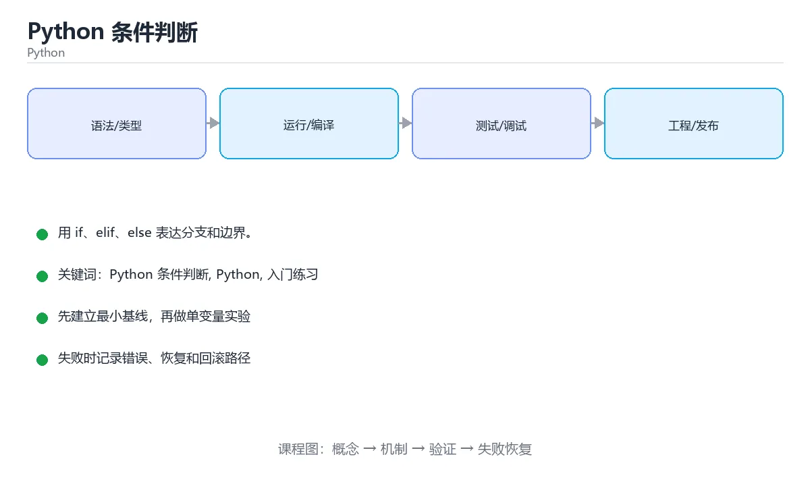

# Python 条件判断

> 内容更新时间：2026-10-06 · 学习阶段：入门 · 预计用时：40 分钟



## 本节知识框架

今天的目标：**让程序学会"做选择"——根据不同的情况，走不同的路。**

生活中你每天都在做条件判断：如果下雨就带伞，否则就不带；如果成绩大于 90 就奖励自己，否则继续努力。程序也一样——用 `if`、`elif`、`else` 就能让代码像人一样"看情况办事"。

学完这一课，你会：
- 掌握 `if`、`elif`、`else` 的写法和执行顺序
- 理解比较运算符（`==`、`>=`、`!=` 等）的用法
- 知道什么是"真值判断"——为什么空列表和 0 在条件里等于 False
- 能写出多分支判断，并避免新手最常犯的错误

**先修与衔接**：本课是 Python 分类的第 3 课。先修：《Python 输入与输出》——你需要会用 `input()` 和 `int()` 转换类型。下一课：《Python 循环入门》。

### 复习清单

- [ ] 能独立写出 if/elif/else 的多分支判断
- [ ] 能解释 `==` 和 `=` 的区别
- [ ] 能说出哪些值在条件里会被当作 False

## 核心概念定义

先认识几个名词，后面写代码时会反复遇到：

| 术语 | 一句话说明 |
| --- | --- |
| 布尔值 | 只有 `True`（真）和 `False`（假）两个取值，条件判断的结果就是它。 |
| if-elif-else | Python 的分支结构：从上到下依次检查条件，第一个为真的分支执行后，其余全部跳过。 |
| 真值判断 | 空列表、0、None 等在条件里等价于假，其余多数对象为真。 |
| 逻辑运算符 | `and`、`or`、`not` 用来组合或取反条件，让判断更灵活。 |
| 比较运算符 | `==`（等于）、`!=`（不等于）、`>`（大于）、`<`（小于）、`>=`（大于等于）、`<=`（小于等于），用来比较两个值并返回布尔值。 |

## 原理与运行机制

### 条件判断就像走岔路口

```text
你走到一个岔路口
    ↓
路牌写着：如果成绩 >= 90，走左边
    ↓  不满足？继续看下一个路牌
路牌写着：如果成绩 >= 60，走中间
    ↓  还不满足？
走右边的路（else）
```

就像医院分诊台：先看是不是急诊（第一个条件），不是的话再看是不是普通门诊（第二个条件），都不符合就去自助窗口（else）。一旦在某个窗口办完事，就不会回头再排另一条队。

### 第一个 if 例子

```python
score = 72

if score >= 60:
    print("pass")
else:
    print("fail")
```

运行结果：

```text
pass
```

代码的逻辑很简单：`score` 是 72，72 大于等于 60 吗？是的，所以执行 `print("pass")`，输出 `pass`。`else` 分支被跳过。

### 三个分支：if / elif / else

当你需要判断多种情况时，用 `elif`（else if 的缩写）：

```python
score = int(input("请输入成绩（0-100）："))

if score >= 90:
    print("优秀")
elif score >= 60:
    print("及格")
else:
    print("需要补考")

print("判断结束")
```

逐行拆开看：
- 第一行：用 `input()` 读取用户输入，用 `int()` 转成整数，存进 `score`。
- `if score >= 90:` —— 先检查最高档。冒号 `:` 不能忘，它告诉 Python "下面缩进的内容是这个条件成立时要做的事"。
- `print("优秀")` 前面有 4 个空格缩进。缩进是 Python 判断代码归属的方式，不是排版好看。
- `elif score >= 60:` —— 只有第一个条件不成立时才会被检查。如果写成 `if` 就变成两个独立判断了。
- `else:` —— 不写条件，负责接住前面所有条件都不满足的情况。
- 最后的 `print("判断结束")` 回到最左侧缩进，说明它不属于任何分支，无论走哪条路都会执行。

跑一遍看看：
- 输入 95 → 第一个条件成立 → 输出「优秀」，后面跳过
- 输入 72 → 第一个不成立，第二个成立 → 输出「及格」
- 输入 40 → 都不成立 → 走 `else` → 输出「需要补考」
- 三种情况最后都会输出「判断结束」

### 比较运算符速查

| 运算符 | 含义 | 例子 | 结果 |
| --- | --- | --- | --- |
| `==` | 等于 | `5 == 5` | `True` |
| `!=` | 不等于 | `5 != 3` | `True` |
| `>` | 大于 | `5 > 3` | `True` |
| `<` | 小于 | `3 < 5` | `True` |
| `>=` | 大于等于 | `5 >= 5` | `True` |
| `<=` | 小于等于 | `3 <= 5` | `True` |

注意 `==` 和 `=` 的区别：`==` 是比较两个值是否相等，`=` 是把右边的值赋给左边的变量。这是新手最容易搞混的地方。

### 真值判断：不只是 True 和 False

Python 的条件不只看 `True` 和 `False`，很多值放在 `if` 后面都会被自动"判断真假"：

```python
# 以下这些值在条件里等价于 False
if 0:          # 数字 0
    print("不会执行")

if "":         # 空字符串
    print("不会执行")

if []:         # 空列表
    print("不会执行")

if None:       # None 表示"什么都没有"
    print("不会执行")

# 以下这些值在条件里等价于 True
if 42:         # 非零数字
    print("会执行")

if "hello":    # 非空字符串
    print("会执行")

if [1, 2]:    # 非空列表
    print("会执行")
```

简单记忆：**"空的"就是假，"有东西"就是真。** 这意味着 `if items:` 和 `if len(items) > 0:` 效果一样，但前者更简洁也更 Pythonic。

### 逻辑运算符：组合多个条件

```python
age = 25
has_id = True

# and：两个条件都满足才行
if age >= 18 and has_id:
    print("可以进入")

# or：满足其中一个就行
if age < 12 or age > 60:
    print("免票")

# not：取反
if not has_id:
    print("请出示证件")
```

`and` 和 `or` 有"短路"特性：
- `A and B`：如果 A 是假，直接返回假，不再看 B
- `A or B`：如果 A 是真，直接返回真，不再看 B

这个特性常用来提供默认值：

```python
name = input("名字：").strip()
display_name = name or "匿名用户"
```

如果用户什么都没输入（空字符串为假），`or` 就会返回右边的 `"匿名用户"`。

### 嵌套条件：分支里面还有分支

```python
has_ticket = True
age = 8

if has_ticket:
    if age >= 12:
        print("全价入场")
    else:
        print("儿童半价入场")
else:
    print("请先购票")
```

嵌套不要写太深，一般两到三层就够了。如果嵌套太多，考虑用 `elif` 或 `and` 把条件合并，让代码更平坦。

## 典型应用场景

### 场景 1：成绩等级判定

```python
score = int(input("成绩："))

if score >= 90:
    grade = "A"
elif score >= 80:
    grade = "B"
elif score >= 70:
    grade = "C"
elif score >= 60:
    grade = "D"
else:
    grade = "F"

print(f"等级：{grade}")
```

### 场景 2：判断闰年

```python
year = int(input("年份："))

if year % 400 == 0:
    print("闰年")
elif year % 100 == 0:
    print("平年")
elif year % 4 == 0:
    print("闰年")
else:
    print("平年")
```

### 场景 3：简单的用户登录

```python
username = input("用户名：").strip()
password = input("密码：")

if username == "admin" and password == "123456":
    print("登录成功")
elif username == "" or password == "":
    print("用户名和密码不能为空")
else:
    print("用户名或密码错误")
```

## 代码/协议/SQL 示例

### 最小示例：两分支判断

```python
score = 72
if score >= 60:
    print("pass")
else:
    print("fail")
```

输出：

```text
pass
```

### 完整示例：多分支 + 用户输入

```python
score = int(input("请输入成绩（0-100）："))

if score >= 90:
    print("优秀")
elif score >= 60:
    print("及格")
else:
    print("需要补考")

print("判断结束")
```

### 动手练一练

1. 输入 90 和 89，确认边界值的归属，理解 `>=` 和 `>` 的区别。
2. 把 `score >= 90` 和 `score >= 60` 的顺序调换，再输入 95，解释为什么结果变错了。
3. 增加一档「满分 100 时输出满分」，想清楚这一条应该放在什么位置。

### 本课速查卡

| 复习项 | 本课要点 |
| --- | --- |
| 核心结论 | if / elif / else 让程序按条件走不同分支：从上往下依次检查，第一个成立的分支执行完，后面的分支就全部跳过。 |
| 最少要写的代码 | `score = int(input("请输入成绩："))` |
| 最常见的错误 | 用 `=` 代替 `==`，或者忘记冒号 `:` |
| 出错先查什么 | 先看报错信息指向哪一行，再检查冒号和缩进 |
| 怎么确认学会了 | 能独立写出多分支判断，并能解释条件顺序为什么重要 |

## 时间/空间复杂度或性能分析

条件判断本身的开销几乎可以忽略——比较两个数字、走一个分支，在现代计算机上都是纳秒级别的操作。

初学者应该关注的不是性能，而是**正确性**：先让代码跑对，再让它跑快。把精力放在理解条件逻辑、写对分支结构上，性能优化是后面的事。

## 常见误区与易错点

| 容易犯的错误 | 会出现什么 | 怎么修 |
| --- | --- | --- |
| 用 `=` 代替 `==` 做比较 | 语法错误或逻辑错误，`=` 是赋值不是比较 | 比较相等用 `==`，比较大小用 `>=`、`<=` |
| 忘记写冒号 `:` | `SyntaxError: expected ':'` | if / elif / else 后面都要加冒号 |
| 缩进不统一（混用 Tab 和空格） | `IndentationError` 或 `TabError` | 整个文件统一用 4 个空格缩进 |
| 把 `elif` 写成 `else if` | `SyntaxError` | Python 里只有 `elif`，没有 `else if` |
| 条件顺序写反（宽泛的写在前面） | 具体条件被吞掉，永远走不到 | 从具体到宽泛排列条件 |
| 用 `==` 比较浮点数 | 精度问题导致判断失败 | 用 `abs(a - b) < 1e-9` 或 `math.isclose()` |

### 重点讲两个新手必踩的坑

**坑 1：忘记冒号**

```python
# 错误写法
if score >= 60
    print("及格")

# 正确写法
if score >= 60:
    print("及格")
```

`if` 条件后面必须跟冒号 `:`，这是 Python 的语法要求。漏掉就会报 `SyntaxError`。

**坑 2：条件顺序颠倒**

```python
# 错误：95 分也会输出"及格"
if score >= 60:
    print("及格")
elif score >= 90:      # 永远走不到这里
    print("优秀")

# 正确：从严格到宽松
if score >= 90:
    print("优秀")
elif score >= 60:
    print("及格")
```

`elif` 只在前面的条件不成立时才被检查。如果宽泛的条件写在前面，后面的严格条件就永远没机会执行了。

## 与其他知识点的关系

- **先修**：《Python 输入与输出》——本课用到了 `input()` 和 `int()` 类型转换。
- **后续**：《Python 循环入门》——循环里经常嵌套条件判断，比如"遇到某个条件就跳出循环"。
- **术语衔接**：本课学的 `if-elif-else`、`真值判断`、`逻辑运算符` 会在后面每一课反复出现。

## 自测题与参考答案

> 先独立作答，再对照参考答案。

### 自测 1

写出 `if`、`elif`、`else` 三个关键字各自的作用，以及它们组合在一起时的执行顺序。

**参考答案**：`if` 是第一个要检查的条件；`elif` 是前面的条件不成立时才检查的新条件，可以有多个；`else` 不写条件，负责接住前面所有条件都不满足的情况。执行顺序是从上到下，第一个为真的分支执行后，其余全部跳过。

### 自测 2

`==` 和 `=` 有什么区别？如果搞混了会怎样？

**参考答案**：`==` 是比较两个值是否相等，返回 True 或 False；`=` 是赋值，把右边的值存进左边的变量。搞混后：`if x = 5` 在 Python 里会报语法错误（不像某些语言会静默出错），但新手容易困惑为什么报错。记住：比较用 `==`，赋值用 `=`。

### 自测 3

以下代码的输出是什么？为什么？

```python
items = []
if items:
    print("有东西")
else:
    print("空的")
```

**参考答案**：输出「空的」。因为空列表 `[]` 在真值判断中等价于 False，所以 `if items:` 不成立，走 `else` 分支。

### 自测 4

写一个判断：输入一个年份，判断是否是闰年。闰年规则：能被 4 整除但不能被 100 整除，或者能被 400 整除。

**参考答案**：

```python
year = int(input("年份："))
if year % 400 == 0:
    print("闰年")
elif year % 100 == 0:
    print("平年")
elif year % 4 == 0:
    print("闰年")
else:
    print("平年")
```

### 自测 5

下面这段代码有什么问题？怎么改？

```python
temperature = 35
if temperature > 30
    print("很热")
else:
    print("还行")
```

**参考答案**：`if temperature > 30` 后面缺少冒号 `:`，会报 `SyntaxError`。加上冒号就好：`if temperature > 30:`。

## 术语速查

| 术语 | 一句话说明 |
| --- | --- |
| 布尔值 | 只有 True 和 False 两个取值，条件判断的结果就是它。 |
| if-elif-else | 从上到下判断条件，命中第一个为真的分支后跳过其余分支。 |
| 真值判断 | 空列表、0、None 等在条件里等价于假，其余多数对象为真。 |
| 逻辑运算符 | and、or、not 用来组合或取反条件。 |
| 比较运算符 | ==、!=、>、<、>=、<=，比较两个值并返回布尔值。 |

## 考点精讲

`Python 条件判断` 的题库有 5 道题，下面逐题讲解。先自己试着作答，再核对答案和解析。

### 考点 1：第 1 题

- **题目**：按“Python 条件判断”中 Python 条件判断、Python、入门练习 的实践顺序，把四个步骤排成从准备到复盘的合理顺序。
- **答案**：先明确 Python 条件判断 的输入、输出与约束 → 写出最小示例并核对 Python 的基线结果 → 只改一个变量，记录边界与失败路径的变化 → 固定版本与证据，把"Python 条件判断"的结论写成可复现记录
- **解析**：这道题考的是学习流程。先搞清楚要做什么（输入输出），再写出能跑的最小代码验证，然后改变量看边界情况，最后把结论固定下来。这跟做实验的思路一样：先假设，再验证，再拓展，最后总结。

### 考点 2：第 2 题

- **题目**：围绕“Python 条件判断”中的 Python 条件判断、Python、入门练习，下列哪两项是本课强调的实践判断？
- **答案**：验证 Python 时要固定版本并覆盖边界输入，结论才可复现；学习 Python 条件判断 时要同时说明输入、输出和失败路径，不能只看正常流程
- **解析**：这两个选项强调的是"完整验证"的思想。写条件判断不能只测正常情况——边界值（比如恰好等于 60 分）、异常输入（比如用户输入字母而不是数字）都要考虑到。固定 Python 版本是因为不同版本的行为可能有细微差异。

### 考点 3：第 3 题

- **题目**：需要依次判断多个互斥条件时，应该使用哪个关键字？
- **答案**：elif，它会按顺序检查前一个条件不成立后的新条件
- **解析**：`elif` 是 "else if" 的缩写。它的特点是：只有前面的条件都不满足时，才会检查 `elif` 后面的条件。多个 `elif` 互斥——最多只有一个分支会被执行。如果用多个独立的 `if`，每个都会被检查，就不是互斥了。

### 考点 4：第 4 题

- **题目**：下面代码想判断 a 是否大于 b，但会报语法错误。缺少了什么？
- **答案**：if 条件末尾的冒号
- **解析**：Python 要求 `if`、`elif`、`else` 后面必须跟冒号 `:`。这是语法规定，漏掉就会报 `SyntaxError`。可以这样记忆：冒号相当于中文里的"那么"——"如果 a 大于 b，**那么**……"。

### 考点 5：第 5 题

- **题目**：填空：补齐下面这段术语说明中的空缺。课程 `用 if、elif、else 表达分支和边界。`，这段说明是：`____`：空列表、0、None 等在条件里等价于假，其余多数对象为真。空缺处应填哪个术语？
- **答案**：真值判断
- **解析**：真值判断（truthiness）是 Python 的一个重要特性。不只是 `True` 和 `False` 能用在条件里——任何值放在 `if` 后面都会被自动转换为布尔值。"空的"东西（0、空字符串、空列表、None）转为 False，"有东西的"转为 True。记住这个规则，就能理解为什么 `if items:` 可以代替 `if len(items) > 0:`。

## 内容元数据

- 内容版本：v2.0
- 最后更新：2026-10-06
- 学习阶段：入门
- 适用环境：Python 3.12+
- 内容来源：内置结构化课程与工程实践整理
- 相关主题：Python 条件判断、Python、入门练习

## 参考资料与复核

- 最后复核：2026-10-04
- 下次复核：2026-11-10
- 来源性质：官方文档、权威教材与工程实践整理

| 参考资料 | 本课用途 |
| --- | --- |
| [Python 官方教程 - 控制流](https://docs.python.org/3/tutorial/controlflow.html) | if/elif/else 语法与示例 |
| [Python 语言参考 - 表达式](https://docs.python.org/3/reference/expressions.html) | 布尔运算与真值判断规则 |
| [Python 入门：条件判断](https://docs.python.org/3/tutorial/controlflow.html#if-statements) | 条件判断的完整语法说明 |
