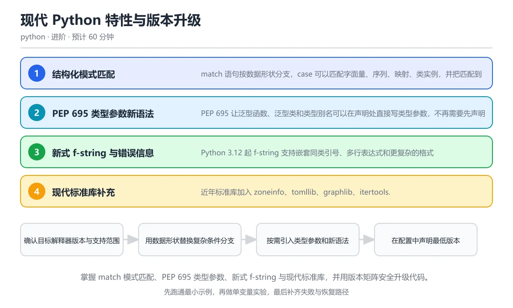

# 现代 Python 特性与版本升级

> 内容更新时间：2026-10-06 · 学习阶段：进阶 · 预计用时：55 分钟

分类：python。关键词：match、PEP 695、类型参数、f-string、版本兼容。



---

你有没有遇到过这样的场景：写了一大串 `if-elif-elif-elif`，自己都绕晕了？或者看到别人代码里出现了 `match`、`type Pair[T] = ...` 这种从没见过的语法，一脸茫然？

别担心，这一课就是带你认识 Python 最近几年加入的"新功能"。我会用生活中的类比帮你理解每个特性，然后一步步写出可以运行的代码。学完之后，你不仅能看懂这些新语法，还能安全地把它们用到自己的项目里。

---

## 本节知识框架

把这一课想象成一次"搬家"——你住在"旧 Python"的房子里，现在要搬到"现代 Python"的新房子。搬家需要知道三件事：新房子里有什么新家具（新语法）、怎么安全地搬过去（版本兼容）、以及搬的时候别把旧东西弄丢了（兼容性检查）。

本课的学习路线：

1. **match 模式匹配** —— 一种更聪明的"分情况讨论"方式
2. **PEP 695 类型参数** —— 写泛型代码的新捷径
3. **新式 f-string** —— 字符串格式化变得更灵活
4. **现代标准库** —— 不用装第三方包就能用的新工具
5. **版本兼容策略** —— 安全升级的路线图

**学完本课你应当能够**：
- 用 `match` 替代复杂的 `if-elif` 链，并知道什么时候不该用
- 用 PEP 695 的新语法写出简洁的泛型函数和类
- 判断一个新语法在你支持的最低 Python 版本上能不能用
- 给项目设置正确的 `requires-python`，避免用户踩坑

**先修要求**：你需要已经了解《类型注解与测试》中的 `typing` 模块和 `pyproject.toml` 的基本用法。如果还不熟悉，建议先去看那一课。

---

## 核心概念定义

我们用一张表来快速认识本课的六个核心术语。每个术语都配有"一句话解释"和"需要注意的坑"。

| 术语 | 一句话解释（类比） | 需要注意的坑 |
| --- | --- | --- |
| 结构化模式匹配 | 就像快递分拣员：看包裹的形状、大小、标签来决定送到哪里，同时还能把包裹里的信息记下来。 | 静态类型检查只在编译期有效，运行时的输入仍然需要自己校验。 |
| 捕获模式 | 就像拆快递时把里面的订单号"记到笔记本上"——匹配到的值会自动绑定到一个新变量名。 | 如果变量名和外面已有的名字一样，旧值会被覆盖，容易出 bug。 |
| PEP 695 | 就像在信封上直接写收件人名字，而不用先填一张"收件人登记表"（TypeVar）。 | 需要 Python 3.12+；旧版本解释器根本不认识这个语法。 |
| 类型参数 | 就像一个"占位符便签"——写代码时贴一个 `T`，使用时再替换成具体的类型。 | Python 运行时不会检查类型注解，传错对象不会自动报错。 |
| 特性检测 | 就像出门前试试门把手能不能转动，而不是只看日历判断今天星期几。 | 不同版本和依赖组合的行为可能不同，换环境要重新验证。 |
| requires-python | 就像产品包装上印的"适用年龄：3 岁以上"——告诉用户最低需要什么版本。 | 写了新语法却忘了更新这个声明，旧版本用户安装后会直接报错。 |

---

## 原理与运行机制

### 一、match 模式匹配：聪明的快递分拣员

想象你是一个快递站的分拣员。传统做法（`if-elif`）是这样的：

```python
# 传统做法：一个一个问问题
if isinstance(message, dict) and message.get("type") == "start":
    handle_start(message)
elif isinstance(message, list) and len(message) == 2 and message[0] == "retry":
    handle_retry(message)
else:
    handle_unknown(message)
```

这就像对每个包裹都问一遍："你是字典吗？你有 type 字段吗？type 是 start 吗？"——问了很多问题才找到答案。

**match 的做法**更直观：直接看包裹的"形状"，一步到位。

```python
# 现代做法：看形状
match message:
    case {"type": "start", "id": int() as request_id}:
        print(f"启动请求 {request_id}")
    case ["retry", int(attempt)] if attempt > 0:
        print(f"第 {attempt} 次重试")
    case Command(name=name, args=args) if args:
        print(f"命令 {name}: {', '.join(args)}")
    case _:
        print("未知消息")
```

**关键规则**（从上到下逐条匹配，命中就停）：
- **字典模式**：检查键是否存在，可以绑定值到变量
- **序列模式**：检查长度和每个位置的元素
- **类模式**：检查类型和属性
- **guard（`if` 条件）**：匹配成功后再额外过滤
- **`_`（下划线）**：万能通配符，匹配任何东西，但不绑定变量

### 二、PEP 695：泛型语法的"快捷方式"

**旧写法**就像寄快递前要填一张单独的"变量登记表"：

```python
# 旧写法（Python 3.11 及以下）
from typing import TypeVar, Generic

T = TypeVar("T")

class Box(Generic[T]):
    def __init__(self, value: T) -> None:
        self.value = value

def first(items: list[T]) -> T:
    return items[0]
```

**新写法**（PEP 695，Python 3.12+）直接在门口挂上名字：

```python
# 新写法（Python 3.12+）
class Box[T]:
    def __init__(self, value: T) -> None:
        self.value = value

def first[T](items: list[T]) -> T:
    return items[0]

type Pair[T] = tuple[T, T]
```

是不是清爽多了？`T` 的作用域被限制在方括号内，不会泄漏到外面。

### 三、新式 f-string：更灵活的字符串模板

Python 3.12 让 f-string 变强大了，就像文本编辑器从"只能单行"升级到"支持多行和嵌套引号"：

```python
# Python 3.12+：可以嵌套同类引号
name = "小华"
print(f'{f"{name}"}同学你好')  # 输出：小华同学你好

# 调试利器：等号语法
score = 95
print(f"{score = }")  # 输出：score = 95

# 多行表达式也更自然
items = [1, 2, 3]
print(f"总数：{
    sum(items)
}")
```

**注意**：旧版 Python 看到这些新写法会直接报语法错误，就像让一个只懂中文的人看日文——完全看不懂。

### 四、现代标准库的新工具

Python 近几年往"工具箱"里加了不少好东西，不用 `pip install` 就能用：

| 工具 | 类比 | 作用 |
| --- | --- | --- |
| `zoneinfo` | 世界时钟转换器 | 处理时区，不用装 `pytz` |
| `tomllib` | TOML 文件阅读器 | 解析 `pyproject.toml` 等配置文件（只读） |
| `graphlib.TopologicalSorter` | 任务排队管理员 | 按依赖关系排序任务 |
| `itertools.batched` | 切蛋糕刀 | 把长序列切成固定大小的小块 |

```python
from itertools import batched

numbers = [1, 2, 3, 4, 5, 6, 7]
for batch in batched(numbers, 3):
    print(batch)
# 输出：(1, 2, 3)  (4, 5, 6)  (7,)
```

### 五、版本兼容：安全搬家指南

升级 Python 版本就像搬家，不能把所有东西一次性扔上卡车。正确的步骤是：

```text
第 1 步：确认目标版本 → 第 2 步：用 match 替换复杂分支 → 第 3 步：引入新语法
→ 第 4 步：更新 requires-python → 第 5 步：多版本 CI 验证
```

**特性检测**的正确姿势：

```python
import sys

if sys.version_info >= (3, 12):
    # 使用新语法
    result = process_modern(data)
else:
    # 回退到兼容写法
    result = process_legacy(data)
```

---

## 典型应用场景

### 场景 1：用 match 处理协议消息

想象你在写一个聊天服务器，需要处理不同格式的消息。match 让你像"看信封就知道怎么处理"一样简洁：

```python
from dataclasses import dataclass

@dataclass
class Command:
    name: str
    args: list[str]

def describe(message):
    match message:
        case {"type": "start", "id": int() as request_id}:
            return f"启动请求 {request_id}"
        case ["retry", int(attempt)] if attempt > 0:
            return f"第 {attempt} 次重试"
        case Command(name=name, args=args) if args:
            return f"命令 {name}: {', '.join(args)}"
        case _:
            return "未知消息"

print(describe({"type": "start", "id": 7}))     # 启动请求 7
print(describe(["retry", 3]))                    # 第 3 次重试
print(describe(Command("build", ["--release"]))) # 命令 build: --release
print(describe(42))                              # 未知消息
```

**什么时候不该用 match？** 如果只是简单的 `if x > 0` 这种判断，用 match 反而像"用大炮打蚊子"——过度了。

### 场景 2：用 PEP 695 写泛型工具函数

你写了一个"取列表第一个元素"的函数，想让它适用于任何类型：

```python
# Python 3.12+：直接在函数名后面写类型参数
def first[T](items: list[T]) -> T:
    """返回列表的第一个元素"""
    return items[0]

# 使用时，T 会被自动替换为具体类型
print(first([1, 2, 3]))       # T 变成 int
print(first(["a", "b", "c"])) # T 变成 str
```

### 场景 3：用现代标准库做任务排序

你有一堆任务，有的任务必须在其他任务之前完成（比如"先编译再打包"）：

```python
from graphlib import TopologicalSorter

# "打包"依赖"编译"，"部署"依赖"打包"
graph = {"compile": set(), "build": {"compile"}, "deploy": {"build"}}
sorter = TopologicalSorter(graph)
order = list(sorter.static_order())
print(order)  # ['compile', 'build', 'deploy']
```

---

## 代码/协议/SQL 示例

### 示例 1：match 的完整用法

```python
from dataclasses import dataclass

@dataclass
class Command:
    name: str
    args: list[str]

def describe(message):
    match message:
        case {"type": "start", "id": int() as request_id}:
            return f"启动请求 {request_id}"
        case ["retry", int(attempt)] if attempt > 0:
            return f"第 {attempt} 次重试"
        case Command(name=name, args=args) if args:
            return f"命令 {name}: {', '.join(args)}"
        case _:
            return "未知消息"

# 测试各种输入
print(describe({"type": "start", "id": 7}))
print(describe(["retry", 3]))
print(describe(Command("build", ["--release"])))
print(describe(42))
```

### 示例 2：PEP 695 泛型

```python
# Python 3.12+ 泛型函数
def first[T](items: list[T]) -> T:
    return items[0]

# Python 3.12+ 泛型类
class Box[T]:
    def __init__(self, value: T) -> None:
        self.value = value
    def get(self) -> T:
        return self.value

# Python 3.12+ 类型别名
type Pair[T] = tuple[T, T]

# 使用
print(first([10, 20, 30]))
box = Box("hello")
print(box.get())
```

### 示例 3：版本兼容检测

```python
import sys

# 特性检测：运行时检查能力，而不是猜版本号
if sys.version_info >= (3, 12):
    print("可以使用 PEP 695 新语法")
else:
    print("需要使用旧式 TypeVar 写法")

# pyproject.toml 中声明最低版本
# [project]
# requires-python = ">=3.12"
```

### 示例 4：现代标准库实用工具

```python
from itertools import batched
from graphlib import TopologicalSorter
import tomllib

# batched：把长序列切成小块
data = list(range(10))
for chunk in batched(data, 3):
    print(chunk)
# (0, 1, 2)
# (3, 4, 5)
# (6, 7, 8)
# (9,)

# TopologicalSorter：按依赖排序
tasks = {
    "安装依赖": set(),
    "编译代码": {"安装依赖"},
    "运行测试": {"编译代码"},
    "发布版本": {"运行测试"},
}
order = list(TopologicalSorter(tasks).static_order())
print(order)  # ['安装依赖', '编译代码', '运行测试', '发布版本']
```

---

## 时间/空间复杂度或性能分析

### match vs if-elif：性能差异大吗？

简单来说：**差别很小，大多数场景不用纠结**。

| 操作 | 时间复杂度 | 说明 |
| --- | --- | --- |
| match 字面量匹配 | O(1) | 直接比较值，和 if 一样快 |
| match 序列模式 | O(n) | n 是模式中的元素个数，需要逐个检查 |
| match 字典模式 | O(k) | k 是要匹配的键的个数 |
| match 类模式 | O(1)~O(n) | 取决于检查的属性数量 |
| if-elif 链 | O(n) | n 是条件分支数量 |

**实际建议**：
- 分支少于 3 个：用 `if-elif`，简单直接
- 分支 3 个以上且数据结构有规律：用 `match`，可读性更好
- 性能敏感的场景：用 `timeit` 实测，不要靠猜

### PEP 695 的运行时开销

类型参数在运行时**几乎零开销**——Python 不会真的检查类型。类型检查是静态分析工具（如 mypy）的工作，不影响运行速度。

### f-string 的性能

f-string 在编译时就被优化成高效的字符串拼接代码，比 `"hello " + name` 和 `"...".format(...)` 都快。新式 f-string 保持了这个优势。

---

## 常见误区与易错点

### 误区 1：把 match 当成万能分支工具

**错误做法**：把所有 `if` 都改成 `match`，包括简单的布尔判断。

```python
# 错误示范：简单条件也用 match，反而更难读
match True:
    case True if x > 0:
        print("正数")
    case True if x < 0:
        print("负数")
    case _:
        print("零")
```

**正确做法**：简单的条件判断继续用 `if-elif`，数据形状复杂时才用 `match`。

```python
# 正确：简单条件用 if
if x > 0:
    print("正数")
elif x < 0:
    print("负数")
else:
    print("零")
```

### 误区 2：类模式用位置参数匹配

**错误做法**：用位置参数匹配类属性，属性顺序一变就悄悄出错。

```python
# 危险：依赖属性定义顺序
match obj:
    case Command("build", args):  # 如果 Command 的属性顺序变了，这里就错了
        ...
```

**正确做法**：使用关键字属性模式。

```python
# 安全：明确指定属性名
match obj:
    case Command(name="build", args=args):
        ...
```

### 误区 3：用了新语法却忘了更新版本声明

**错误做法**：代码里写了 `type Pair[T] = tuple[T, T]`，但 `pyproject.toml` 里还是 `requires-python = ">=3.10"`。

```python
# pyproject.toml 声明支持 3.10
# requires-python = ">=3.10"

# 但代码用了 3.12 才有的语法
type Pair[T] = tuple[T, T]  # 3.10 上直接报语法错误！
```

**正确做法**：同步更新 `requires-python` 和 CI 测试矩阵。

```toml
# pyproject.toml
[project]
requires-python = ">=3.12"  # 同步提升
```

### 误区 4：以为标了类型注解，传错对象就会自动报错

**错误做法**：以为写了 `def foo(x: int)` 后，传入字符串就会报错。

```python
def greet(name: str) -> str:
    return f"Hello, {name}"

# 不会报错！Python 运行时不检查类型注解
print(greet(123))  # 输出 "Hello, 123"，不会报错
```

**正确做法**：用 mypy 等静态检查工具，或在边界处显式验证。

```python
# 用 isinstance 做运行时校验
def greet(name: str) -> str:
    if not isinstance(name, str):
        raise TypeError(f"期望 str，得到 {type(name).__name__}")
    return f"Hello, {name}"
```

---

## 与其他知识点的关系

### 知识图谱

```text
《类型注解与测试》（先修）
    ↓ typing、pyproject.toml 是基础
《现代 Python 特性与版本升级》（本课）
    ↓ match、PEP 695、f-string、标准库
    ↓
《Python 项目架构》（后续）—— 在真实项目中运用这些特性
《Python 内存、性能与解释器原理》（后续）—— 理解底层如何实现这些特性
```

### 术语交叉对照

| 本课术语 | 在《类型注解与测试》中的对应 | 在后续课程中的延伸 |
| --- | --- | --- |
| PEP 695 | TypeVar、Generic | 项目架构中的泛型设计模式 |
| requires-python | pyproject.toml | CI/CD 中的版本矩阵配置 |
| 结构化模式匹配 | 类型判断 isinstance | 协议消息解析、命令分派架构 |
| 特性检测 | 运行时 vs 静态检查 | 解释器原理中的版本演化 |

### 容易混淆的概念对比

- **结构化模式匹配 vs 捕获模式**：前者是整体机制（按形状分支），后者是其中一个细节（把匹配到的值绑定到变量）。就像"快递分拣"是整个流程，"记下订单号"是其中一个动作。
- **PEP 695 vs 类型参数**：PEP 695 是"新语法的名字"，类型参数是"这个语法实现的功能"。就像"微波炉"是电器名，"加热食物"是它的功能。
- **特性检测 vs requires-python**：特性检测是"运行时动态检查"，requires-python 是"安装时的静态声明"。前者像"到了门口试试门铃"，后者像"包装上写的适用年龄"。

---

## 自测题与参考答案

> 先独立作答，再对照答案。每道题都能在正文中找到依据。

### 自测 1：概念复述

不看正文，用自己的话解释什么是"结构化模式匹配"，它和普通的 `if-elif` 有什么区别？

**参考答案**：结构化模式匹配是根据数据的类型、形状和内容进行分支并绑定变量的语法。和普通 `if-elif` 的区别在于：match 直接看数据的"结构"（是字典？是列表？长度多少？），还能自动把匹配到的部分提取成变量；而 `if-elif` 需要手动写 `isinstance`、`len()`、索引取值等检查代码。

### 自测 2：排错

本课错误表记录了"把 match 当成唯一分支工具"的问题。请描述现象和修复方法。

**参考答案**：现象是把简单的布尔条件也改写成多层 match，代码反而更难读。修复方法是：数据形状复杂时使用模式匹配，普通条件判断继续使用 if。

### 自测 3：代码阅读

阅读以下代码，说出 `describe(["retry", 0])` 的返回值：

```python
match message:
    case ["retry", int(attempt)] if attempt > 0:
        return f"第 {attempt} 次重试"
    case _:
        return "未知消息"
```

**参考答案**：返回 `"未知消息"`。虽然列表 `["retry", 0]` 的长度和第一个元素都能匹配，但 guard 条件 `attempt > 0` 不满足（0 不大于 0），所以该分支失败，落入通配分支 `_`。

### 自测 4：动手验证

运行本课的 match 示例，把 `["retry", 3]` 改成 `["retry", -1]`，观察输出变化。

**参考答案**：输出变为 `"未知消息"`，因为 `-1 > 0` 为 False，guard 条件不满足。

### 自测 5：迁移应用

把 match 模式匹配迁移到一个新场景：设计一个处理 HTTP 响应的函数，用 match 区分 200、404、500 等不同状态码。

**参考答案**：

```python
def handle_response(response):
    match response:
        case {"status": 200, "body": body}:
            return f"成功：{body}"
        case {"status": 404}:
            return "页面未找到"
        case {"status": 500, "error": err}:
            return f"服务器错误：{err}"
        case _:
            return "未知响应"
```

---

## 复习清单

- [ ] 能不看正文复述本课核心术语，并指出一个边界或反例
- [ ] 能默写本课最重要的代码示例，并解释每一行的作用
- [ ] 能说出本课内容和前后两课的联系

## 术语速查

| 术语 | 一句话说明 |
| --- | --- |
| `结构化模式匹配` | 根据数据的类型、形状和内容进行分支并绑定变量的语法。 |
| `捕获模式` | 把匹配到的值绑定到新变量名的模式，可能意外覆盖已有名称。 |
| `PEP 695` | 引入在声明处直接书写类型参数和类型别名的现代泛型语法。 |
| `类型参数` | 在泛型函数或类中代表具体类型的占位符，使用时由实参类型替换。 |
| `特性检测` | 在运行时检查解释器或库是否支持某项能力，而不是只比较版本号。 |
| `requires-python` | 项目元数据中声明的最低 Python 版本约束。 |

**术语关系链**：结构化模式匹配 → 捕获模式（match 中的变量绑定机制） → PEP 695（另一种现代语法） → 类型参数（PEP 695 实现的功能） → 特性检测（使用新语法前的安全检查） → requires-python（项目级别的版本声明）。

---

## 考点精讲

本课题库共有 5 道题。下面逐题给出题干、正确选项和解析。建议先自己作答，再核对答案。

### 考点 1：第 1 题

- **题目**：match 语句中 case _ 的作用是什么？
- **正确项**：匹配任意值且不绑定变量，常作为兜底分支
- **解析**：`_` 是通配模式，匹配任何值但不会创建变量。就像快递分拣的"其他"通道——所有不符合专门规则的包裹都到这里，但你不会给它们贴特殊标签。它常放在 match 的最后一个 case，防止未知数据被静默丢弃。

### 考点 2：第 2 题

- **题目**：PEP 695 相比旧式泛型写法的主要改进是什么？
- **正确项**：可以直接在函数和类声明处写类型参数，作用域更清晰
- **解析**：旧写法需要先在外面用 `TypeVar` 声明类型变量，再把类继承 `Generic[T]`。PEP 695 让你直接在 `def first[T]` 或 `class Box[T]` 里写，减少了样板代码，而且 `T` 的作用域被严格限制在声明内部，不会污染外部命名空间。注意：Python 运行时仍然不检查类型。

### 考点 3：第 3 题

- **题目**：安全引入现代语法需要做哪些事情？（多选）
- **正确项**：更新 requires-python 与元数据声明；在 CI 中运行支持版本矩阵；为库用户提供弃用与迁移说明
- **解析**：这三件事缺一不可。只更新代码不改声明 → 旧版本用户安装后报错；只改声明不做 CI → 你不知道是否真的兼容；不做迁移说明 → 用户不知道怎么升级。"假设所有用户都使用最新解释器"是错误选项——现实中用户的环境五花八门。

### 考点 4：第 4 题

- **题目**：阅读模式匹配代码，describe(['retry', 0]) 返回什么？  match message:     case ['retry', int(attempt)] if attempt > 0:         return f'第 {attempt} 次重试'     case _:         return '未知消息'

- **正确项**：未知消息
- **解析**：列表 `['retry', 0]` 能匹配序列模式 `['retry', int(attempt)]`（0 确实是 int），但 guard 条件 `attempt > 0` 不满足（0 不大于 0），所以这个 case 失败，继续往下匹配到 `case _`，返回 `'未知消息'`。

### 考点 5：第 5 题

- **题目**：这个项目声明最低 Python 3.10，但使用了哪种新语法会导致 3.10 无法解析？
- **正确项**：type 语句是 PEP 695 新语法，3.10 无法解析，需要提升最低版本或改用旧式别名
- **解析**：`type Pair[T] = tuple[T, T]` 是 PEP 695 引入的类型别名语法，Python 3.12 才支持。3.10 的解释器在解析阶段就会报 `SyntaxError`。解决方案有两个：一是把 `requires-python` 提升到 `>=3.12`；二是改回旧写法 `Pair = Tuple[T, T]`。

---

## 内容元数据

- 内容版本：v2.0
- 最后更新：2026-10-06
- 学习阶段：进阶

| 字段 | 值 |
| --- | --- |
| 课程 ID | `python_modern_features` |
| 所属分类 | `python` |
| 难度 | 进阶 |
| 预计用时 | 60 分钟 |
| 关键词 | match、PEP 695、类型参数、f-string、版本兼容 |
| 配图 | `images/lesson_python_modern_features.webp` |
| 参考资料 | 5 条 |
| 内容更新时间 | 2026-10-06 |

---

## 参考资料与复核

- 来源性质：官方文档、标准或权威教材；本课核对关键词：match、PEP 695、类型参数、f-string、版本兼容。
- 最后复核：2026-10-04
- 下次复核：2026-12-10
- 复核范围：版本兼容、API 行为与工程实践

下面列出的资料用于核对本课结论，复习时可以对照阅读：
- [PEP 634：结构化模式匹配——规范](https://peps.python.org/pep-0634/)
- [PEP 695：类型参数语法——规范](https://peps.python.org/pep-0695/)
- [Python 3.12 新特性——官方文档](https://docs.python.org/3/whatsnew/3.12.html)
- [Python typing 模块——官方文档](https://docs.python.org/3/library/typing.html)
- [Real Python：Pattern Matching in Python](https://realpython.com/python310-new-features/)

> 复核提示：《现代 Python 特性与版本升级》的结论如与资料冲突，以资料中的规范文本为准，并在笔记里记录差异与日期。
