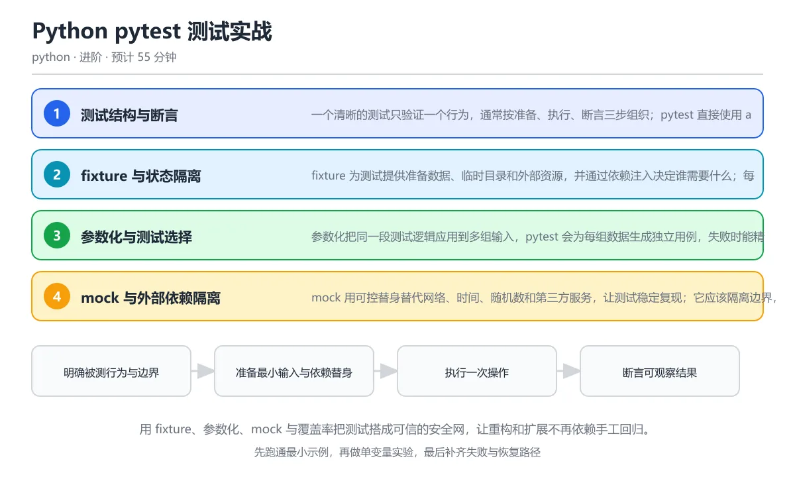

# Python pytest 测试实战

> 内容更新时间：2026-10-06 · 学习阶段：进阶 · 预计用时：60 分钟

分类：python。关键词：pytest、fixture、参数化、mock、覆盖率。用 fixture、参数化、mock 与覆盖率把测试搭成可信的安全网，让重构和扩展不再依赖手工回归。



---

## 本节知识框架

想象你开了一家蛋糕店。每天出炉的蛋糕好不好吃，你不能靠老板亲自尝每一个——你需要一套「自动质检流水线」：准备食材、烘焙、品尝、记录结果。pytest 就是 Python 世界里最流行的这套质检系统。

**本课主线**：用 fixture、参数化、mock 与覆盖率把测试搭成可信的安全网，让重构和扩展不再依赖手工回归。

**学完本课你将掌握六个核心概念**（就像质检流水线的六个工位）：

| 序号 | 概念 | 一句话类比 |
| --- | --- | --- |
| 1 | fixture | 测试的「备料台」——每个测试开始前自动准备好需要的数据、文件、连接，结束后自动清理 |
| 2 | 参数化 | 测试的「批量模式」——同一套检查逻辑，换不同的输入自动跑多遍 |
| 3 | mock | 测试的「替身演员」——用可控的假对象替代网络、时间等不可控的外部依赖 |
| 4 | 覆盖率 | 测试的「体检报告」——告诉你代码的哪些部分被测试跑过了，哪些还没覆盖到 |
| 5 | flaky 测试 | 测试的「天气敏感型」——同样的代码有时通过有时失败，通常因为隐藏的时间或并发问题 |
| 6 | 测试金字塔 | 测试的「分层策略」——大量快速的单元测试打底，少量端到端测试封顶 |

**先修与衔接**：本课是「Python」分类的第 20 课。先修内容：《类型注解与测试》。相关或后续课程：《Python 项目架构：分层、配置与依赖注入》、《Python 数据库与 SQLAlchemy 2.x》。

---

## 核心概念定义

先来一张「术语速览表」。每个术语都配有类比，帮你建立直觉。

| 术语 | 操作性定义 | 生活类比 | 常见边界与风险 |
| --- | --- | --- | --- |
| fixture | pytest 提供的测试资源工厂，可为用例准备数据、依赖与环境并在结束后清理。 | 像酒店的「客房服务」：你入住前房间已打扫好（准备），退房后恢复原样（清理）。 | 如果第二个测试依赖第一个测试留下的全局变量或数据库记录，测试就会互相污染。正确做法是用 fixture 让每个测试拿到独立的新状态。 |
| 参数化 | 用一组参数生成多个独立测试实例的机制，便于系统覆盖边界输入。 | 像自动售货机的「多口味模式」——同一个饮料出口，换不同的配料组合出多种饮品。 | 参数组合爆炸会拖慢测试套件；参数化适合行为相同而数据不同的场景，不适合把不同业务分支硬塞进一张表。 |
| mock | 替代外部依赖的可控测试替身，可预设返回值并记录调用。 | 像电影里的「替身演员」——危险动作让替身完成，主角（被测代码）专注自己的表演。 | 如果把被测函数本身替换成 mock，测试只证明「调用发生了」，没有验证任何真实逻辑。正确做法是只替换进程边界或外部依赖。 |
| 覆盖率 | 测试执行到的代码比例，用于发现未覆盖路径但不能证明行为正确。 | 像考试的「答题覆盖率」——你答了 80% 的题，但不代表答的都对了。 | 只追求覆盖率数字可能写出没有断言的测试；应该优先覆盖风险高的分支，并让每个测试都有有意义的断言。 |
| flaky 测试 | 同一代码和输入下时通过时失败的测试，通常由共享状态、时间或并发引起。 | 像一个「看心情」的灯泡——有时亮有时不亮，你无法预测。 | 共享状态与调度顺序会改变结论，单线程或串行测试通过不等于并发下成立。 |
| 测试金字塔 | 大量快速单元测试、适量集成测试和少量端到端测试的分层策略。 | 像建筑的地基——底层（单元测试）又宽又稳，顶层（端到端测试）又窄又精。 | 只在「大量快速单元测试、适量集成测试和少量端到端测试的分层策略」这一前提下成立，换输入或换环境要重新验证。 |

---

## 原理与运行机制

### pytest 是怎么工作的？一个类比

把 pytest 想象成一个「考试系统」：

1. **收集试卷**（Collection）：pytest 自动扫描所有以 `test_` 开头的文件和函数，就像老师收齐所有学生的答卷。
2. **准备考场**（Setup）：fixture 为每道题准备好草稿纸、计算器（数据和依赖）。
3. **答题**（Execution）：每个测试函数独立运行，互不干扰。
4. **批改**（Assertion）：pytest 用 `assert` 判断对错，失败时会显示「你写了什么」和「期望什么」。
5. **清理考场**（Teardown）：fixture 的 yield 之后代码负责打扫，确保下一个考试干干净净。

### 1. 测试结构与断言——一道题只考一个知识点

一个好的测试就像一道好的考试题：**只验证一个行为**。通常按三步组织：

- **准备**（Arrange）：准备输入数据
- **执行**（Act）：调用被测函数
- **断言**（Assert）：检查结果是否符合预期

pytest 直接使用 Python 的 `assert` 关键字，失败时会自动重写表达式，显示两侧的值，让你一眼看出哪里不对。

### 2. fixture 与状态隔离——每个考生都有独立的草稿纸

fixture 是 pytest 最强大的功能之一。它像一个「自动售货机」：你在函数参数里写上需要什么东西，pytest 就自动给你准备好。

关键特性：
- **依赖注入**：测试函数参数名决定它需要哪个 fixture
- **作用域控制**：`function`（每个测试）、`class`、`module`、`session` 四级
- **yield 分两段**：yield 之前是「准备」，yield 之后是「清理」
- **内置 fixture**：`tmp_path`（临时目录）、`monkeypatch`（临时修改）、`capsys`（捕获输出）

### 3. 参数化与测试选择——一次写题，批量考试

参数化把同一段测试逻辑应用到多组输入。`@pytest.mark.parametrize` 装饰器接收参数名和值列表，pytest 会为每组数据生成独立用例，失败时能精确定位是哪一组。

### 4. mock 与外部依赖隔离——让不可控的东西变得可控

mock 用可控替身替代网络、时间、随机数和第三方服务，让测试稳定复现。`unittest.mock.patch` 临时替换指定位置的属性，`MagicMock` 记录调用参数并允许设置返回值。

核心原则：**只 mock 边界，不 mock 核心逻辑**。就像拍电影时替身只替代危险动作，对话和表情还是要真演员来。

### 5. 覆盖率与测试分层——知道哪些地方还没检查到

覆盖率揭示哪些代码没有被执行，但不能证明行为正确。配合测试金字塔的分层策略，用单元、集成和端到端测试的组合来覆盖不同层次的风险。

```text
明确被测行为与边界 → 准备最小输入与依赖替身 → 执行一次操作 → 断言可观察结果 → 补齐异常路径并检查覆盖缺口
```

---


**教材衔接：项目专属规格**
## 典型应用场景

### 场景一：给除法函数写完整的测试套件

你写了一个除法函数，需要验证：正常除法、浮点除法、负数除法、除零异常。这就是参数化 + pytest.raises 的经典组合。

### 场景二：用 fixture 隔离数据库测试

每个测试都需要数据库连接，但测试之间不能互相污染。用 function 级别的 fixture 为每个测试创建独立的事务，测试结束后自动回滚。

### 场景三：用 mock 隔离网络请求

你的函数会调用外部 API 获取汇率。测试时不能让网络波动影响结果。用 mock 替换网络客户端，返回固定的汇率，让测试结果100%可复现。

### 场景四：用覆盖率发现遗漏的异常分支

跑完覆盖率报告，发现「文件不存在」的分支从来没被测试触发过。补一个针对性用例，把这条路径覆盖住。

---

## 代码/协议/SQL 示例

### 示例 1：最基本的测试结构（Arrange-Act-Assert）

```python
# calculator.py
def divide(a: float, b: float) -> float:
    """除法函数：a 除以 b，b 为 0 时抛出 ValueError。"""
    if b == 0:
        raise ValueError("除数不能为 0")
    return a / b
```

```python
# test_calculator.py
import pytest
from calculator import divide

# 参数化：三组正常输入，一次跑完
@pytest.mark.parametrize(
    ("a", "b", "expected"),
    [(10, 2, 5), (1, 4, 0.25), (-9, 3, -3)],
)
def test_divide(a, b, expected):
    assert divide(a, b) == pytest.approx(expected)

# 异常测试：验证除零时抛出正确的异常和消息
def test_divide_by_zero():
    with pytest.raises(ValueError, match="除数"):
        divide(1, 0)
```

### 示例 2：fixture 的使用与清理

```python
import pytest

@pytest.fixture
def records():
    """准备一份测试数据，测试结束后自动清理。"""
    data = [3, 1, 2]
    yield data       # yield 之前：准备阶段
    data.clear()     # yield 之后：清理阶段

def test_sorted(records):
    """测试排序功能，records 由 fixture 自动注入。"""
    assert sorted(records) == [1, 2, 3]

def test_length(records):
    """每个测试拿到的 records 都是全新的 [3, 1, 2]。"""
    assert len(records) == 3
```

### 示例 3：参数化生成多个独立用例

```python
import pytest

@pytest.mark.parametrize('value', [1, 2, 3])
def test_double(value):
    assert value * 2 >= 2
# pytest 会生成 3 个独立用例：test_double[1]、test_double[2]、test_double[3]
# 任何一个失败都能看到具体是哪个参数导致的
```

### 示例 4：mock 隔离外部依赖

```python
from unittest.mock import patch
from datetime import datetime

# 被测函数：判断令牌是否过期
def is_token_expired(token_time: str) -> bool:
    now = datetime.now()
    return (now - datetime.fromisoformat(token_time)).total_seconds() > 3600

# 测试：用 mock 固定当前时间，让过期判断可复现
@patch('myapp.datetime')
def test_token_boundary(mock_dt):
    mock_dt.now.return_value = datetime(2026, 1, 1, 12, 0, 0)
    mock_dt.fromisoformat = datetime.fromisoformat

    # 刚好 1 小时前的令牌，应该不过期
    assert is_token_expired("2026-01-01T11:00:00") is False
    # 超过 1 小时的令牌，应该过期
    assert is_token_expired("2026-01-01T10:59:59") is True
```

### 示例 5：覆盖率报告

```text
# 运行测试并生成覆盖率报告
$ pytest --cov=myapp --cov-report=term-missing tests/

---------- coverage: platform linux, python 3.12.0 ----------
Name           Stmts   Miss  Cover   Missing
--------------------------------------------
myapp/calc.py     10      1    90%   15
myapp/auth.py     25      8    68%   20-25, 30-32
--------------------------------------------
TOTAL             35      9    74%
```

---

## 时间/空间复杂度或性能分析

### 测试套件的性能关注点

测试代码也要讲性能。一个跑 10 分钟的测试套件会让开发者跳过测试、绕过测试，最终形同虚设。

### 各概念的性能特征

| 概念 | 主要开销 | 优化策略 |
| --- | --- | --- |
| pytest 收集 | 文件扫描与函数发现，小项目毫秒级，大项目可达数秒 | 用 `testpaths` 配置限定扫描范围 |
| fixture | 作用域越大创建次数越少；session 级 fixture 只创建一次 | 数据库连接等重资源用 session 级，但要注意测试间隔离 |
| 参数化 | 参数越多用例越多，线性增长 | 慢速参数化测试加 `@pytest.mark.slow`，CI 中默认跳过 |
| mock | mock 本身开销极低（微秒级） | 不要过度 mock，否则测试变成对调用顺序的断言 |
| 覆盖率 | coverage.py 会给每行代码加追踪，通常增加 2-5 倍运行时间 | CI 中只在主分支或 PR 时跑覆盖率 |

### 测量方法

固定输入跑一遍记录基线，再把测试规模提高一个数量级复测。两次结果的差值才是结论依据。达到边界时不要外推，必须重新测量。

---

## 常见误区与易错点

### 误区速览表

| 容易写错的做法 | 实际现象 | 原因与正确做法 |
| --- | --- | --- |
| 一个测试验证多个行为 | 失败时不知道哪一步坏了 | 按行为拆分测试，让每个失败都指向一个清晰原因 |
| 测试依赖执行顺序 | 单独跑通过，全套跑偶发失败 | 用 fixture 在每个测试前后创建和清理状态 |
| mock 掉被测对象本身 | 测试永远通过，但没有验证任何真实逻辑 | 只替换进程边界或外部依赖，让被测函数真实执行 |
| 只追求覆盖率数字 | 覆盖率 100% 但 bug 依然存在 | 优先覆盖风险高的分支，并让每个测试都有有意义的断言 |

### 误区详解 1：一个测试验证多个行为

**症状**：在一个函数里连续断言解析、计算、写文件和发送通知，失败时不知道哪一步坏了。

**类比**：就像一道考试题里同时考了加减乘除，你答错了，但不知道是哪种运算不会。

**修复**：按行为拆分成四个测试，每个测试只验证一个操作。

### 误区详解 2：测试依赖执行顺序

**症状**：第二个测试依赖第一个测试留下的全局变量或数据库记录。

**类比**：像接力赛跑——第二棒必须等第一棒跑完才能开始。如果第一棒摔倒了，第二棒也跟着失败，但这不是第二棒的问题。

**修复**：用 fixture 在每个测试前后创建和清理状态，让每个测试都能独立运行。

### 误区详解 3：mock 掉被测对象本身

**症状**：把待测函数替换成 mock 后断言它被调用，测试没有验证任何真实逻辑。

**类比**：像让替身演员演完整部电影，然后说「电影拍完了」——但观众看到的不是真正的表演。

**修复**：只替换进程边界或外部依赖（网络、时间、随机数），让被测函数真实执行。

### 误区详解 4：只追求覆盖率数字

**症状**：为未覆盖的行补上无断言的调用，覆盖率上升但没有验证行为。

**类比**：像考试时把每道题都涂了答案，但没检查是否正确——「答题覆盖率」100%，但得分可能很低。

**修复**：优先覆盖风险高的分支，并让每个测试都有有意义的断言。

---

## 与其他知识点的关系

### 知识关系图

```python
《类型注解与测试》──→ 本课《Python pytest 测试实战》──→《Python 项目架构》
        │                        │                          │
   typing、pyproject.toml    fixture、mock、覆盖率       分层、依赖注入
        │                        │                          │
        └────────────────────────┴──────────────────────────┘
                                 │
                          《Python 数据库与 SQLAlchemy 2.x》
```

### 先修知识

- **《类型注解与测试》**：本课默认你已经掌握 `typing` 和 `pyproject.toml` 的基本用法。那门课里的 `pytest` 是入门级使用，本课会深入到 fixture、参数化和 mock。

### 后续衔接

- **《Python 项目架构：分层、配置与依赖注入》**：在分层架构中，fixture 常用于创建各层的依赖；mock 用于隔离不同层的测试。
- **《Python 数据库与 SQLAlchemy 2.x》**：数据库测试需要 fixture 管理连接和事务，mock 用于隔离外部服务，集成测试用于验证真实的 SQL 行为。

### 容易混淆的概念对

| 概念 A | 概念 B | 区别要点 |
| --- | --- | --- |
| fixture | 参数化 | fixture 负责「准备和清理」，参数化负责「一组数据跑同一套逻辑」 |
| mock | 覆盖率 | mock 是「让测试可控」的工具，覆盖率是「发现测试盲区」的指标 |
| flaky 测试 | 测试金字塔 | flaky 测试是「不稳定的测试」，测试金字塔是「组织测试的策略」 |

---

## 自测题与参考答案

> 先独立作答，再对照参考答案。

### 自测 1（概念复述）

不看正文，写出 `fixture` 的操作性定义，并说明它与 `参数化` 的区别。

**参考答案**：fixture 是 pytest 提供的测试资源工厂，可为用例准备数据、依赖与环境并在结束后清理。参数化是用一组参数生成多个独立测试实例的机制。fixture 解决「测试需要什么资源」，参数化解决「同一逻辑如何用不同数据验证」。

### 自测 2（排错）

本课错误表记录了「一个测试验证多个行为」这类做法。请写出它的现象、根因与修复。

**参考答案**：现象是在一个函数里连续断言解析、计算、写文件和发送通知，失败时不知道哪一步坏了。根因是一个测试承担了多个验证责任。修复是按行为拆分测试，让每个失败都指向一个清晰原因。

### 自测 3（代码阅读）

阅读示例 2 中的 fixture 代码，说明 yield 前后各做什么。

**参考答案**：yield 之前 `data = [3, 1, 2]` 是准备阶段，创建测试数据并注入测试函数。yield 之后 `data.clear()` 是清理阶段，测试结束后清空列表，防止状态泄漏到下一个测试。

### 自测 4（动手验证）

把示例 1 中的参数 `(10, 2, 5)` 改成 `(10, 0, 0)`，预测会发生什么。

**参考答案**：`divide(10, 0)` 会抛出 `ValueError`，而测试期望返回 `0`，所以测试会失败并显示 `ValueError` 异常信息。这正好验证了除零保护逻辑在工作。

### 自测 5（迁移）

把 pytest 的方法迁移到自己的项目：围绕 `mock` 写出一个合理的使用场景。

**参考答案**：例如测试一个发送欢迎邮件的函数，用 mock 替换邮件客户端，预设返回成功，验证函数调用了正确的收件人和模板。这样测试不依赖真实邮件服务，结果100%可复现。

---

## 复习清单

- [ ] 能不看正文复述本课核心术语，并指出一个边界或反例
- [ ] 能默写本课最重要的代码示例，并解释每一行的作用
- [ ] 能说出本课内容和前后两课的联系

### 验证命令与预期输出

完成本项目后，用以下命令验证结果是否符合预期：

```text
# 运行全部测试并查看覆盖率
python -m pytest --tb=short -q
```

预期输出应显示所有测试通过，无报错或警告。如果有失败，根据错误信息定位问题并修复。

### 项目交付物

完成本项目后，应交付以下内容：

1. **可运行的代码**：所有功能模块已实现并通过测试
2. **测试报告**：单元测试和集成测试全部通过
3. **文档**：README 说明使用方法，关键函数有注释
4. **复盘总结**：记录遇到的问题和解决方案

## 术语速查

| 术语 | 一句话说明 |
| --- | --- | --- |
| `fixture` | pytest 提供的测试资源工厂，可为用例准备数据、依赖与环境并在结束后清理。 | fixture |
| `参数化` | 用一组参数生成多个独立测试实例的机制，便于系统覆盖边界输入。 | parametrize |
| `mock` | 替代外部依赖的可控测试替身，可预设返回值并记录调用。 | mock / test double |
| `覆盖率` | 测试执行到的代码比例，用于发现未覆盖路径但不能证明行为正确。 | coverage |
| `flaky 测试` | 同一代码和输入下时通过时失败的测试，通常由共享状态、时间或并发引起。 | flaky test |
| `测试金字塔` | 大量快速单元测试、适量集成测试和少量端到端测试的分层策略。 | test pyramid |
| `assert` | Python 内置断言关键字，pytest 用它判断测试通过或失败。 | assertion |
| `pytest.raises` | pytest 提供的异常捕获上下文管理器，用于验证函数抛出特定异常。 | pytest.raises |

**术语关系链**：`fixture`（准备资源）→ `参数化`（批量输入）→ `mock`（隔离依赖）→ `覆盖率`（发现盲区）→ `flaky 测试`（不稳定信号）→ `测试金字塔`（分层策略）。

---

## 考点精讲

本课题库有 5 道题，下面逐题给出题干、正确项与解析。先自己作答，再核对答案。

### 考点 1：第 1 题

- **题目**：pytest 中验证函数抛出特定异常并检查消息，正确写法是？
- **正确项**：with pytest.raises(ValueError, match='除数'): divide(1, 0)
- **解析**：`pytest.raises` 是上下文管理器，在 `with` 块内执行的代码如果抛出了指定类型的异常，测试就通过。`match` 参数用正则表达式检查异常消息中是否包含关键词。直接比较返回值不会捕获异常，空的 `except` 会吞掉错误，`@pytest.mark.error` 不是合法的异常断言方式。

### 考点 2：第 2 题

- **题目**：fixture 使用 yield 的主要目的是什么？
- **正确项**：在测试前准备资源，在测试后执行清理
- **解析**：fixture 中 yield 之前的代码在测试开始前运行，产出的对象通过依赖注入传递给测试函数。测试结束后，pytest 继续执行 yield 之后的清理代码。这就像酒店的客房服务：入住前打扫（yield 前），退房后恢复（yield 后）。没有清理的共享资源会让后续测试受到污染。

### 考点 3：第 3 题

- **题目**：关于 mock，哪些做法是合理的？（多选）
- **正确项**：替换网络客户端以返回固定响应；替换当前时间让过期逻辑可复现；对真实数据库迁移使用集成测试而不是全量 mock
- **解析**：网络、时间和随机数属于不稳定边界，适合用替身控制。数据库迁移的行为、约束和事务语义应该在真实数据库上做集成测试，全量 mock 会丢失这些验证。把被测函数本身替换成 mock 后，测试只能证明调用发生，无法证明业务结果正确——这是最常见的「假安全感」。

### 考点 4：第 4 题

- **题目**：参数化装饰器会生成几个测试用例？  @pytest.mark.parametrize('value', [1, 2, 3]) def test_double(value):     assert value * 2 >= 2

- **正确项**：3 个
- **解析**：参数列表有 3 个值（1、2、3），pytest 会为每组数据生成一个独立用例，分别是 `test_double[1]`、`test_double[2]`、`test_double[3]`。参数化能避免复制粘贴三个几乎相同的函数，也能让增加边界输入变成修改一行数据。

### 考点 5：第 5 题

- **题目**：为什么这个测试即使实现错了也可能通过？

```python
def test_create_user(mocker):
    service = mocker.Mock()
    service.create('Ada')
    service.create.assert_called_once_with('Ada')
```

- **正确项**：它只验证 mock 被调用，没有执行真实创建逻辑
- **解析**：这里的 `service` 是 mock 对象，调用 `service.create('Ada')` 只会记录参数并返回另一个 mock，真实的用户创建、校验和持久化都没有发生。测试只证明了「create 被调用了一次，参数是 Ada」，但无法发现业务缺陷。正确做法是执行真实服务或只 mock 最外层依赖，再断言返回对象、数据库状态或可观察副作用。

---

## 内容元数据

- 内容版本：v2.0
- 最后更新：2026-10-06
- 学习阶段：进阶

| 字段 | 值 |
| --- | --- |
| 课程 ID | `python_pytest` |
| 所属分类 | `python` |
| 难度 | 进阶 |
| 预计用时 | 60 分钟 |
| 关键词 | pytest、fixture、参数化、mock、覆盖率 |
| 配图 | `images/lesson_python_pytest.webp` |
| 参考资料 | 5 条 |
| 内容更新时间 | 2026-10-06 |

---

## 参考资料与复核

- 来源性质：官方文档、标准或权威教材；本课核对关键词：pytest、fixture、参数化、mock、覆盖率。
- 最后复核：2026-10-04
- 下次复核：2026-12-10
- 复核范围：版本兼容、API 行为与工程实践

下面列出的资料用于核对本课结论，复习时可以对照阅读：

- [pytest 官方文档](https://docs.pytest.org/en/stable/)
- [pytest fixture 指南](https://docs.pytest.org/en/stable/how-to/fixtures.html)
- [pytest 参数化文档](https://docs.pytest.org/en/stable/how-to/parametrize.html)
- [unittest.mock 文档](https://docs.python.org/3/library/unittest.mock.html)
- [coverage.py 文档](https://coverage.readthedocs.io/)

> 复核提示：《Python pytest 测试实战》的结论如与资料冲突，以资料中的规范文本为准，并在笔记里记录差异与日期。
