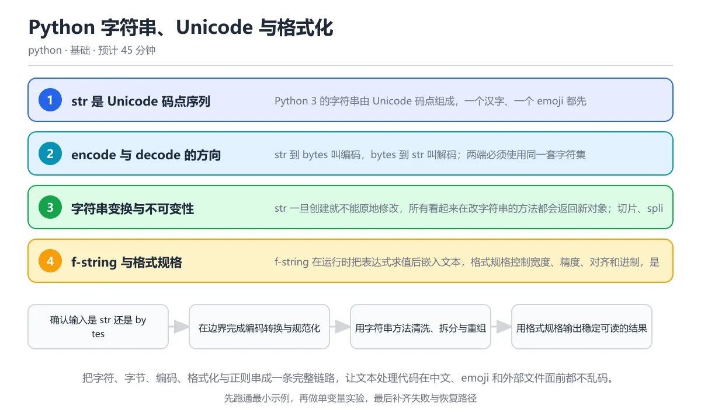

# Python 字符串、Unicode 与格式化

> 内容更新时间：2026-10-06 · 学习阶段：入门 · 预计用时：55 分钟

> 学习阶段：基础 · 预计用时：55 分钟 · 配图：从码点到屏幕



你有没有遇到过这种情况——从网上下载了一个文本文件，打开全是乱码？或者在终端里打印一个 emoji，后面的表格全错位了？别担心，这节课就是帮你彻底搞懂"文字在电脑里到底是怎么存的"。我们会从最生活化的比喻开始，一步步走到你能自己写出健壮的文本处理代码。

---

## 本节知识框架

想象你在学做一道菜。我们先认识食材（字符和编码），再学刀工（字符串操作），然后上锅烹饪（格式化与正则），最后摆盘上桌（输出与排错）。

**本课知识地图**

```text
字符是什么 → 电脑怎么存字符 → Python 怎么处理字符串 → 怎么漂亮地输出 → 怎么用正则匹配文本
```

**学完本课你将能够**：

1. 向朋友解释"为什么 UTF-8 是互联网的事实标准"，并且举出一个真实例子。
2. 遇到乱码问题时，像侦探一样快速定位原因并修复。
3. 用 f-string 和正则表达式写出既好看又可靠的文本处理代码。

**先修知识**：你需要了解变量、基本数据类型（来自《变量与数据类型》），以及列表和字典的基本操作（来自《列表、元组、字典与集合》）。如果这些还不熟，建议先回顾一下。

---

## 核心概念定义

我们先用一张"生活对照表"来认识本课的核心术语。每个概念都配了一个生活中的类比，帮你建立直觉。

| 术语 | 一句话定义 | 生活类比 |
| --- | --- | --- |
| Unicode 码点 | Unicode 标准给每个字符分配的唯一数字编号，Python 的 str 就是码点的序列。 | 就像每个人都有一个身份证号，每个字符也有一个"身份编号"。比如"A"的编号是 65，"中"的编号是 20013。 |
| UTF-8 | 一种变长编码方式，把码点翻译成字节存储。ASCII 占 1 字节，中文通常 3 字节，emoji 通常 4 字节。 | 像快递计费：小包裹（英文字母）1 块钱，中包裹（汉字）3 块钱，大包裹（emoji）4 块钱。 |
| 编码与解码 | 编码把 str 变成 bytes（写出去），解码把 bytes 变回 str（读进来），两端必须用同一套规则。 | 编码好比把中文信翻译成摩尔斯电码发出去，解码就是对方用同一本密码本翻译回来。如果双方用了不同的密码本，就乱套了。 |
| f-string | 以 f 开头的字符串，花括号里可以写表达式，运行时自动替换成结果。 | 像填字游戏：`f\u007b\u007b名字\u007d\u007d` 就是把"名字"这个空填上实际的值。 |
| 原始字符串 | 以 r 开头的字符串，反斜杠不当转义符，所见即所得。 | 普通字符串里 `\n` 是换行，原始字符串里 `\n` 就是字面的反斜杠加 n，像"拍照原片"不做任何后期处理。 |
| 字素簇 | 用户眼中"一个字符"的最小单位，可能由多个码点组合而成。 | 就像"一家人"看起来是一户，但户口本上可能有好几个人。emoji 里的国旗就是两面旗子拼出来的。 |

---

## 原理与运行机制

### 第一层：字符的身份证——Unicode 码点

**类比时间**：想象世界上有一个超级大的通讯录——Unicode 标准。它给全世界所有文字系统中的每一个字符都编了一个号。比如：

- A → 65（也就是 0x41）
- 中 → 20013（也就是 0x4E2D）
- 😀 → 128512（也就是 0x1F600）

Python 3 的 str 类型就是这些编号组成的序列。当你写下 `text = "你好"` 时，Python 内部存的是 `[20320, 22909]` 这两个码点。

**关键洞察**：`len()` 函数数的是码点个数，不是字节数，也不是屏幕上的显示宽度。这就是为什么 `len("😀")` 返回 1，虽然这个 emoji 在 UTF-8 里占了 4 个字节。

### 第二层：字符的快递包装——UTF-8 编码

码点只是逻辑编号，真正存到文件或通过网络发送时，需要变成字节（0 和 1 的序列）。UTF-8 就是最流行的"翻译规则"：

```python
text = "A中😀"
# A → 1 字节, 中 → 3 字节, 😀 → 4 字节
data = text.encode("utf-8")
print(len(data))  # 输出 8（1 + 3 + 4）
```

**为什么 UTF-8 这么流行？** 因为它对英文完全兼容——ASCII 字符在 UTF-8 里还是 1 个字节，老程序不用改。同时它又能表示全世界所有文字，堪称"万能快递箱"。

### 第三层：编码与解码——翻译的双向通道

```text
str ──encode("utf-8")──▶ bytes
bytes ──decode("utf-8")──▶ str
```

**类比**：编码就像把一封中文信翻译成摩尔斯电码发出去；解码就是对方用同一本密码本翻译回来。如果发送方用了 UTF-8，接收方却用 GBK 来解，就会出现经典的"烫烫烫"乱码。

```python
text = "你好世界"
data = text.encode("utf-8")       # str → bytes
print(data)                        # b'\xe4\xbd\xa0\xe5\xa5\xbd\xe4\xb8\x96\xe7\x95\x8c'
back = data.decode("utf-8")       # bytes → str
print(back == text)                # True
```

**铁律**：编码和解码必须用同一套字符集，否则就会报错或乱码。

### 第四层：字符串操作——不可变的"快照"

Python 的字符串一旦创建就不能修改。所有看起来在"改"字符串的操作，其实都返回了一个全新的字符串。

```python
s = "hello"
s.upper()       # 返回 "HELLO"，但 s 本身还是 "hello"
print(s)        # 输出 "hello"，没有变
```

**类比**：字符串像一张照片，你不能修改照片本身，只能拿它复印一张新的然后在复印件上涂改。

常用操作速览：

```python
text = "  Hello, World!  "
print(text.strip())          # "Hello, World!" —— 去掉首尾空白
print(text.lower())          # "  hello, world!  " —— 转小写
print(text.split(","))       # ['  Hello', ' World!  '] —— 按逗号拆分
print("-".join(["a","b"]))   # "a-b" —— 用连字符拼接
```

### 第五层：f-string——优雅的文本格式化

f-string 就像"智能填空题"，在花括号里放表达式，运行时自动求值并嵌入文本：

```python
name = "小明"
score = 95.678
print(f"{name}的成绩是{score:.1f}分")
# 输出：小明的成绩是95.7分
```

格式规格常用语法：

```python
pi = 3.14159
print(f"{pi:>10.2f}")   # 右对齐，宽10位，保留2位小数 → "      3.14"
print(f"{pi:<10.2f}")   # 左对齐 → "3.14      "
print(f"{1234567:,}")    # 千分位分隔 → "1,234,567"
print(f"{255:#06x}")     # 十六进制 → "0x00ff"
```

### 第六层：正则表达式——文本的"模式匹配器"

正则表达式是用一套特殊语法来描述"某一类文本长什么样"的工具。想象你在找所有手机号，正则就是你对手机号"长相"的描述。

```python
import re

# 用原始字符串 r"..." 避免反斜杠转义冲突
pattern = r"\d{3}-\d{4}"
text = "我的电话是 010-1234，她的电话是 021-5678"
results = re.findall(pattern, text)
print(results)  # ['010-1234', '021-5678']
```

**重要区分**：

- `re.match()` —— 只从字符串开头匹配，像"检查快递单号是否以 SF 开头"
- `re.search()` —— 在任意位置搜索，像"在包裹堆里找一个特定快递"
- `re.fullmatch()` —— 要求整个字符串完全匹配，像"验证身份证号格式是否完全正确"

---

## 典型应用场景

### 场景 1：读取文件不乱码

**生活场景**：你在 Windows 上用记事本保存了一个中文文件，发给用 Mac 的同事，结果他打开全是乱码。

**原因**：Windows 中文版的默认编码是 GBK，Mac 默认是 UTF-8。双方用了不同的"密码本"。

**正确做法**：永远显式指定编码。

```python
# 写入
with open("notes.txt", "w", encoding="utf-8") as f:
    f.write("你好世界")

# 读取
with open("notes.txt", "r", encoding="utf-8") as f:
    content = f.read()
```

### 场景 2：统计用户可见的字符数

**生活场景**：你在做一个社交媒体应用，限制每条动态最多 140 个字符。用户输入了带 emoji 和重音符号的文本，`len()` 的结果和用户"看到"的字符数不一样。

**原因**：`len()` 数的是码点，而有些"看起来是一个字符"的东西其实由多个码点组成。

```python
import unicodedata

text = "e\u0301"  # e + 组合重音符 = 看起来是 é，但 len 是 2
print(len(text))   # 2
# 先做 NFC 规范化再比较
normalized = unicodedata.normalize("NFC", text)
print(len(normalized))  # 1 —— 现在 é 是一个码点了
```

### 场景 3：用 f-string 生成报表

**生活场景**：你需要把一组数据打印成对齐的表格，方便在终端里查看。

```python
items = [("苹果", 12.5, 3), ("香蕉", 8.0, 5), ("西瓜", 25.99, 1)]
print(f"{'商品':<6}{'单价':>8}{'数量':>6}{'小计':>10}")
print("-" * 34)
for name, price, qty in items:
    total = price * qty
    print(f"{name:<6}{price:>8.2f}{qty:>6}{total:>10.2f}")
```

### 场景 4：用正则校验用户输入

**生活场景**：用户在注册表单里填了邮箱，你要验证格式是否正确。

```python
import re

email_pattern = re.compile(r"^[\w.+-]+@[\w-]+\.[\w.]+$")

def check_email(addr):
    if email_pattern.fullmatch(addr):
        return "格式正确"
    return "格式错误，请检查"

print(check_email("user@example.com"))   # 格式正确
print(check_email("not-an-email"))       # 格式错误，请检查
```

---

## 代码/协议/SQL 示例

### 示例 1：从码点到显示的完整链路

```python
import unicodedata

# 1. 码点是什么？
text = "Café 😀 中文"
for ch in text:
    print(f"字符: {ch:<3} 码点: U+{ord(ch):04X} 名称: {unicodedata.name(ch, '未知')}")

# 2. 编码成 UTF-8 后占多少字节？
data = text.encode("utf-8")
print(f"码点数量: {len(text)}")     # 8
print(f"UTF-8 字节数: {len(data)}")  # 18（1+1+1+2+4+3+3+3）

# 3. 解码回来
back = data.decode("utf-8")
print(back == text)  # True
```

### 示例 2：Unicode 规范化的力量

```python
import unicodedata

# 两种方式表示 é
composed = "é"          # 预组合形式，一个码点 U+00E9
decomposed = "e\u0301"  # 分解形式，e + 组合重音，两个码点

print(len(composed))    # 1
print(len(decomposed))  # 2
print(composed == decomposed)  # False —— 看起来一样但不相等！

# 用 NFC 规范化统一
norm_d = unicodedata.normalize("NFC", decomposed)
print(norm_d == composed)  # True —— 现在可以比较了
```

### 示例 3：f-string 格式规格实战

```python
pi = 3.14159265
big = 1234567890

# 各种格式化方式
print(f"{pi:.2f}")       # 3.14 —— 保留两位小数
print(f"{pi:>10.2f}")    # "      3.14" —— 右对齐
print(f"{big:,}")        # "1,234,567,890" —— 千分位
print(f"{big:_}")        # "1_234_567_890" —— 下划线分隔
print(f"{255:#06x}")     # "0x00ff" —— 十六进制
print(f"{pi=}")          # "pi=3.14159265" —— 调试利器（Python 3.8+）
```

### 示例 4：正则表达式提取日志字段

```python
import re

log = "2026-10-08 12:30:45 ERROR user=42 msg=timeout"
pattern = re.compile(
    r"^(\d{4}-\d{2}-\d{2}) \S+ ERROR user=(\d+) msg=(\w+)$"
)
match = pattern.fullmatch(log)
if match:
    date, user_id, message = match.groups()
    print(f"日期: {date}, 用户: {user_id}, 消息: {message}")
else:
    print("日志格式不匹配")
```

### 示例 5：原始字符串与正则的配合

```python
# 不用原始字符串 —— 反斜杠需要双重转义，容易出错
bad = "\\d{3}-\\d{4}"

# 用原始字符串 —— 所见即所得，清晰不易错
good = r"\d{3}-\d{4}"

# 两者内容相同
print(bad == good)  # True

# 但在复杂正则里，原始字符串的可读性优势巨大
phone_re = r"(\d{3})-(\d{4})"  # 一眼就能看出模式
```

---

## 时间/空间复杂度或性能分析

学完原理，你可能想知道：这些操作到底快不快？我们来逐一分析。

### 字符串操作的开销

| 操作 | 时间复杂度 | 说明 |
| --- | --- | --- |
| `len(s)` | O(1) | Python 内部保存了长度信息，直接返回 |
| `s[i]` 索引 | O(1) | 直接按位置取码点 |
| `s + t` 拼接 | O(len(s) + len(t)) | 每次创建新字符串，需要复制全部内容 |
| `s.join(list)` | O(总长度) | 一次性分配内存，比分多次用 `+` 拼接高效得多 |
| `s.encode("utf-8")` | O(len(s)) | 遍历每个码点，按 UTF-8 规则转成字节 |
| `re.fullmatch(pattern, s)` | 最坏 O(2^n) | 复杂正则可能触发回溯爆炸，简单模式通常 O(n) |

### 关键性能建议

**建议 1：大量拼接用 join，别用加号**

```python
# 慢 —— 每次 + 都创建一个新字符串对象
result = ""
for word in words:
    result += word

# 快 —— 先收集到列表，最后一次性拼接
result = "".join(words)
```

**类比**：用加号拼接就像每次搬一块砖到工地，而 join 是一次性用卡车把所有砖运过去。

**建议 2：正则表达式提前编译**

```python
# 在循环里反复编译同一个模式 —— 浪费
for line in lines:
    re.match(r"\d+", line)

# 提前编译一次 —— 高效
digit_re = re.compile(r"\d+")
for line in lines:
    digit_re.match(line)
```

**建议 3：避免灾难性回溯**

嵌套量词（如 `(a+)+b`）在某些输入上会让正则引擎指数级变慢。处理不可信输入时，先限制长度或使用原子组。

---

## 常见误区与易错点

### 误区 1：读写文件不指定编码

**你会怎么写？**

```python
# 危险写法 —— 依赖系统默认编码
with open("data.txt", "r") as f:
    content = f.read()
```

**会发生什么？** 在中文 Windows 上，默认编码是 GBK；在 Linux 和 Mac 上是 UTF-8。同一份代码在不同电脑上运行，结果可能完全不同。

**正确做法**：

```python
with open("data.txt", "r", encoding="utf-8") as f:
    content = f.read()
```

### 误区 2：混淆 str 和 bytes

**症状**：

```python
data = b"hello"
print(data.upper())   # 可以，bytes 也有 upper 方法
print(data.strip())   # 可以
# 但下面这行会报错：
print(data + "world")  # TypeError: can't concat str to bytes
```

**正确做法**：在边界处（读文件、收网络数据）统一 decode 成 str，业务逻辑里只用 str。

### 误区 3：把 len 当成显示宽度

**症状**：用 `len()` 来对齐终端输出，遇到 emoji 或组合字符就对不齐。

```python
names = ["Alice", "小明", "😀Bob"]
for name in names:
    print(f"{name:<10}|")  # 对不齐！因为 len("😀Bob") = 4，但显示宽度是 5
```

**原因**：`len()` 返回码点数，而 emoji 在终端里通常占 2 列宽度。

**解决思路**：需要显示宽度对齐时，使用第三方库（如 `wcwidth`）来计算实际显示宽度。

### 误区 4：用 re.match 做整体校验

**症状**：

```python
import re
# 想验证日期格式 YYYY-MM-DD
result = re.match(r"\d{4}-\d{2}", "2026-10-08oops")
print(result)  # 匹配成功！但尾部 oops 被忽略了
```

**原因**：`re.match` 只检查字符串开头是否匹配，不管后面还有什么。

**正确做法**：用 `re.fullmatch` 或在模式两端加 `^` 和 `$`。

```python
result = re.fullmatch(r"\d{4}-\d{2}-\d{2}", "2026-10-08")
print(result)  # 匹配成功
result = re.fullmatch(r"\d{4}-\d{2}-\d{2}", "2026-10-08oops")
print(result)  # None —— 正确拒绝了非法输入
```

---

## 与其他知识点的关系

| 关系类型 | 课程名称 | 怎么联系 |
| --- | --- | --- |
| 先修 | 《变量与数据类型》 | 变量、类型判断是操作字符串的前提 |
| 先修 | 《列表、元组、字典与集合》 | 切片、列表推导式在字符串处理中频繁使用 |
| 关联 | 《异常处理与文件操作》 | 文件读写时必然遇到编码问题，try/except 处理 UnicodeDecodeError |
| 关联 | 《Python 标准库实战工具箱》 | re、unicodedata、string 模块都是标准库的一部分 |
| 后续 | 《类与对象》 | 自定义类可以实现 `__format__` 和 `__str__` 来控制字符串表示 |

**知识链条**：变量与数据类型 → 列表与字典 → **本课（字符串与 Unicode）** → 异常处理与文件操作 → 标准库 → 类与对象

---

## 自测题与参考答案

> 先独立作答，再对照答案。每题的考点都能在正文中找到对应讲解。

### 自测 1（概念理解）

**题目**：Python 3 中 `len("中文😀")` 的结果是什么？

<details>
<summary>参考答案</summary>

**答案：3**。Python 3 的 str 保存的是 Unicode 码点序列。"中"、"文"、"😀"各算一个码点，所以 len 返回 3。注意：这个字符串用 UTF-8 编码后是 3+3+4=10 字节，但 len 数的不是字节数。

</details>

### 自测 2（文件操作）

**题目**：读取一个需要跨平台交换的文本文件，最稳妥的写法是？

<details>
<summary>参考答案</summary>

**答案：`open(path, encoding="utf-8")`**。不指定编码时，Python 使用操作系统默认编码（Windows 中文是 GBK，Linux 是 UTF-8），同一个文件在不同系统上可能读出不同结果。显式传入 `encoding="utf-8"` 才能保证跨平台一致。

</details>

### 自测 3（多选辨析）

**题目**：以下哪些操作会在编码边界抛错或产生乱码？

A. 用 GBK 解码 UTF-8 字节
B. 对 bytes 调用 str 独有的 format 方法
C. 直接比较 bytes 与 str
D. 显式用 UTF-8 先编码再解码

<details>
<summary>参考答案</summary>

**答案：A、B、C**。A 用错误的字符集解码必然乱码；B 中 bytes 没有 format 方法会报 AttributeError；C 中 bytes 和 str 是不同类型，`==` 永远返回 False。D 是正确的往返操作，不会出问题。

</details>

### 自测 4（代码阅读）

**题目**：阅读以下代码，输出是什么？

```python
text = "e" + chr(0x301)
print(len(text), text == "é", unicodedata.normalize("NFC", text) == "é")
```

<details>
<summary>参考答案</summary>

**答案：2 False True**。text 由字母 e 和组合重音符号两个码点组成，所以 len 为 2。直接与预组合形式的 "é" 比较不相等（码点序列不同）。但经过 NFC 规范化后，分解形式被合并成预组合码点，所以比较结果为 True。

</details>

### 自测 5（正则陷阱）

**题目**：下面代码为什么没有拦住非法输入？

```python
re.match(r"[0-9]{4}-[0-9]{2}", "2026-10-08oops")
```

<details>
<summary>参考答案</summary>

**答案**：`re.match` 只保证前缀匹配，尾部的 "oops" 没有被校验。它匹配到 "2026-10" 就认为成功了。要校验整个字符串，应该改用 `re.fullmatch`，或者在模式末尾加上 `$` 锚点并确保模式覆盖完整内容。

</details>

### 自测 6（综合对比）

**题目**：用一句话分别说明 Unicode 码点和 UTF-8 各自解决什么问题。

<details>
<summary>参考答案</summary>

**Unicode 码点**解决的是"给每个字符一个唯一编号"的问题——让电脑知道"这个字符是谁"。**UTF-8**解决的是"怎么把编号存成字节"的问题——让电脑知道"这个字符在文件里长什么样"。一个是身份系统，一个是存储格式。

</details>

---

## 复习清单

- [ ] 能不看正文复述本课核心术语，并指出一个边界或反例
- [ ] 能默写本课最重要的代码示例，并解释每一行的作用
- [ ] 能说出本课内容和前后两课的联系

## 术语速查

| 术语 | 一句话说明 |
| --- | --- | --- |
| Unicode 码点 | 每个字符的唯一数字编号 | "字符的身份证号" |
| UTF-8 | 把码点翻译成字节的最流行编码 | "英文 1 字节，中文 3 字节，emoji 4 字节" |
| 编码 (encode) | str → bytes，写出去 | "发信：翻译成人话再发" |
| 解码 (decode) | bytes → str，读进来 | "收信：按密码本翻译回来" |
| f-string | `f"..."` 花括号里写表达式 | "智能填空题" |
| 原始字符串 | `r"..."` 反斜杠不转义 | "拍照原片，不做后期" |
| 字素簇 | 用户眼中的"一个字符" | "看起来是一个，实际可能好几个码点" |
| NFC 规范化 | 把同一字符的不同码点表示统一 | "先统一格式再比较" |

---

## 考点精讲

本课题库共有 5 道题，下面逐题给出题干、正确答案与详细解析。建议先自己做一遍，再核对答案。

### 考点 1：len 与码点计数

- **题目**：Python 3 中 len('中文😀') 的结果是什么？
- **正确答案**：3
- **解析**：Python 3 的 str 是 Unicode 码点序列。"中"、"文"、"😀" 各占一个码点，len 返回码点数量 3。注意 len 统计的不是 UTF-8 字节数（那是 10），也不是显示宽度。
- **关联知识**：Unicode 码点、UTF-8 编码长度

### 考点 2：文件读取的编码指定

- **题目**：读取一个需要跨平台交换的文本文件，最稳妥的写法是？
- **正确答案**：open(path, encoding=‘utf-8’)
- **解析**：不指定编码时 Python 使用操作系统默认编码，中文 Windows 上是 GBK，Linux/Mac 上是 UTF-8。同一文件在不同系统上可能读出不同结果。显式传入 encoding=‘utf-8’ 才能跨平台一致。
- **关联知识**：编码与解码、UTF-8

### 考点 3：编码边界的常见错误

- **题目**：以下哪些操作会在编码边界抛错或产生乱码？（多选）
- **正确答案**：用 GBK 解码 UTF-8 字节；对 bytes 调用 str 独有的 format 方法；直接比较 bytes 与 str
- **解析**：用错误的字符集解码（GBK 解 UTF-8）必然乱码或报 UnicodeDecodeError；bytes 没有 str 的 format 方法，调用会抛 AttributeError；bytes 与 str 用 == 比较永远返回 False，不会报错但逻辑错误。正确做法是统一类型后再操作。
- **关联知识**：UTF-8、编码与解码、str 与 bytes 的类型区分

### 考点 4：Unicode 规范化

- **题目**：阅读代码，输出与结论哪一项正确？  text = 'e' + chr(0x301) print(len(text), text == 'é', unicodedata.normalize('NFC', text) == 'é')
- **正确答案**：2 False True
- **解析**：text 由字母 e 和组合重音两个码点组成，len 为 2。直接与预组合形式的 ‘é’ 比较为 False（码点序列不同）。NFC 规范化把分解形式合并成预组合码点，所以规范化后比较为 True。代码等价于：

```python
text = ‘e’ + chr(0x301)
print(len(text), text == ‘é’, unicodedata.normalize(‘NFC’, text) == ‘é’)
```

- **关联知识**：Unicode 码点、NFC 规范化

### 考点 5：正则 match 与 fullmatch

- **题目**：下面代码为什么没有拦住非法输入？  re.match(r'[0-9]{4}-[0-9]{2}', '2026-10-08oops')
- **正确答案**：match 只保证前缀匹配，尾部 oops 没有被校验，应改用 fullmatch
- **解析**：`re.match` 只从字符串开头匹配，不要求消耗整个字符串。"2026-10" 匹配成功后就返回了，尾部的 "oops" 被忽略。需要整体校验时必须用 `re.fullmatch`。
- **关联知识**：正则表达式、输入校验

---

## 内容元数据

- 内容版本：v2.0
- 最后更新：2026-10-06
- 学习阶段：基础

| 字段 | 值 |
| --- | --- |
| 课程 ID | `python_strings_encoding` |
| 所属分类 | `python` |
| 难度 | 基础 |
| 预计用时 | 55 分钟 |
| 关键词 | Unicode、UTF-8、bytes、f-string、正则表达式、编码、解码 |
| 配图 | `images/lesson_python_strings_encoding.webp` |
| 内容更新时间 | 2026-10-06 |

---

## 参考资料与复核

- 来源性质：官方文档、标准或权威教材；本课核对关键词：Unicode、UTF-8、bytes、f-string、正则表达式。
- 最后复核：2026-10-04
- 下次复核：2026-12-10
- 复核范围：版本兼容、API 行为与工程实践

下面列出的资料用于核对本课结论，复习时可以对照阅读：

- [Python 官方 Unicode HOWTO](https://docs.python.org/3/howto/unicode.html) —— 官方入门指南，详细解释了 str、bytes 和编码的关系
- [Unicode 编码入门（UTF-8, UTF-16）](https://www.utf8.com/) —— 图文并茂地解释了 UTF-8 的编码规则和历史
- [Python re 模块文档](https://docs.python.org/3/library/re.html) —— 正则表达式的完整参考
- [字符串格式规格迷你语言](https://docs.python.org/3/library/string.html#format-specification-mini-language) —— f-string 和 format 的格式规格语法大全
- [Python PEP 393: Flexible String Representation](https://peps.python.org/pep-0393/) —— 了解 Python 3 内部如何存储字符串
- [Joel on Software: The Absolute Minimum Every Software Developer Must Know About Unicode](https://www.joelonsoftware.com/2003/10/08/the-absolute-minimum-every-software-developer-absolutely-positive-must-know-about-unicode-and-character-sets-no-excuses/) —— 经典必读，用通俗语言解释 Unicode 和字符集

> 复核提示：本课结论如与上述资料冲突，以资料中的规范文本为准，并在笔记里记录差异与日期。
